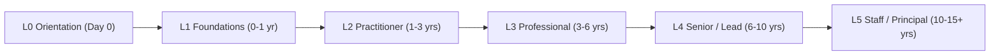

---
hide:
  - navigation
---

# Java Design Patterns Playbook

From your first class diagram to the judgement of a 15-year principal engineer. Every GoF pattern and the modern, enterprise, concurrency and distributed patterns around them, written for Java 21 with runnable examples, trade-offs and war stories.

## Choose your path

-   :material-sprout:{ .lg .middle } **New to design patterns**

    ---

    Start with what patterns are, set up Java, then learn the nine patterns you'll meet first.

    [:octicons-arrow-right-24: Start at L0](l0-orientation/index.md)

-   :material-hammer-wrench:{ .lg .middle } **Working with patterns**

    ---

    Fill in the full GoF catalogue, then learn modern Java idioms, Spring and concurrency patterns.

    [:octicons-arrow-right-24: Go to L2](l2-practitioner/index.md)

-   :material-sitemap:{ .lg .middle } **Leading with patterns**

    ---

    Architecture, DDD, microservices, resilience and the internals behind it all.

    [:octicons-arrow-right-24: Go to L4](l4-senior/index.md)

-   :material-account-tie-voice:{ .lg .middle } **Interview sprint**

    ---

    Graded questions, scenarios and hands-on tasks, plus the Interview Corner on every page.

    [:octicons-arrow-right-24: Interview guide](interview/index.md)

## The six levels

## How every page is structured

Every topic page uses the same template, so you always know where to look:

1. **TL;DR**, then *What it is*, *Why it exists* and a *Mental model*.
2. **How it works**, with a diagram.
3. **Subtopics**, each with a description, how to use it, pros, cons, a best practice and a gotcha.
4. **Three examples** (minimal, realistic in the FreshCart grocery-delivery domain, production-grade), each with the exact command to run and its exact output.
5. **Pros, cons and trade-offs**, *when to use / when not to*, *best practices* and *pitfalls*.
6. **Expert deep dive** with a production war story, an **interview corner**, **practice** exercises and a **quick revision card**.

See [How to use this playbook](how-to-use.md) for learning paths.
