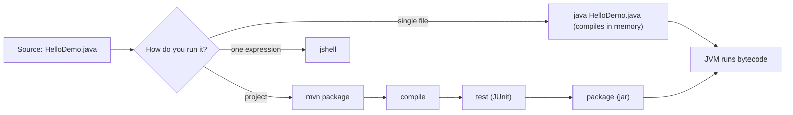

# Setting Up Java to Run the Examples

<span class="badge-l0">L0 ⚪ Orientation</span> · <span class="read-time">⏱ 10 min read</span> · Prerequisites: [What Are Design Patterns](what-are-design-patterns.md)

!!! abstract "TL;DR"
    Install a JDK 21, check it with `java -version`, and you can run every example in this playbook with `java File.java`. Use Maven when an example has several files or tests, and JShell when you want to try one line. Any major IDE works.

## 1. What It Is

**Plain English.** Before you can run Java code you need the **JDK** (Java Development Kit): the compiler, the runtime and tools such as `jshell`. This page gets you from nothing to running the playbook's examples.

**Precise definition.** The examples target **Java SE 21**, a long-term-support (LTS) release. They use:

- the **source-file launcher** (`java File.java`, JEP 330, Java 11+), which compiles and runs a single file in memory;
- **Maven** for multi-file projects with tests;
- **JShell** (JEP 222, Java 9+), the read-eval-print loop.

New terms:

- **JDK vs. JRE:** the JDK includes the compiler and tools; a runtime alone can only run compiled code. You need the JDK.
- **LTS:** a release supported with updates for several years. Java 17, 21 and 25 are LTS releases.
- **Distribution:** builds of OpenJDK from different vendors (Eclipse Temurin, Amazon Corretto, Microsoft, Oracle, Azul Zulu and others). They behave the same for this playbook.

## 2. Why It Exists

Every page shows the exact command and the exact output, so you can check your understanding by running the code. That only works if your setup matches: an older JDK fails on records, sealed types and `switch` patterns with confusing compiler errors. Five minutes of setup saves hours of "why doesn't this compile?".

## 3. Mental Model / Analogy

**Analogy.** The JDK is a kitchen. `java File.java` is cooking one dish straight from the recipe card. Maven is a restaurant kitchen with prep lists, stations and a health inspection (tests) before anything goes out. JShell is tasting a spoonful.

**Technical model.** `javac` turns `.java` source into `.class` bytecode; `java` starts a JVM that loads and runs the bytecode. The source launcher does both steps in memory for one file. Maven runs the same steps, plus downloading dependencies and running tests, in a fixed order called the *lifecycle*.

## 4. How It Works



Maven's default lifecycle runs phases in order: `validate`, `compile`, `test`, `package`, `verify`, `install`, `deploy`. Asking for one phase runs all the earlier ones, which is why `mvn package` also runs the tests.

## 5. Subtopics

### Installing JDK 21 (SDKMAN!, package managers)

- **Description:** Install any OpenJDK 21 distribution. A version manager makes switching between JDKs easy.
- **How to use it:**

    === "macOS / Linux (SDKMAN!)"
        ```bash
        curl -s "https://get.sdkman.io" | bash
        sdk list java                 # pick a 21.x identifier from the list
        sdk install java 21.0.5-tem   # example identifier; use one from the list
        ```
    === "macOS (Homebrew)"
        ```bash
        brew install openjdk@21
        ```
    === "Ubuntu / Debian"
        ```bash
        sudo apt install openjdk-21-jdk
        ```
    === "Windows (winget)"
        ```powershell
        winget install EclipseAdoptium.Temurin.21.JDK
        ```

    Then check: `java -version` should print a version starting with `21`.

- **Pros (version manager):** several JDKs side by side; per-project switching.
- **Cons (version manager):** one more tool; IDEs need to be pointed at the right JDK.
- **Best practice:** use the same major version locally and in CI.
- **Gotcha:** `java -version` and `javac -version` can disagree if `PATH` and `JAVA_HOME` point at different JDKs. Check both.

!!! warning "Verify against the official docs"
    Package names and identifiers change with each update. Check the SDKMAN!, Homebrew or Adoptium pages for the current ones.

### Running single-file programs with `java File.java`

- **Description:** Since Java 11 the launcher compiles and runs a single source file without creating `.class` files. Every class must be in that one file (nested classes are fine), and the first top-level class must have `main`.
- **How to use it:** `java HelloDemo.java arg1 arg2`, with JVM options before the file name: `java -Dkey=value HelloDemo.java`.
- **Pros:** zero setup; perfect for examples and scripts.
- **Cons:** single file only in Java 21 (Java 22 added multi-file source programs, JEP 458); no dependencies unless you pass `--class-path`.
- **Best practice:** keep examples self-contained so they run with this one command.
- **Gotcha:** options placed *after* the file name are program arguments, not JVM options.

### Maven project layout for the examples/ folder

- **Description:** Maven expects code in `src/main/java`, tests in `src/test/java`, and configuration in `pom.xml`. Examples with tests or several files use this layout.
- **How to use it:** `mvn package` to compile, test and build a jar; `mvn test` to run tests only.
- **Pros:** standard everywhere; dependency management; IDEs import it directly.
- **Cons:** XML configuration; first build downloads plugins and takes a while.
- **Best practice:** set `maven.compiler.release` (not just `source`/`target`), so the compiler also checks you only use Java 21 APIs.
- **Gotcha:** forgetting to pin plugin versions gives you different builds on different machines.

### IDE setup: IntelliJ IDEA, VS Code, Eclipse

- **Description:** IntelliJ IDEA (Community is free), VS Code with the "Extension Pack for Java", and Eclipse all support Java 21 and Maven.
- **How to use it:** open the folder containing `pom.xml` (or a single `.java` file), then set the project SDK / JDK to 21.
- **Pros:** navigation ("go to implementation" is essential for pattern-heavy code), refactoring, debugging.
- **Cons:** IDE settings can hide build problems that only appear on the command line.
- **Best practice:** treat the command-line build (`mvn verify`) as the source of truth; the IDE is a helper.
- **Gotcha:** the IDE's project language level can be lower than the JDK, causing "records are not supported" errors. Set both to 21.

### JShell for quick experiments

- **Description:** An interactive shell that evaluates Java declarations, statements and expressions.
- **How to use it:**
  ```text
  $ jshell
  jshell> record Money(long cents) { }
  |  created record Money

  jshell> new Money(129)
  $2 ==> Money[cents=129]

  jshell> /exit
  |  Goodbye
  ```
- **Pros:** instant feedback; great for checking an API.
- **Cons:** not for multi-class designs; state is lost when you exit.
- **Best practice:** use it to try a single idea, then move it into a file.
- **Gotcha:** snippets can be redefined silently, so a later definition replaces an earlier one.

## 6. Examples (exactly 3, progressively harder)

### Example 1: Minimal (L0)

**Scenario:** Check that your JDK is new enough for the playbook. The program uses a record (Java 16+) and fails clearly on older versions.

**Code / Config:**

```java title="HelloDemo.java"
--8<-- "examples/l0-orientation/java-setup/HelloDemo.java"
```

1. A record: if your JDK is older than 16, compilation fails here.
2. `Runtime.version().feature()` returns the major version, such as `21`.

**Run it:**

```bash
java -version
java HelloDemo.java
```

**Output** (with JDK 21):

```text
--8<-- "examples/l0-orientation/java-setup/HelloDemo.expected.txt"
```

**What to notice:**

- No `javac` step and no `.class` files: the launcher compiled in memory.
- On a newer JDK the last line shows that version; the examples still work.
- On JDK 16–20 you get the clear message and exit code 1 instead of a confusing failure later.

### Example 2: Realistic (in FreshCart grocery delivery)

**Scenario:** A FreshCart support script checks which delivery slots a customer can still book. It takes the current time as a *program argument* and the ordering cutoff as a *system property*, so support staff can try different cases without editing code.

**Code / Config:**

```java title="SlotCheckDemo.java"
--8<-- "examples/l0-orientation/java-setup/SlotCheckDemo.java"
```

1. Program arguments arrive in `args`; a fixed default keeps the output reproducible.
2. `Integer.getInteger` reads a `-D` system property, with a default.

**Run it:**

```bash
java SlotCheckDemo.java
java SlotCheckDemo.java 11:15
java -Dfreshcart.cutoffMinutes=60 SlotCheckDemo.java 11:15
```

**Output:**

```text
--8<-- "examples/l0-orientation/java-setup/SlotCheckDemo.expected.txt"
```

```text
Time 11:15, ordering closes 30 min before a slot starts
  08:00-10:00  closed
  12:00-14:00  open
  18:00-20:00  open
```

```text
Time 11:15, ordering closes 60 min before a slot starts
  08:00-10:00  closed
  12:00-14:00  closed
  18:00-20:00  open
```

A bad argument fails fast with a clear exception:

```text
$ java SlotCheckDemo.java 25:00
Exception in thread "main" java.time.format.DateTimeParseException: Text '25:00' could not be parsed: Invalid value for HourOfDay (valid values 0 - 23): 25
```

**What to notice:**

- `-D` goes *before* the file name; `11:15` goes *after* it.
- The noon slot flips from open to closed when the cutoff moves from 30 to 60 minutes.
- The `Slot` record validates itself, a habit you'll see on every page.

### Example 3: Production-grade

**Scenario:** The same slot logic as a proper Maven project: a reusable class, a separate `App`, unit tests that run on every build, pinned plugin versions, and a compiler that treats warnings as errors. This is the shape of the larger examples and the capstone.

**Code / Config:**

=== "pom.xml"

    ```xml
    --8<-- "examples/l0-orientation/java-setup/freshcart-starter/pom.xml"
    ```

    1. `release` makes the compiler check both language features and JDK APIs against Java 21.
    2. Pinned plugin versions give the same build on every machine; `-Xlint:all -Werror` fails the build on any compiler warning.

=== "DeliverySlot.java"

    ```java
    --8<-- "examples/l0-orientation/java-setup/freshcart-starter/src/main/java/com/freshcart/starter/DeliverySlot.java"
    ```

=== "App.java"

    ```java
    --8<-- "examples/l0-orientation/java-setup/freshcart-starter/src/main/java/com/freshcart/starter/App.java"
    ```

=== "DeliverySlotTest.java"

    ```java
    --8<-- "examples/l0-orientation/java-setup/freshcart-starter/src/test/java/com/freshcart/starter/DeliverySlotTest.java"
    ```

Project layout:

```text
freshcart-starter/
├── pom.xml
└── src/
    ├── main/java/com/freshcart/starter/
    │   ├── App.java
    │   └── DeliverySlot.java
    └── test/java/com/freshcart/starter/
        └── DeliverySlotTest.java
```

**Run it:**

```bash
cd examples/l0-orientation/java-setup/freshcart-starter
mvn package
java -cp target/classes com.freshcart.starter.App
```

**Output** (the relevant lines of `mvn package`, then the program):

```text
[INFO] Tests run: 3, Failures: 0, Errors: 0, Skipped: 0
[INFO] BUILD SUCCESS
08:00-10:00 closed
12:00-14:00 open
```

**What to notice:**

- `mvn package` ran the tests first; a failing test stops the jar from being built.
- The test `closedExactlyAtTheCutoff` pins down the boundary that Example 2 only showed by trying times.
- `isOpenAt` rejects a negative cutoff, and the constructor rejects an inverted slot, so bad data can't get in.
- CI runs `mvn verify` on this project on every pull request.

## 7. Pros, Cons & Trade-offs

| Aspect | Pros | Cons |
|--------|------|------|
| Simplicity | `java File.java` needs nothing else | Maven adds XML and a directory convention |
| Performance | In-memory compile is fast for small files | Source launcher recompiles on every run; Maven's first build downloads plugins |
| Scalability | Maven scales to many modules and dependencies | Single-file programs don't scale past a few hundred lines |
| Operability | Maven builds are reproducible in CI | Version drift between local JDK and CI JDK causes surprises |
| Security | Pinned dependencies and plugins are auditable | Downloading dependencies is a supply-chain risk to manage |
| Testability | Maven runs tests on every build | Single-file programs need a separate test runner |
| Cost | All tools here are free | Time to learn Maven's lifecycle |
| Learning curve | JShell and the launcher are beginner friendly | IDE, build tool and JDK settings must agree |

## 8. When to Use / When NOT to Use

**Use the source launcher** for examples, scripts and experiments that fit in one file without dependencies.
**Use Maven (or Gradle)** for anything with tests, dependencies or more than one file you want to keep.
**Use JShell** to check one API call or expression.

**Don't** use the source launcher for production services, and don't add a build tool to a five-line experiment. Gradle is an equally good choice to Maven for real projects; this playbook uses Maven because its XML is easier to show on a page.

## 9. Best Practices

1. **Pin the Java version in the build** (`maven.compiler.release`) and in CI. *(Consensus.)*
2. **Pin plugin and dependency versions.** *(Consensus.)*
3. **Run the command-line build before pushing**, not only the IDE build. *(Consensus.)*
4. **Treat compiler warnings as errors in new projects** (`-Xlint:all -Werror`). *(Opinion; relax it for legacy code.)*
5. **Use a JDK version manager** if you work on projects with different Java versions. *(Opinion.)*

## 10. Pitfalls & Anti-Patterns

!!! danger "Mismatched JDKs"
    **Symptom:** `error: records are not supported in -source 11` or `class file has wrong version 65.0, should be 55.0`.
    **Root cause:** compiling or running with an older JDK than the code needs (class file version 65 is Java 21, 55 is Java 11).
    **Fix:** check `java -version`, `javac -version`, `echo $JAVA_HOME` and the IDE's project SDK; make them all 21.

!!! danger "Unpinned build (production failure mode)"
    **Symptom:** a release built on the CI server failed at startup with `NoSuchMethodError`, though it worked on every laptop.
    **Root cause:** the CI image's default JDK was updated to a newer major version, and the build compiled with `-source`/`-target` but not `--release`, so code linked against an API that doesn't exist on the production JDK.
    **Fix:** use `maven.compiler.release`, pin the CI JDK, and run the same JDK in CI and production.

!!! danger "Options in the wrong place"
    **Symptom:** a `-D` setting has no effect.
    **Root cause:** it was written after the file name, so it became a program argument.
    **Fix:** `java -Dkey=value File.java args...`.

## 11. Configuration & Tuning

| Setting | Default | What it does | When to change it | Risk of changing |
|---------|---------|--------------|-------------------|------------------|
| `maven.compiler.release` | depends on plugin version | Target language level and JDK API | Always set it explicitly | Too high: code won't run on older production JDKs |
| `JAVA_HOME` | unset or system JDK | Which JDK Maven and many tools use | When you install several JDKs | Pointing at a JRE or old JDK breaks builds |
| `-Xlint:all -Werror` | off | Fails the build on compiler warnings | New code bases | Legacy code may need many fixes first |
| `-ea` (JVM option) | off | Enables `assert` statements | Local runs and tests | Assertions with side effects change behaviour |

## 12. Security Considerations

- Download JDKs only from the vendor's official site or a trusted package manager.
- Keep the JDK patched: each quarterly update includes security fixes.
- Review `curl ... | bash` installers before running them, as with any script from the internet.

## 14. Testing It

The Maven project in Example 3 is the template: tests in `src/test/java`, run by `mvn test` or as part of `mvn package`. For single-file examples, this repository's `examples/run-all.sh` runs each program and compares its output with the expected text shown on the page.

## 16. Version Notes

- **Java 11:** single-file source launcher (JEP 330).
- **Java 17:** LTS; sealed classes final.
- **Java 21:** LTS; pattern matching for `switch`, record patterns, virtual threads final. This playbook's baseline.
- **Java 22:** multi-file source-code programs (JEP 458), so `java Main.java` can use other source files next to it.
- **Java 25:** the next LTS after 21. The examples should run unchanged on it.

!!! warning "Verify against the official docs"
    Check the OpenJDK project pages for the support timelines of the distribution you choose.

## 17. Expert Deep Dive

- **Reproducible builds are a team property.** Seniors pin the JDK (toolchains, `.sdkmanrc` or a container image), plugins and dependencies, and use the Maven Wrapper (`mvnw`) so every machine runs the same Maven.
- **`--release` vs. `-source/-target`.** Only `--release` checks API usage against the target JDK's API signatures. It's the single most common cause of "works on my machine" Java bugs between major versions.
- **The JDK you build with isn't always the one you run on.** Containers, application servers and mobile toolchains (Android uses its own runtime and supports a subset of Java language features) may differ. Know your runtime before using new APIs.
- **Upgrades are routine work.** Moving across LTS versions (11 → 17 → 21) is easier in small steps with the build already pinned, tests green and deprecation warnings fixed.

!!! example "War story: the Friday JDK update"
    A team's build agents pulled `latest` for their JDK image. On a Friday, a new major JDK became `latest`. Builds stayed green, but the service failed in production with `UnsupportedClassVersionError`: the jars now contained class files for a JVM newer than the one in production. It took two hours to find because nobody had changed the code. The fix was pinning the image tag and adding `maven.compiler.release`; the lesson they wrote in the postmortem was "the toolchain is part of the code".

## 18. Interview Corner

=== "🟢 L1–L2"

    1. **JDK vs. JRE?** The JDK has the **compiler and development tools**; a runtime alone can only run compiled code.
    2. **How do you run a single Java file without compiling first?** `java File.java`, the **source-file launcher** from Java 11.
    3. **Where do tests go in a Maven project?** **`src/test/java`**.
    4. **What does `mvn package` do?** Runs the lifecycle up to package: **compile, test, then build the jar**.
    5. **What's an LTS release?** A release with **long-term support updates**, such as 17, 21 and 25.

=== "🟡 L3"

    1. **`--release` vs. `-source`/`-target`?** `--release` also checks you only use **APIs available in the target version**.
    2. **What does "class file has wrong version 65.0" mean?** Code compiled for **Java 21** is running on an **older JVM**.
    3. **How do you make builds reproducible?** **Pin** the JDK, plugins and dependencies; use the **Maven Wrapper**.
    4. **How do you pass a system property vs. a program argument?** `-Dkey=value` **before** the class or file; arguments **after** it.
    5. **When would you use JShell?** To **try one API or expression** quickly.

=== "🔴 L4–L5"

    1. **How would you plan a Java 17 → 21 upgrade for 40 services?** Pin toolchains, **upgrade build images first**, fix deprecations, roll out **service by service** with canaries.
    2. **CI is green but production fails with `NoSuchMethodError`. Where do you look?** **Build vs. runtime JDK** mismatch and **dependency version conflicts** on the classpath.
    3. **How do you keep developer setup consistent across a large team?** **Dev containers** or a version file (`.sdkmanrc`), the Maven Wrapper and a single onboarding script.
    4. **Maven or Gradle for a new organisation-wide standard?** Either works; choose on **team skills, build speed and plugin needs**, then **standardise** on one.
    5. **Now the code must also run on Android. What changes?** Android's runtime supports a **subset of newer Java features and APIs**; check desugaring support before using them.

=== "💻 Hands-on"

    **Task:** Add a fourth test to `DeliverySlotTest` proving a negative cutoff is rejected.

    ??? success "Solution"
        ```java
        @Test
        void rejectsNegativeCutoff() {
            assertThrows(IllegalArgumentException.class,
                    () -> noon.isOpenAt(LocalTime.of(9, 0), -5));
        }
        ```
        `mvn test` then reports `Tests run: 4, Failures: 0, Errors: 0, Skipped: 0`.

## 19. Practice

- [ ] Install JDK 21 and run Example 1.
    ??? tip "Hint"
        If `java -version` shows an older version, check `PATH` and `JAVA_HOME`.
- [ ] Run Example 2 with a cutoff of 0 at 11:59.
    ??? tip "Hint"
        `java -Dfreshcart.cutoffMinutes=0 SlotCheckDemo.java 11:59`: the noon slot is open.
- [ ] Break a test in Example 3 on purpose and watch `mvn package` refuse to build the jar.
    ??? tip "Hint"
        Change `assertTrue` to `assertFalse` in `openWhenOrderedBeforeTheCutoff`.
- [ ] Open the Maven project in your IDE and run the test from there.
    ??? tip "Hint"
        Open the folder containing `pom.xml`, not the repository root.

## 20. Quick Revision Card

!!! tip "Remember in 30 seconds"
    - Install a JDK 21 and check `java -version`.
    - One file: `java File.java args`; JVM options go before the file.
    - Projects: Maven, `src/main/java`, `src/test/java`, `mvn package`.
    - Pin `maven.compiler.release`, plugin and dependency versions.
    - JShell to try one line.

    ```bash
    java -version
    java -Dfreshcart.cutoffMinutes=60 SlotCheckDemo.java 11:15
    mvn package && java -cp target/classes com.freshcart.starter.App
    ```

## 21. Further Reading

- [JEP 330: Launch Single-File Source-Code Programs](https://openjdk.org/jeps/330)
- [JEP 222: jshell](https://openjdk.org/jeps/222)
- [JEP 458: Launch Multi-File Source-Code Programs](https://openjdk.org/jeps/458)
- [Maven: Introduction to the Build Lifecycle](https://maven.apache.org/guides/introduction/introduction-to-the-lifecycle.html)
- [Eclipse Adoptium (Temurin)](https://adoptium.net/)

---

[← Previous: Why Patterns Matter (and When They Don't)](why-patterns-matter.md) · [Next: Reading UML for Patterns →](reading-uml.md)
