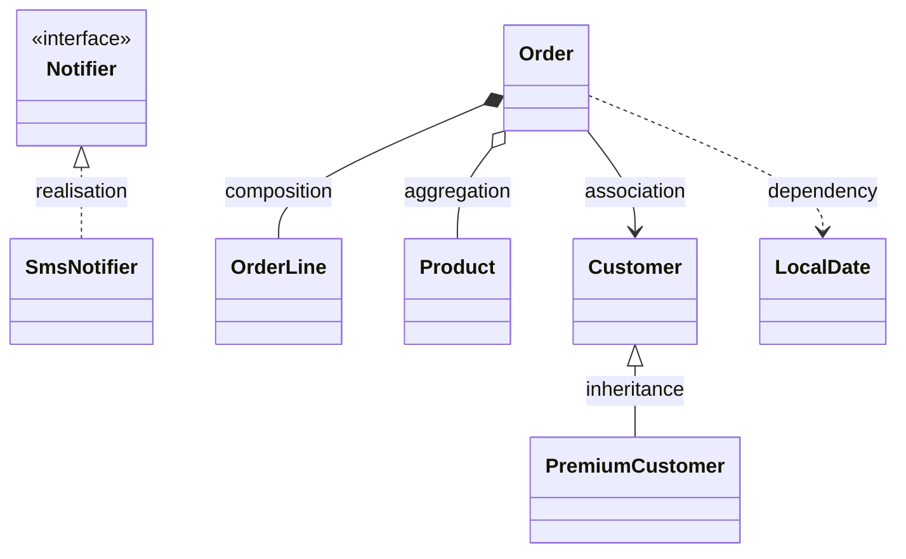
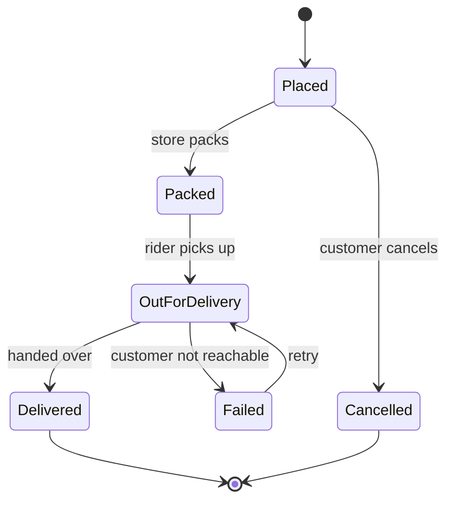
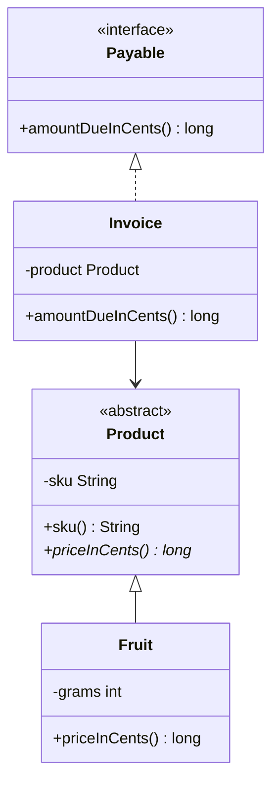

# Reading UML for Patterns

<span class="badge-l0">L0 ⚪ Orientation</span> · <span class="read-time">⏱ 15 min read</span> · Prerequisites: [What Are Design Patterns](what-are-design-patterns.md), [Setting Up Java](java-setup.md)

!!! abstract "TL;DR"
    Every pattern page shows its structure as a UML class diagram and its behaviour as a sequence diagram. You need about a dozen symbols to read them: boxes for classes and interfaces, six kinds of lines for relationships, and arrows for calls over time. This page maps each symbol to the Java code that produces it.

## 1. What It Is

**Plain English.** UML (Unified Modeling Language) is a standard set of drawings for software. Patterns are described with a few of them: *class diagrams* show what types exist and how they're connected, *sequence diagrams* show who calls whom in what order, and *state diagrams* show how an object moves between states.

**Precise definition.** UML is a modelling language standardised by the Object Management Group (OMG). This playbook uses a small subset and draws it with **Mermaid**, a text-based diagram tool that Material for MkDocs renders in the browser.

New terms:

- **Visibility:** `+` public, `-` private, `#` protected, `~` package-private.
- **Multiplicity:** how many objects take part, such as `1`, `0..1` or `*` (many).
- **Lifeline:** in a sequence diagram, the vertical line under a participant, representing time.

## 2. Why It Exists

Code shows one class at a time; a pattern is about how several classes fit together. A diagram shows the whole shape at once, which is why the GoF book gives every pattern a *Structure* diagram. Without the ability to read them, you're stuck reading 5–10 files to understand an idea that fits in one picture. You'll also be expected to sketch them in design reviews and interviews.

## 3. Mental Model / Analogy

**Analogy.** A class diagram is the floor plan of a house: rooms (classes) and doors between them (relationships), with no people in it. A sequence diagram is a video of people moving through the house for one particular event, from top (start) to bottom (end). A state diagram is the light switch on the wall: which positions exist, and what flips it from one to the other.

**Technical model.** A class diagram is a static graph of types; edges mean "inherits from", "implements", "holds a reference to" or "uses". A sequence diagram is one execution trace of method calls between objects. Both are *views* of the same code; neither shows everything.

## 4. How It Works

The six relationship lines, from strongest coupling to weakest:



| Line | Name | Java code that produces it | Meaning |
|------|------|----------------------------|---------|
| solid line, hollow triangle | Inheritance (generalisation) | `class B extends A` | B is an A |
| dashed line, hollow triangle | Realisation | `class B implements I` | B fulfils the contract I |
| solid line, filled diamond | Composition | a field holding parts the owner creates and that die with it | strong "has-a": owns the lifecycle |
| solid line, hollow diamond | Aggregation | a field holding things that exist independently | weak "has-a": shares, doesn't own |
| solid line, open arrow | Association | a field referring to another object | knows about it long-term |
| dashed line, open arrow | Dependency | a parameter, local variable or static call | uses it briefly |

The diamond (or triangle) is always on the side of the *whole* (or the *parent*).

## 5. Subtopics

### Class diagrams: classes, interfaces, abstract classes

- **Description:** A box has up to three compartments: name, fields, methods. Interfaces are marked `<<interface>>`; abstract classes and methods are shown in *italics* or marked `<<abstract>>`. Visibility symbols prefix each member.
- **How to use it:** read top to bottom: what type is it, what does it hold, what can you call?
- **Best practice:** pattern diagrams usually show only the members that matter to the pattern; don't expect every field.
- **Gotcha:** Mermaid writes generics as `List~Product~` because `<` and `>` have other meanings in its syntax.

### Relationships: association, aggregation, composition, inheritance, realisation, dependency

- **Description:** see the table in section 4. The difference between composition and aggregation is ownership of the lifecycle.
- **How to use it:** for each line ask: "is this a field (association/aggregation/composition), a parameter (dependency), or a supertype (inheritance/realisation)?"
- **Pros (of drawing all six precisely):** exact communication of coupling.
- **Cons:** many teams don't distinguish aggregation from association, so the precision can be lost on readers.
- **Best practice:** when in doubt, use a plain association and say what you mean in a label.
- **Gotcha:** in Java, composition vs. aggregation isn't visible in the type: both are just fields. It's a design intent (who creates and who can share the objects).

### Sequence diagrams

- **Description:** participants across the top, time flowing down. A solid arrow is a call, a dashed arrow is a return, and a cross (`x`) marks a call that failed.
- **How to use it:** follow the arrows top to bottom; each arrow is one method call or return.
- **Pros:** shows the *dynamic* behaviour that class diagrams hide, such as the order of calls in Observer or Chain of Responsibility.
- **Cons:** shows only one scenario; branches and loops make them messy.
- **Best practice:** draw the happy path and one failure path, not every branch.
- **Gotcha:** a sequence diagram can drift from the code. Example 3 below generates one from the real calls.

### State diagrams

- **Description:** rounded boxes are states; arrows are transitions labelled with the event that causes them; `[*]` marks start and end.
- **How to use it:** essential for the [State](../l2-practitioner/state.md) pattern. Every arrow should become a method or a case in your code.
- **Best practice:** make sure every state has a way out, unless it's a final state.
- **Gotcha:** forgetting an "impossible" transition is how orders end up stuck in production.



### How Mermaid draws them in this playbook

- **Description:** diagrams are written as text in a fenced code block with the language `mermaid`, and rendered in the browser. Text diagrams live in Git and are reviewed like code.
- **How to use it:**
  ````text
  ```mermaid
  classDiagram
      Notifier <|.. SmsNotifier
  ```
  ````
- **Pros:** diffs in pull requests; no image files to keep up to date.
- **Cons:** less layout control than a drawing tool; a syntax error stops the diagram rendering.
- **Best practice:** quote labels with spaces or punctuation (`A["Order (pending)"]`) and avoid reserved words like `end` as node names.
- **Gotcha:** Mermaid's class diagram uses `..|>` / `<|..` for realisation and `..>` for dependency; similar-looking arrows mean different things.

## 6. Examples (exactly 3, progressively harder)

### Example 1: Minimal (L0)

**Scenario:** Read a small class diagram, then see the exact Java that matches it, symbol by symbol.



**Code / Config:**

```java title="UmlBasicsDemo.java"
--8<-- "examples/l0-orientation/reading-uml/UmlBasicsDemo.java"
```

1. `<<interface>>` in the diagram.
2. `<<abstract>>`; the abstract method is marked with `*` in Mermaid.
3. `-sku String`: the `-` means private.
4. `+sku() String`: public method returning `String`.
5. `Product <|-- Fruit`: solid line with a hollow triangle, because `Fruit extends Product`.
6. `Payable <|.. Invoice` (dashed, `implements`), and `Invoice --> Product` (association, because of the field).

**Run it:**

```bash
java UmlBasicsDemo.java
```

**Output:**

```text
--8<-- "examples/l0-orientation/reading-uml/UmlBasicsDemo.expected.txt"
```

**What to notice:**

- Every box and line in the diagram maps to one Java construct.
- The diagram leaves out `main` and the constructor: diagrams show what matters to the design.
- 650 g at 1 cent per 10 g gives 65 cents.

### Example 2: Realistic (in FreshCart grocery delivery)

**Scenario:** A FreshCart order uses all six relationships. Match each annotated line to the diagram in section 4.

**Code / Config:**

```java title="RelationshipsDemo.java"
--8<-- "examples/l0-orientation/reading-uml/RelationshipsDemo.java"
```

1. **Association** `Order --> Customer`: a long-lived reference to an object the order doesn't own.
2. **Composition** `Order *-- OrderLine`: the order creates its lines in `add`, and nobody else holds them.
3. **Aggregation** `Order o-- Product`: the suggestions list is passed in and shared with other orders.
4. **Dependency** `Order ..> Notifier` and `Order ..> LocalDate`: used only as parameters during one call.

**Run it:**

```bash
java RelationshipsDemo.java
```

**Output:**

```text
--8<-- "examples/l0-orientation/reading-uml/RelationshipsDemo.expected.txt"
```

**What to notice:**

- `PremiumCustomer` overrides `freeDeliveriesPerMonth`, and the order gets 8 through the `Customer` reference: inheritance plus polymorphism.
- Composition vs. aggregation is decided by *who creates and who shares*: `OrderLine`s are created inside, suggestions come from outside.
- Dependencies are the weakest link: change `SmsNotifier` and `Order` doesn't need to change.

### Example 3: Production-grade

**Scenario:** Hand-drawn sequence diagrams go stale. FreshCart's checkout team generates them from real calls instead: a dynamic proxy wraps each component, records every call, return and exception, and prints a Mermaid sequence diagram. One order succeeds; the next fails because stock runs out, and the failure must appear in the diagram.

**Code / Config:**

```java title="SequenceTraceDemo.java"
--8<-- "examples/l0-orientation/reading-uml/SequenceTraceDemo.java"
```

1. `java.lang.reflect.Proxy` creates an object that implements the interface and sends every call to the handler, which records it. This is the [Proxy](../l2-practitioner/proxy.md) pattern.
2. Exceptions from the real object arrive wrapped in `InvocationTargetException`; the handler records a failed call (`--x`) and rethrows the original exception.
3. Calls made *inside* a traced component go through the other proxies, so nested calls appear with the right caller.

**Run it:**

```bash
java SequenceTraceDemo.java
```

**Output:**

```text
--8<-- "examples/l0-orientation/reading-uml/SequenceTraceDemo.expected.txt"
```

The output is valid Mermaid, so it renders like this:

```mermaid
--8<-- "examples/l0-orientation/reading-uml/SequenceTraceDemo.expected.txt"
```

**What to notice:**

- Solid arrows (`->>`) are calls, dashed arrows (`-->>`) are returns, crosses (`--x`) are calls that threw.
- The second order never reaches `Payments`: the diagram shows exactly where the flow stopped.
- Because the diagram comes from real calls, it can be regenerated in a test and compared, so it can't drift from the code.
- The recorder keeps a caller stack in a plain list, so it assumes one thread per recorder. For concurrent requests, create one recorder per request.

## 7. Pros, Cons & Trade-offs

| Aspect | Pros | Cons |
|--------|------|------|
| Simplicity | One picture explains several files | Full UML is large; most teams use a small subset |
| Performance | No runtime cost (except generated diagrams like Example 3) | Tracing proxies add overhead if left on in production |
| Scalability | Diagrams scale communication across teams | Big diagrams of whole systems become unreadable |
| Operability | Sequence diagrams make incident timelines clearer | Static diagrams don't show runtime configuration |
| Security | Diagrams help threat modelling (who calls whom) | Diagrams in public docs can reveal internal structure |
| Testability | Generated diagrams can be checked in tests | Hand-drawn ones can't |
| Cost | Mermaid diagrams are free and live in Git | Keeping hand-drawn diagrams current takes effort |
| Learning curve | A dozen symbols cover pattern diagrams | The fine distinctions (aggregation vs. composition) confuse people |

## 8. When to Use / When NOT to Use

**Draw a diagram when:**

- explaining a pattern or a design to someone else;
- a design spans more than three classes;
- the order of calls matters (sequence) or an object has a lifecycle (state).

**Skip it when:**

- the code is a single class: the code is clearer;
- the diagram would have to show everything; draw the part that matters instead.

The [Cheat Sheet](../reference/cheatsheet.md) has the diagram for every pattern.

## 9. Best Practices

1. **Show only what matters to the point you're making.** *(Consensus.)*
2. **Keep diagrams as text (Mermaid, PlantUML) in the repository.** *(Opinion, widely practised.)*
3. **Draw the happy path and one failure path in sequence diagrams.** *(Opinion.)*
4. **Label relationships with the role** (`Order --> Customer : placed by`). *(Consensus.)*
5. **Generate diagrams from code or traces where drift is costly.** *(Opinion.)*

## 10. Pitfalls & Anti-Patterns

!!! danger "Arrow pointing the wrong way"
    **Symptom:** a reviewer reads your diagram as "Customer extends PremiumCustomer".
    **Root cause:** the triangle was drawn on the child's side.
    **Fix:** the triangle and the diamond always sit on the parent or the whole: `Customer <|-- PremiumCustomer`.

!!! danger "The diagram that lied (production failure mode)"
    **Symptom:** an on-call engineer followed the architecture diagram during an outage and spent an hour on a service that was no longer in the call path.
    **Root cause:** the diagram was drawn once and never updated after a refactoring.
    **Fix:** keep diagrams next to the code, review them in pull requests, and generate sequence diagrams from traces (distributed tracing tools can do this for whole systems).

!!! danger "Everything diagram"
    **Symptom:** a 60-box class diagram that nobody reads.
    **Root cause:** trying to document the whole system in one view.
    **Fix:** one diagram per question ("how does checkout call payments?").

## 14. Testing It

Because Example 3 produces text, a test can assert on it: run the scenario and compare `recorder.diagram()` with a checked-in `.mmd` file. A change in call order then fails the build and forces the diagram to be updated in the same pull request.

## 16. Version Notes

- UML 2.5.1 (OMG, 2017) is the current version of the standard; the subset used in pattern diagrams hasn't changed in decades.
- Mermaid adds diagram types and syntax regularly. The diagrams in this playbook use only long-standing `classDiagram`, `sequenceDiagram`, `stateDiagram-v2` and `flowchart` syntax.

## 17. Expert Deep Dive

- **Diagrams are for decisions, not documentation.** Seniors draw a diagram to make a design review faster, then often throw it away. Long-lived diagrams are kept only at the levels that change slowly (system context, container).
- **The C4 model** (context, containers, components, code) gives each audience a fitting zoom level. Pattern-level class diagrams are the "code" level, the most detailed and the most likely to go stale.
- **Composition vs. aggregation matters for lifecycle bugs.** "Who deletes this?" and "who else holds a reference?" are the questions behind memory leaks, cascade deletes in JPA (`CascadeType.REMOVE`) and DDD aggregate boundaries. The diamond is a cheap way to make that decision explicit.
- **Generated sequence diagrams scale up.** Distributed tracing (OpenTelemetry) turns production traffic into the same picture across services, which beats any hand-drawn diagram during an incident.

!!! example "War story: the cascade that deleted products"
    A grocery platform modelled `Order` to `Product` with JPA `CascadeType.ALL`, because the whiteboard diagram showed a filled diamond (composition) between them. When the team added a "delete abandoned orders" job, it also deleted the products those orders referenced, and the catalogue lost hundreds of items overnight. The diagram should have shown aggregation (products exist independently and are shared by many orders), and the cascade should have been on `Order` to `OrderLine` only. **Lesson:** the hollow vs. filled diamond isn't pedantry; it's the lifecycle rule your code will enforce.

## 18. Interview Corner

=== "🟢 L1–L2"

    1. **What do `+`, `-` and `#` mean in a class diagram?** **Public, private, protected.**
    2. **How is an interface shown?** A box marked **`<<interface>>`**, implemented with a **dashed line and hollow triangle**.
    3. **Composition vs. aggregation?** Composition **owns the lifecycle** of its parts (filled diamond); aggregation **shares** objects that exist independently (hollow diamond).
    4. **What does a sequence diagram show?** **Calls between objects over time**, top to bottom.
    5. **Association vs. dependency?** Association is a **field** (long-lived); dependency is a **parameter or local** use (short-lived).

=== "🟡 L3"

    1. **Draw the Strategy pattern.** Context **associated with** a Strategy interface, realised by concrete strategies.
    2. **How do you show a failed call in a sequence diagram?** A **cross** at the end of the arrow (Mermaid `--x`), or an exception return.
    3. **How would you keep diagrams in sync with code?** Text diagrams **in the repo**, reviewed in PRs, and **generated from traces** where possible.
    4. **Why does composition vs. aggregation matter in JPA?** It decides **cascade** behaviour and **orphan removal**.
    5. **When is a state diagram worth drawing?** When an object has a **lifecycle with rules**, such as orders and payments.

=== "🔴 L4–L5"

    1. **How do you document architecture for 30 teams?** **C4 levels**, owned per team, **diagrams as code**, reviewed with changes.
    2. **An incident reveals the diagrams were wrong. What do you change?** Make diagrams part of the **definition of done**, and use **tracing** for runtime truth.
    3. **What can't UML class diagrams show that matters in production?** **Runtime configuration, concurrency, deployment** and **failure behaviour**.
    4. **How would you diagram a saga across five services?** A **sequence diagram per path** (happy path plus compensation), not one diagram for all.
    5. **Now the system is event-driven. What diagram helps most?** **Event flow / sequence diagrams** with topics as participants, plus a **state diagram** of the main entity.

=== "💻 Hands-on"

    **Task:** Draw a Mermaid class diagram for Example 2's `Order`, using all six relationship types.

    ??? success "Solution"
        ```text
        classDiagram
            Customer <|-- PremiumCustomer
            Notifier <|.. SmsNotifier
            Order *-- OrderLine : lines
            Order o-- Product : suggestions
            Order --> Customer : customer
            Order ..> Notifier : confirm()
            Order ..> LocalDate : confirm()
        ```

## 19. Practice

- [ ] Draw the class diagram for Example 1 of the [OOP Refresher](../l1-foundations/oop-refresher.md).
    ??? tip "Hint"
        One interface, two implementations, both realising it.
- [ ] Add an `Audit` component to Example 3 that Checkout calls after payment, and check the new diagram.
    ??? tip "Hint"
        Create a traced `Audit` interface and call it inside the checkout lambda.
- [ ] Add a "Returned" state to the order state diagram: from Delivered, within 24 hours.
    ??? tip "Hint"
        `Delivered --> Returned : returned within 24h` and `Returned --> [*]`.

## 20. Quick Revision Card

!!! tip "Remember in 30 seconds"
    - Box = class; `<<interface>>`, `<<abstract>>`; `+` public, `-` private, `#` protected.
    - Triangle = inheritance (solid) or realisation (dashed), on the parent's side.
    - Diamond = composition (filled, owns) or aggregation (hollow, shares), on the whole's side.
    - Arrow = association (solid, field) or dependency (dashed, parameter).
    - Sequence: calls down the page; dashed returns; `x` for failures.

    ```text
    classDiagram
        Parent <|-- Child
        Interface <|.. Impl
        Whole *-- Part
        Group o-- Member
        A --> B
        A ..> Helper
    ```

## 21. Further Reading

- Martin Fowler, *UML Distilled*, 3rd edition (Addison-Wesley, 2003).
- [OMG Unified Modeling Language specification](https://www.omg.org/spec/UML/)
- [Mermaid documentation](https://mermaid.js.org/)
- Simon Brown, "The C4 model for visualising software architecture" ([c4model.com](https://c4model.com/)).

---

[← Previous: Setting Up Java to Run the Examples](java-setup.md) · [Next: L1 Foundations →](../l1-foundations/index.md)
