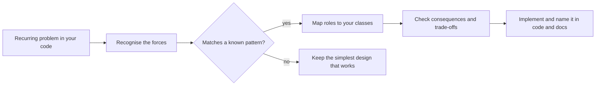

# What Are Design Patterns

<span class="badge-l0">L0 ⚪ Orientation</span> · <span class="read-time">⏱ 15 min read</span> · Prerequisites: none

!!! abstract "TL;DR"
    A design pattern is a named, proven solution to a design problem that keeps coming back, described so you can adapt it rather than copy it. The classic catalogue is the Gang of Four's 23 patterns, grouped into creational, structural and behavioural. Learn them to recognise problems faster and to talk about designs in a few words.

## 1. What It Is

**Plain English.** When experienced developers solve the same kind of problem many times, the good solutions start to look alike. A design pattern writes one of those solutions down, gives it a name ("Strategy", "Observer", "Adapter"), and explains when it helps and what it costs.

**Precise definition.** The GoF book defines design patterns as "descriptions of communicating objects and classes that are customized to solve a general design problem in a particular context." A pattern is *not* a library or a piece of code to paste: it's a description of the roles (classes, interfaces) and how they collaborate. Your implementation will differ every time.

New terms on this page:

- **Intent:** the one-sentence summary of what the pattern does.
- **Participants:** the roles in the pattern (for Strategy: *context*, *strategy*, *concrete strategy*).
- **Consequences:** the trade-offs the pattern brings.
- **Idiom:** a pattern specific to one language (for example Java's try-with-resources or the lazy holder idiom).

## 2. Why It Exists

The architect **Christopher Alexander** described patterns for towns and buildings in *A Pattern Language* (1977). Kent Beck and Ward Cunningham applied the idea to software in 1987, and in 1994 Erich Gamma, Richard Helm, Ralph Johnson and John Vlissides (the "Gang of Four", or GoF) published *Design Patterns: Elements of Reusable Object-Oriented Software*.

Before shared catalogues, every team reinvented the same solutions, often badly, and had no short way to describe them. Without patterns you still get structure, but it's accidental: a "notification manager" that turns out to be a half-finished Observer, or a 500-line `switch` that should have been a Strategy.

## 3. Mental Model / Analogy

**Analogy.** A recipe card for "white sauce" doesn't say which pan or brand of butter to use. It tells a cook the proven combination (fat + flour + milk, whisked over heat) and what can go wrong (lumps). A cook adapts it for lasagne or mac and cheese. A design pattern is a recipe card for code structure.

**Technical model.** Think of a pattern as a small graph: roles (nodes) and the calls between them (edges), plus a list of forces it balances (flexibility vs. simplicity, for example). When you see that shape in a problem, the pattern tells you a tested way to arrange your classes.

## 4. How It Works

You use a pattern in four steps: recognise the problem, pick a candidate pattern, map its roles onto your classes, and check the consequences are acceptable.



Each GoF pattern is documented with the same sections, which is also how you should read one:

| Section | What it tells you |
|---------|-------------------|
| Name and classification | What to call it and whether it's creational, structural or behavioural |
| Intent | One sentence: what it does |
| Also known as | Other names (Strategy is also called Policy) |
| Motivation | A concrete scenario showing the problem |
| Applicability | When to use it |
| Structure | A class diagram of the roles |
| Participants and collaborations | Who does what, and who calls whom |
| Consequences | The benefits and the costs |
| Implementation and sample code | Hints, variations and example code |
| Known uses | Real systems that use it |
| Related patterns | Similar or complementary patterns |

## 5. Subtopics

### Christopher Alexander and the GoF book (1994)

- **Description:** Patterns started in architecture. Alexander wrote that each pattern "describes a problem which occurs over and over again in our environment, and then describes the core of the solution to that problem, in such a way that you can use this solution a million times over, without ever doing it the same way twice." The GoF book brought the idea to object-oriented design with 23 patterns and examples in C++ and Smalltalk.
- **How to use it:** read the GoF introduction (chapter 1) once; its two principles, *program to an interface* and *favour composition over inheritance*, matter more than any single pattern.
- **Best practice:** treat the book as a catalogue to look things up in, not a novel to memorise.
- **Gotcha:** the book's examples predate Java; several patterns are much shorter in modern Java (see [Patterns in Modern Java](../l3-professional/patterns-in-modern-java.md)).

### Anatomy of a pattern: intent, problem, solution, consequences

- **Description:** Every pattern has four essential parts, named in the GoF book: a name, the problem (when to apply it), the solution (the roles and collaborations) and the consequences (trade-offs).
- **How to use it:** before using a pattern, write one line for each of the four parts in your design note or pull request description.
- **Best practice:** read *Consequences* first. It tells you what the pattern costs.
- **Gotcha:** copying the *Structure* diagram exactly, including roles you don't need.

### Creational, structural and behavioural categories

- **Description:** *Creational* patterns deal with how objects are created (Factory Method, Builder). *Structural* patterns deal with how classes and objects are composed into bigger structures (Adapter, Decorator). *Behavioural* patterns deal with how objects distribute responsibility and communicate (Strategy, Observer).
- **How to use it:** when stuck, ask which kind of problem you have: "creating things", "fitting things together" or "who does what and who tells whom". That narrows 23 patterns to about 5–11.
- **Best practice:** learn two or three patterns from each category first (this playbook's L1 does exactly that).
- **Gotcha:** the GoF also classify patterns by scope (class vs. object); it matters less day to day than the three purposes.

### Patterns vs. idioms vs. architectural styles vs. principles

- **Description:** A **principle** is a guideline (SOLID, DRY). A **design pattern** is a solution at the level of a few classes. An **idiom** is a pattern tied to one language (Java's lazy holder idiom). An **architectural pattern or style** shapes a whole application (layered, hexagonal, microservices).
- **How to use it:** use principles to judge designs, design patterns to structure classes, architectural patterns to structure systems.
- **Pros:** clear vocabulary avoids talking past each other in reviews.
- **Cons:** the boundaries are fuzzy; MVC is called both a design pattern and an architectural pattern.
- **Best practice:** say which level you mean ("Repository as in DDD, not Spring Data's interface").
- **Gotcha:** treating a principle as a pattern ("we implemented SOLID") or a pattern as a principle ("always use factories").

### The 23 GoF patterns at a glance

- **Description:** the full catalogue, with where each is covered in this playbook.

| Creational (5) | Structural (7) | Behavioural (11) |
|----------------|----------------|------------------|
| [Abstract Factory](../l2-practitioner/abstract-factory.md) | [Adapter](../l1-foundations/adapter.md) | [Chain of Responsibility](../l2-practitioner/chain-of-responsibility.md) |
| [Builder](../l1-foundations/builder.md) | [Bridge](../l2-practitioner/bridge.md) | [Command](../l2-practitioner/command.md) |
| [Factory Method](../l1-foundations/factory-method.md) | [Composite](../l2-practitioner/composite.md) | [Interpreter](../l2-practitioner/interpreter.md) |
| [Prototype](../l2-practitioner/prototype.md) | [Decorator](../l1-foundations/decorator.md) | [Iterator](../l2-practitioner/iterator.md) |
| [Singleton](../l1-foundations/singleton.md) | [Facade](../l1-foundations/facade.md) | [Mediator](../l2-practitioner/mediator.md) |
| | [Flyweight](../l2-practitioner/flyweight.md) | [Memento](../l2-practitioner/memento.md) |
| | [Proxy](../l2-practitioner/proxy.md) | [Observer](../l1-foundations/observer.md) |
| | | [State](../l2-practitioner/state.md) |
| | | [Strategy](../l1-foundations/strategy.md) |
| | | [Template Method](../l1-foundations/template-method.md) |
| | | [Visitor](../l2-practitioner/visitor.md) |

- **Best practice:** learn the most common ones first: Strategy, Observer, Factory Method, Builder, Adapter, Decorator, Facade, Template Method.
- **Gotcha:** some (Interpreter, Flyweight, Memento) are rare in business code; know them, don't force them.

## 6. Examples (exactly 3, progressively harder)

### Example 1: Minimal (L0)

**Scenario:** FreshCart sends "Order placed" messages by SMS and email, and the product team wants push notifications next. Compare a `switch` that must be edited for every channel with the Strategy pattern, where a new channel is a new class.

**Code / Config:**

```java title="NotifierDemo.java"
--8<-- "examples/l0-orientation/what-are-design-patterns/NotifierDemo.java"
```

1. The *strategy* role: one interface for "how to send".
2. A *concrete strategy*. Each channel is its own small class.
3. Push was added without touching SMS, email or the calling code.
4. The *context* (here, `main`) picks a strategy and calls it without knowing which one it is.

**Run it:**

```bash
java NotifierDemo.java
```

**Output:**

```text
--8<-- "examples/l0-orientation/what-are-design-patterns/NotifierDemo.expected.txt"
```

**What to notice:**

- Both versions print the same result; the difference is how they change.
- The pattern is visible from the names alone: anyone who knows Strategy understands `Notifier` instantly.
- For two channels that never change, the `switch` would be fine. Patterns pay off when variation is real.

### Example 2: Realistic (in FreshCart grocery delivery)

**Scenario:** One FreshCart flow touches all three categories: choosing a delivery type (creational), booking a rider through a partner SDK whose API doesn't match ours (structural), and telling the app and the store when an order's status changes (behavioural).

**Code / Config:**

```java title="ThreeCategoriesDemo.java"
--8<-- "examples/l0-orientation/what-are-design-patterns/ThreeCategoriesDemo.java"
```

1. **Factory Method (creational):** callers ask for "a delivery" and the method decides which class to create.
2. **Adapter (structural):** wraps the partner API behind our own `RiderDispatch` interface.
3. **Observer (behavioural):** every subscriber hears about the change; the order doesn't know who they are.

**Run it:**

```bash
java ThreeCategoriesDemo.java
```

**Output:**

```text
--8<-- "examples/l0-orientation/what-are-design-patterns/ThreeCategoriesDemo.expected.txt"
```

**What to notice:**

- Each pattern solves a different *kind* of problem, which is exactly what the three categories mean.
- The Adapter keeps the partner's odd method signature (`requestCourier(lat, lon, ref)`) out of the rest of the code.
- The Observer uses `Consumer<String>` lambdas: in modern Java many patterns don't need a named class per role.

### Example 3: Production-grade

**Scenario:** A small checkout combines three patterns the way real code does. Orders are built with a Builder that reports *all* validation problems at once, delivery is priced by a Strategy, and receipts, loyalty and metrics listen as Observers. A failing listener (the loyalty service is down) must not stop the order or the other listeners.

**Code / Config:**

```java title="CheckoutDemo.java"
--8<-- "examples/l0-orientation/what-are-design-patterns/CheckoutDemo.java"
```

1. The Builder collects every problem and refuses to build an invalid `Order`, so the rest of the code can trust it.
2. Strategies as lambdas: `EXPRESS` reuses `STANDARD` and adds a surcharge.
3. Each listener is isolated: one failure is logged and the loop continues.

**Run it:**

```bash
java CheckoutDemo.java
```

**Output:**

```text
--8<-- "examples/l0-orientation/what-are-design-patterns/CheckoutDemo.expected.txt"
```

**What to notice:**

- Patterns combine: Builder produces the object, Strategy prices it, Observer reacts to it.
- The failing loyalty listener shows up as a log line, and the metric listener after it still runs.
- The rejected order lists three problems at once, which is friendlier for API clients and mobile forms than failing on the first.
- FC-2002 is over $50, so standard delivery is free and express adds only $3.00: total $64.00.

## 7. Pros, Cons & Trade-offs

| Aspect | Pros | Cons |
|--------|------|------|
| Simplicity | A named pattern explains a design in one word | Applied without need, a pattern adds classes and indirection |
| Performance | Most patterns cost nothing measurable on the JVM | Some (Proxy, Observer with many listeners) add overhead on hot paths |
| Scalability | Patterns make code easier to extend as the team grows | Teams can standardise on patterns that no longer fit |
| Operability | Clear seams for logging, metrics and error isolation | More layers to step through when debugging |
| Security | Proxies and facades give natural places for checks | Extra indirection can hide where a check is missing |
| Testability | Most patterns introduce interfaces you can fake | Over-abstracted code needs many fakes per test |
| Cost | Reusing proven designs avoids expensive mistakes | Learning and reviewing pattern-heavy code takes time |
| Learning curve | A shared vocabulary speeds up onboarding | 23+ patterns is a lot to learn; beginners over-apply them |

## 8. When to Use / When NOT to Use

**Use a pattern when:**

- You can name the problem it solves in your code *today*, not hypothetically.
- The variation it allows (new channels, new rules, new types) is likely.
- The team knows the pattern, so naming it helps communication.

**Don't use a pattern when:**

- A simpler construct does the job: a method, a lambda, an `enum`, a `switch` over a sealed type.
- You're adding it "in case we need it later" (see [Why Patterns Matter](why-patterns-matter.md)).
- The framework already does it for you (Spring's DI container is a factory; don't wrap it in another).

See the [Decision Guide](../reference/decision-guide.md) for "which pattern when".

## 9. Best Practices

1. **Name the pattern in class names or Javadoc** (`PartnerRiderAdapter`), because it tells readers the design in one word. *(Consensus.)*
2. **Start from the problem, not the pattern.** *(Consensus.)*
3. **Read the Consequences section before implementing.** *(Opinion.)*
4. **Prefer the smallest Java construct that expresses the pattern**: a lambda before a class, a record before a hand-written class. *(Opinion, common in modern Java.)*
5. **Leave out roles you don't need.** A Strategy with one implementation isn't a Strategy yet. *(Consensus.)*
6. **Document why you chose a pattern** in the pull request or an architecture decision record. *(Opinion.)*

## 10. Pitfalls & Anti-Patterns

!!! danger "Pattern fever"
    **Symptom:** a beginner's project with `AbstractNotificationFactoryProvider` and five layers for one feature.
    **Root cause:** patterns used to show knowledge rather than to solve a problem.
    **Fix:** delete roles that have one implementation and no planned variation; inline until the code is boringly simple.

!!! danger "Name without the pattern"
    **Symptom:** a class called `OrderObserver` that the order calls directly with `if (type == ...)` branches.
    **Root cause:** pattern names used as decoration.
    **Fix:** either implement the pattern's collaboration properly or rename the class to say what it does.

!!! danger "One bad listener takes down checkout (production failure mode)"
    **Symptom:** orders failed with a 500 error whenever the loyalty service was slow.
    **Root cause:** the Observer loop called listeners synchronously with no error isolation, so one exception aborted the order.
    **Fix:** isolate each listener (as in Example 3), or deliver events asynchronously and retry. See [Observer](../l1-foundations/observer.md).

## 14. Testing It

Patterns usually make code easier to test because each role can be tested alone and replaced with a fake. In Example 3 you can test each fee strategy with a plain `assertEquals`, and test `Checkout` by adding a listener that records what it receives. [Testing Patterns](../l2-practitioner/testing-patterns.md) covers this in depth.

## 16. Version Notes

The GoF catalogue hasn't changed since 1994, but Java has: lambdas (Java 8) shrink Strategy, Command and Observer; records (Java 16) shrink value classes and Builders' targets; sealed types and pattern matching (Java 17–21) give an alternative to Visitor. The [Java Version History for Patterns](../reference/version-history.md) has the full list.

## 17. Expert Deep Dive

What a 15-year engineer knows about patterns that a 2-year engineer doesn't:

- **Patterns are discovered, not invented.** A real pattern has *known uses*, usually in three or more independent systems. Be suspicious of a team-invented "pattern" that only exists in one code base.
- **Patterns compensate for language features.** Peter Norvig's 1996 talk showed that many GoF patterns become invisible or simpler in dynamic languages with first-class functions. Java's lambdas and sealed types are doing the same thing now, so the *intent* outlives the *structure*.
- **The vocabulary is the main value.** In design reviews, "put an anti-corruption layer (an Adapter) in front of the partner API" ends a 20-minute discussion. That only works if the team shares the terms, which is why seniors invest in teaching them.
- **Patterns have scale.** The same idea repeats at different sizes: Strategy (classes) → plugin architecture (modules) → feature flags choosing services (systems). Recognising the shape at any scale is an expert skill.
- **Reviewing legacy code:** map the existing accidental structures to named patterns first ("this is a half Observer"). It makes the refactoring plan obvious and gives you names for the tickets.

!!! example "War story: the 1,800-line pricing switch"
    A grocery platform priced orders in one method with a `switch` on promotion type and nested `if`s for region and customer tier. Each new campaign took a week, and twice a campaign change broke an unrelated region's prices in production, found only by customer complaints. The team traced both incidents to edits in shared branches of the `switch`. They introduced a `Promotion` Strategy interface, moved one promotion type per sprint into its own class with its own tests, and kept the old `switch` as the fallback until it was empty. New campaigns dropped to a day, and the cross-region bugs stopped. **Lesson:** the pattern wasn't clever; it simply gave each rule its own place to live and to be tested.

## 18. Interview Corner

=== "🟢 L1–L2"

    1. **What is a design pattern?** A **reusable, named solution to a recurring design problem**, described as roles and collaborations rather than code.
    2. **Name the three GoF categories.** **Creational, structural and behavioural.**
    3. **Who are the Gang of Four?** Gamma, Helm, Johnson and Vlissides, authors of *Design Patterns* (1994), which catalogued **23 patterns**.
    4. **Pattern vs. algorithm?** An algorithm is a precise sequence of steps; a pattern is a **structure of classes and responsibilities** you adapt.
    5. **Give one pattern per category.** Builder (creational), Adapter (structural), Strategy (behavioural).

=== "🟡 L3"

    1. **How do you decide whether to apply a pattern?** Identify a **concrete, current problem** and check the pattern's **consequences** are worth it.
    2. **Which GoF patterns have become simpler in modern Java, and why?** Strategy, Command and Observer via **lambdas**; Visitor via **sealed types and pattern matching**.
    3. **Pattern vs. architectural style?** Patterns structure **a few classes**; styles structure **whole applications** (layered, hexagonal).
    4. **What's an idiom? Give a Java example.** A **language-specific pattern**, such as try-with-resources or the lazy holder singleton.
    5. **How would you spot over-engineering in a review?** Interfaces with **one implementation and no test double**, factories that build one type, layers that only delegate.

=== "🔴 L4–L5"

    1. **Your team overuses patterns. How do you change that?** Make **simplicity a review criterion**, require a stated problem for each abstraction, and **delete unused indirection** in refactoring time.
    2. **How do patterns help a 200-engineer organisation?** **Shared vocabulary** and reference implementations make designs reviewable and code **predictable across teams**.
    3. **Are design patterns still relevant with frameworks like Spring?** Yes: frameworks **are built from patterns** (proxies, templates, factories), and you need them to **use and debug** the framework.
    4. **Map a legacy subsystem to patterns: why bother?** It gives **names for refactoring steps** and reveals **half-implemented patterns** that cause bugs.
    5. **Now the same Strategy must be chosen per tenant at runtime across 50 services. What changes?** It becomes a **configuration and feature-flag problem**: the selection moves out of code into versioned config, with **safe defaults and observability** on which strategy ran.

=== "💻 Hands-on"

    **Task:** In Example 1, add a `WhatsAppNotifier` and make unknown channels fall back to email instead of throwing.

    ??? success "Solution"
        ```java
        static final class WhatsAppNotifier implements Notifier {
            public String send(String customer, String message) { return "WhatsApp to " + customer + ": " + message; }
        }

        // in main
        Map<String, Notifier> notifiers = Map.of(
                "sms", new SmsNotifier(), "email", new EmailNotifier(),
                "push", new PushNotifier(), "whatsapp", new WhatsAppNotifier());
        Notifier fallback = notifiers.get("email");
        System.out.println(notifiers.getOrDefault("fax", fallback).send("Asha", "Order placed"));
        // Email to Asha: Order placed
        ```

## 19. Practice

- [ ] For each of these, say which category it belongs to: "create a report in PDF or CSV", "make an old SOAP client look like our REST interface", "notify three services when stock runs out".
    ??? tip "Hint"
        Creational (Factory Method), structural (Adapter), behavioural (Observer).
- [ ] Find two patterns in the JDK classes you already use.
    ??? tip "Hint"
        `Iterator` in collections, decorators in `java.io` (`BufferedReader` wraps a `Reader`).
- [ ] Add a "store printer" listener to Example 2 that prints only when the status is `PACKED`.
    ??? tip "Hint"
        `status.subscribe(msg -> { if (msg.endsWith("PACKED")) System.out.println(...); });`

## 20. Quick Revision Card

!!! tip "Remember in 30 seconds"
    - Pattern = named, proven solution to a recurring design problem.
    - Four parts: name, problem, solution, consequences.
    - GoF 1994: 23 patterns, creational (5), structural (7), behavioural (11).
    - Principles judge designs; patterns structure classes; architectural styles structure systems.
    - Use a pattern for a real, current problem; prefer the smallest Java construct.

    ```java
    interface Strategy { long apply(long input); }          // role
    Strategy standard = in -> in >= 5_000 ? 0 : 499;        // concrete strategy (lambda)
    long fee = standard.apply(basketTotal);                 // context uses it
    ```

## 21. Further Reading

- Gamma, Helm, Johnson, Vlissides, *Design Patterns: Elements of Reusable Object-Oriented Software* (Addison-Wesley, 1994).
- Christopher Alexander et al., *A Pattern Language* (Oxford University Press, 1977).
- Eric Freeman and Elisabeth Robson, *Head First Design Patterns*, 2nd edition (O'Reilly, 2020).
- Peter Norvig, "Design Patterns in Dynamic Languages" (talk, 1996).

---

[← Previous: L0 Orientation](index.md) · [Next: Why Patterns Matter (and When They Don't) →](why-patterns-matter.md)
