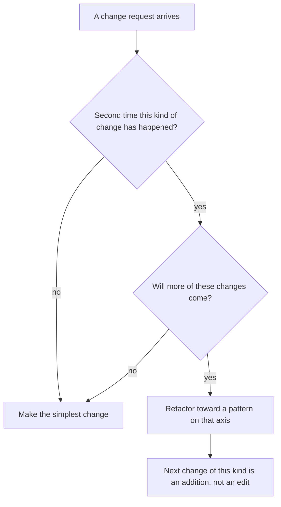

# Why Patterns Matter (and When They Don't)

<span class="badge-l0">L0 ⚪ Orientation</span> · <span class="read-time">⏱ 12 min read</span> · Prerequisites: [What Are Design Patterns](what-are-design-patterns.md)

!!! abstract "TL;DR"
    Patterns matter because they give teams a shared vocabulary and proven ways to keep code easy to change. They stop mattering, and start hurting, when you add them for changes that never come. Modern Java has made several patterns much smaller, so the goal is the pattern's intent, not its original class diagram.

## 1. What It Is

**Plain English.** This page is about the *value* of patterns: what you gain by knowing and using them, and the cost you pay when you use them in the wrong place.

**Precise definition.** A pattern's value is the reduction in the cost of change and communication it brings, minus the cost of the indirection it adds. Two terms you'll meet:

- **Speculative generality:** abstraction added for flexibility nobody needs yet (a code smell named by Martin Fowler and Kent Beck in *Refactoring*).
- **Cost of change:** how much code you must touch, re-test and re-deploy to make a typical change.

## 2. Why It Exists

Software is changed far more often than it is written. Teams that can't describe a design quickly spend review time re-explaining it, and code that isn't arranged for its *likely* changes turns every feature into edits across many files. Patterns address both.

But the industry also learned the opposite lesson: early-2000s enterprise Java was famous for factories of factories and layers that only delegated, which made simple changes slow. Knowing when *not* to use a pattern is as important as knowing the pattern.

## 3. Mental Model / Analogy

**Analogy.** Shelving in a supermarket. A few well-chosen shelves (dairy, bakery, produce) let staff restock fast and customers find things. A shelf for every single product would be "flexible", but no one could find anything and every new product would need new carpentry. Patterns are shelves: put them where things actually vary.

**Technical model.** Picture your code as having *axes of change*: places where new variants keep arriving (new promotions, new payment providers). A pattern placed on a real axis turns future edits into additions. A pattern placed where nothing varies is pure cost: more files, more indirection, no benefit.

## 4. How It Works

Use this loop to decide whether a pattern earns its place:



This is the "rule of three" applied to design: write it once, tolerate the duplication twice, refactor to a pattern the third time (or the second, if you're sure more is coming).

## 5. Subtopics

### Shared vocabulary in code review

- **Description:** A pattern name compresses a paragraph of explanation into one word. "This is a Decorator around the repository" tells a reviewer the class structure, the call flow and the testing approach.
- **How to use it:** name classes after their role (`CachingProductCatalog` as a Decorator, `PartnerRiderAdapter`) and mention the pattern in the pull request description.
- **Pros:** faster reviews; easier onboarding; fewer misunderstandings.
- **Cons:** only works if everyone knows the term; jargon excludes newcomers.
- **Best practice:** link new team members to the relevant pattern page the first time it comes up in their review.
- **Gotcha:** using the name for something that isn't the pattern misleads more than no name at all.

### Designing for change

- **Description:** Patterns let you add new behaviour by adding code instead of editing existing code (the Open/Closed Principle). That keeps changes small and reduces regressions.
- **How to use it:** find the axis that changes most (for FreshCart: promotions, payment providers, delivery partners) and put an interface on it.
- **Pros:** small, safe changes; each variant is testable alone; parallel work without merge conflicts.
- **Cons:** you must guess the axis right; the wrong guess makes the real change harder.
- **Best practice:** use history: `git log` on a file shows which kinds of changes actually happen.
- **Gotcha:** designing for every imaginable change produces the over-engineering below.

### Pattern fever and speculative generality

- **Description:** Adding patterns because they *might* be useful. The code gains interfaces with one implementation, factories that build one thing, and layers that only forward calls.
- **How to use it (to fix it):** inline the indirection, keep the simple version, and reintroduce the pattern when the second real variant appears.
- **Pros (of resisting it):** less code, easier navigation, faster builds and onboarding.
- **Cons (of resisting it):** you'll occasionally refactor later; with tests that's cheap.
- **Best practice:** follow YAGNI ("you aren't gonna need it") for patterns, and keep code easy to refactor instead.
- **Gotcha:** public library APIs are the exception; they can't be refactored freely, so some up-front extension points are justified (see [Designing Frameworks and Libraries](../l5-staff-principal/framework-and-library-design.md)).

### Patterns that modern Java made smaller

- **Description:** Lambdas (Java 8), records (16), sealed types (17) and pattern matching for `switch` (21) express several patterns in far less code. Strategy and Command become functional interfaces, Visitor can become a `switch` over a sealed interface, and value objects become records.
- **How to use it:** reach for the language feature first, and write the classic class-based form when you need state, multiple methods or extensibility by other teams.
- **Pros:** less boilerplate; the compiler checks exhaustiveness for sealed types.
- **Cons:** less discoverable than a named class; lambdas give poorer stack traces and can't hold multiple methods.
- **Best practice:** give lambda strategies names (`static final FeeStrategy EXPRESS = ...`) so they're findable and testable.
- **Gotcha:** a sealed interface is *closed*: other modules can't add variants. That's the point, but it's wrong for plugin-style extension.

## 6. Examples (exactly 3, progressively harder)

### Example 1: Minimal (L0)

**Scenario:** A developer is asked to print a greeting. They build a Strategy and a Factory for it "to be flexible". Compare that with what the requirement needed.

**Code / Config:**

```java title="OverEngineeringDemo.java"
--8<-- "examples/l0-orientation/why-patterns-matter/OverEngineeringDemo.java"
```

1. Four types (two interfaces, two classes) with one implementation each, and no second greeting on the roadmap.
2. One method does the same job.

**Run it:**

```bash
java OverEngineeringDemo.java
```

**Output:**

```text
--8<-- "examples/l0-orientation/why-patterns-matter/OverEngineeringDemo.expected.txt"
```

**What to notice:**

- Identical behaviour, four times the code.
- Nothing about the requirement varies, so there's no axis of change for a pattern to sit on.
- If a second greeting arrives later, extracting an interface from `greet` takes a minute with an IDE.

### Example 2: Realistic (in FreshCart grocery delivery)

**Scenario:** FreshCart's marketing team launches a new promotion type almost every sprint. Version 1 handles promotions in a `switch`; version 2 uses the Strategy pattern. In a later sprint, marketing asks for "25¢ off every item when you buy 10 or more".

**Code / Config:**

```java title="PromotionDemo.java"
--8<-- "examples/l0-orientation/why-patterns-matter/PromotionDemo.java"
```

1. Every new promotion means editing this method and re-testing all existing cases.
2. The axis of change (promotion rules) gets an interface.
3. The new requirement is one new record. No existing code was touched.

**Run it:**

```bash
java PromotionDemo.java
```

**Output:**

```text
--8<-- "examples/l0-orientation/why-patterns-matter/PromotionDemo.expected.txt"
```

**What to notice:**

- Here the pattern earns its place, because promotions really do change every sprint.
- Promotions are records: the rule's parameters (percent, threshold) become data, so marketing could configure new instances without code.
- Compare with Example 1: same pattern, opposite verdict, because the context differs.

### Example 3: Production-grade

**Scenario:** The delivery service handles four event types (rider assigned, picked up, delivered, failed) and needs several operations on them: customer push text, metrics, later audit logs. Classically this is the Visitor pattern. With Java 21, a sealed interface plus pattern matching for `switch` does the same job, and the compiler refuses to build if a new event type isn't handled. Invalid events must be rejected at creation.

**Code / Config:**

```java title="DeliveryEventsDemo.java"
--8<-- "examples/l0-orientation/why-patterns-matter/DeliveryEventsDemo.java"
```

1. `sealed ... permits` fixes the set of event types, so `switch` can be checked for exhaustiveness.
2. Pattern matching with a `when` guard: two cases for `PickedUp` depending on the ETA. No `default` branch is needed.
3. A second operation over the same types without adding a method to any event (Visitor's intent).
4. The compact constructor rejects a `Failed` event without a reason.

**Run it:**

```bash
java DeliveryEventsDemo.java
```

**Output:**

```text
--8<-- "examples/l0-orientation/why-patterns-matter/DeliveryEventsDemo.expected.txt"
```

**What to notice:**

- A classic Visitor needs an interface with four `visit` methods plus an `accept` method on every event. Here it's two `switch` expressions.
- Add a `Cancelled` record to `permits` and both switches stop compiling until you handle it: the safety Visitor gave you, for free.
- `EnumMap` keeps the metric output in a stable order, which keeps the output deterministic.
- This only works because the event set is closed and owned by one team; see [Visitor](../l2-practitioner/visitor.md) for when the classic form is still better.

## 7. Pros, Cons & Trade-offs

| Aspect | Pros | Cons |
|--------|------|------|
| Simplicity | Right-sized patterns make code predictable | Speculative patterns make simple code hard to follow |
| Performance | Negligible cost in almost all business code | Unneeded layers add allocations and calls |
| Scalability | Teams can extend code in parallel along clear axes | Wrong axes force cross-cutting edits anyway |
| Operability | Pattern seams are natural places for logging and metrics | More layers in stack traces |
| Security | Centralised extension points are easier to review | More extension points mean more surface to review |
| Testability | Each variant is testable alone | Over-abstraction needs many fakes |
| Cost | Cheaper changes on real axes of change | Up-front and reading cost on imaginary ones |
| Learning curve | Shared vocabulary speeds onboarding | Juniors copy patterns without the judgement |

## 8. When to Use / When NOT to Use

**Lean on patterns when:**

- The same kind of change has already happened and will keep happening.
- Several people or teams need to extend the same code.
- You're designing a public API or library that others will extend.

**Hold back when:**

- It's the first time you've seen the requirement.
- The variation is closed and small: use an `enum` or a sealed type with `switch`.
- You're prototyping or writing code you'll throw away.

See [Pattern Comparisons](../reference/comparisons.md) for alternatives.

## 9. Best Practices

1. **Refactor toward a pattern on the second or third occurrence of a change**, not before. *(Consensus: rule of three, YAGNI.)*
2. **Use change history to find real axes of change.** *(Opinion, widely practised.)*
3. **Prefer language features (lambdas, records, sealed types) to class-heavy pattern forms** when other teams don't need to extend the code. *(Opinion.)*
4. **Keep tests good enough that adding a pattern later is cheap.** That's what makes waiting safe. *(Consensus.)*
5. **Remove patterns that stopped paying**, the same way you remove dead code. *(Opinion.)*

## 10. Pitfalls & Anti-Patterns

!!! danger "Speculative generality"
    **Symptom:** interfaces with a single `Impl`, abstract classes with one subclass, factories returning one type.
    **Root cause:** designing for imagined future requirements.
    **Fix:** inline them. Reintroduce the abstraction when a second real case appears.

!!! danger "Golden hammer"
    **Symptom:** every problem in the code base is solved with the same pattern (often Strategy or an event bus).
    **Root cause:** the team learned one pattern well and stopped choosing.
    **Fix:** review designs against the [Decision Guide](../reference/decision-guide.md); ask what the simplest alternative would be.

!!! danger "Indirection hides the bug (production failure mode)"
    **Symptom:** a discount was applied twice in production, and it took a day to find where.
    **Root cause:** the promotion went through a factory, a decorator chain and a registry that was configured in three places; the same decorator was registered twice.
    **Fix:** one composition root that wires everything in a single place, plus a startup check that rejects duplicate registrations.

## 14. Testing It

Strategy-style code is easy to test at its boundaries. This parameterised JUnit 5 test checks the new bulk promotion around its threshold; CI runs it with the example.

```java title="PromotionTest.java"
--8<-- "examples/l0-orientation/why-patterns-matter/PromotionTest.java"
```

## 16. Version Notes

| Java | Feature | Pattern it simplifies |
|------|---------|-----------------------|
| 8 | Lambdas, functional interfaces | Strategy, Command, Observer, Template Method |
| 16 | Records (JEP 395) | Value objects, Memento, DTOs |
| 17 | Sealed classes (JEP 409) | Closed hierarchies, State |
| 21 | Pattern matching for `switch` (JEP 441), record patterns (JEP 440) | Visitor, Interpreter |

## 17. Expert Deep Dive

- **Flexibility has a carrying cost.** Every abstraction is paid for on every read, review and debugging session, not just when written. Seniors estimate the probability of the change against that ongoing cost.
- **Reversibility beats prediction.** You can't predict the axes of change reliably, so invest in what makes adding a pattern later cheap: tests, small modules, a single composition root. Then waiting is low-risk.
- **The open/closed decision has two sides.** Polymorphism makes adding *types* cheap and adding *operations* expensive; sealed types plus `switch` do the reverse. Knowing which kind of change your domain sees is the core judgement (the "expression problem").
- **Organisational patterns matter too.** A pattern that one team owns and evolves is healthy; a "shared framework" of patterns imposed across teams often becomes the golden hammer. See [Governing Patterns Across an Organisation](../l5-staff-principal/governing-patterns-at-scale.md).
- **Migrating legacy code:** don't refactor everything into patterns. Put the first pattern on the axis that caused the most incidents or the slowest changes last quarter.

!!! example "War story: the plugin framework nobody plugged into"
    A team building a delivery-tracking service spent two months on a generic plugin framework: provider interfaces, a registry, dynamic class loading and versioned extension points, so that "any partner could be added without code changes". Two years later there were exactly two partners, both added by the same team, and the framework had caused three outages from class-loading conflicts during deployments. A new lead replaced it with two plain Adapter classes behind one interface and a `switch` on configuration. The code shrank by 70%, and the class-loading incidents disappeared. **Lesson:** design for the changes you have evidence for. The cheaper option was the simple pattern, not the general framework.

## 18. Interview Corner

=== "🟢 L1–L2"

    1. **Why learn design patterns?** For a **shared vocabulary** and **proven solutions** that make code easier to change.
    2. **What is YAGNI?** "You aren't gonna need it": **don't build features or abstractions before they're needed.**
    3. **What is over-engineering?** Adding **complexity for requirements that don't exist**.
    4. **How does Strategy help when rules change often?** New rules are **new classes**, so **existing code isn't edited**.
    5. **Give a pattern that lambdas made smaller.** **Strategy** (or Command): a functional interface plus a lambda replaces a class per variant.

=== "🟡 L3"

    1. **How do you find the axes of change in a code base?** Look at **change history** (`git log`, hot-spot analysis) and incident reports.
    2. **When would you use a sealed interface with `switch` instead of polymorphism?** When the set of types is **closed and owned by you** and you add **operations more often than types**.
    3. **What's speculative generality? How do you fix it?** Abstraction for imagined needs; **inline it** and reintroduce on real demand.
    4. **Rule of three?** Tolerate duplication twice; **refactor on the third** occurrence.
    5. **What makes it safe to delay adding a pattern?** **Good tests and small modules**, so refactoring later is cheap.

=== "🔴 L4–L5"

    1. **A team wants a generic framework "for future flexibility". How do you respond?** Ask for **evidence of the variation**, estimate the **carrying cost**, and propose the **smallest reversible step**.
    2. **How do you decide extension points for a public library?** Public APIs are **hard to change**, so add extension points for **documented, demanded** use cases and keep the rest **internal**.
    3. **How do you measure if a pattern pays off?** **Lead time for changes** on that area, **defect rate**, and review time before and after.
    4. **Expression problem: explain and relate to Visitor.** Adding types vs. operations; Visitor makes **operations cheap and types expensive**, like sealed types with `switch`.
    5. **Now 10 teams extend the same promotion engine. What changes?** You need **stable contracts**, versioning, contract tests and **ownership** of the extension API.

=== "💻 Hands-on"

    **Task:** Add a `Cancelled(String orderId, boolean refunded)` event to Example 3 and handle it in both operations.

    ??? success "Solution"
        ```java
        sealed interface DeliveryEvent permits Assigned, PickedUp, Delivered, Failed, Cancelled { String orderId(); }
        record Cancelled(String orderId, boolean refunded) implements DeliveryEvent { }
        enum Kind { ASSIGNED, PICKED_UP, DELIVERED, FAILED, CANCELLED }

        // customerMessage(...)
        case Cancelled c when c.refunded() -> c.orderId() + " was cancelled and refunded";
        case Cancelled c -> c.orderId() + " was cancelled";

        // kind(...)
        case Cancelled c -> Kind.CANCELLED;
        ```
        Until both switches handle `Cancelled`, the compiler reports that the `switch` expression doesn't cover all possible input values.

## 19. Practice

- [ ] Find one interface with a single implementation in a project you know. Should it stay?
    ??? tip "Hint"
        Keep it if it's a boundary you fake in tests (database, clock, HTTP client); otherwise consider inlining it.
- [ ] Add a "free delivery" promotion to Example 2 that returns the delivery fee as the discount.
    ??? tip "Hint"
        Pass the fee in through the record's constructor; don't make the promotion look it up.
- [ ] Rewrite `DeliveryEventsDemo.kind` as a classic Visitor and compare the line count.
    ??? tip "Hint"
        You need a `Visitor<R>` interface with four methods and an `accept` method on each record.

## 20. Quick Revision Card

!!! tip "Remember in 30 seconds"
    - Patterns pay off on real axes of change; elsewhere they're pure cost.
    - Rule of three: refactor to a pattern on the third occurrence.
    - Shared vocabulary is a big part of a pattern's value.
    - Modern Java (lambdas, records, sealed types, `switch` patterns) shrinks many patterns.
    - Good tests make it safe to wait.

    ```java
    sealed interface Event permits A, B { }
    String handle(Event e) {
        return switch (e) { case A a -> "a"; case B b -> "b"; };   // exhaustive, no default
    }
    ```

## 21. Further Reading

- Martin Fowler, *Refactoring: Improving the Design of Existing Code*, 2nd edition (2018), chapter 3 "Bad Smells in Code" (speculative generality).
- Joshua Kerievsky, *Refactoring to Patterns* (2004).
- [JEP 409: Sealed Classes](https://openjdk.org/jeps/409) and [JEP 441: Pattern Matching for switch](https://openjdk.org/jeps/441)
- Martin Fowler, "Yagni" (article on martinfowler.com).

---

[← Previous: What Are Design Patterns](what-are-design-patterns.md) · [Next: Setting Up Java to Run the Examples →](java-setup.md)
