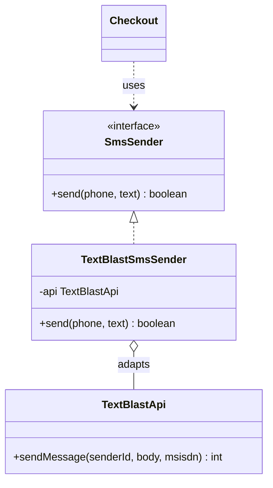
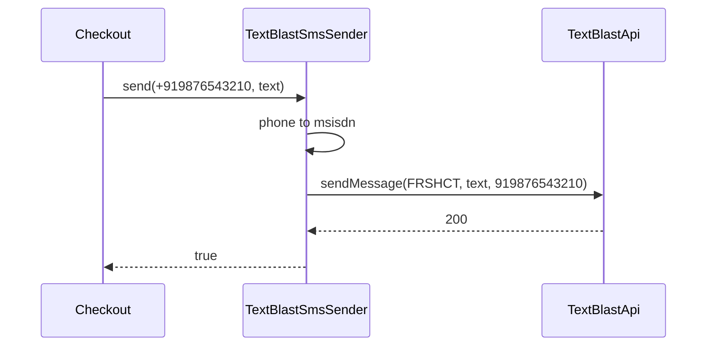

# Adapter

<span class="badge-l1">L1 🟢 Foundations</span> · <span class="read-time">⏱ 35 min read</span> · Prerequisites: [SOLID Principles](solid-principles.md) (Dependency Inversion), [Strategy](strategy.md)

!!! abstract "TL;DR"
    Adapter makes an existing class (a vendor SDK, a legacy library) usable through the interface your code expects, by wrapping it and translating calls, data and errors. It's the everyday tool for integrating third parties without letting their types, units and error codes leak into your domain. Prefer object adapters (composition); test every adapter against one shared contract.

## 1. What It Is

**Plain English.** FreshCart's code sends SMS through an interface called `SmsSender`. The SMS vendor's SDK has a different method name, different argument order and returns numeric codes. Instead of changing all our code to fit the vendor, we write a small class that *looks like* `SmsSender` on the outside and calls the vendor SDK on the inside: a travel plug adapter, in code.

**Precise definition (GoF intent).** "Convert the interface of a class into another interface clients expect. Adapter lets classes work together that couldn't otherwise because of incompatible interfaces." Roles:

- **Target:** the interface your code uses (`SmsSender`).
- **Adaptee:** the existing class with the wrong interface (`TextBlastApi`).
- **Adapter:** implements the target and translates to the adaptee.
- **Client:** your code, which only knows the target.

Also known as **wrapper**. At system boundaries, a set of adapters forms an **anti-corruption layer** (a DDD term).

## 2. Why It Exists

Third-party and legacy code rarely matches your model: different names, units (rupee strings vs cents), time types (`Date` vs `Instant`), error styles (codes vs exceptions), nulls. If you use them directly, those details spread through your codebase, and switching vendors means editing everything. An adapter confines each vendor's details to one class, so your domain depends on your own interface ([Dependency Inversion](solid-principles.md)).

## 3. Mental Model / Analogy

**Analogy.** A FreshCart store buys a scale from a supplier that reports weight in grams on a serial port. The billing counter expects kilograms. A small converter box between them (the adapter) turns grams into kilograms; neither the scale nor the counter changes. Buy a different scale tomorrow, and you only swap the box.

**Technical model.** An adapter is a class that implements the target interface and holds (or extends) the adaptee, translating each call: arguments in, results and errors out.

## 4. How It Works





## 5. Subtopics

### Object adapter

**Description.** The adapter implements the target interface and holds a reference to the adaptee (composition). This is the standard, flexible form: it works with final classes, can adapt any subclass of the adaptee, and can combine several adaptees.

**Advantages / features.** Loose coupling; adaptee replaceable in tests; translation logic in one place.

```java title="ObjectAdapterDemo.java"
--8<-- "examples/l1-foundations/adapter/ObjectAdapterDemo.java"
```

1. Our target interface, in our terms: order IDs and a `Location` record.
2. The adapter *has* the vendor client (composition).
3. Translating identifiers: our order ID to the vendor's shipment reference.
4. Translating data and units: a string to numbers, seconds to minutes (rounded up).

**Run it:** `java ObjectAdapterDemo.java`

```text
--8<-- "examples/l1-foundations/adapter/ObjectAdapterDemo.expected.txt"
```

| Pros | Cons |
|------|------|
| Works with final or third-party classes | One more class per integration |
| Adaptee replaceable and mockable | Delegation code for every method you need |
| Can adapt several adaptees together | Translation bugs hide in the adapter |

**Use it** by default for any integration. **Avoid** adapting when you own both sides; change one of them instead.
**Real-world Java:** `java.io.InputStreamReader` (adapts a byte `InputStream` to a character `Reader`), `Arrays.asList` (array to `List`), Spring MVC's `HandlerAdapter`.
**Best practice:** name adapters after vendor and role (`ParcelGoTracker`). **Gotcha:** an adapter that also adds caching, retries and business rules is no longer an adapter; split those into decorators or services.

### Class adapter

**Description.** The adapter *extends* the adaptee and implements the target. Java has single class inheritance, so this works only when the adaptee is a non-final class and the target is an interface.

**Advantages / features.** No delegation boilerplate; access to the adaptee's protected members; overriding adaptee behaviour is possible.

```java title="ClassAdapterDemo.java"
--8<-- "examples/l1-foundations/adapter/ClassAdapterDemo.java"
```

1. Extends the legacy class and implements our interface.
2. Uses inherited state and methods directly.
3. The adapter still exposes the adaptee's own methods, like `tare`.

**Run it:** `java ClassAdapterDemo.java`

```text
--8<-- "examples/l1-foundations/adapter/ClassAdapterDemo.expected.txt"
```

| | Object adapter | Class adapter |
|---|---|---|
| Mechanism | Composition | Inheritance |
| Works with final adaptee | Yes | No |
| Adapts subclasses of the adaptee | Yes | No, fixed to one class |
| Exposes adaptee's API too | No (cleaner) | Yes (leaky) |
| Delegation code | Needed | Not needed |

**Use it** rarely: when you must reach protected members of a legacy class. **Avoid it** in general; the object adapter is safer.
**Real-world Java:** uncommon in modern libraries; you'll see it in legacy codebases extending old SDK base classes.
**Best practice:** prefer composition. **Gotcha:** callers can still use the adaptee's methods through the adapter, bypassing your translation.

### Two-way adapter

**Description.** One class implements *both* interfaces (old and new), so it can be used by old and new clients at once. It's mainly a migration tool: route all calls into one implementation while callers move over gradually.

**Advantages / features.** Gradual migration; one implementation, so behaviour can't diverge.

```java title="TwoWayAdapterDemo.java"
--8<-- "examples/l1-foundations/adapter/TwoWayAdapterDemo.java"
```

1. Implements the old and the new interface.
2. The old API is translated into the new one, so there's one code path.
3. Old and new callers share one object.

**Run it:** `java TwoWayAdapterDemo.java`

```text
--8<-- "examples/l1-foundations/adapter/TwoWayAdapterDemo.expected.txt"
```

| Pros | Cons |
|------|------|
| Old and new callers work during migration | Class has two responsibilities until migration ends |
| Single source of truth for behaviour | Easy to leave in place forever |
| Callers migrate one at a time | Conversions in both directions to test |

**Use it** for planned migrations with a deadline. **Avoid** keeping it after the last old caller moves; delete the old interface.
**Real-world Java:** migration layers such as old `java.util.Date` APIs alongside `java.time` via `Date.from(Instant)` and `date.toInstant()`.
**Best practice:** track remaining old callers (a deprecation warning or metric) and remove the bridge. **Gotcha:** `BigDecimal.longValueExact` throws on fractional cents; decide how legacy strings with more decimals are handled.

### Adapting legacy and third-party APIs

**Description.** Real adapters translate more than method names: old JDK types (`Enumeration`, `Date`), `null` returns, checked exceptions, vendor codes and units. The adapter turns them into your model's types: `Iterator`, `Instant`, `Optional`, enums.

**Advantages / features.** Your domain code never sees the legacy quirks; one place to fix vendor surprises.

```java title="LegacyApiAdapterDemo.java"
--8<-- "examples/l1-foundations/adapter/LegacyApiAdapterDemo.java"
```

1. `Enumeration` to `Iterator`: the JDK ships this adapter as `asIterator()` (Java 9).
2. `Date` to `Instant`.
3. `null` and single-letter codes become an enum with an explicit `UNKNOWN`.
4. A checked `IOException` becomes an empty `Optional` for callers.

**Run it:** `java LegacyApiAdapterDemo.java`

```text
--8<-- "examples/l1-foundations/adapter/LegacyApiAdapterDemo.expected.txt"
```

| Legacy or vendor style | Adapt to |
|------------------------|----------|
| `Enumeration`, arrays | `Iterator`, `List`, `Stream` |
| `Date`, `Calendar`, epoch numbers | `Instant`, `LocalDate`, `ZonedDateTime` |
| `null` for "not found" | `Optional` or a domain `UNKNOWN` |
| Checked exceptions | Domain exceptions or result types |
| Codes and magic strings | Enums |
| Units (rupee strings, grams) | Your units (cents, kilograms), typed |

**Use it** at every boundary with code you don't own. **Avoid** "pass-through" adapters that return vendor types unchanged.
**Real-world Java:** `Collections.list(Enumeration)`, `Date.toInstant()`, `Arrays.asList`, `InputStreamReader`.
**Best practice:** map unknown codes to an explicit `UNKNOWN` and count them. **Gotcha:** swallowing exceptions into `Optional.empty()` loses the reason; log or count it.

### Adapter vs. Facade vs. Decorator

**Description.** All three wrap something. **Adapter** changes an interface to match what clients expect. **[Decorator](decorator.md)** keeps the same interface and adds behaviour. **[Facade](facade.md)** offers one simpler interface over several subsystems.

**Advantages of knowing the difference.** You name classes accurately, and you don't overload one wrapper with three jobs.

```java title="AdapterVsFacadeVsDecoratorDemo.java"
--8<-- "examples/l1-foundations/adapter/AdapterVsFacadeVsDecoratorDemo.java"
```

1. Adapter: the vendor's `blast` becomes our `send`.
2. Decorator: same `Notifier` interface, plus quiet-hours behaviour.
3. Facade: one simple method that coordinates several parts.

**Run it:** `java AdapterVsFacadeVsDecoratorDemo.java`

```text
--8<-- "examples/l1-foundations/adapter/AdapterVsFacadeVsDecoratorDemo.expected.txt"
```

| | Adapter | Decorator | Facade |
|---|---|---|---|
| Interface in vs out | Different | Same | New, simpler |
| Wraps | One adaptee | One component of the same type | Several subsystems |
| Purpose | Make it fit | Add behaviour | Make it easy |
| Stackable | Rarely | Yes | No |

**Use** each for its own purpose. **Avoid** one class that adapts, retries, caches and orchestrates.
**Real-world Java:** `InputStreamReader` (adapter), `BufferedInputStream` (decorator), `javax.faces.context.FacesContext` or a Spring service layer (facade).
**Best practice:** compose them: an adapter wrapped in decorators, used by a facade. **Gotcha:** calling everything a "wrapper" hides intent in reviews.

## 6. Examples (exactly 3, progressively harder)

### Example 1: Minimal (L1)

**Scenario:** Checkout sends SMS through `SmsSender`. The vendor SDK takes a sender ID, the body and a number without `+`, and returns HTTP-style codes.

```java title="SmsVendorAdapterDemo.java"
--8<-- "examples/l1-foundations/adapter/SmsVendorAdapterDemo.java"
```

1. Our interface: phone and text, true or false.
2. Translating the phone format and argument order is the adapter's whole job.

**Run it:** `java SmsVendorAdapterDemo.java`

**Output:**

```text
--8<-- "examples/l1-foundations/adapter/SmsVendorAdapterDemo.expected.txt"
```

**What to notice:**

- Checkout never sees status codes like 400 or 413.
- Switching SMS vendors means one new adapter class.

### Example 2: Realistic (in FreshCart grocery delivery)

**Scenario:** Two couriers send tracking webhooks in different formats: QuickDrop uses numeric codes and epoch seconds; ParcelGo uses key-value text, words for states and ISO timestamps. The app needs one tracking model.

```java title="CourierStatusAdapterDemo.java"
--8<-- "examples/l1-foundations/adapter/CourierStatusAdapterDemo.java"
```

1. One target interface for every courier.
2. Unknown codes map to `UNKNOWN` instead of crashing or guessing.
3. Several vendor states can map to one of ours.
4. Vendor-specific identifiers (the `PG-` prefix) are removed here and nowhere else.

**Run it:** `java CourierStatusAdapterDemo.java`

**Output:**

```text
--8<-- "examples/l1-foundations/adapter/CourierStatusAdapterDemo.expected.txt"
```

**What to notice:**

- The app shows the same statuses for both couriers.
- QuickDrop's new code 55 (not in the docs) didn't break anything; it was flagged for review.

### Example 3: Production-grade

**Scenario:** Integrating a payment provider SDK. FreshCart's checkout works in cents and expects a sealed result: approved, declined (with a reason the app can show) or failed (retryable or not). The SDK uses rupee strings, its own error codes and a checked exception. The adapter must pass our idempotency key so retries never double-charge, map every known code, and flag unknown ones. A *contract test* runs the same checks against the real adapter and the in-memory fake.

```java title="PaymentProviderAdapterDemo.java"
--8<-- "examples/l1-foundations/adapter/PaymentProviderAdapterDemo.java"
```

1. Vendor decline codes mapped to our reasons, in one table.
2. Validate in our terms before calling the vendor.
3. Unit conversion with `BigDecimal`, never `double`, for money.
4. Our idempotency key becomes the vendor's request ID: retries return the same payment.
5. The checked vendor exception never escapes; it becomes one of our result types.

**Run it:** `java PaymentProviderAdapterDemo.java`

**Output:**

```text
--8<-- "examples/l1-foundations/adapter/PaymentProviderAdapterDemo.expected.txt"
```

**What to notice:**

- Checkout's `switch` handles only FreshCart types; PayLink could be replaced without touching it.
- The retry of FC-2001 returned the same payment ID: no double charge.
- E77 isn't in the vendor's docs; it's treated as non-retryable and counted for investigation.

## 7. Pros, Cons & Trade-offs

| Aspect | Pros | Cons |
|--------|------|------|
| Simplicity | Domain code stays clean | Extra layer and mapping code |
| Coupling | Vendor details in one class | Adapter must track vendor API changes |
| Performance | Negligible | Data copying for large payloads |
| Operability | One place to log, count and map vendor errors | Mapping gaps appear only in production |
| Testability | Domain tested with fakes; contract tests per adapter | Real adapters need integration tests with sandboxes |
| Learning curve | Simple idea | Knowing what to translate (units, errors) needs care |

## 8. When to Use / When NOT to Use

**Use it when:**

- integrating any third-party SDK, API or legacy library;
- you may switch vendors, or support several at once;
- an old interface must keep working while you migrate.

**Don't use it when:**

- you own both sides and can just change one;
- you want to simplify many subsystems: use [Facade](facade.md);
- you want to add behaviour without changing the interface: use [Decorator](decorator.md).

## 9. Best Practices

1. **Define the target interface in your domain's terms first**, then adapt vendors to it. *(Consensus.)*
2. **Never let vendor types escape** the adapter (classes, exceptions, codes). *(Consensus.)*
3. **Map unknown values explicitly** and count them. *(Consensus.)*
4. **Write one contract test suite** and run it against every adapter and fake. *(Consensus.)*
5. **Use `BigDecimal` or integer minor units for money conversions.** *(Consensus.)*
6. **Keep adapters thin**: put retries, caching and metrics in decorators. *(Opinion.)*
7. **Pass idempotency keys through** to vendors that support them. *(Consensus for payments.)*

## 10. Pitfalls & Anti-Patterns

!!! danger "Leaky adapter"
    **Symptom:** `PayLinkException` appears in checkout code; vendor codes in the database.
    **Root cause:** the adapter re-threw or returned vendor types.
    **Fix:** map everything to your own types inside the adapter.

!!! danger "Lost paise (production failure mode)"
    **Symptom:** reconciliation found thousands of payments off by one paisa.
    **Root cause:** the adapter converted cents to rupees with `double` arithmetic (`499.5` became `499.49999`).
    **Fix:** `BigDecimal.movePointLeft(2)` or integer arithmetic, and a contract test with awkward amounts.

!!! danger "Silent default mapping"
    **Symptom:** new courier status "RETURN_TO_ORIGIN" shown to customers as "Delivered".
    **Root cause:** `default -> DELIVERED` in the mapping `switch`.
    **Fix:** default to `UNKNOWN`, alert on it, and add mappings deliberately.

!!! danger "God adapter"
    **Symptom:** a 2,000-line `VendorAdapter` with caching, retries, business rules and reporting.
    **Root cause:** every vendor-related concern added to the adapter.
    **Fix:** thin adapter + decorators (retry, cache) + domain services.

## 11. Configuration & Tuning

| Setting | Default | What it does | When to change it | Risk of changing |
|---------|---------|--------------|-------------------|------------------|
| Code mapping tables | In code | Vendor codes to domain values | Vendor adds codes | Wrong mapping shows wrong status or retries permanent errors |
| Retryable code set | E91, E96 | Which failures may be retried | Vendor guidance changes | Retrying declines causes duplicate attempts and fraud flags |
| Sender ID (Example 1) | FRSHCT | Shown as SMS sender | Brand or regulatory change | Messages blocked by carriers |

## 12. Security Considerations

- Adapters handle raw vendor payloads: validate and size-limit them, especially webhooks (Example 2).
- Don't log full vendor requests or responses containing card data, tokens or personal data; redact in the adapter.
- Verify webhook signatures in the adapter before translating anything.

## 13. Performance & Scalability

Translation costs are tiny compared to network calls. Watch for adapters that convert large payloads repeatedly (parsing a big JSON per field access) and for adapters creating a new vendor client per call; vendor clients usually hold connection pools and must be shared (see [Singleton](singleton.md) and [Factory Method](factory-method.md)).

## 14. Testing It

One contract, two implementations: the real adapter (over a stub SDK here, a vendor sandbox in integration tests) and the fake used by checkout tests. If the fake passes the same contract, tests that use it can be trusted.

```java title="PaymentGatewayContractTest.java"
--8<-- "examples/l1-foundations/adapter/PaymentGatewayContractTest.java"
```

## 15. Observability & Operations

Log and count per vendor and per mapped outcome: approvals, each decline reason, retryable failures and unmapped codes. Alert on any unmapped code and on sudden shifts in the mix (for example, "suspected fraud" declines doubling), which often signal a vendor-side change before they announce it.

## 16. Version Notes

| Java | Change relevant to Adapter |
|------|----------------------------|
| 1.1 | `InputStreamReader`, `OutputStreamWriter` (byte/char adapters) |
| 1.2 | `Arrays.asList`, `Collections.enumeration` and `Collections.list` |
| 8 | `Date.from(Instant)`, `date.toInstant()` to adapt legacy dates |
| 9 | `Enumeration.asIterator()` |
| 17 | Sealed result types for adapters' outputs |
| 21 | Pattern matching for `switch` over adapter results |

## 17. Expert Deep Dive

- **Anti-corruption layer.** In DDD, a set of adapters and translators protects a bounded context from another system's model. Seniors treat it as a deliberate boundary with its own tests, not just a few wrapper classes.
- **Ports and adapters (hexagonal architecture).** The domain defines *ports* (interfaces like `PaymentGateway`); infrastructure provides *adapters*. The whole architecture is the Adapter pattern applied systematically (see [Architectural Patterns](../l4-senior/architectural-patterns.md)).
- **Contract tests as the safety net.** Consumer-driven contract tests (Pact) and shared adapter contracts catch vendor changes before customers do.
- **Versioned mappings.** Vendors add codes without notice. Keep mappings data-driven where possible and monitored, so a new code is a dashboard alert, not an incident.

!!! example "War story: the courier that invented a status"
    A delivery platform mapped courier statuses with a `default -> IN_TRANSIT` branch. The courier quietly introduced `HELD_AT_HUB` for parcels stuck because of address problems. For three weeks, customers saw "in transit" for orders that were going nowhere, and support tickets piled up. After the incident, the adapter mapped unknown statuses to `UNKNOWN`, alerted on them, and showed customers "We're checking on your order". **Lesson:** an adapter's `default` branch is a business decision; make it a safe and visible one.

## 18. Interview Corner

=== "🟢 L1–L2"

    1. **What does Adapter do?** **Converts one interface into another** that clients expect.
    2. **Give a JDK example.** **`InputStreamReader`**, `Arrays.asList`, `Enumeration.asIterator()`.
    3. **Object vs class adapter?** **Composition vs inheritance**; object adapters are more flexible.
    4. **Why wrap a vendor SDK instead of using it directly?** To **keep vendor details out of the domain** and **swap vendors easily**.
    5. **Adapter vs Decorator?** Adapter **changes the interface**; Decorator **keeps it and adds behaviour**.

=== "🟡 L3"

    1. **What should an adapter translate besides method names?** **Units, types, nulls, exceptions, codes and identifiers.**
    2. **How do you test adapters?** **Contract tests** shared by real adapters and fakes, plus **sandbox integration tests**.
    3. **What's a two-way adapter for?** **Gradual migration** between old and new interfaces.
    4. **How do you handle unknown vendor codes?** Map to an **explicit UNKNOWN**, alert and **count**.
    5. **Where do retries belong?** In a **decorator or a template** around the adapter, not inside it.

=== "🔴 L4–L5"

    1. **Design an integration layer for three payment providers.** A **`PaymentGateway` port**, one **adapter per provider**, **shared contract tests**, routing strategy, idempotency and reconciliation.
    2. **What is an anti-corruption layer and when is it worth it?** **Translation boundary** protecting your model from another system's; worth it when the other model is **messy or changes independently**.
    3. **How do you handle vendor API version upgrades safely?** **Adapter per version**, contract tests, **shadow traffic**, gradual switch.
    4. **How does hexagonal architecture relate to Adapter?** **Ports are targets; infrastructure classes are adapters**.
    5. **Now 10x traffic and the vendor rate-limits you. What changes?** **Rate-limiter and queue decorators**, batching if supported, multi-vendor routing.

=== "💻 Hands-on"

    **Task:** Add a second payment adapter for a vendor whose SDK returns a `Map<String, String>` like `{status=OK, id=...}` or `{status=DECLINED, why=NO_FUNDS}`, and make it pass `PaymentGatewayContractTest`.

    ??? success "Solution"
        ```java
        final class MapPayGateway implements PaymentGateway {
            private final MapPaySdk sdk;
            MapPayGateway(MapPaySdk sdk) { this.sdk = sdk; }
            public ChargeResult charge(ChargeRequest r) {
                if (r.amountCents() <= 0) throw new IllegalArgumentException("amount must be positive");
                Map<String, String> res = sdk.pay(r.idempotencyKey(), r.amountCents(), r.customerId());
                return switch (res.getOrDefault("status", "")) {
                    case "OK" -> new Approved(res.get("id"));
                    case "DECLINED" -> new Declined(res.get("why").equals("NO_FUNDS") ? DeclineReason.INSUFFICIENT_FUNDS : DeclineReason.OTHER);
                    default -> new Failed("MapPay " + res, false);
                };
            }
        }
        // class MapPayGatewayContractTest extends PaymentGatewayContractTest { gateway() { return new MapPayGateway(new MapPaySdk()); } }
        ```

## 19. Practice

- [ ] Add a third courier adapter to `CourierStatusAdapterDemo` that receives JSON-like text.
    ??? tip "Hint"
        Parse into a map, then reuse the same `TrackingUpdate` and `Status` mapping approach.
- [ ] Make `LegacyInventoryAdapter.tryReserve` keep the failure reason instead of returning an empty `Optional`.
    ??? tip "Hint"
        Return a small sealed result (`Reserved(qty)` or `Unavailable(reason)`).
- [ ] Write a contract test for `SmsSender` and run it against `TextBlastSmsSender` and a fake.
    ??? tip "Hint"
        Copy the abstract-test-class structure of `PaymentGatewayContractTest`.
- [ ] Find a place in a codebase you know where a vendor type leaks into domain code, and sketch the adapter.
    ??? tip "Hint"
        Search for vendor package names in imports of domain classes.

## 20. Quick Revision Card

!!! tip "Remember in 30 seconds"
    - Intent: make an existing class fit the interface clients expect.
    - Object adapter (composition) by default; class adapter rarely.
    - Translate names, units, types, nulls, exceptions, codes and IDs; never leak vendor types.
    - Unknown codes → explicit `UNKNOWN`, alert, count.
    - One contract test for every adapter and fake.

    ```java
    final class TextBlastSmsSender implements SmsSender {
        public boolean send(String phone, String text) { return api.sendMessage("FRSHCT", text, phone.replace("+", "")) == 200; }
    }
    ```

## 21. Further Reading

- Gamma et al., *Design Patterns* (1994): Adapter.
- Eric Evans, *Domain-Driven Design* (2003), chapter 14 on the Anti-Corruption Layer.
- Alistair Cockburn, ["Hexagonal Architecture" (ports and adapters)](https://alistair.cockburn.us/hexagonal-architecture/).
- [java.io.InputStreamReader API documentation](https://docs.oracle.com/en/java/javase/21/docs/api/java.base/java/io/InputStreamReader.html)

---

[← Previous: Template Method](template-method.md) · [Next: Decorator →](decorator.md)
