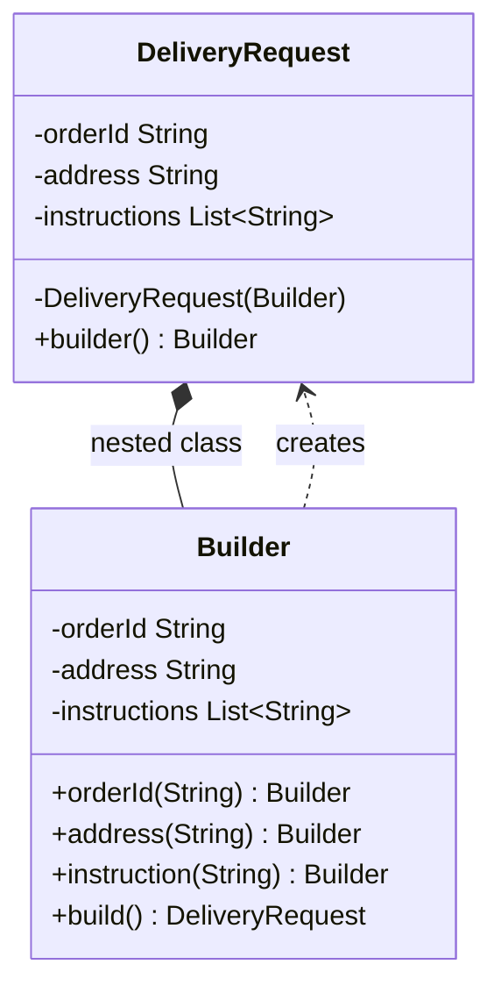
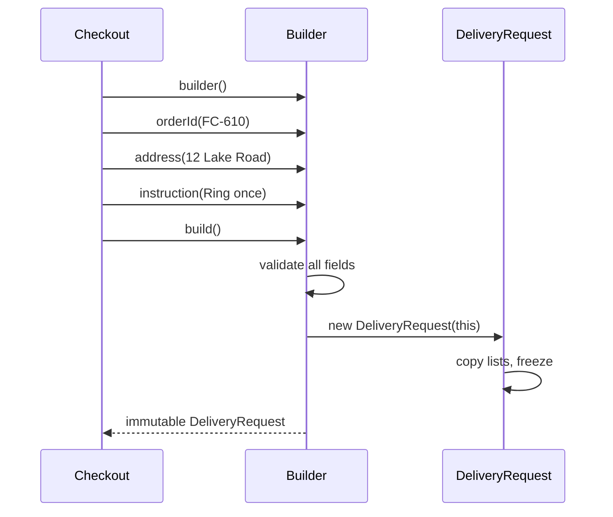

# Builder

<span class="badge-l1">L1 🟢 Foundations</span> · <span class="read-time">⏱ 40 min read</span> · Prerequisites: [Factory Method](factory-method.md), [OOP Refresher](oop-refresher.md)

!!! abstract "TL;DR"
    Builder constructs a complex object step by step, so callers name each value they set, optional fields get defaults, and validation runs once in `build()` before an immutable object exists. Use it when a constructor would take many parameters, several of them optional. In modern Java, pair it with records; for two or three fields, a constructor or static factory is better.

## 1. What It Is

**Plain English.** Building an order or a delivery request is like filling in a form: some boxes are required, many are optional, and the form is only accepted when it's complete and valid. A builder is that form in code. You fill fields one at a time with readable method names, then call `build()`, which checks everything and hands back the finished, unchangeable object.

**Precise definition (GoF intent).** "Separate the construction of a complex object from its representation so that the same construction process can create different representations." The GoF version has four roles:

- **Builder:** an interface with steps (`header`, `line`, `total`).
- **Concrete builder:** implements the steps for one output (text, CSV).
- **Director:** calls the steps in the right order.
- **Product:** the result.

In everyday Java, "builder" usually means Joshua Bloch's **fluent builder** (*Effective Java*, Item 2): a nested static class with chained setters and a `build()` method. This page covers both.

## 2. Why It Exists

Objects with many fields cause two classic problems:

- **Telescoping constructors:** `new Product("MLK-1", "Milk", 129, true, 3, "DairyDay")`. Which `true`? What's `3`? Swapping two `int`s compiles and is wrong.
- **JavaBeans setters:** `new Product()` then `setX`, `setY`. The object exists half-built, can't be immutable, and nothing forces validation.

Builder gives named steps, defaults, one validation point and immutability, without either problem.

## 3. Mental Model / Analogy

**Analogy.** Ordering a custom grocery hamper at a FreshCart store: the clerk fills in a slip (the builder) as you speak: "basket size large, add mangoes, no nuts, gift note". Only when you say "done" (`build()`) does the clerk check the slip (are there items? is the note too long?) and hand it to packing. Once packed (the product), the hamper isn't changed; for a different one you start a new slip, maybe copying the old one (`toBuilder()`).

**Technical model.** A builder is a mutable, short-lived object that collects values; `build()` validates them and passes them into a private constructor of an immutable product.

## 4. How It Works





## 5. Subtopics

### The telescoping constructor problem

**Description.** One constructor per combination of optional parameters, each calling the next with a default. It grows badly: six optional fields would need many constructors to cover the useful combinations, and calls become unreadable lists of values. The JavaBeans alternative (empty constructor plus setters) allows inconsistent, half-built objects.

**Advantages of recognising it.** You spot the smell early (more than about four parameters, several booleans, many overloads) and refactor before the API is public.

```java title="TelescopingDemo.java"
--8<-- "examples/l1-foundations/builder/TelescopingDemo.java"
```

1. The longest constructor: six positional values that are easy to mix up.
2. With setters, validity has to be checked by hand, and often isn't.
3. The object is already usable here, half-built.

**Run it:** `java TelescopingDemo.java`

```text
--8<-- "examples/l1-foundations/builder/TelescopingDemo.expected.txt"
```

| Approach | Readable calls | Immutable | Validated once | Defaults |
|----------|----------------|-----------|----------------|----------|
| Telescoping constructors | No | Yes | Yes | Yes, but tangled |
| JavaBeans setters | Yes | No | No | Yes |
| Builder | Yes | Yes | Yes | Yes |

**Use a builder** once there are more than about four parameters, or several optional ones. **Keep constructors** for small, all-required objects.
**Real-world Java:** `java.util.Locale` had telescoping constructors; Java 7 added `Locale.Builder`, and the constructors were deprecated in Java 19.
**Best practice:** make required parameters arguments of `builder(...)` and optional ones builder methods. **Gotcha:** consecutive parameters of the same type (`int, int`) are the most common source of silent bugs.

### Classic GoF Builder with a Director

**Description.** A builder *interface* declares construction steps; each concrete builder produces a different representation; a director runs the steps in order. The same director can produce a text invoice, a CSV export or a PDF.

**Advantages / features.** Construction algorithm written once; new output formats by new builders; the director doesn't depend on any format.

```java title="GofBuilderDemo.java"
--8<-- "examples/l1-foundations/builder/GofBuilderDemo.java"
```

1. The steps every representation must support.
2. The director owns the order of steps and the totals logic.
3. Each builder returns its own representation.

**Run it:** `java GofBuilderDemo.java`

```text
--8<-- "examples/l1-foundations/builder/GofBuilderDemo.expected.txt"
```

| Pros | Cons |
|------|------|
| One construction algorithm, many outputs | More classes than a fluent builder |
| New formats without touching the director | Builder interface must fit every format |
| Steps are explicit and testable | Rare in modern business code |

**Use it** for documents, reports and parsers where one process feeds several output formats. **Avoid it** when you just want to construct one object with many fields; use a fluent builder.
**Real-world Java:** `javax.xml.stream.XMLStreamWriter` and SAX `ContentHandler` (a parser directs, handlers build); `StringBuilder` is a builder without a director.
**Best practice:** keep business rules (totals) in the director, formatting in builders. **Gotcha:** don't reuse a stateful concrete builder for two products.

### Fluent builder for immutable objects

**Description.** Bloch's builder: a `static` nested `Builder` with a method per field that returns `this`, and `build()` that validates and calls the product's private constructor. The product's fields are `final`, and collections are copied with `List.copyOf`.

**Advantages / features.** Readable call sites; immutable, thread-safe products; validation in one place; defaults visible in the builder.

```java title="FluentBuilderDemo.java"
--8<-- "examples/l1-foundations/builder/FluentBuilderDemo.java"
```

1. Copying the list makes the product independent of the builder and unmodifiable.
2. Each method sets one value and returns the builder for chaining.
3. Collection fields get an "add one" method, which reads better than passing a whole list.
4. `build()` checks required fields and ranges before anything is created.

**Run it:** `java FluentBuilderDemo.java`

```text
--8<-- "examples/l1-foundations/builder/FluentBuilderDemo.expected.txt"
```

| Pros | Cons |
|------|------|
| Readable, self-documenting calls | Duplicates every field in the builder |
| Immutable product | Required fields checked only at runtime |
| Validation and defaults in one place | One extra allocation per object |
| Easy to add optional fields compatibly | Boilerplate without code generation |

**Use it** for domain objects and API requests with many optional fields. **Avoid it** for small objects or hot loops creating millions of tiny objects.
**Real-world Java:** `java.net.http.HttpRequest.newBuilder()`, `HttpClient.newBuilder()`, `Stream.builder()`, Spring's `UriComponentsBuilder` and `WebClient.builder()`.
**Best practice:** copy collections in the product constructor, not in the builder. **Gotcha:** if the product keeps a reference to the builder's list, later builder calls change "immutable" objects.

### Builders for records

**Description.** Records give you an immutable carrier with a canonical constructor, `equals`, `hashCode` and `toString`. Put validation in the *compact constructor*, so every path (builder, wither, direct `new`) is checked. Add a small nested builder only when there are optional fields, and "withers" or `toBuilder()` for copies with changes.

**Advantages / features.** Far less code than a hand-written class; validation can't be bypassed; easy copies.

```java title="RecordBuilderDemo.java"
--8<-- "examples/l1-foundations/builder/RecordBuilderDemo.java"
```

1. The compact constructor validates every instance, however it's created.
2. A "wither" returns a copy with one field changed.
3. `toBuilder()` starts a new builder from an existing value for bigger edits.
4. The builder delegates to the canonical constructor, so validation runs.

**Run it:** `java RecordBuilderDemo.java`

```text
--8<-- "examples/l1-foundations/builder/RecordBuilderDemo.expected.txt"
```

| Pros | Cons |
|------|------|
| Minimal code, value semantics for free | Records can't hide the canonical constructor |
| Validation in one unbypassable place | Builder still duplicates fields |
| Withers and `toBuilder()` for edits | No inheritance between records |

**Use it** as the default for new value objects in Java 16+. **Avoid it** when the object needs mutable state or identity (an entity managed by JPA).
**Real-world Java:** records with builders are common in Spring Boot configuration (`@ConfigurationProperties` records) and HTTP DTOs.
**Best practice:** validate in the compact constructor, not only in `build()`. **Gotcha:** a record's `toString()` prints every field, so don't put secrets in records without overriding it.

### Step builder (type-safe required fields)

**Description.** A chain of interfaces, one per required field, each returning the next step's interface. `build()` only appears on the last interface, so forgetting a required field is a *compile* error rather than a runtime one. Optional fields come at the end.

**Advantages / features.** Compile-time guarantees; IDE auto-complete guides users through required fields in order.

```java title="StepBuilderDemo.java"
--8<-- "examples/l1-foundations/builder/StepBuilderDemo.java"
```

1. Each required field is its own interface, which returns the next step.
2. Only the final step has optional fields and `build()`.
3. One private class implements every step, so there's still one builder object.

**Run it:** `java StepBuilderDemo.java`

```text
--8<-- "examples/l1-foundations/builder/StepBuilderDemo.expected.txt"
```

| Pros | Cons |
|------|------|
| Missing required fields don't compile | One interface per required field |
| Guided by auto-complete | Fixed order of required fields |
| Self-documenting public APIs | Hard to change later without breaking callers |

**Use it** in public libraries and SDKs where wrong calls are expensive. **Avoid it** in internal code with frequently changing fields.
**Real-world Java:** jOOQ's SQL DSL (`select(...).from(...).where(...)`) uses the same step-interface technique.
**Best practice:** keep required steps few (three or four). **Gotcha:** the step interfaces become part of your public API, so renaming them is a breaking change.

### Lombok `@Builder` trade-offs

**Description.** Lombok generates a fluent builder at compile time from an annotation. It removes boilerplate, but adds a compile-time dependency and some surprises. This one isn't a runnable example because single-file Java can't run annotation processors; the snippet shows what you write and what you get.

```java
@Builder(toBuilder = true)
public record Coupon(String code, int percentOff, long minBasketCents, boolean firstOrderOnly) { }
// Lombok generates: Coupon.builder().code("X").percentOff(10).build(), plus coupon.toBuilder()
```

**Advantages / features.** No hand-written builder code; `toBuilder`, `@Singular` for collections, `@Builder.Default` for defaults.

| Pros | Cons |
|------|------|
| Removes boilerplate | Required fields aren't enforced: missing ones become `null` or `0` |
| Consistent builders across a codebase | `@Builder.Default` has had subtle bugs and surprises |
| `@Singular` collection support | Generated code is invisible in reviews and debuggers |
| Works with records and classes | Tooling and JDK upgrades depend on Lombok releases |

**Use it** when your team already uses Lombok and the objects are internal DTOs. **Avoid it** in public APIs, or when required fields matter; write the builder or use a step builder.
**Real-world Java:** widespread in Spring Boot services; many libraries avoid it so users don't inherit the dependency.
**Best practice:** combine `@Builder` with validation in the record's compact constructor. **Gotcha:** `Coupon.builder().build()` compiles and creates a coupon with `code == null` unless something validates it.

## 6. Examples (exactly 3, progressively harder)

### Example 1: Minimal (L1)

**Scenario:** A customer saves a delivery address. The first line and the PIN code are required; the second line, landmark and gate code are optional.

```java title="AddressDemo.java"
--8<-- "examples/l1-foundations/builder/AddressDemo.java"
```

1. Required fields go into `builder(...)`, so callers can't forget them.
2. Optional fields have defaults and their own named methods.

**Run it:** `java AddressDemo.java`

**Output:**

```text
--8<-- "examples/l1-foundations/builder/AddressDemo.expected.txt"
```

**What to notice:**

- The office address sets nothing optional, and still gets sensible empty defaults.
- The PIN code is checked once in `build()`.
- The gate code appears in `toString()`; see Security for why you'd mask it.

### Example 2: Realistic (in FreshCart grocery delivery)

**Scenario:** The app's search screen builds a product query from text, category chips, a price slider, an "in stock" toggle, a sort order and paging. The server needs a stable, normalised URL so search results can be cached.

```java title="SearchQueryDemo.java"
--8<-- "examples/l1-foundations/builder/SearchQueryDemo.java"
```

1. The product knows how to turn itself into a URL; the builder only collects input.
2. A cross-field rule: a search needs text *or* a category.
3. The builder caps page size instead of failing, protecting the server from huge pages.

**Run it:** `java SearchQueryDemo.java`

**Output:**

```text
--8<-- "examples/l1-foundations/builder/SearchQueryDemo.expected.txt"
```

**What to notice:**

- Categories are lower-cased, de-duplicated and sorted, so the same search always gives the same URL (good for caching).
- Defaults (relevance sort, page size 20) are left out of the URL.
- A page size of 500 is quietly capped to 50.

### Example 3: Production-grade

**Scenario:** Checkout builds an `OrderRequest` from the basket. Requirements: duplicate items merge into one line; per-item and per-order limits apply; the minimum order is $99.00; the slot must be at least 30 minutes away (with an injectable clock for tests); *all* errors are reported at once so the app can show them together; the result is deeply immutable; "reorder" starts from a previous order.

```java title="OrderRequestBuilderDemo.java"
--8<-- "examples/l1-foundations/builder/OrderRequestBuilderDemo.java"
```

1. `toBuilder()` supports "reorder": copy an old order into a new builder and edit it.
2. Adding the same SKU again merges quantities instead of creating a duplicate line.
3. Collect every problem instead of stopping at the first, so users fix everything in one go.
4. Time rules use the injected clock, so tests are deterministic.
5. `List.copyOf` freezes the lines; the builder can be reused without affecting this order.

**Run it:** `java OrderRequestBuilderDemo.java`

**Output:**

```text
--8<-- "examples/l1-foundations/builder/OrderRequestBuilderDemo.expected.txt"
```

**What to notice:**

- Milk added twice became one line with quantity 3.
- The reorder removed rice and added atta; the original order still has its two lines.
- Five problems were reported together, each with enough detail to show the customer.

## 7. Pros, Cons & Trade-offs

| Aspect | Pros | Cons |
|--------|------|------|
| Simplicity | Readable call sites with named values | Builder duplicates the product's fields |
| Correctness | One validation point; immutable results | Required fields are runtime-checked (unless step builder) |
| Performance | Negligible for normal objects | Extra allocation; avoid in very hot paths |
| Evolution | New optional fields don't break callers | Removing a builder method is a breaking change |
| Testability | Test builders make fixtures easy (`aValidOrder().withX()`) | Builders themselves need tests for validation |
| Learning curve | Familiar from `HttpRequest`, `StringBuilder` | GoF Builder vs fluent builder naming confusion |

## 8. When to Use / When NOT to Use

**Use it when:**

- a constructor would need more than about four parameters, or several optional ones;
- you want immutable objects but construction happens in stages (forms, parsing, merging);
- validation spans several fields (minimum order, slot vs now).

**Don't use it when:**

- the object has two or three required fields: use a record or [static factory](factory-method.md);
- the object is mutable and long-lived anyway (a JPA entity);
- you need to choose *which class* to create: use [Factory Method](factory-method.md) or [Abstract Factory](../l2-practitioner/abstract-factory.md).

## 9. Best Practices

1. **Required fields in `builder(...)`, optional fields as methods.** *(Consensus.)*
2. **Validate in `build()`, and in the record's compact constructor if the product is a record.** *(Consensus.)*
3. **Copy collections into the product with `List.copyOf` / `Map.copyOf`.** *(Consensus.)*
4. **Report all validation errors at once for user-facing input.** *(Opinion; strongly recommended for forms and APIs.)*
5. **Inject a `Clock` instead of calling `Instant.now()` inside `build()`.** *(Consensus.)*
6. **Provide `toBuilder()` for edit flows instead of setters on the product.** *(Opinion.)*
7. **Use test-data builders in tests** (`anOrder().withStore("x").build()`) to keep fixtures readable. *(Consensus: Freeman & Pryce, GOOS.)*

## 10. Pitfalls & Anti-Patterns

!!! danger "Builder without validation"
    **Symptom:** `NullPointerException`s deep in the payment flow for orders with no customer ID.
    **Root cause:** `build()` just called the constructor; nothing checked required fields.
    **Fix:** validate in `build()` (or the compact constructor) and fail with a clear message.

!!! danger "Shared mutable collections (production failure mode)"
    **Symptom:** orders in a batch job occasionally contained items from the next customer.
    **Root cause:** the job reused one builder per batch, and the product kept a reference to the builder's `ArrayList`.
    **Fix:** `List.copyOf` in the product constructor; create a fresh builder per object.

!!! danger "Builder for everything"
    **Symptom:** `Point.builder().x(1).y(2).build()`.
    **Root cause:** pattern by habit.
    **Fix:** `new Point(1, 2)` or a record.

!!! danger "Partial builders passed around"
    **Symptom:** methods take and return builders across layers, and nobody knows which fields are set.
    **Root cause:** the builder is used as a mutable data bag.
    **Fix:** keep a builder's life short and local; pass built, immutable products between layers.

## 11. Configuration & Tuning

| Setting | Default | What it does | When to change it | Risk of changing |
|---------|---------|--------------|-------------------|------------------|
| `MAX_QTY_PER_SKU` (Example 3) | 20 | Caps quantity per item | Bulk-buy promotions | Hoarding of scarce items |
| `MIN_ORDER_CENTS` | 9 900 | Minimum order value | Delivery cost changes | Unprofitable small orders |
| Slot lead time | 30 minutes | Earliest slot from now | Store picking speed changes | Missed slots, unhappy customers |
| Search page size cap | 50 | Largest result page | Client needs bigger pages | Slow responses, server load |

## 12. Security Considerations

- Builders often collect user input; validate in `build()` and never trust client-supplied prices (Example 3 takes prices from the server's catalogue in a real system).
- Override `toString()` on products holding secrets (gate codes, tokens), because records and Lombok print every field into logs.
- Cap collection sizes (`MAX_LINES`) so a malicious request can't build a huge object.

## 13. Performance & Scalability

A builder adds one short-lived object per product; the JIT's escape analysis often removes it entirely. Copying collections costs O(n) once, which is cheap insurance. Only in measured hot paths (millions of objects per second) consider constructors or factories instead.

## 14. Testing It

Test the builder's rules directly, including merging, error collection and immutability:

```java title="OrderRequestBuilderTest.java"
--8<-- "examples/l1-foundations/builder/OrderRequestBuilderTest.java"
```

Notice the `valid()` helper: a *test-data builder* that starts from a valid order so each test changes only what it's about.

## 15. Observability & Operations

Count validation failures by rule (`order.validation.min_order`, `order.validation.slot_too_soon`). A spike in one rule after a release usually means a client bug or a bad configuration value, and these counters find it in minutes. Log rejected requests at debug level without personal data.

## 16. Version Notes

| Java | Change relevant to Builder |
|------|----------------------------|
| 5 | `StringBuilder` (unsynchronised builder for strings) |
| 7 | `Locale.Builder` |
| 10 | `List.copyOf`, `Map.copyOf` for defensive copies |
| 11 | `java.net.http.HttpRequest.newBuilder()` |
| 16 | Records with compact constructors |
| 19 | `Locale` constructors deprecated in favour of `Locale.of` and `Locale.Builder` |

## 17. Expert Deep Dive

- **Builders are API design.** In a public SDK, every builder method is a commitment. Seniors keep builders small, version them carefully, and prefer adding optional methods (compatible) over adding required ones (breaking).
- **Validation layering.** Field-level rules belong in the product (compact constructor) so they can't be bypassed; contextual rules (stock, slot capacity) belong in services, not builders, because they need I/O.
- **Builders vs "with" methods.** For small records, withers are often enough; for edit flows across many fields, `toBuilder()` is clearer. Some teams generate both with annotation processors (RecordBuilder) instead of Lombok.
- **Test-data builders** are one of the highest-value uses of the pattern: tests read like specifications, and adding a field to the product changes one builder instead of hundreds of tests.

!!! example "War story: the free basket"
    A delivery app let the mobile client send line prices in the order request "to save a lookup". The order builder validated quantity and required fields, but trusted prices. A modified client sent `unitPrice: 0` for expensive items; the builder accepted it, and the orders were paid at zero for a weekend before finance noticed. The fix: the builder took only SKUs and quantities from the client, and a pricing service filled prices from the catalogue. **Lesson:** a builder validates *shape*; trust decisions (prices, permissions) belong to the server.

## 18. Interview Corner

=== "🟢 L1–L2"

    1. **What problem does Builder solve?** **Many parameters, many optional**: telescoping constructors and half-built JavaBeans.
    2. **Where do you validate?** In **`build()`** (and the record's compact constructor).
    3. **Why return `this` from builder methods?** To allow **method chaining** (fluent API).
    4. **Give a JDK builder.** **`HttpRequest.newBuilder()`**, `StringBuilder`, `Locale.Builder`, `Stream.builder()`.
    5. **Builder vs constructor?** Constructor for **few, required** parameters; builder for **many or optional** ones.

=== "🟡 L3"

    1. **GoF Builder vs Bloch's builder?** GoF: **director + builder interface, many representations**; Bloch: **fluent builder for one immutable class**.
    2. **How do you enforce required fields at compile time?** A **step builder** with one interface per required field.
    3. **What can go wrong with collections in builders?** The product **shares the builder's mutable list**; fix with `List.copyOf`.
    4. **Lombok `@Builder` downsides?** **No required-field enforcement**, invisible code, `@Builder.Default` surprises.
    5. **Builder vs Abstract Factory?** Builder builds **one complex object step by step**; Abstract Factory creates **families of objects**, each in one call.

=== "🔴 L4–L5"

    1. **Designing a public SDK's request builders: what rules do you set?** **Required in `builder()`**, optional as methods, **validation in `build()`**, immutable products, **additive evolution only**.
    2. **Where should business validation live: builder or service?** **Shape and invariants in the product/builder; I/O-dependent rules in services.**
    3. **How do builders help test suites at scale?** **Test-data builders** isolate tests from constructor changes and make intent obvious.
    4. **Builders and serialization (Jackson): how do you keep immutability?** **`@JsonDeserialize(builder = ...)` or record constructors**; never add setters.
    5. **Now 10x traffic and the builder shows up in allocation profiles. What do you do?** Confirm with **JFR/async-profiler**, check **escape analysis**, then use **constructors or factories in the hot path** only.

=== "💻 Hands-on"

    **Task:** Make `Address.toString()` in `AddressDemo` mask the gate code, without losing it.

    ??? success "Solution"
        ```java
        record Address(String line1, String pincode, String line2, String landmark, String gateCode) {
            @Override public String toString() {
                String masked = gateCode.isEmpty() ? "" : "****";
                return "Address[line1=%s, pincode=%s, line2=%s, landmark=%s, gateCode=%s]"
                        .formatted(line1, pincode, line2, landmark, masked);
            }
        }
        ```
        The accessor `gateCode()` still returns the real value for the rider's app.

## 19. Practice

- [ ] Turn `TelescopingDemo.Product` into a record with a nested builder and compact-constructor validation.
    ??? tip "Hint"
        Follow `RecordBuilderDemo.Coupon`: validation in `Product { ... }`, defaults in the builder.
- [ ] Add a `MAX_LINES` check test to `OrderRequestBuilderTest`.
    ??? tip "Hint"
        Loop 101 times adding different SKUs, then assert the error message.
- [ ] Add a `PdfInvoiceBuilder` stub to `GofBuilderDemo` without changing the director.
    ??? tip "Hint"
        Implement `InvoiceBuilder`; return a string like "PDF with N lines" from `result()`.
- [ ] Find a class in your codebase with more than five constructor parameters and sketch its builder.
    ??? tip "Hint"
        List which fields are required (go in `builder(...)`) and which are optional.

## 20. Quick Revision Card

!!! tip "Remember in 30 seconds"
    - Intent: build a complex object step by step; validate once; get an immutable result.
    - Bloch's fluent builder: nested static `Builder`, methods return `this`, `build()` validates.
    - Records: validate in the compact constructor; add a builder only for optional fields.
    - Step builder = compile-time required fields. Lombok = less code, no required-field checks.
    - Copy collections; inject the clock; report all errors at once for user input.

    ```java
    var req = HttpRequest.newBuilder(URI.create("https://api.example/slots"))
            .timeout(Duration.ofSeconds(2)).header("Accept", "application/json").GET().build();
    ```

## 21. Further Reading

- Gamma et al., *Design Patterns* (1994): Builder.
- Joshua Bloch, *Effective Java*, 3rd edition, Item 2 "Consider a builder when faced with many constructor parameters".
- Steve Freeman and Nat Pryce, *Growing Object-Oriented Software, Guided by Tests* (2009), on test-data builders.
- [java.net.http.HttpRequest.Builder API documentation](https://docs.oracle.com/en/java/javase/21/docs/api/java.net.http/java/net/http/HttpRequest.Builder.html)

---

[← Previous: Factory Method](factory-method.md) · [Next: Strategy →](strategy.md)
