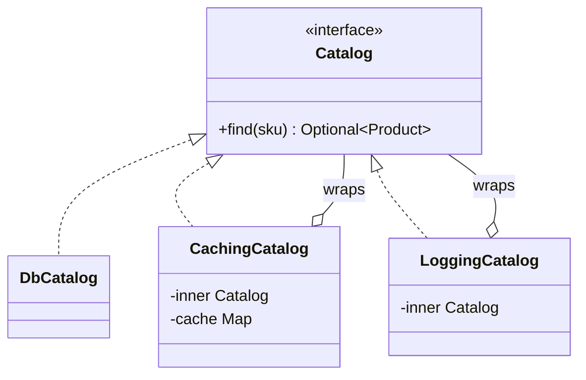
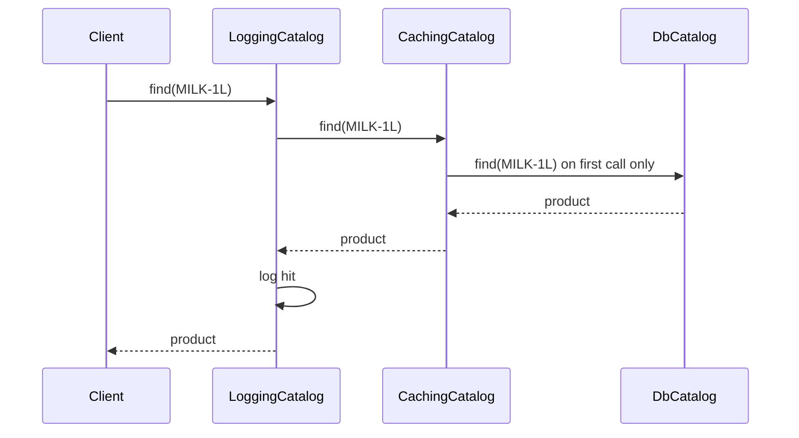

# Decorator

<span class="badge-l1">L1 🟢 Foundations</span> · <span class="read-time">⏱ 40 min read</span> · Prerequisites: [Adapter](adapter.md), [Strategy](strategy.md)

!!! abstract "TL;DR"
    Decorator adds behaviour to an object by wrapping it in another object with the same interface. Each wrapper adds one concern (caching, retries, logging, discounts), and wrappers stack in any order at runtime, which avoids a subclass for every combination. `java.io` streams are the classic example; resilience stacks (retry, circuit breaker, metrics) are the everyday production one.

## 1. What It Is

**Plain English.** You have a product catalog that reads from the database. You want caching. Later you want logging, then metrics. Instead of editing the catalog each time, you wrap it: a `CachingCatalog` *is a* `Catalog` and *has a* `Catalog` inside. Callers still see a `Catalog`. Add another wrapper for logging, and another for metrics, like layers of gift wrap around a box.

**Precise definition (GoF intent).** "Attach additional responsibilities to an object dynamically. Decorators provide a flexible alternative to subclassing for extending functionality." Roles:

- **Component:** the interface (`Catalog`).
- **Concrete component:** the real implementation (`DbCatalog`).
- **Decorator:** implements the component and holds one (`CachingCatalog`), adding behaviour before or after delegating.

Also called **wrapper**.

## 2. Why It Exists

Adding features through inheritance multiplies classes: cached, logged, cached-and-logged, retried-cached-logged... one subclass per combination. It also fixes the combination at compile time. Decorator puts each feature in its own class and combines them at runtime by wrapping, so *n* features need *n* classes, not 2ⁿ, and each feature can be turned on per environment or per customer.

## 3. Mental Model / Analogy

**Analogy.** A FreshCart gift hamper: the basket of groceries (the component) goes into cellophane (decorator 1), gets a ribbon (decorator 2) and a card (decorator 3). Each layer adds something, and it's still "a hamper" you can hand over. You can skip the ribbon, or add the card before the cellophane, and you never needed a "hamper-with-cellophane-and-ribbon" product.

**Technical model.** A decorator implements the same interface as its inner object, forwards calls to it, and adds behaviour around the forwarding. Because the types match, decorators can wrap other decorators.

## 4. How It Works





## 5. Subtopics

### Decorator structure

**Description.** A decorator implements the component interface, receives a component in its constructor, delegates the call, and changes the input or output. With records, a decorator is often a one-liner.

**Advantages / features.** Single responsibility per class; behaviour added without touching the original; combinations chosen at runtime.

```java title="DecoratorStructureDemo.java"
--8<-- "examples/l1-foundations/decorator/DecoratorStructureDemo.java"
```

1. One small interface: the contract every layer keeps.
2. A decorator *is* a `PriceCalculator` and *has* one.
3. Delegate first, then adjust the result.
4. Layers combine freely: discount first, then tax on the discounted price.

**Run it:** `java DecoratorStructureDemo.java`

```text
--8<-- "examples/l1-foundations/decorator/DecoratorStructureDemo.expected.txt"
```

| Pros | Cons |
|------|------|
| One class per feature, combined at runtime | Many small objects; stack traces get deeper |
| Original class untouched (OCP) | Object identity differs from the inner object |
| Features toggled per environment or customer | Interfaces with many methods make decorators tedious |

**Use it** to add cross-cutting or optional behaviour to an interface you control. **Avoid it** for interfaces with dozens of methods; consider a dynamic proxy or AOP.
**Real-world Java:** `java.io` streams, `Collections.unmodifiableList`, `Collections.synchronizedMap`, Spring's `TransactionAwareDataSourceProxy`, Servlet `HttpServletRequestWrapper`.
**Best practice:** keep decorator interfaces small. **Gotcha:** a decorator must forward *every* method, including defaults; a forgotten method silently skips the inner object's behaviour.

### Stacking decorators

**Description.** Decorators wrap decorators. The *order* matters: the outermost runs first on the way in and last on the way out. Retry outside logging logs every attempt; logging outside retry logs one call.

**Advantages / features.** Flexible pipelines; each layer reusable; the composition is visible in one place.

```java title="StackingDecoratorsDemo.java"
--8<-- "examples/l1-foundations/decorator/StackingDecoratorsDemo.java"
```

1. Logging outside retry: the log shows one call that succeeded (the failed attempt is hidden).
2. Retry outside logging: every attempt is logged, including the failure.

**Run it:** `java StackingDecoratorsDemo.java`

```text
--8<-- "examples/l1-foundations/decorator/StackingDecoratorsDemo.expected.txt"
```

| Common order (outermost first) | Why |
|--------------------------------|-----|
| Metrics | Sees every outcome, including fast failures |
| Circuit breaker | Fails fast before spending retries |
| Retry | Retries only real calls |
| Timeout | Bounds each attempt |
| Actual client | Does the work |

**Use** an explicit, documented order. **Avoid** building stacks in many places; assemble in the composition root.
**Real-world Java:** Resilience4j's `Decorators.ofSupplier(...).withCircuitBreaker(...).withRetry(...)`; Servlet filter chains (a decorator chain around the servlet).
**Best practice:** write the stack order as a comment or diagram next to where it's built. **Gotcha:** retry outside a circuit breaker multiplies calls during outages; put the breaker outside.

### `java.io` streams as decorators

**Description.** `InputStream` and `OutputStream` subclasses wrap other streams: `BufferedInputStream` adds buffering, `GZIPInputStream` adds decompression, `InputStreamReader` (an adapter) turns bytes into characters. `FilterInputStream` is the JDK's base class for writing your own.

**Advantages / features.** Any combination of buffering, compression, encryption and counting with a handful of classes.

```java title="JavaIoDecoratorsDemo.java"
--8<-- "examples/l1-foundations/decorator/JavaIoDecoratorsDemo.java"
```

1. Our own decorator via `FilterInputStream`: count bytes passing through.
2. Writing: buffering → characters to bytes → gzip → the "file".
3. Reading: the "file" → count → gunzip → bytes to characters → buffered lines.

**Run it:** `java JavaIoDecoratorsDemo.java`

```text
--8<-- "examples/l1-foundations/decorator/JavaIoDecoratorsDemo.expected.txt"
```

| Stream | Role |
|--------|------|
| `BufferedInputStream`/`BufferedReader` | Decorator: buffering, `readLine` |
| `GZIPInputStream`, `CipherInputStream` | Decorator: decompression, decryption |
| `DataInputStream` | Decorator: read primitives |
| `InputStreamReader` | Adapter: bytes to characters |
| `FilterInputStream` | Base class for your own decorators |

**Use** stream decorators for I/O pipelines. **Avoid** forgetting to close the outermost stream; closing it closes the whole chain.
**Real-world Java:** every file, network and compression pipeline in the JDK.
**Best practice:** always specify a charset in readers and writers. **Gotcha:** override both `read()` and `read(byte[], int, int)` in a `FilterInputStream` decorator; the bulk method doesn't call the single-byte one.

### Functional decorators with `Function.andThen`

**Description.** When the interface is a single function, decorating is function composition: `f.andThen(g)` runs `f` then `g`; `f.compose(g)` runs `g` first. Higher-order functions (`memoised(supplier)`) wrap any function generically.

**Advantages / features.** No classes at all; generic decorators reusable across types.

```java title="FunctionalDecoratorDemo.java"
--8<-- "examples/l1-foundations/decorator/FunctionalDecoratorDemo.java"
```

1. A generic decorator that counts calls to any `Supplier`.
2. A generic memoising decorator: call once, then reuse the result (not thread-safe as written).
3. A pricing pipeline built by composition; order changes the result.

**Run it:** `java FunctionalDecoratorDemo.java`

```text
--8<-- "examples/l1-foundations/decorator/FunctionalDecoratorDemo.expected.txt"
```

| Pros | Cons |
|------|------|
| Minimal code | Only for single-method interfaces |
| Generic wrappers (memoise, time, count) | No names in stack traces or logs |
| Pipelines read left to right | `compose` vs `andThen` order is easy to get backwards |

**Use it** for small, pure transformations and generic wrappers. **Avoid it** for stateful, configurable layers that deserve names and tests.
**Real-world Java:** `Function.andThen`, `Comparator.thenComparing`, `Predicate.and`, Reactor's `transform` operator.
**Best practice:** give composed pipelines a name (a static method). **Gotcha:** memoising with a null check re-computes when the result is legitimately `null`.

### Decorator vs. Proxy vs. inheritance

**Description.** **Inheritance** adds behaviour at compile time, one subclass per combination. **Decorator** adds behaviour at runtime by wrapping, and is meant to be stacked. **[Proxy](../l2-practitioner/proxy.md)** has the same structure as a decorator but a different intent: it *controls access* to the object (permissions, lazy loading, remote calls), and is often generated (JDK dynamic proxies, Spring AOP).

**Advantages of knowing the difference.** You pick the simplest mechanism, and you recognise what Spring is doing when it wraps your beans.

```java title="DecoratorVsProxyVsInheritanceDemo.java"
--8<-- "examples/l1-foundations/decorator/DecoratorVsProxyVsInheritanceDemo.java"
```

1. Inheritance needs a class for each combination of features.
2. A JDK dynamic proxy: one handler intercepts every method of the interface.
3. The proxy controls access: guests can't call `price` at all.

**Run it:** `java DecoratorVsProxyVsInheritanceDemo.java`

```text
--8<-- "examples/l1-foundations/decorator/DecoratorVsProxyVsInheritanceDemo.expected.txt"
```

| | Inheritance | Decorator | Proxy |
|---|---|---|---|
| When combined | Compile time | Runtime | Runtime |
| Intent | Specialise | Add behaviour | Control access |
| Stacking | No | Yes, by design | Possible, not the point |
| Usually written by | You | You | Often generated (JDK, CGLIB, Spring) |
| Example | `DarkStore extends Fulfilment` | `BufferedInputStream` | Spring `@Transactional` bean, lazy JPA entity |

**Use inheritance** for true "is-a" specialisation, **Decorator** for optional features, **Proxy** for access control and transparent infrastructure.
**Real-world Java:** `java.lang.reflect.Proxy`, Spring AOP proxies, Hibernate lazy-loading proxies, `Collections.unmodifiableList` (protection proxy or decorator, depending on who you ask).
**Best practice:** for many methods and cross-cutting concerns, prefer a dynamic proxy or AOP over hand-written decorators. **Gotcha:** Spring proxies don't intercept *self-calls* (`this.method()`), so `@Transactional` on an internally called method does nothing.

## 6. Examples (exactly 3, progressively harder)

### Example 1: Minimal (L1)

**Scenario:** Product labels in the app show badges: organic, bestseller, low stock. Any product can have any mix.

```java title="ProductBadgeDemo.java"
--8<-- "examples/l1-foundations/decorator/ProductBadgeDemo.java"
```

1. Each badge is a decorator wrapping a label.
2. A decorator can decide not to add anything (stock above five).

**Run it:** `java ProductBadgeDemo.java`

**Output:**

```text
--8<-- "examples/l1-foundations/decorator/ProductBadgeDemo.expected.txt"
```

**What to notice:**

- Three badges, eight possible combinations, three classes.
- Sugar with plenty of stock shows no "low stock" text.

### Example 2: Realistic (in FreshCart grocery delivery)

**Scenario:** The catalog is read on every app screen. Add caching (including "not found" results) and logging without changing the database catalog or any caller, and allow evicting an entry when a price changes.

```java title="CachingCatalogDemo.java"
--8<-- "examples/l1-foundations/decorator/CachingCatalogDemo.java"
```

1. `computeIfAbsent` caches the result, including `Optional.empty()` for missing SKUs.
2. Eviction for when a product changes.
3. Logging decorator: records hits and misses.
4. The stack is assembled in one place; callers just get a `Catalog`.

**Run it:** `java CachingCatalogDemo.java`

**Output:**

```text
--8<-- "examples/l1-foundations/decorator/CachingCatalogDemo.expected.txt"
```

**What to notice:**

- Six lookups cost three database queries.
- The missing `GHEE-500` was cached too ("negative caching"): good for load, but a newly added product stays "missing" until evicted, so real caches give missing entries a short TTL.

### Example 3: Production-grade

**Scenario:** Checkout asks the remote inventory service whether items are available. The service sometimes fails. Requirements: retry a transient failure once; after repeated failures stop calling for 30 seconds (circuit breaker) so the service can recover and checkout fails fast; count every outcome; and test each behaviour separately with a controllable clock.

```java title="ResilientClientDemo.java"
--8<-- "examples/l1-foundations/decorator/ResilientClientDemo.java"
```

1. Retry: only transient errors, only up to the limit.
2. Open circuit: fail immediately without touching the remote service.
3. Open after consecutive failed *requests* (each already retried).
4. Metrics outermost, so it counts fast failures from the breaker too.
5. The stack, outermost first: metrics → circuit breaker → retry → remote client.

**Run it:** `java ResilientClientDemo.java`

**Output:**

```text
--8<-- "examples/l1-foundations/decorator/ResilientClientDemo.expected.txt"
```

**What to notice:**

- Requests 4 and 5 failed instantly with `CircuitOpen`, sparing the struggling service.
- After the cool-down, request 6 was let through, succeeded, and closed the circuit.
- Six remote calls for six requests, even with retries, because the breaker stopped wasted calls.

## 7. Pros, Cons & Trade-offs

| Aspect | Pros | Cons |
|--------|------|------|
| Simplicity | One concern per class | Many small classes; wiring must be understood |
| Extensibility | New features without editing existing code | Interface changes ripple through every decorator |
| Performance | Each layer is cheap | Deep stacks add calls and allocations |
| Operability | Features toggled by configuration | Debugging needs to know the stack order |
| Testability | Each decorator tested with a fake inner object | Stack-order bugs need integration tests |
| Learning curve | Familiar from `java.io` | Confusion with Proxy and Adapter |

## 8. When to Use / When NOT to Use

**Use it when:**

- you need optional, combinable behaviours (caching, retries, metrics, formatting);
- you can't or shouldn't modify the original class;
- behaviours vary by environment or customer.

**Don't use it when:**

- the interface is large and every decorator would forward dozens of methods: use a dynamic proxy or AOP;
- you need to change the interface: use [Adapter](adapter.md);
- there's one fixed extra behaviour: just add it to the class.

## 9. Best Practices

1. **One concern per decorator.** *(Consensus.)*
2. **Assemble stacks in the composition root,** with the order documented. *(Consensus.)*
3. **Put metrics outermost and circuit breakers outside retries.** *(Consensus in resilience engineering.)*
4. **Keep component interfaces small** so decorators stay short. *(Consensus.)*
5. **Inject clocks and sleepers** into time-based decorators. *(Consensus.)*
6. **Prefer a proven library (Resilience4j) for resilience decorators in production.** *(Opinion; strongly recommended.)*

## 10. Pitfalls & Anti-Patterns

!!! danger "Retry storm through the wrong order"
    **Symptom:** during an outage, the inventory service received 9x normal traffic.
    **Root cause:** retry (3 attempts) wrapped *outside* a client that itself retried 3 times; no circuit breaker.
    **Fix:** one retry layer, a circuit breaker outside it, and backoff with jitter.

!!! danger "Stale prices from a cache decorator (production failure mode)"
    **Symptom:** customers were charged old prices for an hour after a price update.
    **Root cause:** the caching decorator had no TTL and nothing evicted entries on price changes.
    **Fix:** TTL plus eviction on change events ([Observer](observer.md)), and never cache prices used at payment without a check.

!!! danger "Decorator forgets a method"
    **Symptom:** bulk reads skipped decryption.
    **Root cause:** a `FilterInputStream` decorator overrode `read()` but not `read(byte[], int, int)`.
    **Fix:** override every method that matters, and test each one.

!!! danger "Identity checks across decorators"
    **Symptom:** `if (catalog == dbCatalog)` is false, and a feature silently turns off.
    **Root cause:** code compared object identity or used `instanceof` on a decorated component.
    **Fix:** depend on behaviour through the interface, never on concrete types.

## 11. Configuration & Tuning

| Setting | Default | What it does | When to change it | Risk of changing |
|---------|---------|--------------|-------------------|------------------|
| Retry attempts (Example 3) | 2 | Total tries per request | Error profile of the service | More load during outages |
| Breaker threshold | 2 consecutive failures | When to open | Noisy vs stable services | Too low: opens on blips; too high: slow protection |
| Breaker cool-down | 30 s | Time before a trial call | Service recovery time | Too short: hammering; too long: slow recovery |
| Cache TTL (Example 2) | none (demo) | Staleness limit | Always set one in production | Long TTL: stale data; short: more load |

## 12. Security Considerations

- Logging decorators can leak personal data; redact before logging.
- Authorisation belongs in a proxy or service layer that can't be bypassed; a decorator that's optional in wiring is optional in security too.
- Caching decorators must include the user or tenant in the cache key when results differ per user.

## 13. Performance & Scalability

Each decorator adds a method call (often inlined by the JIT) and maybe an allocation. The performance gains usually dominate: caching removes I/O, circuit breakers stop wasted calls, buffering cuts system calls. Keep shared decorator state thread-safe (`ConcurrentHashMap`, synchronised breaker state) and watch lock contention in very hot paths.

## 14. Testing It

Each decorator is tested with a scripted inner object and a controllable clock:

```java title="CircuitBreakerDecoratorTest.java"
--8<-- "examples/l1-foundations/decorator/CircuitBreakerDecoratorTest.java"
```

Add one integration test for the assembled stack to catch ordering mistakes.

## 15. Observability & Operations

Metrics decorators are the cleanest way to instrument clients: count outcomes by type, time each call, and export circuit breaker state as a gauge (closed, open, half-open). Alert when a breaker opens; it's an early signal that a dependency is unhealthy. Log stack composition at startup.

## 16. Version Notes

| Java | Change relevant to Decorator |
|------|------------------------------|
| 1.0 | `java.io` stream decorators |
| 1.2 | `Collections.unmodifiable*` and `synchronized*` wrappers |
| 1.3 | `java.lang.reflect.Proxy` dynamic proxies |
| 8 | `Function.andThen`, `compose`; default methods (decorators must forward them too) |
| 16 | Records: one-line decorators |
| 21 | Virtual threads make blocking decorators (retry with sleep) cheaper per request |

## 17. Expert Deep Dive

- **Decorators are the shape of middleware.** Servlet filters, Spring interceptors, gRPC interceptors, OkHttp interceptors and Netty pipelines are all decorator chains. Understanding ordering there is the same skill as in Example 3.
- **Default methods and decorators.** Adding a default method to a decorated interface means every decorator inherits the default *instead of forwarding*, silently bypassing the inner object's override. Review every decorator when an interface gains a method.
- **Generated decorators.** At scale, teams generate decorators (annotation processors, AOP) for metrics and tracing so every client is instrumented consistently.
- **Bulkheads and timeouts** are decorators too; a complete resilience stack is timeout → retry → circuit breaker → bulkhead → metrics, tuned per dependency. See [Resilience Patterns](../l4-senior/resilience-patterns.md).

!!! example "War story: the cache that cached the error"
    A team wrapped a slow pricing service in a caching decorator. During a short pricing outage, the service returned an "empty price list" instead of an error, and the cache stored it for 6 hours. Checkout showed "price unavailable" for every product long after the service recovered. The fix: the decorator only cached successful, non-empty responses, used a short TTL for anything unusual, and exposed a manual flush. **Lesson:** a caching decorator must decide what is safe to cache; "whatever came back" is not a policy.

## 18. Interview Corner

=== "🟢 L1–L2"

    1. **What is Decorator?** A wrapper with the **same interface** that **adds behaviour** and delegates.
    2. **Give a JDK example.** **`BufferedInputStream`**, `GZIPInputStream`, `Collections.unmodifiableList`.
    3. **Why not use inheritance?** **Combination explosion** and **compile-time-only** choices.
    4. **Can decorators wrap decorators?** **Yes**, that's the point: they **stack**.
    5. **Decorator vs Adapter?** Decorator **keeps** the interface; Adapter **changes** it.

=== "🟡 L3"

    1. **Why does decorator order matter?** Outer layers **see and control** what inner layers do (retry/log, breaker/retry).
    2. **Decorator vs Proxy?** Same structure; **Proxy controls access**, Decorator **adds behaviour**.
    3. **Why don't Spring proxies intercept self-calls?** The call goes to **`this`, not the proxy**.
    4. **What's the risk with default methods?** Decorators **inherit defaults instead of forwarding**, bypassing the inner object.
    5. **How do you test a decorator?** With a **fake inner component** and controlled time.

=== "🔴 L4–L5"

    1. **Design a resilience stack for a payment call.** **Timeout per attempt, limited retries only for idempotent calls, circuit breaker, bulkhead, metrics outermost**.
    2. **When do hand-written decorators stop scaling?** **Many interfaces or methods**; use **AOP, interceptors or code generation**.
    3. **How do you make a caching decorator safe?** **TTLs, tenant-aware keys, cache only successes**, eviction on change, stampede protection.
    4. **How do you roll out a new decorator safely?** **Feature-flag it in wiring**, shadow mode for caches, dashboards per layer.
    5. **Now 10x traffic and the breaker opens constantly. What do you check?** **Thresholds vs normal error rate**, timeouts, downstream capacity, and whether retries amplify load.

=== "💻 Hands-on"

    **Task:** Write a `Timing` decorator for `InventoryClient` that records each call's duration using an injected clock.

    ??? success "Solution"
        ```java
        record Timing(InventoryClient inner, java.util.function.Supplier<java.time.Instant> clock,
                      java.util.List<java.time.Duration> durations) implements InventoryClient {
            public int available(String store, String sku) {
                var start = clock.get();
                try { return inner.available(store, sku); }
                finally { durations.add(java.time.Duration.between(start, clock.get())); }
            }
        }
        ```
        `finally` records failures too; the injected clock keeps tests deterministic.

## 19. Practice

- [ ] Add a TTL to `CachingCatalog` using an injected clock.
    ??? tip "Hint"
        Store `(value, expiresAt)` pairs and reload when `clock.instant()` is past `expiresAt`.
- [ ] Swap the order of `Retry` and `CircuitBreaker` in `ResilientClientDemo` and explain the new remote call count.
    ??? tip "Hint"
        With retry outside, each request can hit an open breaker twice and failures count per attempt.
- [ ] Write a `FilterOutputStream` decorator that counts bytes written.
    ??? tip "Hint"
        Override `write(int)` and `write(byte[], int, int)`.
- [ ] Find a Servlet filter or Spring interceptor chain in a project and draw its decorator order.
    ??? tip "Hint"
        Check `@Order` annotations or filter registration order.

## 20. Quick Revision Card

!!! tip "Remember in 30 seconds"
    - Intent: add behaviour by wrapping with the same interface; stack at runtime.
    - One concern per decorator; assemble in one place; order matters.
    - Resilience order: metrics → breaker → retry → timeout → client.
    - `java.io` streams are decorators; `InputStreamReader` is an adapter.
    - Proxy = same shape, controls access; inheritance = compile-time, combination explosion.

    ```java
    InventoryClient client = new Metrics(new CircuitBreaker(new Retry(remote, 2), 2, Duration.ofSeconds(30), clock));
    ```

## 21. Further Reading

- Gamma et al., *Design Patterns* (1994): Decorator.
- Michael T. Nygard, *Release It!*, 2nd edition (2018), on circuit breakers, timeouts and bulkheads.
- [Resilience4j documentation](https://resilience4j.readme.io/docs/getting-started)
- [java.io.FilterInputStream API documentation](https://docs.oracle.com/en/java/javase/21/docs/api/java.base/java/io/FilterInputStream.html)

---

[← Previous: Adapter](adapter.md) · [Next: Facade →](facade.md)
