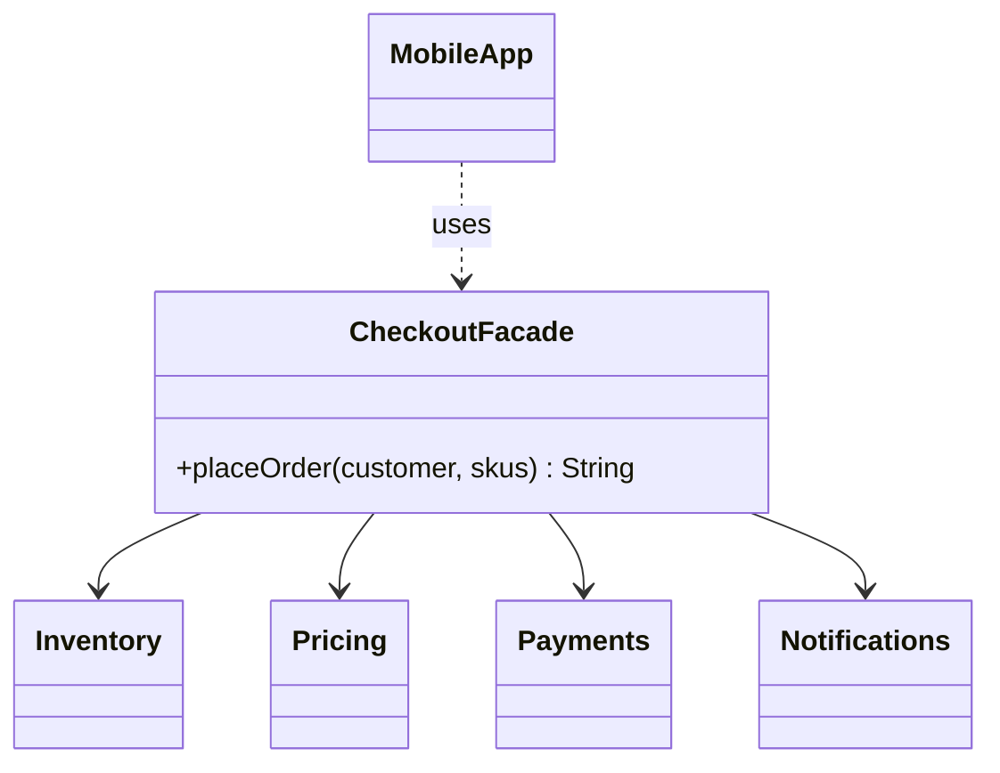
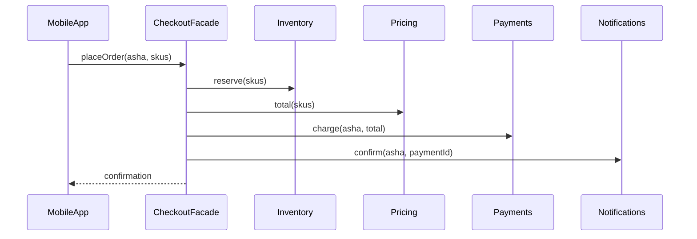

# Facade

<span class="badge-l1">L1 🟢 Foundations</span> · <span class="read-time">⏱ 35 min read</span> · Prerequisites: [Adapter](adapter.md), [Decorator](decorator.md)

!!! abstract "TL;DR"
    Facade gives a complicated set of classes one simple entry point for a common task, like "place order" or "get delivery quote". The client calls one method; the facade coordinates the subsystems in the right order. Keep facades focused on one use-case area, keep business rules in services or the domain, and use facades as the public face of modules.

## 1. What It Is

**Plain English.** Placing a FreshCart order touches inventory, coupons, payments, orders and notifications, in a specific order, with undo steps if something fails. The mobile app shouldn't need to know any of that. A `PlaceOrderFacade` offers one method, `place(order)`, and does the coordination behind it, like a hotel concierge who books your taxi, table and tickets with one request.

**Precise definition (GoF intent).** "Provide a unified interface to a set of interfaces in a subsystem. Facade defines a higher-level interface that makes the subsystem easier to use." Roles:

- **Facade:** the simple entry point (`CheckoutFacade`).
- **Subsystem classes:** do the real work; they don't know the facade exists.
- **Client:** uses the facade, and may still use subsystems directly when it needs more control.

## 2. Why It Exists

Without a facade, every client repeats the same coordination: call A, then B with A's result, then C, handle failures. Clients become coupled to many subsystem classes and their call order, and a change in one subsystem ripples into every client. A facade puts the coordination in one place, shrinks the client's dependencies to one, and gives the subsystem team freedom to change internals.

## 3. Mental Model / Analogy

**Analogy.** The FreshCart store front desk. A customer says "I want to return this item". The desk talks to the stockroom, the refunds system and the loyalty program. The customer never needs to know those departments exist, and the departments still work fine when staff use them directly.

**Technical model.** A facade is a class with a few high-level methods, holding references to subsystem objects, translating a client's request into a sequence of subsystem calls.

## 4. How It Works





## 5. Subtopics

### Facade structure

**Description.** A facade class takes its subsystems as constructor dependencies and exposes one method per common task. It coordinates; it doesn't hide or replace the subsystems, which stay usable directly.

**Advantages / features.** Clients depend on one class; coordination written once; subsystem internals can change freely.

```java title="FacadeStructureDemo.java"
--8<-- "examples/l1-foundations/facade/FacadeStructureDemo.java"
```

1. Without a facade, the client creates and orders four subsystems itself.
2. The facade receives subsystems through its constructor (testable, swappable).
3. One method for the whole task.
4. A facade doesn't lock subsystems away; advanced clients can still use them.

**Run it:** `java FacadeStructureDemo.java`

```text
--8<-- "examples/l1-foundations/facade/FacadeStructureDemo.expected.txt"
```

| Pros | Cons |
|------|------|
| Simple API for common tasks | Another layer to maintain |
| Clients decoupled from subsystem details | Can hide useful options if it's the only way in |
| Coordination logic in one place | Tends to grow into a "god" class |

**Use it** when clients repeatedly coordinate the same subsystems. **Avoid it** as a pass-through layer that adds nothing.
**Real-world Java:** `javax.faces.context.FacesContext`, SLF4J's `LoggerFactory` (a facade over logging frameworks), Spring's `JdbcClient`, `java.net.http.HttpClient` over connection, TLS and HTTP/2 machinery.
**Best practice:** name facade methods after user intents (`placeOrder`, `reorder`). **Gotcha:** a facade that mirrors every subsystem method one-to-one is just indirection.

### Facade vs. service layer

**Description.** A **facade** simplifies access: it assembles, delegates and translates, but adds no business rules. A **service layer** (application service) owns a use case: business rules, validation, transactions. In practice, an application service often *acts* as a facade for its clients too; the distinction is where business decisions live.

**Advantages of keeping them distinct.** Rules don't get buried in "convenience" code; aggregation facades (for screens) stay simple.

```java title="FacadeVsServiceLayerDemo.java"
--8<-- "examples/l1-foundations/facade/FacadeVsServiceLayerDemo.java"
```

1. A facade that assembles a product page from three sources; no decisions.
2. A service that enforces stock and per-customer limits: business rules.

**Run it:** `java FacadeVsServiceLayerDemo.java`

```text
--8<-- "examples/l1-foundations/facade/FacadeVsServiceLayerDemo.expected.txt"
```

| | Facade | Service layer |
|---|---|---|
| Purpose | Make subsystems easy to use | Implement a use case |
| Business rules | None (or trivial) | Yes |
| Transactions | Usually not | Usually owns them |
| Typical client | UI, other modules, BFF | Controllers, message handlers |
| Example | Product page aggregator | `BasketService.add` with limits |

**Use** a facade for aggregation and simplification; **a service** for decisions. **Avoid** putting rules in screen aggregators, where other clients can't reuse them.
**Real-world Java:** Spring `@Service` classes (service layer), Backend-for-Frontend aggregators (facades).
**Best practice:** if a facade starts making decisions, move them into a service or the domain. **Gotcha:** two facades each implementing "the same" rule slightly differently.

### Avoiding the god facade

**Description.** A single facade for the whole system (`FreshCartFacade` with 40 methods and 14 dependencies) becomes a bottleneck: everyone edits it, it's hard to test, and it couples unrelated areas. Split facades by use-case area or team ownership.

**Advantages / features.** Small, owned facades; fewer merge conflicts; clear boundaries.

```java title="GodFacadeDemo.java"
--8<-- "examples/l1-foundations/facade/GodFacadeDemo.java"
```

1. One facade depending on everything.
2. Split by use-case area: each facade has a few dependencies and one owner.
3. Shared subsystems are fine; shared *facades* are what cause trouble.

**Run it:** `java GodFacadeDemo.java`

```text
--8<-- "examples/l1-foundations/facade/GodFacadeDemo.expected.txt"
```

| Smell | Threshold (rule of thumb) | Fix |
|-------|---------------------------|-----|
| Constructor dependencies | More than about 6 | Split by use case |
| Public methods on unrelated topics | Checkout + reports + passwords | One facade per area |
| Many teams editing it | Weekly merge conflicts | Give each team its own |
| Huge test setup | Mocks for everything | Smaller facades |

**Use** one facade per area (checkout, delivery, account, support). **Avoid** one per class (too fine) or one per system (too coarse).
**Real-world Java:** legacy "ServiceLocator" and "Manager" classes are typical god facades.
**Best practice:** align facades with teams and bounded contexts. **Gotcha:** splitting by technical layer (`DbFacade`, `ApiFacade`) instead of use case doesn't reduce coupling.

### Facades at module boundaries

**Description.** In a modular monolith or library, each module exposes a small public facade (an interface plus DTOs), and everything else is internal: package-private classes or a non-exported JPMS package. Other modules can only use the facade, so the module's internals can change without breaking them.

**Advantages / features.** Enforced boundaries; stable contracts; a module can later become a separate service behind the same interface.

```java title="ModuleBoundaryFacadeDemo.java"
--8<-- "examples/l1-foundations/facade/ModuleBoundaryFacadeDemo.java"
```

1. Public DTOs: plain data, no internal types.
2. The module's public facade, with a factory method.
3. Internal types: invisible outside the module.
4. Internal `Slot` objects become DTOs before leaving the module.

**Run it:** `java ModuleBoundaryFacadeDemo.java`

```text
--8<-- "examples/l1-foundations/facade/ModuleBoundaryFacadeDemo.expected.txt"
```

| Boundary tool | Enforces | Notes |
|---------------|----------|-------|
| Package-private classes | Hidden within a package | Simple; one package per module |
| JPMS `exports` | Only exported packages visible | Strongest in plain Java |
| ArchUnit tests | Rules like "checkout may only use delivery.api" | Works without JPMS |
| Spring Modulith | Module structure and events | Spring-specific, verifies boundaries |

**Use** module facades in any codebase with several teams. **Avoid** exposing internal entities through the facade.
**Real-world Java:** the JDK's own modules (`java.net.http` exports only API packages); Spring Modulith's module API packages.
**Best practice:** return DTOs or records, never internal entities. **Gotcha:** a facade returning a JPA entity lets other modules lazy-load and modify your internals.

## 6. Examples (exactly 3, progressively harder)

### Example 1: Minimal (L1)

**Scenario:** The app's "Reorder" button adds the items from the last order to the basket, skipping anything no longer available.

```java title="ReorderFacadeDemo.java"
--8<-- "examples/l1-foundations/facade/ReorderFacadeDemo.java"
```

1. One method coordinates order history, catalog and basket.
2. The result tells the app what was added and what wasn't, so it can tell the customer.

**Run it:** `java ReorderFacadeDemo.java`

**Output:**

```text
--8<-- "examples/l1-foundations/facade/ReorderFacadeDemo.expected.txt"
```

**What to notice:**

- The app makes one call instead of three, with logic it would otherwise duplicate on Android, iOS and web.
- Paneer is reported as unavailable rather than silently dropped.

### Example 2: Realistic (in FreshCart grocery delivery)

**Scenario:** The checkout screen shows one "delivery quote": whether the address is serviceable, the express ETA, and slot options with fees. Four teams own the underlying services.

```java title="DeliveryQuoteFacadeDemo.java"
--8<-- "examples/l1-foundations/facade/DeliveryQuoteFacadeDemo.java"
```

1. "Not serviceable" is a normal result with a message the app can show, not an exception.
2. The facade combines slots and fees into exactly what the screen needs.

**Run it:** `java DeliveryQuoteFacadeDemo.java`

**Output:**

```text
--8<-- "examples/l1-foundations/facade/DeliveryQuoteFacadeDemo.expected.txt"
```

**What to notice:**

- The fee rules (free over $500, evening premium) stay in the fee service; the facade only asks.
- A sealed result type makes the app handle both cases explicitly.

### Example 3: Production-grade

**Scenario:** "Place order" coordinates inventory, coupons, payments, orders and notifications. If payment is declined, the reserved stock and the coupon must be released. A network retry from the app must never charge twice. A broken SMS gateway shouldn't fail an otherwise good order. Subsystem exceptions must never reach the app.

```java title="PlaceOrderFacadeDemo.java"
--8<-- "examples/l1-foundations/facade/PlaceOrderFacadeDemo.java"
```

1. Idempotency: the first outcome for a key is stored and returned for retries.
2. Each completed step registers how to undo itself.
3. Payment is the point of no return; steps after it shouldn't undo it.
4. Non-critical steps produce warnings, not failures.
5. On failure, undo completed steps in reverse order.

**Run it:** `java PlaceOrderFacadeDemo.java`

**Output:**

```text
--8<-- "examples/l1-foundations/facade/PlaceOrderFacadeDemo.expected.txt"
```

**What to notice:**

- The retry of FC-2301 returned the same payment, and there was only one charge.
- The declined card released the coupon and the stock, in reverse order.
- Vikram couldn't reuse `WELCOME20`; his stock reservation was released.
- At the end, only the two successful orders hold stock.

## 7. Pros, Cons & Trade-offs

| Aspect | Pros | Cons |
|--------|------|------|
| Simplicity | One call per task for clients | A layer that must be kept in sync with subsystems |
| Coupling | Clients depend on one interface | The facade itself depends on many subsystems |
| Performance | Can parallelise or batch subsystem calls | Can hide expensive call chains behind one innocent method |
| Operability | One place to trace and time a use case | Failures need clear reporting of which step failed |
| Testability | Clients tested with a fake facade | Facade tests need fakes for every subsystem |
| Evolution | Subsystems change freely behind it | Facade API changes affect many clients |

## 8. When to Use / When NOT to Use

**Use it when:**

- several clients (app, web, partner API) repeat the same coordination;
- a module or library needs a small, stable public surface;
- a screen needs data from several services in one shape (Backend for Frontend).

**Don't use it when:**

- it would only forward calls one-to-one;
- you need to change an interface for compatibility: use [Adapter](adapter.md);
- you're tempted to add business rules: put them in a service or the domain.

## 9. Best Practices

1. **Name methods after user intents.** *(Consensus.)*
2. **One facade per use-case area or team; split when it grows.** *(Consensus.)*
3. **Return DTOs or result types, never internal entities or subsystem exceptions.** *(Consensus.)*
4. **Keep business rules out of facades.** *(Consensus.)*
5. **Make multi-step operations idempotent and compensate failures.** *(Consensus for payments and orders.)*
6. **Inject subsystems through the constructor.** *(Consensus.)*
7. **Enforce module facades with JPMS, ArchUnit or Spring Modulith.** *(Opinion; strongly recommended.)*

## 10. Pitfalls & Anti-Patterns

!!! danger "God facade"
    **Symptom:** a 3,000-line `PlatformFacade` that every team edits.
    **Root cause:** one facade for the whole system.
    **Fix:** split by use-case area and ownership.

!!! danger "Charged twice, no order (production failure mode)"
    **Symptom:** customers on flaky networks were charged twice, and some charges had no order.
    **Root cause:** the app retried "place order" after a timeout; the facade had no idempotency key and no compensation when saving the order failed.
    **Fix:** idempotency keys stored with outcomes, compensation for every step before payment, and reconciliation for steps after it.

!!! danger "Leaky facade"
    **Symptom:** the app crashes on `PaymentGatewayException`; another module modifies delivery's entities.
    **Root cause:** the facade returned internal types and let exceptions through.
    **Fix:** result types and DTOs only.

!!! danger "Rules in the facade"
    **Symptom:** the web and app enforce different basket limits.
    **Root cause:** each client's facade implemented the limit itself.
    **Fix:** rules in a service or the domain, used by every facade.

## 11. Configuration & Tuning

| Setting | Default | What it does | When to change it | Risk of changing |
|---------|---------|--------------|-------------------|------------------|
| Idempotency record lifetime | Forever (demo) | How long retries return the stored outcome | Always bound it (e.g. 24 h) | Too short: late retries charge again |
| Critical vs non-critical steps | Notifications non-critical | Which failures fail the whole call | New steps added | Wrong choice: lost orders or silent gaps |
| Per-subsystem timeouts | Not shown | Bound the facade's total time | Slow dependencies | Too short: false failures; too long: stuck threads |

## 12. Security Considerations

- A facade is a natural place to check that the caller may perform the whole use case (one authorisation point), but subsystems should still protect themselves.
- Don't return internal identifiers or data the client shouldn't see; DTOs make this explicit.
- Idempotency keys must be scoped to the customer, so one customer can't replay another's key.

## 13. Performance & Scalability

A facade can make things faster by calling independent subsystems in parallel (slots, fees and ETA in Example 2) or batching calls. It can also hide cost: one facade call might make ten network calls. Measure per-step timings. Note that `computeIfAbsent` in Example 3 holds a lock for the whole placement for that key; that's what you want for duplicates of the *same* key, but in production use a database row or distributed lock per key so it works across instances.

## 14. Testing It

Test the coordination rules: idempotency, compensation order and non-critical failures.

```java title="PlaceOrderFacadeTest.java"
--8<-- "examples/l1-foundations/facade/PlaceOrderFacadeTest.java"
```

Clients of the facade are tested with a fake facade, so they don't need any subsystem.

## 15. Observability & Operations

Trace each facade call as one span with a child span per step, and log the outcome with the step that failed and what was compensated. Count outcomes (`placed`, `rejected.payment`, `rejected.stock`, `warning.notification`). A rising compensation count is a signal of trouble in a downstream step.

## 16. Version Notes

| Java | Change relevant to Facade |
|------|---------------------------|
| 8 | `CompletableFuture` for parallel subsystem calls |
| 9 | JPMS modules: `exports` enforces facade boundaries |
| 11 | `java.net.http.HttpClient`, itself a facade over HTTP machinery |
| 16 | Records for DTOs |
| 17 | Sealed result types |
| 21 | Virtual threads make simple blocking parallel calls cheap; structured concurrency is in preview |

## 17. Expert Deep Dive

- **Backend for Frontend (BFF)** is Facade applied per client type: one facade service for the mobile app, one for web, each shaping data for its screens.
- **API gateways** are facades at the network edge (routing, auth, rate limiting), not places for business logic.
- **Modular monoliths** live or die by their module facades. Seniors enforce them with build tooling, because conventions erode under deadline pressure.
- **Orchestrating facades become sagas.** When steps span services and can't share a transaction, Example 3's compensation list becomes a [Saga](../l4-senior/distributed-data-patterns.md) with persisted state.

!!! example "War story: the facade that made everything slow"
    A grocery app's "home screen facade" grew to call 14 services sequentially: banners, offers, recommendations, recent orders, wallet balance and more. Each was fast alone, but the home screen took 2.8 seconds at the 95th percentile. The team split it into parallel calls with per-call timeouts and fallbacks (empty sections instead of errors), and moved rarely used sections to lazy loading. The 95th percentile dropped to 600 ms. **Lesson:** a facade hides complexity from clients, so someone must still look at what it does; measure each step.

## 18. Interview Corner

=== "🟢 L1–L2"

    1. **What is Facade?** A **simple, unified interface** over a set of subsystem classes.
    2. **Does a facade prevent using subsystems directly?** **No**, they stay usable.
    3. **Give a Java example.** **SLF4J `LoggerFactory`**, `HttpClient`, Spring `JdbcClient`.
    4. **Facade vs Adapter?** Facade **simplifies many**; Adapter **converts one** interface.
    5. **What is a god facade?** One facade **fronting everything**, with too many dependencies and owners.

=== "🟡 L3"

    1. **Facade vs service layer?** Facade **simplifies access**; service layer **owns business rules and transactions**.
    2. **How do you keep facades small?** **Split by use-case area and team ownership**.
    3. **How do facades help modular monoliths?** They're the **public API of a module**, enforced with JPMS or ArchUnit.
    4. **What should a facade return?** **DTOs or result types**, not internal entities or exceptions.
    5. **How do you handle partial failure in a multi-step facade?** **Compensation** in reverse order, plus **idempotency**.

=== "🔴 L4–L5"

    1. **Design "place order" across services.** **Saga with compensations, idempotency keys, outbox events**, and clear critical vs non-critical steps.
    2. **BFF vs general-purpose API: when do you choose BFF?** When **client needs differ significantly** and teams own their screens.
    3. **How do you migrate a module behind its facade into a microservice?** Keep the **interface**, replace the implementation with a **remote client**, add resilience.
    4. **How do you stop a facade becoming a latency trap?** **Parallel calls, timeouts, fallbacks**, per-step metrics.
    5. **Now 10x traffic and the home screen facade overloads downstream services. What do you do?** **Caching per section, request coalescing, lazy loading**, degrade non-critical sections.

=== "💻 Hands-on"

    **Task:** Make `DeliveryQuoteFacade` call slots and ETA in parallel.

    ??? success "Solution"
        ```java
        Quote quote(String pincode, long basketCents) {
            Optional<String> store = serviceability.storeFor(pincode);
            if (store.isEmpty()) return new NotServiceable(pincode, "We don't deliver to " + pincode + " yet");
            String s = store.get();
            var slotsF = CompletableFuture.supplyAsync(() -> slots.openSlots(s));
            var etaF = CompletableFuture.supplyAsync(() -> eta.expressMinutes(s));
            List<SlotOption> options = slotsF.join().stream()
                    .map(t -> new SlotOption(t + "-" + t.plusHours(1), fees.fee(s, basketCents, t))).toList();
            return new Available(s, etaF.join(), options);
        }
        ```
        In production, add timeouts (`orTimeout`) and fallbacks for each future.

## 19. Practice

- [ ] Add a "repeat last order" button that also re-applies the last coupon if it's still valid, without changing `ReorderFacade`'s callers.
    ??? tip "Hint"
        Inject a `Coupons` subsystem and extend `ReorderResult` with a coupon field.
- [ ] Add a timeout to the payment step in `PlaceOrderFacadeDemo` and decide whether it's retryable.
    ??? tip "Hint"
        A timeout after payment may have succeeded; mark the order "pending verification" and reconcile.
- [ ] Write an ArchUnit-style rule (in words) for `ModuleBoundaryFacadeDemo`.
    ??? tip "Hint"
        "Classes outside delivery may only depend on delivery's public API types."
- [ ] Find the largest "Manager" or "Facade" class in a codebase you know and sketch how to split it.
    ??? tip "Hint"
        Group its public methods by who calls them.

## 20. Quick Revision Card

!!! tip "Remember in 30 seconds"
    - Intent: one simple entry point over several subsystems.
    - Subsystems stay usable; the facade only coordinates.
    - No business rules in facades; return DTOs/result types.
    - One facade per use-case area; split god facades.
    - Multi-step facades need idempotency and compensation.

    ```java
    Outcome outcome = placeOrderFacade.place(new PlaceOrder(key, orderId, customer, skus, total, coupon));
    ```

## 21. Further Reading

- Gamma et al., *Design Patterns* (1994): Facade.
- Martin Fowler, *Patterns of Enterprise Application Architecture* (2002): Service Layer and Remote Facade.
- Sam Newman, *Building Microservices*, 2nd edition (2021), on Backend for Frontend.
- [Spring Modulith reference documentation](https://docs.spring.io/spring-modulith/reference/)

---

[← Previous: Decorator](decorator.md) · [Next: L2 Practitioner →](../l2-practitioner/index.md)
