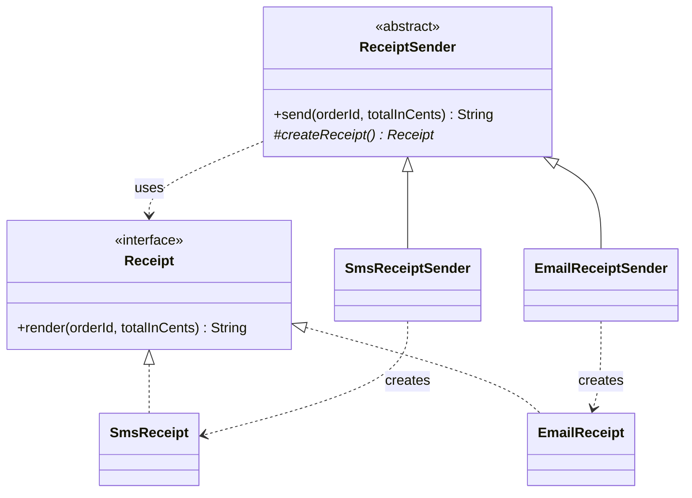
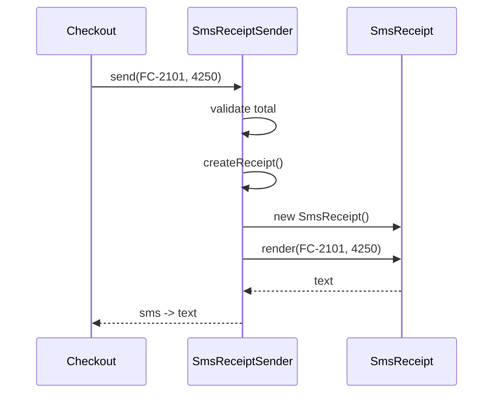

# Factory Method

<span class="badge-l1">L1 🟢 Foundations</span> · <span class="read-time">⏱ 40 min read</span> · Prerequisites: [Singleton](singleton.md), [SOLID Principles](solid-principles.md)

!!! abstract "TL;DR"
    Factory Method moves the decision "which class do I create?" out of the code that uses the object. In the classic form a base class calls an abstract `create...()` method that subclasses override. In everyday Java you'll more often see its relatives: static factory methods (`List.of`, `Money.ofCents`), parameterised factories (`switch` on a kind) and `Supplier<T>`. Use it when the concrete type varies; skip it when `new` is clear and stable.

## 1. What It Is

**Plain English.** Instead of writing `new SmsReceipt()` inside your checkout code, you ask a method to give you "a receipt". Which kind of receipt comes back is decided somewhere else: in a subclass, in a configuration lookup, or in a function you were handed. Your checkout code only knows the interface.

**Precise definition (GoF intent).** "Define an interface for creating an object, but let subclasses decide which class to instantiate. Factory Method lets a class defer instantiation to subclasses." Roles:

- **Product:** the interface the client uses (`Receipt`).
- **Concrete product:** an implementation (`SmsReceipt`, `EmailReceipt`).
- **Creator:** the class with the workflow, which calls the factory method (`ReceiptSender`).
- **Concrete creator:** overrides the factory method to pick the product (`SmsReceiptSender`).

The term is also used loosely for any method whose job is creating objects, including static factories. This page covers both, and says which is which.

## 2. Why It Exists

`new` couples the caller to one concrete class. When the class has to vary (by channel, by country, by environment, in tests), every `new` becomes an `if` chain, copied around the codebase. Adding a new variant then means editing every chain, which breaks the [Open/Closed Principle](solid-principles.md). Factory Method puts creation in one overridable or replaceable place, so the workflow code stays closed for modification and the set of products stays open for extension.

## 3. Mental Model / Analogy

**Analogy.** A FreshCart store manager's checklist says "print the receipt" for every order. The manager doesn't decide *how*; each store's setup does. The kiosk store prints a paper slip, the online store sends an email. The checklist (workflow) is the same; the "make a receipt" step is filled in per store (factory method).

**Technical model.** A factory method is a seam: one call site where the concrete type is chosen. Everything above it depends on an interface.

## 4. How It Works





The base class's `send` is a template: fixed steps, with one step (creation) left to subclasses. That's why Factory Method is often described as a special case of [Template Method](template-method.md).

## 5. Subtopics

### Classic subclass-based Factory Method

**Description.** The GoF form. An abstract creator class owns a workflow and declares an abstract (or default) `createX()` method. Each concrete creator subclass overrides it to return one concrete product.

**Advantages / features.** Workflow written once; new products added by new subclasses without touching the workflow; the creator can't forget a step because `send` is `final`.

```java title="ClassicFactoryMethodDemo.java"
--8<-- "examples/l1-foundations/factory-method/ClassicFactoryMethodDemo.java"
```

1. The factory method: subclasses decide which `Receipt` to create.
2. The workflow is `final`, so validation can't be skipped by a subclass.
3. One concrete creator per product.

**Run it:** `java ClassicFactoryMethodDemo.java`

```text
--8<-- "examples/l1-foundations/factory-method/ClassicFactoryMethodDemo.expected.txt"
```

| Pros | Cons |
|------|------|
| Workflow is shared and protected | One subclass per product: class explosion |
| New products without editing the workflow (OCP) | Inheritance couples creator and subclass |
| Creation logic is in one obvious place | Choosing *which subclass* still has to happen somewhere |

**Use it** in frameworks where users extend a base class anyway. **Avoid it** when the only thing a subclass would do is pick a type; pass a `Supplier` or use a parameterised factory instead.
**Real-world Java:** `java.util.AbstractList.iterator()` and `Collection.iterator()` (each collection creates its own `Iterator`); Spring's `AbstractApplicationContext` has overridable `create...` methods such as `createEnvironment()`.
**Best practice:** make the workflow method `final` and the factory method `protected`. **Gotcha:** don't call an overridable factory method from the creator's *constructor*: the subclass's fields aren't initialised yet.

### Parameterised factory method

**Description.** One method takes a parameter (an enum, a string, a config value) and returns the matching product. With Java 21's sealed interfaces and `switch` expressions, the compiler checks that every kind is handled.

**Advantages / features.** One place to look; exhaustive `switch`; validation of input at the boundary; no subclass per product.

```java title="ParameterisedFactoryDemo.java"
--8<-- "examples/l1-foundations/factory-method/ParameterisedFactoryDemo.java"
```

1. The factory takes the kind as a parameter.
2. A `switch` expression over an enum is exhaustive: adding `Kind.DRONE` without a case won't compile.
3. A separate method parses untrusted strings and gives helpful errors.

**Run it:** `java ParameterisedFactoryDemo.java`

```text
--8<-- "examples/l1-foundations/factory-method/ParameterisedFactoryDemo.expected.txt"
```

| Pros | Cons |
|------|------|
| All creation rules in one method | The method changes for every new kind (not strictly OCP) |
| Compiler-checked exhaustiveness with sealed types/enums | Can grow into a giant `switch` |
| Easy validation and error messages | Kinds must be known at compile time |

**Use it** when the set of products is small, known and owned by your team. **Avoid it** when third parties add products (use a registry or `ServiceLoader`).
**Real-world Java:** `java.nio.charset.Charset.forName("UTF-8")`, `java.time.ZoneId.of("Asia/Kolkata")`, JDBC `DriverManager.getConnection(url)`.
**Best practice:** parse strings into an enum first, then `switch` on the enum. **Gotcha:** a `default ->` branch on an enum switch disables the exhaustiveness check; leave it out.

### Static factory methods (Effective Java, Item 1)

**Description.** A `static` method that returns an instance, used instead of (or alongside) a public constructor: `Money.ofCents(250)`, `List.of(1, 2)`. Not the GoF pattern strictly, but the most common "factory" in Java code.

**Advantages / features (Bloch's list).** Methods have names (`ofCents` vs `parse`); they can return a cached instance; they can return a subtype; the returned class can vary between calls and releases; they can validate before construction.

```java title="StaticFactoryDemo.java"
--8<-- "examples/l1-foundations/factory-method/StaticFactoryDemo.java"
```

1. Private constructor: the static factories are the only way in.
2. A named factory says what the number means: cents, not rupees.
3. Small, frequent values are cached and shared (safe because `Money` is immutable).
4. A second factory with a different name for a different input.

**Run it:** `java StaticFactoryDemo.java`

```text
--8<-- "examples/l1-foundations/factory-method/StaticFactoryDemo.expected.txt"
```

| Pros | Cons |
|------|------|
| Descriptive names | Harder to find in Javadoc than constructors |
| Caching and instance control | Classes without public/protected constructors can't be subclassed |
| Can return subtypes or hide implementation classes | Identity (`==`) behaviour may surprise readers |
| Validation in one place | Too many factory names confuse callers |

**Use it** for value types, immutable objects and APIs that may change implementation. **Avoid it** when a plain constructor is perfectly clear and you need subclassing.
**Real-world Java:** `List.of`, `Optional.of`, `Integer.valueOf` (caches -128..127), `LocalDate.of`, `Path.of`, `EnumSet.of` (returns `RegularEnumSet` or `JumboEnumSet` by size).
**Best practice:** follow the JDK naming conventions: `of`, `from`, `valueOf`, `parse`, `getInstance`, `newInstance`, `create`. **Gotcha:** never compare cached objects with `==` in business code; `Integer.valueOf(1000) == Integer.valueOf(1000)` is `false`.

### Simple factory vs. Factory Method

**Description.** A *simple factory* is a class with a creation method that decides the type (often from a parameter); it isn't one of the GoF patterns. *Factory Method* uses inheritance: the workflow class leaves creation to its subclasses. People mix the names up constantly, so it's worth seeing them side by side.

**Advantages of knowing the difference.** You can pick the lighter tool (a simple factory is often enough), and you can talk about designs precisely in reviews and interviews.

```java title="SimpleFactoryVsFactoryMethodDemo.java"
--8<-- "examples/l1-foundations/factory-method/SimpleFactoryVsFactoryMethodDemo.java"
```

1. Simple factory: one object decides, here from a table keyed by city.
2. Factory Method: the workflow class declares `courier()` and subclasses decide.

**Run it:** `java SimpleFactoryVsFactoryMethodDemo.java`

```text
--8<-- "examples/l1-foundations/factory-method/SimpleFactoryVsFactoryMethodDemo.expected.txt"
```

| | Simple factory | Factory Method |
|---|---|---|
| Mechanism | A method decides (data, `switch`) | Subclasses override a creation method |
| Who varies | The input | The creator subclass |
| Workflow included | No, it only creates | Yes, creation is one step of it |
| Adding a product | Edit the factory (or its table) | Add a subclass |
| Best for | Choosing by config or request data | Frameworks with extensible base classes |

**Use a simple factory** when the choice depends on runtime data. **Use Factory Method** when different subclasses of a workflow need different products.
**Real-world Java:** `Calendar.getInstance(locale)` is a simple (static) factory; `AbstractList.iterator()` is a factory method.
**Best practice:** start with a simple factory; introduce subclasses only when the workflow itself differs. **Gotcha:** a simple factory with dozens of `if`s is a smell; move to a registry (`Map<String, Supplier<T>>`).

### `Supplier<T>` as a factory

**Description.** `java.util.function.Supplier<T>` is a one-method interface: `T get()`. Passing a `Supplier` is Factory Method without the subclass: the caller hands in "how to make one". Constructor references (`ArrayList::new`) are suppliers.

**Advantages / features.** No inheritance; easy to swap in tests (deterministic IDs); composes with lambdas, maps and DI.

```java title="SupplierFactoryDemo.java"
--8<-- "examples/l1-foundations/factory-method/SupplierFactoryDemo.java"
```

1. The class depends on "something that makes IDs", not on `UUID`.
2. A new ID per pick list, from whatever factory was injected.
3. Tests get predictable IDs.
4. Production gets random UUIDs, with no code change in `Picker`.
5. A constructor reference is a factory: every `get()` creates a new list.

**Run it:** `java SupplierFactoryDemo.java`

```text
--8<-- "examples/l1-foundations/factory-method/SupplierFactoryDemo.expected.txt"
```

| Pros | Cons |
|------|------|
| No subclass needed | No place for extra methods or a name for the factory |
| Trivial to fake in tests | Can't take arguments (use `Function<A, T>` then) |
| Works with constructor references and maps | Checked exceptions don't fit `get()` |

**Use it** when the only variation is "how to create one". **Avoid it** when creation needs several parameters or named operations; define a small factory interface instead.
**Real-world Java:** `ThreadLocal.withInitial(Supplier)`, `Collectors.toCollection(TreeSet::new)`, `Map.computeIfAbsent(key, Function)`, `Optional.orElseGet(Supplier)`.
**Best practice:** inject `Supplier`s for IDs, clocks-of-the-day and fresh buffers. **Gotcha:** a `Supplier` that returns the *same* object each time isn't a factory; document which one you expect.

## 6. Examples (exactly 3, progressively harder)

### Example 1: Minimal (L1)

**Scenario:** FreshCart sends order updates by SMS or push, chosen by a string from the customer's preferences.

```java title="NotifierFactoryDemo.java"
--8<-- "examples/l1-foundations/factory-method/NotifierFactoryDemo.java"
```

1. The only place that knows about concrete notifier classes.

**Run it:** `java NotifierFactoryDemo.java`

**Output:**

```text
--8<-- "examples/l1-foundations/factory-method/NotifierFactoryDemo.expected.txt"
```

**What to notice:**

- Callers only see `Notifier`; adding WhatsApp means one new class and one new case.
- An unknown channel fails with a clear message instead of a `NullPointerException` later.

### Example 2: Realistic (in FreshCart grocery delivery)

**Scenario:** Store managers download daily sales reports. The file extension decides the format, and new formats will be added.

```java title="ReportExporterDemo.java"
--8<-- "examples/l1-foundations/factory-method/ReportExporterDemo.java"
```

1. A registry: extension to factory. Adding Excel later means adding one entry.
2. The factory method: picks the exporter from the file name, case-insensitively.
3. The report code never names a concrete exporter.

**Run it:** `java ReportExporterDemo.java`

**Output:**

```text
--8<-- "examples/l1-foundations/factory-method/ReportExporterDemo.expected.txt"
```

**What to notice:**

- `.JSON` works because the extension is normalised.
- The error lists the supported formats, which saves a support ticket.
- Each call gets a fresh exporter, so exporters can keep per-file state safely.

### Example 3: Production-grade

**Scenario:** Every FreshCart store (merchant) has a payment gateway: a card network, UPI, or a sandbox for testing. The type, endpoint and timeout come from configuration. Production must never use the sandbox, development must never hit a live card network, misconfiguration must fail clearly, and each merchant's client (with its connection pool) must be created only once.

```java title="PaymentGatewayFactoryDemo.java"
--8<-- "examples/l1-foundations/factory-method/PaymentGatewayFactoryDemo.java"
```

1. One client per merchant: `computeIfAbsent` creates it at most once, even under concurrency.
2. Environment rules are enforced at creation, so a wrong config can't take a real payment in dev or a fake one in prod.
3. Missing config fails with the exact key to fix.

**Run it:** `java PaymentGatewayFactoryDemo.java`

**Output:**

```text
--8<-- "examples/l1-foundations/factory-method/PaymentGatewayFactoryDemo.expected.txt"
```

**What to notice:**

- The checkout code calls `forMerchant(id).charge(...)` and never sees a concrete gateway class.
- Two merchants, two clients created; repeated calls reuse them.
- Every misconfiguration produces a message an on-call engineer can act on.

## 7. Pros, Cons & Trade-offs

| Aspect | Pros | Cons |
|--------|------|------|
| Simplicity | Callers depend on one interface | Extra classes or indirection to read through |
| Extensibility | New products without changing callers (OCP) | Classic form needs a subclass per product |
| Performance | Factories can cache, pool and reuse | Negligible call overhead; caching adds memory |
| Operability | One place to validate config and log creation | Creation failures surface at first use, not at startup, unless you warm up |
| Testability | Swap the factory or `Supplier` for fakes | Hidden static factories are hard to replace |
| Learning curve | Familiar from the JDK (`List.of`) | Name confusion: simple factory vs Factory Method vs Abstract Factory |

## 8. When to Use / When NOT to Use

**Use it when:**

- the concrete class depends on runtime data (country, channel, config, file type);
- you want to hide implementation classes or cache instances;
- a framework's base class needs subclasses to supply a part.

**Don't use it when:**

- there's one implementation and no realistic second one: `new` is fine (YAGNI);
- a DI container already selects the implementation (Spring `@ConditionalOnProperty`, qualifiers);
- you need *families* of related products that must match: use [Abstract Factory](../l2-practitioner/abstract-factory.md);
- the object has many optional parameters: use [Builder](builder.md).

## 9. Best Practices

1. **Return interfaces, not concrete classes.** *(Consensus.)*
2. **Prefer a static factory or `Supplier` before a creator class hierarchy.** *(Consensus in modern Java.)*
3. **Validate inputs and configuration in the factory** and fail with the key or value to fix. *(Consensus.)*
4. **Switch on an enum or sealed type without `default`,** so the compiler finds missing cases. *(Consensus.)*
5. **Use a registry map** when the number of products grows past a handful. *(Opinion.)*
6. **Name factories with JDK conventions** (`of`, `from`, `parse`, `create`, `forX`). *(Consensus.)*
7. **Warm up critical factories at startup** (create production clients eagerly) so config errors stop the deployment, not the first customer. *(Opinion.)*

## 10. Pitfalls & Anti-Patterns

!!! danger "The god factory"
    **Symptom:** one `ObjectFactory.create(String type)` with 80 cases, used across the codebase.
    **Root cause:** every creation decision was centralised regardless of domain.
    **Fix:** one small factory per product family, owned by the module that owns the product.

!!! danger "Sandbox in production (production failure mode)"
    **Symptom:** orders marked paid but no money collected for two hours.
    **Root cause:** a config typo selected the sandbox gateway in production, and nothing checked the environment.
    **Fix:** enforce environment rules inside the factory (Example 3) and alert on the gateway type at startup.

!!! danger "Overridable method called from a constructor"
    **Symptom:** `NullPointerException` inside a subclass's `createX()` during construction.
    **Root cause:** the base constructor called the factory method before the subclass's fields were set.
    **Fix:** call factory methods lazily from the workflow, not from the constructor.

!!! danger "Factory that hides `new` for no reason"
    **Symptom:** `UserFactory.createUser(name)` that just does `return new User(name)`, with one implementation forever.
    **Root cause:** pattern applied by habit.
    **Fix:** delete it and use the constructor or a record.

## 11. Configuration & Tuning

| Setting | Default | What it does | When to change it | Risk of changing |
|---------|---------|--------------|-------------------|------------------|
| `<merchant>.type` (Example 3) | none, required | Selects the gateway class | New merchant or provider | Wrong type: payments fail or go to sandbox (guarded) |
| `<merchant>.timeoutMs` | 3000 | Card network call timeout | Provider SLA changes | Too low: false failures; too high: threads stuck |
| Cache small `Money` | up to 1000 cents | Shares common instances | Memory profiling shows benefit | Larger caches waste memory |

## 12. Security Considerations

- Never build class names from user input and load them with reflection (`Class.forName(userInput)`); map allowed values to factories explicitly.
- Validate configuration that selects security-relevant implementations (payment, crypto, auth providers) and fail closed.
- Don't log full configuration in factory errors; name the missing key, not the secret value.

## 13. Performance & Scalability

A factory method call costs the same as any method call, and the JIT inlines small ones. The performance wins come from what factories enable: caching immutable values (`Integer.valueOf`), reusing expensive clients per key (Example 3), and avoiding work for unused variants. Watch `computeIfAbsent` with slow creation: it holds a lock on that map bin while creating, so keep creation fast or create outside and use `putIfAbsent`.

## 14. Testing It

Test the factory's decisions directly, including the rejections:

```java title="PaymentGatewayFactoryTest.java"
--8<-- "examples/l1-foundations/factory-method/PaymentGatewayFactoryTest.java"
```

Code that *uses* a factory should accept it (or a `Supplier`) through its constructor, so its tests can hand in fakes.

## 15. Observability & Operations

Log once per created client, with the type and non-secret settings (`pune-01: card, timeout 2500ms`). Export a gauge of clients created per type and a counter of creation failures. After a deployment, a jump in creation failures is a fast signal of bad configuration.

## 16. Version Notes

| Java | Change relevant to Factory Method |
|------|-----------------------------------|
| 5 | Generics and `EnumSet.of`; typed factories |
| 8 | `Supplier<T>`, lambdas and constructor references |
| 9 | `List.of`, `Set.of`, `Map.of` immutable collection factories |
| 17 | Sealed types: closed product hierarchies |
| 21 | Pattern matching for `switch`: exhaustive factories over sealed types and enums |

## 17. Expert Deep Dive

- **The real decision is *where* the choice lives.** In a subclass (classic), in data (registry, config), in the caller (`Supplier`), or in the container (DI). Seniors pick based on who adds new products: your team (enum `switch`), other teams (registry), third parties (`ServiceLoader` or plugins).
- **`ServiceLoader` is a factory method for plugins.** JDBC drivers, `java.nio.file.spi.FileSystemProvider` and logging backends are discovered at runtime and created through it, which is how the JDK stays open for extension.
- **Factories are good startup checkpoints.** Production systems create critical clients during startup (or readiness checks) so a bad config fails the deployment and the rollout stops automatically.
- **Factory Method vs DI.** Containers made many hand-written factories unnecessary; what remains are factories for *runtime* choices (per merchant, per request), which the container can't make at wiring time. A common modern shape: the container injects a factory, and the factory makes per-key objects.

!!! example "War story: the factory that read the wrong environment"
    A grocery platform's payments team had a `GatewayFactory` that picked sandbox or live by reading an environment variable. A new staging cluster was created by copying production manifests, and the variable said `prod`. Staging test orders hit the live card network for a morning, charging test cards that, luckily, were declined. The fix: the factory refused live gateways unless *both* the environment and a signed deployment flag agreed, and it logged its choice at startup, where an alert checked it. **Lesson:** a factory that selects something dangerous should validate its inputs, not just obey them.

## 18. Interview Corner

=== "🟢 L1–L2"

    1. **What problem does Factory Method solve?** It **decouples callers from concrete classes**, so the created type can vary.
    2. **What are the roles?** **Product, concrete product, creator, concrete creator.**
    3. **Give a JDK example of a static factory.** `List.of`, **`Integer.valueOf`**, `LocalDate.of`.
    4. **Static factory vs constructor?** Static factories have **names, can cache, can return subtypes**; constructors can't.
    5. **Is a simple factory a GoF pattern?** **No**; it's a common idiom. Factory Method uses **subclasses**.

=== "🟡 L3"

    1. **Factory Method vs Abstract Factory?** Factory Method creates **one product** via a method; Abstract Factory creates **families of related products** via an object.
    2. **How does Factory Method relate to Template Method?** The factory method is often **one step of a template method**.
    3. **How do you keep a parameterised factory extensible?** Use a **registry** (`Map<Key, Supplier<T>>`) or `ServiceLoader`.
    4. **Why avoid `default` in an enum `switch` factory?** It **hides missing cases** from the compiler.
    5. **When would you inject a `Supplier<T>`?** When code needs **new instances on demand** and tests need control (IDs, buffers).

=== "🔴 L4–L5"

    1. **Design a payment gateway factory for 5,000 merchants across regions.** **Config-driven registry**, per-merchant **cached clients**, **environment guards**, startup **warm-up of top merchants**, metrics on creation failures.
    2. **Factories vs DI containers: what still needs a factory?** **Runtime choices by key or request**, which the container can't know at wiring time.
    3. **How would you let other teams add exporters without touching your code?** **`ServiceLoader` or a registration API** with a stable product interface and contract tests.
    4. **`computeIfAbsent` with slow creation under load: what happens?** Threads for **the same bin block**; move slow I/O out or use **futures as values**.
    5. **Now 10x traffic, and clients are created per request. What do you change?** **Cache per key**, add **pooling**, and **pre-create** hot clients.

=== "💻 Hands-on"

    **Task:** Add a `whatsapp` channel to `NotifierFactoryDemo` and make the factory reject blank channel names.

    ??? success "Solution"
        ```java
        record WhatsApp() implements Notifier {
            public String send(String to, String t) { return "WHATSAPP " + to + ": " + t; }
        }

        static Notifier notifierFor(String channel) {
            if (channel == null || channel.isBlank()) throw new IllegalArgumentException("channel is required");
            return switch (channel.toLowerCase(Locale.ROOT)) {
                case "sms" -> new Sms();
                case "push" -> new Push();
                case "whatsapp" -> new WhatsApp();
                default -> throw new IllegalArgumentException("unknown channel " + channel);
            };
        }
        ```

## 19. Practice

- [ ] Add a `DRONE` kind to `ParameterisedFactoryDemo` and watch the compiler point at the missing case.
    ??? tip "Hint"
        The `switch` expression has no `default`, so adding an enum constant makes it non-exhaustive.
- [ ] Add an `xlsx` exporter to `ReportExporterDemo` by changing only the registry.
    ??? tip "Hint"
        Add `"xlsx", XlsxExporter::new` to the map; write a stub exporter.
- [ ] Make `PaymentGatewayFactory` warm up a list of merchants at startup and report every error at once.
    ??? tip "Hint"
        Loop over merchant IDs, collect exceptions in a list, throw one exception with all messages.
- [ ] Find three static factories in the JDK that return different subclasses depending on input.
    ??? tip "Hint"
        `EnumSet.noneOf`, `List.of` (sizes 0-2 vs more), `Charset.forName`.

## 20. Quick Revision Card

!!! tip "Remember in 30 seconds"
    - Intent: let something other than the caller decide which class to create.
    - Classic: abstract `createX()` in a creator, overridden by subclasses.
    - Everyday Java: static factories (`of`, `valueOf`), enum `switch`, registries, `Supplier<T>`.
    - Validate and fail clearly in the factory; cache expensive products per key.
    - Not for one stable implementation; not for families (Abstract Factory) or many options (Builder).

    ```java
    static Notifier notifierFor(Channel c) {
        return switch (c) { case SMS -> new Sms(); case PUSH -> new Push(); };
    }
    ```

## 21. Further Reading

- Gamma et al., *Design Patterns* (1994): Factory Method.
- Joshua Bloch, *Effective Java*, 3rd edition, Item 1 "Consider static factory methods instead of constructors".
- [java.util.ServiceLoader API documentation](https://docs.oracle.com/en/java/javase/21/docs/api/java.base/java/util/ServiceLoader.html)
- [JEP 441: Pattern Matching for switch](https://openjdk.org/jeps/441)

---

[← Previous: Singleton](singleton.md) · [Next: Builder →](builder.md)
