# L1 · Foundations

L1 🟢 Foundations · Experience: 0–1 yr

**Goal:** after this level you can use OOP principles and the most common patterns with guidance.

**Who it's for:** engineers with roughly 0–1 yr of Java experience, or anyone who finished the previous level.

## Pages in this level

| Page | What you'll learn | Read time |
|------|-------------------|-----------|
| [OOP Refresher for Patterns](oop-refresher.md) | The four OOP pillars every pattern is built from. | 25 min |
| [SOLID Principles](solid-principles.md) | The five principles that tell you when a pattern helps. | 30 min |
| [DRY, KISS, YAGNI and Friends](other-design-principles.md) | The other principles that keep patterns honest. | 20 min |
| [Singleton](singleton.md) | One instance, global access, and why it's often a smell. | 25 min |
| [Factory Method](factory-method.md) | Let subclasses or functions decide which class to create. | 25 min |
| [Builder](builder.md) | Build complex or immutable objects step by step. | 25 min |
| [Strategy](strategy.md) | Swap algorithms at runtime behind one interface. | 25 min |
| [Observer](observer.md) | Notify many listeners when something changes. | 25 min |
| [Template Method](template-method.md) | Fix the algorithm's skeleton, let subclasses fill the steps. | 20 min |
| [Adapter](adapter.md) | Make an incompatible interface fit the one you need. | 20 min |
| [Decorator](decorator.md) | Add behaviour to an object without subclassing. | 25 min |
| [Facade](facade.md) | Give a complex subsystem one simple entry point. | 15 min |

## How the pages relate

```mermaid
flowchart LR
    L1_0["OOP Refresher for Patterns"] --> L1_1["SOLID Principles"]
    L1_1["SOLID Principles"] --> L1_2["DRY, KISS, YAGNI and Friends"]
    L1_2["DRY, KISS, YAGNI and Friends"] --> L1_3["Singleton"]
    L1_3["Singleton"] --> L1_4["Factory Method"]
    L1_4["Factory Method"] --> L1_5["Builder"]
    L1_5["Builder"] --> L1_6["Strategy"]
    L1_6["Strategy"] --> L1_7["Observer"]
    L1_7["Observer"] --> L1_8["Template Method"]
    L1_8["Template Method"] --> L1_9["Adapter"]
    L1_9["Adapter"] --> L1_10["Decorator"]
    L1_10["Decorator"] --> L1_11["Facade"]
```

## Ready for the next level when you can…

- [ ] Apply SOLID to a small class and explain which principle you used
- [ ] Implement Singleton, Factory Method, Builder, Strategy, Observer, Template Method, Adapter, Decorator and Facade from memory
- [ ] Say why you would NOT use a pattern in a given piece of code

---

[← Previous: Reading UML for Patterns](../l0-orientation/reading-uml.md) · [Next: OOP Refresher for Patterns →](oop-refresher.md)
