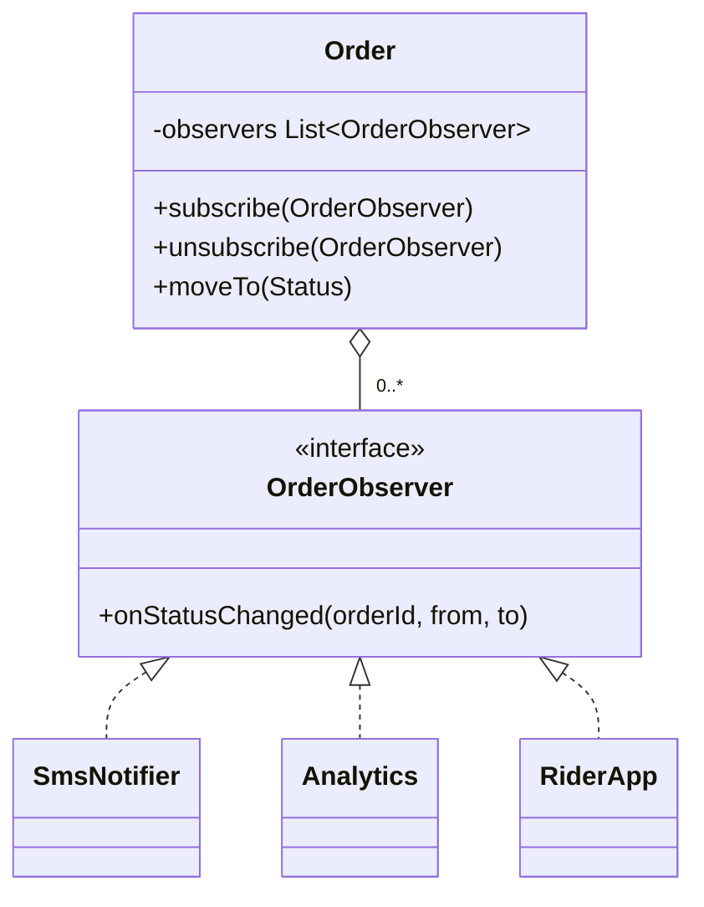
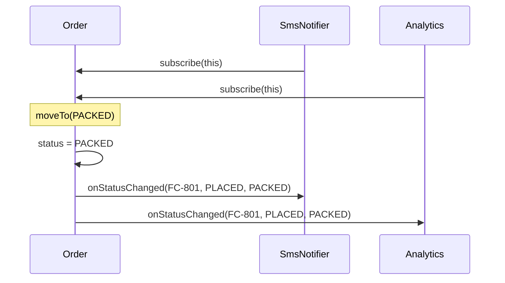

# Observer

<span class="badge-l1">L1 🟢 Foundations</span> · <span class="read-time">⏱ 45 min read</span> · Prerequisites: [Strategy](strategy.md), [SOLID Principles](solid-principles.md)

!!! abstract "TL;DR"
    Observer lets one object (the subject) notify any number of others (observers) when something happens, without knowing who they are. It's how "order placed" reaches inventory, email and loyalty without checkout calling each one. The pattern is easy; the production questions are hard: sync or async, what happens when an observer fails, and who unsubscribes.

## 1. What It Is

**Plain English.** When a FreshCart order is packed, several parts of the system care: the customer's SMS, analytics, the rider app. Instead of the order calling each of them by name, interested parties *subscribe* to the order, and the order tells all subscribers "I changed". New interested parties can join without changing the order's code.

**Precise definition (GoF intent).** "Define a one-to-many dependency between objects so that when one object changes state, all its dependents are notified and updated automatically." Roles:

- **Subject (observable):** keeps a list of observers and notifies them (`Order`).
- **Observer (listener, subscriber):** an interface with a notification method (`OrderObserver`).
- **Concrete observers:** SMS, analytics, inventory.

Also known as *listeners* (Swing, Spring `ApplicationListener`), *callbacks*, and, through a broker, *publish/subscribe*.

## 2. Why It Exists

Without Observer, the subject calls every dependent directly: `order.pack()` calls `sms.send()`, `analytics.track()`, `riderApp.notify()`. Every new dependent edits the order class, the order can't be tested without all of them, and modules depend on each other in a tangle. Observer inverts the dependency: dependents register themselves, and the subject knows only the observer interface.

## 3. Mental Model / Analogy

**Analogy.** A "notify me when back in stock" button. Customers sign up (subscribe); when stock arrives, the store messages everyone on the list (notify). The store doesn't need to know why each customer wants it, and customers can remove themselves (unsubscribe).

**Technical model.** A subject holds `List<Observer>`; a state change loops over the list calling one method. Everything else (threads, errors, ordering, memory) is a design decision you must make explicitly.

## 4. How It Works





## 5. Subtopics

### Subject and observer interfaces

**Description.** The subject offers `subscribe` and `unsubscribe`, stores observers in a thread-safe list, and calls them after its state has changed. The observer interface is small and named for the event (`onStatusChanged`).

**Advantages / features.** Subject and observers are decoupled; observers added at runtime; each observer tested alone.

```java title="SubjectObserverDemo.java"
--8<-- "examples/l1-foundations/observer/SubjectObserverDemo.java"
```

1. The observer interface: one method, named after the event, with the data observers need.
2. `CopyOnWriteArrayList` lets observers subscribe or unsubscribe while a notification is running.
3. Change state *first*, then notify, so observers see a consistent subject.
4. Unsubscribed observers stop receiving events.

**Run it:** `java SubjectObserverDemo.java`

```text
--8<-- "examples/l1-foundations/observer/SubjectObserverDemo.expected.txt"
```

| Pros | Cons |
|------|------|
| Subject doesn't know concrete observers | Control flow is harder to follow ("who reacts to this?") |
| Observers added without changing the subject (OCP) | Notification order is usually unspecified |
| Each observer testable alone | Cascades: observers triggering more events |

**Use it** when several independent parts react to one change. **Avoid it** when there's exactly one dependent and it's always the same: call it directly.
**Real-world Java:** Swing `ActionListener`, `java.util.EventListener` family, Spring `ApplicationListener` and `@EventListener`, JPA entity listeners (`@PostPersist`).
**Best practice:** notify after the state change is complete and consistent. **Gotcha:** `java.util.Observable` is deprecated since Java 9; don't use it in new code.

### Push vs. pull model

**Description.** In the **push** model, the event carries the data observers need (`StockChanged(sku, old, new)`). In the **pull** model, observers are told "something changed" and query the subject themselves.

**Advantages / features.** Push: observers don't depend on the subject's API and get exact before/after values. Pull: events stay tiny and observers read only what they need.

```java title="PushPullDemo.java"
--8<-- "examples/l1-foundations/observer/PushPullDemo.java"
```

1. A push event: an immutable record with old and new values.
2. Pull: the subject passes itself (through a read-only view).
3. The pull observer queries what it cares about, even when the change was about something else.

**Run it:** `java PushPullDemo.java`

```text
--8<-- "examples/l1-foundations/observer/PushPullDemo.expected.txt"
```

Notice the pull observer fired twice: it was told about the milk change too and re-checked eggs.

| | Push | Pull |
|---|---|---|
| Event size | Bigger, carries data | Tiny ("changed") |
| Observer coupling to subject | Low (only the event type) | Higher (needs the subject's API) |
| Old values available | Yes | No, unless the subject keeps history |
| Wasted work | Observers ignore irrelevant fields | Observers re-query even when irrelevant |
| Async / remote friendly | Yes, events can be serialised | No, the subject may have changed again |

**Use push** by default, and always for async or remote events. **Use pull** for UI models where observers re-render from current state.
**Real-world Java:** `PropertyChangeEvent` (push, with old and new values); JavaFX `InvalidationListener` (pull) vs `ChangeListener` (push).
**Best practice:** make push events immutable records. **Gotcha:** passing a *mutable* subject to observers lets them change it during notification.

### Listener management and memory leaks

**Description.** The subject holds strong references to its observers. If an observer (a screen, a session) is discarded but never unsubscribed, the subject keeps it, and everything it references, alive forever: the *lapsed listener* problem, one of the most common Java memory leaks.

**Advantages of a subscription handle.** `subscribe` returns an `AutoCloseable`; owners close it in `close()` or with try-with-resources, and forgetting becomes visible in code review.

```java title="ListenerLeakDemo.java"
--8<-- "examples/l1-foundations/observer/ListenerLeakDemo.java"
```

1. The classic API: add, with a separate remove that callers forget.
2. A better API: subscribing returns the way to unsubscribe.
3. Each screen holds large state; a leaked listener keeps all of it alive.
4. try-with-resources unsubscribes even if an exception is thrown.

**Run it:** `java ListenerLeakDemo.java`

```text
--8<-- "examples/l1-foundations/observer/ListenerLeakDemo.expected.txt"
```

| Technique | Prevents leaks | Cost |
|-----------|----------------|------|
| Subscription handle (`AutoCloseable`) | Yes, if owners close it | Owners must hold the handle |
| Lifecycle-scoped subscriptions (Android lifecycle, Spring bean scope) | Yes, automatically | Framework-specific |
| Weak references to listeners | Sometimes | Listeners can vanish unexpectedly (lambdas!) |
| Explicit `removeListener` | Only with discipline | Easy to forget |

**Use** subscription handles in your own APIs. **Avoid** weak listener lists unless you fully understand GC timing; a lambda held only weakly can be collected immediately.
**Real-world Java:** Project Reactor's `Disposable`, RxJava's `Disposable`, Android's `LifecycleObserver`.
**Best practice:** tie subscriptions to the owner's lifecycle. **Gotcha:** a lambda capturing `this` keeps the whole enclosing object alive.

### Synchronous vs. asynchronous notification

**Description.** By default observers run **synchronously** on the publisher's thread: a slow observer slows the publisher and an exception can abort it. **Asynchronous** notification hands events to an executor, isolating the publisher, at the cost of ordering, transactions and error visibility.

**Advantages / features.** Sync: simple, ordered, inside the same transaction. Async: publisher stays fast and isolated from failures.

```java title="SyncAsyncDemo.java"
--8<-- "examples/l1-foundations/observer/SyncAsyncDemo.java"
```

1. Naive sync: the publisher waits for every observer and fails if any throws.
2. Isolated sync: catch per observer, record the failure, keep going.
3. Async: each observer runs on the pool; the publisher returns immediately.
4. Wait for the pool before reading results (in a real service it keeps running).

**Run it:** `java SyncAsyncDemo.java`

```text
--8<-- "examples/l1-foundations/observer/SyncAsyncDemo.expected.txt"
```

| | Synchronous | Asynchronous |
|---|---|---|
| Publisher latency | Sum of all observers | Near zero |
| Failure isolation | Only if you catch per observer | Natural, but errors are easy to lose |
| Ordering | Deterministic | Not guaranteed across observers |
| Transactions | Same transaction as publisher | Outside it: may run before commit or after rollback |
| Back-pressure | Implicit (publisher waits) | Needs bounded queues |

**Use sync** for observers that must succeed with the publisher (stock reservation). **Use async** for side effects like email, analytics and notifications.
**Real-world Java:** Spring `@EventListener` is sync by default; add `@Async` for async, and `@TransactionalEventListener(phase = AFTER_COMMIT)` to run after the transaction commits.
**Best practice:** always catch and record per-observer failures. **Gotcha:** an async email for an order whose transaction then rolls back: the customer gets a confirmation for an order that doesn't exist.

### `java.beans.PropertyChangeSupport` and the Flow API

**Description.** The JDK ships two ready-made observer mechanisms. `PropertyChangeSupport` manages listeners per property and only fires when the value actually changes. `java.util.concurrent.Flow` (Java 9) defines Reactive Streams interfaces (`Publisher`, `Subscriber`, `Subscription`) with **back-pressure**: subscribers request how many items they're ready for. `SubmissionPublisher` is the JDK's implementation.

**Advantages / features.** No hand-written listener lists; built-in old/new values; Flow adds async delivery and back-pressure.

```java title="PropertyChangeFlowDemo.java"
--8<-- "examples/l1-foundations/observer/PropertyChangeFlowDemo.java"
```

1. A helper that stores listeners and fires `PropertyChangeEvent`s.
2. `firePropertyChange` skips the event when old and new values are equal.
3. Back-pressure: the subscriber asks for two items at a time.
4. `SubmissionPublisher` delivers asynchronously and buffers until subscribers request more.

**Run it:** `java PropertyChangeFlowDemo.java`

```text
--8<-- "examples/l1-foundations/observer/PropertyChangeFlowDemo.expected.txt"
```

| | PropertyChangeSupport | Flow / SubmissionPublisher |
|---|---|---|
| Threading | Synchronous | Asynchronous (ForkJoinPool by default) |
| Back-pressure | No | Yes (`request(n)`) |
| Granularity | Per property name | Per stream of items |
| Typical use | Models, UI binding, config | Streams of events, integration with Reactor/RxJava |

**Use** `PropertyChangeSupport` for simple model change notification; Flow when consumers can be slower than producers. **Avoid** writing your own Reactive Streams implementation; use Reactor or RxJava for complex pipelines.
**Real-world Java:** JavaBeans and Swing models; Flow interfaces are implemented by Reactor, RxJava and the JDK HTTP client's body publishers.
**Best practice:** use property name constants, not string literals scattered around. **Gotcha:** `PropertyChangeEvent` values are `Object`, so casts are needed and typos in property names fail silently.

### Observer vs. Pub/Sub

**Description.** In Observer, subscribers register *with the subject*; they know it exists. In **publish/subscribe**, publishers and subscribers only know a **broker** and a **topic name**; neither knows the other. Pub/Sub can be in-process (an event bus) or distributed (Kafka, RabbitMQ, Google Pub/Sub).

**Advantages of Pub/Sub.** Even looser coupling; many publishers per topic; with a distributed broker, durability, replay and cross-service delivery.

```java title="ObserverVsPubSubDemo.java"
--8<-- "examples/l1-foundations/observer/ObserverVsPubSubDemo.java"
```

1. Observer: you need a reference to the basket to observe it.
2. Pub/Sub: a broker routes messages by topic.
3. The publisher only knows the topic; a topic with no subscribers silently drops messages here.

**Run it:** `java ObserverVsPubSubDemo.java`

```text
--8<-- "examples/l1-foundations/observer/ObserverVsPubSubDemo.expected.txt"
```

| | Observer | Pub/Sub (in-process bus) | Pub/Sub (distributed broker) |
|---|---|---|---|
| Who knows whom | Observer knows subject | Both know only the bus | Both know only the broker |
| Delivery | Method call | Method call or executor | Network, at-least-once usually |
| Durability | None | None | Yes (persisted log or queue) |
| Crosses services | No | No | Yes |
| Debugging | Easy, stack traces | Medium | Hard: needs tracing |

**Use Observer** for objects in one module; **an in-process bus** for decoupled modules in one service; **a broker** across services. **Avoid** a distributed broker when a method call would do.
**Real-world Java:** Guava `EventBus` (in-process, now discouraged by its authors in favour of explicit approaches), Spring `ApplicationEventPublisher`, Kafka clients.
**Best practice:** treat event types as a public contract and version them. **Gotcha:** "fire and forget" to a topic nobody subscribes to loses data silently; monitor it.

## 6. Examples (exactly 3, progressively harder)

### Example 1: Minimal (L1)

**Scenario:** Customers ask to be alerted when a product's price drops to their target.

```java title="PriceDropAlertDemo.java"
--8<-- "examples/l1-foundations/observer/PriceDropAlertDemo.java"
```

1. Each customer is an observer with their own target.
2. No event when the price didn't change, so customers aren't spammed.

**Run it:** `java PriceDropAlertDemo.java`

**Output:**

```text
--8<-- "examples/l1-foundations/observer/PriceDropAlertDemo.expected.txt"
```

**What to notice:**

- The product doesn't know about targets; each observer decides whether to alert.
- At 16900 only Asha is alerted; at 15900 both are.

### Example 2: Realistic (in FreshCart grocery delivery)

**Scenario:** Orders publish typed events: placed, cancelled, delivered. Inventory, loyalty and SLA monitoring each react to the events they care about.

```java title="OrderEventsDemo.java"
--8<-- "examples/l1-foundations/observer/OrderEventsDemo.java"
```

1. A sealed interface lists every event type, so the compiler knows the full set.
2. An exhaustive `switch`: adding a new event type forces inventory to decide what to do.
3. Observers that care about one event just use `instanceof`.
4. Method references register observers without extra classes.

**Run it:** `java OrderEventsDemo.java`

**Output:**

```text
--8<-- "examples/l1-foundations/observer/OrderEventsDemo.expected.txt"
```

**What to notice:**

- Checkout publishes one event; three teams' code reacts without checkout knowing them.
- The SLA monitor only cares about late deliveries (38 minutes, 8 over the 30-minute promise).

### Example 3: Production-grade

**Scenario:** An in-process event bus for FreshCart's order service. Stock reservation must succeed or fail with checkout (critical, synchronous). Email, loyalty and promotions run asynchronously. One failing subscriber must not affect others; failures are kept for retry; campaign subscriptions can be removed; everything is counted.

```java title="EventBusDemo.java"
--8<-- "examples/l1-foundations/observer/EventBusDemo.java"
```

1. Type-safe subscription by event class; returns a handle for unsubscribing.
2. Critical subscribers run in the publisher's thread; others go to a bounded pool.
3. Per-subscriber error isolation, with failures kept as dead letters for retry.
4. A critical failure is re-thrown so the publisher (checkout) can roll back.
5. Shutting down drains queued async events before the service stops.

**Run it:** `java EventBusDemo.java`

**Output:**

```text
--8<-- "examples/l1-foundations/observer/EventBusDemo.expected.txt"
```

**What to notice:**

- Loyalty failed for the big order, but email and stock still worked; the failure is in the dead letters.
- The promo subscriber stopped after its handle was closed (only FC-1401 got a banner).
- **The subtle bug:** an email was sent for FC-1404 even though the critical fraud check failed, because async subscribers were queued before fraud ran. In production you publish async events only *after* the transaction commits (Spring's `@TransactionalEventListener`, or the [Transactional Outbox](../l4-senior/distributed-data-patterns.md)).

## 7. Pros, Cons & Trade-offs

| Aspect | Pros | Cons |
|--------|------|------|
| Simplicity | Subject code stays small | Hidden control flow: "what happens when X?" needs a search |
| Coupling | Subject depends only on an interface | Implicit coupling through event contents |
| Performance | Async observers keep publishers fast | Sync observers add latency; async needs queues and threads |
| Reliability | Failures can be isolated per observer | In-process events are lost on crash |
| Testability | Observers tested alone with sample events | Integration behaviour (order, timing) is harder to test |
| Operability | Metrics per subscriber show health | Event storms and cascades are hard to diagnose |

## 8. When to Use / When NOT to Use

**Use it when:**

- several independent parts must react to one change, and the list grows over time;
- the reacting code belongs to other modules or teams;
- UI or models must stay in sync with state.

**Don't use it when:**

- there's one fixed dependent: a direct call is clearer;
- the caller needs a result back from the reactor: that's a method call, not an event;
- delivery must survive crashes or cross services: use a durable broker and the [Outbox pattern](../l4-senior/distributed-data-patterns.md).

## 9. Best Practices

1. **Make events immutable records named in the past tense** (`OrderPlaced`). *(Consensus.)*
2. **Isolate failures per observer** and record them. *(Consensus.)*
3. **Return a subscription handle** and tie it to the owner's lifecycle. *(Consensus.)*
4. **Decide sync vs async per observer**, not globally. *(Opinion.)*
5. **Publish side-effect events after the transaction commits.** *(Consensus.)*
6. **Use bounded queues for async delivery**, and decide what happens when they're full. *(Consensus.)*
7. **Don't let observers modify the subject during notification.** *(Consensus.)*

## 10. Pitfalls & Anti-Patterns

!!! danger "Lapsed listener"
    **Symptom:** heap grows with every screen opened; heap dumps show thousands of listeners.
    **Root cause:** observers registered and never removed.
    **Fix:** subscription handles closed by the owner's lifecycle.

!!! danger "Confirmation for an order that never existed (production failure mode)"
    **Symptom:** customers got "order confirmed" emails, but no order was in the database.
    **Root cause:** the email observer ran asynchronously before the order transaction rolled back (payment declined).
    **Fix:** after-commit listeners or a transactional outbox.

!!! danger "Event cascade"
    **Symptom:** one stock update causes hundreds of events and a `StackOverflowError`.
    **Root cause:** observers that change state and publish events that trigger each other.
    **Fix:** don't publish from inside observers, or guard against re-entry; model the flow explicitly.

!!! danger "Observer that throws stops the rest"
    **Symptom:** analytics outage also breaks SMS notifications.
    **Root cause:** sync notification loop without per-observer `try/catch`.
    **Fix:** isolate each observer (Example 3).

## 11. Configuration & Tuning

| Setting | Default | What it does | When to change it | Risk of changing |
|---------|---------|--------------|-------------------|------------------|
| Async pool size (Example 3) | 4 | Parallel async subscribers | Many slow subscribers | Too many threads; downstream overload |
| Queue capacity | Unbounded (demo) | Buffer for async events | Always bound it in production | Full queue: block, drop or fail; choose |
| Critical flag per subscriber | false | Runs in publisher's thread | Must succeed with the publisher | Adds latency and failure coupling |
| Shutdown wait | 5 s | Drain time for queued events | Long-running subscribers | Lost events if too short |

## 12. Security Considerations

- Events can carry personal data (addresses, phone numbers) to every subscriber; send IDs and let authorised subscribers look up details.
- In plugin systems, a malicious observer runs with the publisher's privileges; only register trusted code.
- Don't log full events in dead-letter queues if they contain personal or payment data; redact first.

## 13. Performance & Scalability

Synchronous notification costs the sum of observer times; one slow observer slows every publish. Asynchronous delivery moves that cost to a pool, where queue size and pool size decide throughput and memory. `CopyOnWriteArrayList` makes iteration cheap and copying on subscribe expensive, which suits "many notifications, few subscriptions". For high-volume streams use Flow-based libraries with back-pressure.

## 14. Testing It

Test the bus with a direct executor, so "async" delivery is deterministic:

```java title="EventBusTest.java"
--8<-- "examples/l1-foundations/observer/EventBusTest.java"
```

Test each observer separately by calling it with a sample event; you don't need the subject at all.

## 15. Observability & Operations

Count deliveries and failures per subscriber, track async queue depth and the age of the oldest queued event, and alert on dead-letter growth. Put the event ID and order ID in logs and traces of every subscriber, so you can follow one order through all its reactions.

## 16. Version Notes

| Java | Change relevant to Observer |
|------|-----------------------------|
| 1.1 | `java.util.EventListener`, JavaBeans `PropertyChangeSupport` |
| 5 | `CopyOnWriteArrayList` for listener lists |
| 8 | Lambdas and method references as observers |
| 9 | `java.util.Observable`/`Observer` deprecated; `java.util.concurrent.Flow` and `SubmissionPublisher` added |
| 17 | Sealed event hierarchies |
| 21 | Pattern matching for `switch` over sealed events; virtual threads for simple async delivery |

## 17. Expert Deep Dive

- **In-process events are not durable.** If the JVM dies after commit but before async observers run, those reactions are lost. Seniors pair domain events with a transactional outbox and a broker for anything that must happen.
- **Ordering is a design decision.** Per-aggregate ordering (all events for order FC-1 in order) is usually what's needed; global ordering is expensive. Partition by aggregate ID in brokers.
- **Event design.** Prefer events that state facts (`OrderPlaced` with IDs and key values) over commands in disguise (`SendEmailForOrder`). Facts let new consumers appear without changing publishers.
- **Choreography vs orchestration.** Many observers reacting to events (choreography) scales teams but hides the end-to-end flow. For multi-step business processes with compensation, an explicit orchestrator ([Saga](../l4-senior/distributed-data-patterns.md)) is often clearer.

!!! example "War story: the loyalty points that paid out twice"
    A grocery platform's loyalty service listened for `OrderDelivered` events. During a broker incident, events were redelivered (at-least-once delivery), and the listener wasn't idempotent: it added points again for each copy. Some customers got triple points before anyone noticed. The fix was to record processed event IDs and ignore duplicates. **Lesson:** once observers cross a network, every observer must be idempotent, because "exactly once" delivery is something you build, not something you get.

## 18. Interview Corner

=== "🟢 L1–L2"

    1. **What is Observer?** A **one-to-many** dependency: the **subject notifies observers** of changes.
    2. **Give a Java example.** **Swing `ActionListener`**, Spring **`@EventListener`**, `PropertyChangeListener`.
    3. **Why is `java.util.Observable` not used?** **Deprecated since Java 9**: a class not an interface, not thread-safe, limited event model.
    4. **What is a lapsed listener?** An observer **never unsubscribed**, kept alive by the subject: a **memory leak**.
    5. **Push vs pull?** Push sends **data in the event**; pull sends a notification and observers **query the subject**.

=== "🟡 L3"

    1. **What happens if an observer throws?** In a naive loop, **the rest are skipped and the publisher fails**; isolate with per-observer `try/catch`.
    2. **Sync vs async observers: trade-offs?** **Latency and isolation** vs **ordering, transactions and lost errors**.
    3. **How does Spring avoid emails for rolled-back orders?** **`@TransactionalEventListener(phase = AFTER_COMMIT)`**.
    4. **Observer vs Pub/Sub?** Observer knows the **subject**; Pub/Sub uses a **broker and topics**.
    5. **What does Flow add?** **Back-pressure** via `Subscription.request(n)` and async delivery.

=== "🔴 L4–L5"

    1. **Make order events reliable across services.** **Transactional outbox**, broker with **per-order partitioning**, **idempotent consumers**, dead-letter queues and replay.
    2. **How do you keep event-driven flows understandable?** **Event catalogue**, tracing with **correlation IDs**, and orchestration for complex processes.
    3. **How do you evolve event schemas?** **Additive changes**, versioned types, schema registry, consumers tolerant of unknown fields.
    4. **A consumer falls behind by hours. What do you do?** Check **lag metrics**, scale consumers to partition count, apply **back-pressure** or shed non-critical work.
    5. **Now 10x traffic and the in-process bus queue grows unbounded. Fix it.** **Bound the queue**, decide **block vs drop vs reject**, move heavy subscribers to a **broker**.

=== "💻 Hands-on"

    **Task:** Make the loyalty subscriber idempotent so a duplicate `Delivered` event doesn't award points twice.

    ??? success "Solution"
        ```java
        static final java.util.Set<String> processed = java.util.concurrent.ConcurrentHashMap.newKeySet();

        static void loyalty(OrderEvent e) {
            if (e instanceof Delivered d && processed.add(d.orderId())) {   // add() is false for duplicates
                System.out.println("loyalty: points for " + d.customerId());
            }
        }
        ```
        In production the "processed" set lives in the loyalty database, updated in the same transaction as the points.

## 19. Practice

- [ ] Add an `OrderRefunded` event to `OrderEventsDemo` and see where the compiler forces changes.
    ??? tip "Hint"
        Add it to the `permits` list; the `switch` in `inventory` stops compiling until you handle it.
- [ ] Give `EventBusDemo` a bounded queue of 100 events that rejects with a counted error when full.
    ??? tip "Hint"
        `new ThreadPoolExecutor(4, 4, 0, SECONDS, new ArrayBlockingQueue<>(100))` with a `RejectedExecutionHandler`.
- [ ] Rewrite `PriceDropAlertDemo` with `PropertyChangeSupport`.
    ??? tip "Hint"
        Fire `"price"` with old and new values; each customer is a `PropertyChangeListener`.
- [ ] Find a class in your codebase with `addXListener` and check that every caller removes its listener.
    ??? tip "Hint"
        Search for `addListener` calls and look for the matching `remove` in close/destroy methods.

## 20. Quick Revision Card

!!! tip "Remember in 30 seconds"
    - Intent: one-to-many notification; subject knows only the observer interface.
    - Push events (immutable records) by default; pull for UI re-rendering.
    - Return subscription handles; unsubscribe with the owner's lifecycle.
    - Isolate failures per observer; choose sync or async per observer; async side effects after commit.
    - Observer (knows subject) vs Pub/Sub (knows only a broker and topic).

    ```java
    try (var sub = feed.subscribe(price -> render(price))) {
        // screen open
    }   // unsubscribed automatically
    ```

## 21. Further Reading

- Gamma et al., *Design Patterns* (1994): Observer.
- [java.util.concurrent.Flow API documentation](https://docs.oracle.com/en/java/javase/21/docs/api/java.base/java/util/concurrent/Flow.html)
- [Spring Framework reference: Application Events and Listeners](https://docs.spring.io/spring-framework/reference/core/beans/context-introduction.html#context-functionality-events)
- Martin Kleppmann, *Designing Data-Intensive Applications* (2017), chapter 11 on stream processing and event delivery guarantees.

---

[← Previous: Strategy](strategy.md) · [Next: Template Method →](template-method.md)
