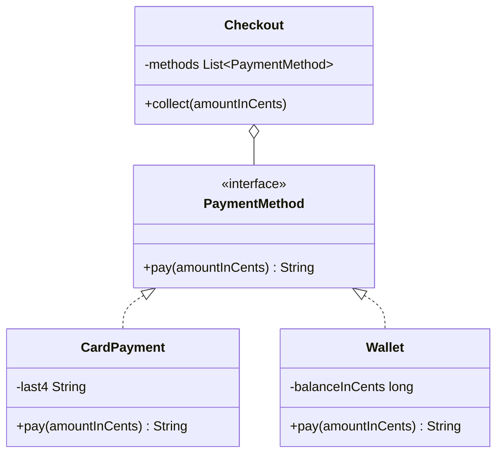
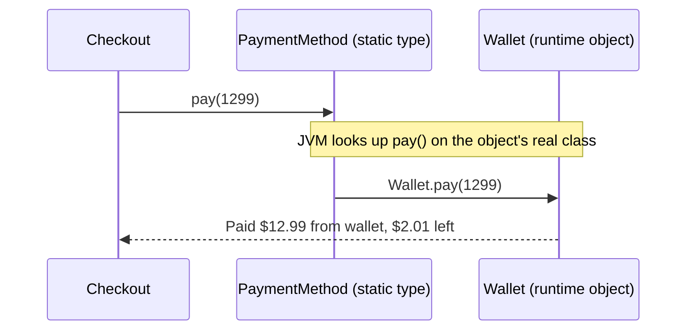

# OOP Refresher for Patterns

<span class="badge-l1">L1 🟢 Foundations</span> · <span class="read-time">⏱ 25 min read</span> · Prerequisites: [Setting Up Java](../l0-orientation/java-setup.md), [Reading UML for Patterns](../l0-orientation/reading-uml.md)

!!! abstract "TL;DR"
    Every design pattern is a particular arrangement of four OOP ideas: encapsulation, abstraction, inheritance and polymorphism. If you can hide state behind methods, depend on interfaces, and choose composition over inheritance by default, most patterns stop looking like magic and start looking like common sense.

## 1. What It Is

**Plain English.** Object-oriented programming (OOP) organises a program as objects that each own some data and the behaviour that works on it. Objects talk to each other by calling methods, and the caller doesn't need to know how the other object does its job.

**Precise definition.** In Java, OOP rests on:

- **Encapsulation:** an object's state is private and changes only through its methods, which protect its *invariants* (rules that must always be true, such as "a balance is never negative").
- **Abstraction:** callers depend on *what* an object does (an interface or abstract type), not *how* it does it.
- **Inheritance:** a class can extend another class (`extends`) to reuse and specialise its implementation, or implement an interface (`implements`) to promise a contract.
- **Polymorphism:** a variable of an interface or superclass type can hold any implementing object, and the JVM picks the right method at runtime (*dynamic dispatch*).

Two design rules build on these and appear in almost every GoF pattern: *program to an interface, not an implementation*, and *favour object composition over class inheritance* (both stated in the GoF book's introduction).

## 2. Why It Exists

Before OOP was common, large programs were usually procedures operating on shared data structures. Any procedure could change any data, so one change in a data layout rippled through the whole code base, and adding a new "kind" of thing meant editing every `if`/`switch` that handled the kinds.

OOP addresses this by putting data and behaviour together and by letting new kinds of objects plug in through polymorphism. Without these ideas you get the problems patterns are designed to fix: rigid code (hard to change), fragile code (breaks in unrelated places), and code you can't reuse or test in isolation.

## 3. Mental Model / Analogy

**Analogy.** Think of a FreshCart grocery store's checkout counter. The cashier (caller) says "pay this amount" to whatever the customer hands over: a card, a phone wallet or cash. The cashier doesn't open the wallet app or the bank's systems. Each payment method knows how to pay (polymorphism), keeps its own balance private (encapsulation), and they all fit the same slot at the counter (abstraction).

**Technical model.** Picture each object as a box with a small set of public buttons (its methods) and private wiring inside. Types describe which buttons exist. Code that holds a reference typed as an interface can press only the interface's buttons, and the JVM routes each press to the concrete object's wiring at runtime. Patterns are recurring ways of wiring boxes together.

## 4. How It Works

When you call a method through an interface, the compiler checks that the interface declares it, and at runtime the JVM looks up the implementation on the object's actual class (`invokeinterface` / `invokevirtual` bytecodes). That runtime lookup is what makes polymorphism, and therefore most patterns, work.





**Under the hood (for later levels).** The HotSpot JIT compiler profiles each call site. If it only ever sees one or two receiver classes, it can inline the call so the abstraction costs nothing. If a call site sees many classes (*megamorphic*), it falls back to a slower table lookup. You'll measure this in [Performance Cost of Patterns](../l3-professional/performance-of-patterns.md).

## 5. Subtopics

### Encapsulation

- **Description:** Keep fields `private` and expose behaviour, not data. The object enforces its own invariants in constructors and methods.
- **How to use it:**
  ```java
  final class Wallet {
      private long balanceInCents;
      void debit(long cents) {
          if (cents > balanceInCents) throw new IllegalStateException("Insufficient funds");
          balanceInCents -= cents;
      }
  }
  ```
- **Pros:** invariants live in one place; internals can change without breaking callers; easier reasoning and testing.
- **Cons:** more methods to write than public fields; over-zealous getters/setters give the cost without the benefit.
- **Best practice:** expose operations (`debit`), not setters (`setBalance`); return unmodifiable views or copies of internal collections.
- **Gotcha:** a getter that returns a mutable internal `List` breaks encapsulation as surely as a public field.

### Abstraction

- **Description:** Model only what a caller needs. In Java this usually means an interface describing a capability.
- **How to use it:** `interface PriceCatalog { Optional<Money> priceOf(String sku); }`
- **Pros:** callers are decoupled from implementations; implementations can be swapped (tests, new vendors).
- **Cons:** each abstraction is one more name to learn and one more hop to follow when reading code.
- **Best practice:** name abstractions after the role they play for the caller (`PriceCatalog`), not after the implementation (`PostgresPriceDao`).
- **Gotcha:** an interface with exactly one implementation and no test double is often premature; extract it when a second need appears.

### Inheritance

- **Description:** `class B extends A` makes B reuse and specialise A's implementation. B is substitutable wherever A is expected.
- **How to use it:** `abstract class Notification { abstract String body(); final String render() { return header() + body(); } }`
- **Pros:** quick reuse of implementation; natural for true "is-a" hierarchies; enables Template Method.
- **Cons:** tight coupling to the superclass's internals (the *fragile base class* problem); single inheritance only; hierarchies get deep and rigid.
- **Best practice:** design classes for inheritance explicitly or forbid it (`final`), as *Effective Java* (Item 19) recommends.
- **Gotcha:** calling an overridable method from a constructor runs subclass code before the subclass is initialised.

### Polymorphism and dynamic dispatch

- **Description:** One call, many behaviours: the method that runs depends on the object's runtime class.
- **How to use it:** `for (PaymentMethod m : methods) m.pay(amount);`
- **Pros:** replaces `if`/`switch` on type with objects; new behaviour arrives as a new class rather than an edit (Open/Closed).
- **Cons:** control flow is less visible in the source; you need the IDE's "go to implementation" to follow it.
- **Best practice:** prefer polymorphism when the set of types is open; prefer a `switch` over a `sealed` hierarchy when the set is closed and you own it (see [Patterns in Modern Java](../l3-professional/patterns-in-modern-java.md)).
- **Gotcha:** overloading is chosen at compile time from the *static* type, overriding at runtime from the *dynamic* type. Mixing them surprises people.

### Interfaces vs. abstract classes

- **Description:** An interface declares a contract (and may have `default`, `static` and `private` methods since Java 8/9). An abstract class can also hold state and constructors.
- **How to use it:** use an interface for a role; use an abstract class to share state or a fixed algorithm between closely related classes.
- **Pros (interface):** a class can implement many; easy to fake in tests; works with lambdas when it has one abstract method.
- **Cons (interface):** no instance state; `default` methods can't enforce invariants on state they can't see.
- **Pros (abstract class):** shared fields and constructors; can make the algorithm skeleton `final`.
- **Cons (abstract class):** uses up the single `extends` slot; couples subclasses to its implementation.
- **Best practice:** start with an interface; add a skeletal abstract implementation alongside it if many implementations share code (`List` + `AbstractList` in the JDK).
- **Gotcha:** adding an abstract method to a published interface breaks every implementer; add a `default` method instead.

### Composition over inheritance

- **Description:** Build behaviour by holding references to other objects (has-a) instead of extending classes (is-a).
- **How to use it:** `record Order(String id, long basketTotalInCents, DeliveryFeePolicy feePolicy) { }`
- **Pros:** behaviour can change at runtime; combinations don't need a subclass each; parts are testable alone.
- **Cons:** more small objects and wiring; a bit more indirection.
- **Best practice:** default to composition; use inheritance for genuine, stable "is-a" relationships you control.
- **Gotcha:** forwarding every method by hand to a wrapped object is a sign you might want Decorator or plain delegation helpers.

### Programming to an interface

- **Description:** Declare variables, parameters and return types with the most general type that offers what you need.
- **How to use it:** `List<Line> lines = new ArrayList<>();` and `Basket(PriceCatalog catalog)`.
- **Pros:** you can switch implementations without touching callers; tests can pass fakes.
- **Cons:** you may lose access to implementation-specific methods you actually need.
- **Best practice:** accept interfaces, return the most useful specific type that you're happy to commit to.
- **Gotcha:** `instanceof` checks and casts back to the concrete class undo the benefit.

## 6. Examples (exactly 3, progressively harder)

### Example 1: Minimal (L1)

**Scenario:** A checkout needs to take payment from different payment methods without knowing which one it has. A wallet must never go negative, so its balance is private and every payment goes through its `pay` method.

**Code / Config:**

```java title="PaymentDemo.java"
--8<-- "examples/l1-foundations/oop-refresher/PaymentDemo.java"
```

1. The abstraction: callers know only this one method.
2. Encapsulated state: nothing outside `Wallet` can change the balance directly.
3. Polymorphism: the same call runs `CardPayment.pay` or `Wallet.pay` depending on the object.

**Run it:**

```bash
java PaymentDemo.java
```

**Output:**

```text
--8<-- "examples/l1-foundations/oop-refresher/PaymentDemo.expected.txt"
```

**What to notice:**

- The loop has no `if (method instanceof Wallet)`; adding a new payment method needs no change here.
- `CardPayment` is a `record` (immutable data plus behaviour), `Wallet` is a class because it has changing state.
- The wallet enforces its own invariant twice: in the constructor and in `pay`.
- The third line shows the invariant protecting the balance on the failure path.

### Example 2: Realistic (in FreshCart grocery delivery)

**Scenario:** FreshCart charges $4.99 delivery, free for baskets of $50 or more, and express delivery adds $3.00 on top of whatever the standard fee is. An inheritance design (`StandardOrder`, `ExpressOrder`, `FreeDeliveryExpressOrder`…) would multiply classes with every new rule. Instead, an order *has* a fee policy, and policies are composed.

**Code / Config:**

```java title="DeliveryFeeDemo.java"
--8<-- "examples/l1-foundations/oop-refresher/DeliveryFeeDemo.java"
```

1. A policy that wraps another policy: composition, and an early look at the Decorator pattern.
2. `Order` depends on the `DeliveryFeePolicy` abstraction, not on any concrete rule.
3. Express is built by wrapping the standard policy, not by subclassing an order.

**Run it:**

```bash
java DeliveryFeeDemo.java
```

**Output:**

```text
--8<-- "examples/l1-foundations/oop-refresher/DeliveryFeeDemo.expected.txt"
```

**What to notice:**

- Three rules, combined two ways, with zero `Order` subclasses.
- FC-1003 is free over $50 *and* express, so it pays only the $3.00 surcharge; the combination needed no new class.
- Money is held as `long` cents to avoid floating-point rounding; L1 pages keep it simple, Example 3 wraps it in a type.
- New rules (peak-hour pricing, a rider-distance fee) are new classes that implement the interface; existing code doesn't change (Open/Closed, see [SOLID](solid-principles.md)).

### Example 3: Production-grade

**Scenario:** The FreshCart basket must reject unknown products, cap the number of items (configurable per environment), never expose its internal list, and emit an event for every accepted or rejected item so operations can see what customers are trying to buy. The basket must be unit-testable without a database or a logging framework.

**Code / Config:**

```java title="BasketDemo.java"
--8<-- "examples/l1-foundations/oop-refresher/BasketDemo.java"
```

1. Prices come through an interface, so the basket works with a database, an HTTP service or an in-memory map.
2. Observability through an abstraction: production can send these to a log or metrics system, tests can record them.
3. The internal list is private and mutable; only the basket's methods change it.
4. Callers get a read-only view, so they can't bypass the invariants.
5. Configuration with a safe default, overridable with `-Dfreshcart.basket.maxItems=20`.

**Run it:**

```bash
java BasketDemo.java
java -Dfreshcart.basket.maxItems=20 BasketDemo.java   # raise the limit
```

**Output** (default limit of 10):

```text
--8<-- "examples/l1-foundations/oop-refresher/BasketDemo.expected.txt"
```

With `-Dfreshcart.basket.maxItems=20` the three extra apples are accepted, and the last line becomes:

```text
basket=B-42 items=12 total=$10.92
```

**What to notice:**

- `Money` and `Line` validate themselves in compact constructors, so an invalid value can't exist.
- `Math.addExact` and `Math.multiplyExact` throw on overflow instead of silently wrapping.
- Every rejection both emits an event *and* rethrows: the caller decides what to show the customer.
- The `Basket` constructor receives all its collaborators (constructor injection); `main` is the only place that knows the concrete classes.
- The attempt to `clear()` the lines fails with `UnsupportedOperationException`, proving encapsulation holds.

## 7. Pros, Cons & Trade-offs

| Aspect | Pros | Cons |
|--------|------|------|
| Simplicity | Small objects with one job are easy to understand alone | Behaviour is spread across many small classes |
| Performance | JIT inlining makes monomorphic interface calls effectively free | Megamorphic call sites and extra allocations cost something in hot loops |
| Scalability (of the code base) | New behaviour arrives as new classes; teams can work in parallel | Deep inheritance trees become hard to change at scale |
| Operability | Clear seams to add logging, metrics and events | Stack traces get longer with more layers |
| Security | Encapsulation stops callers corrupting state; `final` classes prevent malicious subclassing | Overridable methods can be abused if classes aren't designed for extension |
| Testability | Interfaces make fakes trivial | Too many interfaces with one implementation add noise |
| Cost | Changes are local, so maintenance is cheaper | More up-front design effort |
| Learning curve | Matches how people describe the domain | Polymorphic flow is harder for beginners to trace |

## 8. When to Use / When NOT to Use

**Use these OOP techniques when:**

- The domain has concepts with rules (baskets, orders, payments) that must always hold.
- You expect new variants of a behaviour (new fee rules, new payment methods).
- You need to swap collaborators for tests or for different environments.

**Don't reach for them when:**

- The code is pure data transformation: a `record` plus a few static functions or a stream pipeline is clearer.
- The set of variants is closed and small: a `sealed` interface with a `switch` (see [Patterns in Modern Java](../l3-professional/patterns-in-modern-java.md)) or even an `enum` is simpler.
- It's a throwaway script.

Compare alternatives in [Pattern Comparisons](../reference/comparisons.md).

## 9. Best Practices

1. **Make classes `final` unless designed for inheritance**, because unplanned subclassing breaks encapsulation. *(Consensus: Effective Java, Item 19.)*
2. **Keep fields `private` and prefer immutable objects** (`record`, `final` fields), because immutable objects are thread-safe and can't be put into an invalid state later. *(Consensus.)*
3. **Validate in constructors**, so every instance that exists is valid. *(Consensus.)*
4. **Depend on interfaces at boundaries** (repositories, clocks, external services, event sinks), because those are what you replace in tests and when vendors change. *(Consensus.)*
5. **Prefer composition to inheritance by default**, because it keeps classes independent. *(Consensus: GoF, Effective Java Item 18.)*
6. **Don't write getters and setters for every field by reflex**; expose operations. *(Opinion, widely shared.)*
7. **Return unmodifiable views or copies of internal collections.** *(Consensus.)*
8. **Extract an interface when the second implementation or the first test double appears, not before.** *(Opinion.)*

## 10. Pitfalls & Anti-Patterns

!!! danger "Leaky getters"
    **Symptom:** a basket's total is wrong even though `add()` validates everything.
    **Root cause:** `getLines()` returned the internal `ArrayList`, and some caller called `.add()` or `.clear()` on it.
    **Fix:** return `Collections.unmodifiableList(lines)` or `List.copyOf(lines)`, and expose operations instead.

!!! danger "Fragile base class"
    **Symptom:** a JDK or library upgrade changes how a subclass behaves although the subclass didn't change.
    **Root cause:** the subclass overrode a method the superclass calls internally (the classic example is overriding `HashSet.add` and `addAll` to count elements: `addAll` calls `add`, so elements are counted twice).
    **Fix:** wrap the object and forward to it (composition) instead of extending it.

!!! danger "Anaemic objects (production failure mode)"
    **Symptom:** after an incident, refunds were issued twice because two services each updated an order's status fields directly.
    **Root cause:** `Order` had public setters and no behaviour, so every service re-implemented the rules, slightly differently.
    **Fix:** move the rules into `Order` (`order.refund(reason)`) and make the state private. See [Anti-Patterns and Code Smells](../l3-professional/anti-patterns-and-code-smells.md).

!!! danger "Overridable method called from a constructor"
    **Symptom:** a `NullPointerException` from a subclass method during construction.
    **Root cause:** the superclass constructor called a method the subclass overrides, before the subclass's fields were set.
    **Fix:** call only `private` or `final` methods from constructors.

## 12. Security Considerations

- Make security-relevant classes `final` so attackers can't subclass them to override checks.
- Copy mutable inputs defensively in constructors and copy mutable outputs on return, so callers can't change state after validation (a time-of-check/time-of-use bug).
- Don't put secrets in `toString()`; records generate `toString()` from every component automatically, so override it for types that hold secrets.

## 13. Performance & Scalability

The cost of an interface call depends on the call site, not the interface: HotSpot inlines call sites that see one or two receiver types. Don't remove abstractions for speed without a measurement; use JMH to measure, as shown in [Performance Cost of Patterns](../l3-professional/performance-of-patterns.md). Immutable value objects allocate more, but short-lived allocations are cheap with modern collectors and escape analysis can remove some entirely.

## 14. Testing It

Because `Basket` depends on interfaces, a test can pass a tiny fake instead of a mock framework. This JUnit 5 test is in the repository next to the example, and CI runs it:

```java title="BasketTest.java"
--8<-- "examples/l1-foundations/oop-refresher/BasketTest.java"
```

Run it with the JUnit console launcher (or put both files in a Maven project with the `junit-jupiter` dependency and run `mvn test`):

```bash
javac -d out -cp junit-platform-console-standalone-1.11.4.jar BasketDemo.java BasketTest.java
java -jar junit-platform-console-standalone-1.11.4.jar execute -cp out --select-class BasketTest
```

## 15. Observability & Operations

Give domain objects an event or listener interface (as `BasketEvents` does) rather than calling a logging framework from inside them. In production, implement it with SLF4J structured logs and Micrometer counters such as `basket.items.rejected{reason}`. A spike in `Unknown product` rejections usually means the mobile app's catalogue cache is out of date, which is something you can alert on.

## 16. Version Notes

| Java | What changed for OOP-style design |
|------|-----------------------------------|
| 8 | `default` and `static` methods in interfaces; lambdas for single-method interfaces |
| 9 | `private` interface methods |
| 16 | Records (JEP 395) for concise immutable data carriers; pattern matching for `instanceof` (JEP 394) |
| 17 | Sealed classes and interfaces (JEP 409) |
| 21 | Pattern matching for `switch` (JEP 441) and record patterns (JEP 440) |

None of these remove the OOP fundamentals; they make the immutable, closed-hierarchy style shorter to write.

## 17. Expert Deep Dive

A 2-year engineer knows the four pillars; a 15-year engineer knows where each one breaks down:

- **Encapsulation is about invariants, not getters.** Experienced reviewers ask "what rule does this class protect?" If the answer is "none", it should probably be a record or a plain data type, and the rules belong somewhere else.
- **Inheritance is an API commitment.** Once other teams extend your class, every protected method and every self-call is part of your contract. That's why mature libraries are mostly `final` classes and interfaces.
- **Open vs. closed variation.** Polymorphism is best when *other people* add new types. When *you* own all the types and other people add new *operations*, a sealed hierarchy with `switch` beats polymorphism. Knowing which side of this "expression problem" you're on is the most useful OOP judgement call (see [Visitor](../l2-practitioner/visitor.md)).
- **Identity vs. value.** Entities (a basket with an ID) have identity and lifecycle; values (`Money`) don't. Mixing them causes subtle `equals`/`hashCode` and caching bugs. This becomes central in [DDD tactical patterns](../l4-senior/ddd-tactical.md).
- **Legacy migration.** To move a setter-heavy code base toward encapsulation, first add behaviour methods next to the setters, migrate callers, then make the setters private. Each step is shippable on its own.

!!! example "War story: the shared list"
    A delivery-slot service cached each store's available slots and returned `getSlots()` straight from the cache. A new feature filtered out slots for a customer by calling `removeIf` on the returned list. Under load, customers started seeing "no slots available" for whole stores. Heap dumps showed the cached lists shrinking over the day. Diagnosis took two days because the bug only appeared after many different customers had filtered the same list. The fix was one line, `return List.copyOf(slots);`, plus a code-review rule: collections returned from caches and domain objects must be unmodifiable. **Lesson:** encapsulation isn't academic; a mutable return value is a shared global variable.

## 18. Interview Corner

=== "🟢 L1–L2"

    1. **What is encapsulation?** Keeping an object's state private and changing it only through methods, so the object can **enforce its invariants**.
    2. **Interface vs. abstract class?** An interface is a contract a class can implement **many of**; an abstract class can hold **state and constructors** but a class can extend only one.
    3. **What is polymorphism?** One call with different behaviour depending on the **runtime type** of the object, decided by **dynamic dispatch**.
    4. **Overloading vs. overriding?** Overloading picks a method at **compile time** by parameter types; overriding replaces a method at **runtime** in a subclass.
    5. **Why prefer composition over inheritance?** It avoids **tight coupling to a superclass's implementation** and lets behaviour change at runtime.

=== "🟡 L3"

    1. **A getter returns an internal list and data gets corrupted. How do you find and fix it?** Search for mutations on returned collections, add a test that mutates the returned value, then return an **unmodifiable view or copy**.
    2. **When would you make a class `final`?** By default, unless it's **designed and documented for inheritance**; it protects invariants and lets you change internals freely.
    3. **How do you design a class so tests don't need a database?** Depend on an **interface** for persistence and pass a fake in the test via **constructor injection**.
    4. **Records: when not to use them?** When the type needs **mutable state or hidden fields**, or when its `toString` would leak secrets.
    5. **Explain the fragile base class problem.** A subclass depends on the superclass's **self-use of overridable methods**, so changes in the superclass break it.

=== "🔴 L4–L5"

    1. **Your team's domain model is anaemic; services have all the logic. What's your migration plan?** Pick one aggregate, **move rules into behaviour methods**, migrate callers incrementally, then **make setters private**; measure defect rate per area.
    2. **Polymorphism or a sealed `switch` for payment methods?** Depends on **who adds variants**: external plugins favour polymorphism; a closed set you own favours sealed types with **exhaustive switches**.
    3. **Does interface-heavy design hurt performance at 10x traffic?** Usually not: **monomorphic call sites inline**. Profile first; only **megamorphic** hot paths matter.
    4. **How do you keep a published library extensible without inheritance?** Expose **interfaces and composition hooks**, keep classes final, use **default methods** to evolve.
    5. **Now the basket is shared across devices (phone and web). What changes?** Identity and **concurrency control** (versioning/optimistic locking) become part of the entity's invariants.

=== "💻 Hands-on"

    **Task:** `Order` has public fields `status` and `refundedAmount`. Make it impossible to refund more than the order total or to refund a cancelled order.

    ??? success "Solution"
        ```java
        final class Order {
            enum Status { PLACED, DELIVERED, CANCELLED }

            private final long totalInCents;
            private Status status = Status.PLACED;
            private long refundedInCents;

            Order(long totalInCents) {
                if (totalInCents <= 0) throw new IllegalArgumentException("total must be positive");
                this.totalInCents = totalInCents;
            }

            void cancel() { status = Status.CANCELLED; }

            void refund(long amountInCents) {
                if (status == Status.CANCELLED) throw new IllegalStateException("cancelled orders can't be refunded");
                if (amountInCents <= 0) throw new IllegalArgumentException("refund must be positive");
                if (refundedInCents + amountInCents > totalInCents) throw new IllegalStateException("refund exceeds total");
                refundedInCents += amountInCents;
            }

            long refundedInCents() { return refundedInCents; }
        }
        ```

## 19. Practice

- [ ] Add a `GiftCardPayment` to Example 1 without changing the loop in `main`.
    ??? tip "Hint"
        Implement `PaymentMethod`; give it a private remaining balance like `Wallet`.
- [ ] Add a peak-hour surcharge policy to Example 2 that adds $1.50 between 17:00 and 19:00.
    ??? tip "Hint"
        Wrap another policy, and inject a `java.time.Clock` so the rule is testable.
- [ ] Make `Basket.add` merge quantities when the same SKU is added twice.
    ??? tip "Hint"
        Replace the list with a `LinkedHashMap<String, Line>` and keep `lines()` returning an unmodifiable list.
- [ ] Write a test proving `lines()` can't be modified.
    ??? tip "Hint"
        `assertThrows(UnsupportedOperationException.class, () -> basket.lines().clear())`.

## 20. Quick Revision Card

!!! tip "Remember in 30 seconds"
    - Private state + behaviour methods = encapsulation; protect invariants.
    - Depend on interfaces at boundaries; inject them through constructors.
    - Polymorphism replaces type-checking `if`s.
    - Composition by default, inheritance for true stable "is-a".
    - `final` classes, immutable values, unmodifiable returns.

    ```java
    interface Policy { long apply(long cents); }
    final class Thing {
        private final Policy policy;
        Thing(Policy policy) { this.policy = Objects.requireNonNull(policy); }
        long price(long cents) { return policy.apply(cents); }
    }
    ```

## 21. Further Reading

- Gamma, Helm, Johnson, Vlissides, *Design Patterns: Elements of Reusable Object-Oriented Software* (1994), chapter 1.
- Joshua Bloch, *Effective Java*, 3rd edition, chapter 4 "Classes and Interfaces" (Items 15–25).
- [The Java Tutorials: Object-Oriented Programming Concepts](https://docs.oracle.com/javase/tutorial/java/concepts/index.html)
- [JEP 395: Records](https://openjdk.org/jeps/395) and [JEP 409: Sealed Classes](https://openjdk.org/jeps/409)

---

[← Previous: L1 Foundations](index.md) · [Next: SOLID Principles →](solid-principles.md)
