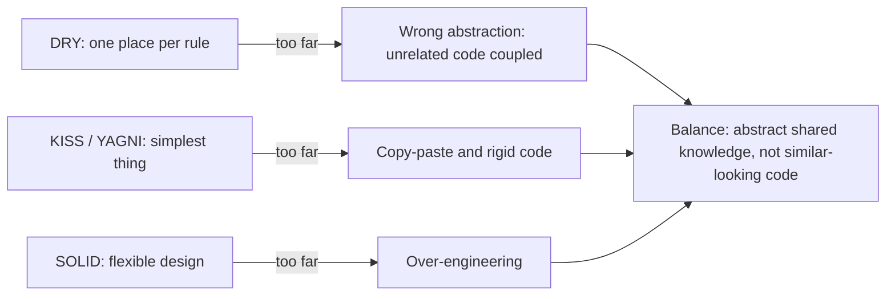

# DRY, KISS, YAGNI and Friends

<span class="badge-l1">L1 🟢 Foundations</span> · <span class="read-time">⏱ 20 min read</span> · Prerequisites: [SOLID Principles](solid-principles.md)

!!! abstract "TL;DR"
    SOLID tells you how to make code flexible; DRY, KISS and YAGNI stop you overdoing it. Keep each piece of *knowledge* in one place (DRY), choose the simplest design that works (KISS), and don't build what nobody needs yet (YAGNI). Law of Demeter, Tell Don't Ask, cohesion/coupling and GRASP help you decide which class a piece of behaviour belongs to.

## 1. What It Is

**Plain English.** A handful of short rules that experienced developers use to judge code:

- **DRY (Don't Repeat Yourself):** don't keep the same rule in two places.
- **KISS (Keep It Simple):** prefer the simplest design that solves the problem.
- **YAGNI (You Aren't Gonna Need It):** don't build features or abstractions before they're needed.
- **Law of Demeter:** talk to your immediate friends, not to strangers reached through them.
- **Tell, Don't Ask:** tell an object to do something instead of asking for its data and deciding for it.
- **Cohesion and coupling:** keep related things together, unrelated things apart.
- **GRASP:** nine guidelines for assigning responsibilities to classes.

**Precise definition.** *The Pragmatic Programmer* (Hunt and Thomas, 1999) defines DRY as: "Every piece of knowledge must have a single, unambiguous, authoritative representation within a system." Note the word *knowledge*: DRY is about rules and decisions, not about lines of text that happen to look alike.

## 2. Why It Exists

When a rule lives in two places, the copies drift apart, and the bug appears in whichever copy you forgot to update. When code is more complex than it needs to be, every reader pays for it. When code reaches through chains of objects, a change to any link breaks callers far away. These principles came out of decades of maintenance pain: the Law of Demeter from a 1987 research project at Northeastern University, YAGNI from Extreme Programming in the late 1990s, GRASP from Craig Larman's *Applying UML and Patterns*.

## 3. Mental Model / Analogy

**Analogy.** A FreshCart store's price list. If the price of milk is written on the shelf, in the till and on the website separately, one day they won't match (DRY). The best price system is the one staff can understand on day one (KISS). You don't buy a second till for a rush that never comes (YAGNI). The cashier asks the customer to pay; they don't reach into the customer's bag for their wallet (Demeter, Tell Don't Ask).

**Technical model.** Think of knowledge as nodes and code as references to those nodes. DRY says each node exists once. Coupling counts the edges between modules; cohesion measures how many edges stay inside a module. Demeter limits each method to edges of length one.

## 4. How It Works

The principles pull in different directions, and good design balances them:



The practical test for DRY: *if this rule changes, would both copies have to change, for the same reason, at the same time?* If yes, unify them. If they'd change for different reasons, they only look alike, and merging them couples things that should stay independent.

## 5. Subtopics

### DRY

- **Description:** Every piece of business knowledge (a validation rule, a tax rate, a status transition) has one authoritative home.
- **How to use it:** put the rule in a type (`PhoneNumber`, `Money`) or a single function, and make everything else use it.
- **Pros:** one place to change; copies can't drift; fewer bugs.
- **Cons:** shared code couples its users; a wrong abstraction is worse than duplication.
- **Best practice:** unify duplicated *knowledge*; tolerate duplicated *code* that represents different knowledge.
- **Gotcha:** "wrong DRY": merging two formulas that look the same today but belong to different teams (Example 3).

### KISS

- **Description:** Prefer the simplest design that meets today's requirements and that a new team member can follow.
- **How to use it:** before adding a layer, a pattern or a framework, ask what the simplest working version looks like.
- **Pros:** fewer bugs, faster onboarding, easier debugging.
- **Cons:** "simple" is subjective; simple designs may need refactoring as requirements grow.
- **Best practice:** simple means *few concepts*, not *few lines*; a clear 20-line method beats a clever 5-line one.
- **Gotcha:** confusing simple with easy: copy-pasting is easy, but the result isn't simple.

### YAGNI

- **Description:** Don't implement capabilities until there's an actual need. It's the time dimension of KISS.
- **How to use it:** build for the current story; keep the code clean and tested so the next story is cheap to add.
- **Pros:** less code to maintain; no time spent on features that never ship.
- **Cons:** occasionally you redo work you could have anticipated.
- **Best practice:** YAGNI works only with refactoring and tests. Without them, people over-build out of fear.
- **Gotcha:** it doesn't apply to things that are expensive to add later: security, data model decisions, public API contracts.

### Law of Demeter

- **Description:** A method should call methods only on itself, its fields, its parameters and objects it creates; not on objects returned by those calls. Informally: "only talk to your friends", or "one dot per line" (fluent builders and streams are an accepted exception).
- **How to use it:** replace `order.getCustomer().getWallet().getBalance()` with a method on the nearest friend: `order.settle()`.
- **Pros:** callers don't depend on the internal structure of objects they don't own; refactoring is safer.
- **Cons:** can produce many small "wrapper" methods if applied blindly.
- **Best practice:** apply it to *behaviour*; navigating plain data records (DTOs) is usually fine.
- **Gotcha:** counting dots mechanically: `stream().filter().map()` is one object's fluent API, not a Demeter violation.

### Tell, Don't Ask

- **Description:** Instead of asking an object for data and making decisions about it, tell the object what you want and let it decide using its own data.
- **How to use it:** `wallet.tryDebit(cents)` instead of `if (wallet.getBalance() >= cents) wallet.setBalance(...)`.
- **Pros:** rules live with the data (encapsulation); no duplicated decision logic in callers.
- **Cons:** objects can grow too many methods; some decisions belong outside (reports, UI).
- **Best practice:** use it for decisions that protect invariants; queries for display are fine.
- **Gotcha:** "ask" code is also a race condition when two threads check and act separately.

### Cohesion and coupling

- **Description:** *Cohesion* is how strongly the parts of a module belong together. *Coupling* is how much one module depends on another. Aim for high cohesion and low coupling.
- **How to use it:** group code by the reason it changes; minimise what modules know about each other.
- **Pros:** changes stay local; modules can be understood and tested alone.
- **Cons:** reducing coupling usually adds an interface or an event, which is indirection.
- **Best practice:** package by feature (`delivery`, `refunds`) rather than by layer (`controllers`, `services`) when features change independently.
- **Gotcha:** coupling through shared data (one database table used by five modules) is as real as coupling through code.

### GRASP in brief

- **Description:** Craig Larman's nine responsibility-assignment patterns: Information Expert, Creator, Controller, Low Coupling, High Cohesion, Polymorphism, Pure Fabrication, Indirection and Protected Variations.
- **How to use it:** the two you'll use daily: **Information Expert** (give a responsibility to the class that has the data to fulfil it) and **Creator** (let the class that contains or closely uses objects create them).
- **Pros:** a vocabulary for "which class should do this?".
- **Cons:** less widely known than GoF; some terms overlap with SOLID.
- **Best practice:** when unsure where a method goes, apply Information Expert first.
- **Gotcha:** *Pure Fabrication* (a class that isn't a domain concept, like `OrderRepository`) is allowed when Information Expert would hurt cohesion.

## 6. Examples (exactly 3, progressively harder)

### Example 1: Minimal (L1)

**Scenario:** FreshCart's signup form and rider app both validate phone numbers. The rule was copy-pasted, then changed in one place: signup allows 13 digits and strips spaces, the rider app doesn't. A customer's number is accepted at signup and rejected when a rider tries to call them.

**Code / Config:**

```java title="PhoneNumberDemo.java"
--8<-- "examples/l1-foundations/other-design-principles/PhoneNumberDemo.java"
```

1. The copy has already drifted: a different maximum length, and no space stripping.
2. One authoritative home for the rule: a value type that can't be invalid.
3. Normalisation happens once, so everything downstream sees the same format.

**Run it:**

```bash
java PhoneNumberDemo.java
```

**Output:**

```text
--8<-- "examples/l1-foundations/other-design-principles/PhoneNumberDemo.expected.txt"
```

**What to notice:**

- The two copies give different answers for the same input: that's what duplicated knowledge costs.
- With `PhoneNumber`, an invalid number can't even be created, so later code doesn't re-check.
- Storing the normalised form (`+919876543210`) means search and deduplication work too.

### Example 2: Realistic (in FreshCart grocery delivery)

**Scenario:** Settling an order from the customer's wallet. The "ask" version reaches through order → customer → wallet and decides in the caller. The "tell" version asks the order to settle itself, which asks the customer, which asks the wallet.

**Code / Config:**

```java title="DemeterDemo.java"
--8<-- "examples/l1-foundations/other-design-principles/DemeterDemo.java"
```

1. The wallet decides whether a debit is allowed: the rule lives with the data.
2. The customer only talks to its own field.
3. The order only talks to its own field; the caller only talks to the order.
4. A Demeter violation: this caller depends on the shape of `Order`, `Customer` and `Wallet`.

**Run it:**

```bash
java DemeterDemo.java
```

**Output:**

```text
--8<-- "examples/l1-foundations/other-design-principles/DemeterDemo.expected.txt"
```

**What to notice:**

- Both styles work on the first payment; the difference shows when rules change. If wallets gain a daily limit, only `tryDebit` changes in the tell style; every ask-style caller would need editing.
- The second `settle()` is declined because the balance is now $15.01: the wallet enforced its own invariant.
- The ask style's check-then-set is also a race condition if two threads settle at once.

### Example 3: Production-grade

**Scenario:** The delivery fee (what customers pay) and the rider payout (what riders earn) are both "base + rate per km". A well-meaning refactoring merged them into one `distanceCost()` function. Then marketing made delivery free over $50, and rider payouts for those orders dropped to zero. The corrected design keeps the two policies separate, because they're different knowledge owned by different teams, and shares only the knowledge that's genuinely common: what a valid delivery distance is.

**Code / Config:**

```java title="FeeAndPayoutDemo.java"
--8<-- "examples/l1-foundations/other-design-principles/FeeAndPayoutDemo.java"
```

1. Owned by Pricing; changes with campaigns.
2. Owned by Rider Operations; changes with agreements and fuel costs. Similar shape, different reasons to change.
3. The one rule both genuinely share lives in one place.

**Run it:**

```bash
java FeeAndPayoutDemo.java
```

**Output:**

```text
--8<-- "examples/l1-foundations/other-design-principles/FeeAndPayoutDemo.expected.txt"
```

**What to notice:**

- FC-7003 has free delivery, yet the rider is still paid $4.43; the negative margin is a business decision, now visible.
- FC-7001's payout hits the $3.00 minimum, a rule only payouts have.
- An invalid distance is rejected by both policies through the same shared check.
- Settings are validated in the records' constructors, so bad configuration fails at startup, not mid-delivery.

## 7. Pros, Cons & Trade-offs

| Aspect | Pros | Cons |
|--------|------|------|
| Simplicity | KISS/YAGNI keep the code base small | Too little structure leads to copy-paste |
| Performance | Simple code is easier to optimise | Wrapper methods for Demeter add trivial calls |
| Scalability | Low coupling lets teams change modules independently | Shared "DRY" utilities become bottlenecks owned by nobody |
| Operability | Rules in one place are easier to audit and log | Over-DRY generic code produces vague logs |
| Security | One validation type means one place to get it right | One shared bug affects every user of it |
| Testability | Value types and tell-style objects are easy to test | Merged logic needs tests for every caller's case |
| Cost | Less code to maintain | Refactoring later when YAGNI was wrong |
| Learning curve | Short, memorable rules | Knowing when each rule stops applying takes experience |

## 8. When to Use / When NOT to Use

**Use DRY** for business rules, validation, configuration values and status transitions.
**Don't use DRY** to merge code that looks alike but changes for different reasons, or across service boundaries where sharing a library couples deployments.

**Use KISS/YAGNI** by default for features, abstractions and infrastructure.
**Don't use YAGNI** as a reason to skip security, data model design or public API contracts, which are expensive to change later.

**Use Demeter/Tell Don't Ask** for objects with behaviour and invariants.
**Don't apply them** to plain data records, DTOs or fluent APIs.

## 9. Best Practices

1. **Ask "same knowledge or same shape?" before removing duplication.** *(Consensus.)*
2. **Encode validation rules in value types.** *(Consensus in DDD; widely practised.)*
3. **Wait for the third occurrence before abstracting** (rule of three). *(Consensus.)*
4. **Put behaviour where the data is** (Information Expert). *(Consensus.)*
5. **Prefer duplication over the wrong abstraction.** *(Opinion, popularised by Sandi Metz.)*
6. **Keep YAGNI away from security and data contracts.** *(Opinion, widely shared.)*

## 10. Pitfalls & Anti-Patterns

!!! danger "The wrong abstraction"
    **Symptom:** a shared method with boolean flags (`calculate(distance, isPayout, isPeak, skipFree)`) that every team edits.
    **Root cause:** two different pieces of knowledge merged because their code looked alike.
    **Fix:** inline the shared method back into its callers, then extract only what's genuinely shared.

!!! danger "Riders paid zero (production failure mode)"
    **Symptom:** riders complained that some deliveries paid nothing; the payroll report showed $0 payouts for orders over $50.
    **Root cause:** fee and payout shared one function; a "free delivery over $50" change to the fee also changed payouts.
    **Fix:** separate policies per owner (Example 3) and a test that free delivery doesn't change payouts.

!!! danger "Train wrecks"
    **Symptom:** `a.getB().getC().getD().doSomething()` across the code base, and a refactoring of `C` breaks 40 files.
    **Root cause:** callers depend on the internal structure of objects they don't own.
    **Fix:** add a behaviour method on the nearest object (Tell, Don't Ask).

!!! danger "Speculative configuration"
    **Symptom:** 60 configuration flags, half of which have never been changed from their default.
    **Root cause:** YAGNI ignored: every possible variation made configurable "just in case".
    **Fix:** delete unused flags; add configuration when someone needs to change a value without a deploy.

## 12. Security Considerations

DRY is a security principle for validation and authorisation: one input-validation type and one authorisation check per action means one place to audit and fix. Duplicated checks drift, and attackers find the weakest copy. YAGNI does *not* apply to security controls such as input validation, encryption and audit logging.

## 14. Testing It

The test that would have caught the rider payout incident: free delivery must not change the payout, and both policies reject the same invalid distances.

```java title="FeeAndPayoutTest.java"
--8<-- "examples/l1-foundations/other-design-principles/FeeAndPayoutTest.java"
```

## 16. Version Notes

Records (Java 16) make DRY value types like `PhoneNumber` a few lines, with validation in the compact constructor. Before records, the boilerplate of a proper value class (constructor, `equals`, `hashCode`, `toString`) was a common excuse for passing raw `String`s around.

## 17. Expert Deep Dive

- **DRY across services is coupling.** A shared "common" library used by 30 services means a change requires 30 deployments, and a bug ships everywhere. Seniors accept duplicated code across service boundaries and share only stable contracts (schemas, client libraries owned by the provider).
- **Duplication is cheaper than the wrong abstraction.** When an abstraction collects flags and special cases, the fastest fix is often to inline it back into callers and re-extract what's really shared.
- **Demeter at system level** is "don't call your dependency's dependency". A service that queries another team's database directly is the distributed version of a train wreck.
- **YAGNI vs. one-way doors.** Amazon's "one-way vs. two-way door" framing helps: reversible decisions should be made fast and simply; irreversible ones (public APIs, data formats, security) deserve up-front design.
- **In reviews**, ask: "If this rule changes, how many places change?" and "Who owns this shared code?".

!!! example "War story: the shared utils jar"
    A grocery platform's teams shared a `common-utils` library for "everything reusable": date helpers, money formatting, validation, HTTP clients. After two years it had 400 classes and every service depended on it. A change to a phone-number regex for one country, made by the checkout team, shipped to the rider service in its next routine build and started rejecting riders' numbers in another country. Rollback required rebuilding a dozen services. The fix was splitting the library by owner, versioning each part, and moving domain rules (like phone validation per country) into the services that own them. **Lesson:** DRY's "single authoritative representation" needs a single *owner* too.

## 18. Interview Corner

=== "🟢 L1–L2"

    1. **What does DRY mean?** **Every piece of knowledge has one authoritative representation**; it's about rules, not text.
    2. **What's YAGNI?** **Don't build things before they're needed.**
    3. **What's the Law of Demeter?** **Only talk to immediate collaborators**: fields, parameters, objects you create.
    4. **Tell, Don't Ask?** **Tell objects to act** instead of asking for their data and deciding for them.
    5. **High cohesion, low coupling?** **Related things together**, **few dependencies** between modules.

=== "🟡 L3"

    1. **When should you NOT remove duplication?** When the copies **change for different reasons** or belong to **different owners**.
    2. **Is `list.stream().filter().map()` a Demeter violation?** No: it's a **fluent API on one abstraction**.
    3. **How does Tell, Don't Ask help with concurrency?** It puts **check and act in one method**, avoiding check-then-act races.
    4. **Which GRASP principle helps most day to day?** **Information Expert**: give the responsibility to the class with the data.
    5. **YAGNI exceptions?** **Security, data models and public API contracts**, which are costly to change later.

=== "🔴 L4–L5"

    1. **Your organisation has a 400-class shared library. What do you do?** **Split by owner**, version independently, move **domain rules into owning services**.
    2. **How do you balance DRY with service autonomy?** Share **contracts, not implementations**; accept duplicated code across boundaries.
    3. **How do you spot the wrong abstraction in review?** **Boolean flags, type switches and special cases** accumulating in shared code.
    4. **Which decisions deserve up-front design despite YAGNI?** **One-way doors**: data formats, public APIs, security architecture.
    5. **Now rider payouts differ per city and per vehicle. What changes?** Payout policy becomes **data-driven configuration per city/vehicle**, still owned by Rider Ops, with **validation at load time**.

=== "💻 Hands-on"

    **Task:** In Example 2, add a daily spending limit to the wallet without changing `Order` or `Customer`.

    ??? success "Solution"
        ```java
        static final class Wallet {
            private long balanceInCents;
            private final long dailyLimitInCents;
            private long spentTodayInCents;

            Wallet(long balance, long dailyLimit) { this.balanceInCents = balance; this.dailyLimitInCents = dailyLimit; }

            boolean tryDebit(long cents) {
                if (cents <= 0 || cents > balanceInCents) return false;
                if (spentTodayInCents + cents > dailyLimitInCents) return false;
                balanceInCents -= cents;
                spentTodayInCents += cents;
                return true;
            }
        }
        ```
        Only the wallet changed, because the decision lives there (Tell, Don't Ask).

## 19. Practice

- [ ] Find two copies of the same validation rule in a project you know and unify them in a value type.
    ??? tip "Hint"
        Search for the same regex or the same magic number in several files.
- [ ] Find a train wreck (`a.getB().getC()...`) and replace it with a tell-style method.
    ??? tip "Hint"
        Put the new method on the first object in the chain.
- [ ] Add a peak-hour bonus to rider payouts in Example 3 without touching the fee policy.
    ??? tip "Hint"
        Add a `peakBonusInCents` component to `RiderPayoutPolicy` and a `boolean peak` parameter.

## 20. Quick Revision Card

!!! tip "Remember in 30 seconds"
    - DRY = one home per piece of *knowledge*, not per look-alike code.
    - KISS = fewest concepts; YAGNI = nothing before it's needed (except one-way doors).
    - Demeter = talk to friends only; Tell, Don't Ask = let the data's owner decide.
    - High cohesion, low coupling; package by feature.
    - GRASP Information Expert: behaviour goes where the data is.

    ```java
    record PhoneNumber(String value) {           // DRY: the rule lives here
        PhoneNumber { /* validate + normalise once */ }
    }
    boolean paid = order.settle();                // Tell, Don't Ask
    ```

## 21. Further Reading

- Andrew Hunt and David Thomas, *The Pragmatic Programmer*, 20th anniversary edition (2019).
- Craig Larman, *Applying UML and Patterns*, 3rd edition (2004), chapters on GRASP.
- Sandi Metz, "The Wrong Abstraction" (blog post, 2016).
- Martin Fowler, "TellDontAsk" and "Yagni" (articles on martinfowler.com).

---

[← Previous: SOLID Principles](solid-principles.md) · [Next: Singleton →](singleton.md)
