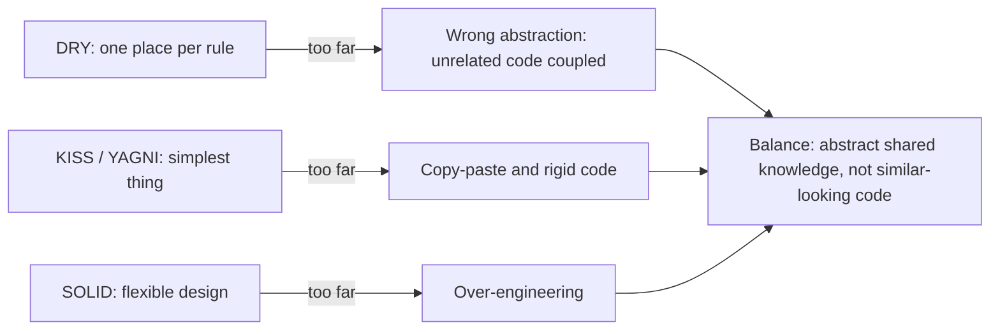

# DRY, KISS, YAGNI and Friends

<span class="badge-l1">L1 🟢 Foundations</span> · <span class="read-time">⏱ 50 min read</span> · Prerequisites: [SOLID Principles](solid-principles.md)

!!! abstract "TL;DR"
    SOLID tells you how to make code flexible; DRY, KISS and YAGNI stop you overdoing it. Keep each piece of *knowledge* in one place (DRY), choose the simplest design that works (KISS), and don't build what nobody needs yet (YAGNI). Law of Demeter, Tell Don't Ask, cohesion/coupling and GRASP help you decide which class a piece of behaviour belongs to.

## 1. What It Is

**Plain English.** A handful of short rules that experienced developers use to judge code:

- **DRY (Don't Repeat Yourself):** don't keep the same rule in two places.
- **KISS (Keep It Simple):** prefer the simplest design that solves the problem.
- **YAGNI (You Aren't Gonna Need It):** don't build features or abstractions before they're needed.
- **Law of Demeter:** talk to your immediate friends, not to strangers reached through them.
- **Tell, Don't Ask:** tell an object to do something instead of asking for its data and deciding for it.
- **Cohesion and coupling:** keep related things together, unrelated things apart.
- **GRASP:** nine guidelines for assigning responsibilities to classes.

**Precise definition.** *The Pragmatic Programmer* (Hunt and Thomas, 1999) defines DRY as: "Every piece of knowledge must have a single, unambiguous, authoritative representation within a system." Note the word *knowledge*: DRY is about rules and decisions, not about lines of text that happen to look alike.

## 2. Why It Exists

When a rule lives in two places, the copies drift apart, and the bug appears in whichever copy you forgot to update. When code is more complex than it needs to be, every reader pays for it. When code reaches through chains of objects, a change to any link breaks callers far away. These principles came out of decades of maintenance pain: the Law of Demeter from a 1987 research project at Northeastern University, YAGNI from Extreme Programming in the late 1990s, GRASP from Craig Larman's *Applying UML and Patterns*.

## 3. Mental Model / Analogy

**Analogy.** A FreshCart store's price list. If the price of milk is written on the shelf, in the till and on the website separately, one day they won't match (DRY). The best price system is the one staff can understand on day one (KISS). You don't buy a second till for a rush that never comes (YAGNI). The cashier asks the customer to pay; they don't reach into the customer's bag for their wallet (Demeter, Tell Don't Ask).

**Technical model.** Think of knowledge as nodes and code as references to those nodes. DRY says each node exists once. Coupling counts the edges between modules; cohesion measures how many edges stay inside a module. Demeter limits each method to edges of length one.

## 4. How It Works

The principles pull in different directions, and good design balances them:



The practical test for DRY: *if this rule changes, would both copies have to change, for the same reason, at the same time?* If yes, unify them. If they'd change for different reasons, they only look alike, and merging them couples things that should stay independent.

## 5. Subtopics

Each principle gets a full deep dive: description, advantages, a runnable before/after production-style example, pros and cons, when to use and avoid it, real-world Java, a best practice and the classic mistake.

### DRY: Don't Repeat Yourself

**Description.** "Every piece of knowledge must have a single, unambiguous, authoritative representation within a system" (Hunt and Thomas). The key word is *knowledge*: a business rule, a validation, a status transition, a configuration value. When the same rule is written in two places, the copies drift apart, and the system gives different answers depending on which copy runs. DRY is **not** about removing every pair of similar-looking lines.

**Advantages / features.**

- One place to change a rule, so a change can't be half-applied.
- Every client gets the same answer (API, support tool, mobile app).
- The rule can be tested once, thoroughly.
- Rules expressed as types (`enum`, value objects) are visible and discoverable.

**Production example: one order-status state machine instead of copied checks.**

```java title="DryStatusDemo.java"
--8<-- "examples/l1-foundations/other-design-principles/DryStatusDemo.java"
```

1. **Before:** the API and the support tool each have their own copy of "can this order be cancelled?", and they already disagree.
2. **After:** the lifecycle lives in the `OrderStatus` enum, as a table of allowed transitions.
3. Every transition goes through one method that enforces the table.
4. All clients now give the same answer, because they all ask the same place.

**Run it:** `java DryStatusDemo.java`

```text
--8<-- "examples/l1-foundations/other-design-principles/DryStatusDemo.expected.txt"
```

| Pros | Cons |
|------|------|
| Rules can't drift between copies | Shared code couples everyone who uses it |
| One place to test and audit | A wrong shared abstraction hurts every user |
| Consistent behaviour across clients | Shared code needs a clear owner |
| Encourages rules-as-types (enums, value objects) | Across services, sharing code couples deployments |

**Use it for** business rules, validations, state transitions, constants with business meaning and mappings. **Avoid it for** code that merely looks similar but represents different decisions (see Example 3), and across microservice boundaries, where you share contracts rather than code.

**Real-world Java.** `java.time.DayOfWeek` and `java.util.concurrent.TimeUnit` are single authoritative representations of knowledge that used to be scattered as magic numbers. Bean Validation (`@NotNull`, `@Email`) keeps validation rules in one place on the type.

**Best practice:** before merging two copies, ask "would these change for the same reason, at the same time, requested by the same people?"
**Gotcha:** DRY applies to tests too, but readable tests often repeat setup on purpose. Prefer clarity over DRY in tests.

### KISS: Keep It Simple

**Description.** Choose the simplest design that meets the requirement and that a new teammate can understand quickly. Simple means *few concepts*, not *few characters*. A generic rule engine, a clever stream reduction or a reflection trick may be shorter, but every reader has to decode it, and every bug hides in it.

**Advantages / features.**

- Faster code reviews and onboarding.
- Fewer places for bugs to hide; easier debugging at 3 a.m.
- Names that match the business language ("bookable", "before cutoff").
- Easier to change, because the intent is obvious.

**Production example: the same slot rule, clever vs. simple.**

```java title="KissDemo.java"
--8<-- "examples/l1-foundations/other-design-principles/KissDemo.java"
```

1. **Clever:** a map of predicates reduced into one. It works, but the reader must decode it, and the rules are anonymous.
2. **Simple:** two named booleans that read like the business rule.
3. Simple code is also easier to explain when support asks "why can't I book this slot?".

**Run it:** `java KissDemo.java`

```text
--8<-- "examples/l1-foundations/other-design-principles/KissDemo.expected.txt"
```

| Pros | Cons |
|------|------|
| Easy to read, review and debug | Simple designs may need refactoring as needs grow |
| Fewer bugs and edge cases | "Simple" is subjective; teams must agree |
| Intent matches the business language | Can be mistaken for "unsophisticated" |
| Cheap to change | Copy-paste is easy but not simple |

**Use it** by default, everywhere. **Accept extra complexity** only when a measured need requires it: performance after profiling, a framework your team already knows, or a real second variant.

**Real-world Java.** `record` replaced pages of `equals`/`hashCode`/`toString` boilerplate; `var`, text blocks and `List.of` exist to make simple code shorter without making it clever.

**Best practice:** name intermediate results (`hasRoom`, `beforeCutoff`); a well-named boolean is the cheapest documentation there is.
**Gotcha:** "simple" isn't "easy": a 400-line copy-pasted method was easy to write and is anything but simple.

### YAGNI: You Aren't Gonna Need It

**Description.** Don't build capabilities until an actual requirement needs them. From Extreme Programming: speculative features cost design time, build time, test time and reading time forever, and most guessed requirements arrive in a different shape than predicted, or never arrive. YAGNI only works together with refactoring and tests, which make adding the feature later cheap.

**Advantages / features.**

- Less code to build, test, secure and maintain.
- The design fits real requirements instead of imagined ones.
- Faster delivery of what users actually asked for.
- When the real need arrives, you design for its real shape.

**Production example: one discount rule today, a second one later.**

```java title="YagniDemo.java"
--8<-- "examples/l1-foundations/other-design-principles/YagniDemo.java"
```

1. **Speculative:** a factory taking region, channel and tier, all ignored, because only one rule exists.
2. **YAGNI:** exactly the requirement, with validation.
3. Months later, a real second rule arrives, and only now is an extension point added, shaped by the actual need (per city, not per region/channel/tier).

**Run it:** `java YagniDemo.java`

```text
--8<-- "examples/l1-foundations/other-design-principles/YagniDemo.expected.txt"
```

| Pros | Cons |
|------|------|
| Less code and less maintenance | Some refactoring when needs do arrive |
| Designs match real requirements | Needs good tests to be safe |
| Faster delivery | Can be misused to skip important non-functional work |
| No dead configuration or unused abstractions | Hard to apply to public APIs, which can't be refactored freely |

**Use it** for features, abstractions, configuration options and infrastructure. **Don't use it** for "one-way doors" that are expensive to change later: security, data models and storage formats, public API contracts, and observability.

**Real-world Java.** The JDK itself follows a version of this: features arrive first as previews (sealed classes, pattern matching, virtual threads' early APIs) and are finalised only after real-world feedback.

**Best practice:** when tempted to add a parameter "for later", write it down as a ticket instead of code.
**Gotcha:** YAGNI is not an excuse to skip tests, error handling or logging; those are needed now.

### Law of Demeter

**Description.** A method should call methods only on: itself, its fields, its parameters and objects it creates. Not on objects *returned by* those calls. Chains like `order.getCustomer().getWallet().getBalance()` make the caller depend on the internal structure of three classes, so changing any of them breaks callers far away. It's also called the *principle of least knowledge*.

**Advantages / features.**

- Callers depend only on their direct collaborators.
- Internal structures can be refactored without breaking distant code.
- Behaviour moves next to the data (it pairs naturally with Tell, Don't Ask).
- Easier mocking: one collaborator to fake instead of a chain.

**Example: see [Example 2](#example-2-realistic-in-freshcart-grocery-delivery)** below, which settles an order from a wallet both ways.

| Pros | Cons |
|------|------|
| Lower coupling to internal structure | Wrapper methods that only delegate |
| Safer refactoring | Can bloat intermediate classes with pass-through methods |
| Simpler test setup | Misapplied to data records and fluent APIs |

**Use it** for objects with behaviour and invariants. **Don't apply it** to plain data (records, DTOs, JSON trees) or fluent APIs like streams and builders, where chaining is the design.

**Real-world Java.** `Optional.map(...).orElse(...)` and `stream().filter().map()` chain calls on *one* abstraction, so they're not violations. A train wreck through JPA entities (`order.getCustomer().getAddress().getCity()`) often causes lazy-loading queries too, so Demeter violations can also be performance bugs.

**Best practice:** when you see a chain, add a method on the first object that answers the question directly.
**Gotcha:** counting dots mechanically. The rule is about reaching into *other objects' internals*.

### Tell, Don't Ask

**Description.** Tell an object what you want done, and let it decide using its own data, instead of asking for its data, deciding outside, and writing back. Asking spreads the object's rules across its callers, and the read-decide-write sequence is a race condition when two callers run at once.

**Advantages / features.**

- Invariants are enforced in one place, inside the object.
- No duplicated decision logic in callers.
- Check-and-act can be made atomic, which matters under concurrency.
- Objects get behaviour-rich APIs (`tryBook`, `tryDebit`) instead of getters and setters.

**Production example: booking the last delivery slot under concurrency.**

```java title="TellDontAskDemo.java"
--8<-- "examples/l1-foundations/other-design-principles/TellDontAskDemo.java"
```

1. **Ask:** the caller checks, then writes. Between the two steps another caller can do the same.
2. **Tell:** the slot decides and updates atomically with compare-and-set, so it can never overbook.
3. The interleaving is replayed step by step so the output is deterministic: both customers see a free place and both get it.

**Run it:** `java TellDontAskDemo.java`

```text
--8<-- "examples/l1-foundations/other-design-principles/TellDontAskDemo.expected.txt"
```

| Pros | Cons |
|------|------|
| Rules live with the data | Objects can grow many behaviour methods |
| Atomic check-and-act prevents races | Reporting and UI still need to read data |
| Callers are simpler | Some decisions span several objects and belong in a service |
| Fewer getters/setters exposed | Requires rethinking setter-heavy code |

**Use it** for anything that protects an invariant: balances, capacity, stock, status transitions. **Asking is fine** for display, reports and serialisation.

**Real-world Java.** `ConcurrentHashMap.putIfAbsent`, `AtomicInteger.compareAndSet` and `Set.add` (which returns whether it added) are "tell" APIs that make check-and-act atomic.

**Best practice:** name methods after the intent and return the outcome (`boolean tryBook()`), so the caller doesn't need to read state first.
**Gotcha:** wrapping an ask-style sequence in `synchronized` in the *caller* only works if every caller uses the same lock. Put the decision in the object.

### Cohesion and coupling

**Description.** *Cohesion* measures how strongly the parts of a module belong together: a `Pincode` class with all pincode rules is highly cohesive; an `OrderUtils` class with prices, pincodes and payouts is not. *Coupling* measures how much modules know about each other. Aim for high cohesion (each module has one purpose) and low coupling (modules interact through small, stable contracts such as events or interfaces).

**Advantages / features.**

- Features can be understood, changed and tested on their own.
- Teams can own modules with few cross-team dependencies.
- Changes stay local; the blast radius of a bug is smaller.
- Modules can later be extracted into separate deployables if needed.

**Production example: from a utils grab-bag to cohesive features connected by an event.**

```java title="CohesionDemo.java"
--8<-- "examples/l1-foundations/other-design-principles/CohesionDemo.java"
```

1. **Low cohesion:** three unrelated rules in one class, owned by three different teams.
2. A small event record is the only thing Checkout and Delivery share: low coupling.
3. Checkout publishes the event; it doesn't know who listens or what they do.

**Run it:** `java CohesionDemo.java`

```text
--8<-- "examples/l1-foundations/other-design-principles/CohesionDemo.expected.txt"
```

| Pros | Cons |
|------|------|
| Local, safe changes | More classes and packages |
| Clear ownership per feature | Events make the flow harder to follow |
| Easier extraction into modules or services | Too-fine modules add coordination overhead |
| Smaller test setups | Shared data (one table used by all) can hide coupling |

**Use it** when organising packages and modules: package by feature (`checkout`, `delivery`, `addresses`) rather than by layer (`controllers`, `services`, `utils`). **Avoid** splitting a cohesive feature across many modules just to keep files small.

**Real-world Java.** The JDK's own packages are cohesive (`java.time`, `java.util.concurrent`), and Java modules (JPMS, Java 9) enforce low coupling by exporting only chosen packages.

**Best practice:** treat any class named `*Utils` or `*Helper` as a review question: whose rules are these, and where do they belong?
**Gotcha:** coupling through a shared database table is still coupling, even if the code never imports the other module.

### GRASP in brief

**Description.** Craig Larman's General Responsibility Assignment Software Patterns answer "which class should do this?". There are nine: **Information Expert**, **Creator**, **Controller**, **Low Coupling**, **High Cohesion**, **Polymorphism**, **Pure Fabrication**, **Indirection** and **Protected Variations**. The first four are the ones you'll use in almost every design discussion.

**Advantages / features.**

- A shared vocabulary for responsibility decisions in design reviews.
- Behaviour ends up next to the data it uses.
- A principled reason for non-domain classes (repositories, controllers) to exist.
- Connects naturally to GoF: Polymorphism → Strategy, Indirection → Adapter/Mediator, Protected Variations → OCP.

**Production example: one checkout flow, four GRASP patterns.**

```java title="GraspDemo.java"
--8<-- "examples/l1-foundations/other-design-principles/GraspDemo.java"
```

1. **Information Expert:** the line has the price and quantity, so it computes its subtotal.
2. **Creator:** the basket contains lines, so the basket creates (and validates) them.
3. **Pure Fabrication:** a repository isn't a grocery concept; it's invented to keep persistence out of the domain.
4. **Controller:** receives the system event and delegates; it contains no business rules.

**Run it:** `java GraspDemo.java`

```text
--8<-- "examples/l1-foundations/other-design-principles/GraspDemo.expected.txt"
```

| Pros | Cons |
|------|------|
| Principled answers to "where does this go?" | Less known than GoF or SOLID |
| Behaviour sits with its data | Terms overlap with SOLID (Low Coupling, High Cohesion) |
| Justifies useful non-domain classes | Information Expert alone can overload central classes |

**Use it** in design reviews and when adding a new method: start with Information Expert, and fall back to Pure Fabrication when the expert would lose cohesion. **Avoid** treating it as a checklist to apply all nine everywhere.

**Real-world Java.** Spring MVC's `@Controller` is GRASP's Controller; Spring Data repositories are Pure Fabrications; `List.of` creating its own immutable implementation is Creator.

**Best practice:** if a method mostly reads another object's fields, move it to that object (Information Expert).
**Gotcha:** Information Expert can pull persistence or UI concerns into domain objects; that's when Pure Fabrication is the right answer.

### Principles at a glance

| Principle | One-line test | If violated | Typical fix |
|-----------|---------------|-------------|-------------|
| DRY | Is this rule written in exactly one place? | Copies drift, clients disagree | Value type, enum, single function |
| KISS | Could a new teammate explain this in a minute? | Bugs hide in clever code | Name things, remove indirection |
| YAGNI | Is there a real requirement for this today? | Dead code, wrong abstractions | Delete it; add when needed |
| Demeter | Does this call reach through a returned object? | Distant code breaks on refactoring | Method on the nearest collaborator |
| Tell, Don't Ask | Does the caller decide using another object's data? | Duplicated rules, race conditions | Behaviour method on the data owner |
| Cohesion/coupling | Do this module's parts change together? Does it know too much about others? | Grab-bag classes, ripple changes | Package by feature, events, interfaces |
| GRASP Expert | Does this class have the data to do this job? | Logic far from its data | Move the method to the data |

## 6. Examples (exactly 3, progressively harder)

### Example 1: Minimal (L1)

**Scenario:** FreshCart's signup form and rider app both validate phone numbers. The rule was copy-pasted, then changed in one place: signup allows 13 digits and strips spaces, the rider app doesn't. A customer's number is accepted at signup and rejected when a rider tries to call them.

**Code / Config:**

```java title="PhoneNumberDemo.java"
--8<-- "examples/l1-foundations/other-design-principles/PhoneNumberDemo.java"
```

1. The copy has already drifted: a different maximum length, and no space stripping.
2. One authoritative home for the rule: a value type that can't be invalid.
3. Normalisation happens once, so everything downstream sees the same format.

**Run it:**

```bash
java PhoneNumberDemo.java
```

**Output:**

```text
--8<-- "examples/l1-foundations/other-design-principles/PhoneNumberDemo.expected.txt"
```

**What to notice:**

- The two copies give different answers for the same input: that's what duplicated knowledge costs.
- With `PhoneNumber`, an invalid number can't even be created, so later code doesn't re-check.
- Storing the normalised form (`+919876543210`) means search and deduplication work too.

### Example 2: Realistic (in FreshCart grocery delivery)

**Scenario:** Settling an order from the customer's wallet. The "ask" version reaches through order → customer → wallet and decides in the caller. The "tell" version asks the order to settle itself, which asks the customer, which asks the wallet.

**Code / Config:**

```java title="DemeterDemo.java"
--8<-- "examples/l1-foundations/other-design-principles/DemeterDemo.java"
```

1. The wallet decides whether a debit is allowed: the rule lives with the data.
2. The customer only talks to its own field.
3. The order only talks to its own field; the caller only talks to the order.
4. A Demeter violation: this caller depends on the shape of `Order`, `Customer` and `Wallet`.

**Run it:**

```bash
java DemeterDemo.java
```

**Output:**

```text
--8<-- "examples/l1-foundations/other-design-principles/DemeterDemo.expected.txt"
```

**What to notice:**

- Both styles work on the first payment; the difference shows when rules change. If wallets gain a daily limit, only `tryDebit` changes in the tell style; every ask-style caller would need editing.
- The second `settle()` is declined because the balance is now $15.01: the wallet enforced its own invariant.
- The ask style's check-then-set is also a race condition if two threads settle at once.

### Example 3: Production-grade

**Scenario:** The delivery fee (what customers pay) and the rider payout (what riders earn) are both "base + rate per km". A well-meaning refactoring merged them into one `distanceCost()` function. Then marketing made delivery free over $50, and rider payouts for those orders dropped to zero. The corrected design keeps the two policies separate, because they're different knowledge owned by different teams, and shares only the knowledge that's genuinely common: what a valid delivery distance is.

**Code / Config:**

```java title="FeeAndPayoutDemo.java"
--8<-- "examples/l1-foundations/other-design-principles/FeeAndPayoutDemo.java"
```

1. Owned by Pricing; changes with campaigns.
2. Owned by Rider Operations; changes with agreements and fuel costs. Similar shape, different reasons to change.
3. The one rule both genuinely share lives in one place.

**Run it:**

```bash
java FeeAndPayoutDemo.java
```

**Output:**

```text
--8<-- "examples/l1-foundations/other-design-principles/FeeAndPayoutDemo.expected.txt"
```

**What to notice:**

- FC-7003 has free delivery, yet the rider is still paid $4.43; the negative margin is a business decision, now visible.
- FC-7001's payout hits the $3.00 minimum, a rule only payouts have.
- An invalid distance is rejected by both policies through the same shared check.
- Settings are validated in the records' constructors, so bad configuration fails at startup, not mid-delivery.

## 7. Pros, Cons & Trade-offs

| Aspect | Pros | Cons |
|--------|------|------|
| Simplicity | KISS/YAGNI keep the code base small | Too little structure leads to copy-paste |
| Performance | Simple code is easier to optimise | Wrapper methods for Demeter add trivial calls |
| Scalability | Low coupling lets teams change modules independently | Shared "DRY" utilities become bottlenecks owned by nobody |
| Operability | Rules in one place are easier to audit and log | Over-DRY generic code produces vague logs |
| Security | One validation type means one place to get it right | One shared bug affects every user of it |
| Testability | Value types and tell-style objects are easy to test | Merged logic needs tests for every caller's case |
| Cost | Less code to maintain | Refactoring later when YAGNI was wrong |
| Learning curve | Short, memorable rules | Knowing when each rule stops applying takes experience |

## 8. When to Use / When NOT to Use

**Use DRY** for business rules, validation, configuration values and status transitions.
**Don't use DRY** to merge code that looks alike but changes for different reasons, or across service boundaries where sharing a library couples deployments.

**Use KISS/YAGNI** by default for features, abstractions and infrastructure.
**Don't use YAGNI** as a reason to skip security, data model design or public API contracts, which are expensive to change later.

**Use Demeter/Tell Don't Ask** for objects with behaviour and invariants.
**Don't apply them** to plain data records, DTOs or fluent APIs.

## 9. Best Practices

1. **Ask "same knowledge or same shape?" before removing duplication.** *(Consensus.)*
2. **Encode validation rules in value types.** *(Consensus in DDD; widely practised.)*
3. **Wait for the third occurrence before abstracting** (rule of three). *(Consensus.)*
4. **Put behaviour where the data is** (Information Expert). *(Consensus.)*
5. **Prefer duplication over the wrong abstraction.** *(Opinion, popularised by Sandi Metz.)*
6. **Keep YAGNI away from security and data contracts.** *(Opinion, widely shared.)*

## 10. Pitfalls & Anti-Patterns

!!! danger "The wrong abstraction"
    **Symptom:** a shared method with boolean flags (`calculate(distance, isPayout, isPeak, skipFree)`) that every team edits.
    **Root cause:** two different pieces of knowledge merged because their code looked alike.
    **Fix:** inline the shared method back into its callers, then extract only what's genuinely shared.

!!! danger "Riders paid zero (production failure mode)"
    **Symptom:** riders complained that some deliveries paid nothing; the payroll report showed $0 payouts for orders over $50.
    **Root cause:** fee and payout shared one function; a "free delivery over $50" change to the fee also changed payouts.
    **Fix:** separate policies per owner (Example 3) and a test that free delivery doesn't change payouts.

!!! danger "Train wrecks"
    **Symptom:** `a.getB().getC().getD().doSomething()` across the code base, and a refactoring of `C` breaks 40 files.
    **Root cause:** callers depend on the internal structure of objects they don't own.
    **Fix:** add a behaviour method on the nearest object (Tell, Don't Ask).

!!! danger "Speculative configuration"
    **Symptom:** 60 configuration flags, half of which have never been changed from their default.
    **Root cause:** YAGNI ignored: every possible variation made configurable "just in case".
    **Fix:** delete unused flags; add configuration when someone needs to change a value without a deploy.

## 12. Security Considerations

DRY is a security principle for validation and authorisation: one input-validation type and one authorisation check per action means one place to audit and fix. Duplicated checks drift, and attackers find the weakest copy. YAGNI does *not* apply to security controls such as input validation, encryption and audit logging.

## 14. Testing It

The test that would have caught the rider payout incident: free delivery must not change the payout, and both policies reject the same invalid distances.

```java title="FeeAndPayoutTest.java"
--8<-- "examples/l1-foundations/other-design-principles/FeeAndPayoutTest.java"
```

## 16. Version Notes

Records (Java 16) make DRY value types like `PhoneNumber` a few lines, with validation in the compact constructor. Before records, the boilerplate of a proper value class (constructor, `equals`, `hashCode`, `toString`) was a common excuse for passing raw `String`s around.

## 17. Expert Deep Dive

- **DRY across services is coupling.** A shared "common" library used by 30 services means a change requires 30 deployments, and a bug ships everywhere. Seniors accept duplicated code across service boundaries and share only stable contracts (schemas, client libraries owned by the provider).
- **Duplication is cheaper than the wrong abstraction.** When an abstraction collects flags and special cases, the fastest fix is often to inline it back into callers and re-extract what's really shared.
- **Demeter at system level** is "don't call your dependency's dependency". A service that queries another team's database directly is the distributed version of a train wreck.
- **YAGNI vs. one-way doors.** Amazon's "one-way vs. two-way door" framing helps: reversible decisions should be made fast and simply; irreversible ones (public APIs, data formats, security) deserve up-front design.
- **In reviews**, ask: "If this rule changes, how many places change?" and "Who owns this shared code?".

!!! example "War story: the shared utils jar"
    A grocery platform's teams shared a `common-utils` library for "everything reusable": date helpers, money formatting, validation, HTTP clients. After two years it had 400 classes and every service depended on it. A change to a phone-number regex for one country, made by the checkout team, shipped to the rider service in its next routine build and started rejecting riders' numbers in another country. Rollback required rebuilding a dozen services. The fix was splitting the library by owner, versioning each part, and moving domain rules (like phone validation per country) into the services that own them. **Lesson:** DRY's "single authoritative representation" needs a single *owner* too.

## 18. Interview Corner

=== "🟢 L1–L2"

    1. **What does DRY mean?** **Every piece of knowledge has one authoritative representation**; it's about rules, not text.
    2. **What's YAGNI?** **Don't build things before they're needed.**
    3. **What's the Law of Demeter?** **Only talk to immediate collaborators**: fields, parameters, objects you create.
    4. **Tell, Don't Ask?** **Tell objects to act** instead of asking for their data and deciding for them.
    5. **High cohesion, low coupling?** **Related things together**, **few dependencies** between modules.

=== "🟡 L3"

    1. **When should you NOT remove duplication?** When the copies **change for different reasons** or belong to **different owners**.
    2. **Is `list.stream().filter().map()` a Demeter violation?** No: it's a **fluent API on one abstraction**.
    3. **How does Tell, Don't Ask help with concurrency?** It puts **check and act in one method**, avoiding check-then-act races.
    4. **Which GRASP principle helps most day to day?** **Information Expert**: give the responsibility to the class with the data.
    5. **YAGNI exceptions?** **Security, data models and public API contracts**, which are costly to change later.

=== "🔴 L4–L5"

    1. **Your organisation has a 400-class shared library. What do you do?** **Split by owner**, version independently, move **domain rules into owning services**.
    2. **How do you balance DRY with service autonomy?** Share **contracts, not implementations**; accept duplicated code across boundaries.
    3. **How do you spot the wrong abstraction in review?** **Boolean flags, type switches and special cases** accumulating in shared code.
    4. **Which decisions deserve up-front design despite YAGNI?** **One-way doors**: data formats, public APIs, security architecture.
    5. **Now rider payouts differ per city and per vehicle. What changes?** Payout policy becomes **data-driven configuration per city/vehicle**, still owned by Rider Ops, with **validation at load time**.

=== "💻 Hands-on"

    **Task:** In Example 2, add a daily spending limit to the wallet without changing `Order` or `Customer`.

    ??? success "Solution"
        ```java
        static final class Wallet {
            private long balanceInCents;
            private final long dailyLimitInCents;
            private long spentTodayInCents;

            Wallet(long balance, long dailyLimit) { this.balanceInCents = balance; this.dailyLimitInCents = dailyLimit; }

            boolean tryDebit(long cents) {
                if (cents <= 0 || cents > balanceInCents) return false;
                if (spentTodayInCents + cents > dailyLimitInCents) return false;
                balanceInCents -= cents;
                spentTodayInCents += cents;
                return true;
            }
        }
        ```
        Only the wallet changed, because the decision lives there (Tell, Don't Ask).

## 19. Practice

- [ ] Find two copies of the same validation rule in a project you know and unify them in a value type.
    ??? tip "Hint"
        Search for the same regex or the same magic number in several files.
- [ ] Find a train wreck (`a.getB().getC()...`) and replace it with a tell-style method.
    ??? tip "Hint"
        Put the new method on the first object in the chain.
- [ ] Add a peak-hour bonus to rider payouts in Example 3 without touching the fee policy.
    ??? tip "Hint"
        Add a `peakBonusInCents` component to `RiderPayoutPolicy` and a `boolean peak` parameter.

## 20. Quick Revision Card

!!! tip "Remember in 30 seconds"
    - DRY = one home per piece of *knowledge*, not per look-alike code.
    - KISS = fewest concepts; YAGNI = nothing before it's needed (except one-way doors).
    - Demeter = talk to friends only; Tell, Don't Ask = let the data's owner decide.
    - High cohesion, low coupling; package by feature.
    - GRASP Information Expert: behaviour goes where the data is.

    ```java
    record PhoneNumber(String value) {           // DRY: the rule lives here
        PhoneNumber { /* validate + normalise once */ }
    }
    boolean paid = order.settle();                // Tell, Don't Ask
    ```

## 21. Further Reading

- Andrew Hunt and David Thomas, *The Pragmatic Programmer*, 20th anniversary edition (2019).
- Craig Larman, *Applying UML and Patterns*, 3rd edition (2004), chapters on GRASP.
- Sandi Metz, "The Wrong Abstraction" (blog post, 2016).
- Martin Fowler, "TellDontAsk" and "Yagni" (articles on martinfowler.com).

---

[← Previous: SOLID Principles](solid-principles.md) · [Next: Singleton →](singleton.md)
