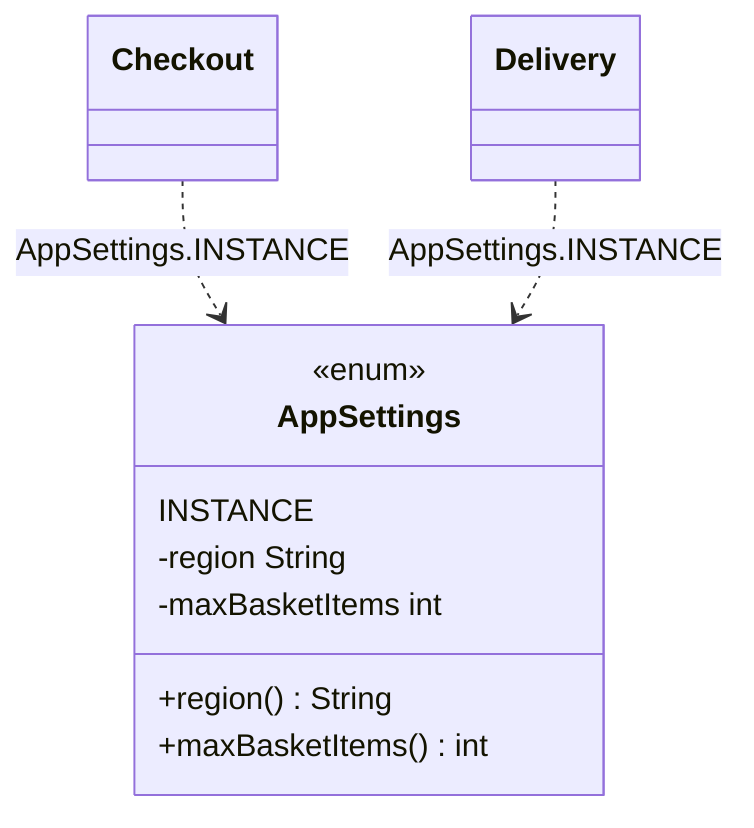
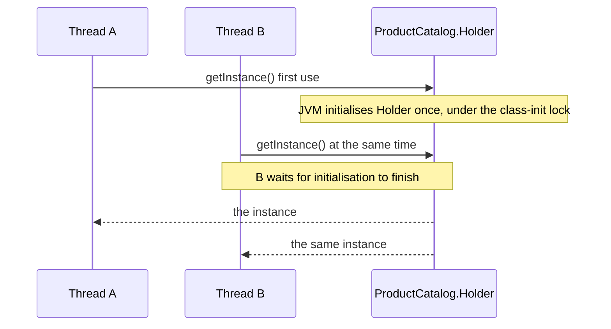

# Singleton

<span class="badge-l1">L1 🟢 Foundations</span> · <span class="read-time">⏱ 45 min read</span> · Prerequisites: [OOP Refresher](oop-refresher.md), [SOLID Principles](solid-principles.md)

!!! abstract "TL;DR"
    Singleton guarantees a class has exactly one instance and gives global access to it. In Java the safest forms are an `enum` or the lazy holder idiom. Use it sparingly: global state hurts testing and hides dependencies, so in most applications you want *one instance created in the composition root and injected*, not the Singleton pattern itself.

## 1. What It Is

**Plain English.** Some things should exist only once in a running program: the app's settings, a metrics registry, a connection pool. Singleton is a class that makes sure only one object of it can ever be created, and offers a static method (or field) to reach that object from anywhere.

**Precise definition (GoF intent).** "Ensure a class only has one instance, and provide a global point of access to it." It's a *creational* pattern with two parts:

- **Controlled construction:** a `private` constructor so no one else can call `new`.
- **Global access:** a static accessor (`getInstance()`) or an `enum` constant (`INSTANCE`).

New terms: **class initialisation** is when the JVM runs a class's static initialisers, on its first active use. **Safe publication** means other threads are guaranteed to see a fully constructed object.

## 2. Why It Exists

Some resources are expensive or must be coordinated: a thread pool, a cache, a hardware device, the configuration loaded at startup. Before the pattern, programs used global variables, which anyone could reassign, and which were created in an unpredictable order. Singleton gave one controlled place for creation, and lazy creation for expensive objects.

What goes wrong without *any* single-instance control: two caches that disagree, two connection pools each sized for the whole database (so twice the connections), or two clients for a payment provider each with its own rate limit.

## 3. Mental Model / Analogy

**Analogy.** A FreshCart store has one master key cabinet. There's a single cabinet (one instance), it's in a known place everyone can reach (global access), and nobody is allowed to build a second one (private constructor). The downside is the same as in code: because everyone uses it directly, you can't easily swap it for a test cabinet, and you can't see from a staff member's job description that they depend on it.

**Technical model.** A Singleton is a static field holding the only instance, plus rules that make sure the field is set exactly once, safely across threads, and can't be bypassed by reflection, serialization or cloning.

## 4. How It Works





The JVM guarantees that a class is initialised only once, and that the result is visible to every thread (JLS §12.4.2). The `enum` and lazy holder forms reuse that guarantee, which is why they need no explicit locking.

## 5. Subtopics

Each implementation gets a deep dive with a runnable example, pros and cons, and when to use it.

### Eager initialisation

**Description.** The instance is created in a `static final` field initialiser. It's simple and thread-safe because class initialisation is. "Eager" means *when the class is initialised* (its first active use), which is not the same as program start.

**Advantages / features.** Simplest correct form; thread-safe without locks; failures in construction surface early and loudly.

```java title="EagerSingletonDemo.java"
--8<-- "examples/l1-foundations/singleton/EagerSingletonDemo.java"
```

1. Created once, when `FeatureFlags` is initialised.
2. `private`: nobody else can call `new FeatureFlags()`.
3. Unknown flags fail loudly instead of silently returning `false`.

**Run it:** `java EagerSingletonDemo.java`

```text
--8<-- "examples/l1-foundations/singleton/EagerSingletonDemo.expected.txt"
```

Notice "FeatureFlags created" prints *after* "main started": the nested class was initialised on first use.

| Pros | Cons |
|------|------|
| Simplest correct implementation | Created even if only a static constant of the class is used |
| Thread-safe through class initialisation | Construction errors become `ExceptionInInitializerError` |
| No locking on access | Can't pass parameters to the constructor |

**Use it** for cheap objects that are always needed. **Avoid it** when construction is expensive and often unused, or needs runtime parameters.
**Real-world Java:** `java.lang.Runtime.getRuntime()` returns an eagerly created instance.
**Best practice:** keep the constructor cheap and free of I/O. **Gotcha:** an exception in the initialiser makes the class unusable for the rest of the JVM's life (`NoClassDefFoundError` on later access).

### Lazy holder idiom

**Description.** The instance lives in a private static nested `Holder` class. The holder is only initialised when `getInstance()` first touches it, so creation is lazy, and the JVM's class-initialisation lock makes it thread-safe. Also called *initialization-on-demand holder*.

**Advantages / features.** Lazy *and* lock-free on every access after the first; no `volatile`; easy to read.

```java title="LazyHolderDemo.java"
--8<-- "examples/l1-foundations/singleton/LazyHolderDemo.java"
```

1. The nested class holds the instance and isn't initialised until it's used.
2. First call initialises `Holder`; later calls just read the field.
3. Other static members of the outer class don't trigger loading.

**Run it:** `java LazyHolderDemo.java`

```text
--8<-- "examples/l1-foundations/singleton/LazyHolderDemo.expected.txt"
```

| Pros | Cons |
|------|------|
| Lazy creation for expensive objects | Slightly more code than eager |
| Thread-safe with no explicit locking | No constructor parameters |
| No cost on access after initialisation | A failing constructor still breaks the class permanently |

**Use it** when the object is expensive and may not be needed. **Avoid it** when you need to reset or replace the instance (tests).
**Real-world Java:** a common idiom for loggers' and libraries' internal registries.
**Best practice:** prefer this over double-checked locking for static singletons. **Gotcha:** it only works for `static` instances, not for per-object lazy fields.

### Enum singleton

**Description.** An `enum` with a single constant. The JVM guarantees one instance, and Java's serialization and reflection rules protect enums specifically. Joshua Bloch calls a single-element enum "often the best way to implement a singleton" (*Effective Java*, Item 3).

**Advantages / features.** Shortest code; serialization-safe; reflection-safe; thread-safe.

```java title="EnumSingletonDemo.java"
--8<-- "examples/l1-foundations/singleton/EnumSingletonDemo.java"
```

1. One constant, one instance.
2. State inside a singleton must be thread-safe: `AtomicLong` here.
3. Deserialising an enum returns the existing constant, never a copy.
4. The JDK refuses to create enum instances through reflection.

**Run it:** `java EnumSingletonDemo.java`

```text
--8<-- "examples/l1-foundations/singleton/EnumSingletonDemo.expected.txt"
```

| Pros | Cons |
|------|------|
| Shortest correct code | Can't extend another class |
| Safe against serialization and reflection attacks | Eager (initialised with the enum class) |
| Thread-safe creation | Looks unusual to some readers |
| Works naturally with `switch` and `EnumMap` | Still global state: same testing problems |

**Use it** when you really need a static singleton. **Avoid it** when the instance needs constructor arguments known only at runtime, or when tests need to replace it.
**Real-world Java:** `java.util.concurrent.TimeUnit` constants and `java.math.RoundingMode` are enum instances used as shared singletons.
**Best practice:** keep enum singletons stateless or use thread-safe state. **Gotcha:** mutable state in an enum is still shared mutable global state.

### Double-checked locking with `volatile`

**Description.** Check without a lock, lock only if the instance is missing, check again inside the lock, then create. The field must be `volatile`; without it, another thread can see a non-null reference to an object whose fields aren't initialised yet (the classic broken DCL, fixed by the Java 5 memory model, JSR-133).

**Advantages / features.** Lazy; locking only on the first access; supports constructor arguments read at runtime.

```java title="DclSingletonDemo.java"
--8<-- "examples/l1-foundations/singleton/DclSingletonDemo.java"
```

1. `volatile` makes publication safe across threads.
2. Read the field once into a local: one volatile read on the fast path.
3. The second check prevents a second construction by a thread that waited for the lock.
4. All 64 threads start at once to stress the race.

**Run it:** `java DclSingletonDemo.java`

```text
--8<-- "examples/l1-foundations/singleton/DclSingletonDemo.expected.txt"
```

| Pros | Cons |
|------|------|
| Lazy, with no lock after initialisation | Easy to get subtly wrong (`volatile`, local copy) |
| Can read runtime configuration | More code than holder or enum |
| Works for instance fields too (lazy per object) | Reviewers must know the memory model to verify it |

**Use it** for lazy *instance* fields, or when the holder idiom doesn't fit. **Avoid it** for static singletons; the holder idiom is simpler.
**Real-world Java:** used inside JDK and library classes for lazily computed fields.
**Best practice:** copy the pattern exactly, including the local variable. **Gotcha:** dropping `volatile` produces a bug that almost never shows up in tests.

### Breaking singletons: reflection, serialization, class loaders

**Description.** A private constructor isn't a guarantee. **Reflection** can call it with `setAccessible(true)`. **Serialization** creates a new object on `readObject` unless the class defines `readResolve`. **Class loaders**: each class loader that loads the class gets its own static field, so application servers, plugin systems and some test runners can end up with "one singleton per class loader". **Cloning** creates a copy if the class implements `Cloneable`.

**Advantages of knowing this.** You can harden singletons that matter (security, licensing, payment clients), and you can recognise "two instances" bugs in app servers.

```java title="BreakingSingletonDemo.java"
--8<-- "examples/l1-foundations/singleton/BreakingSingletonDemo.java"
```

1. A guard in the constructor turns a reflective second construction into an error.
2. `readResolve` replaces the deserialised copy with the real instance.
3. Reflection bypasses `private` unless the module system or a guard prevents it.

**Run it:** `java BreakingSingletonDemo.java`

```text
--8<-- "examples/l1-foundations/singleton/BreakingSingletonDemo.expected.txt"
```

| Defence | Protects against | Cost |
|---------|------------------|------|
| Use an `enum` | Reflection and serialization | Can't extend a class |
| Constructor guard | Reflection | Extra code; must be thread-safe |
| `readResolve()` | Serialization | Must remember it; fields should be `transient` |
| Don't implement `Cloneable` | Cloning | None |
| Strong encapsulation (JPMS modules) | Reflection from other modules | Requires modular build |

**Use these defences** when a second instance would be a security or correctness problem. **Don't bother** for ordinary in-house singletons; prefer DI instead.
**Real-world Java:** enums are protected in `java.lang.reflect.Constructor.newInstance`, which throws "Cannot reflectively create enum objects".
**Best practice:** if you need the guarantees, use an enum. **Gotcha:** in an application server with several web apps, each app's class loader has its own "singleton".

### Singleton vs. dependency-injected single instance

**Description.** Often what you really need is *one instance per application*, not a class that *enforces* one instance and exposes it globally. Create the object once in the composition root (or let Spring create it; Spring beans are singleton-scoped by default) and pass it to whoever needs it through their constructor.

**Advantages / features.** Dependencies are visible in constructors; tests create their own instance (or a fake); no global state; you can still have exactly one instance at runtime.

```java title="DiSingletonDemo.java"
--8<-- "examples/l1-foundations/singleton/DiSingletonDemo.java"
```

1. The static version uses the real clock and accumulates state across tests.
2. The dependency is hidden: nothing in `RefundServiceBefore`'s constructor tells you it writes an audit log.
3. The dependency is explicit and replaceable.
4. One instance, created once, shared by both services.

**Run it:** `java DiSingletonDemo.java`

```text
--8<-- "examples/l1-foundations/singleton/DiSingletonDemo.expected.txt"
```

| | Static Singleton | DI single instance |
|---|---|---|
| Number of instances at runtime | One | One |
| Dependency visible in constructors | No | Yes |
| Replace in tests | Hard (global state) | Easy (pass a fake) |
| Thread safety of creation | Must be designed in | Composition root creates it once |
| Works with Spring | Fights the container | Default bean scope |

**Use DI** in applications, especially with Spring, Micronaut, Quarkus or Dagger. **Use a static singleton** only in libraries or low-level code with no composition root, or for truly stateless constants.
**Real-world Java:** Spring `@Service` and `@Component` beans are single instances managed by the container, not GoF singletons.
**Best practice:** "single instance" is a *wiring* decision, so make it in the composition root. **Gotcha:** a Spring bean that also has a static `getInstance()` gives you two ways to reach it, and they can diverge.

## 6. Examples (exactly 3, progressively harder)

### Example 1: Minimal (L1)

**Scenario:** FreshCart's checkout needs app-wide settings (the region and the basket limit) that are read once at startup and never change.

```java title="AppSettingsDemo.java"
--8<-- "examples/l1-foundations/singleton/AppSettingsDemo.java"
```

1. One enum constant: one settings object, created safely by the JVM.
2. Any class can read settings without passing them around.

**Run it:**

```bash
java AppSettingsDemo.java
java -Dfreshcart.maxBasketItems=100 AppSettingsDemo.java   # the 80-item basket is now ok
```

**Output:**

```text
--8<-- "examples/l1-foundations/singleton/AppSettingsDemo.expected.txt"
```

**What to notice:**

- No locking code at all; the enum handles thread safety.
- Settings are read once; changing the system property later has no effect, which is usually what you want for startup configuration.
- `checkBasket` hides a dependency on `AppSettings`: fine in a tiny program, a testing problem in a large one (see Example 3).

### Example 2: Realistic (in FreshCart grocery delivery)

**Scenario:** Checkout and Delivery both count business events (orders placed, deliveries completed or failed). Operations wants one registry to read all counters from, and the counters must be correct when many requests update them at once.

```java title="MetricsRegistryDemo.java"
--8<-- "examples/l1-foundations/singleton/MetricsRegistryDemo.java"
```

1. Thread-safe map, because every request thread writes to the singleton.
2. `LongAdder` handles heavy concurrent increments better than `AtomicLong`.
3. Return a copy so callers can't modify the registry's state.

**Run it:** `java MetricsRegistryDemo.java`

**Output:**

```text
--8<-- "examples/l1-foundations/singleton/MetricsRegistryDemo.expected.txt"
```

**What to notice:**

- A metrics registry is one of the few places a static singleton is common in production code (Micrometer has `Metrics.globalRegistry`).
- All state inside the singleton is thread-safe; that's mandatory, not optional.
- Metric names are validated, so a malformed name (spaces, capitals) fails fast instead of creating a counter no dashboard queries.

### Example 3: Production-grade

**Scenario:** FreshCart's slot service caches each store's open delivery slots for five minutes. There must be one cache per service so app and web requests share it, entries must expire, the database must be called as little as possible, a database outage should serve stale data rather than fail, and tests must be able to create a fresh cache and control time. That rules out a static singleton; the answer is one instance created in the composition root and injected.

```java title="SlotCacheDemo.java"
--8<-- "examples/l1-foundations/singleton/SlotCacheDemo.java"
```

1. `ConcurrentHashMap`: the single instance is shared by every request thread.
2. On a load failure, serve the last known value if there is one (stale-if-error).
3. The composition root creates exactly one cache and hands it to both handlers.

**Run it:** `java SlotCacheDemo.java`

**Output:**

```text
--8<-- "examples/l1-foundations/singleton/SlotCacheDemo.expected.txt"
```

**What to notice:**

- The web request after the app request didn't call the database: one shared instance.
- Expiry is tested by moving an injected clock, not by sleeping.
- The database was down for the fourth request, yet customers still saw slots; only a store with no cached value failed.
- Hit, miss and load-failure counters are what you'd export to your metrics system.

## 7. Pros, Cons & Trade-offs

| Aspect | Pros | Cons |
|--------|------|------|
| Simplicity | One well-known place to get the object | Hidden dependencies: callers reach for it from anywhere |
| Performance | Expensive resources created once | Contention if the singleton's state is synchronised badly |
| Scalability | Shared pools and caches use memory efficiently | Global state becomes a bottleneck and a coupling point |
| Operability | One place to configure and observe | Hard to reconfigure at runtime without a restart |
| Security | Enum form resists reflection and serialization attacks | A mutable global is reachable by all code |
| Testability | — | Hard to replace, state leaks between tests, order-dependent tests |
| Cost | Little code | Refactoring away from singletons later is expensive |
| Learning curve | Easy to understand | Thread-safe lazy variants are easy to get wrong |

## 8. When to Use / When NOT to Use

**Use a static Singleton when:**

- there's genuinely one of something per JVM and no DI container (a library's internal registry, a process-wide metrics registry);
- the object is stateless or immutable (constants, pure functions grouped in an enum).

**Use a DI-managed single instance instead when:**

- you're in an application with a composition root or a container (Spring, Quarkus, Micronaut, Dagger);
- the object has dependencies, configuration, or state that tests need to control.

**Don't use either for:** per-user or per-request data, or anything you'll need more than one of later (multi-tenant, multi-region). Compare alternatives in [Pattern Comparisons](../reference/comparisons.md).

## 9. Best Practices

1. **Prefer DI for single instances in applications.** *(Consensus in modern Java.)*
2. **If you need a static singleton, use an `enum` or the lazy holder idiom.** *(Consensus: Effective Java Item 3.)*
3. **Make all state inside a singleton thread-safe or immutable.** *(Consensus.)*
4. **Keep constructors cheap and free of I/O**, so initialisation failures don't poison the class. *(Consensus.)*
5. **Never store per-user or per-request data in a singleton.** *(Consensus.)*
6. **Hide the singleton behind an interface** if other code depends on it, so tests can substitute it. *(Opinion.)*
7. **Write `volatile` double-checked locking only when profiling shows the simpler forms don't fit.** *(Opinion.)*

## 10. Pitfalls & Anti-Patterns

!!! danger "Singletonitis"
    **Symptom:** `OrderService.getInstance()`, `PaymentService.getInstance()`, `UserService.getInstance()` everywhere; tests need a specific run order.
    **Root cause:** Singleton used as a convenient way to reach things instead of passing dependencies.
    **Fix:** convert to constructor injection one service at a time; create instances in the composition root.

!!! danger "Customer data shown to the wrong customer (production failure mode)"
    **Symptom:** under load, some users saw another customer's basket total in the app.
    **Root cause:** a singleton `CheckoutContext` stored the "current customer" in a field, and concurrent requests overwrote each other.
    **Fix:** per-request data goes in request-scoped objects or method parameters, never in a singleton's fields.

!!! danger "Broken double-checked locking"
    **Symptom:** rare `NullPointerException`s inside a freshly created singleton, only on multi-core production machines.
    **Root cause:** the field wasn't `volatile`, so another thread saw a reference to a partially constructed object.
    **Fix:** add `volatile`, or switch to the lazy holder idiom.

!!! danger "Poisoned class"
    **Symptom:** every request fails with `NoClassDefFoundError: Could not initialize class ...` after a startup hiccup.
    **Root cause:** the singleton's static initialiser threw once (database down at startup), and the JVM never retries class initialisation.
    **Fix:** don't do I/O in static initialisers; create the resource lazily with retries, or in the composition root.

## 11. Configuration & Tuning

| Setting | Default | What it does | When to change it | Risk of changing |
|---------|---------|--------------|-------------------|------------------|
| Eager vs lazy | Eager (enum/static field) | When the instance is built | Expensive and often unused objects | Lazy hides startup failures until first use |
| Cache TTL (Example 3) | 5 minutes | How long cached data is served | Data changes faster or slower | Too long: stale data; too short: database load |
| Stale-if-error | On | Serve the last value when loading fails | Data must never be stale (prices at payment) | Off: outages surface to customers |

## 12. Security Considerations

- Use an `enum` for security-sensitive singletons (licence checks, crypto key holders) so reflection and serialization can't create a second instance.
- Never keep secrets in a singleton's `toString()`, and don't keep per-user tokens in singleton fields.
- With JPMS, don't `opens` the package containing security singletons, so other modules can't reflect into them.

## 13. Performance & Scalability

Access to an enum, eager or holder singleton is just a static field read after initialisation; the JIT often constant-folds it. The real performance risk is *contention*: a `synchronized` method on a singleton serialises every request. Use concurrent data structures (`ConcurrentHashMap`, `LongAdder`) inside singletons, and measure with JMH before optimising (see [Performance Cost of Patterns](../l3-professional/performance-of-patterns.md)).

## 14. Testing It

Each test creates its own cache instance and controls time, which a static singleton would make impossible:

```java title="SlotCacheTest.java"
--8<-- "examples/l1-foundations/singleton/SlotCacheTest.java"
```

If you must test code that uses a static singleton, add a package-private reset method for tests, or better, refactor the caller to accept an interface.

## 15. Observability & Operations

Singletons that own resources (pools, caches, clients) should expose metrics: size, hit rate, load failures, and for pools active versus idle connections. Log once at creation with the effective configuration, so you can see in production what the single instance was built with. Alert on a rising load-failure count before it becomes customer-visible.

## 16. Version Notes

| Java | Change relevant to Singleton |
|------|------------------------------|
| 5 | New memory model (JSR-133) makes `volatile` double-checked locking correct; enums introduced |
| 9 | Modules (JPMS) can block reflective access to private constructors from other modules |
| 16 | Records: handy for immutable values held by singletons |
| 21 | Virtual threads: avoid `synchronized` blocks around blocking I/O inside shared singletons, since they pin the carrier thread in Java 21 |

!!! warning "Verify against the official docs"
    The pinning behaviour of `synchronized` with virtual threads was improved in later JDK releases (JEP 491, JDK 24). Check the release notes for the JDK you run.

## 17. Expert Deep Dive

- **"One per what?"** Seniors ask what the uniqueness scope really is: per JVM, per class loader, per tenant, per region, per request? A GoF Singleton answers "per class loader" whether you meant it or not. In multi-tenant systems, most "singletons" turn out to be "one per tenant".
- **Singletons are global variables with better manners.** They create hidden coupling, which shows up as tests that must run in a specific order and features that can't be split into modules. In design reviews, ask: "how would a test replace this?"
- **Container scope is the modern answer.** Spring's singleton scope, Dagger's `@Singleton` and Guice's `@Singleton` give one instance per container, visible in constructors, replaceable in tests.
- **Initialisation order bugs.** Static singletons that depend on each other can deadlock during class initialisation if two threads initialise them in opposite orders. Avoid singleton-to-singleton dependencies in static initialisers.
- **Migrating legacy code:** keep `getInstance()` working, but make it return an instance that the composition root installs. Move callers to constructor injection one by one; delete `getInstance()` when it has no callers.

!!! example "War story: the singleton that knew too much"
    A grocery platform's mobile backend had a `SessionManager.getInstance()` singleton that cached "the current store" for pricing. It worked for years because each JVM served one city. When the team consolidated cities onto shared instances to cut costs, customers in Pune occasionally saw Mumbai prices. The cause took a week to find: the singleton's "current store" was being overwritten by concurrent requests from different cities. The fix was to remove the field, pass the store through the request, and replace the singleton with an injected, stateless `PricingService`. **Lesson:** a singleton's uniqueness assumption ("one city per JVM") is a hidden architectural constraint; write it down or design it out.

## 18. Interview Corner

=== "🟢 L1–L2"

    1. **What is the Singleton pattern?** It **ensures one instance** of a class and gives a **global access point** to it.
    2. **How do you stop others creating instances?** A **private constructor**.
    3. **What's the simplest thread-safe Singleton in Java?** An **enum with one constant**, or a `static final` field.
    4. **Eager vs lazy?** Eager creates the instance at **class initialisation**; lazy creates it on **first use**.
    5. **Why is Singleton criticised?** It's **global state**: hidden dependencies and **hard-to-test** code.

=== "🟡 L3"

    1. **Why must the field be `volatile` in double-checked locking?** Without it, another thread can see a **partially constructed object** (no happens-before).
    2. **How does the lazy holder idiom achieve thread safety?** Through the JVM's **class-initialisation guarantees**: the holder is initialised once, under a lock, on first access.
    3. **How can a Singleton be broken?** **Reflection, serialization, cloning and multiple class loaders**.
    4. **How do you make a serializable Singleton safe?** Implement **`readResolve`**, or use an **enum**.
    5. **Singleton vs Spring singleton bean?** A Spring bean is **one per container**, created and injected by Spring; a GoF singleton is **one per class loader**, reached statically.

=== "🔴 L4–L5"

    1. **Your codebase has 40 static singletons. How do you remove them safely?** Introduce interfaces, make `getInstance()` return a **container-installed instance**, migrate callers to **constructor injection**, then delete the accessors.
    2. **When is a static singleton still right?** Process-wide, **stateless or thread-safe infrastructure** with no composition root: a library's internal registry, a global metrics registry.
    3. **A singleton cache works in one region. Now make it multi-region.** Uniqueness becomes **per region or per tenant**; data may need a **distributed cache** with invalidation, and the local instance becomes a near-cache.
    4. **Static singletons and class-initialisation deadlocks: explain.** Two threads initialise two classes whose **static initialisers reference each other** in opposite orders and wait forever on the class-init locks.
    5. **Now 10x traffic, and the singleton's `synchronized` method is a hotspot. What do you do?** Profile, then replace the lock with **concurrent structures** (`ConcurrentHashMap`, `LongAdder`), **shard** state, or make the object **immutable** and swap it atomically.

=== "💻 Hands-on"

    **Task:** Make `MetricsRegistryDemo.Metrics` testable without changing its callers' behaviour in production.

    ??? success "Solution"
        ```java
        interface MetricsSink { void increment(String name); }

        enum Metrics implements MetricsSink { INSTANCE; /* existing code */ }

        static final class Checkout {
            private final MetricsSink metrics;
            Checkout() { this(Metrics.INSTANCE); }           // production default
            Checkout(MetricsSink metrics) { this.metrics = metrics; }  // tests pass a fake
            void place(String orderId) { metrics.increment("checkout.orders_placed"); }
        }
        ```
        Production code keeps using the singleton through the default constructor; tests inject a recording fake.

## 19. Practice

- [ ] Convert `EagerSingletonDemo.FeatureFlags` to an enum and check the output is unchanged.
    ??? tip "Hint"
        `enum FeatureFlags { INSTANCE; private final Map<String, Boolean> flags = ...; }`
- [ ] Remove `volatile` from `DclSingletonDemo` and explain why the test probably still passes.
    ??? tip "Hint"
        The bug depends on instruction reordering and CPU memory visibility; x86 hides many such bugs. The code is still wrong.
- [ ] Add a `maxEntries` limit to `SlotCache` that evicts the oldest store.
    ??? tip "Hint"
        Track insertion order, or use a `LinkedHashMap` with `removeEldestEntry` behind a lock.
- [ ] Find every `getInstance()` in a project you know and classify each as "keep" or "inject".
    ??? tip "Hint"
        Keep stateless or process-wide infrastructure; inject anything with dependencies or business state.

## 20. Quick Revision Card

!!! tip "Remember in 30 seconds"
    - Intent: one instance + global access. Creational.
    - Best static forms: `enum` (safest) or lazy holder (lazy, lock-free).
    - Double-checked locking needs `volatile` and a local copy.
    - Breakers: reflection, serialization (`readResolve`), cloning, class loaders.
    - In applications, prefer one instance created in the composition root and injected.

    ```java
    enum Settings { INSTANCE; int maxItems() { return 50; } }

    final class Catalog {
        private Catalog() { }
        private static final class Holder { static final Catalog I = new Catalog(); }
        static Catalog get() { return Holder.I; }
    }
    ```

## 21. Further Reading

- Gamma et al., *Design Patterns* (1994): Singleton.
- Joshua Bloch, *Effective Java*, 3rd edition, Item 3 "Enforce the singleton property with a private constructor or an enum type".
- Brian Goetz et al., *Java Concurrency in Practice* (2006), section 16.2 on safe publication and double-checked locking.
- [The Java Language Specification, §12.4.2: Detailed Initialization Procedure](https://docs.oracle.com/javase/specs/jls/se21/html/jls-12.html#jls-12.4.2)

---

[← Previous: DRY, KISS, YAGNI and Friends](other-design-principles.md) · [Next: Factory Method →](factory-method.md)
