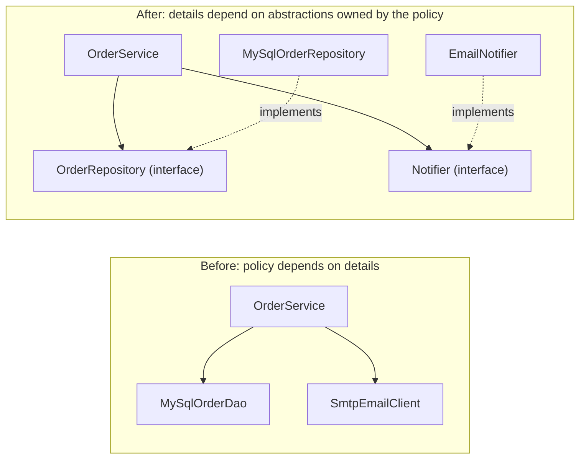

# SOLID Principles

<span class="badge-l1">L1 🟢 Foundations</span> · <span class="read-time">⏱ 30 min read</span> · Prerequisites: [OOP Refresher for Patterns](oop-refresher.md)

!!! abstract "TL;DR"
    SOLID is five principles for classes that are easy to change: one reason to change per class, extend without editing, subtypes that keep their parent's promises, small interfaces, and dependencies on abstractions. They are the "why" behind most design patterns: when you can name which principle a design breaks, you usually know which pattern fixes it.

## 1. What It Is

**Plain English.** SOLID is a checklist of five questions to ask about a class: Does it do one job? Can I add behaviour without editing it? Can a subclass stand in for its parent safely? Does it force callers to depend on methods they don't use? Does it depend on details or on abstractions?

**Precise definition.** The acronym, popularised by Robert C. Martin (the name was suggested by Michael Feathers), stands for:

| Letter | Principle | Short statement |
|--------|-----------|-----------------|
| **S** | Single Responsibility (SRP) | A module should be responsible to one, and only one, actor (one reason to change). |
| **O** | Open/Closed (OCP) | Software entities should be open for extension but closed for modification (Bertrand Meyer, 1988). |
| **L** | Liskov Substitution (LSP) | Objects of a subtype must be usable wherever the supertype is expected without breaking correctness (Barbara Liskov, 1987). |
| **I** | Interface Segregation (ISP) | Clients should not be forced to depend on methods they do not use. |
| **D** | Dependency Inversion (DIP) | High-level policy should not depend on low-level details; both should depend on abstractions. |

New terms: an **actor** is a group of people who request changes (marketing, finance, rider operations). **Policy** is the business logic; **details** are databases, frameworks, email providers.

## 2. Why It Exists

Code that's hard to change fails in predictable ways: one change breaks something unrelated (fragility), a small change needs edits in many places (rigidity), and parts can't be reused or tested alone (immobility). Martin described these "design smells" in the early 2000s and collected the principles that prevent them. Before SOLID was a shared checklist, teams learned these lessons separately and painfully, usually through production incidents caused by "small" changes.

## 3. Mental Model / Analogy

**Analogy.** A well-run FreshCart store: each person has one job (the packer packs, the cashier takes payment: **S**). A new payment terminal plugs into the standard socket without rewiring the counter (**O**). Any trained cashier can cover any till (**L**). The rider app shows riders only rider functions, not the store's stock-taking screens (**I**). The store manager's process says "use a delivery partner", not "call Imran on his personal phone" (**D**).

**Technical model.** Each principle limits how change spreads through the dependency graph. SRP and ISP keep each node small, OCP and DIP point the arrows toward stable abstractions, and LSP makes sure that substituting one node for another along those arrows is safe.

## 4. How It Works

DIP is the principle that changes the *shape* of the dependency graph. Without it, business policy depends directly on details. With it, both depend on an interface owned by the policy side:



The arrows from the details now point *toward* the policy layer: the dependency is inverted. That's what lets you test `OrderService` with in-memory fakes and swap the email provider without touching it.

## 5. Subtopics

### Single Responsibility

- **Description:** A class should have one reason to change, meaning it serves one actor. "Calculates order totals, formats emails and writes to the database" is three responsibilities, owned by pricing, marketing and the platform team.
- **How to use it:** list who would ask for changes to the class. More than one group means you should split it.
- **Pros:** smaller classes; changes for one actor can't break another's feature; easier tests.
- **Cons:** more classes and wiring; taken too far, logic gets scattered across tiny classes.
- **Best practice:** split by reason to change, not by "number of methods".
- **Gotcha:** "do one thing" is a rule for *functions*. SRP is about *who causes change*, which is a different question.

### Open/Closed

- **Description:** You should be able to add behaviour by adding code (a new class) rather than editing tested code. In Java this usually means polymorphism over an interface.
- **How to use it:** put an interface on the axis that changes (pricing rules, payment providers) and add implementations.
- **Pros:** new features don't risk old ones; parallel work without merge conflicts.
- **Cons:** you must guess the axis; abstractions on the wrong axis add cost and still need edits.
- **Best practice:** apply OCP after the second or third change of the same kind (see [Why Patterns Matter](../l0-orientation/why-patterns-matter.md)).
- **Gotcha:** no code is closed against every change. Choose what to be closed against.

### Liskov Substitution

- **Description:** A subtype must honour the supertype's contract: accept at least the same inputs, promise at least the same results, and keep its invariants. Code written for the parent must still work with the child.
- **How to use it:** for each override ask: "could a caller written for the parent be surprised?" Exceptions the parent doesn't throw, stricter inputs or weaker results are red flags.
- **Pros:** polymorphism you can trust; patterns built on substitution (Strategy, Decorator, Proxy) work safely.
- **Cons:** forces you to give up some "natural" hierarchies (Square/Rectangle).
- **Best practice:** prefer immutable types and interfaces; LSP problems mostly come from mutable state in hierarchies.
- **Gotcha:** `UnsupportedOperationException` in an override is an LSP violation in disguise; the JDK's unmodifiable collections are a known, documented trade-off.

### Interface Segregation

- **Description:** Don't make clients depend on methods they don't call. Split fat interfaces into role interfaces.
- **How to use it:** design interfaces from the client's point of view: `OrderLookup` for readers, `RefundLedger` for the refund flow.
- **Pros:** smaller fakes in tests; changes to one role don't recompile or redeploy unrelated clients; clearer intent.
- **Cons:** more interfaces to name and find.
- **Best practice:** one class can implement several role interfaces; the split is for clients, not implementations.
- **Gotcha:** splitting so far that every interface has one method and no clear role makes the code harder to navigate.

### Dependency Inversion

- **Description:** High-level modules (business policy) define the abstractions they need; low-level modules (database, email, HTTP) implement them. Concrete classes are chosen in one place, the *composition root*.
- **How to use it:** pass collaborators through constructors as interfaces; create the concrete objects in `main` or the DI container.
- **Pros:** testable without infrastructure; infrastructure can change without touching business code.
- **Cons:** indirection; a container or wiring code to maintain.
- **Best practice:** inject time (`Clock`), randomness and IDs too, not just databases. They're details as well.
- **Gotcha:** DIP isn't the same as dependency *injection*. Injection is a technique; inversion is about who owns the abstraction. See [Dependency Injection](../l2-practitioner/dependency-injection.md).

## 6. Examples (exactly 3, progressively harder)

### Example 1: Minimal (L1)

**Scenario:** FreshCart prints shelf labels. A helper written for `Rectangle` sets width then height and expects the area to be width × height. Someone adds `Square extends Rectangle` "because a square is a rectangle". This breaks LSP.

**Code / Config:**

```java title="LiskovDemo.java"
--8<-- "examples/l1-foundations/solid-principles/LiskovDemo.java"
```

1. Each setter changes both sides, to keep the square square.
2. This code is correct for any `Rectangle`, but a `Square` silently breaks its assumption.
3. The fix: immutable values in a sealed hierarchy. Nothing can be "resized into" an invalid state.

**Run it:**

```bash
java LiskovDemo.java
```

**Output:**

```text
--8<-- "examples/l1-foundations/solid-principles/LiskovDemo.expected.txt"
```

**What to notice:**

- No exception, no compiler warning, just a wrong number: LSP violations are quiet.
- The problem is the mutable *setters*, not the geometry. Immutable `Rect` and `Sq` have no contract to break.
- "Is-a" in the real world isn't enough; the subtype must behave like the supertype.

### Example 2: Realistic (in FreshCart grocery delivery)

**Scenario:** The original `OrderService` calculated prices, saved to MySQL and sent emails in one class, so pricing campaigns, database migrations and email template changes all edited the same file. The refactored version applies SRP (the service only coordinates), OCP (pricing rules are pluggable) and DIP (the service owns `OrderRepository` and `Notifier`).

**Code / Config:**

```java title="OrderServiceDemo.java"
--8<-- "examples/l1-foundations/solid-principles/OrderServiceDemo.java"
```

1. **OCP:** a new campaign is a new `PricingRule`, applied in order.
2. **DIP:** the abstractions belong to the business side; the database and email code implement them.
3. **SRP:** the service changes only if the *process* of placing an order changes.
4. The composition root: the only place that names concrete classes.

**Run it:**

```bash
java OrderServiceDemo.java
```

**Output:**

```text
--8<-- "examples/l1-foundations/solid-principles/OrderServiceDemo.expected.txt"
```

**What to notice:**

- FC-5001 is under $50, so it pays the $4.99 fee: $34.99. FC-5002 gets free delivery and 10% off: $54.00.
- Swapping `InMemoryOrders` for a JDBC repository changes `main` only.
- Rule order matters (fee before or after discount). That's now an explicit list you can see and test, not code buried in a method.

### Example 3: Production-grade

**Scenario:** FreshCart refunds must be idempotent (a retried request never pays twice), allowed only within 48 hours of delivery, capped at the amount paid, and fully audited. The service must be testable without a payment provider, a database or the real clock. ISP keeps each dependency small; DIP lets tests replace every one of them.

**Code / Config:**

```java title="RefundServiceDemo.java"
--8<-- "examples/l1-foundations/solid-principles/RefundServiceDemo.java"
```

1. **ISP:** the refund flow needs "find an order", not the 20 methods of a full order store.
2. **DIP:** the gateway is an interface the service owns; the provider's SDK hides behind an adapter.
3. Time is a dependency too. A fixed `Clock` makes the 48-hour rule testable and the output deterministic.
4. Idempotency by request key: the duplicate is detected before any money moves.
5. One class can implement several small roles; clients still see only what they need.

**Run it:**

```bash
java RefundServiceDemo.java
```

**Output:**

```text
--8<-- "examples/l1-foundations/solid-principles/RefundServiceDemo.expected.txt"
```

**What to notice:**

- The retry with key `req-1` returns "already refunded" without calling the gateway.
- FC-6002 was delivered on 29 October; the window closed 48 hours later, so the refund on 2 November is rejected.
- Every outcome, including rejections, is written to the audit log.
- `main` builds the gateway from a lambda: a one-method interface is the cheapest possible test double.

## 7. Pros, Cons & Trade-offs

| Aspect | Pros | Cons |
|--------|------|------|
| Simplicity | Each class is small and focused | More classes and interfaces overall |
| Performance | Usually no measurable cost | Extra indirection on very hot paths |
| Scalability | Teams change their parts without colliding | Wiring grows with the number of components |
| Operability | Clear seams for logging, metrics and auditing | Behaviour spread across classes is harder to trace |
| Security | Narrow interfaces limit what each component can do | More extension points to review |
| Testability | Fakes for every dependency, including time | Over-abstracted code needs many fakes |
| Cost | Cheaper, safer changes over the code base's life | Up-front design effort |
| Learning curve | Five memorable checks | The principles are easy to quote and hard to apply well |

## 8. When to Use / When NOT to Use

**Apply SOLID when:**

- code is long-lived and changed by several people or teams;
- business rules change often (pricing, refunds, promotions);
- you need to test business logic without infrastructure.

**Go easy when:**

- writing scripts, prototypes or one-off migrations;
- the code is simple data plumbing with no rules;
- applying a principle would add abstraction for a change nobody expects.

See [DRY, KISS, YAGNI and Friends](other-design-principles.md) for the principles that balance SOLID.

## 9. Best Practices

1. **Split classes by reason to change (actor), not by size.** *(Consensus.)*
2. **Let the business side own the interfaces it depends on.** *(Consensus: DIP.)*
3. **Inject `Clock`, ID generators and randomness.** *(Consensus.)*
4. **Prefer immutable types to avoid LSP traps in hierarchies.** *(Opinion, widely shared.)*
5. **Design interfaces from the client's needs (role interfaces).** *(Consensus: ISP.)*
6. **Keep one composition root per application.** *(Opinion.)*
7. **Don't apply OCP pre-emptively; wait for the second change on an axis.** *(Opinion.)*

## 10. Pitfalls & Anti-Patterns

!!! danger "God service"
    **Symptom:** `OrderService` has 3,000 lines, and every sprint's changes conflict in it.
    **Root cause:** responsibilities for several actors (pricing, notifications, persistence, fraud) in one class.
    **Fix:** extract one responsibility per change request, behind an interface the service owns.

!!! danger "Refusing subclass"
    **Symptom:** `UnsupportedOperationException` from a subclass method in production.
    **Root cause:** a subtype that can't honour its parent's contract (LSP violation).
    **Fix:** split the interface (ISP) so the subtype only promises what it can do, or use composition.

!!! danger "Double refunds (production failure mode)"
    **Symptom:** customers occasionally got refunded twice after the payment provider timed out.
    **Root cause:** the client retried the refund request, and the service had no idempotency key, so both requests paid out.
    **Fix:** require an idempotency key per refund request, check it before paying (Example 3), and pass the same key to the payment provider so its side is idempotent too.

!!! danger "Interfaces everywhere"
    **Symptom:** `UserServiceImpl implements UserService` for every class, with no second implementation and no fakes.
    **Root cause:** DIP applied mechanically.
    **Fix:** add interfaces at real boundaries (infrastructure, other teams, things you fake in tests).

## 12. Security Considerations

ISP is also a least-privilege tool: a component that receives only `OrderLookup` can't write orders or issue refunds, even if it's compromised or buggy. Audit logs (as in Example 3) belong behind an interface so that every implementation, including tests, records rejections as well as successes.

## 13. Performance & Scalability

SOLID rarely affects runtime performance; interface calls are cheap after JIT inlining. It does affect *team* scalability: SRP and ISP reduce merge conflicts and the blast radius of a change, which matters more than nanoseconds in most business systems.

## 14. Testing It

DIP is what makes this test possible: a fixed clock, an in-memory store and a recording gateway, with no mocking library.

```java title="RefundServiceTest.java"
--8<-- "examples/l1-foundations/solid-principles/RefundServiceTest.java"
```

## 15. Observability & Operations

Give audit and metrics their own interfaces (as `AuditLog` here) so business code can report outcomes without knowing about the logging framework. For refunds, alert on the rate of `refund_duplicate` (clients retrying too aggressively) and `refund_rejected` by reason.

## 16. Version Notes

The principles don't depend on the Java version, but modern Java makes them cheaper: records make immutable values (helping LSP) one line; sealed interfaces (17) let you close a hierarchy deliberately; lambdas make one-method interfaces (DIP/ISP) easy to implement in tests.

## 17. Expert Deep Dive

- **SRP is about people.** Martin's later formulation ("responsible to one actor") is the useful one. Seniors map classes to the teams and stakeholders who request changes; this is the same thinking that later draws module and service boundaries (Conway's Law).
- **OCP is strategic, not total.** You choose which changes to be closed against. Experienced engineers use change history and roadmap knowledge to pick those axes, and accept that other changes will need edits.
- **LSP is about contracts, including non-functional ones.** A subtype that's 100× slower, or that blocks where the parent didn't, can break callers too. Treat timeouts, thread-safety and exceptions as part of the contract.
- **DIP at architecture scale** becomes hexagonal / clean architecture: the domain owns ports, infrastructure provides adapters. See [Architectural Patterns](../l4-senior/architectural-patterns.md).
- **In a design review**, ask: "Who will ask for changes to this class?", "What's the next rule we'll add and where does it go?", and "Can I test this without the database and the clock?". Those three questions catch most SOLID problems.

!!! example "War story: the refund that ran on summer time"
    A grocery company's refund window was implemented with `LocalDateTime.now()` in the service. Twice a year, when the clocks changed, a handful of refunds near the deadline were wrongly rejected or accepted, and support tickets spiked. Nobody could reproduce it in tests, because the tests ran on whatever the machine's clock said. The fix was injecting a `Clock`, storing delivery times as `Instant`, and adding tests at the exact deadline (like `refundWindowEndsExactly48HoursAfterDelivery`). **Lesson:** the system clock is an infrastructure detail; DIP applies to it too.

## 18. Interview Corner

=== "🟢 L1–L2"

    1. **What does SOLID stand for?** **Single responsibility, open/closed, Liskov substitution, interface segregation, dependency inversion.**
    2. **Explain SRP.** A class should have **one reason to change**, serving **one actor**.
    3. **Give an LSP violation.** **Square extending a mutable Rectangle**: setting the width changes the height.
    4. **What is ISP?** Clients **shouldn't depend on methods they don't use**; prefer small role interfaces.
    5. **How does DIP help testing?** Depending on **interfaces** lets tests pass **fakes** instead of real infrastructure.

=== "🟡 L3"

    1. **DIP vs. dependency injection?** DIP is **who owns the abstraction** (the policy side); DI is the **technique of passing dependencies in**.
    2. **How do you decide where to apply OCP?** Use **change history** and the roadmap; apply on the **axis that keeps changing**.
    3. **Is `Collections.unmodifiableList` an LSP violation?** Arguably yes; the JDK documents mutators as **optional operations**, a deliberate trade-off.
    4. **How would you test time-based rules?** Inject a **`Clock`** and use **`Clock.fixed`** in tests, including at the **exact boundary**.
    5. **Signs a class breaks SRP?** **Many unrelated imports**, frequent merge conflicts, changes requested by **different teams**.

=== "🔴 L4–L5"

    1. **How do SOLID principles show up at service level?** SRP → **service boundaries by business capability**; DIP → **ports and adapters**; ISP → **narrow APIs per consumer**.
    2. **When is applying SOLID wrong?** For **throwaway or very stable code**, or when abstractions are added for **imagined change**.
    3. **Design idempotent refunds across retries and provider timeouts.** **Idempotency key** end to end, **ledger before/after** with a unique constraint, and **pass the key to the provider**.
    4. **How do you raise SOLID awareness in 10 teams without dogma?** Review **real incidents** and change costs, add **review questions** rather than rules.
    5. **Now refunds come from three channels (app, support, chat bot). What changes?** A **single refund policy** behind one port, channel-specific **adapters**, and **per-channel limits** as configuration.

=== "💻 Hands-on"

    **Task:** Add a "loyalty points" pricing rule to Example 2 that takes 1% off for customers with more than 1,000 points, without changing `OrderService`.

    ??? success "Solution"
        ```java
        record LoyaltyDiscount(java.util.Map<String, Integer> pointsByEmail) implements PricingRule {
            public long adjust(Order o, long total) {
                int points = pointsByEmail.getOrDefault(o.customerEmail(), 0);
                return points > 1_000 ? total - o.basketInCents() / 100 : total;
            }
        }
        // main: rules.add(new LoyaltyDiscount(Map.of("ravi@example.com", 1_500)));
        ```
        `OrderService` is untouched: the change is one new class and one line in the composition root.

## 19. Practice

- [ ] List the actors for a class in your current project. Does it serve more than one?
    ??? tip "Hint"
        Look at the last ten commits that touched it and who asked for each.
- [ ] Add an SMS notifier to Example 2 that sends alongside email.
    ??? tip "Hint"
        Write a `CompositeNotifier` that holds a list of notifiers: a preview of the Composite pattern.
- [ ] In Example 3, make the ledger check and record atomic.
    ??? tip "Hint"
        Replace `alreadyRefunded` + `record` with one `boolean tryReserve(String key)` that uses `Set.add`'s return value.
- [ ] Find an LSP violation in code you know (an override that throws or ignores its input).
    ??? tip "Hint"
        Search for `UnsupportedOperationException` and empty overrides.

## 20. Quick Revision Card

!!! tip "Remember in 30 seconds"
    - **S:** one actor, one reason to change.
    - **O:** add behaviour by adding classes on the axis that changes.
    - **L:** subtypes keep the parent's promises; immutability helps.
    - **I:** small role interfaces shaped by clients.
    - **D:** policy owns the interfaces; details implement them; wire in one place.

    ```java
    final class RefundService {                     // S: coordinates refunds only
        RefundService(OrderLookup orders,           // I: small role interface
                      PaymentGateway gateway,       // D: owned abstraction
                      Clock clock) { /* ... */ }
    }
    ```

## 21. Further Reading

- Robert C. Martin, *Agile Software Development, Principles, Patterns, and Practices* (2002).
- Robert C. Martin, *Clean Architecture* (2017), part III "Design Principles".
- Barbara Liskov, "Data Abstraction and Hierarchy" (OOPSLA 1987 keynote); Liskov and Wing, "A Behavioral Notion of Subtyping" (1994).
- Bertrand Meyer, *Object-Oriented Software Construction* (1988).

---

[← Previous: OOP Refresher for Patterns](oop-refresher.md) · [Next: DRY, KISS, YAGNI and Friends →](other-design-principles.md)
