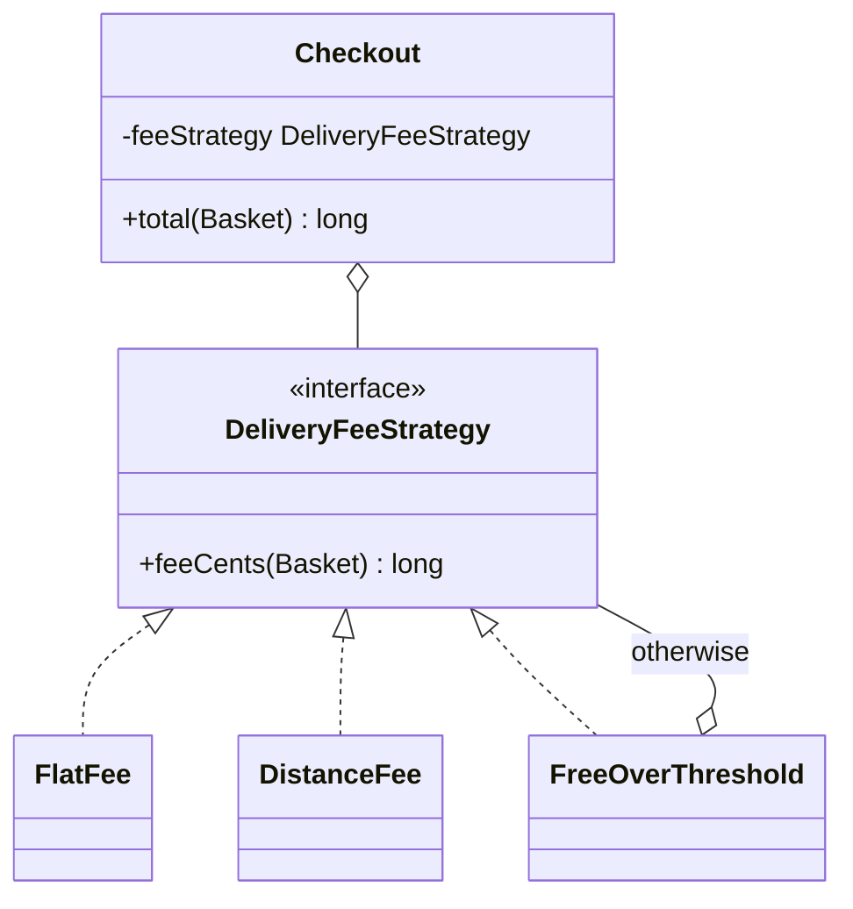
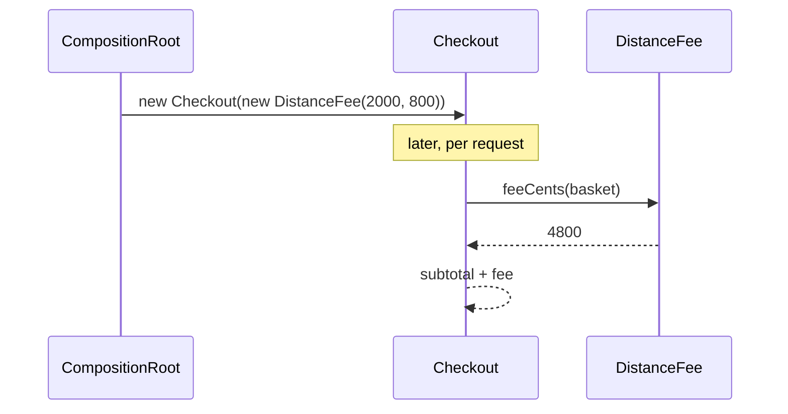

# Strategy

<span class="badge-l1">L1 🟢 Foundations</span> · <span class="read-time">⏱ 40 min read</span> · Prerequisites: [SOLID Principles](solid-principles.md), [Factory Method](factory-method.md)

!!! abstract "TL;DR"
    Strategy puts each variant of an algorithm (how to price, sort, assign, round) behind one interface, so the code that uses it can swap algorithms without `if/else` chains. In Java 8+ a strategy is often just a lambda (`Comparator` is the most famous example). It's the pattern you'll use most; the hard parts are choosing the strategy at runtime and rolling new ones out safely.

## 1. What It Is

**Plain English.** FreshCart charges delivery differently in different cities: a flat fee in one, distance-based in another, free above a basket value in a third. Instead of writing all three rules inside checkout with `if` statements, each rule becomes its own small object with the same method, `feeCents(basket)`. Checkout is given one of them and calls it, without knowing which.

**Precise definition (GoF intent).** "Define a family of algorithms, encapsulate each one, and make them interchangeable. Strategy lets the algorithm vary independently from clients that use it." Roles:

- **Strategy:** the interface (`DeliveryFeeStrategy`).
- **Concrete strategy:** one algorithm (`FlatFee`, `DistanceFee`).
- **Context:** the class that holds and uses a strategy (`Checkout`).

## 2. Why It Exists

Algorithms that vary by customer, city, time or experiment tend to collect as `if/else` or `switch` chains inside business code. Every new variant means editing that code (breaking the [Open/Closed Principle](solid-principles.md)), the chain gets copied to other places, and testing one rule means setting up all the others. Strategy isolates each rule in its own class or function, tested and changed independently.

## 3. Mental Model / Analogy

**Analogy.** A FreshCart packer has a packing station (the context) and a rack of instruction cards: "one bag", "cold chain box", "bulk crates" (strategies). For each order they pick a card and follow it. The station doesn't change when a new card is printed.

**Technical model.** Strategy is composition plus an interface: the context *has a* strategy and delegates one decision to it. With lambdas, the interface is a functional interface and the strategy is a function value.

## 4. How It Works





## 5. Subtopics

### Interface-based strategy

**Description.** The textbook form: a small interface with one (sometimes two or three) methods, implemented by one class or record per algorithm. The context receives the strategy through its constructor.

**Advantages / features.** Each algorithm is a named type with its own configuration (`DistanceFee(base, perKm)`); strategies can be composed (`FreeOverThreshold` wraps another); easy to document and test.

```java title="InterfaceStrategyDemo.java"
--8<-- "examples/l1-foundations/strategy/InterfaceStrategyDemo.java"
```

1. The `if/else` version: every new rule edits this method, and a typo is a runtime error.
2. The strategy interface: one method, one decision.
3. Strategies can wrap other strategies: free over $500, otherwise distance-based.
4. The context holds a strategy and never asks which one it is.

**Run it:** `java InterfaceStrategyDemo.java`

```text
--8<-- "examples/l1-foundations/strategy/InterfaceStrategyDemo.expected.txt"
```

| Pros | Cons |
|------|------|
| New algorithms without editing the context (OCP) | More types than an `if` |
| Each algorithm configured and tested alone | Clients must know enough to pick one |
| Strategies compose (wrappers, fallbacks) | Overkill for two fixed, simple branches |
| Records make strategies tiny and immutable | Interface changes affect every strategy |

**Use it** when an algorithm has several variants with their own parameters. **Avoid it** for one stable `if` with two branches.
**Real-world Java:** `java.util.Comparator`, `java.util.concurrent.RejectedExecutionHandler` (`AbortPolicy`, `CallerRunsPolicy`), Spring Security's `PasswordEncoder`, Spring Retry's `BackOffPolicy`.
**Best practice:** keep strategy interfaces narrow and stateless. **Gotcha:** a strategy that needs the whole context object (`feeCents(Checkout)`) couples them back together; pass only the data it needs.

### Lambdas and functional interfaces as strategies

**Description.** Any interface with a single abstract method is a functional interface, so a lambda or method reference can be a strategy. The JDK's `Comparator`, `Predicate`, `Function` and `Supplier` cover many cases; define your own (`Discount`) when a domain name makes code clearer.

**Advantages / features.** No class per strategy; strategies built by combining functions (`thenComparing`, `capped(...)`); great for one-off variants.

```java title="LambdaStrategyDemo.java"
--8<-- "examples/l1-foundations/strategy/LambdaStrategyDemo.java"
```

1. A domain-named functional interface reads better than `LongUnaryOperator`.
2. A factory method returning a lambda: a configurable strategy without a class.
3. `Comparator` is the JDK's most used strategy.
4. Strategies compose: a percentage discount wrapped in a cap.

**Run it:** `java LambdaStrategyDemo.java`

```text
--8<-- "examples/l1-foundations/strategy/LambdaStrategyDemo.expected.txt"
```

| Pros | Cons |
|------|------|
| Very little code | Anonymous: worse stack traces and logs (`Lambda$14/0x...`) |
| Composable with default methods | Hard to configure from outside or serialise |
| JDK interfaces understood by everyone | Complex logic in a lambda hurts readability |

**Use it** for small algorithms and composition. **Avoid it** when a strategy has configuration, a name in logs, or more than a few lines; use a record.
**Real-world Java:** `List.sort(Comparator)`, `Collectors.groupingBy(Function)`, `CompletableFuture.thenApply(Function)`, Spring's `RetryTemplate` callbacks.
**Best practice:** give lambdas names via `static final` fields or factory methods. **Gotcha:** capturing mutable state in a lambda strategy makes it non-thread-safe.

### Enum strategies

**Description.** When the set of algorithms is closed and known (payment methods, rounding rules), an enum constant per algorithm works well. Either give each constant its own method body, or pass a lambda to the enum constructor.

**Advantages / features.** Exhaustive `switch`, `valueOf` from configuration, `EnumMap` lookups, one place to see all variants.

```java title="EnumStrategyDemo.java"
--8<-- "examples/l1-foundations/strategy/EnumStrategyDemo.java"
```

1. Each constant has its own body: constant-specific methods.
2. The abstract method forces every constant to implement it.
3. Alternative style: pass the algorithm to the constructor as a lambda.
4. Select from configuration by name; unknown names fail.

**Run it:** `java EnumStrategyDemo.java`

```text
--8<-- "examples/l1-foundations/strategy/EnumStrategyDemo.expected.txt"
```

| Pros | Cons |
|------|------|
| All variants visible in one file | Closed: adding one means editing the enum |
| Serialisable and configurable by name | No per-instance configuration (fees are constants) |
| `EnumMap`/`switch` friendly | Constants can't have different dependencies |

**Use it** for small, closed, stateless sets. **Avoid it** when variants need injected dependencies or are added by other teams.
**Real-world Java:** `java.util.concurrent.TimeUnit` (each constant converts differently), `java.math.RoundingMode`.
**Best practice:** keep business numbers (1.8%) in configuration if they change often. **Gotcha:** renaming a constant breaks stored configuration and databases that saved the name.

### Selecting a strategy: map, factory, DI

**Description.** Someone has to choose the strategy. Common options: a **registry map** (name to strategy, from config), a **context-based factory** (look at the order and decide), or **dependency injection** (the composition root decides and the service just uses what it's given).

**Advantages of separating selection.** The context stays simple; selection rules are tested on their own; tests inject a fixed strategy.

```java title="StrategySelectionDemo.java"
--8<-- "examples/l1-foundations/strategy/StrategySelectionDemo.java"
```

1. Registry: configuration names map to strategy factories.
2. Context-based choice: the order's properties decide.
3. The service receives the chooser; it doesn't know the rules.

**Run it:** `java StrategySelectionDemo.java`

```text
--8<-- "examples/l1-foundations/strategy/StrategySelectionDemo.expected.txt"
```

| Selection style | Best for | Watch out for |
|-----------------|----------|---------------|
| Registry map | Choice by configuration or request parameter | Unknown names; list valid ones in errors |
| Context-based factory | Choice by business data | The factory becoming a new `if` chain |
| DI (constructor) | Choice fixed per deployment or per bean | Not for per-request choices |
| Spring `Map<String, Strategy>` injection | Many strategies as beans | Bean names become configuration keys |

**Use** a registry for configuration-driven choices and a factory for data-driven ones. **Avoid** scattering selection logic across callers.
**Real-world Java:** Spring injects `Map<String, PaymentProvider>` of all beans implementing an interface; JDBC's `DriverManager` picks a driver by URL.
**Best practice:** fail loudly on unknown names, listing valid ones. **Gotcha:** moving the `if` chain from the context into a selector without simplifying anything only moves the problem.

### Strategy vs. State vs. Template Method

**Description.** These three look alike in class diagrams but differ in *who decides*. **Strategy:** the client picks the algorithm. **[State](../l2-practitioner/state.md):** the object switches its own behaviour as its state changes. **[Template Method](template-method.md):** a base class fixes the algorithm's steps, and subclasses fill in one step.

**Advantages of knowing the difference.** You choose the right tool and can explain the choice in reviews.

```java title="StrategyVsStateVsTemplateDemo.java"
--8<-- "examples/l1-foundations/strategy/StrategyVsStateVsTemplateDemo.java"
```

1. Strategy: the caller passes the rounding rule.
2. State: each state decides what `cancel` means and which state comes next.
3. Template Method: the base class fixes the steps, a subclass fills `body()`.

**Run it:** `java StrategyVsStateVsTemplateDemo.java`

```text
--8<-- "examples/l1-foundations/strategy/StrategyVsStateVsTemplateDemo.expected.txt"
```

| | Strategy | State | Template Method |
|---|---|---|---|
| Who chooses the behaviour | The client or configuration | The object itself, as it changes | The subclass, at compile time |
| Mechanism | Composition | Composition, states replace each other | Inheritance |
| Changes at runtime | Yes, by swapping | Yes, automatically | No |
| Strategies know each other | No | Yes (they pick the next state) | Not applicable |
| Typical example | Fee rules, sorting | Order lifecycle | Report layout, `JdbcTemplate` |

**Use Strategy** for interchangeable algorithms, **State** for lifecycle-dependent behaviour, **Template Method** for fixed workflows with a variable step.
**Real-world Java:** `Comparator` (Strategy), `java.util.Iterator` implementations over internal state (State-like), `java.io.InputStream.read(byte[])` built on abstract `read()` (Template Method).
**Best practice:** prefer Strategy (composition) over Template Method (inheritance) when either fits. **Gotcha:** a "strategy" that changes the context's strategy field is really State.

## 6. Examples (exactly 3, progressively harder)

### Example 1: Minimal (L1)

**Scenario:** When an item is out of stock, the customer chooses what happens: no replacement (refund), the same brand in another size, or the cheapest similar item at no more than 10% higher price.

```java title="SubstitutionDemo.java"
--8<-- "examples/l1-foundations/strategy/SubstitutionDemo.java"
```

1. One interface, three lambdas: the customer's preference picks one.
2. A business guard: never substitute something more than 10% pricier.

**Run it:** `java SubstitutionDemo.java`

**Output:**

```text
--8<-- "examples/l1-foundations/strategy/SubstitutionDemo.expected.txt"
```

**What to notice:**

- Same input, three outcomes; the picking code doesn't change.
- "Cheapest similar" skipped the 500 ml pack (wrong size) and the pricier Prime milk.

### Example 2: Realistic (in FreshCart grocery delivery)

**Scenario:** Each city's team prices delivery slots their own way: Pune uses a flat fee with an evening premium, Mumbai surges with demand and adds a rain surcharge, and Nashik (new) offers free delivery until slots are nearly full.

```java title="SlotPricingDemo.java"
--8<-- "examples/l1-foundations/strategy/SlotPricingDemo.java"
```

1. Surge starts at 70% booked and is capped at 1.5x, so prices can't run away.
2. A strategy that wraps another: free until 90% full, then the wrapped pricing.
3. Selection by city lives in one map, which in production comes from configuration.

**Run it:** `java SlotPricingDemo.java`

**Output:**

```text
--8<-- "examples/l1-foundations/strategy/SlotPricingDemo.expected.txt"
```

**What to notice:**

- Mumbai's busy rainy evening: 3900 × 1.5 (capped) + 1500 rain = 7350.
- Nashik's launch offer still charges when slots are 95% full, protecting the last slots.
- Each city team can change its strategy without touching the others'.

### Example 3: Production-grade

**Scenario:** Assigning riders to orders. Different stores use different algorithms (nearest rider, least-loaded rider, batching with riders already out). A new algorithm must be rolled out to a percentage of orders, the same order must always get the same algorithm, cold orders need a rider with a cold box, a failing or empty strategy must fall back safely, and every decision is counted.

```java title="RiderAssignmentDemo.java"
--8<-- "examples/l1-foundations/strategy/RiderAssignmentDemo.java"
```

1. Shared eligibility rules (cold box, at most three active orders) apply to every strategy.
2. A stable bucket per order for percentage rollout; the hash is mixed because sequential IDs have sequential `hashCode`s.
3. A strategy bug must not stop deliveries: catch, count, fall back.
4. Fallback to the simplest, most trusted strategy.

**Run it:** `java RiderAssignmentDemo.java`

**Output:**

```text
--8<-- "examples/l1-foundations/strategy/RiderAssignmentDemo.expected.txt"
```

**What to notice:**

- In `pune-01`, some orders use the candidate `LEAST_LOADED` strategy (50% rollout) and the rest use `NEAREST`.
- `FC-2001` needed a cold box; batching found nobody suitable, so the fallback chose Meena and counted it.
- The metrics line is what you'd compare between strategies before rolling out to 100%.

## 7. Pros, Cons & Trade-offs

| Aspect | Pros | Cons |
|--------|------|------|
| Simplicity | Context code is short and stable | More types or lambdas to find |
| Extensibility | New algorithms without edits (OCP) | Interface must fit all algorithms |
| Performance | Megamorphic calls are cheap compared to I/O | Very hot paths may lose inlining with many implementations |
| Operability | Per-store or per-experiment switching and rollout | Needs metrics to know which strategy ran |
| Testability | Each strategy tested alone; fakes are trivial | Selection logic needs its own tests |
| Learning curve | Familiar via `Comparator` | Easy to confuse with State and Template Method |

## 8. When to Use / When NOT to Use

**Use it when:**

- an algorithm has several variants chosen by configuration, data or experiment;
- you see the same `switch` on a "type" or "mode" in more than one place;
- you want to A/B test or gradually roll out a new algorithm.

**Don't use it when:**

- there are two branches that will never grow: an `if` is clearer;
- behaviour changes with the object's lifecycle: use [State](../l2-practitioner/state.md);
- steps are fixed and only one step varies in subclasses you already have: consider [Template Method](template-method.md).

## 9. Best Practices

1. **Keep strategies stateless and immutable**, so one instance can serve all threads. *(Consensus.)*
2. **Pass strategies the data they need, not the whole context.** *(Consensus.)*
3. **Separate selection from execution**: a registry or chooser picks; the context uses. *(Consensus.)*
4. **Name strategies** (records or named constants), so logs and metrics say which ran. *(Opinion.)*
5. **Always have a safe default or fallback strategy** for business-critical decisions. *(Opinion; strongly recommended.)*
6. **Roll out new strategies by percentage with stable bucketing**, and compare metrics. *(Consensus in large systems.)*
7. **Prefer JDK functional interfaces** unless a domain name adds clarity. *(Opinion.)*

## 10. Pitfalls & Anti-Patterns

!!! danger "Strategy explosion"
    **Symptom:** 40 strategy classes that differ by one number.
    **Root cause:** a class per configuration value instead of parameterised strategies.
    **Fix:** one record with fields (`DistanceFee(base, perKm)`) and the numbers in configuration.

!!! danger "Flapping assignments (production failure mode)"
    **Symptom:** during a rollout, riders received an order, lost it, then got it back.
    **Root cause:** the experiment picked a strategy with `Math.random()` on every retry, so retries used different algorithms.
    **Fix:** bucket by a stable key (order ID) as in Example 3.

!!! danger "Selector that knows everything"
    **Symptom:** the "strategy factory" has the same `if` chain the strategies were meant to remove.
    **Root cause:** selection rules mixed with algorithm details.
    **Fix:** selection by a simple key (city, store config); the algorithm details stay inside strategies.

!!! danger "Stateful shared strategy"
    **Symptom:** wrong totals under load.
    **Root cause:** a strategy cached a running total in a field, shared by all requests.
    **Fix:** keep strategies stateless; pass state in as arguments.

## 11. Configuration & Tuning

| Setting | Default | What it does | When to change it | Risk of changing |
|---------|---------|--------------|-------------------|------------------|
| Store strategy (Example 3) | `NEAREST` | Algorithm per store | Store layout or rider count changes | Worse delivery times; watch metrics |
| Candidate percent | 0 | Rollout share for a new strategy | During experiments | Too fast: wide impact if it's worse |
| Surge cap (Example 2) | 1.5x | Maximum price multiplier | Pricing policy | Customer backlash or lost margin |
| Eligibility (max active orders) | 3 | Rider capacity | Bigger delivery bags | Late deliveries |

## 12. Security Considerations

- Never pick a strategy class by name from user input with reflection; map allowed keys to strategies.
- Strategies that affect money (pricing, fees, discounts) need caps and audit logs of which strategy and parameters were used.
- Don't let clients choose server-side strategies directly (`?pricing=free`); derive the choice from trusted data.

## 13. Performance & Scalability

An interface call through a strategy costs a few nanoseconds. With one or two implementations at a call site the JIT inlines them; with many ("megamorphic") it uses a virtual call, still negligible next to I/O. The scalability win is operational: you can switch algorithms per store or region without deploying. Benchmark algorithm *cost* (sorting, assignment) with realistic data before rollout.

## 14. Testing It

Test each strategy alone, the fallback path, and the rollout percentage:

```java title="RiderAssignmentTest.java"
--8<-- "examples/l1-foundations/strategy/RiderAssignmentTest.java"
```

For new strategies, a useful extra is a *comparison test*: run old and new strategies on the same recorded inputs and check the differences are the intended ones.

## 15. Observability & Operations

Count every decision by strategy name (`assign.used.LEAST_LOADED`), every fallback and every error. Add the strategy name to logs and traces for the request. During rollouts, dashboard the business outcome (delivery time, cost) split by strategy, and keep a configuration switch to send 100% back to the old strategy instantly.

## 16. Version Notes

| Java | Change relevant to Strategy |
|------|-----------------------------|
| 5 | Enums with constant-specific methods |
| 8 | Lambdas, `java.util.function`, `Comparator.comparing` and `thenComparing` |
| 16 | Records: one-line parameterised strategies |
| 17 | Sealed interfaces: closed strategy families with exhaustive `switch` |
| 21 | Pattern matching for `switch` over sealed strategy types |

## 17. Expert Deep Dive

- **Strategy is how experiments ship.** At scale, new algorithms (ranking, pricing, dispatch) always launch behind a strategy interface with stable bucketing, guardrail metrics and an instant rollback switch. The pattern is simple; the operational wrapping is the senior part.
- **Shadow mode.** Run the new strategy alongside the old one, act on the old result, and log both. You get real-traffic comparisons with zero customer risk.
- **Interface design.** Return rich results (`Assignment(rider, reason, score)`) rather than bare values; debugging "why did it pick Ravi?" needs the reason.
- **Strategy vs rules engines.** When business users need to change rules weekly, strategies with parameters in configuration go a long way; a full rules engine is rarely needed and expensive to operate.

!!! example "War story: the experiment nobody could turn off"
    A quick-commerce company added a new rider-batching strategy by replacing the old class, behind a deploy rather than a switch. Delivery times rose 12% in two cities whose store layouts the new algorithm didn't suit. Rolling back meant a full deploy during the evening peak. Afterwards, every dispatch algorithm sat behind a strategy interface selected per store from configuration, with percentage rollout and a dashboard comparing delivery times by strategy. The next experiment that went wrong was rolled back in 30 seconds. **Lesson:** Strategy's real value in production is being able to switch algorithms *without* deploying.

## 18. Interview Corner

=== "🟢 L1–L2"

    1. **What is Strategy?** A **family of interchangeable algorithms** behind **one interface**, used by a context.
    2. **Give a JDK example.** **`Comparator`** passed to `List.sort`.
    3. **How do lambdas relate to Strategy?** A lambda can implement a **functional interface**, so it **is a strategy**.
    4. **What principle does Strategy support?** **Open/Closed**: new algorithms without changing the context.
    5. **When is an `if` better?** **Two simple, stable branches.**

=== "🟡 L3"

    1. **Strategy vs State?** Strategy is **chosen by the client**; State **changes itself** as the object's lifecycle moves.
    2. **Strategy vs Template Method?** **Composition vs inheritance**; Strategy swaps the whole algorithm at runtime.
    3. **How do you select a strategy at runtime?** **Registry map, context-based factory, or DI**; fail loudly on unknown keys.
    4. **Why keep strategies stateless?** So **one instance is safe for all threads** and results don't depend on history.
    5. **How would Spring give you all strategies?** Inject **`Map<String, Strategy>` or `List<Strategy>`** of beans.

=== "🔴 L4–L5"

    1. **Roll out a new pricing strategy to 5% of orders safely.** **Stable bucketing by order/customer**, guardrail metrics, **shadow mode first**, instant rollback switch.
    2. **How do you compare two strategies fairly?** **Randomised, stable assignment**; compare **business metrics with confidence intervals**, not anecdotes.
    3. **Strategy explosion: how do you control it?** **Parameterise** strategies, keep numbers in config, **delete losers** after experiments.
    4. **When would you introduce a rules engine instead?** When **non-engineers change rules frequently** and need audit and versioning.
    5. **Now 10x traffic, and one strategy calls a slow ML service. What do you do?** **Timeouts and a fallback strategy**, cache features, and **degrade gracefully** to the simple strategy.

=== "💻 Hands-on"

    **Task:** Add a `PEAK_HOURS` delivery-fee strategy to `InterfaceStrategyDemo` that adds $20.00 between 18:00 and 21:00 on top of another strategy.

    ??? success "Solution"
        ```java
        record PeakHours(DeliveryFeeStrategy base, java.time.Clock clock) implements DeliveryFeeStrategy {
            public long feeCents(Basket b) {
                var now = java.time.LocalTime.now(clock);
                boolean peak = !now.isBefore(java.time.LocalTime.of(18, 0)) && now.isBefore(java.time.LocalTime.of(21, 0));
                return base.feeCents(b) + (peak ? 2_000 : 0);
            }
        }
        ```
        It wraps another strategy (composition) and takes a `Clock`, so tests can fix the time.

## 19. Practice

- [ ] Rewrite `EnumStrategyDemo.PaymentFee` so fee percentages come from a `Map<String, Double>` configuration.
    ??? tip "Hint"
        Use a record `PercentFee(double rate, long capCents)` and a registry map.
- [ ] Add shadow mode to `RiderAssignmentDemo`: run the candidate too, log disagreements, but always use the current strategy.
    ??? tip "Hint"
        Call both strategies; compare rider IDs; count `assign.shadow.disagree`.
- [ ] Find a `switch` on a "type" string in a codebase you know and sketch the strategy interface that would replace it.
    ??? tip "Hint"
        The method signature of the strategy is usually the code inside each `case`, with its inputs as parameters.
- [ ] Explain in two sentences why `FC-1001`..`FC-1004` all got the same strategy at a 50% rollout before the hash was mixed.
    ??? tip "Hint"
        `String.hashCode` changes by 1 when the last character changes by 1.

## 20. Quick Revision Card

!!! tip "Remember in 30 seconds"
    - Intent: interchangeable algorithms behind one interface; the context delegates.
    - Forms: interface + records, lambdas (`Comparator`), enums for closed sets.
    - Selection: registry map, context factory, or DI; fail loudly on unknown names.
    - Production: stateless strategies, stable bucketing for rollouts, fallback, metrics by strategy.
    - Not State (object switches itself), not Template Method (inheritance, one step varies).

    ```java
    products.sort(Comparator.comparingLong(Product::priceCents).thenComparing(Product::name));
    ```

## 21. Further Reading

- Gamma et al., *Design Patterns* (1994): Strategy.
- Joshua Bloch, *Effective Java*, 3rd edition, Item 42 "Prefer lambdas to anonymous classes" and Item 34 on constant-specific enum methods.
- Ron Kohavi, Diane Tang and Ya Xu, *Trustworthy Online Controlled Experiments* (2020), for rolling out strategies with experiments.
- [java.util.Comparator API documentation](https://docs.oracle.com/en/java/javase/21/docs/api/java.base/java/util/Comparator.html)

---

[← Previous: Builder](builder.md) · [Next: Observer →](observer.md)
