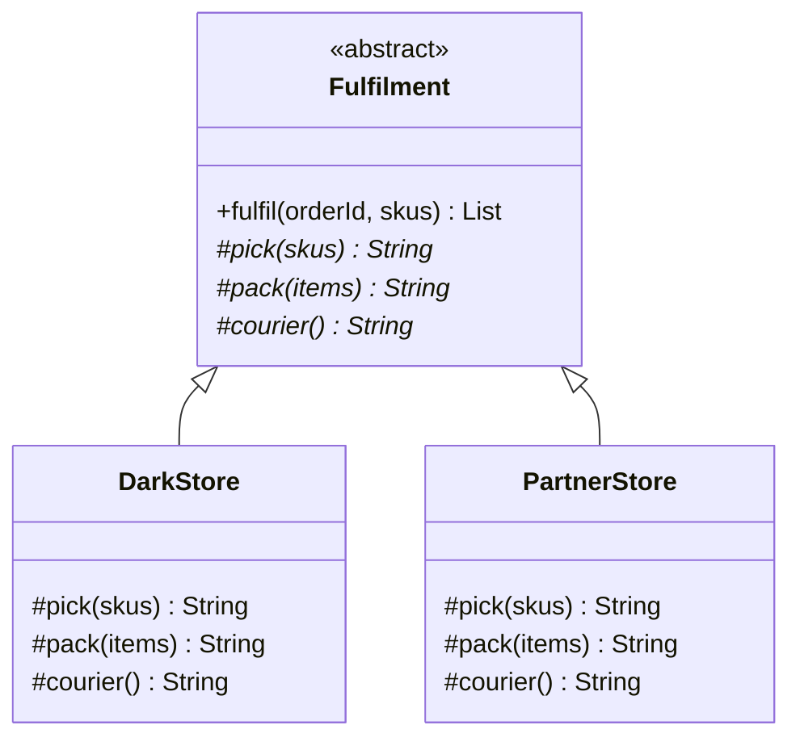
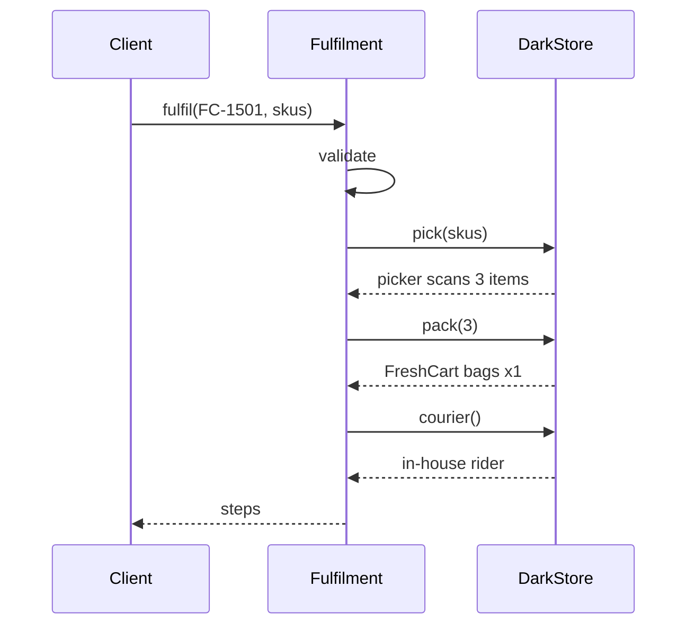

# Template Method

<span class="badge-l1">L1 🟢 Foundations</span> · <span class="read-time">⏱ 35 min read</span> · Prerequisites: [Strategy](strategy.md), [OOP Refresher](oop-refresher.md)

!!! abstract "TL;DR"
    Template Method fixes the steps of an algorithm in one `final` method of a base class and lets subclasses fill in the steps that vary. It's how frameworks keep the important parts (transactions, retries, validation) in one place while you supply the business bits. In modern Java, passing the varying steps as lambdas often does the same job without inheritance.

## 1. What It Is

**Plain English.** Every FreshCart order goes through the same fulfilment recipe: pick, pack, label. A dark store and a partner store do each step differently, but the order of steps, and the checks between them, must never change. Template Method writes the recipe once in a base class and leaves blanks (abstract methods) that each store fills in.

**Precise definition (GoF intent).** "Define the skeleton of an algorithm in an operation, deferring some steps to subclasses. Template Method lets subclasses redefine certain steps of an algorithm without changing the algorithm's structure." Parts:

- **Template method:** the `final` method with the fixed sequence (`fulfil`).
- **Primitive operations:** `abstract` steps subclasses must implement (`pick`, `pack`).
- **Hooks:** optional steps with a default that subclasses *may* override (`beforePacking`).

## 2. Why It Exists

When several classes follow the same procedure with small differences, copy-paste spreads the procedure everywhere. Then a fix (add validation, add a retry, close a resource) has to be made in every copy, and one copy always gets missed. Template Method keeps one copy of the procedure and isolates the differences, so the procedure is fixed and enforced in one place.

## 3. Mental Model / Analogy

**Analogy.** A FreshCart store-opening checklist printed by head office: "1. Disarm alarm. 2. Check fridge temperatures. 3. ____ (store-specific setup). 4. Open doors." Each store fills in step 3. Nobody can skip step 2 or reorder the list.

**Technical model.** A `final` public method calls `protected` abstract and hook methods in a fixed order. Subclasses override only the protected steps. Control stays with the base class ("don't call us, we'll call you").

## 4. How It Works





## 5. Subtopics

### Abstract class with a final template method

**Description.** The base class has a `final` public method with the algorithm and `protected abstract` methods for steps. `final` stops subclasses from changing the order or skipping checks; `protected` keeps steps out of the public API.

**Advantages / features.** One copy of the procedure; enforced validation; subclasses stay small.

```java title="TemplateBasicsDemo.java"
--8<-- "examples/l1-foundations/template-method/TemplateBasicsDemo.java"
```

1. The template method is `final`: subclasses can't reorder or skip steps.
2. Steps run in a fixed order, after validation that applies to every store type.
3. Steps are `protected abstract`: subclasses must provide them, callers can't call them.

**Run it:** `java TemplateBasicsDemo.java`

```text
--8<-- "examples/l1-foundations/template-method/TemplateBasicsDemo.expected.txt"
```

| Pros | Cons |
|------|------|
| Procedure written and fixed once | Inheritance: one base class per subclass, tight coupling |
| Subclasses implement only what differs | Changing the base affects every subclass (fragile base class) |
| Checks can't be skipped | Hard to combine variations (dark store + gift packing) |

**Use it** when several variants share a fixed procedure and you control the class hierarchy. **Avoid it** when variants need to be combined, or when steps would be better as separate [strategies](strategy.md).
**Real-world Java:** `java.io.InputStream.read(byte[], int, int)` built on abstract `read()`; `java.util.AbstractMap`; Spring Batch's `AbstractItemCountingItemStreamItemReader`.
**Best practice:** make the template `final` and steps `protected`. **Gotcha:** don't call abstract steps from the base *constructor*; subclass fields aren't initialised yet.

### Hook methods

**Description.** Hooks are steps with a default implementation, often empty or returning a default answer, which subclasses may override. They give extension points without forcing every subclass to implement them.

**Advantages / features.** Subclasses override only what they need; new hooks can be added without breaking existing subclasses.

```java title="HookMethodsDemo.java"
--8<-- "examples/l1-foundations/template-method/HookMethodsDemo.java"
```

1. A "before" hook with an empty default.
2. A hook that answers a question; the default says no cold chain.
3. A subclass that overrides nothing still works with all defaults.
4. "After" hooks add steps at the end without touching the core sequence.

**Run it:** `java HookMethodsDemo.java`

```text
--8<-- "examples/l1-foundations/template-method/HookMethodsDemo.expected.txt"
```

| | Abstract step | Hook |
|---|---|---|
| Subclass must implement | Yes | No |
| Default behaviour | None | Yes (often no-op) |
| Adding one later | Breaks every subclass | Compatible |
| Typical names | `doX`, `createX` | `beforeX`, `afterX`, `onX`, `shouldX` |

**Use hooks** for optional extension points. **Avoid** too many hooks: a base class with 15 hooks is hard to understand.
**Real-world Java:** Servlet `HttpServlet.doGet`/`doPost` (defaults return 405), JUnit's `@BeforeEach`/`@AfterEach` (annotation-based hooks), Spring's `OncePerRequestFilter.shouldNotFilter`.
**Best practice:** name hooks by when they run (`beforePacking`). **Gotcha:** an overridden hook that forgets to call `super` can silently drop base behaviour; keep hook defaults empty so `super` calls aren't needed.

### The Hollywood Principle

**Description.** "Don't call us, we'll call you." In Template Method (and frameworks in general), the base class or framework owns the control flow and calls your code at defined points. You don't write the loop, error handling or lifecycle; you write `process(item)`.

**Advantages / features.** Framework code handles the hard, repetitive parts consistently; your code is small and focused.

```java title="HollywoodDemo.java"
--8<-- "examples/l1-foundations/template-method/HollywoodDemo.java"
```

1. The framework owns the loop, the counting and the lifecycle.
2. Per-item error handling is the framework's job; one bad item doesn't stop the batch.
3. Your only required job: process one item.
4. You start the job; the framework decides when to call `process` and the hooks.

**Run it:** `java HollywoodDemo.java`

```text
--8<-- "examples/l1-foundations/template-method/HollywoodDemo.expected.txt"
```

| | Library (you call it) | Framework (it calls you) |
|---|---|---|
| Who owns control flow | Your code | The framework |
| Example | `List.sort`, Jackson `ObjectMapper` | Spring MVC, JUnit, Spring Batch |
| Flexibility | Higher | Lower, but consistent |
| Boilerplate | Yours to write | Handled for you |

**Use it** to build internal frameworks for repetitive jobs (batch processing, imports, partner calls). **Avoid** building a framework for two use cases.
**Real-world Java:** JUnit calls your test methods; Spring calls your `@Controller` methods and `@Scheduled` jobs; servlet containers call `service()`.
**Best practice:** document exactly when each callback runs. **Gotcha:** frameworks hide control flow; debugging needs knowledge of the lifecycle.

### Template Method with lambdas instead of subclasses

**Description.** The fixed algorithm becomes a method (often generic) that takes the varying steps as functional parameters. Same structure, no inheritance: this is Template Method implemented with [Strategy](strategy.md)-style composition.

**Advantages / features.** No class hierarchy; steps combinable freely; easy to test with simple lambdas.

```java title="LambdaTemplateDemo.java"
--8<-- "examples/l1-foundations/template-method/LambdaTemplateDemo.java"
```

1. The template is a method; parse, validate and apply are parameters.
2. A price import: three small lambdas.
3. A completely different import reuses the same template.

**Run it:** `java LambdaTemplateDemo.java`

```text
--8<-- "examples/l1-foundations/template-method/LambdaTemplateDemo.expected.txt"
```

| | Inheritance-based | Lambda-based |
|---|---|---|
| Coupling | Subclass tied to base class | None beyond function types |
| Combining variations | Hard (single inheritance) | Easy |
| Shared state between steps | Easy (fields) | Must pass through parameters |
| Number of steps | Fine with many | Awkward beyond 3–4 parameters |
| Discoverability | Abstract methods tell you what to write | Parameter names must be clear |

**Use lambdas** for 1–3 varying steps. **Use inheritance** when there are many steps and shared state, or the framework expects subclasses.
**Real-world Java:** Spring's `JdbcTemplate.query(sql, RowMapper)`, `TransactionTemplate.execute(callback)`, `RestTemplate.execute(..., RequestCallback, ResponseExtractor)`.
**Best practice:** when there are more than three function parameters, group them into a small interface. **Gotcha:** checked exceptions don't fit `Function`; define your own functional interface that declares them.

### Template Method in the JDK and Spring (`JdbcTemplate`)

**Description.** The JDK's abstract collections are templates: implement `get` and `size` in `AbstractList` and you inherit `iterator`, `contains`, `indexOf`, `subList`, `equals` and more. Spring's `*Template` classes (`JdbcTemplate`, `TransactionTemplate`) are callback-style templates: they own a resource's lifecycle (open, begin, commit or roll back, close), and you pass the work.

**Advantages / features.** Huge reuse from a few methods; resource handling that can't be done wrong by callers.

```java title="JdkSpringTemplateDemo.java"
--8<-- "examples/l1-foundations/template-method/JdkSpringTemplateDemo.java"
```

1. Two primitive methods give a full read-only `List`.
2. The template owns begin, commit and close; the callback does the work.
3. On any exception, the template rolls back and always closes.

**Run it:** `java JdkSpringTemplateDemo.java`

```text
--8<-- "examples/l1-foundations/template-method/JdkSpringTemplateDemo.expected.txt"
```

| Template | You implement | You inherit or get for free |
|----------|---------------|-----------------------------|
| `AbstractList` | `get`, `size` | iteration, search, `subList`, `equals`, `hashCode`, `toString` |
| `AbstractMap` | `entrySet` | `get`, `containsKey`, `equals`, `toString`, ... |
| `InputStream` | `read()` | `read(byte[])`, `readAllBytes`, `transferTo` |
| Spring `JdbcTemplate` | SQL + `RowMapper` | connections, statements, exception translation |
| Spring `TransactionTemplate` | the work callback | begin, commit, rollback |

**Use** JDK abstract collections when exposing custom data as a collection. **Avoid** hand-writing resource lifecycles when a template exists.
**Real-world Java:** see the table; also `HttpServlet`, `java.util.concurrent.AbstractExecutorService`.
**Best practice:** override more methods (like `read(byte[])`) only for performance, keeping behaviour identical. **Gotcha:** `AbstractList` subclasses that don't override `add` throw `UnsupportedOperationException`, which surprises callers expecting a mutable list.

## 6. Examples (exactly 3, progressively harder)

### Example 1: Minimal (L1)

**Scenario:** Every store report has the same header and footer; each report type has its own title and body.

```java title="DailyReportDemo.java"
--8<-- "examples/l1-foundations/template-method/DailyReportDemo.java"
```

1. The layout is fixed in one method.
2. Each report type only writes its body.

**Run it:** `java DailyReportDemo.java`

**Output:**

```text
--8<-- "examples/l1-foundations/template-method/DailyReportDemo.expected.txt"
```

**What to notice:**

- Changing the footer once changes every report.
- A new report type is one small class.

### Example 2: Realistic (in FreshCart grocery delivery)

**Scenario:** Suppliers send price files in different formats. Parsing differs per supplier; the safety rules don't: unknown SKUs and non-positive prices are rejected, and any change over 30% goes to a human for review instead of being applied.

```java title="SupplierPriceImportDemo.java"
--8<-- "examples/l1-foundations/template-method/SupplierPriceImportDemo.java"
```

1. The import loop and every safety rule live in the base class.
2. Big price swings are held for review: a supplier typo can't triple a price on the app.
3. Each supplier implements only how to parse one line.
4. A hook: DairyDay files have no header row.

**Run it:** `java SupplierPriceImportDemo.java`

**Output:**

```text
--8<-- "examples/l1-foundations/template-method/SupplierPriceImportDemo.expected.txt"
```

**What to notice:**

- The oil price jump (189 to 299) was held for review, not applied.
- Bad rows are reported with the reason, and the rest of the file still imports.
- A new supplier can't forget the 30% rule, because it isn't theirs to implement.

### Example 3: Production-grade

**Scenario:** FreshCart calls many partner APIs (couriers, payments). Every call must validate input, retry only transient errors with exponential backoff, map failures into one exception type with the partner name, and record metrics. Partners differ in how they're called and which errors are retryable; payment status polling needs more attempts and shorter delays.

```java title="PartnerCallTemplateDemo.java"
--8<-- "examples/l1-foundations/template-method/PartnerCallTemplateDemo.java"
```

1. The resilience recipe is the `final` template: no partner can skip retries, metrics or error mapping.
2. Retry only if the error is retryable *and* attempts remain.
3. Exponential backoff: 200 ms, 400 ms, ...
4. A hook with a safe default: only `TransientError` is retried.
5. Payment status overrides hooks for more attempts, shorter delays, and treating "PENDING" as retryable.

**Run it:** `java PartnerCallTemplateDemo.java`

**Output:**

```text
--8<-- "examples/l1-foundations/template-method/PartnerCallTemplateDemo.expected.txt"
```

**What to notice:**

- Two 503s then success: the caller just sees the booking.
- The 422 wasn't retried; retrying a permanent error only wastes time.
- Invalid input was rejected before any network call.
- Sleeping is injected, so the demo (and tests) run instantly.

## 7. Pros, Cons & Trade-offs

| Aspect | Pros | Cons |
|--------|------|------|
| Simplicity | Procedure in one place; small subclasses | Logic split between base and subclasses (yo-yo reading) |
| Correctness | Required steps and checks can't be skipped | Fragile base class: base changes ripple to subclasses |
| Extensibility | New variants by subclassing; hooks for optional steps | Single inheritance limits combinations |
| Performance | None to speak of | None |
| Testability | Base procedure tested once | Testing an abstract class needs a test subclass |
| Learning curve | Familiar from frameworks | Hook-heavy bases are hard to understand |

## 8. When to Use / When NOT to Use

**Use it when:**

- several classes share a procedure and differ in a few steps;
- some steps or checks must never be skipped (validation, transactions, retries);
- you're building a small internal framework (batch jobs, imports, API clients).

**Don't use it when:**

- variations must be combined at runtime: use [Strategy](strategy.md) or [Decorator](decorator.md);
- there's only one step that varies: pass a lambda;
- the base class would need many hooks to fit everyone: split it.

## 9. Best Practices

1. **Make the template method `final`.** *(Consensus.)*
2. **Make steps `protected`, and hooks no-op by default.** *(Consensus.)*
3. **Prefer composition (lambdas, strategies) when inheritance isn't otherwise needed.** *(Consensus: Effective Java Item 18 "Favor composition over inheritance".)*
4. **Keep the number of steps and hooks small** (fewer than about seven). *(Opinion.)*
5. **Inject time and sleep** into templates that wait or retry. *(Consensus.)*
6. **Document the call order of steps** in the base class Javadoc. *(Consensus.)*

## 10. Pitfalls & Anti-Patterns

!!! danger "Overridable template"
    **Symptom:** one subclass skips validation, and bad data reaches production.
    **Root cause:** the template method wasn't `final`, and the subclass overrode it.
    **Fix:** `final` template; only steps are overridable.

!!! danger "Retry storm (production failure mode)"
    **Symptom:** a partner's brief outage turned into a 20-minute one; their API was flooded.
    **Root cause:** each client implemented its own retries without backoff; some retried permanent errors forever.
    **Fix:** one template with backoff, attempt limits and retryable classification (Example 3), plus jitter in real systems.

!!! danger "Deep template hierarchies"
    **Symptom:** `AbstractBaseImporter` → `AbstractCsvImporter` → `AbstractSupplierCsvImporter` → `GreenValleyImporter`, each overriding some steps.
    **Root cause:** inheritance used to share every bit of code.
    **Fix:** one template level; share helpers through composition.

!!! danger "Constructor calls a step"
    **Symptom:** `NullPointerException` in a subclass step during construction.
    **Root cause:** the base constructor called an overridable step before subclass fields were set.
    **Fix:** never call overridable methods from constructors.

## 11. Configuration & Tuning

| Setting | Default | What it does | When to change it | Risk of changing |
|---------|---------|--------------|-------------------|------------------|
| `maxAttempts` (Example 3) | 3 | Total attempts per call | Partner reliability or SLA | Too high: slow failures, load on partner |
| `initialBackoff` | 200 ms | First retry delay, doubled each time | Partner rate limits | Too low: retry storms |
| `MAX_AUTO_CHANGE` (Example 2) | 30% | Price change applied without review | Volatile categories (vegetables) | Bad prices published automatically |

## 12. Security Considerations

- Put security checks (authorisation, input validation, audit logging) in the `final` template so no subclass can forget them.
- Don't let subclasses override hooks that decide security outcomes unless reviewed; mark such methods `final`.
- Error mapping in templates should avoid leaking partner responses with sensitive data into logs and user messages.

## 13. Performance & Scalability

Template Method adds a few virtual calls, which the JIT inlines when there are few subclasses. The real performance effects come from what templates enforce: retries add latency and load, so cap them; validation up front saves wasted calls. For high-throughput templates, add jitter to backoff so many clients don't retry at the same moment.

## 14. Testing It

Test the template's behaviour once, using a concrete subclass with scripted responses and a fake sleeper:

```java title="PartnerCallTemplateTest.java"
--8<-- "examples/l1-foundations/template-method/PartnerCallTemplateTest.java"
```

Each partner subclass then only needs tests for its own `doCall` and `isRetryable`.

## 15. Observability & Operations

Templates are the ideal place for consistent telemetry: one metric name pattern (`partner.operation.outcome`), one log format, one trace span per attempt. Alert on retry ratio (retries / calls) per partner; a rising ratio is an early warning before failures reach customers.

## 16. Version Notes

| Java | Change relevant to Template Method |
|------|-----------------------------------|
| 1.2 | `AbstractList`, `AbstractMap` and other collection templates |
| 8 | Lambdas: callback-style templates; default methods as hooks in interfaces |
| 9 | `InputStream.readAllBytes`, `transferTo` built on the `read` template |
| 17 | Sealed classes can restrict which subclasses may extend a template |

## 17. Expert Deep Dive

- **Internal frameworks are Template Methods at scale.** Every platform team builds them: job runners, API clients, importers. The senior skill is keeping them small, documented and optional, so teams aren't forced into inheritance hierarchies that don't fit.
- **Interface default methods as templates.** An interface can hold a default "template" method calling abstract methods. It avoids the single-inheritance limit, but can't be `final`, so implementers can override it.
- **Composition-first templates.** Spring's evolution from `JdbcDaoSupport` (inherit) to `JdbcTemplate` (pass callbacks) to `JdbcClient` (fluent API) shows the industry moving from inheritance to composition for the same idea.
- **Sealed templates.** `sealed abstract class Fulfilment permits DarkStore, PartnerStore` documents and enforces the complete set of variants.

!!! example "War story: the importer nobody could change"
    A grocery company's catalogue team had an `AbstractImporter` with 22 hook methods built over five years. Every supplier subclass overrode a different mix, and two overrode the template method itself to "fix" ordering. A change to the validation step broke four suppliers' imports in production. The team replaced it with a short `final` pipeline (read, parse, validate, apply) whose parse step was a function per supplier; validation became non-overridable. **Lesson:** a template's value is in what it *prevents* subclasses from changing; once everything is overridable, it's just shared code with extra risk.

## 18. Interview Corner

=== "🟢 L1–L2"

    1. **What is Template Method?** A **fixed algorithm skeleton** in a base class, with **steps filled in by subclasses**.
    2. **Why make the template method `final`?** So subclasses **can't change the order or skip steps**.
    3. **What is a hook?** An **optional step with a default** that subclasses may override.
    4. **Give a JDK example.** **`AbstractList`** (implement `get`, `size`), **`InputStream.read()`**.
    5. **What's the Hollywood Principle?** **"Don't call us, we'll call you"**: the framework calls your code.

=== "🟡 L3"

    1. **Template Method vs Strategy?** **Inheritance and fixed structure** vs **composition and swappable whole algorithms**.
    2. **How would you implement it without inheritance?** Pass steps as **lambdas or a small interface** (callback style, like `JdbcTemplate`).
    3. **What's the fragile base class problem?** **Changes in the base class break subclasses** that depend on its internal behaviour.
    4. **Why not call abstract steps from a constructor?** Subclass **fields aren't initialised** yet.
    5. **How does Factory Method relate?** A factory method is often **one step of a template method**.

=== "🔴 L4–L5"

    1. **Design a resilient partner-call framework.** **Final template** with validation, **classified retries with backoff and jitter**, error mapping, metrics, **per-partner hooks**.
    2. **When do internal frameworks go wrong?** **Too many hooks, deep hierarchies**, forced inheritance; fix with composition and small APIs.
    3. **How do you migrate from inheritance templates to callbacks?** Add a **callback-based template**, adapt old subclasses to it, migrate callers incrementally.
    4. **How do you keep templates evolvable?** **Add hooks, never remove**; keep steps few; version the framework.
    5. **Now 10x traffic and retries amplify partner outages. What do you change?** **Retry budgets, jitter, circuit breakers**, and lower attempt counts under load.

=== "💻 Hands-on"

    **Task:** Add jitter to `PartnerCallTemplateDemo` backoff (±20%) without making tests random.

    ??? success "Solution"
        ```java
        interface Jitter { double factor(); }                      // returns 0.8..1.2 in production

        // in PartnerCall: inject Jitter alongside Sleeper
        Duration jittered = Duration.ofMillis(Math.round(delay.toMillis() * jitter.factor()));
        sleeper.sleep(jittered);

        // production: () -> 0.8 + ThreadLocalRandom.current().nextDouble() * 0.4
        // tests:      () -> 1.0
        ```
        Randomness is injected like time, so tests stay deterministic.

## 19. Practice

- [ ] Add a `CashOnDeliveryFulfilment` to `TemplateBasicsDemo` with a hook that adds "collect cash" after labelling.
    ??? tip "Hint"
        Add an `afterLabel(List<String> log)` hook with an empty default to the base class first.
- [ ] Rewrite `SupplierPriceImportDemo` so the parse step is a `Function<String, PriceUpdate>` instead of a subclass.
    ??? tip "Hint"
        `new PriceImport(line -> ...)` with the header-skipping hook as a boolean parameter.
- [ ] Make `PartnerCallTemplateDemo` stop retrying when total time slept would exceed 1 second.
    ??? tip "Hint"
        Track the sum of delays; treat "budget exceeded" like "no attempts left".
- [ ] Implement a read-only `Map<String, Long>` of SKU prices by extending `AbstractMap`.
    ??? tip "Hint"
        You only need `entrySet()`; return a set backed by your data.

## 20. Quick Revision Card

!!! tip "Remember in 30 seconds"
    - Intent: fixed algorithm skeleton; subclasses fill steps.
    - `final` template, `protected abstract` steps, no-op hooks.
    - Hollywood Principle: the base or framework calls you.
    - Modern Java: pass steps as lambdas (callback templates like `JdbcTemplate`).
    - Prefer composition when variations must combine; keep hooks few.

    ```java
    abstract class Import {
        final Result run(String file) { /* read, parse(line), validate, apply */ }
        protected abstract PriceUpdate parse(String line);
    }
    ```

## 21. Further Reading

- Gamma et al., *Design Patterns* (1994): Template Method.
- Joshua Bloch, *Effective Java*, 3rd edition, Item 18 "Favor composition over inheritance" and Item 19 "Design and document for inheritance or else prohibit it".
- [Spring Framework reference: Data Access with JDBC (JdbcTemplate)](https://docs.spring.io/spring-framework/reference/data-access/jdbc/core.html)
- [java.util.AbstractList API documentation](https://docs.oracle.com/en/java/javase/21/docs/api/java.base/java/util/AbstractList.html)

---

[← Previous: Observer](observer.md) · [Next: Adapter →](adapter.md)
