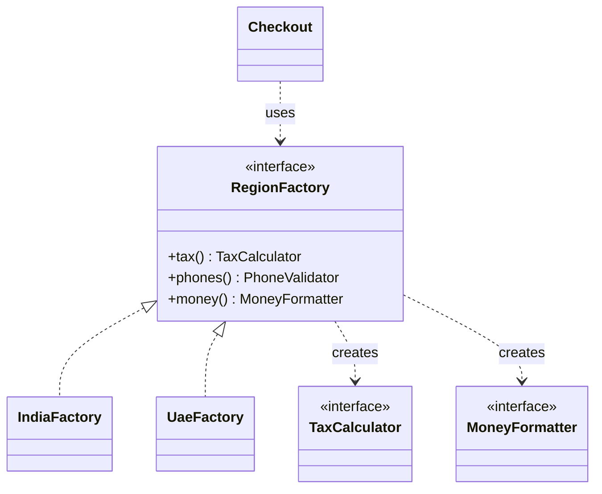
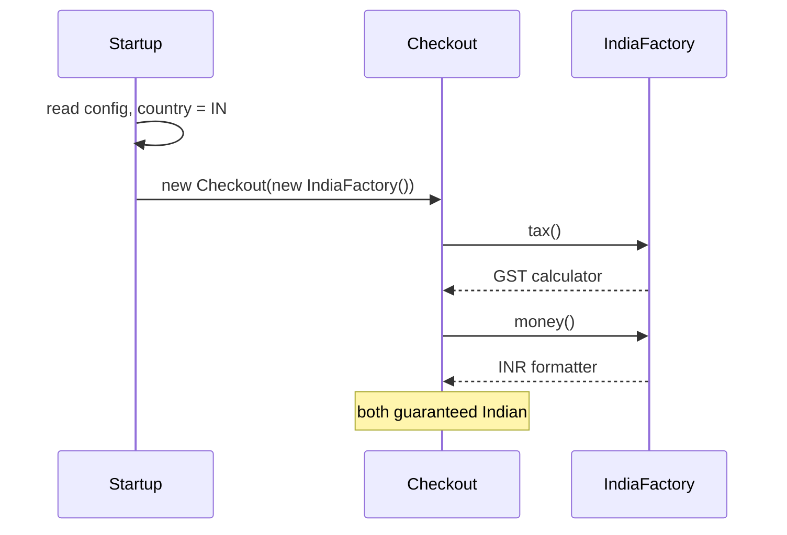

# Abstract Factory

<span class="badge-l2">L2 🔵 Practitioner</span> · <span class="read-time">⏱ 35 min read</span> · Prerequisites: [Factory Method](../l1-foundations/factory-method.md), [Strategy](../l1-foundations/strategy.md)

!!! abstract "TL;DR"
    Abstract Factory is an interface for creating a *family* of related objects (tax rules, address format and delivery promise for a country; charge, webhook and refund clients for an environment) without naming their classes. Pick one concrete factory, usually at startup, and every object it creates is guaranteed to match. Its weakness: adding a new kind of product changes every factory.

## 1. What It Is

**Plain English.** FreshCart operates in India and the UAE. Checkout needs a tax calculator, an address formatter and a money formatter, and they must belong to the *same* country: Indian GST with UAE dirham formatting would be a bug. An abstract factory is one object per country that hands out all three, so code that receives "the India factory" can only ever get Indian pieces.

**Precise definition (GoF intent).** "Provide an interface for creating families of related or dependent objects without specifying their concrete classes." Roles:

- **Abstract factory:** interface with one creation method per product (`RegionFactory`).
- **Concrete factory:** creates one family (`IndiaFactory`, `UaeFactory`).
- **Abstract products:** interfaces for each kind of object (`TaxCalculator`, `MoneyFormatter`).
- **Concrete products:** the family members.
- **Client:** uses only the abstract factory and products.

## 2. Why It Exists

When several objects vary together (by country, environment, vendor or theme), choosing each one separately invites mismatches: someone wires the UAE formatter with the India tax rules, or the sandbox webhook verifier with the live charge client. Those bugs are often invisible in tests and expensive in production. Abstract Factory makes the *family* the unit of choice: one decision, consistent objects.

## 3. Mental Model / Analogy

**Analogy.** A FreshCart store-launch kit. The Pune kit contains Pune price tags, Marathi-and-English signage and the Pune delivery map; the Dubai kit contains dirham tags, Arabic-and-English signage and the Dubai map. The launch team receives a kit, not loose items, so they can't put Dubai tags on Pune shelves.

**Technical model.** An interface whose methods each return an abstract product; each implementation returns concrete products from one family. Clients receive the factory (usually injected) and call its methods.

## 4. How It Works





## 5. Subtopics

### Product families

**Description.** A family is a set of objects designed to work together, and a concrete factory creates exactly one family. Clients ask the factory for each product and never mix factories.

**Advantages / features.** Consistency guaranteed by construction; switching the whole family is one change; concrete classes hidden from clients.

```java title="ProductFamiliesDemo.java"
--8<-- "examples/l2-practitioner/abstract-factory/ProductFamiliesDemo.java"
```

1. One creation method per product type in the family.
2. The client receives a factory and can only combine products from it.
3. Switching country means passing a different factory; the client code is unchanged.

**Run it:** `java ProductFamiliesDemo.java`

```text
--8<-- "examples/l2-practitioner/abstract-factory/ProductFamiliesDemo.expected.txt"
```

| Pros | Cons |
|------|------|
| Products in a family always match | More interfaces and classes |
| One switch changes the whole family | Adding a product type touches every factory |
| Concrete classes hidden from clients | Overkill when products don't actually depend on each other |

**Use it** when several objects must vary together. **Avoid it** when the products are independent; separate [factories](../l1-foundations/factory-method.md) or [strategies](../l1-foundations/strategy.md) are simpler.
**Real-world Java:** `javax.xml.parsers.DocumentBuilderFactory` and `TransformerFactory`; `java.awt.Toolkit` (platform UI family); JDBC's `Connection` creating matching `Statement`s and `PreparedStatement`s for one driver.
**Best practice:** keep families small (three to five products). **Gotcha:** if callers can reach concrete products directly, they can still mix families; keep concrete classes package-private.

### Abstract Factory vs. Factory Method

**Description.** [Factory Method](../l1-foundations/factory-method.md) creates *one* product, chosen by a subclass overriding a method. Abstract Factory creates *several related* products, chosen by passing a factory object. Concrete factories often implement each creation method as a simple factory method.

**Advantages of knowing the difference.** You pick the lighter tool when only one product varies.

```java title="AbstractFactoryVsFactoryMethodDemo.java"
--8<-- "examples/l2-practitioner/abstract-factory/AbstractFactoryVsFactoryMethodDemo.java"
```

1. Factory Method: one abstract creation method in a workflow class.
2. Abstract Factory: an interface creating a bag *and* a box that match.
3. The client receives a factory object (composition), not a subclass.

**Run it:** `java AbstractFactoryVsFactoryMethodDemo.java`

```text
--8<-- "examples/l2-practitioner/abstract-factory/AbstractFactoryVsFactoryMethodDemo.expected.txt"
```

| | Factory Method | Abstract Factory |
|---|---|---|
| Creates | One product | A family of related products |
| Mechanism | Inheritance (subclass overrides) | Composition (pass a factory object) |
| Chosen | By choosing the subclass | By choosing the factory instance |
| Adding a product variant | New subclass | New concrete factory |
| Adding a product *type* | Not applicable | Change interface and all factories |

**Use Factory Method** for one varying product inside a workflow; **Abstract Factory** for matched sets.
**Real-world Java:** `Collection.iterator()` (factory method) vs `DocumentBuilderFactory` (abstract factory).
**Best practice:** start with Factory Method; promote to Abstract Factory when a second product must match the first. **Gotcha:** an "abstract factory" with one method is just a factory; don't add the ceremony.

### Choosing the factory at startup

**Description.** The concrete factory is usually chosen once, at startup, from configuration (country, environment, cloud), then injected everywhere. Services never read configuration or switch on the environment themselves.

**Advantages / features.** One decision point; invalid configuration fails at startup, not at the first customer request; easy testing with a local factory.

```java title="StartupSelectionDemo.java"
--8<-- "examples/l2-practitioner/abstract-factory/StartupSelectionDemo.java"
```

1. A registry of available families, keyed by configuration value.
2. Selection happens once and fails loudly with the valid choices.
3. Services receive the factory; they don't know which one.
4. A bad value stops startup instead of breaking later.

**Run it:** `java StartupSelectionDemo.java`

```text
--8<-- "examples/l2-practitioner/abstract-factory/StartupSelectionDemo.expected.txt"
```

| Selection approach | Fits | Watch out |
|--------------------|------|-----------|
| Registry map + config key | Plain Java, few families | Validate keys at startup |
| Spring profiles / `@ConditionalOnProperty` | Spring apps, per environment | Profiles silently missing in one environment |
| `ServiceLoader` | Plug-in families from other jars | Several providers found: decide which wins |
| Per-request (country from user) | Multi-country in one deployment | Cache factories; they should be stateless |

**Use** startup selection for environment-level families; per-request selection for per-customer families like country.
**Real-world Java:** `DocumentBuilderFactory.newInstance()` uses system properties and `ServiceLoader` to pick an implementation.
**Best practice:** log the chosen family at startup. **Gotcha:** defaulting silently to "local" in production because a variable is missing; fail instead.

### Adding a new product type

**Description.** Abstract Factory makes new *families* easy (add a factory) but new *product types* hard (add a method to the interface and implement it in every factory). Java's compiler helps: an abstract method forces every factory to decide. A default method avoids the work but lets families silently fall back to a generic product.

**Advantages of handling it deliberately.** No family ships with a wrong or missing product.

```java title="AddingProductTypeDemo.java"
--8<-- "examples/l2-practitioner/abstract-factory/AddingProductTypeDemo.java"
```

1. The new product type as an abstract method: every factory must implement it, or it doesn't compile.
2. The shortcut: a default method makes old factories compile unchanged.
3. The result: the Saudi family silently uses a generic invoice number, which may not be legally compliant.

**Run it:** `java AddingProductTypeDemo.java`

```text
--8<-- "examples/l2-practitioner/abstract-factory/AddingProductTypeDemo.expected.txt"
```

| Approach | Safety | Effort |
|----------|--------|--------|
| Abstract method on the interface | Compiler forces every family to decide | Edit every factory |
| Default method | Silent fallback; risky for regulated or family-specific behaviour | Low |
| Default that throws `UnsupportedOperationException` | Fails at runtime, maybe in production | Low |
| Separate factory for the new product | No change to old interface | Families can now mismatch again |

**Use** abstract methods for anything that must match the family. **Avoid** defaults for regulated behaviour (tax, invoicing, compliance).
**Real-world Java:** JDBC added methods to `Connection` over versions; drivers had to implement them, and older drivers threw `SQLFeatureNotSupportedException`.
**Best practice:** add a contract test that checks every factory produces every product. **Gotcha:** sealing the factory interface (`sealed ... permits`) documents the full set of families you must update.

## 6. Examples (exactly 3, progressively harder)

### Example 1: Minimal (L2)

**Scenario:** Stores choose standard or eco packaging; the bag, cold pack and filler must all come from the same range.

```java title="PackagingFactoryDemo.java"
--8<-- "examples/l2-practitioner/abstract-factory/PackagingFactoryDemo.java"
```

1. The packaging family: three products that belong together.
2. The packing code doesn't know which range it's using.

**Run it:** `java PackagingFactoryDemo.java`

**Output:**

```text
--8<-- "examples/l2-practitioner/abstract-factory/PackagingFactoryDemo.expected.txt"
```

**What to notice:**

- Eco stores can't accidentally use plastic air pillows; the family decides.
- Adding a "premium" range is one new class.

### Example 2: Realistic (in FreshCart grocery delivery)

**Scenario:** One checkout service serves India and the UAE. Tax rules (by category in India, flat in the UAE), address formats and postcode rules, and delivery promises all depend on the country. Rates here are simplified for the example.

```java title="RegionalCheckoutDemo.java"
--8<-- "examples/l2-practitioner/abstract-factory/RegionalCheckoutDemo.java"
```

1. A "country kit": the family of country-specific behaviours.
2. India: category-based tax rates (simplified for the example).
3. The UAE has no postcodes, so the rule is "must be empty".
4. The kit is chosen per request from the customer's country.

**Run it:** `java RegionalCheckoutDemo.java`

**Output:**

```text
--8<-- "examples/l2-practitioner/abstract-factory/RegionalCheckoutDemo.expected.txt"
```

**What to notice:**

- The same basket has different tax in each country, and the checkout code has no `if (country == ...)`.
- Adding Saudi Arabia means one new kit class and one map entry.

### Example 3: Production-grade

**Scenario:** The payment provider has a sandbox and a live environment. FreshCart needs three clients (charges, webhook verification, refunds) that must all point at the same environment: a live charge client with a sandbox webhook secret would reject every real payment confirmation. Configuration comes from secrets per deployment, must be validated, and production must refuse anything that looks like sandbox.

```java title="PaymentStackFactoryDemo.java"
--8<-- "examples/l2-practitioner/abstract-factory/PaymentStackFactoryDemo.java"
```

1. The abstract factory for the payment family.
2. All configuration problems are collected and reported at once, before any client exists.
3. Simplified signature check for the demo; real providers use HMAC-SHA256 (see Security).
4. The stack refuses to be assembled from mixed environments.
5. The deployment name selects the environment and secrets; services just receive a `PaymentStack`.

**Run it:** `java PaymentStackFactoryDemo.java`

**Output:**

```text
--8<-- "examples/l2-practitioner/abstract-factory/PaymentStackFactoryDemo.expected.txt"
```

**What to notice:**

- The live verifier rejects a webhook signed with the sandbox secret.
- `dev` had two configuration problems; both are reported, and startup stops.
- Even hand-assembling a mixed stack is refused.

## 7. Pros, Cons & Trade-offs

| Aspect | Pros | Cons |
|--------|------|------|
| Correctness | Families can't be mixed | Only if clients use the factory consistently |
| Extensibility | New families without touching clients | New product types touch every factory |
| Simplicity | Clients see interfaces only | Many interfaces; indirection |
| Performance | Factories can be stateless singletons | None significant |
| Operability | One place to validate environment config | Selection errors must fail at startup to be safe |
| Testability | Swap in a test family | Each family needs contract tests |

## 8. When to Use / When NOT to Use

**Use it when:**

- several objects must vary together (country, environment, vendor, platform, theme);
- mixing them would be a bug;
- you want to switch families in one place.

**Don't use it when:**

- only one object varies: use [Factory Method](../l1-foundations/factory-method.md) or a [Strategy](../l1-foundations/strategy.md);
- products are independent: inject each one separately;
- a DI container's profiles already express the family cleanly (then the "factory" is your configuration class).

## 9. Best Practices

1. **Make the family the unit of configuration**: select one factory, not individual products. *(Consensus.)*
2. **Select at startup and fail fast** on unknown or invalid configuration. *(Consensus.)*
3. **Keep concrete products package-private** so clients can't mix them. *(Opinion.)*
4. **Use abstract methods, not defaults, for products that must match the family.** *(Consensus.)*
5. **Tag products with their family (environment, country) when mixing is dangerous**, and check at assembly. *(Opinion.)*
6. **Write a contract test run against every factory.** *(Consensus.)*

## 10. Pitfalls & Anti-Patterns

!!! danger "Live payments, sandbox webhooks (production failure mode)"
    **Symptom:** after a deploy, every payment stayed "pending"; customers were charged but orders never confirmed.
    **Root cause:** the webhook secret came from a different configuration block than the charge client, and pointed at sandbox.
    **Fix:** one factory per environment creating all payment clients from one validated configuration (Example 3).

!!! danger "Family mixing through side doors"
    **Symptom:** UAE invoices printed with Indian GST labels.
    **Root cause:** one service created `new IndiaTaxCalculator()` directly instead of asking the factory.
    **Fix:** hide concrete classes; review for direct construction.

!!! danger "The ever-growing factory interface"
    **Symptom:** `RegionFactory` has 25 methods and every new feature adds one.
    **Root cause:** everything country-specific was forced into one family.
    **Fix:** split into smaller families (tax kit, address kit) that vary independently.

!!! danger "Silent defaults"
    **Symptom:** a new country launched with generic invoice numbers that failed an audit.
    **Root cause:** a default method supplied a product the family should have defined.
    **Fix:** abstract methods and a contract test for every family.

## 11. Configuration & Tuning

| Setting | Default | What it does | When to change it | Risk of changing |
|---------|---------|--------------|-------------------|------------------|
| `FRESHCART_INFRA` | `local` | Selects the infrastructure family | Per deployment | Wrong family: data in the wrong region |
| Deployment → environment map | prod→LIVE, staging/dev→SANDBOX | Which payment family each deployment gets | New deployments | Production pointing at sandbox, or the reverse |
| Country kits | IN, AE | Supported countries | Launches | Missing kit fails checkout for that country |

## 12. Security Considerations

- Webhook verification must use a proper HMAC (for example HMAC-SHA256 with a constant-time comparison), never `hashCode` as in the simplified demo.
- Production factories should refuse test credentials and sandbox endpoints, and sandbox factories should refuse live ones; both directions have caused incidents.
- Load secrets per family from a secret manager; never fall back to another environment's secrets.

## 13. Performance & Scalability

Factories are usually stateless and created once, so their cost is negligible. Products that hold resources (HTTP clients, connection pools) should be created once per family and reused, not per call; a factory method that builds a new HTTP client on every call is a common hidden cost.

## 14. Testing It

Run the same checks against every family: each product exists, belongs to the family, and invalid configuration is refused.

```java title="PaymentStackFactoryTest.java"
--8<-- "examples/l2-practitioner/abstract-factory/PaymentStackFactoryTest.java"
```

## 15. Observability & Operations

Log the selected family and its non-secret settings at startup (`payments: LIVE via https://api.paylink.example`). Expose it on a health or info endpoint, and alert if production reports a sandbox family. Tag metrics with the family (country, environment) so dashboards can compare them.

## 16. Version Notes

| Java | Change relevant to Abstract Factory |
|------|-------------------------------------|
| 1.4 | `DocumentBuilderFactory`, `TransformerFactory` (JAXP) |
| 6 | `ServiceLoader` for discovering factory implementations |
| 8 | Default methods: possible (risky) defaults for new products |
| 16 | Records for small, immutable factories |
| 17 | Sealed interfaces: `sealed interface RegionFactory permits IndiaFactory, UaeFactory` lists every family |

## 17. Expert Deep Dive

- **Abstract Factory is mostly configuration now.** In Spring applications, `@Configuration` classes per profile play the role of concrete factories: each defines a matching set of beans. The pattern's lesson still applies: group beans that must match into one configuration and validate it.
- **Families vary along several axes.** Country and environment are independent; a 2×2 grid of families quickly becomes 4, then 9. Split into independent families (country kit, payment stack) and compose them, rather than one factory per combination.
- **Tagging for safety.** When mixing is dangerous (environments, tenants, regions), make products carry their family tag and check it at assembly and at use. This turns a silent misconfiguration into a startup failure.
- **Plugin families.** `ServiceLoader` lets other jars provide whole families (a new payment provider), which keeps the core closed for modification.

!!! example "War story: the tenant that saw another tenant's files"
    A multi-tenant platform built a storage client per tenant but a thumbnail cache shared across tenants, chosen by a separate config key. A copy-paste mistake gave tenant B the cache namespace of tenant A, and some customers briefly saw another company's product images. The fix was a per-tenant factory that produced *all* tenant-scoped clients from one tenant ID, with every client carrying that ID and the request pipeline checking it. **Lesson:** if objects must agree on an identity (tenant, environment, region), create them together from one source of truth.

## 18. Interview Corner

=== "🟢 L1–L2"

    1. **What is Abstract Factory?** An interface for creating **families of related objects** without naming concrete classes.
    2. **Give an example family.** **Country kit**: tax, address format, currency formatter.
    3. **Abstract Factory vs Factory Method?** **Family via an object** vs **one product via a subclass**.
    4. **Name a JDK example.** **`DocumentBuilderFactory`**, `TransformerFactory`.
    5. **What's easy and what's hard to add?** New **families** easy; new **product types** hard.

=== "🟡 L3"

    1. **How do you choose the factory?** **Once at startup** from config (or per request for per-customer families), and **inject** it.
    2. **Why avoid default methods for new products?** They **silently give families a generic product**.
    3. **How do Spring profiles relate?** A profile's **`@Configuration` acts as a concrete factory** for a set of beans.
    4. **How do you stop clients mixing families?** **Hide concrete classes**, inject only the factory, and **tag and check** products.
    5. **How do you test families?** A **contract test** run against every factory.

=== "🔴 L4–L5"

    1. **Design multi-country, multi-environment payments.** **Independent families** (country kit, payment stack) composed at startup; **tagging and validation**; contract tests.
    2. **How do you prevent sandbox/live mixups?** **One config source per environment**, refuse test keys in prod, **assembly checks**, startup alerts.
    3. **When do families explode combinatorially, and what do you do?** Several axes; **split into orthogonal families** and compose.
    4. **How would third parties add a family?** **`ServiceLoader` or plugin API** with contract tests.
    5. **Now 10x tenants: one factory per tenant?** **Cache stateless families**, create resource-holding products lazily, and **bound per-tenant resources**.

=== "💻 Hands-on"

    **Task:** Add a Saudi Arabia kit to `RegionalCheckoutDemo` with 15% VAT, a five-digit postcode rule and a "within 90 minutes" promise.

    ??? success "Solution"
        ```java
        static final class SaudiKit implements CountryKit {
            public String code() { return "SA"; }
            public TaxPolicy tax() { return i -> i.cents() * 15 / 100; }
            public AddressFormatter addresses() { return new AddressFormatter() {
                public String format(Address a) { return a.line1() + ", " + a.city() + " " + a.postcode() + ", KSA"; }
                public boolean validPostcode(String p) { return p.matches("\\d{5}"); } }; }
            public DeliveryPromise delivery() { return m -> "within 90 minutes"; }
        }
        // KITS = Map.of("IN", new IndiaKit(), "AE", new UaeKit(), "SA", new SaudiKit());
        ```

## 19. Practice

- [ ] Add a `ReceiptPrinter` product to `RegionFactory` in `ProductFamiliesDemo` and implement it for both countries.
    ??? tip "Hint"
        Add an abstract method; the compiler lists every factory you must update.
- [ ] Make `StartupSelectionDemo` read the family name from a system property.
    ??? tip "Hint"
        `System.getProperty("freshcart.infra", "local")`, then run with `-Dfreshcart.infra=cloud-dubai`.
- [ ] Seal `PaymentStackFactory` so only `PayLinkStackFactory` and a test factory may implement it.
    ??? tip "Hint"
        `sealed interface PaymentStackFactory permits PayLinkStackFactory, TestStackFactory`.
- [ ] Find two beans in a Spring project that must always match (same environment or tenant) and sketch a factory for them.
    ??? tip "Hint"
        Look for configuration properties with the same prefix used by different beans.

## 20. Quick Revision Card

!!! tip "Remember in 30 seconds"
    - Intent: create families of related objects that must match.
    - One concrete factory per family; clients see only interfaces.
    - Choose the factory once (startup) or per customer; validate and fail fast.
    - New families: easy. New product types: change every factory (use abstract methods, not defaults).
    - Tag dangerous families (environment, tenant) and check at assembly.

    ```java
    RegionFactory region = KITS.get(customer.country());
    long tax = region.tax().taxCents(net);
    String shown = region.money().format(net + tax);
    ```

## 21. Further Reading

- Gamma et al., *Design Patterns* (1994): Abstract Factory.
- [javax.xml.parsers.DocumentBuilderFactory API documentation](https://docs.oracle.com/en/java/javase/21/docs/api/java.xml/javax/xml/parsers/DocumentBuilderFactory.html)
- [Spring Framework reference: Environment abstraction and profiles](https://docs.spring.io/spring-framework/reference/core/beans/environment.html)
- [java.util.ServiceLoader API documentation](https://docs.oracle.com/en/java/javase/21/docs/api/java.base/java/util/ServiceLoader.html)

---

[← Previous: L2 Practitioner](index.md) · [Next: Prototype →](prototype.md)
