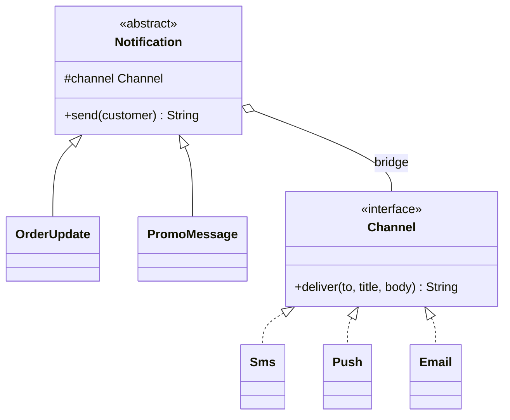
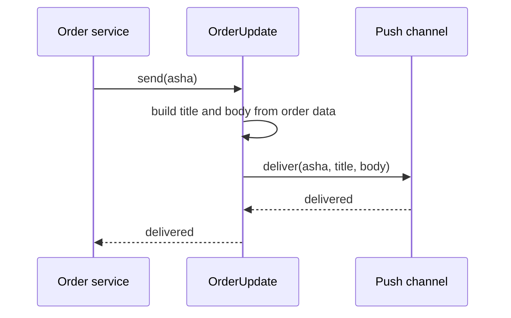

# Bridge

<span class="badge-l2">L2 🔵 Practitioner</span> · <span class="read-time">⏱ 35 min read</span> · Prerequisites: [Adapter](../l1-foundations/adapter.md), [Strategy](../l1-foundations/strategy.md), [Composition over inheritance](../l1-foundations/other-design-principles.md)

!!! abstract "TL;DR"
    Bridge splits one class hierarchy that varies in **two independent ways** into two hierarchies connected by a reference: the **abstraction** (what you do: order update, promo, report) holds an **implementor** (how it's done: SMS, push, CSV, S3). Each side grows on its own, so m kinds × n back ends need m + n classes instead of m × n. JDBC is the classic Java example: your code uses `Connection`, each vendor ships a `Driver`.

## 1. What It Is

**Plain English.** FreshCart sends several kinds of messages (order updates, promotions, OTP codes) through several channels (SMS, push, email). If each combination were its own class (`SmsOrderUpdate`, `PushPromo`, ...), adding WhatsApp would mean writing a class for every message kind. Bridge separates "what message" from "which channel", and the message simply holds a channel.

**Definition (GoF).** "Decouple an abstraction from its implementation so that the two can vary independently." Parts:

- **Abstraction:** the high-level interface clients use (`Notification`), holding a reference to an implementor.
- **Refined abstraction:** variants of the abstraction (`OrderUpdate`, `PromoMessage`).
- **Implementor:** a lower-level interface for the "how" (`Channel`), usually smaller and more primitive.
- **Concrete implementors:** the platform- or vendor-specific code (`Sms`, `Push`, `Email`).

"Implementation" here doesn't mean "the class that implements an interface"; it means the platform-specific side that the abstraction delegates to.

## 2. Why It Exists

Inheritance handles one dimension of variation well. With two dimensions, subclassing multiplies: every new message kind needs a class per channel, and every new channel needs a class per message kind. Code is duplicated across combinations, and changing how SMS works means editing many classes. Bridge turns one dimension into a field (composition), so the two dimensions can change, be tested and be deployed separately, and the implementor can even be chosen at runtime from configuration.

## 3. Mental Model / Analogy

**Analogy.** A TV remote and a TV. Remotes vary (basic, universal, voice); TVs vary (brands, models). Any remote works with any TV through a small agreed protocol (power, volume, channel). Remote makers and TV makers innovate independently; you don't buy a "basic-remote-for-brand-X-TV".

**Technical model.** Two interfaces: the abstraction's rich, domain-level API and the implementor's small, primitive API. The abstraction's methods are built from implementor calls. The link is a constructor-injected field, so the pairing is chosen at the composition root.

## 4. How It Works





## 5. Subtopics

### Abstraction and implementor

**Description.** The abstraction is what client code talks to; it holds an implementor and builds its behaviour from the implementor's primitive operations. Refined abstractions add variants on the "what" side; concrete implementors add variants on the "how" side. The bridge is the field that connects them.

**Advantages / features.** Either side can be extended without touching the other; the pairing is chosen at runtime; each side can be tested on its own.

```java title="AbstractionImplementorDemo.java"
--8<-- "examples/l2-practitioner/bridge/AbstractionImplementorDemo.java"
```

1. The implementor interface is small and knows nothing about orders or promotions.
2. The abstraction holds the implementor: that field is the bridge.
3. A refined abstraction decides *what* to say and leaves *how* to the channel.

**Run it:** `java AbstractionImplementorDemo.java`

```text
--8<-- "examples/l2-practitioner/bridge/AbstractionImplementorDemo.expected.txt"
```

| Pros | Cons |
|------|------|
| Two dimensions vary independently | Two hierarchies to understand instead of one |
| Implementor chosen at runtime | Designing a good implementor interface is hard |
| Platform code isolated from domain code | Overkill when there's only one dimension |

**Use it** when a concept varies along two axes that change for different reasons (business kinds vs technical back ends). **Avoid** it when one of the axes has only one member and no realistic second.
**Real-world Java:** JDBC (`Connection` vs `Driver`), SLF4J (logging API vs Logback/Log4j binding), AWT peers (`java.awt.Button` vs the native `ButtonPeer`), Spring's `PlatformTransactionManager` behind `TransactionTemplate`.
**Best practice:** make the implementor interface primitive (deliver bytes, store blobs) and keep policies in the abstraction. **Gotcha:** if the implementor interface mirrors the abstraction method for method, you've built an Adapter or a pass-through, not a bridge.

### Avoiding class explosion

**Description.** The main motivation. Combining two dimensions by inheritance needs m × n classes; a bridge needs m + n. The gap grows with every addition.

**Advantages / features.** Adding a channel is one class; adding a message kind is one class; no duplicated code across combinations.

```java title="ClassExplosionDemo.java"
--8<-- "examples/l2-practitioner/bridge/ClassExplosionDemo.java"
```

1. Inheritance: one class per (kind, channel) pair.
2. Bridge: one class per kind plus one per channel.
3. Adding one channel and one kind: 16 classes versus 8.

**Run it:** `java ClassExplosionDemo.java`

```text
--8<-- "examples/l2-practitioner/bridge/ClassExplosionDemo.expected.txt"
```

| Growth | Inheritance (m × n) | Bridge (m + n) |
|--------|---------------------|----------------|
| 3 kinds, 3 channels | 9 | 6 |
| 4 kinds, 4 channels | 16 | 8 |
| 10 kinds, 5 channels | 50 | 15 |

**Use** this test: "if I add one more X, how many classes do I touch?" If the answer is "one per Y", consider a bridge. **Avoid** creating the second hierarchy speculatively; wait for the second real member.
**Real-world Java:** without SLF4J's bridge, every library would need a version per logging framework.
**Best practice:** name classes by one dimension only (`Push`, `OrderUpdate`); a class name with both (`PushOrderUpdate`) is the smell. **Gotcha:** a third dimension (language, brand) can be a second bridge field, but each extra bridge adds wiring; keep it to what really varies.

### Bridge vs. Adapter vs. Strategy

**Description.** All three hold a reference to an interface and delegate to it, so the code looks similar. The difference is intent and timing. **Adapter** makes an existing, incompatible API fit, after the fact. **Strategy** swaps one algorithm inside one object. **Bridge** is designed up front so two whole hierarchies can grow independently.

**Advantages / features (of knowing the difference).** You name classes correctly and choose the right shape for the problem.

```java title="BridgeVsAdapterStrategyDemo.java"
--8<-- "examples/l2-practitioner/bridge/BridgeVsAdapterStrategyDemo.java"
```

1. Adapter: translates our `SmsSender` call into the legacy API's different method and return code.
2. Strategy: one class (`Checkout`) with one swappable rule.
3. Bridge: a family of pages on one side, a family of renderers on the other.

**Run it:** `java BridgeVsAdapterStrategyDemo.java`

```text
--8<-- "examples/l2-practitioner/bridge/BridgeVsAdapterStrategyDemo.expected.txt"
```

| | Adapter | Strategy | Bridge |
|---|---------|----------|--------|
| Intent | Make incompatible interfaces work together | Swap an algorithm | Let two hierarchies vary independently |
| When designed | After the fact | Up front | Up front |
| Hierarchies | One (wrapping one class) | One context, many strategies | Two, both extensible |
| Typical size | One method mapping | One method | Several methods on each side |

**Use** the name that matches your intent; reviewers read it as documentation. **Avoid** arguing about labels when the code is simple; the shape is what matters.
**Real-world Java:** Adapter: `InputStreamReader`; Strategy: `Comparator`; Bridge: JDBC, SLF4J.
**Best practice:** a Bridge implementor often ends up being created via an Adapter around a vendor SDK; that's normal. **Gotcha:** a Strategy that grows its own subclass hierarchy on the "context" side has become a Bridge; refactor names to reflect that.

### JDBC as a bridge

**Description.** JDBC separates the API your code uses (`DriverManager`/`DataSource`, `Connection`, `PreparedStatement`, `ResultSet`) from vendor drivers that implement it. `DriverManager` picks a driver by URL (`jdbc:postgresql:...`), and since JDBC 4.0 drivers register themselves via `ServiceLoader`. Your repository code doesn't change when you switch database vendors (as long as the SQL is portable).

**Advantages / features.** Database vendors and application developers evolve separately; tests can run on an embedded database; one connection pool works with every driver.

```java title="JdbcBridgeDemo.java"
--8<-- "examples/l2-practitioner/bridge/JdbcBridgeDemo.java"
```

1. The implementor interfaces that vendors implement.
2. The abstraction that application code calls; it chooses a driver from the URL.
3. Application code depends only on the abstraction.
4. Registration: real drivers do this automatically through `META-INF/services/java.sql.Driver`.

**Run it:** `java JdbcBridgeDemo.java`

```text
--8<-- "examples/l2-practitioner/bridge/JdbcBridgeDemo.expected.txt"
```

| Pros | Cons |
|------|------|
| Switch databases by URL and driver jar | SQL dialects still leak through the abstraction |
| Pools (HikariCP) work with any driver | Lowest-common-denominator API; vendor features need `unwrap` |
| Embedded databases for tests | Driver bugs surface as generic `SQLException`s |

**Use** the JDBC idea for your own pluggable back ends (storage, payments, search). **Avoid** assuming the abstraction hides everything; test on the real vendor too (Testcontainers).
**Real-world Java:** `java.sql.Driver`, `javax.sql.DataSource`, R2DBC (reactive equivalent), JPA providers behind the JPA API.
**Best practice:** depend on `DataSource` (injected) rather than `DriverManager` in applications. **Gotcha:** "No suitable driver found" usually means the driver jar isn't on the runtime classpath or the URL prefix is mistyped.

## 6. Examples (exactly 3, progressively harder)

### Example 1: Minimal (L2)

**Scenario:** receipts come in two types (short, detailed) and two formats (plain text for the thermal printer, HTML for email).

```java title="ReceiptPrinterDemo.java"
--8<-- "examples/l2-practitioner/bridge/ReceiptPrinterDemo.java"
```

1. The implementor: how a line and the whole receipt are formatted.
2. The abstraction: which lines a receipt contains; it holds a format.

**Run it:** `java ReceiptPrinterDemo.java`

**Output:**

```text
--8<-- "examples/l2-practitioner/bridge/ReceiptPrinterDemo.expected.txt"
```

**What to notice:**

- Four combinations from four small classes; a PDF format would be one more class.

### Example 2: Realistic (in FreshCart grocery delivery)

**Scenario:** the operations team gets daily reports (sales per store, low stock) and wants them as CSV for spreadsheets and JSON for the dashboard. New reports and new formats keep arriving, from different people.

```java title="ReportExportDemo.java"
--8<-- "examples/l2-practitioner/bridge/ReportExportDemo.java"
```

1. The implementor writes rows; it knows nothing about sales or stock.
2. Format rules such as quoting values with commas live in the exporter, once.
3. A new report only decides which rows and columns to produce.

**Run it:** `java ReportExportDemo.java`

**Output:**

```text
--8<-- "examples/l2-practitioner/bridge/ReportExportDemo.expected.txt"
```

**What to notice:**

- "Indiranagar, 2nd stage" was quoted correctly in CSV, for every report, because quoting lives on the format side.
- Report authors and format authors never edit the same class.

### Example 3: Production-grade

**Scenario:** invoices must be archived for 8 years. Developers use an in-memory store; production uses an object store that sometimes times out. Requirements: the back end is chosen from a config URL; retries, key naming and checksums are written once (in the abstraction) for every back end; a finance-audited variant records every read and write; tampered or corrupted invoices are detected on read.

```java title="InvoiceArchiveDemo.java"
--8<-- "examples/l2-practitioner/bridge/InvoiceArchiveDemo.java"
```

1. The implementor is primitive (bytes in, bytes out), so a new back end is small and easy to get right.
2. Back ends are chosen by URL scheme at the composition root, the way JDBC chooses drivers.
3. Retry policy lives in the abstraction, so every back end gets it for free.
4. Integrity checks also live in the abstraction: a checksum written on save is verified on load.
5. A refined abstraction adds auditing without changing any back end.

**Run it:** `java InvoiceArchiveDemo.java`

**Output:**

```text
--8<-- "examples/l2-practitioner/bridge/InvoiceArchiveDemo.expected.txt"
```

**What to notice:**

- The object store failed twice; the archive succeeded on the third attempt without the back end knowing about retries.
- Changing a stored invoice from Rs 100 to Rs 1 was caught by the checksum.
- An unknown scheme (`ftp`) failed at startup with a clear message, not on the first invoice.

## 7. Pros, Cons & Trade-offs

| Aspect | Pros | Cons |
|--------|------|------|
| Extensibility | m + n classes instead of m × n | Two hierarchies to learn |
| Flexibility | Implementor chosen at runtime or by config | Indirection in every call |
| Testability | Each side tested alone; contract tests for implementors | Needs contract tests to keep implementors consistent |
| Design | Domain code isolated from platform code | A poor implementor interface leaks platform details |
| Teams | Different teams own each side | Interface changes need coordination |
| Simplicity | — | Overkill for one dimension |

## 8. When to Use / When NOT to Use

**Use it when:**

- a concept varies in two independent ways (what × how, domain × platform);
- you need to switch back ends by configuration (storage, messaging, payments);
- different teams or vendors own the two sides.

**Don't use it when:**

- only one dimension varies (use Strategy or plain polymorphism);
- you're wrapping one existing API to fit yours (that's Adapter);
- the "second hierarchy" is speculative.

## 9. Best Practices

1. **Keep the implementor interface small and primitive.** *(Consensus.)*
2. **Put policies (retries, validation, naming) in the abstraction**, not in each implementor. *(Consensus.)*
3. **Write a contract test** every implementor must pass. *(Consensus.)*
4. **Choose implementors at the composition root** from configuration, failing fast on unknown values. *(Consensus.)*
5. **Name classes by one dimension**; a name with both is a smell. *(Opinion, widely shared.)*
6. **Allow escape hatches** (`unwrap`) for vendor-specific features instead of bloating the interface. *(Consensus; JDBC does this.)*

## 10. Pitfalls & Anti-Patterns

!!! danger "Leaky implementor (production failure mode)"
    **Symptom:** moving invoice storage to a new object store broke archiving; the new back end didn't support "list keys by prefix" efficiently, and the nightly job timed out.
    **Root cause:** the implementor interface had grown a `listByPrefix` method that the old back end handled cheaply, and the abstraction depended on it in a loop.
    **Fix:** keep the implementor primitive; keep an index of invoice keys in the database (owned by the abstraction); run the contract test, including performance expectations, against each back end before migrating.

!!! danger "Bridge with one implementor forever"
    **Symptom:** every change touches two interfaces and three classes, with a single `Default...Impl`.
    **Root cause:** a bridge introduced "for flexibility" with no second back end.
    **Fix:** collapse it; introduce the split when the second implementor actually arrives.

!!! danger "Policies duplicated in implementors"
    **Symptom:** S3 uploads retried 3 times, local disk 0 times, Azure 5 times, with different logs.
    **Root cause:** each implementor added its own retries.
    **Fix:** move retries to the abstraction (or a decorator around the implementor) once.

!!! danger "Lowest common denominator"
    **Symptom:** a valuable vendor feature (server-side encryption) can't be used.
    **Root cause:** the implementor interface only exposes what all back ends share.
    **Fix:** optional capabilities (a `supports(Feature)` method or `unwrap`), not a bigger mandatory interface.

## 11. Configuration & Tuning

| Setting | Default | What it does | When to change it | Risk of changing |
|---------|---------|--------------|-------------------|------------------|
| Back-end URL (`archive.url`) | none (required) | Selects the implementor | Per environment | Typos must fail at startup |
| `spring.datasource.url` / driver | none | Picks the JDBC driver (a bridge) | Switching databases | Dialect differences |
| Retry attempts (abstraction) | 3 | Transient failure handling for all back ends | Flaky back ends | Long waits, duplicate writes if not idempotent |
| Checksum verification | on | Detects corruption | Never turn off for financial data | CPU cost on huge files |

## 12. Security Considerations

- Never let user input choose the implementor (URL scheme, driver class); an attacker could select a debug or local-file back end.
- Encryption, access control and audit belong in the abstraction so no back end can forget them.
- Credentials for each implementor should come from a secrets manager at the composition root, not from the abstraction.
- JDBC URLs can carry dangerous options (for example, some drivers allow loading classes or files via URL parameters); don't build them from user input.

## 13. Performance & Scalability

The bridge itself is one extra method call. Performance differences come from implementors: an in-memory store and a remote object store have very different latency, so design the implementor interface around the slowest realistic back end (batch operations, streaming for large data). Put caching and batching in the abstraction so every back end benefits, and measure per implementor (tag metrics with the back-end name).

## 14. Testing It

A contract test every implementor must pass, plus tests of the abstraction's own policies:

```java title="InvoiceArchiveTest.java"
--8<-- "examples/l2-practitioner/bridge/InvoiceArchiveTest.java"
```

## 15. Observability & Operations

Tag every metric and log line with the implementor's name (`backend=object-store`) so dashboards can compare back ends and migrations can be watched side by side. Log the chosen implementor at startup. During a back-end migration, run both implementors in parallel (write to both, read from old, compare) using a bridge-level "dual write" implementor.

## 16. Version Notes

| Version | Change relevant to Bridge |
|---------|---------------------------|
| Java 1.1 | JDBC 1.0 and AWT peers: the JDK's original bridges |
| Java 6 / JDBC 4.0 | Drivers self-register via `ServiceLoader` (no `Class.forName`) |
| Java 9 | Module system: `ServiceLoader` with `provides ... with` |
| Java 17 | Sealed interfaces can close a bridge's implementor set when you own all back ends |
| SLF4J 2.0 | Bindings discovered via `ServiceLoader` instead of static binder classes |

## 17. Expert Deep Dive

- **Bridges at architecture scale.** Hexagonal architecture's "ports and adapters" is a bridge: the domain defines ports (implementor interfaces) and infrastructure provides adapters (concrete implementors). See [Architectural Patterns](../l4-senior/architectural-patterns.md).
- **Service Provider Interfaces (SPI).** Java's standard way to ship implementors separately: the API module defines the interface, providers ship jars with `META-INF/services` entries, and `ServiceLoader` finds them. JDBC, JAXP, SLF4J 2 and `java.nio.file.spi.FileSystemProvider` all work this way.
- **Capability negotiation.** Mature bridges let implementors declare optional features (`DatabaseMetaData.supportsBatchUpdates()`), so the abstraction can use them when present and fall back otherwise.
- **Migrations.** Because the implementor is swappable, a bridge is the natural place for strangler-style migrations: a composite implementor writes to both back ends, then reads switch over, then the old one is removed.

!!! example "War story: the SMS bill"
    A grocery company sent all customer notifications through a `Notification` × `Channel` bridge. A new "Promo" message kind was added in a hurry, and its author hard-coded the SMS channel because "promos always go by SMS". Push was the default for everything else, and promotions were sent nightly to 2 million customers. The first night's SMS bill was more than the month's budget. **Fixes:** channel selection moved to a preference service at the composition root (customer preference, cost tier, quiet hours); message kinds can no longer construct channels themselves; and a per-channel spending limit was added to the abstraction. **Lesson:** a bridge only helps if the pairing is decided in one place, not by whoever writes the next refined abstraction.

## 18. Interview Corner

=== "🟢 L1–L2"

    1. **What does Bridge do?** Separates an **abstraction** from its **implementation** so both can vary independently.
    2. **What problem does it solve?** **Class explosion**: m × n subclasses for two dimensions.
    3. **Give a JDK example.** **JDBC**: `Connection` API vs vendor `Driver`s.
    4. **What connects the two hierarchies?** A **field** in the abstraction referencing the implementor.
    5. **Give a FreshCart example.** **Notification kinds × channels** (SMS, push, email).

=== "🟡 L3"

    1. **Bridge vs Adapter?** Adapter fits an **existing** API after the fact; Bridge is designed **up front** for two hierarchies.
    2. **Bridge vs Strategy?** Strategy swaps **one algorithm** in one context; Bridge has **hierarchies on both sides**.
    3. **Where should retries live?** In the **abstraction** (or one decorator), not in each implementor.
    4. **How do you keep implementors consistent?** A **contract test** they all pass.
    5. **How does JDBC find a driver?** **`ServiceLoader`** registration, then matching the **URL prefix**.

=== "🔴 L4–L5"

    1. **Design a pluggable storage layer for invoices.** **Primitive implementor**, policies in the abstraction, URL-based selection, contract tests, checksums, migration via dual write.
    2. **How do you handle features only some back ends support?** **Capability flags** or `unwrap`, not a bigger mandatory interface.
    3. **How does hexagonal architecture relate to Bridge?** **Ports** are implementor interfaces; **adapters** are concrete implementors.
    4. **How would you migrate from one back end to another with no downtime?** **Dual-write implementor**, backfill, compare reads, switch, remove.
    5. **When is a bridge harmful?** **Speculative** second hierarchies, leaky interfaces, or when it hides **performance differences** that matter.

=== "💻 Hands-on"

    **Task:** Add a `DualWriteBlobStore` to `InvoiceArchiveDemo` for migrations.

    ??? success "Solution"
        ```java
        record DualWriteBlobStore(BlobStore oldStore, BlobStore newStore) implements BlobStore {
            public void put(String k, byte[] d) { oldStore.put(k, d); newStore.put(k, d); }
            public Optional<byte[]> get(String k) { return oldStore.get(k).or(() -> newStore.get(k)); }
            public String name() { return "dual(" + oldStore.name() + "," + newStore.name() + ")"; }
        }
        ```

## 19. Practice

- [ ] Add a WhatsApp channel and an OTP message kind to `AbstractionImplementorDemo`; count the classes you touched.
    ??? tip "Hint"
        You should add two classes and change none.
- [ ] Add a `MarkdownExporter` to `ReportExportDemo`.
    ??? tip "Hint"
        Header row, a `|---|` separator row, then one `|`-separated row per data row.
- [ ] Add a `listInvoices(year)` feature to `InvoiceArchiveDemo` without adding a method to `BlobStore`.
    ??? tip "Hint"
        Keep an index blob per year, updated by the abstraction on each save.
- [ ] Find a class pair in a codebase whose names combine two dimensions (`S3CsvExporter`, `KafkaOrderPublisher`).
    ??? tip "Hint"
        Ask whether each half varies independently.

## 20. Quick Revision Card

!!! tip "Remember in 30 seconds"
    - Intent: split two independent dimensions into two hierarchies joined by a field.
    - Abstraction (what) holds implementor (how); m + n classes instead of m × n.
    - Implementor small and primitive; policies (retries, checksums) in the abstraction.
    - Choose the implementor at the composition root; contract-test all implementors.
    - Java examples: JDBC, SLF4J, AWT peers; architecture: ports and adapters.

    ```java
    abstract class Notification {
        protected final Channel channel;                 // the bridge
        Notification(Channel channel) { this.channel = channel; }
        abstract String send(String customer);
    }
    ```

## 21. Further Reading

- Gamma, Helm, Johnson, Vlissides, *Design Patterns* (1994), "Bridge".
- [JDBC API specification and `java.sql` package](https://docs.oracle.com/en/java/javase/21/docs/api/java.sql/java/sql/package-summary.html)
- [java.util.ServiceLoader API documentation](https://docs.oracle.com/en/java/javase/21/docs/api/java.base/java/util/ServiceLoader.html)
- [SLF4J user manual](https://www.slf4j.org/manual.html)
- Alistair Cockburn, "Hexagonal Architecture" (2005).

---

[← Previous: Proxy](proxy.md) · [Next: Flyweight →](flyweight.md)
