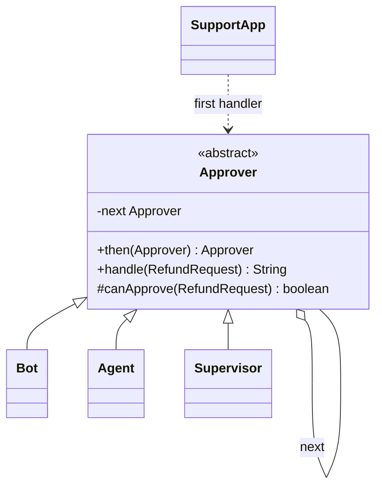
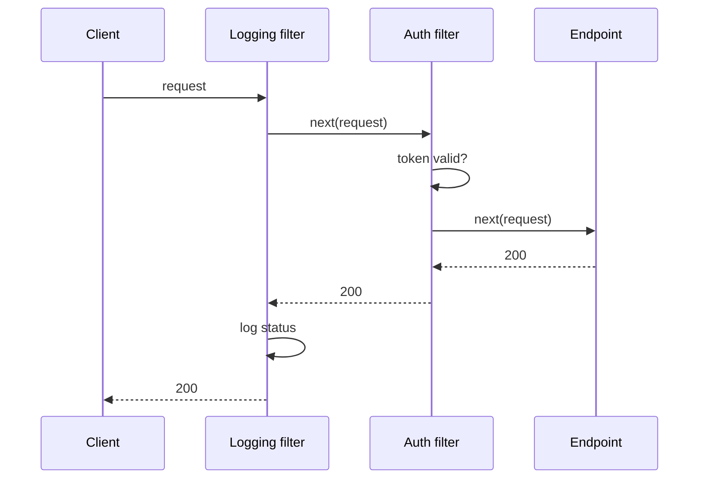

# Chain of Responsibility

<span class="badge-l2">L2 🔵 Practitioner</span> · <span class="read-time">⏱ 35 min read</span> · Prerequisites: [Decorator](../l1-foundations/decorator.md), [Command](command.md)

!!! abstract "TL;DR"
    Chain of Responsibility passes a request along a sequence of handlers; each one either handles it, passes it on, or (in the filter style) does something before and after the rest of the chain. It decouples the sender from whoever ends up handling the request. You use it every day in Java: servlet filters, Spring `HandlerInterceptor`s and Spring Security's filter chain. Order matters, and every chain needs a defined ending for requests nobody handles.

## 1. What It Is

**Plain English.** A FreshCart refund request goes to a chatbot first. Small refunds the bot approves itself; bigger ones go to an agent, then a supervisor. The customer doesn't know or care who approves; the request moves along the line until someone can deal with it.

**Definition (GoF).** "Avoid coupling the sender of a request to its receiver by giving more than one object a chance to handle the request. Chain the receiving objects and pass the request along the chain until an object handles it." Parts:

- **Handler:** an interface with a method to handle the request (and, in the linked form, a reference to the next handler).
- **Concrete handlers:** decide whether to handle, pass on, or both.
- **Client:** sends the request to the first handler.

Two variants are common in Java:

- **"First one wins"** (GoF): exactly one handler handles the request (approvals, fallbacks, routing).
- **Pipeline / filter chain:** every handler may act and then call the next (logging, auth, compression), possibly stopping early.

## 2. Why It Exists

Without a chain, the sender needs one big method with every rule (`if amount <= 200 then bot else if ...`), and changing the order, adding a level, or reusing a step means editing that method. With a chain, each rule is a small handler, the order is configuration, and new handlers plug in without touching the others or the sender. Cross-cutting request concerns (authentication, logging, rate limits) can be stacked around business endpoints without the endpoints knowing.

## 3. Mental Model / Analogy

**Analogy.** A call centre's escalation path: first-line support, then a specialist, then a manager. Each level resolves what it can and escalates the rest. Or airport security: each checkpoint (ID, bag scan, body scan) can stop you or wave you on to the next.

**Technical model.** A linked list (or `List`) of handlers. In "first wins" chains, iterate until one returns a result. In filter chains, each handler receives the request and a `next` callback; calling `next` continues the chain, not calling it short-circuits, and code after `next` runs on the way back.

## 4. How It Works





## 5. Subtopics

### Linked handlers

**Description.** The GoF form: each handler holds a reference to the next one. `handle` either processes the request or forwards it. The chain is assembled by linking handlers; the client only knows the first.

**Advantages / features.** Each rule is isolated; levels can be added, removed or reordered by relinking; the sender doesn't know who handles the request.

**Before (one method with every level) and after (linked handlers):**

```java title="LinkedHandlersDemo.java"
--8<-- "examples/l2-practitioner/chain-of-responsibility/LinkedHandlersDemo.java"
```

1. Before: every limit and level is hard-coded in one method.
2. `then` links the next handler and returns it, so chains read left to right.
3. The end of the chain is explicit: an unhandled request gets a clear answer, not a `NullPointerException`.
4. The chain is built once; here there's no finance level, and the largest refund falls off the end.

**Run it:** `java LinkedHandlersDemo.java`

```text
--8<-- "examples/l2-practitioner/chain-of-responsibility/LinkedHandlersDemo.expected.txt"
```

| Pros | Cons |
|------|------|
| Each handler small and independent | Hard to see the whole chain in one place |
| Order changed by relinking | A broken link silently drops requests |
| Sender decoupled from handlers | Long chains are slow to debug |

**Use it** for escalation, approvals and fallbacks where exactly one handler should act. **Avoid** hand-linked chains when a `List` would be clearer (most cases in modern Java).
**Real-world Java:** `java.util.logging.Logger` passes records to parent loggers; class loaders delegate to their parent before loading themselves.
**Best practice:** build the chain in one place (a factory or configuration) and log which handler handled each request. **Gotcha:** a cycle in the links (A → B → A) loops forever; build chains from a list to avoid it.

### List-based pipelines

**Description.** In modern Java a chain is often just a `List` of functional handlers iterated by a small loop. You choose the semantics in the loop: stop at the first result, or run all handlers and collect results (e.g. every validation error).

**Advantages / features.** The whole chain is visible in one place; easy to reorder, test and configure; no linking code.

```java title="ListPipelineDemo.java"
--8<-- "examples/l2-practitioner/chain-of-responsibility/ListPipelineDemo.java"
```

1. Each check is a lambda returning an optional problem.
2. "Stop at first": cheapest; good for fast failure.
3. "Collect all": better for users, who can fix everything at once.

**Run it:** `java ListPipelineDemo.java`

```text
--8<-- "examples/l2-practitioner/chain-of-responsibility/ListPipelineDemo.expected.txt"
```

| Semantics | Use for | Example |
|-----------|---------|---------|
| First result wins | Routing, fallbacks, coupons | Price lookup: cache, DB, supplier |
| Stop at first failure | Security checks, cheap fail-fast | Auth then rate limit then validation |
| Run all, collect | User-facing validation | All form errors at once |

**Use** list pipelines by default. **Avoid** hiding the list inside many classes; keep its definition in one readable place.
**Real-world Java:** Bean Validation runs all constraints and collects violations; Spring's `HandlerMethodArgumentResolver` list picks the first resolver that supports a parameter.
**Best practice:** order cheap and most-likely-to-fail checks first. **Gotcha:** if checks have side effects (reserving stock), "collect all" may run effects you didn't want; keep checks pure.

### Servlet filters and Spring interceptors

**Description.** Web frameworks run requests through filter chains. A servlet `Filter` receives the request and a `FilterChain`; calling `chain.doFilter` continues, not calling it stops the request, and code after the call runs on the way out. Spring adds `HandlerInterceptor` (`preHandle`, `postHandle`, `afterCompletion`) and Spring Security builds its own ordered `SecurityFilterChain`.

**Advantages / features.** Cross-cutting concerns (auth, logging, CORS, compression, request IDs) wrap every endpoint without endpoint code; filters can be reused across applications.

```java title="FiltersInterceptorsDemo.java"
--8<-- "examples/l2-practitioner/chain-of-responsibility/FiltersInterceptorsDemo.java"
```

1. The servlet shape: a filter gets the request and the rest of the chain.
2. The chain is built from the inside out, so the first filter in the list runs first.
3. Code before `proceed` runs on the way in; code after runs on the way out.
4. Not calling `proceed` short-circuits: the endpoint never runs.

**Run it:** `java FiltersInterceptorsDemo.java`

```text
--8<-- "examples/l2-practitioner/chain-of-responsibility/FiltersInterceptorsDemo.expected.txt"
```

| Mechanism | Level | Typical use |
|-----------|-------|-------------|
| Servlet `Filter` (`@Order`, `FilterRegistrationBean`) | Servlet container | Request IDs, logging, CORS, compression |
| Spring Security `SecurityFilterChain` | Before the DispatcherServlet | Authentication, authorisation, CSRF |
| Spring `HandlerInterceptor` | Around controller methods | Per-handler checks, timing, locale |
| WebFlux `WebFilter` | Reactive pipeline | The same, non-blocking |

**Use** filters for concerns that apply to many endpoints. **Avoid** business logic in filters; it becomes invisible to whoever reads the controller.
**Real-world Java:** Spring Security's ~15 default filters, `OncePerRequestFilter`, Micrometer's HTTP server metrics filter, gRPC `ServerInterceptor`.
**Best practice:** set explicit orders and put request IDs and error handling first, so every later failure is logged with an ID. **Gotcha:** filter order mistakes are silent: an auth filter before logging means rejected requests are never logged, as the demo shows.

### Ending the chain and fallbacks

**Description.** Every chain must say what happens when no handler takes the request: return a default, return "not found", throw a clear exception, or queue for later. Fallback chains also handle **failures**: if a handler throws, decide whether to try the next one or stop.

**Advantages / features.** Predictable behaviour for the "nobody handled it" case; graceful degradation when sources fail.

```java title="EndingChainFallbacksDemo.java"
--8<-- "examples/l2-practitioner/chain-of-responsibility/EndingChainFallbacksDemo.java"
```

1. Sources are tried in order of cost: cache, database, supplier API.
2. A failing source is logged and skipped, not fatal.
3. The defined end: hide the item rather than show a wrong price.

**Run it:** `java EndingChainFallbacksDemo.java`

```text
--8<-- "examples/l2-practitioner/chain-of-responsibility/EndingChainFallbacksDemo.expected.txt"
```

| Ending | When | Risk |
|--------|------|------|
| Default value | A safe default exists | Default hides real problems |
| Empty result / 404 | "Not found" is a valid answer | Callers must handle it |
| Exception | Unhandled means a bug or misconfiguration | Crashes if not caught at the edge |
| Queue / retry later | Temporary lack of capacity | Needs a durable queue and monitoring |

**Use** an explicit terminal handler or a clear post-loop decision. **Avoid** `null` as "nobody handled it".
**Real-world Java:** Spring's `DispatcherServlet` returns 404 when no handler mapping matches; class loading throws `ClassNotFoundException` when no loader in the chain finds the class.
**Best practice:** count how often the end of the chain is reached; a rising count is an early warning. **Gotcha:** catching exceptions to try the next handler can hide bugs; only fall through on expected failures (timeouts), not on programming errors.

## 6. Examples (exactly 3, progressively harder)

### Example 1: Minimal (L2)

**Scenario:** checkout applies the first coupon rule that matches the cart.

```java title="CouponChainDemo.java"
--8<-- "examples/l2-practitioner/chain-of-responsibility/CouponChainDemo.java"
```

1. Each rule either returns a discount or passes.
2. A stream finds the first rule that applies, with a defined default.

**Run it:** `java CouponChainDemo.java`

**Output:**

```text
--8<-- "examples/l2-practitioner/chain-of-responsibility/CouponChainDemo.expected.txt"
```

**What to notice:**

- Rule order is the business priority; changing it is a one-line move.

### Example 2: Realistic (in FreshCart grocery delivery)

**Scenario:** each new order needs a rider. Try the cheapest option first (an idle rider nearby), then batching onto a route that ends nearby, then the ParcelGo partner fleet (more expensive), and finally queue the order to retry.

```java title="RiderAssignmentChainDemo.java"
--8<-- "examples/l2-practitioner/chain-of-responsibility/RiderAssignmentChainDemo.java"
```

1. Each step tries to assign and returns an assignment or nothing.
2. Partners cost more, so they come after in-house options.
3. The end of the chain queues the order instead of failing it.

**Run it:** `java RiderAssignmentChainDemo.java`

**Output:**

```text
--8<-- "examples/l2-practitioner/chain-of-responsibility/RiderAssignmentChainDemo.expected.txt"
```

**What to notice:**

- The bulky order skipped the bike rider and went to the partner.
- The 18 km order fell to the queue with a reason, not an exception.

### Example 3: Production-grade

**Scenario:** the order API needs request IDs, error handling, authentication and idempotency in front of every endpoint. Requirements: handlers declare an explicit order and the pipeline sorts them; duplicate names or orders fail at startup; any handler can short-circuit; exceptions become a 500 response that includes the request ID; retried POSTs with the same `Idempotency-Key` replay the stored response; per-handler metrics count calls and short-circuits, safely under concurrency.

```java title="RequestPipelineDemo.java"
--8<-- "examples/l2-practitioner/chain-of-responsibility/RequestPipelineDemo.java"
```

1. A handler has a name, an explicit order, and a `handle(request, next)` method.
2. Configuration mistakes (two handlers with the same order) fail at startup.
3. A handler that didn't call `next` short-circuited; the pipeline counts it.
4. The error handler sits right after request IDs, so every 500 carries a reference support can search for.
5. Idempotency short-circuits a repeated POST by replaying the stored response.

**Run it:** `java RequestPipelineDemo.java`

**Output:**

```text
--8<-- "examples/l2-practitioner/chain-of-responsibility/RequestPipelineDemo.expected.txt"
```

**What to notice:**

- The handlers were listed in the wrong order in code, but ran by their declared order.
- The retried POST returned the same order number; only one order was created.
- The crashing endpoint produced `500 ... ref req-4`, and the metrics show auth and idempotency each short-circuited once.

## 7. Pros, Cons & Trade-offs

| Aspect | Pros | Cons |
|--------|------|------|
| Decoupling | Sender doesn't know the handler | Hard to know who handled a request |
| Flexibility | Add, remove, reorder handlers | Order bugs are silent |
| Reuse | Filters shared across apps | Generic handlers can grow complex |
| Robustness | Fallbacks degrade gracefully | Unhandled requests if no terminal case |
| Performance | Early short-circuits save work | Long chains add latency to every request |
| Testability | Each handler unit-testable | Need chain-level tests for ordering |

## 8. When to Use / When NOT to Use

**Use it when:**

- several handlers might handle a request and the choice depends on the request;
- cross-cutting steps must wrap many endpoints (filters, interceptors);
- you need ordered fallbacks (cache, database, remote).

**Don't use it when:**

- exactly one handler is always known up front (call it directly);
- every handler must always run with no ordering concerns (an Observer or a simple loop);
- the decision is a clean lookup by key (use a `Map`).

## 9. Best Practices

1. **Define the chain in one place** with explicit order. *(Consensus.)*
2. **Always define the end** of the chain. *(Consensus.)*
3. **Put request IDs and error handling first**, auth before business handlers. *(Consensus.)*
4. **Keep handlers small and side-effect free** where possible. *(Consensus.)*
5. **Log or measure which handler handled a request** and how often the end is reached. *(Consensus.)*
6. **Test the assembled chain** for order, not just each handler. *(Consensus.)*

## 10. Pitfalls & Anti-Patterns

!!! danger "Filter order exposed private data (production failure mode)"
    **Symptom:** an internal admin endpoint returned order data to unauthenticated users for two hours after a release.
    **Root cause:** a new caching filter was registered with a higher priority than the security filter chain, so cached admin responses were served before authentication ran.
    **Fix:** explicit orders for all filters (security first); a startup check that the security filter is at the front; an integration test calling admin endpoints without credentials.

!!! danger "Swallowed requests"
    **Symptom:** some refunds were never processed and nothing was logged.
    **Root cause:** the last handler returned `null` for amounts above its limit; callers treated `null` as "done".
    **Fix:** an explicit terminal handler that escalates to a queue and logs.

!!! danger "Fallback hides an outage"
    **Symptom:** for a week, every price came from the slow supplier API; nobody noticed until the bill arrived.
    **Root cause:** the cache handler was failing on every call and the chain silently fell through.
    **Fix:** metrics per handler (hit, miss, error); alert when an early handler stops handling.

!!! danger "Business logic in filters"
    **Symptom:** discounts applied twice, and nobody could find where.
    **Root cause:** a "promo filter" modified request bodies before the controller.
    **Fix:** keep filters for cross-cutting concerns; put business rules in services.

## 11. Configuration & Tuning

| Setting | Default | What it does | When to change it | Risk of changing |
|---------|---------|--------------|-------------------|------------------|
| `@Order` / `FilterRegistrationBean.setOrder` | lowest precedence | Position of a servlet filter | Every custom filter | Wrong order: security or logging gaps |
| `spring.security.filter.order` | -100 | Position of the security chain | Rarely | Filters before it run unauthenticated |
| `SecurityFilterChain` `securityMatcher` | all requests | Which chain handles which paths | Multiple chains | Overlapping matchers: first match wins |
| Handler timeouts | none | Max time per fallback source | Remote handlers | Too short: unnecessary fallbacks |

## 12. Security Considerations

- Authentication and authorisation must run before anything that reads or caches business data.
- Every path must go through the security chain; test unauthenticated access to sensitive endpoints.
- Don't let a fallback bypass a security check ("if auth service is down, allow"); fail closed.
- Filters that log requests must mask secrets (tokens, passwords, card numbers).

## 13. Performance & Scalability

Each handler adds a little latency to every request, so keep filters fast and short-circuit early (reject bad tokens before parsing bodies). Fallback chains should order handlers by cost and success rate, and give remote handlers timeouts so a slow source doesn't hold the whole request. Measure per-handler latency; one slow filter slows every endpoint.

## 14. Testing It

Test order, short-circuiting, error mapping, startup validation and idempotency of the assembled pipeline:

```java title="RequestPipelineTest.java"
--8<-- "examples/l2-practitioner/chain-of-responsibility/RequestPipelineTest.java"
```

In Spring, `MockMvc` tests run the real filter chain; include at least one test per security rule.

## 15. Observability & Operations

Add the request ID in the first filter and put it in the logging context (MDC) so every log line carries it. Export per-handler metrics: calls, short-circuits, errors and latency. Spring Boot's `/actuator/mappings` and the security debug log (`logging.level.org.springframework.security=DEBUG`) show filter chains and their order when debugging.

## 16. Version Notes

| Version | Change relevant to Chain of Responsibility |
|---------|--------------------------------------------|
| Servlet 2.3 | `Filter` and `FilterChain` |
| Java 8 | Lambdas and `Optional`: list-based chains of functions |
| Spring Security 5.7 | `SecurityFilterChain` beans replace `WebSecurityConfigurerAdapter` |
| Spring Boot 3 / Jakarta EE 9+ | `javax.servlet` → `jakarta.servlet` |
| Java 21 | Virtual threads: blocking filters are cheap per request |

## 17. Expert Deep Dive

- **Middleware everywhere.** The `handle(request, next)` shape is the same in servlet filters, gRPC interceptors, OkHttp interceptors, Netty pipelines and Kafka consumer interceptors. Learn it once.
- **Chain vs Decorator.** A filter chain is a list of decorators around an endpoint built at runtime. Decorator emphasises adding behaviour to one object; Chain emphasises passing a request through optional handlers that may stop it.
- **Ordering as a contract.** In large codebases, give filters named order constants (`ORDER_REQUEST_ID = 0`, `ORDER_SECURITY = 100`) and validate at startup; ordering bugs are among the hardest to spot in review.
- **Resilience chains.** Fallbacks combine with timeouts, circuit breakers and bulkheads; see [Resilience Patterns](../l4-senior/resilience-patterns.md).

!!! example "War story: the rate limiter that limited everyone"
    A grocery API added a rate-limiting filter keyed by client IP to stop scraping. It was registered before the filter that reads the `X-Forwarded-For` header from the load balancer, so every request appeared to come from the load balancer's IP. At the evening peak, the whole country shared one rate limit, and most customers got `429 Too Many Requests`. **Fixes:** the forwarded-headers filter got the first position by explicit order; the rate limiter keys by authenticated user, falling back to the real client IP; and a test asserts the filter order. **Lesson:** in a chain, a handler only sees what earlier handlers have prepared.

## 18. Interview Corner

=== "🟢 L1–L2"

    1. **What is Chain of Responsibility?** Passing a request along **handlers until one handles it** (or each processes it).
    2. **Give a Java example.** **Servlet filters**, Spring Security's filter chain.
    3. **What happens if no handler handles the request?** It must be **defined**: default, error, or queue.
    4. **How do you stop a filter chain?** **Don't call `chain.doFilter`** (return a response).
    5. **Give a FreshCart example.** **Refund approval**: bot, agent, supervisor.

=== "🟡 L3"

    1. **Linked handlers vs list pipeline?** Links are GoF; lists are **clearer, easier to reorder and test**.
    2. **Why does filter order matter?** Later filters depend on **what earlier ones prepared** (auth, request IDs, forwarded headers).
    3. **Filter vs HandlerInterceptor?** Filters wrap the **whole servlet**; interceptors wrap **controller handling**.
    4. **Chain vs Decorator?** Similar shape; chain handlers **may stop** the request, decorators always delegate.
    5. **How do you test a chain?** Unit-test handlers, then **test the assembled chain** for order and short-circuits.

=== "🔴 L4–L5"

    1. **Design the request pipeline for a public API.** **Request ID, error mapping, forwarded headers, auth, rate limit, idempotency, validation**, with explicit order and metrics.
    2. **How do you prevent ordering regressions?** **Named order constants, startup validation, integration tests** for security and headers.
    3. **Design a price-lookup fallback chain.** **Cache → DB → supplier**, timeouts, circuit breakers, metrics, safe terminal behaviour.
    4. **When is a chain the wrong tool?** When routing is a **key lookup** or **all handlers must run** (events).
    5. **How do you debug "who handled this request?"** **Per-handler metrics and logs with request IDs**, security debug logs.

=== "💻 Hands-on"

    **Task:** Add a timing handler to `RequestPipelineDemo` that records the latency of the rest of the chain.

    ??? success "Solution"
        ```java
        record Timing(Map<String, Long> lastNanos) implements Handler {
            public String name() { return "timing"; }
            public int order() { return 12; }
            public Response handle(Request r, Next next) {
                long start = System.nanoTime();
                try { return next.call(r); }
                finally { lastNanos.put(r.path(), System.nanoTime() - start); }
            }
        }
        ```

## 19. Practice

- [ ] Add a `Finance` approver to `LinkedHandlersDemo` that approves anything but requires a reason.
    ??? tip "Hint"
        Add a `reason` field to `RefundRequest`.
- [ ] Add a rate-limit handler to `RequestPipelineDemo` keyed by user, at an order after auth.
    ??? tip "Hint"
        Return 429 when a user exceeds N requests in the current minute; use an injected clock.
- [ ] Make `EndingChainFallbacksDemo` stop falling through on `IllegalArgumentException` (a bug), but continue on timeouts.
    ??? tip "Hint"
        Catch only a `TimeoutException`-like type for fallthrough.
- [ ] List the filters in a Spring Boot application and their order.
    ??? tip "Hint"
        Set `logging.level.org.springframework.security=DEBUG` and read the startup log.

## 20. Quick Revision Card

!!! tip "Remember in 30 seconds"
    - Intent: pass a request along handlers; decouple sender from handler.
    - Variants: first-one-wins (approvals, fallbacks) and filter pipelines (`handle(request, next)`).
    - Order matters: request ID and errors first, then security, then business.
    - Always define the end: default, 404, exception, or queue.
    - Measure per handler; test the assembled chain.

    ```java
    interface Filter { Response doFilter(Request req, Chain next); }
    Filter auth = (req, next) -> req.hasToken() ? next.proceed(req) : new Response(401, "login required");
    ```

## 21. Further Reading

- Gamma, Helm, Johnson, Vlissides, *Design Patterns* (1994), "Chain of Responsibility".
- [Jakarta Servlet Filter API](https://jakarta.ee/specifications/servlet/6.0/apidocs/jakarta.servlet/jakarta/servlet/filter)
- [Spring Security reference: Architecture (the filter chain)](https://docs.spring.io/spring-security/reference/servlet/architecture.html)
- [Spring MVC reference: Interception](https://docs.spring.io/spring-framework/reference/web/webmvc/mvc-config/interceptors.html)
- [gRPC Java interceptors](https://grpc.io/docs/guides/interceptors/)

---

[← Previous: State](state.md) · [Next: Mediator →](mediator.md)
