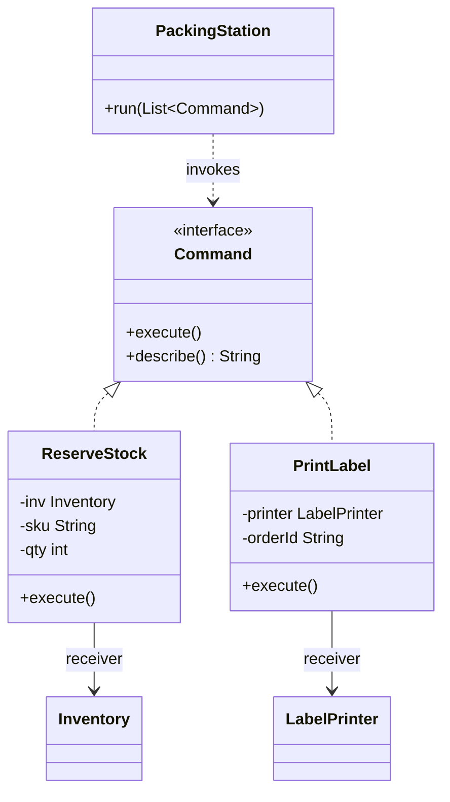
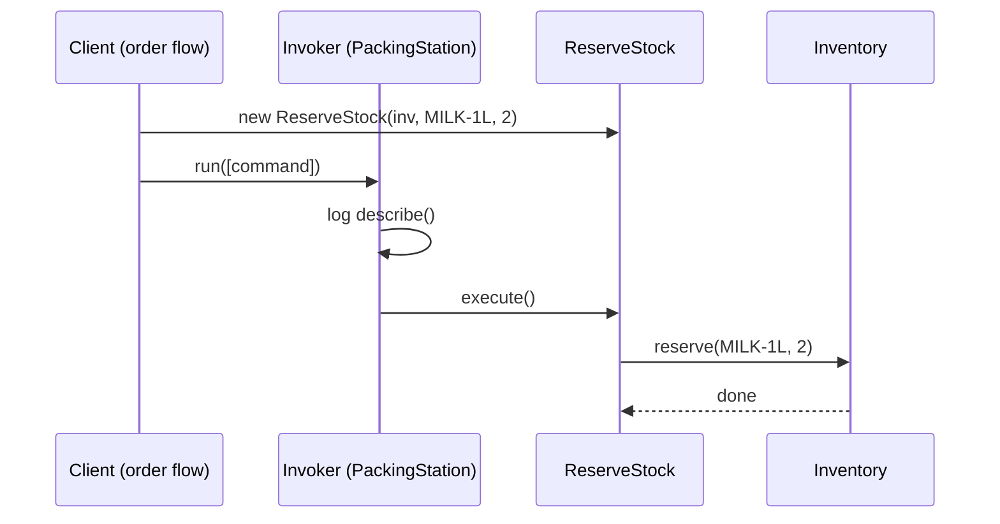

# Command

<span class="badge-l2">L2 🔵 Practitioner</span> · <span class="read-time">⏱ 40 min read</span> · Prerequisites: [Strategy](../l1-foundations/strategy.md), [Observer](../l1-foundations/observer.md)

!!! abstract "TL;DR"
    Command turns a request ("reserve 2 milk", "refund order FC-7201") into an object. Once a request is an object, you can queue it, log it, retry it, undo it, combine several into one, or run it later on another machine. In modern Java a simple command is just a lambda (`Runnable`); use a record or class when you need data, a name, undo, or persistence. Commands that cross process boundaries need idempotency keys.

## 1. What It Is

**Plain English.** At a FreshCart store, a supervisor writes tasks on cards: "restock aisle 3", "print labels for FC-7001". The cards go in a tray; any free packer picks one up and does it. The supervisor doesn't need to know who will do it or when, and the tray can be reordered, counted or audited. Each card is a command.

**Definition (GoF).** "Encapsulate a request as an object, thereby letting you parameterize clients with different requests, queue or log requests, and support undoable operations." Parts:

- **Command:** an interface with `execute()` (and optionally `undo()`).
- **Concrete command:** holds the parameters and a reference to the receiver.
- **Receiver:** the object that actually does the work (`Inventory`, `LabelPrinter`).
- **Invoker:** triggers commands without knowing what they do (a button, a queue worker, a scheduler).
- **Client:** creates commands and hands them to the invoker.

## 2. Why It Exists

When the code that **decides** what should happen is tightly bound to the code that **does** it, you can't delay the work, retry it, record it, or reverse it. A button that calls `inventory.reserve(...)` directly can't be reassigned; a checkout that calls the email service directly can't survive the email service being down. Making the request an object separates "asking" from "doing", which unlocks queues, undo, macros, audit logs and background jobs.

## 3. Mental Model / Analogy

**Analogy.** A restaurant order slip. The waiter (invoker) takes the slip to the kitchen without cooking; the chef (receiver) cooks from the slip. Slips can wait in a queue, be cancelled, be grouped for a table (macro), and be kept as a record of what was ordered.

**Technical model.** A function plus its arguments, packaged as a value. In Java: an object implementing `Command` (or a lambda capturing its arguments). Undo needs the command to remember what it changed. Persistence needs the command to be pure data (a record) that a handler can execute later.

## 4. How It Works





## 5. Subtopics

### Command, invoker and receiver

**Description.** The command carries everything needed to perform one request; the receiver does the real work; the invoker decides **when** to execute but not **what** happens. Adding a new kind of request means adding a command class, not editing the invoker.

**Advantages / features.** Invokers become generic (a station, a button, a worker); requests can be logged and described uniformly; receivers stay focused on their domain.

**Before (invoker switches on action names) and after (commands):**

```java title="CommandInvokerReceiverDemo.java"
--8<-- "examples/l2-practitioner/command/CommandInvokerReceiverDemo.java"
```

1. Before: the invoker knows every action and every receiver; each new action edits this switch.
2. The command interface: execute plus a description for logs.
3. The invoker runs any list of commands and logs them, without knowing what they do.

**Run it:** `java CommandInvokerReceiverDemo.java`

```text
--8<-- "examples/l2-practitioner/command/CommandInvokerReceiverDemo.expected.txt"
```

| Pros | Cons |
|------|------|
| Invoker decoupled from receivers | One class per request type (unless lambdas) |
| Uniform logging, queuing and scheduling | Indirection: harder to follow "who does what" |
| New requests without changing invokers | Commands holding receiver references can't be serialised |

**Use it** when the thing that triggers work should be generic (buttons, schedulers, workers). **Avoid** it for a direct call that will never be queued, logged or undone.
**Real-world Java:** `Runnable` and `Callable` submitted to an `ExecutorService` (the executor is the invoker), Swing `Action`, Spring Batch steps, `java.util.TimerTask`.
**Best practice:** give commands a readable `describe()` or `toString()` for logs. **Gotcha:** commands that capture mutable objects see changes made after they were created; capture values or copies.

### Undo/redo

**Description.** For undo, each command stores what it needs to reverse itself (the previous value, the removed item) when it executes, and implements `undo()`. A history keeps two stacks: executed commands (for undo) and undone commands (for redo). Running a new command clears the redo stack.

**Advantages / features.** Editors, admin tools and carts get reliable undo without snapshots of the whole state.

```java title="UndoRedoDemo.java"
--8<-- "examples/l2-practitioner/command/UndoRedoDemo.java"
```

1. Undoable commands know how to reverse themselves.
2. `RemoveItem` remembers the removed quantity at execution time; it can't know it earlier.
3. A new command clears redo: redoing old commands after a new edit would corrupt state.
4. Redo re-executes and moves the command back to the undo stack.

**Run it:** `java UndoRedoDemo.java`

```text
--8<-- "examples/l2-practitioner/command/UndoRedoDemo.expected.txt"
```

| Approach | Pros | Cons |
|----------|------|------|
| Inverse operation per command | Small memory, precise | Each command must implement undo correctly |
| Snapshot before each command ([Memento](memento.md)) | Simple, works for any change | Memory grows with state size |
| Event sourcing (rebuild from history) | Full audit, time travel | Complex infrastructure |

**Use** inverse-operation undo for editors and admin tools. **Avoid** promising undo for side effects that can't be reversed (an SMS already sent); use compensation instead.
**Real-world Java:** Swing's `javax.swing.undo.UndoManager` and `UndoableEdit`, IDE refactoring undo.
**Best practice:** limit history size and clear it when the underlying data is saved or reloaded. **Gotcha:** undoing a command whose preconditions changed (the item was removed by someone else) needs a conflict check, not a blind reversal.

### Macro commands

**Description.** A macro command is a [Composite](composite.md) of commands: executing it runs the steps in order; undoing it undoes them in reverse order. If a step fails, the steps that already ran should be rolled back so the macro behaves as one unit.

**Advantages / features.** One-click workflows ("reorder last week's basket"), all-or-nothing behaviour, and a single undo for a multi-step action.

```java title="MacroCommandDemo.java"
--8<-- "examples/l2-practitioner/command/MacroCommandDemo.java"
```

1. A macro is itself a command, so it can go anywhere a command can (history, queue, another macro).
2. On failure, undo the completed steps in reverse order, then report.
3. Undo of the whole macro reverses every step, last first.

**Run it:** `java MacroCommandDemo.java`

```text
--8<-- "examples/l2-practitioner/command/MacroCommandDemo.expected.txt"
```

| Pros | Cons |
|------|------|
| Multi-step actions as one unit | Rollback only as good as each step's undo |
| One undo for the whole action | Partial failure handling must be designed |
| Reusable building blocks | Long macros hide what will happen |

**Use** macros for user-facing workflows built from existing commands. **Avoid** them as a substitute for database transactions when all steps touch one database; use a transaction.
**Real-world Java:** Spring Batch jobs made of steps; deployment tools running ordered steps; saga orchestrators (compensation instead of undo, see [Distributed Data Patterns](../l4-senior/distributed-data-patterns.md)).
**Best practice:** let users preview a macro's steps before running it. **Gotcha:** an undo that itself throws during rollback leaves partial state; log it loudly and continue undoing the others.

### Commands as lambdas

**Description.** Since Java 8, a command with no undo and no extra data is just a functional interface: `Runnable`, `Consumer<T>`, `Supplier<T>`, `Callable<T>`. Maps from names to lambdas make command registries without classes. When you need a name, undo, or parameters you can inspect, wrap the lambda in a small record.

**Advantages / features.** No boilerplate classes; composition with `andThen`; easy registries.

```java title="CommandsAsLambdasDemo.java"
--8<-- "examples/l2-practitioner/command/CommandsAsLambdasDemo.java"
```

1. A command registry: names to `Runnable`s, like a small admin console.
2. `Consumer.andThen` composes commands into a pipeline.
3. A record adds a name and an undo when you need them.

**Run it:** `java CommandsAsLambdasDemo.java`

```text
--8<-- "examples/l2-practitioner/command/CommandsAsLambdasDemo.expected.txt"
```

| Form | Pros | Cons |
|------|------|------|
| Lambda (`Runnable`) | Shortest, no class | No name in logs, no undo, not serialisable |
| Record wrapping lambdas | Name and undo, still short | Still not storable |
| Record of data + handler | Storable, replayable, inspectable | More code; needs a dispatcher |

**Use** lambdas for in-process callbacks and registries. **Avoid** lambdas for commands that must be stored, sent, or audited; use data records.
**Real-world Java:** `ExecutorService.submit(() -> ...)`, `CompletableFuture.runAsync`, Spring Shell and picocli command registries.
**Best practice:** name lambdas by storing them in well-named variables or maps. **Gotcha:** a lambda's `toString` is something like `Demo$$Lambda/0x...`, useless in logs.

### Command queues and jobs

**Description.** When commands are plain data (records), they can be put in a queue and executed later by a worker, in another thread, process or machine. This is how background jobs, message queues and outbox processing work. Because queues deliver **at least once**, commands carry an **idempotency key** so a duplicate is executed only once.

**Advantages / features.** Slow or unreliable work leaves the request path; spikes are smoothed; failures can be retried without the user waiting.

```java title="CommandQueueDemo.java"
--8<-- "examples/l2-practitioner/command/CommandQueueDemo.java"
```

1. The command is pure data with an idempotency key; no receiver reference, so it can be stored or sent.
2. The handler checks the key first, so a retried request doesn't email the invoice twice.
3. A bounded queue gives back-pressure when workers fall behind.
4. A worker (a virtual thread here) pulls and executes commands until the queue is idle.

**Run it:** `java CommandQueueDemo.java`

```text
--8<-- "examples/l2-practitioner/command/CommandQueueDemo.expected.txt"
```

| Queue | Durability | Typical use |
|-------|------------|-------------|
| `BlockingQueue` in memory | Lost on restart | Local background work |
| Database table (outbox, job table) | Durable, transactional with your data | Reliable jobs, outbox pattern |
| Message broker (Kafka, RabbitMQ, SQS) | Durable, distributed | Cross-service commands |

**Use** queued commands for slow, retryable side effects (emails, refunds, exports). **Avoid** queuing work the user must see completed in the same response.
**Real-world Java:** `ThreadPoolExecutor`'s work queue, Spring `@Async`, JobRunr, Quartz, Spring Batch, Kafka consumers, the transactional outbox.
**Best practice:** store the idempotency key with the result in the same transaction as the effect. **Gotcha:** an in-memory queue loses commands on deploy; use a durable store for anything that must happen.

## 6. Examples (exactly 3, progressively harder)

### Example 1: Minimal (L2)

**Scenario:** a packer's handheld scanner has programmable buttons; each store assigns different actions.

```java title="ScannerButtonsDemo.java"
--8<-- "examples/l2-practitioner/command/ScannerButtonsDemo.java"
```

1. The command interface takes the scanned SKU as its parameter.
2. Unassigned buttons get a harmless default command (a [Null Object](null-object.md)).

**Run it:** `java ScannerButtonsDemo.java`

**Output:**

```text
--8<-- "examples/l2-practitioner/command/ScannerButtonsDemo.expected.txt"
```

**What to notice:**

- The scanner code never changes when a store reassigns its buttons.

### Example 2: Realistic (in FreshCart grocery delivery)

**Scenario:** a category manager runs a 10% discount on fruit. The tool must show a preview, apply all changes, and undo the whole batch if the manager spots a mistake.

```java title="BulkPriceChangeDemo.java"
--8<-- "examples/l2-practitioner/command/BulkPriceChangeDemo.java"
```

1. Each price change is a command that remembers the old price when it executes.
2. Because changes are objects, they can be previewed before anything happens.
3. Undo walks the batch in reverse, restoring each old price.

**Run it:** `java BulkPriceChangeDemo.java`

**Output:**

```text
--8<-- "examples/l2-practitioner/command/BulkPriceChangeDemo.expected.txt"
```

**What to notice:**

- The same command objects served preview, apply and undo.
- The undo restored exact old prices, not a recalculation (10% off then 10% on would be wrong).

### Example 3: Production-grade

**Scenario:** customer-support actions (refunds, SMS, restocks) go through a command processor. Requirements: commands are storable data; each type has one handler; duplicates (same idempotency key) run once; transient failures from the PayLink payment provider are retried with exponential backoff; invalid commands are rejected without retrying; failures beyond the retry limit go to a dead-letter list; every attempt is audited.

```java title="CommandProcessorDemo.java"
--8<-- "examples/l2-practitioner/command/CommandProcessorDemo.java"
```

1. Commands are a sealed set of records: storable, comparable, and exhaustively handled.
2. The idempotency store returns the earlier result for a duplicate instead of refunding twice.
3. Exponential backoff (100 ms, 200 ms, 400 ms, ...), recorded instead of slept so tests are fast.
4. Permanent errors (bad input) aren't retried; retrying can't fix them.
5. An exhaustive `switch` dispatches each command type to its handler; a new type won't compile until handled.

**Run it:** `java CommandProcessorDemo.java`

**Output:**

```text
--8<-- "examples/l2-practitioner/command/CommandProcessorDemo.expected.txt"
```

**What to notice:**

- The refund succeeded on the third attempt after two PayLink timeouts; the repeated request returned the stored result without a second refund.
- The zero-value refund was rejected once, not retried.
- With the provider fully down, the command was dead-lettered after three attempts for a human to look at.

## 7. Pros, Cons & Trade-offs

| Aspect | Pros | Cons |
|--------|------|------|
| Decoupling | Invoker independent of receivers | More types and indirection |
| Flexibility | Queue, schedule, retry, undo, macro | Each feature needs careful design |
| Reliability | Retries and dead letters for side effects | At-least-once delivery requires idempotency |
| Auditability | Every request is a record | Storage and privacy of stored commands |
| Testability | Commands tested as data | Async execution complicates tests |
| Simplicity | Lambdas for simple cases | Overkill for direct calls |

## 8. When to Use / When NOT to Use

**Use it when:**

- requests must be queued, scheduled, retried or run elsewhere;
- users need undo/redo or one-click multi-step actions;
- you need an audit trail of what was requested and by whom;
- invokers (buttons, schedulers, workers) should be generic.

**Don't use it when:**

- a direct method call is enough and will stay that way;
- the caller needs the result synchronously and can't tolerate delay;
- "undo" would hide irreversible effects (use compensation and say so).

## 9. Best Practices

1. **Make queued commands immutable data** (records) without receiver references. *(Consensus.)*
2. **Give every command that crosses a boundary an idempotency key.** *(Consensus.)*
3. **Separate transient from permanent errors**; retry only transient ones, with backoff and a limit. *(Consensus.)*
4. **Dead-letter, alert and provide a replay tool.** *(Consensus.)*
5. **Use lambdas for simple in-process commands**, records for anything stored or logged. *(Consensus.)*
6. **Capture state needed for undo at execution time.** *(Consensus.)*

## 10. Pitfalls & Anti-Patterns

!!! danger "Double refund (production failure mode)"
    **Symptom:** some customers received two refunds for the same order during a payment-provider slowdown.
    **Root cause:** the refund job timed out after the provider had processed the refund; the queue redelivered the command, and nothing recognised it as a duplicate.
    **Fix:** an idempotency key per refund stored with the result, and the same key passed to the provider's API (most payment APIs accept one).

!!! danger "Retrying permanent errors"
    **Symptom:** the job queue filled with thousands of retries, delaying every other job.
    **Root cause:** validation errors (bad data) were retried like timeouts, forever.
    **Fix:** classify errors; reject permanent ones immediately to a dead-letter queue.

!!! danger "Commands holding live objects"
    **Symptom:** after a restart, queued jobs failed with `NotSerializableException` or ran against stale objects.
    **Root cause:** commands stored references to services and entities, not IDs.
    **Fix:** store IDs and values; look up receivers when the command runs.

!!! danger "Undo that ignores what changed since"
    **Symptom:** undoing a price change overwrote a newer change made by a colleague.
    **Root cause:** undo blindly restored the old value.
    **Fix:** check the current value still equals what the command set (optimistic check) before undoing.

## 11. Configuration & Tuning

| Setting | Default | What it does | When to change it | Risk of changing |
|---------|---------|--------------|-------------------|------------------|
| Max attempts | 3–5 typical | Retries before dead-letter | Flaky dependencies | Too many: long delays, load on a struggling service |
| Backoff base / max | 100 ms–1 s / 1–5 min | Spacing of retries | Provider rate limits | Too short: retry storms |
| Jitter | on (recommended) | Randomises backoff | Many workers retrying together | None significant |
| Queue capacity | bounded | Back-pressure | Bursty producers | Too small: rejected submissions |
| Idempotency retention | days | How long keys are remembered | Long client retry windows | Storage growth |

## 12. Security Considerations

- Authorise when the command is **created** and record who created it; the worker that executes it later runs with system privileges.
- Validate commands from queues as untrusted input; a message on a topic may not come from your service.
- Don't store secrets or full card data in commands; store references.
- Stored commands are an audit log: protect them from tampering and apply data-retention rules.

## 13. Performance & Scalability

Queued commands decouple request latency from work latency: checkout returns in milliseconds while invoices are emailed later. Throughput scales with workers, limited by the receivers (a payment API's rate limit). Bound queues to avoid memory growth; batch commands for the same receiver (one bulk SMS call instead of 1,000); and watch queue age, not only length, as the key health signal.

## 14. Testing It

Test commands as data: retries with recorded backoff, idempotency, permanent errors and giving up:

```java title="CommandProcessorTest.java"
--8<-- "examples/l2-practitioner/command/CommandProcessorTest.java"
```

## 15. Observability & Operations

Track per command type: submitted, succeeded, retried, dead-lettered, and execution time. Alert on dead letters and on the age of the oldest queued command. Log each attempt with the idempotency key so one key traces a request across retries. Provide an operator tool to inspect, fix and replay dead-lettered commands.

## 16. Version Notes

| Java | Change relevant to Command |
|------|----------------------------|
| 1.0 | `Runnable`: the original command interface |
| 5 | `Callable`, `ExecutorService`: invokers for commands |
| 8 | Lambdas and `java.util.function`: commands without classes |
| 16–17 | Records and sealed interfaces: storable command types with exhaustive handling |
| 21 | Virtual threads: one cheap thread per queued command; pattern matching for `switch` dispatch |

## 17. Expert Deep Dive

- **CQRS.** Command Query Responsibility Segregation separates commands (change state, return little) from queries (read, change nothing). Command handlers become the only place writes happen, which simplifies auditing and scaling.
- **Commands vs events.** A command says "please do X" and can be rejected; an event says "X happened" and is a fact. Queues of commands have one intended handler; event streams have many subscribers. Mixing them up leads to confusing systems.
- **Exactly-once is built, not bought.** Brokers deliver at least once; exactly-once effects come from idempotent handlers (keys stored transactionally with effects). See [Distributed Data Patterns](../l4-senior/distributed-data-patterns.md).
- **Compensation over undo.** In distributed systems you can't undo an email or a refund; you issue a compensating command (a follow-up email, a reversal). Sagas are macro commands with compensations.

!!! example "War story: the replay that sent 40,000 SMS"
    A grocery company's SMS commands failed for two hours during a TextBlast outage and landed in a dead-letter queue. An engineer replayed the whole queue once the provider recovered. Because the commands were "send delivery update" messages without expiry, customers received 40,000 stale texts ("your order is 5 minutes away") hours after delivery. **Fixes:** commands gained an `expiresAt` field and handlers drop expired ones; the replay tool shows counts by command type and age before running; and time-sensitive notifications are rebuilt from current state instead of replayed. **Lesson:** a stored command is a request frozen in time; decide how long it stays valid.

## 18. Interview Corner

=== "🟢 L1–L2"

    1. **What does Command do?** Turns a **request into an object** so it can be queued, logged, undone.
    2. **Name the roles.** **Command, receiver, invoker, client.**
    3. **Give a JDK example.** **`Runnable`** submitted to an **`ExecutorService`**.
    4. **How is undo implemented?** Each command stores **what it changed** and implements `undo()`; a history stack.
    5. **What's a macro command?** A command made of **other commands**, run in order and undone in reverse.

=== "🟡 L3"

    1. **Why clear the redo stack after a new command?** Redo of old commands would apply to a **different state**.
    2. **What is an idempotency key?** A unique ID so a **duplicate delivery runs once**.
    3. **Lambda vs class for a command?** Lambda for **simple in-process**; record/class for **name, undo, storage**.
    4. **Which errors should be retried?** **Transient** ones (timeouts, 503), with backoff and a limit; not validation errors.
    5. **Command vs Strategy?** Strategy is **how** to do something; Command is **a request to do** something, possibly later.

=== "🔴 L4–L5"

    1. **Design a reliable refund pipeline.** **Outbox + queue, idempotency keys end to end, retries with jitter, dead letters, replay tooling, audit.**
    2. **Commands vs events in a microservice architecture?** Commands **target one handler and can fail**; events are **facts for many subscribers**.
    3. **How do you get exactly-once effects?** **Idempotent handlers** with keys stored **transactionally** with the effect.
    4. **How do you handle undo in distributed workflows?** **Compensating commands** (sagas), not true undo.
    5. **What do you monitor for a command queue?** **Oldest message age**, throughput, retries, dead letters, handler latency.

=== "💻 Hands-on"

    **Task:** Add an `expiresAt` to `SendSms` in `CommandProcessorDemo` and drop expired commands.

    ??? success "Solution"
        ```java
        record SendSms(String key, String phone, String text, Instant expiresAt) implements Cmd { }

        case SendSms s -> {
            if (clock.instant().isAfter(s.expiresAt())) {
                audit.add(s.key() + " expired, dropped");
                yield "expired";
            }
            yield "sms to " + s.phone();
        }
        ```

## 19. Practice

- [ ] Add a `ChangeQty` command to `UndoRedoDemo`.
    ??? tip "Hint"
        Remember the previous quantity in `execute()`.
- [ ] Make `MacroCommandDemo` continue undoing other steps if one undo throws, and report all failures.
    ??? tip "Hint"
        Collect exceptions with `addSuppressed`.
- [ ] Add jitter to `CommandProcessorDemo`'s backoff using an injected `Random`.
    ??? tip "Hint"
        `base * 2^(attempt-1) * (0.5 + random.nextDouble())`.
- [ ] Replace `CommandQueueDemo`'s in-memory queue with a database table design (columns, indexes, status).
    ??? tip "Hint"
        `id, key UNIQUE, type, payload JSON, status, attempts, next_run_at`, index on `(status, next_run_at)`.

## 20. Quick Revision Card

!!! tip "Remember in 30 seconds"
    - Intent: a request as an object, so it can be queued, logged, retried, undone or combined.
    - Roles: command, receiver, invoker, client.
    - Undo: store what changed at execution; two stacks; new command clears redo.
    - Simple commands are lambdas; stored commands are records with idempotency keys.
    - Retry transient errors with backoff; dead-letter the rest; commands can expire.

    ```java
    record RefundPayment(String key, String orderId, long paise) { }   // storable command
    executor.submit(() -> processor.submit(new RefundPayment("refund-FC-1", "FC-1", 64_900)));
    ```

## 21. Further Reading

- Gamma, Helm, Johnson, Vlissides, *Design Patterns* (1994), "Command".
- [javax.swing.undo package documentation](https://docs.oracle.com/en/java/javase/21/docs/api/java.desktop/javax/swing/undo/package-summary.html)
- Martin Fowler, ["CQRS"](https://martinfowler.com/bliki/CQRS.html)
- [Stripe API: Idempotent requests](https://docs.stripe.com/api/idempotent_requests)
- Gregor Hohpe and Bobby Woolf, *Enterprise Integration Patterns* (2003), "Command Message".

---

[← Previous: Flyweight](flyweight.md) · [Next: Iterator →](iterator.md)
