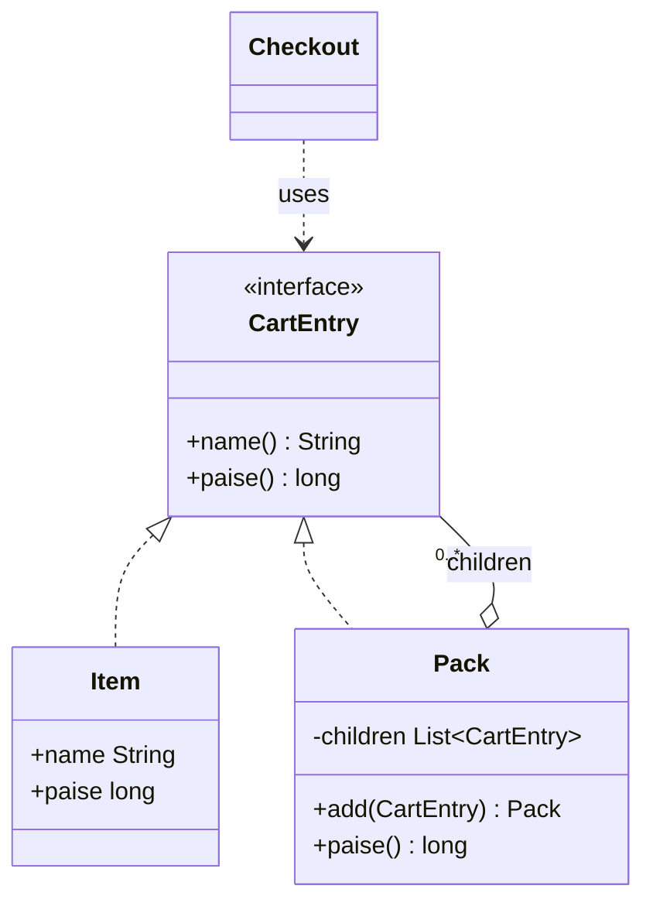
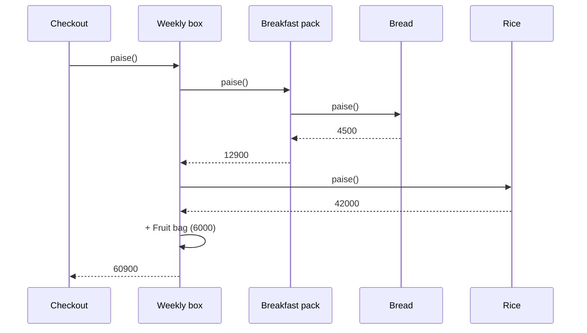

# Composite

<span class="badge-l2">L2 🔵 Practitioner</span> · <span class="read-time">⏱ 35 min read</span> · Prerequisites: [OOP Refresher](../l1-foundations/oop-refresher.md), [Strategy](../l1-foundations/strategy.md)

!!! abstract "TL;DR"
    Composite lets you treat a single object and a group of objects through the same interface, so a tree (a combo pack of items and smaller packs, a category menu, a UI layout) can be priced, counted or drawn with one call on the root. Leaves do the work; composites forward it to their children and combine the results. In modern Java, model the tree as a sealed interface with records and use pattern-matching switches.

## 1. What It Is

**Plain English.** On FreshCart, a customer can buy one banana, or a "Weekly box" that contains a "Breakfast pack" (bread and eggs), a bag of rice and a "Fruit bag". When checkout asks "what does this cost?", it shouldn't care whether the answer comes from one item or a box of boxes. Composite makes "one thing" and "a group of things" answer the same questions.

**Definition (GoF).** "Compose objects into tree structures to represent part-whole hierarchies. Composite lets clients treat individual objects and compositions of objects uniformly." Parts:

- **Component:** the shared interface (`CartEntry` with `price()`).
- **Leaf:** a node with no children that does the real work (`Item`).
- **Composite:** a node with children; it implements the operation by delegating to them and combining results (`Pack`).
- **Client:** code that only talks to `Component`.

## 2. Why It Exists

Without Composite, every piece of code that walks a tree needs `if (x instanceof Item) ... else if (x instanceof Pack) ...`, repeated for price, weight, availability and display. Adding a new kind of node means finding all of those checks. Composite puts the "how do I combine my children" logic in one place per node type, so clients make one call and the recursion happens inside the structure.

## 3. Mental Model / Analogy

**Analogy.** An army's chain of command. A general says "report your headcount". Each officer asks the units below them and adds up the answers; a soldier just says "1". The general doesn't need to know how deep the hierarchy goes.

**Technical model.** A tree where every node implements the same interface. An operation on a composite is a fold over its children: `price(pack) = combine(price(child1), price(child2), ...)`. Leaves are the base case of the recursion.

## 4. How It Works





## 5. Subtopics

### Component, leaf and composite

**Description.** The three roles of the pattern. The **component** declares the operations every node supports. A **leaf** implements them directly. A **composite** holds a list of components (leaves or other composites) and implements each operation by calling it on its children and combining the results.

**Advantages / features.** Clients write one call instead of type checks; trees can be any depth; new leaf types plug in without changing clients.

**Before (type checks everywhere) and after (one interface):**

```java title="ComponentLeafCompositeDemo.java"
--8<-- "examples/l2-practitioner/composite/ComponentLeafCompositeDemo.java"
```

1. Before: the caller knows every shape and recurses itself; every new operation repeats this.
2. The component: what every node in the tree can answer.
3. A leaf: the price is its own.
4. A composite: its price is the sum of its children, which may themselves be composites.

**Run it:** `java ComponentLeafCompositeDemo.java`

```text
--8<-- "examples/l2-practitioner/composite/ComponentLeafCompositeDemo.expected.txt"
```

| Pros | Cons |
|------|------|
| Clients treat one and many the same | The shared interface can get too general |
| Trees of any depth with simple code | Hard to restrict which children a composite may hold |
| New leaf types need no client changes | Deep trees can overflow the stack (see recursive operations) |

**Use it** for real part-whole hierarchies: bundles, menus, folders, org charts, UI layouts, expression trees. **Avoid** it when the data is flat or has a fixed depth of two (an order with lines doesn't need Composite).
**Real-world Java:** `java.awt.Container` extends `Component` and holds `Component`s; JavaFX `Parent`/`Node`; `java.io.File` directories; Spring's `CompositeHealthContributor` and `CompositeCacheManager`.
**Best practice:** keep the component interface small: operations that make sense for every node. **Gotcha:** a composite that returns its mutable child list lets callers change the tree behind its back; return `List.copyOf`.

### Safety vs. transparency

**Description.** Where do child-management methods (`add`, `remove`, `children`) go? **Transparent** design puts them on the component, so all nodes look identical, and leaves throw `UnsupportedOperationException`. **Safe** design puts them only on the composite, so calling `add` on a leaf doesn't compile, but clients must sometimes know which type they hold.

**Advantages / features.** Transparency makes generic tree code (walkers, editors) simpler. Safety moves mistakes from runtime to compile time.

```java title="SafetyVsTransparencyDemo.java"
--8<-- "examples/l2-practitioner/composite/SafetyVsTransparencyDemo.java"
```

1. Transparent: `add` exists on every node; a leaf rejects it only when called.
2. Safe: `add` exists only on the composite type.
3. Transparent design lets generic code walk any node through `children()`.
4. With the safe design, the bug never reaches runtime.

**Run it:** `java SafetyVsTransparencyDemo.java`

```text
--8<-- "examples/l2-practitioner/composite/SafetyVsTransparencyDemo.expected.txt"
```

| Design | Pros | Cons |
|--------|------|------|
| Transparent | Uniform interface; generic traversal | Leaves have methods that throw; violates Interface Segregation |
| Safe | Compiler catches misuse | Clients must downcast or pattern-match to add children |

**Use** the safe design by default in application code, especially with sealed types. **Avoid** transparency unless you're building a generic tree editor or framework.
**Real-world Java:** AWT is "safe" (`add` is on `Container`, not `Component`); `javax.swing.tree.TreeNode` is transparent for reading (`getChildCount`, `isLeaf`) but adding children lives on `MutableTreeNode`.
**Best practice:** make read-only traversal (`children()`) transparent and mutation safe. **Gotcha:** GoF's original sample is transparent; copying it blindly gives you leaves full of `throw new UnsupportedOperationException()`.

### Recursive operations

**Description.** Every Composite operation is recursive: totals (sum children), search (return the path to a match), rendering (indent per level), validation (check each node). Recursion mirrors the tree and is easy to read, but each level uses a stack frame, so very deep or untrusted trees need an iterative walk with an explicit stack.

**Advantages / features.** One short method per operation; the tree's shape drives the algorithm.

```java title="RecursiveOperationsDemo.java"
--8<-- "examples/l2-practitioner/composite/RecursiveOperationsDemo.java"
```

1. Totals: my count plus my children's counts.
2. Search: return the path, built as the recursion unwinds.
3. Rendering: pass the indentation down one level at a time.
4. Iterative depth-first walk with an explicit `Deque`, safe for any depth.

**Run it:** `java RecursiveOperationsDemo.java`

```text
--8<-- "examples/l2-practitioner/composite/RecursiveOperationsDemo.expected.txt"
```

| Approach | Pros | Cons |
|----------|------|------|
| Recursion | Short, mirrors the tree | Stack overflow on very deep trees |
| Explicit stack | Any depth, controllable | More code; post-order is harder |
| Cached results | Fast repeated reads | Invalidation when the tree changes |

**Use** recursion for trees you build yourself (catalogues are rarely more than 5 levels). **Avoid** recursion on trees from user input (uploaded JSON, nested comments) without a depth limit.
**Real-world Java:** `Files.walk` (iterative, with a depth limit), Jackson's `JsonNode` traversal, Spring Security's nested `RequestMatcher`s.
**Best practice:** validate depth when a tree is built from external input. **Gotcha:** computing `productCount()` inside `print()` makes rendering O(n²) on large trees; compute once and pass it down, or cache.

### Composite with sealed interfaces

**Description.** Since Java 17, a `sealed interface` lists every node type, and records make each node immutable. Operations can live outside the nodes as exhaustive `switch` expressions with record patterns (Java 21), so adding an operation doesn't touch the node classes, and adding a node type makes the compiler point to every switch that must handle it.

**Advantages / features.** Immutable trees (thread-safe, no cycles), exhaustive handling checked by the compiler, operations grouped by feature rather than spread across classes.

```java title="SealedCompositeDemo.java"
--8<-- "examples/l2-practitioner/composite/SealedCompositeDemo.java"
```

1. The sealed interface names every node type; nobody else can add one.
2. A compact constructor copies the children, so the tree can't change after creation.
3. An exhaustive `switch`: no `default` branch, so a new node type is a compile error here.
4. Adding a node type tells you every place that must change.

**Run it:** `java SealedCompositeDemo.java`

```text
--8<-- "examples/l2-practitioner/composite/SealedCompositeDemo.expected.txt"
```

| Style | Pros | Cons |
|-------|------|------|
| Classic (methods on nodes) | Easy to add node types | Each new operation touches every node class |
| Sealed + switch | Easy to add operations; compiler checks exhaustiveness | Adding a node type touches every switch (by design) |

**Use** sealed composites for closed domains you own: pricing trees, rule trees, expression ASTs. **Avoid** them when third parties must add node types (plugins); use the classic interface there.
**Real-world Java:** the JDK's `java.lang.classfile` API (Java 24) models class-file elements as sealed interfaces of records, the same shape as this demo.
**Best practice:** keep switches in one place per operation (a `Pricing` class), not scattered. **Gotcha:** a `default` branch silently swallows new node types; leave it out so the compiler helps you. This "operations outside the nodes" style is the modern replacement for [Visitor](visitor.md).

## 6. Examples (exactly 3, progressively harder)

### Example 1: Minimal (L2)

**Scenario:** a delivery box holds products and bags; bags hold products and smaller bags. The dispatcher needs the total weight to choose a vehicle.

```java title="DeliveryBoxDemo.java"
--8<-- "examples/l2-practitioner/composite/DeliveryBoxDemo.java"
```

1. The component: anything that can go into a box has a weight.
2. A bag's weight is its own 15 g plus everything inside it.

**Run it:** `java DeliveryBoxDemo.java`

**Output:**

```text
--8<-- "examples/l2-practitioner/composite/DeliveryBoxDemo.expected.txt"
```

**What to notice:**

- The same `grams()` call works on a product, a bag, or the whole box.
- The dispatcher never checks what kind of thing it holds.

### Example 2: Realistic (in FreshCart grocery delivery)

**Scenario:** the app's category menu is a tree. Each store has different stock, so the menu shows in-stock counts per category and hides categories with nothing to sell.

```java title="CatalogMenuDemo.java"
--8<-- "examples/l2-practitioner/composite/CatalogMenuDemo.java"
```

1. A recursive count: a product counts as 1 if in stock; a category sums its children.
2. Rendering walks the same tree and indents each level.
3. Empty categories are pruned with all their descendants.
4. Stock comes from outside the tree, so one menu tree serves every store.

**Run it:** `java CatalogMenuDemo.java`

**Output:**

```text
--8<-- "examples/l2-practitioner/composite/CatalogMenuDemo.expected.txt"
```

**What to notice:**

- "Exotic" disappeared because its only product was out of stock; "Mango" too.
- The tree itself is immutable; the per-store view is computed.

### Example 3: Production-grade

**Scenario:** festival hampers are bundles of bundles, each with its own discount and a cap on that discount. Requirements: exact money (no `double`), rounding once at the end, validation when merchandisers build a hamper (no empty bundles, no SKU listed twice, at most four levels), "available only if every item is", and an itemised receipt that support staff can read.

```java title="BundlePricingDemo.java"
--8<-- "examples/l2-practitioner/composite/BundlePricingDemo.java"
```

1. Immutable records: once built, a bundle can be shared across threads and can't contain itself.
2. Validation walks the tree once, checking depth and duplicate SKUs across all levels.
3. Pricing recurses: children first, then this bundle's capped discount.
4. The receipt shows each level's subtotal, so a customer complaint can be checked line by line.
5. Bad hampers are rejected with a message a merchandiser can act on.

**Run it:** `java BundlePricingDemo.java`

**Output:**

```text
--8<-- "examples/l2-practitioner/composite/BundlePricingDemo.expected.txt"
```

**What to notice:**

- Sweets got 5% off (28.50), then the whole hamper got 10% off its subtotal (133.05, under the 150 cap).
- One out-of-stock biscuit packet made the whole "Tea time" bundle unavailable.
- Duplicate SKUs were caught even though they were at different levels.

## 7. Pros, Cons & Trade-offs

| Aspect | Pros | Cons |
|--------|------|------|
| Simplicity | One call on the root does the whole tree | Recursion can surprise developers new to it |
| Extensibility | New leaf types without client changes | Restricting child types needs extra checks |
| Correctness | Sealed types make handling exhaustive | Transparent design throws at runtime |
| Performance | Natural divide-and-conquer | Repeated recursive reads are O(n) each; may need caching |
| Safety | Immutable trees are thread-safe | Mutable trees can form cycles |
| Design | Matches real part-whole domains | Over-general component interfaces |

## 8. When to Use / When NOT to Use

**Use it when:**

- the domain is a part-whole hierarchy of varying depth (bundles, menus, folders, org charts);
- clients should treat one item and a group the same way;
- operations combine child results (sum, all/any, render).

**Don't use it when:**

- the structure is flat or has a fixed shape (order → lines);
- leaves and groups need very different operations;
- the "tree" is really a graph with shared nodes and cycles (use a graph model).

## 9. Best Practices

1. **Prefer the safe design**: child management only on composites. *(Consensus in modern Java.)*
2. **Make trees immutable** (records, `List.copyOf`) unless editing is the feature. *(Consensus.)*
3. **Use sealed interfaces and exhaustive switches** for closed domains. *(Consensus since Java 21.)*
4. **Validate trees from outside input**: depth, size, duplicates. *(Consensus.)*
5. **Use exact types for money** (`BigDecimal` or long minor units), rounding once. *(Consensus.)*
6. **Cache expensive aggregates** only with a clear invalidation rule. *(Consensus.)*

## 10. Pitfalls & Anti-Patterns

!!! danger "Recursive bundle (production failure mode)"
    **Symptom:** the catalogue service crashed with `StackOverflowError` whenever a certain hamper was viewed.
    **Root cause:** a mutable `Bundle` was edited in the admin tool, and a merchandiser added the hamper to its own "Gift add-ons" sub-bundle, creating a cycle.
    **Fix:** immutable bundles, or a cycle check on `add` (walk up the parents); validate trees when saving, not when reading.

!!! danger "Leaves full of exceptions"
    **Symptom:** `UnsupportedOperationException` in production from `item.add(...)`.
    **Root cause:** a transparent component interface let a refactor call `add` on a leaf.
    **Fix:** move `add` to the composite type; let the compiler catch it.

!!! danger "Quadratic rendering"
    **Symptom:** the category page took 4 seconds for a large store.
    **Root cause:** each level called `countProducts()` on its subtree while rendering, recomputing the same counts again and again.
    **Fix:** compute counts in one post-order pass, or cache them per immutable tree.

!!! danger "Rounding at every level"
    **Symptom:** hamper prices off by a few paise compared with the merchandiser's spreadsheet.
    **Root cause:** each bundle rounded its discounted price, so rounding errors added up across levels.
    **Fix:** keep full precision through the tree and round once at the end (or agree a documented rule).

## 11. Configuration & Tuning

| Setting | Default | What it does | When to change it | Risk of changing |
|---------|---------|--------------|-------------------|------------------|
| Max tree depth | none | Rejects deeper trees | Always set for external input (e.g. 4–10) | Too low blocks real use cases |
| Max node count | none | Limits tree size | User-generated content | Too low blocks large catalogues |
| Thread stack size (`-Xss`) | ~1 MB (platform-dependent) | Recursion depth limit | Rarely; prefer iterative walks | Memory per thread grows |
| Aggregate cache | off | Stores computed totals | Large, read-heavy trees | Stale totals if tree changes |

## 12. Security Considerations

- Trees from users (nested comments, uploaded JSON, menu imports) are a denial-of-service vector: limit depth and size before walking them. Jackson 2.15+ enforces a default maximum nesting depth (1,000) for this reason.
- Don't trust prices or discounts in a client-sent bundle; rebuild the tree from your catalogue by SKU.
- Validate discount values per node; a negative or 100% discount deep in a tree is easy to miss in review.

## 13. Performance & Scalability

Every aggregate is O(n) in the number of nodes, which is fine for catalogues and menus. Repeated reads on big trees benefit from computing aggregates once per immutable tree (store them in the composite's record when built). Parallel streams over children rarely help; trees are usually small and uneven. For very deep trees, use an explicit stack; for very wide trees (thousands of children), stream children instead of building lists.

## 14. Testing It

Test leaves and composites through the same interface, plus nesting, capping and validation:

```java title="BundlePricingTest.java"
--8<-- "examples/l2-practitioner/composite/BundlePricingTest.java"
```

## 15. Observability & Operations

Log a tree's size and depth when it's loaded or saved, and alert on outliers (a 40-level bundle is almost certainly a data bug). For pricing trees, store the itemised breakdown with the order, so support can explain any total without recomputing it from a catalogue that has since changed.

## 16. Version Notes

| Java | Change relevant to Composite |
|------|------------------------------|
| 1.0 | AWT `Container`/`Component`: the classic Composite in the JDK |
| 10 | `List.copyOf` for cheap immutable child lists |
| 16 | Records: concise immutable nodes |
| 17 | Sealed classes and interfaces (final) |
| 21 | Pattern matching for `switch` and record patterns (final): exhaustive operations outside the nodes |

## 17. Expert Deep Dive

- **Composite + Visitor vs sealed switches.** Classic Composite puts operations in nodes; Visitor moves them out but needs double dispatch. Java 21 sealed types plus pattern matching give Visitor's benefits with far less code; see [Visitor](visitor.md).
- **Persistent trees.** Immutable trees can be "edited" by rebuilding only the path from root to the changed node and sharing the rest. This makes undo, audit history and concurrent reads cheap.
- **Storing trees.** Databases don't store composites natively. Options: adjacency list (`parent_id`, recursive CTE queries), materialised path (`/food/fruit/citrus`), nested sets, or a JSON column for small immutable bundles. Choose by read vs write pattern.
- **Composite in other patterns.** [Interpreter](interpreter.md) ASTs, [Specification](specification.md) (`and`/`or` of rules) and composite health checks are all Composites.

!!! example "War story: the infinite hamper"
    A grocery platform let merchandisers build gift hampers in an admin tool, stored as mutable `Bundle` objects with parent and child links. During a festival rush, someone dragged the "Premium hamper" into its own "Upgrade options" sub-bundle. Saving worked; the next page view recursed until `StackOverflowError`, and because the hamper was on the home page, every app open failed for twelve minutes. **Fixes:** bundles became immutable records validated on save (cycle check, depth ≤ 4, no duplicate SKUs); the home page renders from a cached, validated snapshot; and the admin tool shows a preview that runs the same validation. **Lesson:** a tree you let people edit will eventually become a graph unless you prevent it.

## 18. Interview Corner

=== "🟢 L1–L2"

    1. **What problem does Composite solve?** Treating **single objects and groups the same way** in a tree.
    2. **Name the three roles.** **Component, leaf, composite.**
    3. **Give a JDK example.** **AWT `Container`** holding `Component`s.
    4. **How does a composite implement an operation?** By **calling it on its children and combining** the results.
    5. **Give a FreshCart example.** A **combo pack** containing items and other packs.

=== "🟡 L3"

    1. **Safe vs transparent design?** Transparent puts `add` on every node (**runtime errors**); safe puts it on composites only (**compile-time safety**).
    2. **How do sealed interfaces change Composite?** Operations become **exhaustive switches** outside the nodes; the compiler checks every case.
    3. **How do you avoid stack overflows?** **Depth limits** and **iterative walks** with an explicit stack.
    4. **Composite vs Decorator?** Both are recursive; Decorator wraps **one** object to add behaviour, Composite holds **many** to treat them as one.
    5. **How do you prevent cycles?** **Immutable** trees, or a check on `add` that the new child isn't an ancestor.

=== "🔴 L4–L5"

    1. **How would you store bundle trees in a relational database?** **Adjacency list with recursive CTEs**, materialised paths, or a **JSON column** for immutable bundles; choose by query pattern.
    2. **A tree aggregate is slow on a large catalogue. What do you do?** **Compute once per immutable version**, cache, or precompute on write.
    3. **How do you design an editable tree used by many readers?** **Persistent immutable trees** (path copying) with an atomic root reference.
    4. **How do you handle trees from untrusted input?** **Limits on depth and size**, streaming parsers, rebuild from trusted data.
    5. **When is a tree really a graph?** When nodes are **shared or cyclic**; then use graph algorithms with visited sets, not Composite.

=== "💻 Hands-on"

    **Task:** Add a `weightGrams()` operation to `BundlePricingDemo` without changing the records.

    ??? success "Solution"
        ```java
        // assuming Sku gets a grams component
        static int weightGrams(Line l) {
            return switch (l) {
                case Sku s -> s.grams();
                case Bundle b -> b.lines().stream().mapToInt(BundlePricingDemo::weightGrams).sum();
            };
        }
        ```

## 19. Practice

- [ ] Add a `FreeGift` node (price 0, always available) to `SealedCompositeDemo` and let the compiler show you what to update.
    ??? tip "Hint"
        Add it to `permits`, then fix each switch the compiler complains about.
- [ ] Make `RecursiveOperationsDemo.print` O(n) instead of O(n²).
    ??? tip "Hint"
        Compute counts bottom-up once into a `Map<Category, Integer>`, then render.
- [ ] Add a cycle check to a mutable `Pack.add` that rejects adding an ancestor.
    ??? tip "Hint"
        Give each pack a `parent` link and walk up from `this`.
- [ ] Return the cheapest available item path in `CatalogMenuDemo`.
    ??? tip "Hint"
        Recurse, returning `Optional` of the best path from each child.

## 20. Quick Revision Card

!!! tip "Remember in 30 seconds"
    - Intent: treat one object and a group of objects the same way (part-whole trees).
    - Roles: component (shared interface), leaf (does the work), composite (delegates to children and combines).
    - Prefer the safe design; make trees immutable; validate depth and duplicates.
    - Modern Java: sealed interface + records + exhaustive `switch`.
    - Deep or untrusted trees: limit depth, walk iteratively.

    ```java
    sealed interface Node permits Item, Bundle { }
    record Item(String name, long paise) implements Node { }
    record Bundle(String name, List<Node> kids) implements Node { }

    static long price(Node n) {
        return switch (n) {
            case Item i -> i.paise();
            case Bundle b -> b.kids().stream().mapToLong(X::price).sum();
        };
    }
    ```

## 21. Further Reading

- Gamma, Helm, Johnson, Vlissides, *Design Patterns* (1994), "Composite".
- [JEP 409: Sealed Classes](https://openjdk.org/jeps/409)
- [JEP 441: Pattern Matching for switch](https://openjdk.org/jeps/441)
- [java.awt.Container API documentation](https://docs.oracle.com/en/java/javase/21/docs/api/java.desktop/java/awt/Container.html)
- Eric Freeman and Elisabeth Robson, *Head First Design Patterns* (2nd ed., 2020), chapter 9.

---

[← Previous: Dependency Injection](dependency-injection.md) · [Next: Proxy →](proxy.md)
