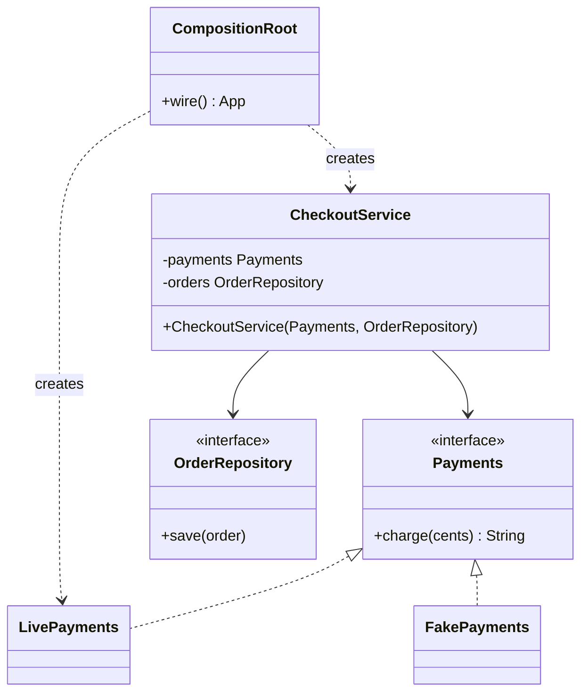
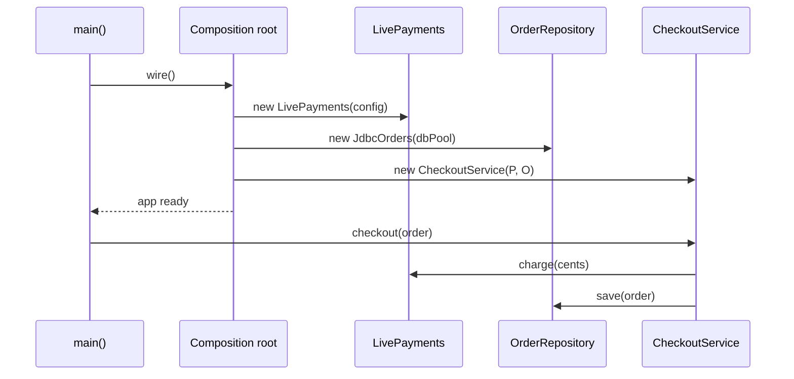

# Dependency Injection

<span class="badge-l2">L2 🔵 Practitioner</span> · <span class="read-time">⏱ 40 min read</span> · Prerequisites: [SOLID Principles](../l1-foundations/solid-principles.md), [Factory Method](../l1-foundations/factory-method.md), [Singleton](../l1-foundations/singleton.md)

!!! abstract "TL;DR"
    Dependency Injection (DI) means an object **receives** the things it needs (repositories, clients, clocks) through its constructor instead of creating or looking them up itself. One place, the **composition root**, builds the object graph. A container such as Spring automates that wiring, but the pattern works fine in plain Java. Prefer constructor injection, avoid Service Locators, and watch scopes: a singleton must never hold a request-scoped object.

## 1. What It Is

**Plain English.** A FreshCart delivery rider doesn't build their own scooter or print their own maps. The hub hands them a scooter, a phone and a route at the start of the shift. The rider just rides. If the hub wants to test a new route app, it hands over a different phone; the rider doesn't change. DI is the hub handing each object what it needs.

**Definition.** Dependency Injection is a technique (named by Martin Fowler in 2004) where "an object's dependencies are supplied by an external party rather than created by the object." Parts:

- **Service** (the dependency): something a class uses, usually behind an interface (`Payments`, `OrderRepository`).
- **Client**: the class that uses it (`CheckoutService`), which declares what it needs in its constructor.
- **Injector**: the code that creates the services and passes them in. This is the **composition root**, either hand-written or a container (Spring, Guice, Dagger).

DI is the most common way to apply the **Dependency Inversion Principle** (the "D" in SOLID): high-level code depends on abstractions, and something outside decides which implementation it gets.

## 2. Why It Exists

When a class does `new LivePaymentGateway()` inside itself, three things go wrong. You can't test it without charging real cards. You can't run it in a different environment (staging, a developer laptop) without editing code. And every class that creates its own dependencies hides how the system is wired, so a change to one constructor ripples everywhere. DI moves all creation to one place, so classes become small, testable, and swappable, and the wiring becomes visible.

## 3. Mental Model / Analogy

**Analogy.** A restaurant kitchen. The chef (client) doesn't grow vegetables or forge knives; the kitchen manager (composition root) stocks the station before service. For a cooking competition (a test), the manager stocks it with measured, fake ingredients, and the chef cooks the same way.

**Technical model.** A directed graph of objects. Each class lists its outgoing edges as constructor parameters. The composition root walks the graph from the leaves (clock, database pool) up to the roots (HTTP handlers), creating each object once its dependencies exist. Containers do exactly that walk automatically, using reflection or generated code.

## 4. How It Works





## 5. Subtopics

### Constructor, setter and field injection

**Description.** There are three ways to hand a dependency to an object. **Constructor injection** passes it as a constructor parameter and stores it in a `final` field. **Setter injection** calls a setter after construction. **Field injection** writes straight into a private field using reflection (what `@Autowired` or `@Inject` on a field does).

**Advantages / features.** Constructor injection makes objects complete and immutable from the moment they exist, documents every dependency in one signature, and needs no framework in tests. Setter injection allows optional or changeable dependencies. Field injection is the shortest to type, and that is its only advantage.

**Before (field injection, hidden needs) and after (constructor injection):**

```java title="InjectionStylesDemo.java"
--8<-- "examples/l2-practitioner/dependency-injection/InjectionStylesDemo.java"
```

1. `final` plus a constructor: the object can't exist without its dependency, and a `null` fails at wiring time with a clear message.
2. Setter injection: the object exists in a half-built state until someone remembers to call the setter.
3. Field injection: nothing in the class's public API says it needs `Payments`.
4. Without a framework, even a unit test must use reflection to fill the field.

**Run it:** `java InjectionStylesDemo.java`

```text
--8<-- "examples/l2-practitioner/dependency-injection/InjectionStylesDemo.expected.txt"
```

| Style | Pros | Cons |
|-------|------|------|
| Constructor | Immutable, always complete, test with `new`, cycles fail fast | Long parameter lists are visible (which is a useful warning) |
| Setter | Optional dependencies, can be changed later | Half-built objects, mutable, easy to forget |
| Field | Least typing | Hidden dependencies, needs reflection, can't be `final`, hides "too many dependencies" |

**Use** constructor injection by default; setter injection only for genuinely optional dependencies. **Avoid** field injection in production code (it's tolerable in test classes, where JUnit or Spring creates the instance).
**Real-world Java:** Spring recommends constructor injection and, since Spring 4.3, needs no `@Autowired` on a single constructor; Java records make constructor injection a one-liner.
**Best practice:** if a constructor needs more than about five dependencies, the class is doing too much; split it. **Gotcha:** Lombok's `@RequiredArgsConstructor` only covers `final` fields; forget `final` and the dependency is silently `null`.

### Composition root

**Description.** The composition root is the single place, as close to `main` as possible, where the whole object graph is built. Every other class only receives dependencies; only the root knows concrete classes such as `JdbcOrders` or `LivePayments`.

**Advantages / features.** One file shows how the system is assembled; shared objects (one repository, one clock) are created once and passed to everyone who needs them; swapping an implementation is a one-line change.

```java title="CompositionRootDemo.java"
--8<-- "examples/l2-practitioner/dependency-injection/CompositionRootDemo.java"
```

1. Business classes take interfaces and a `Clock`; they contain no `new` for their collaborators.
2. `App.wire()` is the composition root: the only method that knows every concrete class.
3. One repository instance is shared by both services, which is how they see the same data.

**Run it:** `java CompositionRootDemo.java`

```text
--8<-- "examples/l2-practitioner/dependency-injection/CompositionRootDemo.expected.txt"
```

| Pros | Cons |
|------|------|
| Wiring visible in one place | The root grows with the application |
| Easy to swap implementations per environment | Manual wiring is boilerplate in large apps |
| Business code has no framework imports | Startup order must be managed by hand |

**Use** a hand-written root for libraries, CLIs, small services and Lambdas. **Avoid** creating dependencies anywhere else, such as inside business methods.
**Real-world Java:** in Spring Boot, the `@SpringBootApplication` class plus `@Configuration` classes are the composition root; in Dagger it's the `@Component`.
**Best practice:** inject a `Clock`, random source and ID generator too, so time and randomness are testable. **Gotcha:** calling `App.wire()` twice creates two separate graphs; singletons are "one per graph", not one per JVM.

### Service Locator and why it's an anti-pattern

**Description.** A Service Locator is a global registry that classes call to **fetch** their dependencies (`ServiceLocator.get(Payments.class)`). It decouples a class from concrete implementations, like DI, but the class still reaches out to a global object.

**Advantages / features (why people used it).** No constructor changes when a new dependency appears; works in code where you don't control construction (old frameworks, plugins).

**Before (locator) and after (DI):**

```java title="ServiceLocatorDemo.java"
--8<-- "examples/l2-practitioner/dependency-injection/ServiceLocatorDemo.java"
```

1. A static map of type to implementation: global mutable state.
2. The class's dependency is hidden inside a method body; you learn about it only when it fails at runtime.
3. With DI, the record's components list everything it needs, and each test passes its own fake.

**Run it:** `java ServiceLocatorDemo.java`

```text
--8<-- "examples/l2-practitioner/dependency-injection/ServiceLocatorDemo.expected.txt"
```

| Pros | Cons |
|------|------|
| Decouples from concrete classes | Hidden dependencies: the API lies about what a class needs |
| Easy to add to old code | Missing registrations found at runtime, not at startup |
| | Global state: tests leak into each other and can't run in parallel |

**Use** a locator only at framework edges where you can't control construction, and immediately pass what you looked up into constructors. **Avoid** it in business code.
**Real-world Java:** JNDI lookups in old Java EE code, `ServiceLoader` (fine for discovering plugins, not for wiring), calling `applicationContext.getBean(...)` inside services (the same anti-pattern in Spring).
**Best practice:** treat `getBean` calls in business code as a code smell. **Gotcha:** a locator wrapped in an injected `ServiceProvider` interface is still a locator; the constructor still doesn't say what's used.

### DI containers: Spring, Guice, Dagger

**Description.** A DI container automates the composition root. You declare bindings ("`Payments` is `LivePayments`"), and the container finds constructors, resolves parameters by type, caches singletons and detects cycles. **Spring** and **Guice** do this at runtime with reflection; **Dagger** (and Micronaut, Quarkus ArC, Spring AOT) generate the wiring code at compile or build time.

**Advantages / features.** Less wiring code, scopes and lifecycles built in, and extras such as configuration binding, AOP proxies (`@Transactional`) and profiles.

This is what a container does at its core, in about 40 lines:

```java title="MiniContainerDemo.java"
--8<-- "examples/l2-practitioner/dependency-injection/MiniContainerDemo.java"
```

1. Bindings map an interface to an implementation; unbound concrete classes are used as-is.
2. Track the types being built; meeting one again means a cycle, reported with the path.
3. Pick the constructor (Spring picks the only one or the `@Autowired` one).
4. Resolve each parameter recursively by type: that's "autowiring".

**Run it:** `java MiniContainerDemo.java`

```text
--8<-- "examples/l2-practitioner/dependency-injection/MiniContainerDemo.expected.txt"
```

| Container | How it wires | Strengths | Weaknesses |
|-----------|--------------|-----------|------------|
| Spring | Runtime reflection (plus AOT for native images) | Huge ecosystem, profiles, AOP, Boot auto-config | Startup time, "magic" when auto-config surprises you |
| Guice | Runtime reflection, Java modules | Small, explicit modules | Smaller ecosystem today |
| Dagger | Compile-time code generation | Errors at compile time, fast startup, Android standard | More annotations, slower builds |
| Hand-written | Plain `new` | No magic, no dependency | Boilerplate in large graphs |

**Use** the container your framework already ships (Spring Boot, Quarkus, Micronaut, Dagger on Android). **Avoid** adding a container to a small library or CLI.
**Real-world Java:** Spring's `DefaultListableBeanFactory`, Guice's `Injector`, Dagger's generated `DaggerAppComponent`, Jakarta CDI.
**Best practice:** keep business classes free of container annotations where you can, so the same class works with `new` in tests. **Gotcha:** Spring Boot 2.6+ fails on circular references by default; don't re-enable them, fix the design.

### Scopes and lifecycles

**Description.** A **scope** decides how many instances exist and how long they live: **singleton** (one per container), **prototype** (new on every request for it), **request** or **session** (one per HTTP request or user session). A **lifecycle** is create → initialise → use → destroy; containers call `@PostConstruct` and `@PreDestroy` and close singletons in reverse creation order.

**Advantages / features.** Expensive shared objects are created once; per-request data stays separate; resources are released cleanly on shutdown.

**The trap and the fix:**

```java title="ScopesDemo.java"
--8<-- "examples/l2-practitioner/dependency-injection/ScopesDemo.java"
```

1. A singleton that takes the request context directly keeps the first request's object forever.
2. Inject a provider (`Supplier`, Spring's `ObjectProvider`, Jakarta's `Provider<T>`) and ask for the current one on each call.
3. The "current request" is usually tracked per thread (Spring uses request attributes bound to the thread).
4. Shut down in reverse order, so nothing is closed while something that depends on it still runs.

**Run it:** `java ScopesDemo.java`

```text
--8<-- "examples/l2-practitioner/dependency-injection/ScopesDemo.expected.txt"
```

| Scope | Instances | Typical use | Danger |
|-------|-----------|-------------|--------|
| Singleton | One per container | Services, repositories, clients | Must be thread-safe and stateless per user |
| Prototype | New each lookup | Stateful helpers, builders | Container doesn't destroy them |
| Request | One per HTTP request | Current user, correlation ID | Injected into a singleton without a proxy or provider |
| Session | One per user session | Shopping cart (rarely today) | Memory per user, breaks horizontal scaling |

**Use** singletons for stateless services (most beans). **Avoid** storing per-user state in singleton fields.
**Real-world Java:** Spring's `@Scope("request")` with scoped proxies, `ObjectProvider<T>`, Jakarta CDI `@RequestScoped`.
**Best practice:** pass request data as method arguments where possible; use request scope only for cross-cutting context. **Gotcha:** with virtual threads or `@Async`, thread-bound request context doesn't follow the work; pass it explicitly or use `ScopedValue` (preview in Java 21).

## 6. Examples (exactly 3, progressively harder)

### Example 1: Minimal (L2)

**Scenario:** `OrderService` checks stock and sends an SMS. Production and a test give it different dependencies.

```java title="OrderServiceWiringDemo.java"
--8<-- "examples/l2-practitioner/dependency-injection/OrderServiceWiringDemo.java"
```

1. The service declares its needs in the constructor and never creates them.
2. The test passes fakes: everything out of stock, SMS messages recorded in a list.

**Run it:** `java OrderServiceWiringDemo.java`

**Output:**

```text
--8<-- "examples/l2-practitioner/dependency-injection/OrderServiceWiringDemo.expected.txt"
```

**What to notice:**

- The same `OrderService` code behaved differently only because it was given different collaborators.
- No mocking library and no framework were needed.

### Example 2: Realistic (in FreshCart grocery delivery)

**Scenario:** checkout charges a payment provider, sends an SMS and stores an invoice. Developers run with fakes, staging uses sandboxes, production uses live services. Each environment is a **module**: a complete, consistent set of bindings, like a Spring profile.

```java title="EnvironmentWiringDemo.java"
--8<-- "examples/l2-practitioner/dependency-injection/EnvironmentWiringDemo.java"
```

1. `CheckoutService` doesn't know which environment it's in.
2. A module groups bindings that belong together, so you can't accidentally mix live payments with staging storage.
3. The composition root picks a module by name and fails fast on an unknown one.
4. A test starts from a module and overrides one binding.

**Run it:** `java EnvironmentWiringDemo.java`

**Output:**

```text
--8<-- "examples/l2-practitioner/dependency-injection/EnvironmentWiringDemo.expected.txt"
```

**What to notice:**

- Adding an environment means adding a module, not editing `CheckoutService`.
- The test override replaced payments only; SMS and storage came from the dev module.

### Example 3: Production-grade

**Scenario:** a plain-Java service (no framework, for example an AWS Lambda where startup time matters) needs what a container gives: singletons and per-request objects, **startup validation** that reports every missing binding and cycle at once, eager creation in dependency order, shutdown in reverse order, and per-test overrides.

```java title="AppContainerDemo.java"
--8<-- "examples/l2-practitioner/dependency-injection/AppContainerDemo.java"
```

1. Bindings are typed factories plus declared dependencies: no reflection, so it's fast and works in native images.
2. Validation runs before anything is created: missing bindings and cycles are collected and reported together.
3. Singletons are created eagerly at startup, so a broken configuration fails the deploy, not the first customer.
4. Shutdown closes singletons in reverse creation order; one failing `close()` doesn't stop the others.
5. Application classes have plain constructors; all wiring lives in `production()`.

**Run it:** `java AppContainerDemo.java`

**Output:**

```text
--8<-- "examples/l2-practitioner/dependency-injection/AppContainerDemo.expected.txt"
```

**What to notice:**

- Each request got a fresh `RequestInfo`, but every request shared one `CheckoutService`.
- `Payments` was closed before `DbPool`, the reverse of creation.
- The broken container reported the missing binding and the cycle (from both ends) in a single error, before serving any traffic.

## 7. Pros, Cons & Trade-offs

| Aspect | Pros | Cons |
|--------|------|------|
| Testability | Fakes passed with `new`; no global state | Tests may over-mock if every class has an interface |
| Flexibility | Swap implementations per environment | Indirection: "which implementation runs here?" |
| Readability | Constructors document dependencies | Container wiring can feel like magic |
| Design | Exposes classes with too many dependencies | Interfaces created only for DI add noise |
| Performance | Objects created once and shared | Reflection-based containers slow startup |
| Operability | Startup validation catches wiring errors early | Container errors can be long and confusing |

## 8. When to Use / When NOT to Use

**Use it when:**

- a class talks to anything external (database, HTTP, file system, clock, randomness);
- you need different implementations in tests or environments;
- several classes share one instance (a connection pool, a cache).

**Don't use it when:**

- the dependency is a value object or pure utility (`String`, `List`, `Money`, `Math`); just use it;
- you'd create an interface with exactly one implementation and no test need;
- a tiny script or a one-class program; `new` is fine.

## 9. Best Practices

1. **Constructor injection with `final` fields.** *(Consensus; Spring's own recommendation.)*
2. **One composition root**; business code never calls `new` on services or `getBean`. *(Consensus.)*
3. **Validate the graph at startup** (eager singletons, Spring's default) so wiring errors fail the deploy. *(Consensus.)*
4. **Inject `Clock`, ID generators and random sources** to make time-based code testable. *(Consensus.)*
5. **Keep business classes free of container annotations** where your framework allows it. *(Opinion; common in hexagonal architecture.)*
6. **Use providers for shorter-lived scopes** inside singletons. *(Consensus.)*
7. **Treat a large constructor as a design signal**, not a reason to switch to field injection. *(Consensus.)*

## 10. Pitfalls & Anti-Patterns

!!! danger "Request data leaking between customers (production failure mode)"
    **Symptom:** after a refactor, some customers saw another customer's delivery address on the checkout page under load.
    **Root cause:** a singleton `CheckoutPresenter` stored the "current customer" in a field set at the start of each request; two concurrent requests overwrote each other.
    **Fix:** pass customer data as method arguments, or inject a request-scoped provider; add a concurrency test with two simultaneous requests.

!!! danger "Field injection hiding a god class"
    **Symptom:** a service with 18 `@Autowired` fields that nobody can unit-test.
    **Root cause:** field injection made adding dependencies free, so responsibilities piled up.
    **Fix:** switch to constructor injection; the long constructor shows where to split.

!!! danger "Circular dependency"
    **Symptom:** `The dependencies of some of the beans in the application context form a cycle` at startup (Spring Boot 2.6+).
    **Root cause:** `OrderService` needs `PaymentService` and `PaymentService` needs `OrderService`.
    **Fix:** extract the shared logic into a third class, or replace one direction with an event. Don't set `spring.main.allow-circular-references=true`.

!!! danger "`new` inside a Spring bean"
    **Symptom:** `@Transactional` or `@Cacheable` on a class "doesn't work".
    **Root cause:** the object was created with `new`, so the container never wrapped it in a proxy.
    **Fix:** let the container create beans that need container features; inject them.

## 11. Configuration & Tuning

| Setting | Default | What it does | When to change it | Risk of changing |
|---------|---------|--------------|-------------------|------------------|
| `spring.main.lazy-initialization` | `false` | Create beans on first use | Faster startup for dev tools | Wiring errors appear at first request, in production |
| `spring.main.allow-circular-references` | `false` (Boot 2.6+) | Allow cycles via field/setter injection | Almost never | Hides a design problem; half-built beans |
| `@Lazy` on one injection point | off | Inject a proxy, create on first use | Break a rare legitimate cycle, expensive optional bean | Errors move to runtime |
| `@Profile` / modules | none | Choose bindings per environment | Dev, test, staging, prod differences | Untested production-only bindings |
| Spring AOT / GraalVM native | off | Pre-compute wiring at build time | Serverless, fast startup | Reflection needs hints |

## 12. Security Considerations

- Never let configuration or user input choose which class to instantiate by name (`Class.forName(userValue)`); bind a fixed set of implementations.
- Make sure fake or test bindings (fake payments, no-op auth) can't load in production: put them in test source sets, and fail startup if a "fake" bean exists with the prod profile.
- Singletons are shared across users: never store user data, tokens or locale in their fields.
- Secrets are dependencies too: inject them from a secrets manager at the composition root rather than reading environment variables deep inside classes.

## 13. Performance & Scalability

DI itself costs nothing at runtime: after wiring, calls are ordinary method calls. The cost is at **startup**: reflection-based containers scan the classpath and build proxies (seconds for a large Spring app). Options: compile-time DI (Dagger, Micronaut, Quarkus), Spring AOT, or GraalVM native images. Prefer eager singletons in long-running services (pay once at startup) and keep request-scoped objects light, because they are created on every request.

## 14. Testing It

With constructor injection, a unit test is just `new` plus fakes. For the container itself, test scopes, overrides, validation and shutdown order:

```java title="AppContainerTest.java"
--8<-- "examples/l2-practitioner/dependency-injection/AppContainerTest.java"
```

In Spring, keep most tests as plain unit tests; use `@SpringBootTest` (or slices like `@WebMvcTest`) to check the wiring, and `@MockitoBean` (Spring Boot 3.4+, replacing `@MockBean`) to override one bean.

## 15. Observability & Operations

Log the active profile and the key bindings at startup ("payments=LivePayments, sms=TextBlastClient"), so an incident responder can see which implementation was running. Spring Boot's `/actuator/beans` endpoint lists every bean and its dependencies, and `/actuator/startup` shows slow bean creation. Track startup time as a metric; a jump often means a new heavy bean or a classpath scan.

## 16. Version Notes

| Version | Change relevant to DI |
|---------|-----------------------|
| Java EE 6 / JSR-330 (2009) | Standard `@Inject`, `@Named`, `Provider<T>` |
| Spring 4.3 | Single constructor needs no `@Autowired` |
| Spring Boot 2.6 | Circular references prohibited by default |
| Java 16 | Records: concise constructor injection |
| Spring Boot 3 / Jakarta EE 9+ | `javax.inject` → `jakarta.inject` |
| Spring Boot 3.4 | `@MockitoBean` replaces `@MockBean` |
| Java 21 | `ScopedValue` (preview) for request context with virtual threads |

## 17. Expert Deep Dive

- **DI is about the graph, not the container.** Seniors can explain an app's object graph without the framework: which singletons exist, what is per request, and who owns shutdown. If you can't draw it, the container is hiding too much.
- **Pure DI vs container.** Hand-written wiring (sometimes called "pure DI") gives compile-time safety and zero startup cost; containers win when you need AOP, configuration binding and an ecosystem. Many teams use Spring for the web layer and keep the domain container-free.
- **Interfaces aren't mandatory.** DI works with concrete classes; add an interface where there are real alternatives (a fake, a second provider), not for every class.
- **Modules as boundaries.** In large systems, each bounded context exposes one wiring module and keeps its internals package-private. That turns the composition root into an architecture diagram; see [Architectural Patterns](../l4-senior/architectural-patterns.md).

!!! example "War story: the fake that went live"
    A grocery company's checkout service used Spring profiles: `dev` bound a `FakePaymentGateway` that approved every charge. A deployment script for a new region forgot to set `SPRING_PROFILES_ACTIVE`, Spring started with the default profile, and a misplaced `@Profile("!prod")` meant the fake loaded. For forty minutes orders were "paid" without any charge. **Fixes:** fake implementations moved to the test source set; startup fails if no profile is set; a startup check refuses to run when any bean's class name contains `Fake` outside tests; and the payment provider's daily settlement report is reconciled automatically. **Lesson:** wiring is code; test your production wiring as seriously as your business logic.

## 18. Interview Corner

=== "🟢 L1–L2"

    1. **What is Dependency Injection?** An object **receives its dependencies** from outside instead of creating them.
    2. **Name three injection styles.** **Constructor, setter, field.** Prefer **constructor**.
    3. **Why does DI help testing?** You can pass **fakes** through the constructor without global state or frameworks.
    4. **What is a Spring bean's default scope?** **Singleton** (one per application context).
    5. **DI vs Dependency Inversion?** Inversion is the **principle** (depend on abstractions); DI is a **technique** to achieve it.

=== "🟡 L3"

    1. **Why is Service Locator considered an anti-pattern?** **Hidden dependencies**, runtime failures, **global state** that couples tests.
    2. **What is a composition root?** The **single place** near `main` where the object graph is built.
    3. **How do you inject a request-scoped bean into a singleton?** A **provider** (`ObjectProvider`, `Provider<T>`) or a **scoped proxy**.
    4. **Why did Spring Boot ban circular references?** Cycles need **half-built objects** and signal a design problem.
    5. **Why might `@Transactional` not work on a method?** **Self-invocation** or the object was **created with `new`**, so no proxy.

=== "🔴 L4–L5"

    1. **Runtime reflection vs compile-time DI: how do you choose?** **Startup time, native images, compile-time safety** vs ecosystem and AOP; serverless favours compile-time.
    2. **How do you stop test fakes from reaching production?** **Separate source sets**, startup assertions, required profiles, **reconciliation** as a last line.
    3. **Design wiring for a modular monolith.** **One module per bounded context**, package-private internals, a public API, a top-level root that composes modules.
    4. **A service takes 40 s to start. What do you look at?** **Classpath scanning, eager heavy beans, auto-configuration**, `/actuator/startup`; consider AOT or lazy init with care.
    5. **When would you not use a DI container?** **Libraries, CLIs, small Lambdas**, and domain modules that should stay framework-free.

=== "💻 Hands-on"

    **Task:** In `AppContainerDemo`, make `start()` report each cycle only once.

    ??? success "Solution"
        ```java
        private void findCycle(Class<?> t, List<Class<?>> path, List<String> problems, Set<Set<Class<?>>> seen) {
            if (path.contains(t)) {
                List<Class<?>> cycle = path.subList(path.indexOf(t), path.size());
                if (seen.add(new HashSet<>(cycle))) {           // same members = same cycle
                    problems.add("cycle: " + cycle.stream().map(Class::getSimpleName).collect(joining(" -> ")) + " -> " + t.getSimpleName());
                }
                return;
            }
            Binding b = bindings.get(t);
            if (b == null) return;
            path.add(t);
            b.deps().forEach(d -> findCycle(d, path, problems, seen));
            path.remove(path.size() - 1);
        }
        ```

## 19. Practice

- [ ] Rewrite a class from one of your projects that uses field injection to use constructor injection, and count its dependencies.
    ??? tip "Hint"
        More than five constructor parameters usually means two classes are hiding inside one.
- [ ] Add a `Clock` to `OrderServiceWiringDemo` and write a test that orders placed after 22:00 are scheduled for the next morning.
    ??? tip "Hint"
        `Clock.fixed(Instant.parse("2026-11-02T22:30:00Z"), ZoneOffset.UTC)`.
- [ ] Add a `test` module to `EnvironmentWiringDemo` and make `wire("prod")` fail if any binding is a fake.
    ??? tip "Hint"
        Mark fakes with an interface such as `TestOnly` and check with `instanceof` in the root.
- [ ] Extend `MiniContainerDemo` with a prototype scope.
    ??? tip "Hint"
        Keep a set of prototype types and skip the singleton cache for them.

## 20. Quick Revision Card

!!! tip "Remember in 30 seconds"
    - DI: objects **receive** dependencies; one **composition root** builds the graph.
    - Prefer **constructor injection** with `final` fields; avoid field injection and Service Locators.
    - Containers (Spring, Guice, Dagger) automate wiring; compile-time ones start faster.
    - Scopes: singleton (default), prototype, request, session. Never hold a request object in a singleton; inject a provider.
    - Validate wiring at startup; close singletons in reverse order; keep fakes out of production.

    ```java
    @Service
    class CheckoutService {
        private final Payments payments;
        private final OrderRepository orders;
        CheckoutService(Payments payments, OrderRepository orders) {   // no @Autowired needed
            this.payments = payments;
            this.orders = orders;
        }
    }
    ```

## 21. Further Reading

- [Martin Fowler: Inversion of Control Containers and the Dependency Injection pattern](https://martinfowler.com/articles/injection.html)
- [Spring Framework reference: Dependency Injection](https://docs.spring.io/spring-framework/reference/core/beans/dependencies/factory-collaborators.html)
- Mark Seemann and Steven van Deursen, *Dependency Injection: Principles, Practices, and Patterns* (2019).
- [Dagger documentation](https://dagger.dev/dev-guide/)
- [JSR-330: Dependency Injection for Java](https://jcp.org/en/jsr/detail?id=330)

---

[← Previous: Object Pool](object-pool.md) · [Next: Composite →](composite.md)
