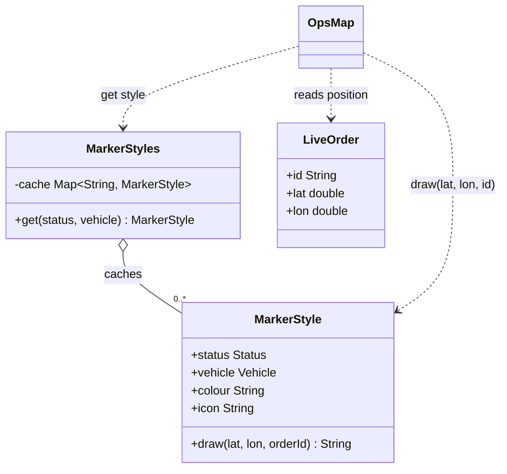
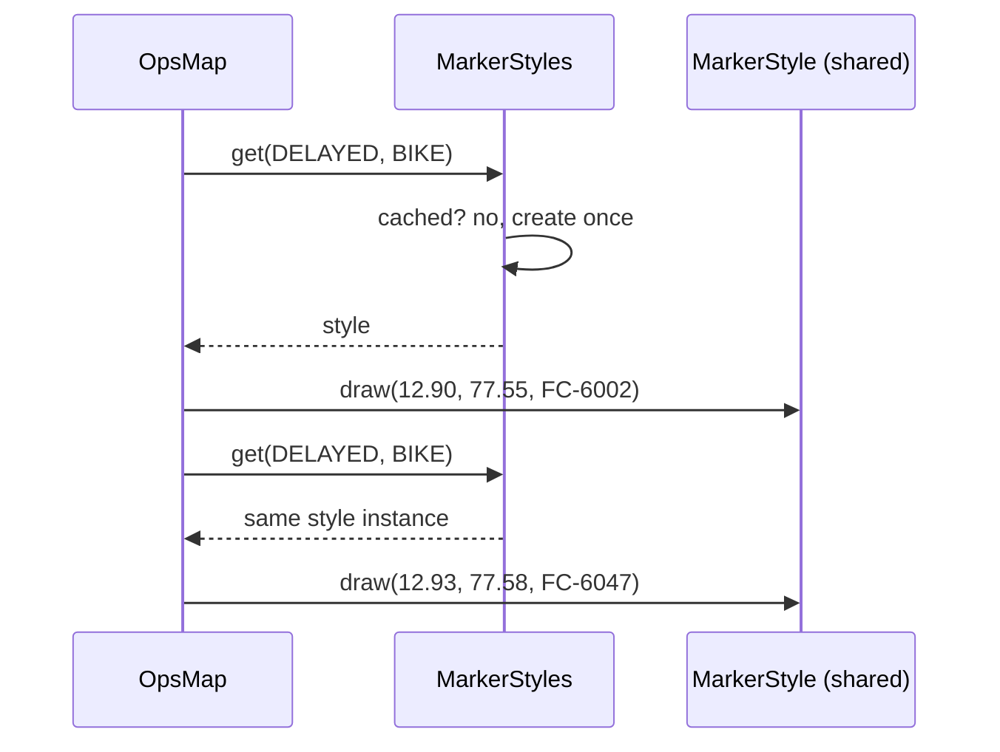

# Flyweight

<span class="badge-l2">L2 🔵 Practitioner</span> · <span class="read-time">⏱ 30 min read</span> · Prerequisites: [Factory Method](../l1-foundations/factory-method.md), [Immutability](../l1-foundations/oop-refresher.md)

!!! abstract "TL;DR"
    Flyweight saves memory when you have huge numbers of similar objects: split each object's data into **intrinsic** state (the same for many objects, immutable, shared) and **extrinsic** state (unique per use, kept outside or passed in). A factory hands out one shared instance per intrinsic value. The JDK uses it for `Integer.valueOf`, `Boolean.TRUE` and the String pool, which is also why `==` on boxed numbers is a classic bug. Measure first: it only pays off with many objects and repeated, heavy intrinsic data.

## 1. What It Is

**Plain English.** FreshCart's operations map shows 5,000 live orders. Each marker needs an icon and a colour, and there are only nine combinations (three statuses × three vehicle types). Loading a separate icon image for every order would waste memory; instead, nine shared marker styles are drawn at 5,000 different positions. The style is the flyweight; the position is passed in when drawing.

**Definition (GoF).** "Use sharing to support large numbers of fine-grained objects efficiently." Parts:

- **Flyweight:** an immutable object holding intrinsic (shareable) state, with operations that take extrinsic state as parameters.
- **Flyweight factory:** creates and caches flyweights by key, returning the existing instance when one exists.
- **Client:** stores or computes extrinsic state and passes it to the flyweight.
- **Intrinsic state:** independent of context, shared (font, icon, unit of measure).
- **Extrinsic state:** depends on context, not shared (position, quantity, order ID).

## 2. Why It Exists

Memory is finite, and garbage collection time grows with the live heap. When an application holds hundreds of thousands of objects that each carry a copy of the same heavy data (a decoded image, a set of strings, a lookup table), most of the heap is duplicates. Sharing one immutable copy turns O(n) duplicated data into O(distinct values), which can be the difference between fitting in a 512 MB container and running out of memory.

## 3. Mental Model / Analogy

**Analogy.** A printing press's movable type. A page has thousands of letters, but the printer owns a few copies of each letter shape. The shape (intrinsic) is shared; where it sits on the page (extrinsic) is decided when the page is set.

**Technical model.** A `Map<Key, Flyweight>` behind a factory method. Clients hold references to shared flyweights plus their own small extrinsic fields. Correctness depends on immutability: if a shared flyweight could change, every user would see the change.

## 4. How It Works





## 5. Subtopics

### Intrinsic vs. extrinsic state

**Description.** The core design decision. Intrinsic state is the same across many objects and doesn't depend on where or how the object is used; it goes into the shared flyweight. Extrinsic state differs per use; it stays in the client (a small object or array) or is passed as a method parameter.

**Advantages / features.** Duplicated heavy data disappears; flyweights are immutable and therefore thread-safe; the client objects become tiny.

**Before (every line carries a copy) and after (shared details, small lines):**

```java title="IntrinsicExtrinsicDemo.java"
--8<-- "examples/l2-practitioner/flyweight/IntrinsicExtrinsicDemo.java"
```

1. Intrinsic: name, category and the thumbnail are the same for every line of the same product.
2. Extrinsic: quantity and order ID are unique per line and stay in the small record.
3. Operations combine both: shared details plus the line's own data.

**Run it:** `java IntrinsicExtrinsicDemo.java`

```text
--8<-- "examples/l2-practitioner/flyweight/IntrinsicExtrinsicDemo.expected.txt"
```

| Pros | Cons |
|------|------|
| Duplicated data stored once | Extra indirection to reach shared data |
| Flyweights immutable and thread-safe | Splitting state can make the model less obvious |
| Smaller, faster-to-scan heaps | Extrinsic state must be supplied correctly every time |

**Use it** when many objects share heavy, immutable data. **Avoid** it when the "shared" part is small (a few fields); the reference costs about as much as the data.
**Real-world Java:** JPA entities referencing shared enum or reference-data entities, `java.awt.Font` objects shared by many text components, `Charset` instances.
**Best practice:** make the intrinsic type a `record` with no setters. **Gotcha:** a "shared" object with even one mutable field (a cached computed price) leaks changes between all users.

### Flyweight factory

**Description.** The factory owns the cache and guarantees "at most one instance per key". In concurrent code, `ConcurrentHashMap.computeIfAbsent` creates each flyweight exactly once without explicit locks. Invalid keys should fail before anything is cached.

**Advantages / features.** One place controls creation; callers can't accidentally create duplicates; thread-safe sharing with a single call.

```java title="FlyweightFactoryDemo.java"
--8<-- "examples/l2-practitioner/flyweight/FlyweightFactoryDemo.java"
```

1. The flyweight: a small immutable record.
2. `computeIfAbsent` runs the creation function at most once per key, even under heavy concurrency.
3. An exception inside the function leaves nothing in the cache, so bad keys don't pollute it.

**Run it:** `java FlyweightFactoryDemo.java`

```text
--8<-- "examples/l2-practitioner/flyweight/FlyweightFactoryDemo.expected.txt"
```

| Factory style | Pros | Cons |
|---------------|------|------|
| Enum constants | Fixed set, zero code | Only for values known at compile time |
| `EnumMap` / `Map.of` prebuilt | Simple, no locking | Fixed set |
| `ConcurrentHashMap.computeIfAbsent` | Lazy, thread-safe, open set | Unbounded unless capped |
| Caffeine / weak-value cache | Bounded, evicts unused values | Library dependency; identity may change after eviction |

**Use** enums for small fixed sets and a concurrent map for open sets with a known upper bound. **Avoid** unbounded caches keyed by user input.
**Real-world Java:** `Integer.valueOf`, `Charset.forName`, `ZoneId.of` (caches region data), Guava `Interners.newWeakInterner()`.
**Best practice:** make constructors private (or package-private) so only the factory creates flyweights. **Gotcha:** don't do slow work or call `computeIfAbsent` on the same map recursively inside the mapping function; it can block other threads or throw `IllegalStateException`.

### Integer cache and String interning

**Description.** The JDK's best-known flyweights. `Integer.valueOf` (and autoboxing) returns cached instances for -128 to 127; `Boolean.valueOf` returns `TRUE`/`FALSE`; string literals are interned in the String pool, and `String.intern()` adds runtime strings to it. Because of these caches, `==` on boxed values or strings sometimes works and sometimes doesn't, which is a classic bug.

**Advantages / features.** Less allocation for common small values and constant strings, without any code from you.

```java title="IntegerCacheStringInternDemo.java"
--8<-- "examples/l2-practitioner/flyweight/IntegerCacheStringInternDemo.java"
```

1. Autoboxing calls `Integer.valueOf`, which returns cached instances only in -128..127.
2. `Boolean.valueOf` always returns one of two shared constants; never use `new Boolean`.
3. Compile-time string literals are interned; `new String` creates a separate copy.
4. Strings built at runtime (parsed, concatenated) are not interned: compare with `equals`.

**Run it:** `java IntegerCacheStringInternDemo.java`

```text
--8<-- "examples/l2-practitioner/flyweight/IntegerCacheStringInternDemo.expected.txt"
```

| Cache | Range / scope | Configurable | Trap |
|-------|---------------|--------------|------|
| `Integer`, `Short`, `Long`, `Byte`, `Character` | -128..127 (Character 0..127) | `Integer` upper bound via `-XX:AutoBoxCacheMax` | `==` works in tests with small IDs, fails in production |
| `Boolean` | `TRUE`, `FALSE` | No | `new Boolean` (deprecated) bypasses it |
| String pool | Literals and `intern()` | Pool table size (`-XX:StringTableSize`) | `==` works for literals only |

**Use** `equals` for all value comparisons; let the JDK caches be an invisible optimisation. **Avoid** `intern()` as a general memory fix; G1 string deduplication or your own interner is safer.
**Real-world Java:** `Integer.valueOf`, `String.intern`, G1's `-XX:+UseStringDeduplication`, JDK 9 compact strings (Latin-1 strings take 1 byte per char).
**Best practice:** enable static analysis rules for `==` on boxed types and strings (SpotBugs, Error Prone). **Gotcha:** deprecated wrapper constructors (`new Integer(5)`) are marked for removal since Java 16 and bypass the cache.

### Measuring the memory win

**Description.** Flyweight is an optimisation, so prove it pays. First estimate: number of objects × size of the duplicated part. Then measure: heap after GC with and without sharing, a heap histogram (`jcmd <pid> GC.class_histogram`), or exact object sizes with JOL (Java Object Layout). Only adopt the pattern when the saving is significant.

**Advantages / features.** Avoids complicating code for no gain; gives numbers for a design review.

```java title="MeasuringMemoryDemo.java"
--8<-- "examples/l2-practitioner/flyweight/MeasuringMemoryDemo.java"
```

1. `System.gc()` is only a hint; calling it a few times gives a rough "live heap" reading, good enough to compare two designs.
2. Estimate first: 20,000 labels × a 4 KB glyph cache is about 80 MB if not shared.
3. Compare the two measurements rather than trusting a single raw number.

**Run it:** `java MeasuringMemoryDemo.java`

```text
--8<-- "examples/l2-practitioner/flyweight/MeasuringMemoryDemo.expected.txt"
```

| Tool | What it tells you | When |
|------|-------------------|------|
| Back-of-envelope estimate | Order of magnitude | Before writing code |
| `Runtime` used memory after GC | Rough comparison | Quick experiments |
| `jcmd <pid> GC.class_histogram` | Instance counts and bytes per class | In a running service |
| Heap dump + Eclipse MAT | Duplicate strings, retained sizes | Investigating real memory problems |
| JOL (`GraphLayout.parseInstance`) | Exact layout and deep size | Precise micro-measurements |

**Use** measurements to decide. **Avoid** flyweights for a few thousand objects; modern heaps handle that easily.
**Real-world Java:** Eclipse MAT's "duplicate strings" report is the usual first sign that a flyweight (or interning) is worth it.
**Best practice:** record the before/after numbers in the pull request. **Gotcha:** compressed references (`-XX:+UseCompressedOops`, on by default below 32 GB) make each reference 4 bytes, so sharing tiny objects saves almost nothing.

## 6. Examples (exactly 3, progressively harder)

### Example 1: Minimal (L2)

**Scenario:** the product list shows a category badge on 10,000 product tiles; there are four categories.

```java title="CategoryBadgeDemo.java"
--8<-- "examples/l2-practitioner/flyweight/CategoryBadgeDemo.java"
```

1. The badge is an immutable record: safe to share.
2. A prebuilt `EnumMap` is the simplest flyweight factory for a fixed set.

**Run it:** `java CategoryBadgeDemo.java`

**Output:**

```text
--8<-- "examples/l2-practitioner/flyweight/CategoryBadgeDemo.expected.txt"
```

**What to notice:**

- 10,000 tiles, 4 badges. The tile keeps only its own name and a reference.

### Example 2: Realistic (in FreshCart grocery delivery)

**Scenario:** the operations dashboard draws every live order on a city map, refreshing every few seconds. Marker styles (icon bitmap and colour) depend only on status and vehicle type.

```java title="DeliveryMapMarkersDemo.java"
--8<-- "examples/l2-practitioner/flyweight/DeliveryMapMarkersDemo.java"
```

1. The flyweight holds intrinsic state only; in a real app this includes a decoded bitmap.
2. Extrinsic state (position, order ID) is passed in at draw time, never stored in the style.
3. The live order keeps its own small, changing data.

**Run it:** `java DeliveryMapMarkersDemo.java`

**Output:**

```text
--8<-- "examples/l2-practitioner/flyweight/DeliveryMapMarkersDemo.expected.txt"
```

**What to notice:**

- 5,000 markers, 9 styles; if each bitmap were 30 KB, that's about 270 KB instead of about 150 MB.
- Orders move every refresh; styles never change, so they're never re-created.

### Example 3: Production-grade

**Scenario:** the nightly supplier feed creates 200,000 SKUs. Each row's parser creates new objects for brand, unit, category and tax rate, but there are only a few dozen distinct combinations. Requirements: share equal attribute sets safely across loader threads; refuse to share mutable types; protect the cache from a broken feed where every value is unique; report metrics to prove the saving.

```java title="CatalogInternerDemo.java"
--8<-- "examples/l2-practitioner/flyweight/CatalogInternerDemo.java"
```

1. Only records and `String`s are accepted: sharing a mutable object would leak changes between SKUs.
2. Fast path: an existing equal value is returned (a hit).
3. Over the cap, the interner stops sharing instead of growing forever; the feed still loads.
4. `putIfAbsent` makes concurrent first insertions agree on one winner.
5. Metrics show the hit rate and how often the cap was hit.

**Run it:** `java CatalogInternerDemo.java`

**Output:**

```text
--8<-- "examples/l2-practitioner/flyweight/CatalogInternerDemo.expected.txt"
```

**What to notice:**

- 200,000 rows shared just 60 attribute objects (99.97% hits).
- The junk feed stopped at 10,000 cached values; the other 40,000 were used unshared, and memory stayed bounded.
- `StringBuilder` was rejected before it could become a shared mutable object.

## 7. Pros, Cons & Trade-offs

| Aspect | Pros | Cons |
|--------|------|------|
| Memory | Duplicates stored once | No gain when shared data is small |
| GC | Smaller live heap, shorter GC work | Long-lived caches stay in old generation |
| Concurrency | Immutable flyweights are thread-safe | Factory must be thread-safe |
| Design | Explicit split of shared and per-use data | Extra parameters and indirection |
| Correctness | — | Mutable "flyweights" leak state; `==` confusion |
| Operations | Metrics show the win | Unbounded caches can leak memory |

## 8. When to Use / When NOT to Use

**Use it when:**

- the application holds very many objects (tens of thousands or more);
- most of each object's data is repeated across objects and can be immutable;
- measurements show memory or GC pressure from those duplicates.

**Don't use it when:**

- the object count is small, or the shared part is a few small fields;
- the "shared" data needs to change per object;
- you haven't measured; modern JVMs allocate short-lived objects very cheaply.

## 9. Best Practices

1. **Measure first** (heap histogram, MAT duplicate report). *(Consensus.)*
2. **Make flyweights immutable records** with private creation through a factory. *(Consensus.)*
3. **Use `computeIfAbsent` or `putIfAbsent`** for thread-safe factories. *(Consensus.)*
4. **Bound caches keyed by external input.** *(Consensus.)*
5. **Compare values with `equals`**, never `==`, even when values are interned. *(Consensus.)*
6. **Prefer enums** for small fixed sets of shared values. *(Consensus.)*

## 10. Pitfalls & Anti-Patterns

!!! danger "Mutable flyweight (production failure mode)"
    **Symptom:** after a promotion on one product, dozens of unrelated products showed the promo price.
    **Root cause:** shared `PriceTier` objects had a `discountPercent` field; a promotion set it on the shared instance.
    **Fix:** make the tier an immutable record; keep per-product overrides in the product (extrinsic state).

!!! danger "`==` on boxed IDs"
    **Symptom:** `order.getStoreId() == selectedStoreId` worked in testing and failed for stores above 127 in production.
    **Root cause:** `Integer` cache covers only -128..127; larger values are different objects.
    **Fix:** `Objects.equals` or primitive `int`; static analysis rule.

!!! danger "Unbounded interner"
    **Symptom:** a service's heap grew steadily until `OutOfMemoryError` after a few days.
    **Root cause:** search queries were interned "to save memory"; every unique query stayed forever.
    **Fix:** intern only low-cardinality values; cap or use weak references.

!!! danger "Flyweight for tiny objects"
    **Symptom:** more complex code, no measurable memory change.
    **Root cause:** sharing objects with two small fields; each reference costs about the same as the data.
    **Fix:** remove the indirection.

## 11. Configuration & Tuning

| Setting | Default | What it does | When to change it | Risk of changing |
|---------|---------|--------------|-------------------|------------------|
| `-XX:AutoBoxCacheMax` | 127 | Raises `Integer` cache upper bound | Hot code boxing larger ints | More permanent objects; doesn't fix `==` bugs |
| `-XX:+UseStringDeduplication` | off | G1/ZGC dedupe equal `String` backing arrays | Heaps full of duplicate strings | Some GC CPU |
| `-XX:StringTableSize` | ~65,536 buckets | String pool hash table size | Heavy `intern()` use | Memory for the table |
| Interner cap | your choice | Max distinct shared values | Per data cardinality | Too low: fewer savings |

## 12. Security Considerations

- Caches keyed by user input are a denial-of-service vector (memory exhaustion); cap them.
- Never put per-user data (names, tokens, addresses) in a shared flyweight.
- `String.intern()` on attacker-controlled strings fills the global pool for the life of the JVM.

## 13. Performance & Scalability

Benefits: smaller heaps, fewer cache misses when scanning large collections, and less GC work. Costs: a hash lookup per creation (cheap with `ConcurrentHashMap`), an extra pointer hop per access, and the cache itself staying live forever. For comparison: a `byte[2048]` thumbnail duplicated 10,000 times is about 20 MB; shared across 5 products it is 10 KB. JDK features already do much of this automatically: compact strings (Java 9) halve Latin-1 string memory, and G1/ZGC can deduplicate strings.

## 14. Testing It

Test identity (same instance for equal values), the cap, concurrency and the immutability guard:

```java title="InternerTest.java"
--8<-- "examples/l2-practitioner/flyweight/InternerTest.java"
```

## 15. Observability & Operations

Export interner metrics (distinct values, hit rate, over-cap count) and alert on a falling hit rate or a rising distinct count: both point at a data change upstream. In production, `jcmd <pid> GC.class_histogram` shows whether instance counts of the shared type stay flat, and heap dumps analysed with MAT show remaining duplicates.

## 16. Version Notes

| Java | Change relevant to Flyweight |
|------|------------------------------|
| 5 | Autoboxing and `Integer.valueOf` cache |
| 7 | String pool moved from PermGen to the main heap |
| 8u20 | G1 string deduplication |
| 9 | Compact strings (JEP 254) |
| 16 | Records (immutable flyweights); wrapper constructors deprecated for removal |
| 18 | String deduplication available in Serial, Parallel, ZGC and Shenandoah, not only G1 |

## 17. Expert Deep Dive

- **Value classes (Project Valhalla).** Value objects without identity will let the JVM flatten small immutable objects into arrays and fields, removing headers and pointers. Flyweight-style identity sharing will matter less for small values and remain useful for heavy shared data.
- **Flyweight vs caching vs pooling.** Flyweights are **shared simultaneously** and immutable; pooled objects ([Object Pool](object-pool.md)) are **lent exclusively** and reset; caches store **results** that may expire. Mixing these concepts causes bugs.
- **Columnar thinking.** At very large scales, the next step after flyweights is storing extrinsic state in primitive arrays (structure of arrays) and intrinsic state in small lookup tables, as analytics engines and game engines do.
- **Interning in data pipelines.** Parsers (Jackson's `InternCache` for field names) intern low-cardinality strings automatically; apply the same idea to enum-like columns when loading large feeds.

!!! example "War story: the 6 GB catalogue"
    A grocery platform's search service loaded its 1.2 million-SKU catalogue into memory and needed a 6 GB heap. A heap dump showed 70% of the memory was duplicate strings and small objects: brand names, units, category paths and tax codes, each parsed fresh for every SKU. Interning attribute records (about 4,000 distinct combinations) and enabling G1 string deduplication brought the heap to 1.8 GB, and GC pauses dropped from around 400 ms to under 80 ms. Months later, a supplier feed began sending unique "brand" values (timestamps appended by a bug), and the uncapped interner grew until the service crashed; a cap and a distinct-count alert were added. **Lesson:** measure the win, and guard the cache against bad data.

## 18. Interview Corner

=== "🟢 L1–L2"

    1. **What is Flyweight?** Sharing **immutable common state** across many objects to save memory.
    2. **Intrinsic vs extrinsic state?** Intrinsic is **shared and context-free**; extrinsic is **per use**, kept outside or passed in.
    3. **Give a JDK example.** **`Integer.valueOf`** cache, **String pool**.
    4. **Why must flyweights be immutable?** They're **shared**; a change would affect every user.
    5. **Why is `Integer a = 128, b = 128; a == b` false?** The cache covers only **-128..127**.

=== "🟡 L3"

    1. **How do you build a thread-safe flyweight factory?** **`ConcurrentHashMap.computeIfAbsent`**.
    2. **Flyweight vs Object Pool?** Flyweights are **shared at once and immutable**; pooled objects are **borrowed exclusively**.
    3. **How do you know a flyweight is worth it?** **Heap histogram, MAT duplicates**, before/after measurements.
    4. **What's G1 string deduplication?** GC **merges equal strings' backing arrays** automatically.
    5. **Risks of `String.intern()`?** **Unbounded growth** from high-cardinality or attacker-controlled strings.

=== "🔴 L4–L5"

    1. **A service needs 6 GB for a catalogue. How do you investigate?** **Heap dump, dominator tree, duplicate strings**; intern low-cardinality attributes; consider off-heap or columnar layouts.
    2. **How do you protect a shared cache from bad input?** **Cap distinct values**, weak references, metrics and alerts.
    3. **How will Valhalla value classes change this?** **Flattened, identity-free** small values; less need to share tiny objects.
    4. **When would you use weak interners?** When values come and go and should be **reclaimed when unused**.
    5. **How does compressed oops affect the trade-off?** References are **4 bytes**, so sharing tiny objects saves little.

=== "💻 Hands-on"

    **Task:** Make `MarkerStyles` reject unknown combinations from a configuration file instead of creating them.

    ??? success "Solution"
        ```java
        private final Set<String> allowed;    // loaded from config at startup
        MarkerStyle get(Status s, Vehicle v) {
            String key = s + "/" + v;
            if (!allowed.contains(key)) throw new IllegalArgumentException("no marker style for " + key);
            return cache.computeIfAbsent(key, k -> createStyle(s, v));
        }
        ```

## 19. Practice

- [ ] Use JOL to measure the deep size of `IntrinsicExtrinsicDemo`'s two lists.
    ??? tip "Hint"
        `GraphLayout.parseInstance(list).totalSize()` from `org.openjdk.jol:jol-core`.
- [ ] Run a service with `-XX:+UseG1GC -XX:+UseStringDeduplication` and compare heap after GC.
    ??? tip "Hint"
        Use `-Xlog:stringdedup*=debug` to see deduplication statistics.
- [ ] Replace `CatalogInternerDemo`'s cap with Caffeine's `maximumSize` and weak values.
    ??? tip "Hint"
        `Caffeine.newBuilder().maximumSize(10_000).weakValues().build()`.
- [ ] Find `==` comparisons on `Integer`, `Long` or `String` in a codebase.
    ??? tip "Hint"
        Error Prone's `ReferenceEquality` check finds many of them.

## 20. Quick Revision Card

!!! tip "Remember in 30 seconds"
    - Intent: share immutable common (intrinsic) state among many objects; keep per-use (extrinsic) state outside.
    - Factory: one instance per key (`computeIfAbsent`); bound caches fed by external data.
    - JDK flyweights: `Integer.valueOf` (-128..127), `Boolean.TRUE/FALSE`, String pool.
    - Always `equals`, never `==`, for boxed values and strings.
    - Measure first; flyweights for tiny objects save almost nothing.

    ```java
    record MarkerStyle(String colour, String icon) { }
    static final Map<String, MarkerStyle> STYLES = new ConcurrentHashMap<>();
    static MarkerStyle style(String key) {
        return STYLES.computeIfAbsent(key, MarkerStyles::create);
    }
    ```

## 21. Further Reading

- Gamma, Helm, Johnson, Vlissides, *Design Patterns* (1994), "Flyweight".
- [Integer.valueOf API documentation](https://docs.oracle.com/en/java/javase/21/docs/api/java.base/java/lang/Integer.html#valueOf(int))
- [JEP 254: Compact Strings](https://openjdk.org/jeps/254)
- [JOL: Java Object Layout](https://github.com/openjdk/jol)
- [Eclipse Memory Analyzer (MAT)](https://eclipse.dev/mat/)

---

[← Previous: Bridge](bridge.md) · [Next: Command →](command.md)
