# L2 · Practitioner

L2 🔵 Practitioner · Experience: 1–3 yrs

**Goal:** after this level you can pick and implement every GoF pattern independently and test it.

**Who it's for:** engineers with roughly 1–3 yrs of Java experience, or anyone who finished the previous level.

## Pages in this level

| Page | What you'll learn | Read time |
|------|-------------------|-----------|
| [Abstract Factory](abstract-factory.md) | Create families of related objects that must match. | 25 min |
| [Prototype](prototype.md) | Create new objects by copying an existing one. | 20 min |
| [Object Pool](object-pool.md) | Reuse expensive objects instead of creating them. | 20 min |
| [Dependency Injection](dependency-injection.md) | Give objects their dependencies instead of letting them find them. | 30 min |
| [Composite](composite.md) | Treat single objects and groups the same way. | 20 min |
| [Proxy](proxy.md) | Control access to an object through a stand-in. | 25 min |
| [Bridge](bridge.md) | Separate an abstraction from its implementation so both can vary. | 20 min |
| [Flyweight](flyweight.md) | Share common state to save memory. | 20 min |
| [Command](command.md) | Turn a request into an object you can queue, log or undo. | 25 min |
| [Iterator](iterator.md) | Traverse a collection without exposing its internals. | 20 min |
| [State](state.md) | Change behaviour when internal state changes. | 25 min |
| [Chain of Responsibility](chain-of-responsibility.md) | Pass a request along handlers until one handles it. | 20 min |
| [Mediator](mediator.md) | Centralise how objects talk to each other. | 20 min |
| [Memento](memento.md) | Capture and restore state without breaking encapsulation. | 20 min |
| [Visitor](visitor.md) | Add operations to a class hierarchy without changing it. | 30 min |
| [Interpreter](interpreter.md) | Represent and evaluate a small language. | 25 min |
| [Null Object](null-object.md) | Replace null checks with an object that does nothing. | 15 min |
| [Specification](specification.md) | Combine business rules as composable predicates. | 20 min |
| [Testing Patterns](testing-patterns.md) | Test pattern-based code and use the patterns of testing. | 30 min |

## How the pages relate

```mermaid
flowchart LR
    L2_0["Abstract Factory"] --> L2_1["Prototype"]
    L2_1["Prototype"] --> L2_2["Object Pool"]
    L2_2["Object Pool"] --> L2_3["Dependency Injection"]
    L2_3["Dependency Injection"] --> L2_4["Composite"]
    L2_4["Composite"] --> L2_5["Proxy"]
    L2_5["Proxy"] --> L2_6["Bridge"]
    L2_6["Bridge"] --> L2_7["Flyweight"]
    L2_7["Flyweight"] --> L2_8["Command"]
    L2_8["Command"] --> L2_9["Iterator"]
    L2_9["Iterator"] --> L2_10["State"]
    L2_10["State"] --> L2_11["Chain of Responsibility"]
    L2_11["Chain of Responsibility"] --> L2_12["Mediator"]
    L2_12["Mediator"] --> L2_13["Memento"]
    L2_13["Memento"] --> L2_14["Visitor"]
    L2_14["Visitor"] --> L2_15["Interpreter"]
    L2_15["Interpreter"] --> L2_16["Null Object"]
    L2_16["Null Object"] --> L2_17["Specification"]
    L2_17["Specification"] --> L2_18["Testing Patterns"]
```

## Ready for the next level when you can…

- [ ] Implement all 23 GoF patterns and pick between similar ones (Strategy vs. State, Adapter vs. Bridge)
- [ ] Wire an application with constructor injection and no container
- [ ] Unit test code that uses patterns with the right test doubles

---

[← Previous: Facade](../l1-foundations/facade.md) · [Next: Abstract Factory →](abstract-factory.md)
