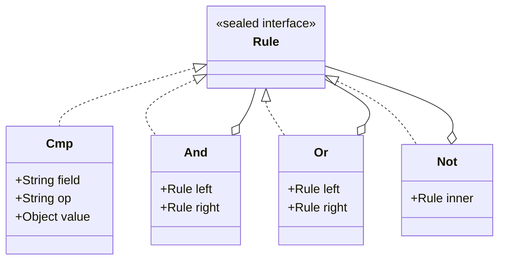
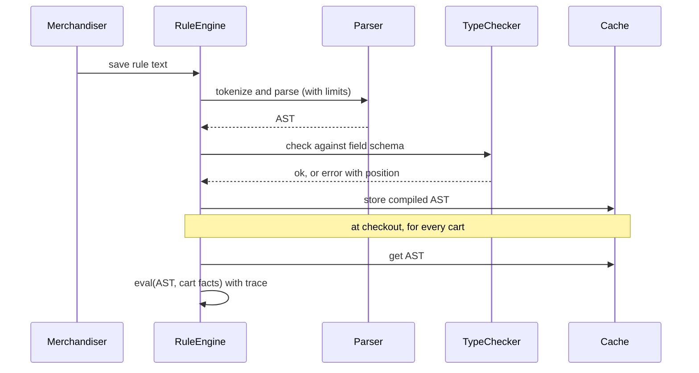

# Interpreter

<span class="badge-l2">L2 🔵 Practitioner</span> · <span class="read-time">⏱ 40 min read</span> · Prerequisites: [Composite](composite.md), [Visitor](visitor.md)

!!! abstract "TL;DR"
    Interpreter turns a small language (promo rules, fee formulas, filters) into a tree of objects and evaluates that tree. Each grammar rule becomes a node type; evaluation is a recursive walk. In Java 21 the nodes are sealed records and evaluation is an exhaustive `switch`. Parse once, evaluate many times, and when the input comes from people (not code), add type checking, size limits and clear error messages. When the grammar grows beyond a page, use a parser generator such as ANTLR or an existing expression language instead of hand-writing one.

## 1. What It Is

**Plain English.** FreshCart's merchandisers want to write rules like `category == "fruit" and cart_total >= 499 or tier == "gold"` without asking a developer to ship a release. Interpreter gives that text a structure: a parser builds a tree (`Or(And(Cmp, Cmp), Cmp)`), and an evaluator walks the tree for each cart and answers yes or no.

**Definition (GoF).** "Given a language, define a representation for its grammar along with an interpreter that uses the representation to interpret sentences in the language." Parts:

- **Abstract expression:** the node type (`Rule`, `Expr`) with an `interpret(context)` operation or a `switch` over it.
- **Terminal expressions:** leaves such as numbers, field names, `TotalAbove(499)`.
- **Non-terminal expressions:** nodes made of other nodes, such as `And`, `Or`, `Add`.
- **Context:** the facts the sentence is evaluated against (the cart, the variables).
- **Client / parser:** builds the tree from text. GoF leaves parsing out of the pattern, but in practice you always need one.

## 2. Why It Exists

Some behaviour changes faster than you can deploy: promo eligibility, surge pricing, alert conditions, search filters. Hard-coding each variant means a release per business change; storing them as free text and using `String.split` breaks on the first pair of parentheses. Interpreter gives these rules a real grammar, a typed in-memory form you can validate, print, optimise and evaluate, and a single place to enforce safety.

## 3. Mental Model / Analogy

**Analogy.** A recipe is a sentence in a small language: "boil 2 cups of water, then add rice". A cook (the interpreter) reads each step and acts on the kitchen (the context). Rewriting the recipe doesn't require hiring a new cook.

**Technical model.** Text → tokens → abstract syntax tree (AST) → evaluation. The AST is a [Composite](composite.md): leaves and nodes share one type, and evaluation recurses. Extra operations on the same AST (printing, type checking, simplifying) are [Visitor](visitor.md)s, which in Java 21 are just more `switch` functions.

## 4. How It Works





## 5. Subtopics

### Grammar to class hierarchy

**Description.** Write the grammar first, then map each rule to a type. Terminals (`cart_total > 499`, `category = fruit`) become leaf classes; combinations (`rule AND rule`) become classes holding child rules. Each class implements `interpret(context)` by doing its own small piece and delegating to its children. This is the GoF form.

**Advantages / features.** The grammar is visible in the code; adding a construct is adding a class; each class is tiny and easy to test.

```java title="GrammarToClassesDemo.java"
--8<-- "examples/l2-practitioner/interpreter/GrammarToClassesDemo.java"
```

1. The abstract expression: every node knows how to interpret itself against the context (the cart).
2. A non-terminal expression: it delegates to its children and combines the results.
3. The "sentence" is built by hand here. Real systems get it from a parser, shown in the next subtopic.

**Run it:** `java GrammarToClassesDemo.java`

```text
--8<-- "examples/l2-practitioner/interpreter/GrammarToClassesDemo.expected.txt"
```

| Grammar element | Becomes | Example |
|-----------------|---------|---------|
| Terminal | Leaf record | `TotalAbove(499)` |
| Sequence / combination | Record with child fields | `And(left, right)` |
| Alternative (`a \| b`) | Separate implementations of the interface | `Or`, `And`, `HasCategory` |
| Repetition (`a*`) | `List<Child>` field | `Sum(List<Expr>)` |

**Use** this mapping for any small, stable language. **Avoid** it when the language has dozens of constructs; the class count explodes.
**Real-world Java:** `java.util.regex.Pattern` compiles a regex into a tree of internal `Node` objects that match themselves; Spring's `SpelNode` subclasses (`OpAnd`, `OpOr`, `PropertyOrFieldReference`).
**Best practice:** write the grammar as a comment at the top of the file, and keep it in sync. **Gotcha:** `interpret` methods spread one operation across many classes, so adding a second operation (printing) touches every class. That's why the modern form below keeps operations in functions.

### Abstract syntax trees

**Description.** The AST is the tree form of a sentence after parsing: it drops punctuation and whitespace and keeps only structure. Getting there takes two steps. A **tokenizer** (lexer) turns characters into tokens (`25`, `+`, `km`). A **parser** turns tokens into a tree, applying precedence (`*` before `+`) and parentheses. The simplest hand-written parser is **recursive descent**: one method per grammar level, each calling the next tighter level.

**Advantages / features.** Precedence is encoded by which method calls which; errors can report the exact token; the resulting tree is independent of the text, so you can print it, store it or evaluate it many times.

```java title="AstDemo.java"
--8<-- "examples/l2-practitioner/interpreter/AstDemo.java"
```

1. The tokenizer: digits become numbers, letters become names, and anything unexpected is rejected with its position.
2. `expr` handles the loosest operators (`+`, `-`) and calls `term` for each side, so the tighter level is built first.
3. `term` handles `*` and `/`. Because `expr` calls `term`, multiplication ends up deeper in the tree and is evaluated first.
4. Evaluation is a recursive `switch` over node types.

**Run it:** `java AstDemo.java`

```text
--8<-- "examples/l2-practitioner/interpreter/AstDemo.expected.txt"
```

| Stage | Input | Output | Typical errors |
|-------|-------|--------|----------------|
| Lexing | Characters | Tokens with positions | Unknown character, unclosed quote |
| Parsing | Tokens | AST | Missing `)`, unexpected token |
| Checking | AST | Typed AST | Unknown field, wrong type |
| Evaluation | AST + context | Value | Missing fact, division by zero |

**Use** recursive descent for grammars of up to roughly ten rules. **Avoid** left-recursive rules (`expr := expr '+' term`) in recursive descent; they recurse forever. Use loops instead, as `expr` does.
**Real-world Java:** `javac` (a hand-written recursive-descent parser, `JavacParser`), Spring's `InternalSpelExpressionParser`, Jackson's JSON parser.
**Best practice:** keep token positions so every error says where. **Gotcha:** `8 - 2 - 1` must be `(8 - 2) - 1`; building the tree with a loop (left fold) gives left associativity, while naive recursion (`term '-' expr`) gives the wrong answer.

### Interpreter with records and switch

**Description.** Java 21 lets you define the AST as a `sealed interface` with `record` nodes and write each operation (evaluate, print, simplify, type-check) as a function with an exhaustive `switch` and record patterns. The nodes become plain data; operations live in one place each.

**Advantages / features.** Adding an operation is one new function; the compiler rejects a `switch` that misses a node type; records give `equals`, `hashCode` and `toString` for free, which makes tests and caching easy.

**Before (interpret methods inside each class) and after (data + functions):** compare `GrammarToClassesDemo` above with this:

```java title="RecordsSwitchInterpreterDemo.java"
--8<-- "examples/l2-practitioner/interpreter/RecordsSwitchInterpreterDemo.java"
```

1. The whole grammar fits in five lines; the compiler knows every node type.
2. A second operation, constant folding, added without touching the node types.
3. Record patterns deconstruct and test in one line: "the right side is the number 1".

**Run it:** `java RecordsSwitchInterpreterDemo.java`

```text
--8<-- "examples/l2-practitioner/interpreter/RecordsSwitchInterpreterDemo.expected.txt"
```

| | GoF `interpret` methods | Sealed records + `switch` |
|-|-------------------------|---------------------------|
| Add a node type | One class; existing code untouched | Compiler flags every `switch` |
| Add an operation | Edit every class | One new function |
| Completeness check | Abstract method | Exhaustive `switch` |
| Equality, printing | Hand-written | Record defaults |
| Java version | Any | 21+ |

**Use** records and `switch` for new interpreters in Java 21. **Avoid** a `default` branch in these switches; it silently accepts new node types.
**Real-world Java:** `java.lang.classfile` (JDK 24) models instructions as sealed types; the Java compiler's own pattern-matching design was motivated by AST work like this.
**Best practice:** make AST nodes immutable so a compiled rule can be shared by all threads. **Gotcha:** very deep trees overflow the stack during recursive evaluation; limit depth at parse time.

### When to use a parser generator instead

**Description.** Splitting strings and regular expressions can't handle nesting. Hand-written recursive descent is fine for small grammars. When the language needs functions, dates, lists, string escapes, good error recovery or will grow over years, generate the parser from a grammar file with **ANTLR** (or JavaCC), or use an existing expression language (Spring SpEL, MVEL, CEL, JEXL) rather than inventing one.

**Advantages / features.** Parser generators handle precedence and ambiguity declaratively, produce syntax-error recovery, and keep the grammar as documentation. Existing languages bring tooling and years of bug fixes.

```java title="ParserGeneratorDemo.java"
--8<-- "examples/l2-practitioner/interpreter/ParserGeneratorDemo.java"
```

1. The tempting shortcut: split on `OR`, then on `AND`. It ignores parentheses entirely.
2. A real parser follows the grammar, so `(fruit OR dairy)` is evaluated as a unit.
3. Past a certain size, stop hand-writing.

**Run it:** `java ParserGeneratorDemo.java`

```text
--8<-- "examples/l2-practitioner/interpreter/ParserGeneratorDemo.expected.txt"
```

| Option | Good for | Cost |
|--------|----------|------|
| String split / regex | Flat lists (`a,b,c`) | Breaks on nesting |
| Hand-written recursive descent | ≤ ~10 grammar rules, best error messages | You maintain it |
| ANTLR / JavaCC | Large or evolving grammars | Build step, generated code, learning curve |
| Existing language (SpEL, CEL, JEXL) | Standard expressions | Security review; may be too powerful |
| No language: a form/JSON rule builder | Non-technical users | Less flexible |

**Use** a parser generator when the grammar exceeds a page or needs error recovery. **Avoid** exposing general-purpose expression languages (SpEL, OGNL) to untrusted input; they can call arbitrary methods.
**Real-world Java:** Hibernate 6 parses HQL with ANTLR; Elasticsearch's Painless is ANTLR-based; Google's CEL is designed for safe, non-Turing-complete policy rules.
**Best practice:** before writing a language, ask whether a structured JSON rule (field, operator, value) edited in a UI is enough. **Gotcha:** a "simple" DSL grows; budget for tooling (syntax highlighting, validation in the editor) from the start.

## 6. Examples (exactly 3, progressively harder)

### Example 1: Minimal (L2)

**Scenario:** QuickDrop's delivery fee is Rs 20 plus Rs 6 per km, or Rs 10 per km when it's raining. Operations want to change this formula without a release.

```java title="SurgeFeeDemo.java"
--8<-- "examples/l2-practitioner/interpreter/SurgeFeeDemo.java"
```

1. The fee language: four node types, sealed so the evaluator must handle each.
2. The interpreter: one recursive `switch`, with the conditions (`km`, `raining`) as the context.

**Run it:** `java SurgeFeeDemo.java`

**Output:**

```text
--8<-- "examples/l2-practitioner/interpreter/SurgeFeeDemo.expected.txt"
```

**What to notice:**

- The rule is data; changing it doesn't change `fee`.
- `IfRaining` is a non-terminal that chooses which child to evaluate.

### Example 2: Realistic (in FreshCart grocery delivery)

**Scenario:** FreshCart merchandisers type promo eligibility rules into an admin screen. The rule is parsed once into an AST, then evaluated for every cart. Typos must be rejected with a position, not saved.

```java title="PromoRuleDslDemo.java"
--8<-- "examples/l2-practitioner/interpreter/PromoRuleDslDemo.java"
```

1. The recursive-descent parser: `or` calls `and`, so `and` binds tighter, as merchandisers expect.
2. Every error carries the token's position, so the admin screen can underline it.
3. Evaluation walks the AST against the cart's facts.

**Run it:** `java PromoRuleDslDemo.java`

**Output:**

```text
--8<-- "examples/l2-practitioner/interpreter/PromoRuleDslDemo.expected.txt"
```

**What to notice:**

- The pretty-printed form shows the grouping the parser chose; showing it back to the author catches precedence surprises.
- `tier = "gold"` (one `=`) is rejected at position 5 instead of being saved and never matching.

### Example 3: Production-grade

**Scenario:** the rule engine is shared by promotions, fraud flags and free-delivery offers. Rules come from people, so they are untrusted: a rule must not exhaust the server, compare text with numbers, or reference fields that don't exist. Support asks "why did this customer get the offer?" so evaluation must explain itself. Thousands of carts per second evaluate the same few rules.

```java title="SafeRuleEngineDemo.java"
--8<-- "examples/l2-practitioner/interpreter/SafeRuleEngineDemo.java"
```

1. Limits are checked while parsing (length here, nesting depth and node count further down), so a hostile rule fails fast.
2. A type checker runs over the whole AST before any evaluation: unknown fields, mixed types, ordering operators on text and non-boolean rules are all rejected at save time.
3. Evaluation records each comparison with the actual value, giving support an explanation.
4. Rules are parsed and checked once and cached by their text; ASTs are immutable records, so threads share them safely.
5. Missing facts fail loudly instead of evaluating to `false` and quietly denying an offer.

**Run it:** `java SafeRuleEngineDemo.java`

**Output:**

```text
--8<-- "examples/l2-practitioner/interpreter/SafeRuleEngineDemo.expected.txt"
```

**What to notice:**

- The trace shows short-circuiting: `cart_total >= 499` never ran because `category == "fruit"` was already false.
- 1,001 evaluations compiled the rule once.
- Each rejection names the problem in words a merchandiser can act on.

## 7. Pros, Cons & Trade-offs

| Aspect | Pros | Cons |
|--------|------|------|
| Flexibility | Business rules change without a release | A new language to document, test and support |
| Structure | AST can be validated, printed, optimised, stored | Parser and checker are real code to maintain |
| Extensibility | New operations are new functions | New syntax touches lexer, parser, checker, evaluator |
| Performance | Parse once, evaluate fast | Tree walking is slower than compiled code |
| Safety | One place to enforce limits and types | Untrusted input is an attack surface |
| Debuggability | Traces explain decisions | Users may write rules nobody else understands |

## 8. When to Use / When NOT to Use

**Use it when:**

- a small, stable language expresses the problem well (filters, rules, formulas, queries);
- the rules change more often than you deploy, and non-developers write them;
- you need to analyse rules, not just run them (validate, explain, find conflicts).

**Don't use it when:**

- a configuration table or a JSON rule (field, operator, value) is enough;
- an existing language (SQL, SpEL, CEL, JSONPath) already fits;
- the grammar is large or evolving fast: use a parser generator;
- performance is critical and rules are fixed: write the code.

## 9. Best Practices

1. **Parse once, evaluate many times;** cache compiled ASTs. *(Consensus.)*
2. **Sealed records for nodes, one `switch` function per operation, no `default`.** *(Consensus for Java 21.)*
3. **Validate at save time** (syntax, types, fields), not at evaluation time. *(Consensus.)*
4. **Limit length, depth and node count** for any user-written rule. *(Consensus.)*
5. **Report errors with positions** and echo the parsed form back to the author. *(Consensus.)*
6. **Keep the language non-Turing-complete:** no loops, no method calls, no I/O. *(Consensus for user rules.)*
7. **Prefer an existing language or a parser generator** once the grammar exceeds about a page. *(Opinion, widely shared.)*

## 10. Pitfalls & Anti-Patterns

!!! danger "Missing facts evaluate to false (production failure mode)"
    **Symptom:** after a checkout refactor, no customer got the "gold tier free delivery" offer for three days; nothing errored.
    **Root cause:** the refactor renamed the fact `tier` to `loyalty_tier`. The interpreter returned `null` for unknown fields, and `null == "gold"` evaluated to `false`.
    **Fix:** type-check rules against a declared schema at save time, fail evaluation when a schema field is missing from the facts, and alert on rules that never match.

!!! danger "Expression injection"
    **Symptom:** a "rule" field accepted `T(java.lang.Runtime).getRuntime().exec(...)`.
    **Root cause:** user text was passed straight to a general-purpose expression language (SpEL with `StandardEvaluationContext`).
    **Fix:** use your own small grammar, or `SimpleEvaluationContext` / CEL, which can't call arbitrary methods.

!!! danger "Precedence surprises"
    **Symptom:** `a or b and c` was read by authors as `(a or b) and c`.
    **Root cause:** standard precedence (and before or) differs from how people read left to right.
    **Fix:** show the parenthesised form back to the author before saving, and consider requiring parentheses when `and` and `or` are mixed.

!!! danger "String hacks instead of a parser"
    **Symptom:** rules with parentheses or quoted values containing `and` behave randomly.
    **Root cause:** `split(" AND ")` or regexes can't parse nested structures.
    **Fix:** a real tokenizer and parser, however small.

## 11. Configuration & Tuning

| Setting | Default | What it does | When to change it | Risk of changing |
|---------|---------|--------------|-------------------|------------------|
| Max rule length | 500 chars (example) | Rejects huge inputs before parsing | Rules legitimately longer | Too high allows resource abuse |
| Max nesting depth | 12 | Prevents stack overflow in parsing and evaluation | Deeply nested generated rules | Too high risks `StackOverflowError` |
| Max node count | 60 | Bounds evaluation cost per rule | Large but legitimate rules | Too high slows checkout |
| Compiled-rule cache size | Unbounded map (example) | Avoids re-parsing | Many distinct rules: use a bounded cache (Caffeine) | Unbounded growth if rule text is per-user |
| Evaluation timeout | none | Stops runaway rules | Languages with loops or functions | Partial results |

## 12. Security Considerations

- Treat rule text as **untrusted input**: limit size, depth and node count before evaluating.
- **Never** feed user text to SpEL, OGNL, MVEL, JavaScript engines or `ScriptEngine` with full access; that's remote code execution (several Struts and Spring CVEs).
- Keep the language **free of side effects**: no method calls, no I/O, no loops.
- **Whitelist fields** through a schema; don't resolve arbitrary property paths by reflection.
- Escape and quote properly when pretty-printing rules into logs or UIs.
- Store who changed each rule and when; rules are code that bypasses code review.

## 13. Performance & Scalability

A tree-walking interpreter costs a few nanoseconds per node, which is negligible for rules with tens of nodes. The expensive part is parsing, so cache compiled ASTs. For very hot paths, compile the AST into a tree of lambdas (`Predicate<Facts>`) once; the JIT then inlines them. Beyond that, generate bytecode (`java.lang.classfile`, ASM), as SpEL's compiler mode does. Evaluate cheap and selective comparisons first in `and` chains to benefit from short-circuiting. Immutable ASTs scale across threads with no locking.

## 14. Testing It

Test precedence, every type error, the limits and the cache:

```java title="SafeRuleEngineTest.java"
--8<-- "examples/l2-practitioner/interpreter/SafeRuleEngineTest.java"
```

Also worth adding: a round-trip property test (parse → print → parse gives the same AST), and a fuzz test that random strings never throw anything but `IllegalArgumentException`.

## 15. Observability & Operations

Log rule saves with author, old and new text. Count evaluations, matches and errors per rule; alert on rules that never match after a release (the failure mode above) or suddenly match everything. Keep the evaluation trace for sampled decisions so support can answer "why did this customer get this offer?". Measure parse time and cache hit rate.

## 16. Version Notes

| Java | Change relevant to Interpreter |
|------|--------------------------------|
| 1.4 | `java.util.regex`: a compiled pattern is an interpreter tree |
| 6 | `javax.script` (`ScriptEngine`) for embedding languages |
| 8 | Lambdas: compile ASTs into `Predicate` / `Function` trees |
| 15 | Nashorn JavaScript engine removed |
| 16 | Records for AST nodes; pattern matching for `instanceof` |
| 17 | Sealed classes for closed node hierarchies |
| 21 | Pattern matching for `switch` and record patterns (final) |
| 24 | `java.lang.classfile` API for generating bytecode from ASTs |

## 17. Expert Deep Dive

- **Interpreter = Composite + operations.** The AST is a Composite; evaluation, printing, type checking and optimisation are [Visitor](visitor.md)s. In Java 21 all of them are `switch` functions over sealed records.
- **Closure compilation.** Turning `And(a, b)` into `facts -> ca.test(facts) && cb.test(facts)` once removes the per-node `switch` dispatch; Truffle/GraalVM takes this further with self-specialising AST interpreters that the JIT compiles to machine code.
- **Pratt parsing.** For expression languages with many precedence levels, a Pratt (top-down operator precedence) parser replaces one method per level with a table of binding powers.
- **Static analysis of rules.** Because rules are trees, you can detect contradictions (`total > 500 and total < 100`), overlap between promotions, or rules that can never match, before they go live.
- **Turing completeness is a liability.** Policy languages like CEL deliberately avoid loops so evaluation time is bounded by rule size.

!!! example "War story: the rule that never matched"
    DairyDay ran milk-subscription offers from rules stored as text and evaluated by a hand-written interpreter that returned `false` for any field it didn't recognise. A data team renamed `subscription_days` to `sub_days` in the checkout facts. Every rule mentioning the old name stopped matching, and the "30 days free delivery" offer silently disappeared for 40,000 subscribers over a long weekend. No error was logged because, as far as the interpreter knew, nothing had failed. **Fixes:** a declared schema of facts; type checking on save and on deploy (all stored rules are re-checked when the schema changes); evaluation fails if a declared fact is missing; and a dashboard of match rates per rule with an alert on a drop to zero. **Lesson:** an interpreter that "never throws" hides bugs; make unknowns loud.

## 18. Interview Corner

=== "🟢 L1–L2"

    1. **What does Interpreter do?** Represents sentences of a **small language as a tree** and **evaluates** it.
    2. **What are terminal and non-terminal expressions?** **Leaves** (numbers, fields) and **nodes made of other nodes** (and, or, plus).
    3. **What is the context?** The **facts** the expression is evaluated against.
    4. **Which pattern does the AST resemble?** **Composite.**
    5. **Give an example from the JDK.** **`java.util.regex.Pattern`.**

=== "🟡 L3"

    1. **What does a parser do that `split` can't?** Handles **nesting, precedence and associativity**.
    2. **How does recursive descent encode precedence?** **Looser levels call tighter levels** (`expr` calls `term`).
    3. **How do Java 21 features change the pattern?** **Sealed records** for nodes and **exhaustive `switch`** per operation.
    4. **Why parse once and cache?** Parsing dominates cost; **ASTs are immutable** and shareable.
    5. **When would you use ANTLR?** When the **grammar is large, evolving or needs error recovery**.

=== "🔴 L4–L5"

    1. **Design a promo rule engine for non-developers.** **Grammar, schema type checking, limits, explain trace, cache, versioned rules, match-rate monitoring.**
    2. **How do you make user expressions safe?** **Own small grammar, no method calls or loops**, size/depth limits, field whitelist; never raw SpEL/OGNL.
    3. **How would you speed up a hot interpreter?** **Compile to lambdas**, then bytecode; order `and` chains by selectivity.
    4. **How would you detect conflicting promotions?** **Analyse ASTs** (interval reasoning on numeric comparisons) or use an SMT solver.
    5. **Interpreter vs Strategy vs rules engine (Drools)?** Strategy picks among **coded** behaviours; Interpreter runs **user-written** ones; Drools adds **forward chaining** over many rules.

=== "💻 Hands-on"

    **Task:** Add `in` to `SafeRuleEngineDemo` so authors can write `category in ("fruit", "dairy")`.

    ??? success "Solution"
        ```java
        record In(Node field, List<Lit> values) implements Node { }   // add to the permits list

        // parser, in cmp(): after primary(), if the token is "in", read "(" lit ("," lit)* ")"
        // type checker:
        case In i -> {
            Class<?> f = typeOf(i.field(), schema);
            for (Lit v : i.values()) if (v.value().getClass() != f) throw new IllegalArgumentException("mixed types in 'in'");
            yield Boolean.class;
        }
        // evaluator:
        case In i -> { Object v = eval(i.field(), facts, trace); yield i.values().stream().anyMatch(l -> l.value().equals(v)); }
        // show():
        case In i -> show(i.field()) + " in " + i.values().stream().map(SafeRuleEngineDemo::show).toList();
        ```

## 19. Practice

- [ ] Add `/` to `AstDemo` with a clear error for division by zero.
    ??? tip "Hint"
        Check the right operand's value in the `/` branch and throw with the expression text.
- [ ] Write a round-trip test for `PromoRuleDslDemo`: `parse(show(parse(s)))` equals `parse(s)`.
    ??? tip "Hint"
        Records give you `equals` for free.
- [ ] Compile `SafeRuleEngineDemo`'s AST into a `Predicate<Map<String, Object>>` and compare speed.
    ??? tip "Hint"
        A `switch` that returns lambdas: `case And a -> { var l = compile(a.l()); var r = compile(a.r()); yield f -> l.test(f) && r.test(f); }`.
- [ ] Detect the contradiction `cart_total > 500 and cart_total < 100` at save time.
    ??? tip "Hint"
        Collect numeric bounds per field across an `and` chain and check the interval is non-empty.

## 20. Quick Revision Card

!!! tip "Remember in 30 seconds"
    - Intent: represent a small language as a tree and evaluate it.
    - Pipeline: text → tokens → AST → check → evaluate (cache the AST).
    - Java 21: sealed records for nodes, one exhaustive `switch` per operation.
    - Recursive descent: looser levels call tighter levels; loops for left associativity.
    - User rules: limits, schema type checks, positions in errors, no method calls.
    - Big grammar? ANTLR or an existing language.

    ```java
    static boolean eval(Rule r, Map<String, Object> f) {
        return switch (r) {
            case Cmp c -> compare(f.get(c.field()), c.op(), c.value());
            case And(Rule a, Rule b) -> eval(a, f) && eval(b, f);
            case Or(Rule a, Rule b) -> eval(a, f) || eval(b, f);
        };
    }
    ```

## 21. Further Reading

- Gamma, Helm, Johnson, Vlissides, *Design Patterns* (1994), "Interpreter".
- Robert Nystrom, *Crafting Interpreters* (2021), free online; part II builds a tree-walking interpreter in Java.
- Terence Parr, *The Definitive ANTLR 4 Reference* (2013).
- [JEP 440: Record Patterns](https://openjdk.org/jeps/440) and [JEP 441: Pattern Matching for switch](https://openjdk.org/jeps/441)
- [Common Expression Language (CEL)](https://github.com/google/cel-spec): a safe, non-Turing-complete expression language.

---

[← Previous: Visitor](visitor.md) · [Next: Null Object →](null-object.md)
