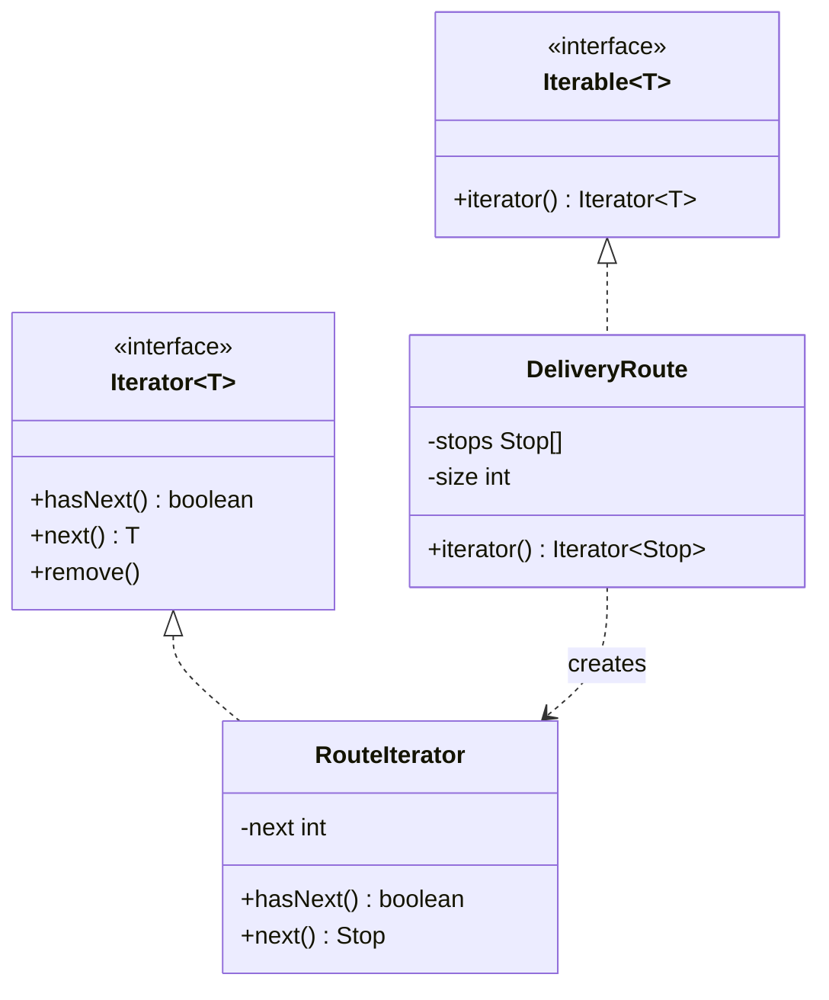
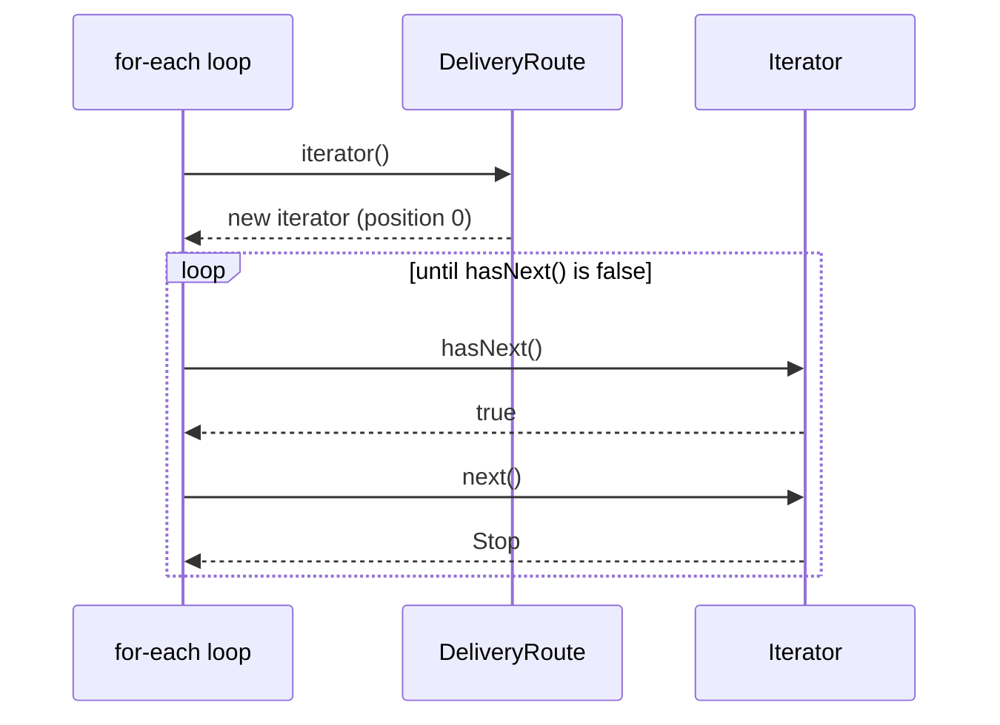

# Iterator

<span class="badge-l2">L2 🔵 Practitioner</span> · <span class="read-time">⏱ 35 min read</span> · Prerequisites: [OOP Refresher](../l1-foundations/oop-refresher.md), [Composite](composite.md)

!!! abstract "TL;DR"
    Iterator gives sequential access to the elements of a collection without exposing how it's stored. In Java it's built in: `Iterable` makes for-each work, `Iterator` walks one element at a time, and `Spliterator` powers streams. Write your own when the data isn't a plain list: a tree, a paginated API, a database cursor. Know the contracts: `ArrayList` iterators fail fast on concurrent changes, concurrent collections iterate weakly consistently, and a lazy iterator should fetch only what the caller actually uses.

## 1. What It Is

**Plain English.** A FreshCart picker walks the store with a pick list. They don't care whether the list is stored in an array, grouped by aisle in a map, or fetched page by page from the server; they just ask "what's next?" until there's nothing left. The iterator is that "what's next?" handle.

**Definition (GoF).** "Provide a way to access the elements of an aggregate object sequentially without exposing its underlying representation." Parts:

- **Iterator:** `hasNext()` and `next()` (and optionally `remove()`), keeping the current position.
- **Aggregate / Iterable:** the collection, with a method that creates a fresh iterator (`iterator()`).
- **Client:** loops using only the iterator interface.

Java adds **internal iteration** (`forEach`, streams), where you pass the action and the collection does the looping, and **`Spliterator`**, which can split work for parallel streams.

## 2. Why It Exists

If a collection exposes its internals (`getStops()` returning its `ArrayList`), callers can change it, depend on its structure, and break when it changes from a list to an array or a tree. Every kind of collection would also need its own loop style. Iterator gives one uniform way to traverse anything, keeps the representation private, allows several independent traversals at once, and enables laziness: elements can be computed or fetched only when asked for.

## 3. Mental Model / Analogy

**Analogy.** A TV remote's "next channel" button. You don't know how the TV stores its channel list; you just press next until you've seen enough. Two people with two remotes on two TVs keep independent positions.

**Technical model.** An object holding a cursor into some structure. `hasNext()` answers whether another element exists (fetching or computing it if needed); `next()` returns it and advances. The iterator is single-use and stateful; the `Iterable` is a factory for fresh iterators.

## 4. How It Works





## 5. Subtopics

### Iterator and Iterable

**Description.** `Iterable<T>` has one abstract method, `iterator()`, and any class implementing it works in a for-each loop. `Iterator<T>` has `hasNext()`, `next()` (which must throw `NoSuchElementException` when exhausted), an optional `remove()`, and `forEachRemaining`. Each call to `iterator()` should return a new, independent iterator.

**Advantages / features.** Callers loop without knowing the storage; the class can change its internals freely; you can control whether removal is allowed.

**Before (exposing the internal list) and after (Iterable):**

```java title="IteratorIterableDemo.java"
--8<-- "examples/l2-practitioner/iterator/IteratorIterableDemo.java"
```

1. Returning the internal list lets any caller clear or reorder the route.
2. `iterator()` returns a fresh iterator over a private array; callers can't tell or care.
3. The contract: `next()` throws `NoSuchElementException` past the end.

**Run it:** `java IteratorIterableDemo.java`

```text
--8<-- "examples/l2-practitioner/iterator/IteratorIterableDemo.expected.txt"
```

| Pros | Cons |
|------|------|
| Representation stays private | An iterator is single-use and stateful |
| Works with for-each and streams | Writing iterators by hand is error-prone |
| Multiple independent traversals | `remove()` semantics are easy to get wrong |

**Use** `Iterable` for domain collections (routes, pick lists, baskets). **Avoid** returning internal mutable collections; return an `Iterable`, a `List.copyOf`, or an unmodifiable view.
**Real-world Java:** every `Collection`, `Path` (iterates path elements), `DirectoryStream`, `ServiceLoader`, `Scanner` (an `Iterator<String>`).
**Best practice:** implementing `Iterable` also gives you `forEach`; add a `stream()` method if callers need streams. **Gotcha:** an `Iterable` that returns the **same** iterator each time can be looped only once; the second loop silently does nothing.

### Fail-fast vs. weakly consistent iterators

**Description.** What happens if a collection changes during iteration depends on the collection. `ArrayList`, `HashMap` and most `java.util` collections are **fail-fast**: they throw `ConcurrentModificationException` on a best-effort basis. `ConcurrentHashMap` and `ConcurrentLinkedQueue` iterators are **weakly consistent**: no exception, and changes may or may not be seen. `CopyOnWriteArrayList` iterates a **snapshot**.

**Advantages / features (of knowing it).** You choose the right removal technique and the right collection for concurrent access.

```java title="FailFastVsWeaklyConsistentDemo.java"
--8<-- "examples/l2-practitioner/iterator/FailFastVsWeaklyConsistentDemo.java"
```

1. Removing through the list while for-each iterates trips the fail-fast check.
2. Safe removal: `Iterator.remove()` or `removeIf`.
3. `ConcurrentHashMap`: no exception; the loop may or may not see keys added during it.
4. `CopyOnWriteArrayList`: the loop sees the snapshot from when it started.

**Run it:** `java FailFastVsWeaklyConsistentDemo.java`

```text
--8<-- "examples/l2-practitioner/iterator/FailFastVsWeaklyConsistentDemo.expected.txt"
```

| Iterator kind | Collections | On concurrent change | Use for |
|---------------|-------------|----------------------|---------|
| Fail-fast | `ArrayList`, `HashMap`, `HashSet` | Usually throws `ConcurrentModificationException` | Single-threaded code |
| Weakly consistent | `ConcurrentHashMap`, `ConcurrentLinkedQueue` | No exception; may reflect some changes | Shared, frequently updated data |
| Snapshot | `CopyOnWriteArrayList`/`Set` | Sees the old snapshot | Rarely changed lists (listeners) |

**Use** `removeIf` or `Iterator.remove()` for removal during iteration. **Avoid** relying on `ConcurrentModificationException` for correctness; it's best effort only.
**Real-world Java:** listener lists in frameworks are often `CopyOnWriteArrayList`; caches are `ConcurrentHashMap`.
**Best practice:** never share an `ArrayList` between threads without synchronisation, even for reading while another thread writes. **Gotcha:** removing the second-to-last element inside a for-each over an `ArrayList` doesn't throw; it silently ends the loop early and skips the last element.

### Custom iterators

**Description.** Write an iterator when the data isn't a ready-made collection: a tree (walk it with an explicit stack), a generated sequence, or a paginated source (fetch the next page only when the current one runs out). `hasNext()` should do the work of finding the next element and be safe to call repeatedly.

**Advantages / features.** Laziness (nothing is fetched or computed until needed), constant memory for huge or infinite sources, and a normal for-each for callers.

```java title="CustomIteratorDemo.java"
--8<-- "examples/l2-practitioner/iterator/CustomIteratorDemo.java"
```

1. A depth-first tree iterator with an explicit stack: no recursion, any depth.
2. `hasNext()` fetches pages until it finds an element or the source is empty, so repeated calls are safe.
3. The caller took three orders; only two pages were fetched.

**Run it:** `java CustomIteratorDemo.java`

```text
--8<-- "examples/l2-practitioner/iterator/CustomIteratorDemo.expected.txt"
```

| Pros | Cons |
|------|------|
| Lazy: fetch or compute only what's used | Stateful code with subtle edge cases |
| Constant memory for large sources | Exceptions from I/O inside `hasNext()` must be unchecked |
| Hides traversal logic | Not thread-safe; one consumer at a time |

**Use** custom iterators for trees, pagination and generated data. **Avoid** them when a stream pipeline over an existing collection does the job.
**Real-world Java:** `BufferedReader.lines()`, `Files.walk`, JDBC `ResultSet` (an iterator in all but name), Kafka consumer `poll` loops.
**Best practice:** put the "advance" logic in `hasNext()`, make `next()` call `hasNext()`, and test empty sources, single elements and empty pages. **Gotcha:** `hasNext()` that advances the position (instead of peeking) loses elements when called twice.

### Spliterator and streams

**Description.** `Spliterator` is the iterator behind streams. `tryAdvance` gives one element to an action; `trySplit` hands off part of the remaining elements so parallel streams can process them on several threads; characteristics (`ORDERED`, `SIZED`, `DISTINCT`, `NONNULL`, ...) let the stream library optimise. Wrap any source with `StreamSupport.stream(spliterator, parallel)`.

**Advantages / features.** Your custom source gets the whole Stream API (filter, map, limit, collect) and stays lazy: short-circuiting operations stop pulling early.

```java title="SpliteratorStreamsDemo.java"
--8<-- "examples/l2-practitioner/iterator/SpliteratorStreamsDemo.java"
```

1. `AbstractSpliterator` gives a default (sequential) `trySplit`; you only write `tryAdvance`.
2. `tryAdvance` produces one element per call and returns false at the end.
3. `limit(3)` stopped pulling after three elements, so only two pages were fetched.
4. An array-backed spliterator splits in half for parallel work and knows its exact size.

**Run it:** `java SpliteratorStreamsDemo.java`

```text
--8<-- "examples/l2-practitioner/iterator/SpliteratorStreamsDemo.expected.txt"
```

| Iteration style | Example | Pros | Cons |
|-----------------|---------|------|------|
| External (`Iterator`) | `while (it.hasNext())` | Full control, early exit, works with checked exceptions around it | Verbose |
| Internal (`forEach`, streams) | `list.forEach(...)`, `stream().filter(...)` | Concise, composable, parallelisable | Harder to break out of; lambdas can't throw checked exceptions |

**Use** a `Spliterator` to give a custom source stream support. **Avoid** parallel streams over sources that split badly (linked structures, paged I/O); they're slower than sequential.
**Real-world Java:** `Collection.spliterator()`, `Files.lines`, `BufferedReader.lines`, `Pattern.splitAsStream`, Spring Data's `Stream<T>` repository methods.
**Best practice:** report accurate characteristics; claim `SIZED` only if the size is exact. **Gotcha:** streams over I/O resources must be closed (try-with-resources); a forgotten `Files.lines` stream leaks a file handle.

## 6. Examples (exactly 3, progressively harder)

### Example 1: Minimal (L2)

**Scenario:** items are added to a picker's list in any order, but the picker should walk the store aisle by aisle.

```java title="ShoppingListDemo.java"
--8<-- "examples/l2-practitioner/iterator/ShoppingListDemo.java"
```

1. The pick list is `Iterable`, so for-each works.
2. Internally it's a sorted map of lists; the iterator flattens it in aisle order.

**Run it:** `java ShoppingListDemo.java`

**Output:**

```text
--8<-- "examples/l2-practitioner/iterator/ShoppingListDemo.expected.txt"
```

**What to notice:**

- The caller never sees the `TreeMap`; changing the grouping wouldn't change the loop.

### Example 2: Realistic (in FreshCart grocery delivery)

**Scenario:** the app's "My orders" screen loads order history from a cursor-paginated API. Most customers look at the first few orders and stop; nobody should download a whole history to see four orders.

```java title="OrderHistoryPagerDemo.java"
--8<-- "examples/l2-practitioner/iterator/OrderHistoryPagerDemo.java"
```

1. The API returns one page and a cursor for the next.
2. The history is an `Iterable` lambda creating a fresh lazy iterator each time.
3. A missing cursor marks the last page.

**Run it:** `java OrderHistoryPagerDemo.java`

**Output:**

```text
--8<-- "examples/l2-practitioner/iterator/OrderHistoryPagerDemo.expected.txt"
```

**What to notice:**

- Stopping after FC-9004 meant the third page was never requested.
- The full loop used three calls for seven orders; callers just wrote for-each.

### Example 3: Production-grade

**Scenario:** finance exports every order (millions of rows) and support searches them with stream filters. Requirements: never load the whole table; use keyset pagination (`WHERE id > ? ORDER BY id LIMIT ?`) so inserts during the export don't cause skipped or repeated rows; stop fetching when the consumer stops; retry a page on transient database errors; detect a cursor that doesn't advance (which would loop forever); release resources on close; and report metrics.

```java title="CursorStreamDemo.java"
--8<-- "examples/l2-practitioner/iterator/CursorStreamDemo.java"
```

1. The data source is "rows after this ID", the shape of keyset pagination.
2. A page is fetched only when the current one is used up.
3. A safety check: if the last ID didn't increase, stop instead of looping forever.
4. Transient page failures are retried up to a limit.
5. `onClose` runs when the try-with-resources block ends, the place to release connections.

**Run it:** `java CursorStreamDemo.java`

**Output:**

```text
--8<-- "examples/l2-practitioner/iterator/CursorStreamDemo.expected.txt"
```

**What to notice:**

- `findFirst` stopped after one page and four rows.
- Two database timeouts were retried and the export still summed all ten orders.
- A buggy source that kept returning the same page was stopped with a clear error.

## 7. Pros, Cons & Trade-offs

| Aspect | Pros | Cons |
|--------|------|------|
| Encapsulation | Storage hidden from callers | Iterator classes tied to internals |
| Uniformity | One loop style for every source | Custom iterators need careful contracts |
| Laziness | Fetch/compute only what's used | Errors appear mid-iteration, far from creation |
| Memory | Constant memory for huge sources | Resources stay open until iteration ends |
| Concurrency | Concurrent collections iterate safely | Fail-fast iterators throw; snapshots can be stale |
| Parallelism | Spliterators enable parallel streams | Poorly splitting sources get slower in parallel |

## 8. When to Use / When NOT to Use

**Use it when:**

- a domain class holds a collection callers need to loop over;
- data comes from a tree, a generator, pages or a cursor;
- callers might stop early and you want to avoid unnecessary work.

**Don't use it when:**

- callers need random access or a size (return a `List`);
- a stream over an existing collection already expresses it;
- the source holds scarce resources and callers can't be trusted to finish or close (fetch into a list instead).

## 9. Best Practices

1. **Return `Iterable`, unmodifiable views or copies**, never internal mutable collections. *(Consensus.)*
2. **Use `removeIf` or `Iterator.remove()`** to remove while iterating. *(Consensus.)*
3. **Make `hasNext()` idempotent** and `next()` throw `NoSuchElementException` at the end. *(Consensus; the contract.)*
4. **Use keyset pagination** for large or changing tables. *(Consensus.)*
5. **Close streams backed by I/O** with try-with-resources. *(Consensus.)*
6. **Prefer streams for transformations, loops for control flow** (early exit, checked exceptions). *(Opinion, widely shared.)*

## 10. Pitfalls & Anti-Patterns

!!! danger "OFFSET pagination during an export (production failure mode)"
    **Symptom:** the nightly order export sometimes missed orders and sometimes contained duplicates.
    **Root cause:** the iterator used `LIMIT 1000 OFFSET n`; orders inserted or deleted during the export shifted rows between pages.
    **Fix:** keyset pagination on a unique, ordered key (`WHERE id > :lastId ORDER BY id LIMIT 1000`), as in Example 3.

!!! danger "Removing inside for-each"
    **Symptom:** `ConcurrentModificationException`, or worse, the last item silently skipped.
    **Root cause:** `list.remove(x)` inside `for (x : list)`.
    **Fix:** `list.removeIf(...)` or an explicit `Iterator.remove()`.

!!! danger "Iterable that works once"
    **Symptom:** the second loop over a result printed nothing.
    **Root cause:** `iterator()` returned the same, already exhausted iterator (or a stream's iterator).
    **Fix:** create a new iterator per call; or return a `List` if callers loop more than once.

!!! danger "Leaked cursor"
    **Symptom:** the connection pool ran dry after many exports were cancelled.
    **Root cause:** stream over a database cursor not closed when the consumer stopped early.
    **Fix:** try-with-resources around every resource-backed stream; `onClose` releases the connection.

## 11. Configuration & Tuning

| Setting | Default | What it does | When to change it | Risk of changing |
|---------|---------|--------------|-------------------|------------------|
| Page size | 100–1,000 typical | Rows per fetch | Larger for exports, smaller for UIs | Too big: memory and timeouts; too small: many round trips |
| JDBC `fetchSize` | driver-specific (PostgreSQL: all rows) | Rows per network round trip for a cursor | Streaming large results | Too small: many round trips |
| Retry attempts per page | 0–3 | Transient error tolerance | Flaky networks | Duplicated work if pages aren't idempotent |
| Parallel stream threads | common pool (cores − 1) | Parallelism for parallel streams | Rarely; prefer a dedicated executor | Starving other work |

## 12. Security Considerations

- Cursors given to clients (API pagination) should be opaque and tamper-resistant (signed or encrypted), so clients can't jump to other customers' data by editing them.
- Always apply authorisation in each page query (`WHERE customer_id = ?`), not only on the first page.
- Limit page size on public APIs to prevent denial of service through huge pages.

## 13. Performance & Scalability

Lazy iteration keeps memory flat regardless of data size and lets short-circuiting operations skip work. Keyset pagination stays fast on deep pages (an index seek), while `OFFSET` gets slower the deeper you go because the database must skip rows. Parallel streams help only for CPU-heavy work over sources that split well (arrays, `ArrayList`); for I/O-bound pagination use sequential iteration with prefetching or virtual threads.

## 14. Testing It

Test exact-once ordered delivery, early stop, retries and the non-advancing cursor guard:

```java title="CursorStreamTest.java"
--8<-- "examples/l2-practitioner/iterator/CursorStreamTest.java"
```

## 15. Observability & Operations

For long iterations (exports, migrations), log progress periodically (rows, pages, last ID) so a stuck job is visible and can resume from the last ID. Record pages fetched per request for API-backed iterators to spot callers that read whole histories. Alert on open-cursor counts or pool usage during batch windows.

## 16. Version Notes

| Java | Change relevant to Iterator |
|------|-----------------------------|
| 1.2 | `Iterator` replaces `Enumeration`; fail-fast collections |
| 5 | `Iterable` and the for-each loop; concurrent collections with weakly consistent iterators |
| 8 | `Spliterator`, streams, `Iterable.forEach`, `Iterator.forEachRemaining`, `Collection.removeIf` |
| 9 | `Stream.takeWhile`, `dropWhile`, `iterate(seed, hasNext, next)` |
| 16 | `Stream.toList()` |
| 21 | Sequenced collections: `reversed()`, `getFirst()`, `getLast()` |
| 22 | Stream gatherers preview (final in 24): custom intermediate operations |

## 17. Expert Deep Dive

- **External vs internal iteration.** External iteration (the caller drives) gives control; internal iteration (the collection drives) enables optimisation and parallelism. Streams are internal iteration with lazy, fused pipelines; one pass, no intermediate collections.
- **Iterator invalidation and modCount.** Fail-fast iterators compare a `modCount` captured at creation with the collection's current count on each `next()`. It's not synchronised, so it's a bug detector, not a concurrency guarantee.
- **Generators and coroutines.** Languages with `yield` make custom iterators trivial. In Java, a producer thread feeding a `BlockingQueue` (cheap with virtual threads) can simulate generators for complex traversals, at the cost of thread coordination.
- **Database cursors.** Server-side cursors stream rows but hold a transaction and connection open. Keyset pagination over short transactions is usually better for long exports and for resuming after failure.

!!! example "War story: the export that never ended"
    A grocery platform's daily export used a custom iterator over an API whose pages were keyed by `updated_at`. One night, more than a page's worth of orders shared the same `updated_at` second (a bulk status update). The iterator asked for "after this timestamp", got the same page again, and looped until the job was killed eight hours later, having written the same 500 orders 1.2 million times. **Fixes:** the cursor became a composite key `(updated_at, id)`, which is unique; the iterator checks that the cursor advances and fails fast otherwise; and the export job has a row-count sanity check and a time limit. **Lesson:** a pagination key must be unique and strictly increasing.

## 18. Interview Corner

=== "🟢 L1–L2"

    1. **What does Iterator do?** Gives **sequential access** without exposing the collection's **internal structure**.
    2. **Iterator vs Iterable?** `Iterable` **creates iterators** (enables for-each); `Iterator` **walks** one traversal.
    3. **How do you remove while looping?** **`Iterator.remove()`** or **`removeIf`**.
    4. **What is `ConcurrentModificationException`?** Thrown by a **fail-fast iterator** when the collection changes during iteration.
    5. **What should `next()` do at the end?** Throw **`NoSuchElementException`**.

=== "🟡 L3"

    1. **Fail-fast vs weakly consistent?** Fail-fast **throws** on change (best effort); weakly consistent **never throws**, may reflect changes.
    2. **What is a Spliterator?** The iterator behind streams: **`tryAdvance`, `trySplit`, characteristics**.
    3. **Why is OFFSET pagination risky?** Rows **shift** with inserts/deletes; deep pages are **slow**.
    4. **External vs internal iteration?** Caller drives (**control, early exit**) vs collection drives (**composition, parallelism**).
    5. **How do you make a lazy paged iterator?** Fetch the next page in **`hasNext()`** when the current page is exhausted.

=== "🔴 L4–L5"

    1. **Design an export of 500 million rows.** **Keyset pagination**, bounded pages, resumable from last ID, checkpoints, metrics, read replica.
    2. **When do parallel streams hurt?** **Poorly splitting or I/O-bound** sources, tiny workloads, shared common pool contention.
    3. **How do you design API pagination cursors?** **Opaque, signed**, unique ordered keys, authorisation per page, size limits.
    4. **Server-side cursor vs keyset pages?** Cursors hold **connections and transactions** open; keyset pages are **short, resumable**.
    5. **How do you guarantee an iterator terminates?** **Strictly increasing unique cursor**, advance checks, time and count limits.

=== "💻 Hands-on"

    **Task:** Add a `stream()` method to `DeliveryRoute` in `IteratorIterableDemo`.

    ??? success "Solution"
        ```java
        Stream<Stop> stream() {
            return StreamSupport.stream(
                Spliterators.spliterator(iterator(), size, Spliterator.ORDERED | Spliterator.SIZED | Spliterator.NONNULL),
                false);
        }
        ```

## 19. Practice

- [ ] Add a breadth-first iterator to `CustomIteratorDemo`'s `Category`.
    ??? tip "Hint"
        Use a queue (`ArrayDeque` with `offer`/`poll`) instead of a stack.
- [ ] Make `OrderHistoryPagerDemo` prefetch the next page in the background when the current page is half consumed.
    ??? tip "Hint"
        Start a `CompletableFuture` for the next page; join it when needed.
- [ ] Change `CursorStreamDemo` to use a composite cursor `(updatedAt, id)`.
    ??? tip "Hint"
        `WHERE (updated_at, id) > (?, ?) ORDER BY updated_at, id`.
- [ ] Find a for-each loop in a codebase that removes from the list it iterates.
    ??? tip "Hint"
        Search for `.remove(` inside `for (` blocks.

## 20. Quick Revision Card

!!! tip "Remember in 30 seconds"
    - Intent: traverse elements without exposing the representation.
    - `Iterable.iterator()` makes a fresh iterator; `next()` throws `NoSuchElementException` at the end.
    - Remove with `removeIf` or `Iterator.remove()`; fail-fast vs weakly consistent vs snapshot.
    - Lazy custom iterators: advance in `hasNext()`; fetch pages only when needed.
    - Large data: keyset pagination, streams via `Spliterator`, close resources.

    ```java
    class PickList implements Iterable<Item> {
        public Iterator<Item> iterator() {
            return byAisle.values().stream().flatMap(List::stream).iterator();
        }
    }
    ```

## 21. Further Reading

- Gamma, Helm, Johnson, Vlissides, *Design Patterns* (1994), "Iterator".
- [java.util.Spliterator API documentation](https://docs.oracle.com/en/java/javase/21/docs/api/java.base/java/util/Spliterator.html)
- [java.util.concurrent package summary (weakly consistent iterators)](https://docs.oracle.com/en/java/javase/21/docs/api/java.base/java/util/concurrent/package-summary.html)
- Markus Winand, ["We need tool support for keyset pagination"](https://use-the-index-luke.com/no-offset)
- Joshua Bloch, *Effective Java* (3rd ed., 2018), Item 58 "Prefer for-each loops to traditional for loops".

---

[← Previous: Command](command.md) · [Next: State →](state.md)
