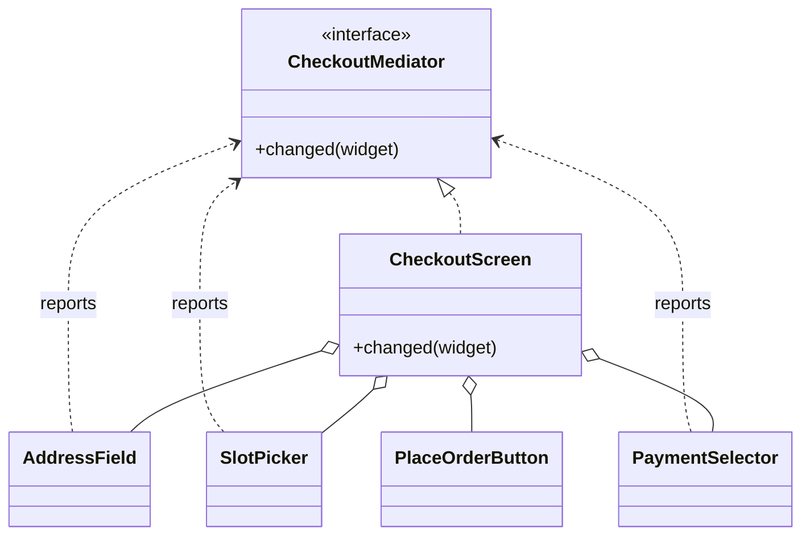
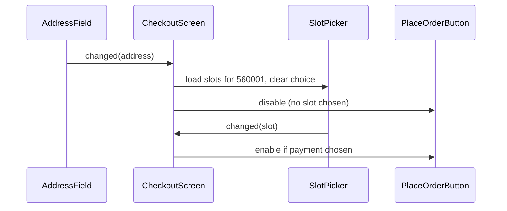

# Mediator

<span class="badge-l2">L2 🔵 Practitioner</span> · <span class="read-time">⏱ 35 min read</span> · Prerequisites: [Observer](../l1-foundations/observer.md), [Facade](../l1-foundations/facade.md)

!!! abstract "TL;DR"
    Mediator puts the coordination between several objects into one place. Instead of every object knowing and calling the others (a web of n² links), each "colleague" talks only to the mediator, which decides who should react. Typical uses: UI screens where fields affect each other, dispatchers matching orders with riders, and in-process buses that route requests to handlers. Keep each mediator focused on one workflow, or it becomes a god class.

## 1. What It Is

**Plain English.** On FreshCart's checkout screen, changing the address must reload delivery slots, clear the chosen slot, and disable the "Place order" button until a slot and payment are chosen again. If each widget called the others directly, every widget would know about every other one. Instead, each widget tells the screen "I changed", and the screen (the mediator) decides what happens next.

**Definition (GoF).** "Define an object that encapsulates how a set of objects interact. Mediator promotes loose coupling by keeping objects from referring to each other explicitly, and it lets you vary their interaction independently." Parts:

- **Mediator:** an interface for colleagues to report events (`changed(widget)`, `orderPacked(id)`).
- **Concrete mediator:** knows the colleagues and contains the coordination rules.
- **Colleagues:** objects that do their own job and report to the mediator instead of calling each other.

## 2. Why It Exists

When objects interact directly, each new rule adds links: n objects can need up to n × (n − 1) references, and the rules end up scattered across all of them. Changing a rule ("clear the payment method when the address has no slots") means finding which classes know about which. A mediator turns that many-to-many web into many-to-one, with the rules in one class that can be read, tested and changed in one place. The colleagues become reusable because they no longer know their neighbours.

## 3. Mental Model / Analogy

**Analogy.** An airport control tower. Planes don't negotiate runway use with each other; each talks to the tower, which tells them when to land or wait. Adding a new plane doesn't require it to know every other plane.

**Technical model.** A hub-and-spoke graph. Colleagues hold a reference to the mediator (often through a narrow interface) and call it on events. The mediator holds references to the colleagues and updates them according to its rules.

## 4. How It Works





## 5. Subtopics

### Mediator and colleagues

**Description.** Colleagues report events to the mediator; the mediator holds the rules that involve several colleagues and updates them. Colleagues don't reference each other at all.

**Advantages / features.** Rules are centralised and readable; colleagues are simpler and reusable; adding a widget affects only the mediator.

**Before:** the address field would hold references to the slot picker, payment selector and button, and each of those would hold references back. **After:**

```java title="MediatorColleaguesDemo.java"
--8<-- "examples/l2-practitioner/mediator/MediatorColleaguesDemo.java"
```

1. Colleagues see only this narrow interface.
2. A colleague does its own job and reports the change; it never calls another widget.
3. The screen is the mediator: it owns the widgets and the rules between them.
4. The cross-widget rule ("button enabled only with a slot and a payment method") lives in exactly one place.

**Run it:** `java MediatorColleaguesDemo.java`

```text
--8<-- "examples/l2-practitioner/mediator/MediatorColleaguesDemo.expected.txt"
```

| Pros | Cons |
|------|------|
| n² links become n | The mediator can grow very large |
| Interaction rules in one place | One more class to read to understand behaviour |
| Colleagues reusable and testable | Colleagues' changes all funnel through one method |

**Use it** when several objects have rules about each other (forms, dashboards, dispatch). **Avoid** it when two objects interact simply; a direct call is clearer.
**Real-world Java:** Swing/JavaFX controllers coordinating form fields; `java.util.Timer` coordinating tasks; Spring's `DispatcherServlet` coordinating handler mappings, adapters and view resolvers.
**Best practice:** give colleagues a narrow mediator interface, not the concrete class. **Gotcha:** a mediator that updates a colleague, which reports back, which triggers another update, can loop; make updates from the mediator not trigger reports (or guard re-entry).

### Event bus as a mediator

**Description.** An in-process event bus is a generic mediator: publishers post events to the bus, subscribers register for event types, and neither knows the other. Unlike a hand-written mediator, the bus has no business rules; it only routes.

**Advantages / features.** Very loose coupling; new reactions added without touching publishers; failures in one subscriber can be isolated.

```java title="EventBusMediatorDemo.java"
--8<-- "examples/l2-practitioner/mediator/EventBusMediatorDemo.java"
```

1. Subscribers register by event type; the bus keeps the list.
2. A failing subscriber is isolated so the others still run.
3. Checkout publishes one event and knows nothing about inventory, analytics or notifications.

**Run it:** `java EventBusMediatorDemo.java`

```text
--8<-- "examples/l2-practitioner/mediator/EventBusMediatorDemo.expected.txt"
```

| Pros | Cons |
|------|------|
| Publishers and subscribers fully decoupled | Flow is hard to follow ("who reacts to this?") |
| Easy to add reactions | Ordering and error handling are implicit |
| Good for cross-module notifications | Overuse turns a codebase into "event spaghetti" |

**Use** a bus for notifications that several modules care about. **Avoid** it for request/response flows where the caller needs a result.
**Real-world Java:** Spring `ApplicationEventPublisher` and `@EventListener` (with `@TransactionalEventListener` for after-commit), Guava `EventBus`, Vert.x event bus.
**Best practice:** document events like an API (name, fields, who publishes). **Gotcha:** Spring events are synchronous by default; a slow listener slows the publisher unless you use `@Async`.

### Mediator vs. Observer

**Description.** Both decouple objects. In **Observer**, a subject broadcasts changes and each observer decides independently what to do; the subject has no coordination logic. In **Mediator**, the mediator contains the logic that involves **several** colleagues ("if stock is low **and** a promo is active, pause the promo **and** reorder more").

**Advantages / features (of knowing the difference).** Put multi-party rules in a mediator and single-party reactions in observers.

```java title="MediatorVsObserverDemo.java"
--8<-- "examples/l2-practitioner/mediator/MediatorVsObserverDemo.java"
```

1. Observer: the subject just notifies; it doesn't know what listeners do.
2. Mediator: knows the promo and the buyer, and coordinates them.
3. The rule needs information about several parties, so it can't live in any single listener.

**Run it:** `java MediatorVsObserverDemo.java`

```text
--8<-- "examples/l2-practitioner/mediator/MediatorVsObserverDemo.expected.txt"
```

| | Observer | Mediator |
|---|----------|----------|
| Direction | One-to-many broadcast | Many-to-many via a hub |
| Logic location | In each observer | In the mediator |
| Knows the others | Subject doesn't know observers' types | Mediator knows all colleagues |
| Typical use | "Something happened" | "Coordinate these parties" |

**Use** Observer for independent reactions; Mediator for rules spanning several objects. **Avoid** chains of observers that trigger each other to implement a multi-party rule; that's a hidden mediator.
**Real-world Java:** Observer: `PropertyChangeListener`, Spring events; Mediator: controllers, dispatchers, workflow coordinators.
**Best practice:** combine them: the mediator can be an observer of colleagues' events. **Gotcha:** an event bus with one subscriber that contains all the rules is a mediator in disguise; name it as one.

### Avoiding the god mediator

**Description.** Because all coordination flows into the mediator, it tends to grow until it knows every colleague and handles every event: a god class that every team edits. The fix is to split mediators by workflow or use case, each with only the colleagues it needs.

**Advantages / features.** Small mediators are readable, testable, and owned by one team; changes have a smaller blast radius.

```java title="GodMediatorDemo.java"
--8<-- "examples/l2-practitioner/mediator/GodMediatorDemo.java"
```

1. Before: one mediator, nine colleagues, nine events, one giant switch.
2. After: one mediator per workflow, each with three colleagues.
3. A change to refunds now touches one small class; shared colleagues like inventory are used by several mediators, which is fine.

**Run it:** `java GodMediatorDemo.java`

```text
--8<-- "examples/l2-practitioner/mediator/GodMediatorDemo.expected.txt"
```

| Signal of a god mediator | Fix |
|--------------------------|-----|
| More than ~7 colleagues | Split by workflow |
| Many unrelated events in one method | One mediator per use case |
| Several teams edit the same mediator | Split along team/bounded-context lines |
| Hard to test without everything | Narrow interfaces for colleagues |

**Use** one mediator per screen, workflow or bounded context. **Avoid** "application-wide" mediators.
**Real-world Java:** large Spring controllers or "manager" services that coordinate everything are the common god mediators.
**Best practice:** name mediators after the workflow (`CheckoutMediator`, `DispatchCoordinator`), not the app. **Gotcha:** splitting can create mediators that call each other; if two mediators coordinate constantly, they may be one workflow, or need events between them.

## 6. Examples (exactly 3, progressively harder)

### Example 1: Minimal (L2)

**Scenario:** packers and riders send messages through the store desk, which routes them by role.

```java title="StoreDeskDemo.java"
--8<-- "examples/l2-practitioner/mediator/StoreDeskDemo.java"
```

1. The desk is the mediator: staff join it and send through it.
2. Routing by role: senders don't know who's on shift.

**Run it:** `java StoreDeskDemo.java`

**Output:**

```text
--8<-- "examples/l2-practitioner/mediator/StoreDeskDemo.expected.txt"
```

**What to notice:**

- Priya didn't need to know which riders were working.

### Example 2: Realistic (in FreshCart grocery delivery)

**Scenario:** packing stations finish orders and riders become free at unpredictable times. A dispatcher matches them: a packed order goes to a waiting rider, or waits for the next free one.

```java title="DispatchMediatorDemo.java"
--8<-- "examples/l2-practitioner/mediator/DispatchMediatorDemo.java"
```

1. Colleagues report only what happened to them.
2. The matching rule works from both sides: a free rider takes the oldest waiting order.
3. One place assigns; it's also where you'd add rules (bulky orders, rider capacity).

**Run it:** `java DispatchMediatorDemo.java`

**Output:**

```text
--8<-- "examples/l2-practitioner/mediator/DispatchMediatorDemo.expected.txt"
```

**What to notice:**

- Neither the packing station nor the rider app knows the other exists.
- Orders were matched first-in, first-out from both directions.

### Example 3: Production-grade

**Scenario:** controllers in the order service shouldn't depend on dozens of services. They send **requests** (`PlaceOrder`, `GetOrderStatus`) to an in-process mediator that routes each to exactly one handler, and handlers publish **notifications** (`OrderPlaced`) that any number of listeners handle. Requirements: missing or duplicate handlers fail at startup; cross-cutting behaviours (logging, validation) wrap every request; a failing listener doesn't break the others and is reported.

```java title="InProcessMediatorDemo.java"
--8<-- "examples/l2-practitioner/mediator/InProcessMediatorDemo.java"
```

1. Exactly one handler per request type; a second registration is a startup error.
2. Startup validation finds request types without handlers before traffic arrives.
3. Behaviours wrap the handler like a filter chain, in registration order.
4. Listener failures are collected (and in production, logged and alerted), not thrown at the publisher.
5. Handlers publish notifications through the mediator; they don't call listeners directly.

**Run it:** `java InProcessMediatorDemo.java`

**Output:**

```text
--8<-- "examples/l2-practitioner/mediator/InProcessMediatorDemo.expected.txt"
```

**What to notice:**

- The loyalty listener failed, but the SMS and stock listeners still ran and the order was placed.
- The empty order was rejected by the validation behaviour before reaching the handler, and the logging behaviour recorded the failure.
- Configuration mistakes (missing or duplicate handlers) surfaced at startup.

## 7. Pros, Cons & Trade-offs

| Aspect | Pros | Cons |
|--------|------|------|
| Coupling | Colleagues don't know each other | Everything depends on the mediator |
| Readability | Rules in one place | Flow hidden behind indirection |
| Change | Rule changes in one class | God mediator risk |
| Reuse | Colleagues reusable elsewhere | Mediators rarely reusable |
| Testability | Rules testable with fake colleagues | Mediator tests need many colleagues |
| Extensibility | New colleagues via the mediator | Mediator grows with each colleague |

## 8. When to Use / When NOT to Use

**Use it when:**

- several objects have interaction rules that involve more than two of them;
- the web of direct references between objects is growing;
- you want the coordination logic visible and testable in one place.

**Don't use it when:**

- two objects interact simply (call directly);
- reactions are independent (use Observer/events);
- the mediator would coordinate unrelated workflows (split first).

## 9. Best Practices

1. **One mediator per workflow or screen.** *(Consensus.)*
2. **Narrow interfaces for colleagues to report through.** *(Consensus.)*
3. **Keep business rules in the mediator, not in an event bus.** *(Opinion, widely shared.)*
4. **Isolate listener failures and report them.** *(Consensus.)*
5. **Validate handler registration at startup.** *(Consensus.)*
6. **Guard against re-entrant update loops.** *(Consensus.)*

## 10. Pitfalls & Anti-Patterns

!!! danger "Re-entrant update loop (production failure mode)"
    **Symptom:** the checkout screen froze on some phones when customers changed their address.
    **Root cause:** the mediator cleared the slot picker, which reported "changed" back to the mediator, which reloaded slots, which cleared the picker again, recursively.
    **Fix:** mediator updates set colleague state directly without triggering reports (or a re-entry flag); a test that changing the address triggers exactly one slot reload.

!!! danger "God mediator"
    **Symptom:** a 3,000-line `OrderCoordinator` with merge conflicts every sprint.
    **Root cause:** every new workflow added a case to the same mediator.
    **Fix:** split by workflow; colleagues stay shared.

!!! danger "Event spaghetti"
    **Symptom:** nobody can explain what happens after `OrderPlaced`; a change broke refunds two modules away.
    **Root cause:** dozens of listeners triggering further events, with rules spread across them.
    **Fix:** put multi-step rules in an explicit mediator or saga; document events and their consumers.

!!! danger "Synchronous listener slows publishers"
    **Symptom:** placing an order took 3 seconds during an analytics outage.
    **Root cause:** a synchronous `@EventListener` called a slow external service.
    **Fix:** `@Async` or an outbox for slow work; timeouts on external calls.

## 11. Configuration & Tuning

| Setting | Default | What it does | When to change it | Risk of changing |
|---------|---------|--------------|-------------------|------------------|
| Spring event listeners | synchronous | Listeners run in the publisher's thread | Slow listeners: `@Async` | Lost events on crash; ordering changes |
| `@TransactionalEventListener(phase)` | `AFTER_COMMIT` | Runs listener after the transaction | Side effects that must not run on rollback | Listener failures don't roll back the transaction |
| `@Order` on listeners | unordered | Listener order | When order matters (rarely should) | Hidden coupling between listeners |
| Async executor size | `SimpleAsyncTaskExecutor` (unbounded threads) in plain Spring | Threads for async listeners | Always configure a bounded executor | Unbounded threads under load |

## 12. Security Considerations

- A mediator that routes requests must still enforce authorisation per request type (a behaviour is a good place).
- Event payloads may be logged or sent to many listeners: keep personal data minimal (IDs, not addresses).
- Don't let external input choose which handler runs by class name.

## 13. Performance & Scalability

A mediator adds an indirection per interaction, which is negligible. The real costs come from what it coordinates: synchronous listeners add their latency to the publisher; a single mediator instance can become a contention point if it holds locks. For high throughput, keep mediators stateless or partition their state (one dispatcher per store), and move slow reactions to asynchronous processing.

## 14. Testing It

Test routing, behaviour order, listener isolation and startup validation:

```java title="InProcessMediatorTest.java"
--8<-- "examples/l2-practitioner/mediator/InProcessMediatorTest.java"
```

## 15. Observability & Operations

Log each request type with timing via a behaviour (one place for all handlers). Count notification-listener failures by listener and alert on them. Spring Boot's `ApplicationStartup` and listener logging help identify slow listeners. Keep a generated list of event types and their listeners in documentation.

## 16. Version Notes

| Version | Change relevant to Mediator |
|---------|-----------------------------|
| Java 1.1 | Event model in AWT; controllers mediating components |
| Spring 4.2 | `@EventListener` and `@TransactionalEventListener` |
| Java 8 | Lambdas: concise listeners and handlers |
| Java 17/21 | Sealed request/notification types; pattern-matching dispatch |
| Spring Modulith 1.x | Application events between modules with an event publication registry |

## 17. Expert Deep Dive

- **Mediator at architecture scale.** An orchestrator in a saga is a mediator across services; choreography (events only) is the observer style. Orchestration makes flows visible; choreography reduces coupling. See [Distributed Data Patterns](../l4-senior/distributed-data-patterns.md).
- **CQRS buses.** Command buses (one handler) and event buses (many handlers) are mediators; pipeline behaviours give cross-cutting concerns without AOP.
- **Modular monoliths.** Spring Modulith uses application events as mediators between modules, with a publication registry that retries listeners after failures, so in-process events become reliable.
- **When the mediator should be a state machine.** If the mediator's rules depend on "where we are in the process", model that explicitly with [State](state.md).

!!! example "War story: the coordinator nobody owned"
    A grocery company's "OrderCoordinator" started as a small mediator between checkout, payments and inventory. Over three years it gained dispatch, refunds, loyalty, promotions and analytics, about 4,000 lines and 22 injected services. A promotions change broke refunds on a holiday weekend because both shared a private helper in the coordinator. **Fixes:** the team split it into workflow mediators (checkout, dispatch, after-sales, merchandising) with module boundaries checked in CI, and cross-workflow reactions moved to documented events. Merge conflicts dropped, and each mediator got one owning team. **Lesson:** a mediator should coordinate one workflow; when it starts coordinating the company, split it.

## 18. Interview Corner

=== "🟢 L1–L2"

    1. **What does Mediator do?** Centralises **interaction between objects** so they don't reference each other.
    2. **What are colleagues?** Objects that **report to the mediator** instead of calling each other.
    3. **Give an example.** A **checkout screen** coordinating address, slots, payment and button.
    4. **What problem does it solve?** A **web of n² references** and scattered rules.
    5. **What's the main risk?** A **god mediator**.

=== "🟡 L3"

    1. **Mediator vs Observer?** Observer **broadcasts**; Mediator **coordinates several parties** with its own logic.
    2. **Is an event bus a mediator?** Yes, a **generic** one without business rules.
    3. **Mediator vs Facade?** Facade **simplifies a subsystem for clients**; Mediator **coordinates peers** that talk through it.
    4. **How do you prevent update loops?** **Don't trigger reports** from mediator-driven updates; re-entry guards.
    5. **Spring events: sync or async?** **Synchronous by default**; use `@Async` or after-commit listeners for side effects.

=== "🔴 L4–L5"

    1. **Orchestration vs choreography?** Orchestrator = **mediator** (visible flow, central control); choreography = **events** (loose coupling, hidden flow).
    2. **How do you split a god mediator?** By **workflow/bounded context**, shared colleagues, events between workflows, module boundaries in CI.
    3. **Design a command bus for an order service.** **One handler per command, pipeline behaviours** (auth, validation, logging, transactions), startup validation.
    4. **How do you make in-process events reliable?** **Publication registry / outbox**, after-commit listeners, retries.
    5. **When is a mediator better modelled as a state machine?** When its rules depend on **process stage**; make states explicit.

=== "💻 Hands-on"

    **Task:** Add a re-entry guard to `MediatorColleaguesDemo.CheckoutScreen.changed`.

    ??? success "Solution"
        ```java
        private boolean updating;
        public void changed(Object widget) {
            if (updating) return;                 // ignore reports caused by our own updates
            updating = true;
            try {
                // ...existing rules...
            } finally {
                updating = false;
            }
        }
        ```

## 19. Practice

- [ ] Add a "delivery tip" widget to `MediatorColleaguesDemo` that is hidden for pickup orders.
    ??? tip "Hint"
        Add a delivery-mode colleague; the rule lives in the mediator.
- [ ] Give `DispatchMediatorDemo` a rule: bulky orders only go to riders with vans.
    ??? tip "Hint"
        Keep free riders by vehicle type; match by order size.
- [ ] Add an authorisation behaviour to `InProcessMediatorDemo` that rejects `PlaceOrder` for blocked customers.
    ??? tip "Hint"
        Check `q instanceof PlaceOrder p` and a blocked set.
- [ ] Find a "manager" or "coordinator" class with more than 10 dependencies and sketch how to split it.
    ??? tip "Hint"
        Group its methods by workflow; each group becomes a mediator.

## 20. Quick Revision Card

!!! tip "Remember in 30 seconds"
    - Intent: centralise how objects interact; colleagues talk to the mediator, not each other.
    - n² links become n; rules live in one place.
    - Event bus = generic mediator; Observer = broadcast without coordination logic.
    - Split mediators by workflow; guard against update loops; isolate listener failures.
    - Production: one handler per request, behaviours around requests, startup validation.

    ```java
    interface CheckoutMediator { void changed(Object widget); }
    class AddressField { void enter(String pin) { this.pin = pin; mediator.changed(this); } }
    ```

## 21. Further Reading

- Gamma, Helm, Johnson, Vlissides, *Design Patterns* (1994), "Mediator".
- [Spring Framework reference: Application events](https://docs.spring.io/spring-framework/reference/core/beans/context-introduction.html#context-functionality-events)
- [Spring Modulith reference: Working with application events](https://docs.spring.io/spring-modulith/reference/events.html)
- Chris Richardson, *Microservices Patterns* (2018), chapter 4 "Managing transactions with sagas" (orchestration vs choreography).
- Eric Freeman and Elisabeth Robson, *Head First Design Patterns* (2nd ed., 2020), appendix "Leftover patterns: Mediator".

---

[← Previous: Chain of Responsibility](chain-of-responsibility.md) · [Next: Memento →](memento.md)
