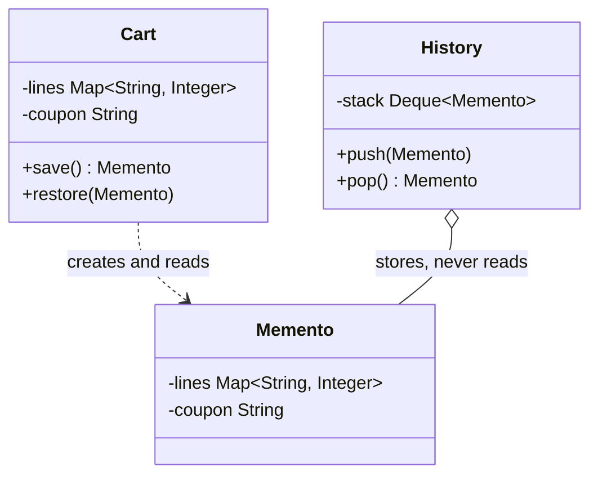
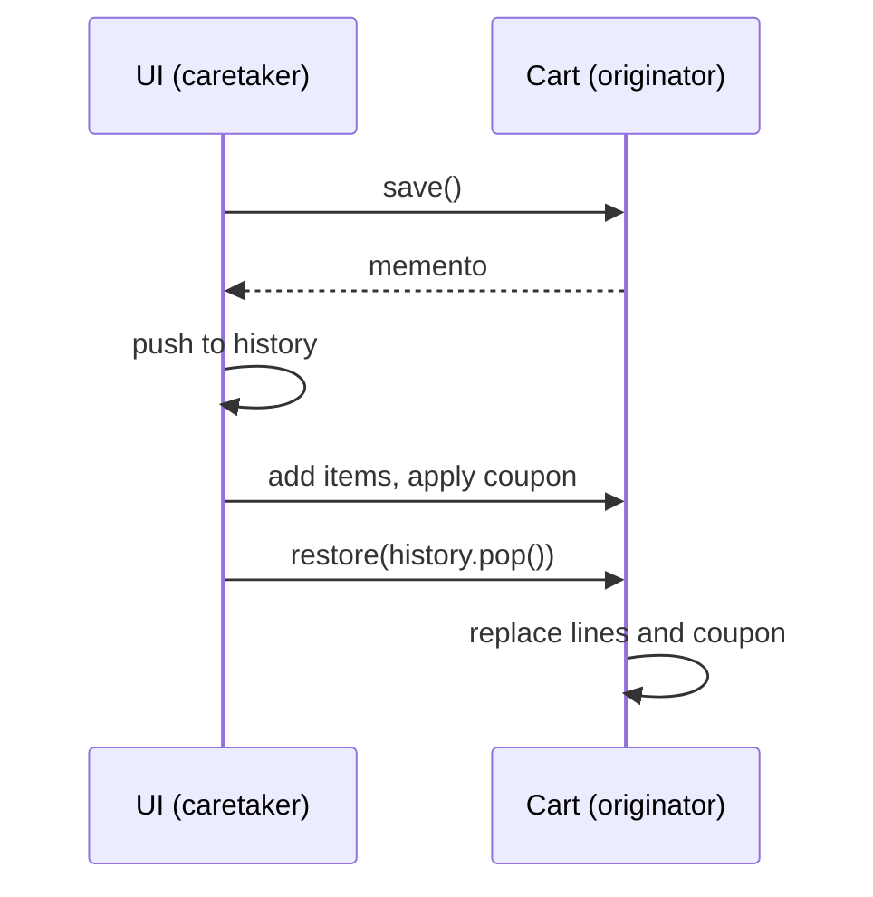

# Memento

<span class="badge-l2">L2 🔵 Practitioner</span> · <span class="read-time">⏱ 30 min read</span> · Prerequisites: [Prototype](prototype.md), [Command](command.md)

!!! abstract "TL;DR"
    Memento captures an object's state as a snapshot, without exposing its internals, so the object can be restored later: undo, "discard changes", checkpoints before risky operations, and drafts saved for later. The object (originator) creates and restores its own snapshots; another object (caretaker) stores them without looking inside. In Java, a deeply immutable `record` is a natural memento. Watch the memory cost: big state with small changes may be better served by storing changes (Command) instead of full copies.

## 1. What It Is

**Plain English.** A FreshCart customer taps "Add all recipe ingredients" and six items land in the cart. They change their mind. The app saved a checkpoint of the cart just before the bulk add, so one tap restores exactly the earlier cart, including the delivery fee it had. That checkpoint is a memento.

**Definition (GoF).** "Without violating encapsulation, capture and externalize an object's internal state so that the object can be restored to this state later." Parts:

- **Originator:** the object whose state is saved (`Cart`); it creates mementos and restores from them.
- **Memento:** the snapshot; opaque to everyone except the originator.
- **Caretaker:** keeps mementos (a history stack, a draft store) but never reads or changes their contents.

## 2. Why It Exists

To undo or roll back, someone needs the old state. If outside code copies an object's fields through getters, encapsulation breaks: every caller must know every field, copies are easily shallow (sharing mutable lists), and adding a field silently breaks restoring. Memento puts the knowledge of "what makes up my state" inside the object itself, and gives everyone else an opaque token they can store and hand back.

## 3. Mental Model / Analogy

**Analogy.** A game's save point. The game decides what goes into a save file; you only see "Save slot 3, Tuesday 10:42" and can load it. You don't edit the save file, and a new game version knows how to read old saves.

**Technical model.** `originator.save()` returns an immutable value capturing the state; `originator.restore(memento)` replaces the current state with it. The caretaker holds mementos in some structure (stack, map, database) and decides when to discard them.

## 4. How It Works





## 5. Subtopics

### Originator, memento and caretaker

**Description.** The originator knows its own fields and is the only class that creates or reads mementos. In Java, a private nested class (or a record with package-private access) keeps the memento's contents hidden from caretakers. The caretaker just stores and returns mementos.

**Advantages / features.** Encapsulation stays intact; adding a field means updating `save`/`restore` in one class; caretakers are generic.

**Before (caller copies internals) and after (originator-made mementos):**

```java title="OriginatorMementoCaretakerDemo.java"
--8<-- "examples/l2-practitioner/memento/OriginatorMementoCaretakerDemo.java"
```

1. Before: public mutable fields; the "saved copy" is the same map, so it changes with the cart.
2. A nested memento with a private constructor and private fields: only `Cart` can create or read it.
3. The cart copies its own state into the memento, so the snapshot is independent.
4. The caretaker (a history stack) stores mementos without knowing what's inside.

**Run it:** `java OriginatorMementoCaretakerDemo.java`

```text
--8<-- "examples/l2-practitioner/memento/OriginatorMementoCaretakerDemo.expected.txt"
```

| Pros | Cons |
|------|------|
| Encapsulation preserved | Full copies cost memory and time |
| Restore logic lives with the state | Caretaker can't inspect or diff mementos |
| Works for any kind of change | Restoring external side effects isn't possible |

**Use it** for undo, cancel/discard, checkpoints and drafts. **Avoid** it for state that can't be captured (open connections, sent emails).
**Real-world Java:** `javax.swing.text` undoable edits store state needed to revert; IDE "local history"; serialisation-based checkpoints.
**Best practice:** include derived state (totals, fees) or recompute it on restore, consistently. **Gotcha:** a memento that holds references to mutable objects isn't a snapshot; always copy.

### Immutable snapshots with records

**Description.** A Java `record` is a concise, immutable carrier, which makes it a natural memento, but records are only **shallowly** immutable. A record holding a `List` keeps a reference to that list; if the originator later changes the list, the "snapshot" changes too. Copy collections in the compact constructor (`List.copyOf`, `Map.copyOf`).

**Advantages / features.** Short to write, `equals` for comparing snapshots, safe to share between threads once deeply immutable.

```java title="RecordSnapshotDemo.java"
--8<-- "examples/l2-practitioner/memento/RecordSnapshotDemo.java"
```

1. A record holding the caller's list: later edits leak into the snapshot.
2. The compact constructor copies the list into an unmodifiable one.
3. The copied list can't be modified by anyone, so the snapshot stays true.

**Run it:** `java RecordSnapshotDemo.java`

```text
--8<-- "examples/l2-practitioner/memento/RecordSnapshotDemo.expected.txt"
```

| Copy method | Immutable | Keeps order | Allows nulls |
|-------------|-----------|-------------|--------------|
| `List.copyOf` | Yes | Yes | No |
| `Map.copyOf` | Yes | **No** (unspecified order) | No |
| `Collections.unmodifiableMap(new LinkedHashMap<>(m))` | Yes (wrapper over a private copy) | Yes | Yes |
| `new ArrayList<>(list)` | No | Yes | Yes |

**Use** records with defensive copies for mementos. **Avoid** `Map.copyOf` when order matters (cart lines, form steps); its iteration order is unspecified and can differ between runs.
**Real-world Java:** immutable value objects in domain models; event payloads.
**Best practice:** copy nested mutable objects too (or make them records). **Gotcha:** `List.copyOf` throws on `null` elements; decide whether nulls are valid before choosing it.

### Undo history

**Description.** A caretaker that keeps snapshots in two stacks gives undo and redo: before each change push the current snapshot to undo; undo moves current to redo and pops undo; a new change clears redo. A size limit drops the oldest snapshots so memory stays bounded.

**Advantages / features.** Simple, general undo for any editor-like feature, with predictable memory.

```java title="UndoHistoryDemo.java"
--8<-- "examples/l2-practitioner/memento/UndoHistoryDemo.java"
```

1. The whole banner is a small immutable record, so a snapshot is cheap.
2. The history keeps at most `limit` snapshots; the oldest is dropped.
3. A new edit clears redo; redoing old edits after a new one would be confusing.
4. Redo pushes the current state back onto undo.

**Run it:** `java UndoHistoryDemo.java`

```text
--8<-- "examples/l2-practitioner/memento/UndoHistoryDemo.expected.txt"
```

| Undo approach | Stores | Best for |
|---------------|--------|----------|
| Memento snapshots | Whole state per step | Small state, complex changes |
| Command inverses | Change per step | Large state, simple reversible changes |
| Event sourcing | All events forever | Audit, time travel, rebuilds |

**Use** snapshots when state is small and changes are varied. **Avoid** unlimited histories; users rarely undo more than a few dozen steps.
**Real-world Java:** form editors, admin consoles, drawing tools; see [Command](command.md) for inverse-operation undo.
**Best practice:** coalesce rapid edits (typing) into one undo step. **Gotcha:** if snapshots are taken after the change instead of before, undo jumps two steps.

### Memory cost of snapshots

**Description.** A full snapshot copies all state each time. With large state and small edits, that's mostly duplicate data. Alternatives: store **deltas** (the change and its inverse, i.e. commands), or use **persistent data structures** that share unchanged parts between versions.

**Advantages / features (of measuring).** You choose the right undo strategy before memory becomes a problem.

```java title="SnapshotMemoryDemo.java"
--8<-- "examples/l2-practitioner/memento/SnapshotMemoryDemo.java"
```

1. Full snapshots: 50 edits on 10,000 prices copy 500,000 entries.
2. Deltas: 50 tiny records with old and new values.
3. Applying deltas in reverse reproduces the first snapshot exactly.

**Run it:** `java SnapshotMemoryDemo.java`

```text
--8<-- "examples/l2-practitioner/memento/SnapshotMemoryDemo.expected.txt"
```

| Strategy | Memory per step | Restore cost | Complexity |
|----------|-----------------|--------------|------------|
| Full snapshot | O(state) | O(state) | Low |
| Delta / inverse command | O(change) | O(steps undone) | Medium: each change needs an inverse |
| Persistent structure (structural sharing) | O(change × log n) | O(1) to switch versions | Needs a library (e.g. Vavr, PCollections) |

**Use** full snapshots for small state (forms, banners, carts). **Avoid** them for large catalogues or documents; use deltas or structural sharing.
**Real-world Java:** Git stores snapshots with structural sharing; databases use write-ahead logs (deltas).
**Best practice:** estimate state size × history depth before choosing. **Gotcha:** deltas must be applied in exact reverse order; skipping or reordering corrupts state.

## 6. Examples (exactly 3, progressively harder)

### Example 1: Minimal (L2)

**Scenario:** a support agent's reply box saves a draft; an accidental "select all, delete" can be undone.

```java title="ReplyDraftDemo.java"
--8<-- "examples/l2-practitioner/memento/ReplyDraftDemo.java"
```

1. The draft is a record: text and cursor position together.
2. Restoring puts both back, so typing continues where it was.

**Run it:** `java ReplyDraftDemo.java`

**Output:**

```text
--8<-- "examples/l2-practitioner/memento/ReplyDraftDemo.expected.txt"
```

**What to notice:**

- The cursor position was part of the state; restoring only the text would put the cursor in the wrong place.

### Example 2: Realistic (in FreshCart grocery delivery)

**Scenario:** "Add recipe ingredients" adds several items at once, which also changes the delivery fee (free above five lines). Customers need a single "Undo" for the whole bulk add.

```java title="CartCheckpointDemo.java"
--8<-- "examples/l2-practitioner/memento/CartCheckpointDemo.java"
```

1. The checkpoint includes derived state (the fee), with an ordered, unmodifiable copy of the lines.
2. Rollback restores every part of the state at once.
3. The checkpoint is taken before the bulk change, not after.

**Run it:** `java CartCheckpointDemo.java`

**Output:**

```text
--8<-- "examples/l2-practitioner/memento/CartCheckpointDemo.expected.txt"
```

**What to notice:**

- Paneer was already in the cart; undo restored its quantity to 1 rather than removing it, which "remove the recipe items" logic would get wrong.
- The delivery fee came back too.

### Example 3: Production-grade

**Scenario:** a new store's onboarding form has five steps and is often finished on another device days later. Drafts are persisted mementos. Requirements: a schema version with migration from older drafts; corruption detection; a size limit; expiry after 30 days; restore goes through the form, which validates the snapshot.

```java title="FormDraftStoreDemo.java"
--8<-- "examples/l2-practitioner/memento/FormDraftStoreDemo.java"
```

1. The originator validates a snapshot before accepting it; stored data is untrusted input.
2. A size limit stops a runaway field from filling the store.
3. A checksum detects corrupted or tampered drafts.
4. Expired drafts are deleted on read, as the retention policy requires.
5. Version 1 drafts used the field `gst`; the loader migrates them to `gstin`.

**Run it:** `java FormDraftStoreDemo.java`

**Output:**

```text
--8<-- "examples/l2-practitioner/memento/FormDraftStoreDemo.expected.txt"
```

**What to notice:**

- The draft saved on the phone resumed on the laptop at step 3 with both fields.
- An old v1 draft loaded correctly after migration; a one-character corruption was detected.
- The 40-day-old draft was discarded and removed.

## 7. Pros, Cons & Trade-offs

| Aspect | Pros | Cons |
|--------|------|------|
| Encapsulation | Internals stay private | Caretaker can't inspect snapshots |
| Simplicity | Undo for any change | Full copies for every step |
| Correctness | Restores exact state, including derived values | Shallow copies silently break it |
| Memory | Bounded histories are predictable | Large state × deep history is expensive |
| Persistence | Drafts and checkpoints survive restarts | Needs versioning and migration |
| Side effects | — | Can't undo external effects (emails, payments) |

## 8. When to Use / When NOT to Use

**Use it when:**

- users need undo, "discard changes" or checkpoints;
- you must roll back an object after a failed multi-step operation;
- work-in-progress must be saved and resumed later (drafts).

**Don't use it when:**

- state is huge and changes are small (store deltas instead);
- the change affected external systems (use compensation);
- a database transaction already gives you rollback.

## 9. Best Practices

1. **Let the originator create and restore mementos.** *(Consensus.)*
2. **Make mementos deeply immutable** (records with copied collections). *(Consensus.)*
3. **Bound histories** and coalesce rapid edits. *(Consensus.)*
4. **Version persisted mementos** and migrate on read. *(Consensus.)*
5. **Validate on restore**: stored snapshots are untrusted input. *(Consensus.)*
6. **Capture before the change**, never after. *(Consensus.)*

## 10. Pitfalls & Anti-Patterns

!!! danger "Shallow snapshot (production failure mode)"
    **Symptom:** "Undo" on the promo editor did nothing for item lists; the banner kept the newest items.
    **Root cause:** the snapshot record held the editor's live `List`, so later edits changed the "saved" list too.
    **Fix:** `List.copyOf` in the record's compact constructor; a unit test that edits after saving and checks the snapshot.

!!! danger "Unbounded history"
    **Symptom:** the admin app's memory grew steadily during long editing sessions until the tab crashed.
    **Root cause:** a full catalogue snapshot was pushed on every keystroke, with no limit.
    **Fix:** coalesce typing into one step, cap history, store deltas for large state.

!!! danger "Old drafts break after a release"
    **Symptom:** after renaming a form field, managers resuming drafts lost their GST numbers.
    **Root cause:** persisted drafts had no version and no migration.
    **Fix:** schema versions and migration on load, as in Example 3; tests with real old drafts.

!!! danger "Restoring part of the state"
    **Symptom:** after undo, the cart showed old items but the new delivery fee.
    **Root cause:** the memento didn't include derived state, and restore didn't recompute it.
    **Fix:** include it or recompute on restore, consistently.

## 11. Configuration & Tuning

| Setting | Default | What it does | When to change it | Risk of changing |
|---------|---------|--------------|-------------------|------------------|
| History limit | 20–100 steps typical | Max undo depth | Large state: lower | Too low frustrates users |
| Coalescing window | ~500 ms–1 s | Groups rapid edits into one step | Text editing | Too long: undo jumps too far |
| Draft TTL | 30 days (example) | Retention of saved drafts | Legal/retention policy | Too short loses work; too long keeps personal data |
| Max draft size | a few KB | Protects storage | Large forms | Too low rejects real drafts |

## 12. Security Considerations

- Persisted mementos may hold personal data (addresses, tax IDs): encrypt at rest, apply retention limits, and delete them when the user deletes their account.
- Treat stored mementos as untrusted: validate on restore, check integrity (checksum or signature if clients can modify them).
- Never deserialise drafts with Java native serialisation (`ObjectInputStream`) from untrusted sources; use a data format and explicit parsing.

## 13. Performance & Scalability

Snapshot cost is proportional to state size, paid on every save. For small objects it's negligible; for large ones, measure. Persistent collections share structure, so "copying" a large map after one change costs only the changed path. For persisted drafts, write asynchronously and debounce (save at most every few seconds) to avoid hammering the database while users type.

## 14. Testing It

Test round trips, migration, corruption, expiry and validation on restore:

```java title="FormDraftStoreTest.java"
--8<-- "examples/l2-practitioner/memento/FormDraftStoreTest.java"
```

## 15. Observability & Operations

Track draft saves, restores, migrations by version, corruption and expiry counts. A rise in corruption points at storage or encoding bugs; old versions still being restored tell you when a migration path can be removed. For in-app undo, count undo usage per feature to tune history limits.

## 16. Version Notes

| Java | Change relevant to Memento |
|------|----------------------------|
| 1.1 | Serialization (avoid for untrusted data) |
| 9 | `List.of`, `Map.of`; 10: `List.copyOf`, `Map.copyOf` |
| 16 | Records: concise immutable snapshots |
| 17 | Deserialization filters (JEP 415) if you must use Java serialisation |
| 21 | Sequenced collections: ordered copies are easier to reason about |

## 17. Expert Deep Dive

- **Memento vs Prototype.** Both copy state. [Prototype](prototype.md) creates a new usable object; a memento is a passive snapshot that only the originator can turn back into state.
- **Event sourcing as "infinite memento".** Store every event and rebuild any past state by replay; snapshots (mementos) are then an optimisation to avoid replaying from the beginning.
- **Structural sharing.** Persistent data structures (hash array mapped tries, as in Clojure, Scala, Vavr) make "snapshot every step" cheap by sharing unchanged branches. This is how many modern UIs implement undo.
- **Checkpoints in long jobs.** Batch jobs (Spring Batch's `ExecutionContext`) store checkpoints so a failed job can resume from the last committed chunk; that's Memento applied to processes.

!!! example "War story: the undo that leaked prices"
    A grocery admin tool let category managers edit a price list and undo changes. Snapshots were records holding the live `Map` of prices. After an "undo", managers saw correct values on screen (re-rendered from the snapshot), but the shared map had kept the newer prices, which were saved on the next "Publish". For two days, discounts that managers believed they had undone went live. **Fixes:** snapshots copy the map; "Publish" shows a diff against the live catalogue; and a test edits after saving, undoes, and asserts the published values. **Lesson:** a memento that shares mutable state isn't a memento.

## 18. Interview Corner

=== "🟢 L1–L2"

    1. **What does Memento do?** Saves an object's **state as a snapshot** to restore later, **without exposing internals**.
    2. **Name the roles.** **Originator, memento, caretaker.**
    3. **Give a use case.** **Undo**, discard changes, drafts, checkpoints.
    4. **Why should mementos be immutable?** So the saved state **can't change** after saving.
    5. **Who can read a memento's contents?** Only the **originator**.

=== "🟡 L3"

    1. **Why are records only shallowly immutable?** They hold **references**; mutable collections inside can still change; copy them.
    2. **Memento vs Command for undo?** Memento stores **state**; Command stores **changes and inverses**.
    3. **How do you bound undo memory?** **History limits**, coalescing, deltas for large state.
    4. **Why version persisted mementos?** Fields change; **old drafts must migrate**.
    5. **What can't Memento undo?** **External side effects** (emails, payments).

=== "🔴 L4–L5"

    1. **Design undo for a 50,000-row price editor.** **Deltas or persistent structures**, coalescing, bounded history, publish with diff.
    2. **Event sourcing vs snapshots?** Events are the **source of truth**; snapshots **speed up rebuilding**.
    3. **How do you store user drafts safely?** **Versioned format, validation, integrity checks, encryption, TTL**, deletion on account removal.
    4. **How do you make a long batch job resumable?** **Checkpoints** (last committed position) in durable storage; idempotent chunks.
    5. **What are persistent data structures and why use them?** Versions **share unchanged parts**: cheap snapshots, safe concurrent reads.

=== "💻 Hands-on"

    **Task:** Make `UndoHistoryDemo` coalesce edits that happen within 1 second into one undo step.

    ??? success "Solution"
        ```java
        private Instant lastSave = Instant.MIN;
        void saved(Banner before, Instant now) {
            if (Duration.between(lastSave, now).toMillis() < 1_000 && !undo.isEmpty()) {
                lastSave = now;            // same burst: keep the earlier snapshot
                return;
            }
            undo.push(before);
            if (undo.size() > limit) undo.removeLast();
            redo.clear();
            lastSave = now;
        }
        ```

## 19. Practice

- [ ] Add a `coupon` to `CartCheckpointDemo` and make sure undo restores it.
    ??? tip "Hint"
        Add it to the `Checkpoint` record and to `rollback`.
- [ ] Replace full snapshots in `SnapshotMemoryDemo` with a persistent map from a library and compare memory.
    ??? tip "Hint"
        Vavr's `HashMap.put` returns a new map sharing structure.
- [ ] Add a v2 → v3 migration to `FormDraftStoreDemo` that splits `storeName` into `brand` and `area`.
    ??? tip "Hint"
        Chain migrations: v1 → v2 → v3 in order.
- [ ] Find a "cancel edits" feature in an app you know and check whether it copies state deeply.
    ??? tip "Hint"
        Look for lists or maps stored in the "original" object.

## 20. Quick Revision Card

!!! tip "Remember in 30 seconds"
    - Intent: snapshot an object's state to restore later, keeping internals private.
    - Originator makes and restores; caretaker stores; memento is opaque and immutable.
    - Records + `List.copyOf` / ordered unmodifiable copies; never share mutable collections.
    - Undo: two stacks, a limit, new change clears redo.
    - Large state: deltas or structural sharing; persisted drafts need versions, checks and TTL.

    ```java
    record Checkpoint(Map<String, Integer> lines, long fee) { }
    Checkpoint before = cart.checkpoint();
    // ...bulk change...
    cart.rollback(before);
    ```

## 21. Further Reading

- Gamma, Helm, Johnson, Vlissides, *Design Patterns* (1994), "Memento".
- [JEP 395: Records](https://openjdk.org/jeps/395)
- [javax.swing.undo package documentation](https://docs.oracle.com/en/java/javase/21/docs/api/java.desktop/javax/swing/undo/package-summary.html)
- [Vavr collections (persistent data structures)](https://docs.vavr.io/#_collections)
- Joshua Bloch, *Effective Java* (3rd ed., 2018), Item 50 "Make defensive copies when needed".

---

[← Previous: Mediator](mediator.md) · [Next: Visitor →](visitor.md)
