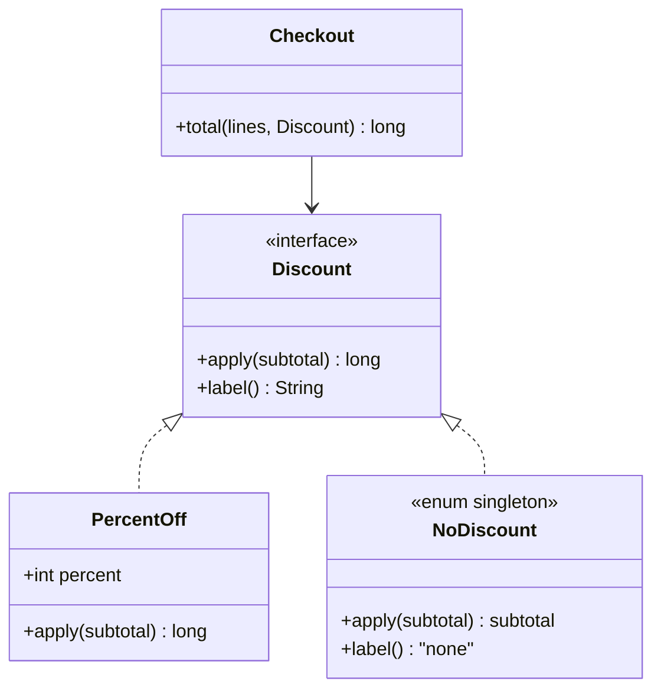
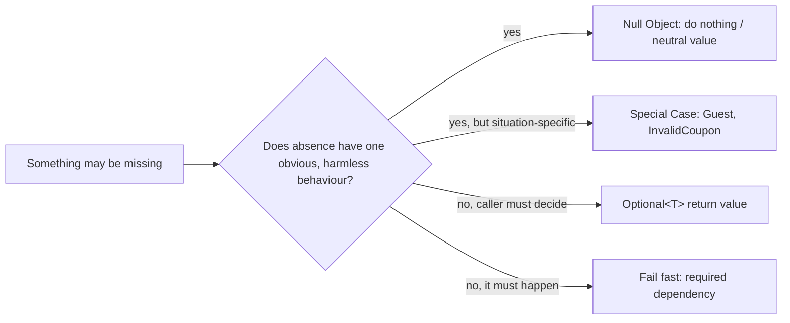

# Null Object

<span class="badge-l2">L2 🔵 Practitioner</span> · <span class="read-time">⏱ 30 min read</span> · Prerequisites: [Strategy](../l1-foundations/strategy.md), [Polymorphism](../l1-foundations/oop-refresher.md)

!!! abstract "TL;DR"
    A Null Object is an implementation of an interface that does nothing, used instead of `null` when "nothing" has one obvious meaning: no discount, no notification, no metrics. Callers stop writing `if (x != null)`, and `NullPointerException`s from forgotten checks disappear. Its bigger sibling, the Special Case, gives specific, sensible answers for situations like "guest customer" or "invalid coupon". Use `Optional` instead when the caller must decide what absence means, and never use a Null Object for something that must happen, such as a payment.

## 1. What It Is

**Plain English.** FreshCart's checkout asks a `Discount` to adjust the total. Most carts have no discount. Instead of passing `null` and checking for it everywhere, pass `NoDiscount`, a discount that returns the total unchanged. The checkout code treats every cart the same way.

**Definition (Woolf, *Pattern Languages of Program Design 3*, 1997).** "A Null Object provides a surrogate for another object that shares the same interface but does nothing." Parts:

- **Abstract object:** the interface clients use (`Discount`, `Notifier`).
- **Real object:** an implementation with behaviour (`PercentOff`, `SmsNotifier`).
- **Null object:** an implementation whose methods do nothing or return neutral values (`0`, empty list, the input unchanged). Usually a singleton.
- **Client:** calls the interface without checking for `null`.

## 2. Why It Exists

Tony Hoare called `null` his "billion-dollar mistake": every reference may be missing, and the compiler doesn't make you check. Code fills with defensive `if (x != null)`, and the one place someone forgets crashes in production. When absence has a single, harmless meaning, encoding that meaning in an object removes both the checks and the crashes, and keeps the decision ("what does no discount mean?") in one place.

## 3. Mental Model / Analogy

**Analogy.** A shop's "no discount" option on the till is a real button that applies a 0% discount. The cashier presses one button for every customer instead of first asking "is there a discount at all?".

**Technical model.** Polymorphism replaces a conditional: the `if (discount == null)` branch moves into a class whose methods are the "else" behaviour. The decision is made once, when the object is chosen (often at wiring time), not at every call.

## 4. How It Works





## 5. Subtopics

### Null Object structure

**Description.** Implement the interface with methods that do nothing or return a neutral value: the identity for the operation (subtotal unchanged, `0` points, empty list), and a harmless description (`"none"`). Because it has no state, make it a singleton; an `enum` with one constant is the simplest thread-safe way.

**Advantages / features.** No `null` checks in callers; no NPEs from forgotten checks; the meaning of "nothing" is defined and tested in one place.

**Before (null and checks) and after (Null Object):**

```java title="NullObjectStructureDemo.java"
--8<-- "examples/l2-practitioner/null-object/NullObjectStructureDemo.java"
```

1. Before: every method that touches the discount needs this check, and `receiptBefore` forgot it.
2. The Null Object: same interface, neutral behaviour, a single shared instance.
3. After: no branches; "no discount" flows through the same code as any other discount.

**Run it:** `java NullObjectStructureDemo.java`

```text
--8<-- "examples/l2-practitioner/null-object/NullObjectStructureDemo.expected.txt"
```

| Method kind | Neutral value | Example |
|-------------|---------------|---------|
| Transform a value | Return the input | `apply(subtotal) -> subtotal` |
| Compute an amount | `0` | `loyaltyPoints() -> 0` |
| Return a collection | Empty, immutable | `List.of()` |
| Side effect | Do nothing | `send(...) {}` |
| Description | A clear word | `"none"` |
| Boolean query | The safe answer | `canUseCashOnDelivery() -> false` |

**Use** a Null Object when an optional collaborator's absence means "skip it". **Avoid** it when callers need to know the value was missing.
**Real-world Java:** `Collections.emptyList()`, `OutputStream.nullOutputStream()` and `Writer.nullWriter()` (Java 11), SLF4J's `NOPLogger`, Micrometer's `NoopCounter`, OpenTelemetry's no-op `Tracer`.
**Best practice:** return empty collections, never `null` collections (Effective Java Item 54). **Gotcha:** a Null Object's "neutral" value must be neutral for **every** caller; `0` is neutral for a sum but not for a minimum.

### Null Object vs. Optional

**Description.** `Optional<T>` (Java 8) is a return type that says "there may be no value; you decide what to do". A Null Object says "absence has one behaviour, already decided". Lookups (`findByPhone`) return `Optional`, because different callers react differently (greet as new, ask to sign up, return 404). Collaborators (`Notifier`) use Null Objects, because "no notifier" always means "don't notify".

**Advantages / features.** Each tool fits a different question; using the right one makes intent visible in the type.

```java title="NullObjectVsOptionalDemo.java"
--8<-- "examples/l2-practitioner/null-object/NullObjectVsOptionalDemo.java"
```

1. A lookup may find nothing, and the meaning depends on the caller, so it returns `Optional`.
2. "No notifier" has one meaning everywhere: do nothing. That's a Null Object.
3. Here the caller decides what a missing customer means at this point in the flow.

**Run it:** `java NullObjectVsOptionalDemo.java`

```text
--8<-- "examples/l2-practitioner/null-object/NullObjectVsOptionalDemo.expected.txt"
```

| Question | Use | Example |
|----------|-----|---------|
| Lookup may find nothing; callers react differently | `Optional<T>` return | `findCustomer(phone)` |
| Optional collaborator; absent means skip | Null Object | `NoNotifier`, `NoMetrics` |
| Absent or odd case with specific behaviour | Special Case | `Guest`, `InvalidCoupon` |
| Must exist | Fail fast (`requireNonNull`) | `PaymentGateway` |
| Field or parameter | Neither `Optional` nor `null`: overloads, defaults or a Null Object | `Order(Discount d)` |

**Use** `Optional` for return values only. **Avoid** `Optional` fields, parameters and collections of `Optional`; the JDK designers intended it as a return type.
**Real-world Java:** `Stream.findFirst()`, `Map.entry` lookups via `Optional.ofNullable(map.get(k))`, Spring Data `findById` returning `Optional`.
**Best practice:** `orElseThrow()` when absence is a bug, `map(...).orElse(...)` when there is a default. **Gotcha:** `Optional.get()` without checking just moves the NPE to a `NoSuchElementException`.

### Special Case pattern

**Description.** Martin Fowler's *Special Case* (*Patterns of Enterprise Application Architecture*, 2002) generalises Null Object: a subclass for a particular situation that gives specific, sensible answers. A missing customer becomes `Guest` (greeting "Sign in to earn points", no cash on delivery); a blocked one becomes `Blocked`. Null Object is the special case for absence.

**Advantages / features.** Business rules for unusual situations live in one class; callers stay simple; with a sealed interface, code that does need to tell cases apart can still `switch` on them.

```java title="SpecialCaseDemo.java"
--8<-- "examples/l2-practitioner/null-object/SpecialCaseDemo.java"
```

1. `Guest` is more than "nothing": it has its own greeting and rules.
2. A second special case for a situation that isn't absence at all.
3. The lookup turns `null` and "not found" into a special case at the boundary, so nothing downstream sees `null`.

**Run it:** `java SpecialCaseDemo.java`

```text
--8<-- "examples/l2-practitioner/null-object/SpecialCaseDemo.expected.txt"
```

| | Null Object | Special Case |
|-|-------------|--------------|
| Represents | Absence | Any unusual situation (absent, unknown, blocked, unavailable) |
| Behaviour | Neutral / nothing | Specific to the situation |
| State | None (singleton) | May carry data (`code`, `reason`) |
| Typical number | One per interface | Several per interface |

**Use** Special Case when an unusual situation has its own rules. **Avoid** stuffing many special cases into one class with flags; that brings the conditionals back.
**Real-world Java:** `Collections.emptyList()` (a special case of `List`), `Duration.ZERO`, `BigDecimal.ZERO`, `Locale.ROOT`.
**Best practice:** convert `null` to a special case at the boundary (repository, HTTP client) and never let `null` past it. **Gotcha:** special cases must not hide errors; "unknown customer" is fine, "database down" usually is not.

## 6. Examples (exactly 3, progressively harder)

### Example 1: Minimal (L2)

**Scenario:** TextBlast sends an order SMS to customers who opted in. Checkout shouldn't care who opted in.

```java title="NoOpNotifierDemo.java"
--8<-- "examples/l2-practitioner/null-object/NoOpNotifierDemo.java"
```

1. The Null Object: accepts the call, does nothing.
2. The choice is made once, when the notifier is created.

**Run it:** `java NoOpNotifierDemo.java`

**Output:**

```text
--8<-- "examples/l2-practitioner/null-object/NoOpNotifierDemo.expected.txt"
```

**What to notice:**

- Both orders called `orderPlaced`; only one SMS went out, and no code checked the preference.

### Example 2: Realistic (in FreshCart grocery delivery)

**Scenario:** a promo code box at checkout. Customers leave it empty, type a valid code, mistype one, or use an expired one. Each case must produce the right total and the right message, and the pricing code must stay simple.

```java title="CouponCheckoutDemo.java"
--8<-- "examples/l2-practitioner/null-object/CouponCheckoutDemo.java"
```

1. The Null Object for "no code typed": no discount, no message.
2. Special cases for bad codes: no discount, but a helpful message with the code.
3. All the branching happens once, when the typed text is turned into a `Coupon`.

**Run it:** `java CouponCheckoutDemo.java`

**Output:**

```text
--8<-- "examples/l2-practitioner/null-object/CouponCheckoutDemo.expected.txt"
```

**What to notice:**

- `checkout` has no `if` about coupons; it only formats the message if there is one.
- The cap applied on the big cart (Rs 100, not Rs 250).
- `" fresh10 "` was normalised at the boundary.

### Example 3: Production-grade

**Scenario:** FreshCart's checkout has a required payment gateway and optional SMS, metrics and loyalty services that can be switched off per environment or during incidents. Requirements: no `null` checks in checkout; never start without payments; disabled features must be visible at startup and in counters; when loyalty is off, the receipt must say points are pending rather than silently showing 0.

```java title="CheckoutWiringDemo.java"
--8<-- "examples/l2-practitioner/null-object/CheckoutWiringDemo.java"
```

1. A Null Object that counts what it swallowed. "Doing nothing" is now measurable and can be exported as a metric.
2. A Special Case for an unavailable service: it gives a safe answer (0 points), reports `degraded()`, and records what's owed so it can be paid later.
3. Wiring picks real or null implementations once. The required collaborator is checked with `requireNonNull` and never replaced.
4. Checkout calls every collaborator unconditionally.
5. The startup log lists disabled features, so a missing SMS isn't a mystery.

**Run it:** `java CheckoutWiringDemo.java`

**Output:**

```text
--8<-- "examples/l2-practitioner/null-object/CheckoutWiringDemo.expected.txt"
```

**What to notice:**

- The receipt says `loyaltyDegraded=true`, so the app can show "points pending".
- Two SMS were suppressed and counted.
- The app refused to start without a payment gateway.

## 7. Pros, Cons & Trade-offs

| Aspect | Pros | Cons |
|--------|------|------|
| Safety | No NPEs from forgotten checks | Can hide real errors if misused |
| Readability | Callers have no branches | Behaviour of "nothing" is in another file |
| Cohesion | Meaning of absence defined once | One more class per interface |
| Performance | Singleton, no allocation | Calls still happen (negligible) |
| Debugging | Fewer crashes | "Why didn't the SMS go out?" is harder without logs and counters |

## 8. When to Use / When NOT to Use

**Use it when:**

- an optional collaborator's absence means "skip it" (logging, metrics, notifications, caching);
- a default has a clear neutral behaviour (no discount, empty list);
- unusual situations have their own rules (guest, invalid coupon): use Special Case.

**Don't use it when:**

- callers need to know the value was missing: return `Optional`;
- the operation must happen (payment, stock reservation, audit): fail fast;
- the "neutral" answer is wrong for some callers.

## 9. Best Practices

1. **Make Null Objects stateless singletons**, ideally an `enum`. *(Consensus.)*
2. **Return empty collections, never `null`.** *(Consensus, Effective Java Item 54.)*
3. **Convert `null` to a special case at the boundary** and keep it out of the domain. *(Consensus.)*
4. **Never use a Null Object for required behaviour;** use `Objects.requireNonNull` at construction. *(Consensus.)*
5. **Make "nothing" observable:** log disabled features at startup, count suppressed calls. *(Opinion, widely shared.)*
6. **Use `Optional` only as a return type.** *(Consensus.)*

## 10. Pitfalls & Anti-Patterns

!!! danger "No-op for something that must happen (production failure mode)"
    **Symptom:** orders were marked paid in a staging-like region, and goods were delivered without payment for six hours.
    **Root cause:** a config typo disabled the payment client, and the wiring code fell back to a `NoOpPaymentGateway` that returned success, "so the app still starts".
    **Fix:** required collaborators are never replaced by Null Objects; the app fails to start. Null Objects are for optional features only.

!!! danger "Silent Null Object hides an outage"
    **Symptom:** customers stopped receiving delivery SMS; nobody noticed for two days.
    **Root cause:** after a credentials rotation the SMS client failed to initialise and a no-op notifier was wired in without any log or metric.
    **Fix:** log disabled features at startup, count suppressed calls, and alert when a feature that should be on is off.

!!! danger "Neutral value that isn't neutral"
    **Symptom:** the "cheapest delivery slot" computation always returned Rs 0.
    **Root cause:** a Null Object `DeliveryFee` returned `0`, which is neutral for a sum but wins every minimum.
    **Fix:** choose the neutral value per operation, or use `Optional` when there's no safe value.

!!! danger "Null Object with mutable state"
    **Symptom:** a shared `EmptyCart` singleton started showing items for random users.
    **Root cause:** its `items()` returned a mutable `ArrayList`, which a caller added to.
    **Fix:** return immutable values (`List.of()`); keep Null Objects stateless.

## 11. Configuration & Tuning

| Setting | Default | What it does | When to change it | Risk of changing |
|---------|---------|--------------|-------------------|------------------|
| `<feature>.enabled` flags | Feature-specific | Chooses real vs. Null Object at startup | Per environment, during incidents | Silent loss of a feature if not observable |
| Spring `@ConditionalOnMissingBean` | n/a | Supplies a no-op bean when no real one exists | Libraries offering optional integrations | Hides misconfiguration if the no-op is unintended |
| Micrometer without a registry | `SimpleMeterRegistry` or no-op | Metrics calls become cheap no-ops | Tests, local runs | No metrics in prod if the registry isn't configured |
| SLF4J without a binding | NOP logger (with a warning) | Log calls do nothing | Never intentionally in prod | All logs lost |

## 12. Security Considerations

- Never use a permissive Null Object for security decisions: a `NoOpAuthorizer` that allows everything, or an empty `PermissionSet` treated as "no restrictions". The neutral value for access is **deny**.
- An audit logger must not be optional; if auditing is required, fail when it's missing.
- Special cases for unknown users (`Guest`) must have the most restricted permissions.

## 13. Performance & Scalability

A singleton Null Object costs one virtual call that the JIT usually inlines to nothing, cheaper and more predictable than branching. Avoid building expensive arguments for no-op calls (`logger.debug("..." + bigObject)`); use lazy forms such as SLF4J's `{}` placeholders or `Supplier` parameters. Counting suppressed calls with `AtomicLong` (or `LongAdder` under heavy contention) is cheap.

## 14. Testing It

Test the wiring, the special cases and that required collaborators can't be replaced:

```java title="CheckoutWiringTest.java"
--8<-- "examples/l2-practitioner/null-object/CheckoutWiringTest.java"
```

Null Objects are also useful **in** tests: `NoMetrics.INSTANCE` and `NoOpNotifier.INSTANCE` are simpler than mocks when the test doesn't care about those calls.

## 15. Observability & Operations

Log the list of disabled features at startup and expose it on a health or info endpoint. Count suppressed calls per Null Object and alert when a feature that should be on reports suppressions. For Special Cases like `LoyaltyUnavailable`, expose a "degraded" health status and the size of the backlog owed.

## 16. Version Notes

| Java | Change relevant to Null Object |
|------|--------------------------------|
| 1.2 | `Collections.EMPTY_LIST` |
| 5 | Generic `Collections.emptyList()`; enums for singleton Null Objects |
| 7 | `Objects.requireNonNull` |
| 8 | `Optional`; default methods let interfaces provide no-op defaults |
| 9 | `List.of()`, `Map.of()` immutable empties; `Objects.requireNonNullElse` |
| 11 | `OutputStream.nullOutputStream()`, `Writer.nullWriter()`, `Reader.nullReader()` |
| 14 | Helpful NullPointerException messages name the null variable |
| 17 / 21 | Sealed interfaces and pattern matching for distinguishing special cases |

## 17. Expert Deep Dive

- **Null Object is a degenerate Strategy, State or Proxy.** Any of them can have a "do nothing" variant; `NoDiscount` is the identity strategy.
- **Identity elements.** The best neutral values are algebraic identities: `0` for sums, `1` for products, the empty list for concatenation, `x -> x` for transforms. If the operation has no identity (min, max), a Null Object is the wrong tool.
- **Default methods.** An interface can provide no-op defaults (`default void onEvent(Event e) {}`), turning every implementation into a partial Null Object. Listener interfaces in Swing's `*Adapter` classes did this before Java 8.
- **Null-safety tooling.** JSpecify annotations (`@Nullable`, `@NullMarked`) with NullAway or the Checker Framework catch remaining nulls at compile time; Null Objects reduce how many you need to annotate.
- **Valhalla.** Project Valhalla's proposed null-restricted types (`Foo!`) would let the type system forbid `null` directly; Special Case remains the way to model meaningful "missing" situations.

!!! example "War story: the coupon that always worked"
    ParcelGo's merchant checkout looked up promo codes and, to avoid NPEs, returned a shared `NoCoupon` for unknown codes. Unknown codes therefore produced no error message, and merchants assumed a typo'd code had been applied; support tickets doubled during a sale. Worse, a later "optimisation" cached the coupon per cart and a developer added a `discountPercent` setter on the shared `NoCoupon` for testing, which leaked into production and gave 15% off to every cart without a code for an afternoon. **Fixes:** separate `NoCoupon` (nothing typed) from `InvalidCoupon(code)` and `ExpiredCoupon(code, date)` special cases with messages; make all of them immutable enums or records; and add a test that `NoCoupon.INSTANCE.discount(x) == 0` for random `x`. **Lesson:** "absent" and "wrong" are different situations, and a shared Null Object must never have state.

## 18. Interview Corner

=== "🟢 L1–L2"

    1. **What is a Null Object?** An implementation that **does nothing**, used **instead of `null`**.
    2. **What does it remove from callers?** **`null` checks** and the **NPEs** from forgotten ones.
    3. **Give a JDK example.** **`Collections.emptyList()`**, `OutputStream.nullOutputStream()`.
    4. **Why make it a singleton?** It has **no state**, so one instance is enough.
    5. **When should you not use it?** When the operation **must happen** (payment) or callers **need to know** it's missing.

=== "🟡 L3"

    1. **Null Object vs Optional?** Optional: **caller decides** (return values). Null Object: **behaviour already decided** (collaborators).
    2. **What is Special Case?** A subclass with **situation-specific behaviour** (Guest, InvalidCoupon); Null Object is the special case for absence.
    3. **Where should `null` become a special case?** **At the boundary** (repository, client).
    4. **How can a Null Object hide failures?** Silent no-ops after **misconfiguration**; fix with **startup logs and counters**.
    5. **What's a good neutral value?** The operation's **identity element**; none exists for min/max.

=== "🔴 L4–L5"

    1. **Design wiring for optional integrations.** **Feature flags choose real vs null at startup**, required beans fail fast, disabled list exposed on health, suppression metrics.
    2. **How do you handle a degraded dependency at checkout?** A **Special Case** returning safe values, flagging **degraded**, queuing owed work.
    3. **Null Objects and security?** Neutral for access is **deny**; never a permissive no-op authorizer.
    4. **How would you eliminate NPEs in a large codebase?** **JSpecify + NullAway**, empties not nulls, boundary conversion, Optional returns.
    5. **When does Null Object conflict with fail-fast?** When it **masks configuration errors**; decide per collaborator whether it's optional.

=== "💻 Hands-on"

    **Task:** Add an `AuditLog` collaborator to `CheckoutWiringDemo` that is required in production but optional in tests.

    ??? success "Solution"
        ```java
        interface AuditLog { void record(String event); }
        enum NoAudit implements AuditLog { INSTANCE; public void record(String e) { } }

        // in wire(): required unless explicitly allowed (tests only)
        AuditLog audit = (AuditLog) realBeans.get("audit");
        if (audit == null) {
            if (!Boolean.parseBoolean(config.getOrDefault("audit.optional", "false")))
                throw new IllegalStateException("audit log is required");
            audit = off(disabled, "audit", NoAudit.INSTANCE);
        }
        ```

## 19. Practice

- [ ] Replace a method that returns `null` for "no items" with one returning `List.of()`, and remove the callers' checks.
    ??? tip "Hint"
        Search for `== null` right after the call.
- [ ] Add a `ClosedStore` special case to a `Store` interface: no slots, a message with the reopening time.
    ??? tip "Hint"
        A record with `reopensAt`, returning `List.of()` from `availableSlots()`.
- [ ] Export `DisabledNotifier.suppressed` as a metric and write an alert rule.
    ??? tip "Hint"
        Alert if suppressed > 0 while `sms.enabled` is expected to be true.
- [ ] Find a `NoOp` implementation in a library you use and check whether its neutral values are neutral for every caller.
    ??? tip "Hint"
        Look at Micrometer, OpenTelemetry or SLF4J.

## 20. Quick Revision Card

!!! tip "Remember in 30 seconds"
    - Null Object: same interface, does nothing; replaces `null` and its checks.
    - Stateless singleton (`enum`), immutable return values.
    - Special Case: specific behaviour for unusual situations (Guest, InvalidCoupon).
    - `Optional` for return values when the caller decides.
    - Never for required behaviour; make "nothing" observable.

    ```java
    enum NoDiscount implements Discount {
        INSTANCE;
        public long apply(long subtotal) { return subtotal; }
        public String label() { return "none"; }
    }
    ```

## 21. Further Reading

- Bobby Woolf, "Null Object", in *Pattern Languages of Program Design 3* (1997).
- Martin Fowler, *Patterns of Enterprise Application Architecture* (2002), "Special Case"; and *Refactoring* (2nd ed., 2018), "Introduce Special Case".
- Joshua Bloch, *Effective Java* (3rd ed., 2018), Item 54 "Return empty collections or arrays, not nulls" and Item 55 "Return optionals judiciously".
- [JSpecify](https://jspecify.dev/): standard nullness annotations for Java.
- Tony Hoare, "Null References: The Billion Dollar Mistake" (QCon 2009 talk).

---

[← Previous: Interpreter](interpreter.md) · [Next: Specification →](specification.md)
