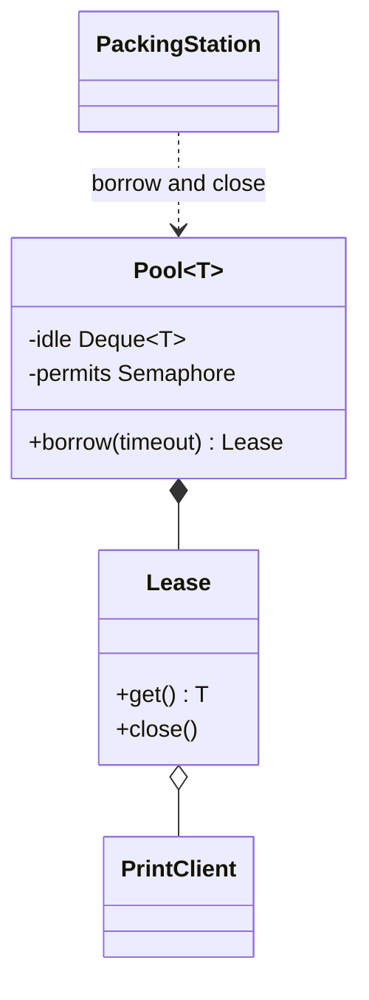
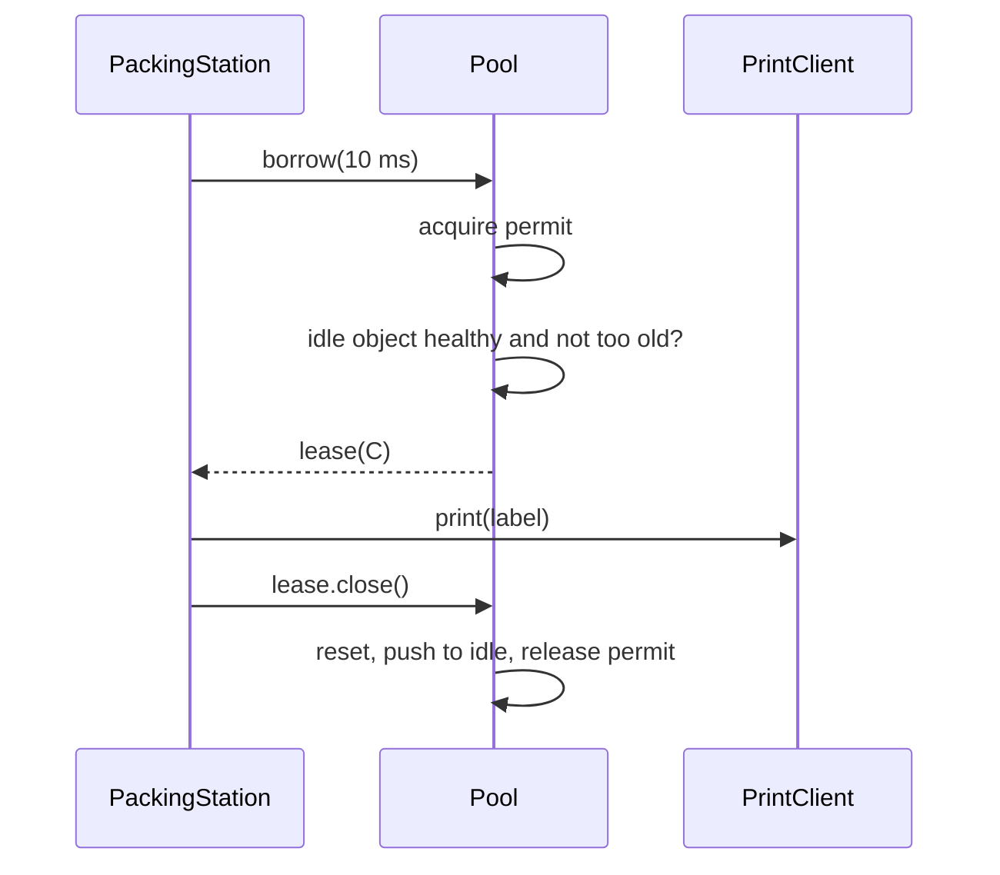

# Object Pool

<span class="badge-l2">L2 🔵 Practitioner</span> · <span class="read-time">⏱ 35 min read</span> · Prerequisites: [Singleton](../l1-foundations/singleton.md), [Factory Method](../l1-foundations/factory-method.md)

!!! abstract "TL;DR"
    An object pool keeps a limited set of expensive objects (database connections, threads, heavyweight clients) and lends them out instead of creating new ones each time. Pools also *limit* how many are in use, which protects scarce resources. On today's JVM, don't pool cheap objects, and with virtual threads, don't pool threads: limit access to the resource instead.

## 1. What It Is

**Plain English.** A FreshCart store has two label printers. Packers don't buy a printer for every order; they take one from the shelf, print, and put it back. If both are in use, the next packer waits a moment. That shelf is an object pool: a fixed set of reusable things, lent out and returned.

**Definition.** Object Pool isn't one of the original GoF patterns, but it's a standard creational pattern: "Manage a set of initialised, reusable objects; clients borrow an object, use it, and return it, instead of creating and destroying it." Parts:

- **Pool:** creates objects (often lazily) up to a maximum, lends and receives them.
- **Pooled object:** expensive to create, reusable after a reset.
- **Lease** (optional): a handle that returns the object when closed.
- **Policies:** maximum size, wait timeout, validation, eviction, leak detection.

## 2. Why It Exists

Some objects are expensive to create (a database connection needs a TCP and TLS handshake and authentication; a renderer loads fonts), and some resources are limited (the database allows 100 connections). Creating one per request is slow and can overload the resource. A pool pays the creation cost a few times, reuses the objects, and caps concurrent use, turning overload into a short wait or a clear error.

## 3. Mental Model / Analogy

**Analogy.** Shopping trolleys at a supermarket entrance. There are 50; you take one, use it, return it. When they're all out, you wait for someone to bring one back. Broken trolleys are taken out of service, and very old ones are replaced. If people take trolleys home (leaks), the store runs out.

**Technical model.** A thread-safe collection of idle objects plus a counter or semaphore for the maximum. `borrow()` takes an idle object (or creates one if under the maximum, or waits); `return()` resets and puts it back.

## 4. How It Works





## 5. Subtopics

### Pool structure and lifecycle

**Description.** A pool's lifecycle per object: **create** (lazily, up to the maximum) → **borrow** (validate first) → **use** → **reset** → **return**, and eventually **evict** (broken or too old). When the pool is exhausted, `borrow` waits up to a timeout and then fails clearly.

**Advantages / features.** Reuse of expensive objects; a hard cap on concurrent use; broken objects removed automatically.

```java title="PoolLifecycleDemo.java"
--8<-- "examples/l2-practitioner/object-pool/PoolLifecycleDemo.java"
```

1. A fair semaphore enforces the maximum and serves waiting borrowers in order.
2. Exhaustion is a timed wait, then a clear error, never an endless hang.
3. Validate on borrow; broken objects are dropped.
4. Reset on return so the next borrower doesn't see the previous user's state.

**Run it:** `java PoolLifecycleDemo.java`

```text
--8<-- "examples/l2-practitioner/object-pool/PoolLifecycleDemo.expected.txt"
```

| Pros | Cons |
|------|------|
| Creation cost paid rarely | Pool code is concurrency code: easy to get wrong |
| Caps concurrent use of a scarce resource | Objects must be reset correctly |
| Broken objects detected on borrow | Borrowers can leak objects (never return them) |

**Use it** for expensive objects or limited resources. **Avoid** writing your own pool when a mature one exists (HikariCP, Apache Commons Pool).
**Real-world Java:** HikariCP, Apache Commons Pool 2, `ThreadPoolExecutor`, Netty's `PooledByteBufAllocator`.
**Best practice:** always borrow with a timeout and return in `finally` (or a lease with try-with-resources). **Gotcha:** forgetting the reset step leaks state between users (see "When pooling hurts").

### Connection pools (HikariCP)

**Description.** The most important pool in Java back ends. A JDBC connection pool keeps open connections; `getConnection()` borrows one and `close()` returns it. Key settings in HikariCP: `maximumPoolSize`, `connectionTimeout` (how long to wait), `maxLifetime` (retire connections before the database or network does), `idleTimeout`, and `leakDetectionThreshold`.

**Advantages / features.** Requests skip connection setup; the database is protected from connection storms; slow or leaked usage becomes visible.

```java title="ConnectionPoolDemo.java"
--8<-- "examples/l2-practitioner/object-pool/ConnectionPoolDemo.java"
```

1. A fixed set of connections, created up front (HikariCP keeps a minimum idle number ready).
2. Wait up to `connectionTimeout` for a free connection.
3. Holding connections while doing slow non-database work starves other requests.
4. Borrow, query, return: always in `finally` (or try-with-resources on a real `Connection`).

**Run it:** `java ConnectionPoolDemo.java`

```text
--8<-- "examples/l2-practitioner/object-pool/ConnectionPoolDemo.expected.txt"
```

| HikariCP setting | Default | Meaning |
|------------------|---------|---------|
| `maximumPoolSize` | 10 | Most connections open at once |
| `connectionTimeout` | 30 s | Wait for a connection before failing |
| `maxLifetime` | 30 min | Retire connections before infrastructure kills them |
| `idleTimeout` | 10 min | Close extra idle connections (when min idle < max) |
| `leakDetectionThreshold` | 0 (off) | Log a stack trace if a connection is held longer |

**Use** a connection pool for every JDBC application; Spring Boot configures HikariCP by default. **Avoid** huge pools; more connections than the database can serve make everything slower.
**Real-world Java:** HikariCP (Spring Boot default), Tomcat JDBC pool, Agroal (Quarkus).
**Best practice:** keep transactions short and never call remote APIs while holding a connection. **Gotcha:** a pool of 10 per instance × 50 instances = 500 database connections; size pools against the database limit, not per service.

!!! warning "Verify against the official docs"
    Default values above are from HikariCP's documentation at the time of writing; check the version you use.

### Thread pools as object pools

**Description.** `ThreadPoolExecutor` pools threads: a core and maximum number of workers, a work queue, and a rejection policy when both are full. It's an object pool where the "objects" are threads and the "borrowers" are tasks.

**Advantages / features.** Thread creation cost avoided; concurrency capped; back-pressure via a bounded queue and rejection policy.

```java title="ThreadPoolDemo.java"
--8<-- "examples/l2-practitioner/object-pool/ThreadPoolDemo.java"
```

1. Two worker threads, never more.
2. A *bounded* queue: at most three waiting tasks.
3. A rejection handler decides what happens when workers and queue are full (here: count it).
4. Only two threads were ever created for five completed tasks.

**Run it:** `java ThreadPoolDemo.java`

```text
--8<-- "examples/l2-practitioner/object-pool/ThreadPoolDemo.expected.txt"
```

| Choice | Effect |
|--------|--------|
| Unbounded queue (`Executors.newFixedThreadPool`) | Never rejects; memory grows without limit under overload |
| Bounded queue + `AbortPolicy` | Fails fast with `RejectedExecutionException` |
| Bounded queue + `CallerRunsPolicy` | Slows the submitter down (natural back-pressure) |
| Separate pools per dependency (bulkheads) | One slow dependency can't use every thread |

**Use** bounded queues and an explicit rejection policy in servers. **Avoid** `Executors.newCachedThreadPool()` for unbounded work; it can create thousands of platform threads.
**Real-world Java:** Tomcat's request thread pool, `ForkJoinPool.commonPool()`, Spring's `ThreadPoolTaskExecutor`.
**Best practice:** name threads (via a `ThreadFactory`) and export pool metrics. **Gotcha:** `newFixedThreadPool` uses an unbounded `LinkedBlockingQueue`.

### When pooling hurts on the modern JVM

**Description.** Pooling was common in early Java because allocation and garbage collection were slow. Modern JVMs allocate small objects in nanoseconds (thread-local allocation buffers) and collect short-lived objects very cheaply. Pooling cheap objects now usually *hurts*: pooled objects live long, get promoted to the old generation, need synchronisation, and carry state from one user to the next.

**Advantages of knowing it.** You avoid adding complexity and bugs for no gain.

```java title="WhenPoolingHurtsDemo.java"
--8<-- "examples/l2-practitioner/object-pool/WhenPoolingHurtsDemo.java"
```

1. A pool of small buffers, with no reset on return.
2. The second customer gets the first customer's name and items.
3. Just allocating a new `StringBuilder` is simpler, faster to write, and correct.

**Run it:** `java WhenPoolingHurtsDemo.java`

```text
--8<-- "examples/l2-practitioner/object-pool/WhenPoolingHurtsDemo.expected.txt"
```

| Pool it | Don't pool it |
|---------|---------------|
| Database and network connections | `StringBuilder`, small DTOs, collections |
| Threads (platform threads) | Virtual threads |
| Objects wrapping native resources | Objects that are only memory |
| Objects with measured, high setup cost | Anything without a profiler showing a problem |

**Use** pooling only for resource-holding or measurably expensive objects. **Avoid** pooling to "help the GC" without measurements.
**Real-world Java:** Netty pools *direct* byte buffers (off-heap, expensive to allocate) but not ordinary objects.
**Best practice:** profile allocation with JFR before pooling anything. **Gotcha:** pooled objects referencing request data keep it alive and can leak it to the next request.

### Virtual threads and pooling

**Description.** Java 21 virtual threads are cheap enough to create one per task. Pooling them defeats their purpose. What still needs limiting is the scarce resource behind them (database connections, a partner's rate limit), which you protect with a semaphore or the resource's own pool.

**Advantages / features.** Simple thread-per-request code with high concurrency; resource limits enforced where they matter.

```java title="VirtualThreadsPoolingDemo.java"
--8<-- "examples/l2-practitioner/object-pool/VirtualThreadsPoolingDemo.java"
```

1. The scarce resource is limited, not the threads.
2. Each task waits for a permit only around the database call.
3. One virtual thread per task; closing the executor waits for all of them.

**Run it:** `java VirtualThreadsPoolingDemo.java`

```text
--8<-- "examples/l2-practitioner/object-pool/VirtualThreadsPoolingDemo.expected.txt"
```

| | Platform threads | Virtual threads |
|---|---|---|
| Creation cost | High (OS thread, MB stack) | Low (heap object) |
| Pool them? | Yes | No |
| Limit concurrency with | Pool size | Semaphore or resource pool |
| Blocking I/O | Ties up an OS thread | Unmounts from the carrier thread |

**Use** `Executors.newVirtualThreadPerTaskExecutor()` for I/O-bound work and keep connection pools. **Avoid** pooling virtual threads or using them for CPU-bound work.
**Real-world Java:** Spring Boot 3.2+ (`spring.threads.virtual.enabled=true`), Helidon Níma, Tomcat with virtual threads.
**Best practice:** keep connection pool sizes based on the database's capacity, not on thread counts. **Gotcha:** on Java 21, blocking inside `synchronized` can pin the carrier thread; prefer `ReentrantLock` in hot paths (improved in later JDKs).

## 6. Examples (exactly 3, progressively harder)

### Example 1: Minimal (L2)

**Scenario:** A store has two label printers shared by packers.

```java title="LabelPrinterPoolDemo.java"
--8<-- "examples/l2-practitioner/object-pool/LabelPrinterPoolDemo.java"
```

1. A lease returns the printer when closed.
2. `take()` waits until a printer is free.

**Run it:** `java LabelPrinterPoolDemo.java`

**Output:**

```text
--8<-- "examples/l2-practitioner/object-pool/LabelPrinterPoolDemo.expected.txt"
```

**What to notice:**

- Three orders, two printers; printer A is reused.
- try-with-resources makes "always give it back" automatic.

### Example 2: Realistic (in FreshCart grocery delivery)

**Scenario:** At month end, FreshCart renders thousands of invoice PDFs. A renderer takes noticeable time to start (fonts, templates), so a few are pooled and shared by many worker threads.

```java title="InvoiceRendererPoolDemo.java"
--8<-- "examples/l2-practitioner/object-pool/InvoiceRendererPoolDemo.java"
```

1. Starting a renderer is the expensive part (simulated with busy work).
2. Three renderers are created once, up front.
3. Each render borrows and returns in `finally`.

**Run it:** `java InvoiceRendererPoolDemo.java`

**Output:**

```text
--8<-- "examples/l2-practitioner/object-pool/InvoiceRendererPoolDemo.expected.txt"
```

**What to notice:**

- Eight threads shared three renderers; 200 invoices cost three start-ups.
- The pool also limits memory: at most three renderers exist.

### Example 3: Production-grade

**Scenario:** Packing stations use a heavyweight print-service client. Requirements: at most two clients; borrowers wait at most a few milliseconds and get a helpful error naming who holds the clients; broken clients are discarded; clients older than 30 minutes are retired; leases can't be used after return or returned twice; leases held over 60 seconds are reported as suspected leaks; and everything is counted.

```java title="ProductionPoolDemo.java"
--8<-- "examples/l2-practitioner/object-pool/ProductionPoolDemo.java"
```

1. A returned lease can't be used again.
2. Closing twice is harmless (common with nested `finally` blocks).
3. The timeout error lists the current holders, which is gold during incidents.
4. Max-lifetime eviction (like HikariCP's `maxLifetime`), using an injected clock.
5. Leak detection: leases held longer than the threshold.

**Run it:** `java ProductionPoolDemo.java`

**Output:**

```text
--8<-- "examples/l2-practitioner/object-pool/ProductionPoolDemo.expected.txt"
```

**What to notice:**

- Station 3's error names the returns desk, which never returned its client.
- The unhealthy client was discarded on the next borrow; old clients were retired after 30 minutes.
- Five borrows needed only four creations, and the metrics show why each eviction happened.

## 7. Pros, Cons & Trade-offs

| Aspect | Pros | Cons |
|--------|------|------|
| Performance | Avoids expensive creation | No gain (or a loss) for cheap objects |
| Scalability | Caps load on scarce resources | Pool size becomes a bottleneck if too small |
| Reliability | Validation and eviction remove bad objects | Leaks exhaust the pool and stall the service |
| Simplicity | Borrow/return API is simple | Correct pool implementation is hard |
| Operability | Metrics show saturation clearly | Many settings to tune per environment |
| Security | — | State leaking between users if reset is wrong |

## 8. When to Use / When NOT to Use

**Use it when:**

- objects hold scarce resources (connections, sockets, native handles, licences);
- creation cost is high and measured;
- you must cap concurrent use of a dependency.

**Don't use it when:**

- objects are cheap (allocation is faster than pool bookkeeping);
- you're using virtual threads (limit resources, not threads);
- a library already pools for you (HTTP clients, JDBC via HikariCP).

## 9. Best Practices

1. **Use a proven pool** (HikariCP, Commons Pool, `ThreadPoolExecutor`) instead of writing one. *(Consensus.)*
2. **Borrow with a timeout; return in `finally` or via try-with-resources.** *(Consensus.)*
3. **Validate on borrow, reset on return, retire by age.** *(Consensus.)*
4. **Turn on leak detection** in non-production and with a high threshold in production. *(Consensus.)*
5. **Size pools from downstream capacity** (database connections across all instances). *(Consensus.)*
6. **Bound queues and choose a rejection policy** for thread pools. *(Consensus.)*
7. **Don't pool cheap objects or virtual threads.** *(Consensus on modern JVMs.)*

## 10. Pitfalls & Anti-Patterns

!!! danger "Connection held during a remote call (production failure mode)"
    **Symptom:** during a payment provider slowdown, the whole app timed out, even pages that don't use payments.
    **Root cause:** checkout opened a transaction, then called the payment API inside it, holding a connection for seconds; the pool ran dry.
    **Fix:** call remote APIs outside transactions; keep connection hold times in milliseconds.

!!! danger "Pool leak"
    **Symptom:** `Connection is not available, request timed out after 30000ms` hours after a deploy.
    **Root cause:** an error path returned early without closing the connection.
    **Fix:** try-with-resources everywhere; `leakDetectionThreshold` to find the culprit.

!!! danger "Oversized pools"
    **Symptom:** raising the pool size from 20 to 200 made the database slower.
    **Root cause:** more concurrent queries than the database has CPU cores and disks to serve.
    **Fix:** smaller pools; HikariCP's guidance starts from the database's core count.

!!! danger "Pooling for the GC"
    **Symptom:** a custom object pool, data leaking between requests, no measurable speed-up.
    **Root cause:** pooling cheap objects based on outdated advice.
    **Fix:** delete the pool; allocate normally; profile first.

## 11. Configuration & Tuning

| Setting | Default | What it does | When to change it | Risk of changing |
|---------|---------|--------------|-------------------|------------------|
| Max pool size | 10 (HikariCP) | Concurrent connections per instance | Measured saturation and DB headroom | Too big: DB overload; too small: waits |
| Borrow timeout | 30 s (HikariCP) | How long a request waits | Lower for user-facing paths (e.g. 2–5 s) | Too low: errors under brief spikes |
| Max lifetime | 30 min | Retire before infrastructure does | Shorter than DB/firewall idle limits | Too short: constant churn |
| Leak threshold | off | Report long-held objects | On in staging; high value in prod | Too low: noisy false alarms |
| Thread pool queue | unbounded (`newFixedThreadPool`) | Waiting tasks | Always bound in servers | Rejections must be handled |

## 12. Security Considerations

- Reset pooled objects completely: session variables, user context, buffers. Leaking one customer's data to the next request is a security incident.
- Database connections should not carry per-user privileges that persist across borrowers; reset roles or use separate pools.
- Pools are a denial-of-service target: per-client rate limits stop one caller from monopolising the pool.

## 13. Performance & Scalability

Pools trade memory and bookkeeping for creation cost and a concurrency cap. The key metrics are **wait time** to borrow, **utilisation**, and **hold time**. Little's Law helps: needed pool size ≈ request rate × average hold time (100 req/s × 20 ms = 2 connections on average). If hold time grows (slow queries, remote calls in transactions), a bigger pool rarely helps; fix the hold time.

## 14. Testing It

Test reuse, exhaustion, retirement and leak detection with an injected clock:

```java title="ProductionPoolTest.java"
--8<-- "examples/l2-practitioner/object-pool/ProductionPoolTest.java"
```

## 15. Observability & Operations

Export pool gauges (active, idle, pending waiters, max) and timers (borrow wait, hold time). HikariCP publishes these to Micrometer automatically in Spring Boot. Alert when pending waiters stay above zero or borrow wait rises; both precede timeouts. Log leak warnings with the stack trace of the borrower.

## 16. Version Notes

| Java | Change relevant to Object Pool |
|------|--------------------------------|
| 5 | `java.util.concurrent`: `ThreadPoolExecutor`, `Semaphore`, `BlockingQueue` |
| 7 | try-with-resources: leases closed automatically |
| 19–21 | Virtual threads (final in 21): don't pool threads for I/O-bound work |
| 21 | `Executors.newVirtualThreadPerTaskExecutor()` |
| 24 | JEP 491: `synchronized` no longer pins virtual threads in most cases |

## 17. Expert Deep Dive

- **Pool sizing is a system property, not a service setting.** Total connections = pool size × instances × services; autoscaling multiplies it. Seniors size pools against the database's capacity and use connection proxies (PgBouncer, RDS Proxy) when instance counts vary.
- **Hold time is the real lever.** Short transactions, no remote calls inside them, and fast queries let a small pool serve high traffic.
- **Bulkheads.** Separate pools for separate dependencies (and for critical vs batch work) stop one slow path from taking everything; see [Resilience Patterns](../l4-senior/resilience-patterns.md).
- **Virtual threads change the shape, not the limits.** With virtual threads, many more requests reach the pool at once; without a limit they wait in the pool queue, so set `connectionTimeout` and shed load deliberately.

!!! example "War story: the pool that grew the outage"
    During a sale, a grocery platform's order service started timing out on connections. The on-call engineer raised `maximumPoolSize` from 20 to 100 across 40 instances: up to 4,000 connections to a database tuned for about 1,000. The database spent its time switching between sessions, every query slowed, and the outage spread to other services. Rolling back to 20, killing a slow report query that had been holding connections, and moving the report to a replica fixed it. **Lesson:** an exhausted pool is a symptom; find what's holding connections before making the pool bigger.

## 18. Interview Corner

=== "🟢 L1–L2"

    1. **What is an object pool?** A set of **reusable expensive objects** lent out and returned.
    2. **Give two Java examples.** **HikariCP** (connections) and **`ThreadPoolExecutor`** (threads).
    3. **Why return in `finally`?** So objects are **returned even when exceptions happen**; otherwise the pool leaks.
    4. **What should happen when the pool is empty?** **Wait up to a timeout**, then fail clearly.
    5. **Should you pool `StringBuilder`s?** **No**; allocation is cheap and pooling adds bugs.

=== "🟡 L3"

    1. **What is `maxLifetime` for?** Retire connections **before the database or firewall closes them**.
    2. **How do you find a connection leak?** **`leakDetectionThreshold`** stack traces, pool metrics, hold-time timers.
    3. **Why bounded queues in thread pools?** **Back-pressure** and bounded memory under overload.
    4. **How do virtual threads change pooling?** **Don't pool threads**; limit the **resource** with semaphores or its pool.
    5. **How big should a connection pool be?** Based on **DB capacity and hold time**, often small (tens), across all instances.

=== "🔴 L4–L5"

    1. **The pool is exhausted in production. Walk through your response.** Check **hold times and slow queries**, find leaks, shed load; **don't just raise the size**.
    2. **Design connection management for an autoscaling service.** **Per-instance pools sized from a global budget**, a connection proxy, timeouts, bulkheads.
    3. **How do you protect a partner API with a rate limit across instances?** **Distributed rate limiter or token bucket service**, local semaphores as a first line.
    4. **When would you write a custom pool?** For **native or licensed resources** with no library support, with leases, validation, eviction and metrics.
    5. **Now 10x traffic with virtual threads; the DB is the bottleneck. What changes?** **Caching, read replicas, query optimisation, admission control**; not more connections.

=== "💻 Hands-on"

    **Task:** Make `ConnectionPoolDemo`'s pool report average hold time.

    ??? success "Solution"
        ```java
        private final Map<Connection, Long> borrowedAt = new ConcurrentHashMap<>();
        private final LongAdder totalHoldNanos = new LongAdder(), returns = new LongAdder();

        Connection getConnection(long timeoutMs) throws InterruptedException {
            Connection c = free.poll(timeoutMs, TimeUnit.MILLISECONDS);
            if (c == null) throw new IllegalStateException("timed out");
            borrowedAt.put(c, System.nanoTime());
            return c;
        }
        void close(Connection c) {
            totalHoldNanos.add(System.nanoTime() - borrowedAt.remove(c));
            returns.increment();
            free.add(c);
        }
        double averageHoldMillis() { return returns.sum() == 0 ? 0 : totalHoldNanos.sum() / 1e6 / returns.sum(); }
        ```

## 19. Practice

- [ ] Add a `CallerRunsPolicy` to `ThreadPoolDemo` and observe which thread runs rejected tasks.
    ??? tip "Hint"
        Print `Thread.currentThread().getName()` inside the task.
- [ ] Add an idle timeout to `ProductionPoolDemo` that closes clients idle for more than 10 minutes.
    ??? tip "Hint"
        Store `lastReturnedAt` in the entry and check it on borrow.
- [ ] Compute a pool size for 300 requests/s with an average hold time of 15 ms, and add headroom.
    ??? tip "Hint"
        Little's Law: 300 × 0.015 = 4.5 on average; add headroom for bursts.
- [ ] Find a place in a codebase where a remote call happens inside a database transaction.
    ??? tip "Hint"
        Look for HTTP client calls inside `@Transactional` methods.

## 20. Quick Revision Card

!!! tip "Remember in 30 seconds"
    - Intent: reuse expensive objects and cap concurrent use.
    - Lifecycle: create lazily → validate on borrow → reset on return → retire by age or health.
    - Always: borrow with timeout, return in `finally`/lease, leak detection, metrics.
    - Connection pools: small, sized from DB capacity; short hold times; no remote calls in transactions.
    - Don't pool cheap objects or virtual threads; limit the resource with a semaphore.

    ```java
    try (Connection c = dataSource.getConnection();
         PreparedStatement ps = c.prepareStatement("SELECT qty FROM stock WHERE sku = ?")) {
        ps.setString(1, sku);
        // ...
    }   // connection back in the pool
    ```

## 21. Further Reading

- [HikariCP: About Pool Sizing](https://github.com/brettwooldridge/HikariCP/wiki/About-Pool-Sizing)
- [JEP 444: Virtual Threads](https://openjdk.org/jeps/444)
- Brian Goetz et al., *Java Concurrency in Practice* (2006), chapter 8 "Applying Thread Pools".
- [java.util.concurrent.ThreadPoolExecutor API documentation](https://docs.oracle.com/en/java/javase/21/docs/api/java.base/java/util/concurrent/ThreadPoolExecutor.html)

---

[← Previous: Prototype](prototype.md) · [Next: Dependency Injection →](dependency-injection.md)
