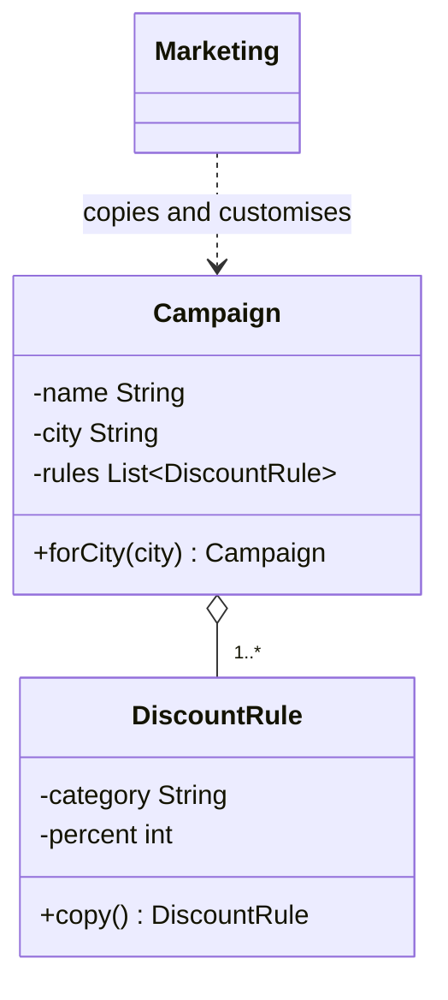
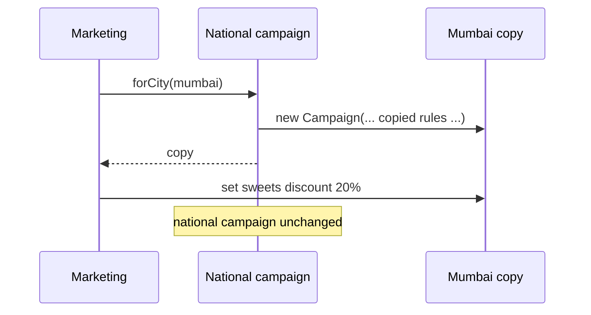

# Prototype

<span class="badge-l2">L2 🔵 Practitioner</span> · <span class="read-time">⏱ 30 min read</span> · Prerequisites: [Builder](../l1-foundations/builder.md), [Abstract Factory](abstract-factory.md)

!!! abstract "TL;DR"
    Prototype creates new objects by copying an existing, pre-configured one, then customising the copy. It's useful when setting an object up from scratch is long or error-prone: templates, campaigns, store configurations. In Java, copy with copy constructors or copy methods, not `Cloneable`. Decide deliberately what is deep-copied, shared, reset or left out.

## 1. What It Is

**Plain English.** FreshCart's marketing team designs a Diwali campaign once (dates, discount rules, banner products) and then needs a version for each city with small changes. Instead of building each city's campaign from nothing, they copy the national one and tweak it. The national campaign is the *prototype*; each city version is a copy.

**Precise definition (GoF intent).** "Specify the kinds of objects to create using a prototypical instance, and create new objects by copying this prototype." Roles:

- **Prototype:** an object that knows how to copy itself (`copy()`, `forCity(...)`).
- **Concrete prototype:** a configured instance used as a template.
- **Client:** asks for a copy, then customises it.
- Often a **prototype registry** holds named templates.

## 2. Why It Exists

Some objects are expensive or fiddly to configure: many fields, nested rules, values learned from data or tuned by people. Rebuilding them repeats work and invites mistakes; sharing one instance means edits leak everywhere. Copying a known-good template gives each user an independent object that starts correct, and the template stays untouched.

## 3. Mental Model / Analogy

**Analogy.** A FreshCart store manager keeps a master planogram (shelf layout) for a standard dark store. Opening a new store, they photocopy it and mark local changes. Scribbling on the copy doesn't change the master. Some things on the master must never be photocopied, like the safe's combination; the new store gets its own.

**Technical model.** A method on the object (or a copy constructor) returns a new instance with the same configuration. The important decisions are per field: copy deeply, share (if immutable), reset, or exclude.

## 4. How It Works





## 5. Subtopics

### Shallow vs. deep copy

**Description.** A **shallow copy** creates a new outer object but shares the inner objects (lists, nested objects). A **deep copy** duplicates the inner mutable objects too. Immutable inner objects (strings, records, `List.of`) can be shared safely, so "deep" only matters for mutable parts.

**Advantages of knowing it.** You avoid the most common Prototype bug: edits to a copy appearing in the template.

```java title="ShallowDeepCopyDemo.java"
--8<-- "examples/l2-practitioner/prototype/ShallowDeepCopyDemo.java"
```

1. Shallow: a new `Basket`, but the same `List` of the same `Line` objects.
2. Deep: new list and new `Line` objects.
3. Changing a line in the shallow copy changes the template's line too.

**Run it:** `java ShallowDeepCopyDemo.java`

```text
--8<-- "examples/l2-practitioner/prototype/ShallowDeepCopyDemo.expected.txt"
```

| | Shallow | Deep |
|---|---|---|
| Cost | Cheap | Proportional to object graph size |
| Independence | Inner objects shared | Fully independent |
| Safe when inner objects are | Immutable | Mutable |
| Risk | Leaking edits into the template | Copying huge graphs; cycles |

**Use** shallow copies only with immutable parts; deep copies for mutable parts. **Avoid** deep-copying large shared caches or services; those should be shared references, not copies.
**Real-world Java:** `ArrayList(Collection)` (shallow: new list, same elements), `List.copyOf` (immutable shallow copy), `Arrays.copyOf`.
**Best practice:** make inner objects immutable so a shallow copy is enough. **Gotcha:** `new ArrayList<>(list)` copies the list, not the elements; mutable elements are still shared.

### `Cloneable` and why to avoid it

**Description.** Java's built-in mechanism: implement the marker interface `Cloneable` and override `Object.clone()`, which makes a field-by-field (shallow) copy without calling a constructor. It's widely considered broken: shallow by default, incompatible with `final` fields that need new values, a checked exception for something that can't fail, and no constructor runs, so invariants aren't checked.

**Advantages of knowing it.** You recognise its problems in legacy code and know the alternatives.

```java title="CloneableDemo.java"
--8<-- "examples/l2-practitioner/prototype/CloneableDemo.java"
```

1. `Cloneable` has no methods; it just switches on `Object.clone()`.
2. `super.clone()` copies fields shallowly, and you must catch an exception that can't happen.
3. A copy constructor is explicit, runs validation, and can set `final` fields.

**Run it:** `java CloneableDemo.java`

```text
--8<-- "examples/l2-practitioner/prototype/CloneableDemo.expected.txt"
```

| Problem with `clone()` | Consequence |
|------------------------|-------------|
| Shallow by default | Shared mutable state between copies |
| No constructor call | Validation and counters skipped |
| `final` fields can't be reassigned | Can't give the copy a new ID or deep-copied list |
| `CloneNotSupportedException` | Boilerplate try/catch |
| Subclasses inherit it | Every subclass must get `clone()` right |

**Use** `clone()` only for arrays (`array.clone()` is fine and fast). **Avoid** `Cloneable` for your own classes.
**Real-world Java:** `ArrayList.clone()`, `HashMap.clone()` (shallow); Joshua Bloch advises against `Cloneable` in *Effective Java*, Item 13.
**Best practice:** provide a copy constructor or a `copy()`/`with...()` method. **Gotcha:** `int[][] grid.clone()` copies only the outer array; rows are shared.

### Copy constructors and copy factories

**Description.** A copy constructor takes an instance of the same class and builds a new one from it; a static copy factory (`copyOf(other, newName)`) does the same with a name and room for changes. Both run normal construction, so invariants and defensive copies apply. For immutable records, you often don't copy at all: share the instance and use withers to create changed versions.

**Advantages / features.** Explicit about what is copied; works with `final` fields; validation runs.

```java title="CopyConstructorDemo.java"
--8<-- "examples/l2-practitioner/prototype/CopyConstructorDemo.java"
```

1. A copy constructor delegating to the normal constructor, which copies collections defensively.
2. A named copy factory that also changes one field.
3. Records are immutable: "copying with a change" is a wither, and the original can be shared freely.

**Run it:** `java CopyConstructorDemo.java`

```text
--8<-- "examples/l2-practitioner/prototype/CopyConstructorDemo.expected.txt"
```

| Technique | Best for |
|-----------|----------|
| Copy constructor | Mutable classes you own |
| Static copy factory (`copyOf`, `from`) | Copy plus changes, or returning a different type |
| Withers on records | Immutable values: copy-with-change |
| `toBuilder()` | Many changes at once ([Builder](../l1-foundations/builder.md)) |

**Use** copy constructors or factories for mutable templates; immutability where possible. **Avoid** reflection-based "deep copy" utilities; they copy things you didn't mean to (secrets, caches, references to services).
**Real-world Java:** `new ArrayList<>(other)`, `new HashMap<>(other)`, `EnumSet.copyOf`, `List.copyOf`.
**Best practice:** route copying through the normal constructor so validation runs. **Gotcha:** a copy constructor in a superclass doesn't know subclass fields; prefer `final` classes or a copy method each subclass overrides.

### Prototype registry

**Description.** A registry maps names to prototype instances. Clients ask for a *copy* by name. The registry stores its own copy at registration, so later edits to the original don't leak in, and hands out copies, so client edits don't leak back.

**Advantages / features.** Templates managed in one place (often loaded from configuration); clients don't need to know how templates are built.

```java title="PrototypeRegistryDemo.java"
--8<-- "examples/l2-practitioner/prototype/PrototypeRegistryDemo.java"
```

1. The prototype's copy operation.
2. Copy on the way in: the registry owns its template.
3. Copy on the way out: clients get independent objects.

**Run it:** `java PrototypeRegistryDemo.java`

```text
--8<-- "examples/l2-practitioner/prototype/PrototypeRegistryDemo.expected.txt"
```

| Pros | Cons |
|------|------|
| Named, reusable templates | Templates can drift from current business rules |
| Templates can be data (loaded at startup) | Copy semantics must be right for every type |
| Clients isolated from template construction | Another component to version and manage |

**Use it** for campaign, document, configuration or game-object templates. **Avoid it** when templates are trivial to build; a factory method is simpler.
**Real-world Java:** Spring's `prototype` bean scope (a new instance per request from a bean definition), document and email template systems.
**Best practice:** version templates and record which version a copy came from. **Gotcha:** if the registry returns its own instance instead of a copy, one client's edit changes everyone's future copies.

## 6. Examples (exactly 3, progressively harder)

### Example 1: Minimal (L2)

**Scenario:** "Weekly essentials" is a suggested basket. Each customer gets their own copy to adjust.

```java title="WeeklyBasketDemo.java"
--8<-- "examples/l2-practitioner/prototype/WeeklyBasketDemo.java"
```

1. The copy gets its own map; quantities are immutable integers, so that's enough.
2. Customers change their copies freely.

**Run it:** `java WeeklyBasketDemo.java`

**Output:**

```text
--8<-- "examples/l2-practitioner/prototype/WeeklyBasketDemo.expected.txt"
```

**What to notice:**

- The template still has seven litres of milk and two breads after both customers edited.
- A map of immutable values only needs one level of copying.

### Example 2: Realistic (in FreshCart grocery delivery)

**Scenario:** Marketing builds a national campaign with discount rules, then makes city versions with different percentages, dates, names and banner products.

```java title="CampaignCloneDemo.java"
--8<-- "examples/l2-practitioner/prototype/CampaignCloneDemo.java"
```

1. Rules are mutable objects, so each one is copied (deep copy).
2. `forCity` is the prototype operation: copy everything, change the city.
3. Mumbai's higher discount doesn't affect the national campaign or Kolkata.

**Run it:** `java CampaignCloneDemo.java`

**Output:**

```text
--8<-- "examples/l2-practitioner/prototype/CampaignCloneDemo.expected.txt"
```

**What to notice:**

- Three independent campaigns from one design.
- Dates are `LocalDate` (immutable), so they're shared safely and replaced, not mutated.

### Example 3: Production-grade

**Scenario:** FreshCart opens new dark stores by copying a "standard dark store" template: zones, slots and staffing. The copy must get a new ID, start with no orders or rating, never inherit the source store's payment terminal key, record which template version it came from, and pass go-live checks after local changes.

```java title="StoreTemplateDemo.java"
--8<-- "examples/l2-practitioner/prototype/StoreTemplateDemo.java"
```

1. The prototype operation, with an injected ID generator (UUIDs in production, a counter in demos and tests).
2. Configuration is deep-copied through the normal constructor.
3. Secrets are deliberately *not* copied; operational state is reset.
4. Validation of the customised copy before it can go live.
5. Publishing a template stores a copy, so later edits to the source store don't change it.

**Run it:** `java StoreTemplateDemo.java`

**Output:**

```text
--8<-- "examples/l2-practitioner/prototype/StoreTemplateDemo.expected.txt"
```

**What to notice:**

- The new store has no key and zero orders, and records `tpl-standard-dark-store@v1`.
- The 22:00 slot added to pune-01 after publishing didn't reach the template (still 2 slots).
- Go-live was blocked until Nashik had enough pickers and its own key.

## 7. Pros, Cons & Trade-offs

| Aspect | Pros | Cons |
|--------|------|------|
| Simplicity | Clients start from a correct, complete object | Copy logic must be maintained as fields are added |
| Correctness | Templates encode known-good configuration | Shallow-copy bugs leak edits between objects |
| Performance | Copying can be cheaper than rebuilding (parsing, computing) | Deep copies of large graphs are expensive |
| Security | Explicit copy lets you exclude secrets | Generic cloning copies secrets by accident |
| Testability | Templates make test fixtures easy | Copy semantics need their own tests |
| Evolution | Templates can be data, versioned | Old copies don't get template fixes automatically |

## 8. When to Use / When NOT to Use

**Use it when:**

- objects are costly or fiddly to configure, and new ones are mostly like an existing one;
- users create variations of templates (campaigns, documents, store setups);
- the set of "kinds" is data (templates loaded at runtime) rather than classes.

**Don't use it when:**

- objects are cheap and simple to build: use constructors or [Builder](../l1-foundations/builder.md);
- objects are immutable: share them and use withers;
- copies must keep receiving template updates: reference the template instead of copying it.

## 9. Best Practices

1. **Prefer immutability**, so copies can share most parts. *(Consensus.)*
2. **Use copy constructors or copy methods, not `Cloneable`.** *(Consensus: Effective Java Item 13.)*
3. **Decide per field: deep-copy, share, reset or exclude**, and document it. *(Consensus.)*
4. **Never copy identity, secrets or operational state.** *(Consensus.)*
5. **Copy on registration and on retrieval in registries.** *(Consensus.)*
6. **Record which template and version a copy came from.** *(Opinion; strongly recommended for audit.)*
7. **Test that edits to copies don't affect templates.** *(Consensus.)*

## 10. Pitfalls & Anti-Patterns

!!! danger "The template that changed by itself"
    **Symptom:** every new campaign started with last week's Mumbai discount.
    **Root cause:** `forCity` copied the campaign but shared the list of rule objects; a Mumbai edit changed the template's rules.
    **Fix:** deep-copy mutable rules, or make rules immutable records.

!!! danger "Copied credentials (production failure mode)"
    **Symptom:** sales from a new store were settled into another store's merchant account.
    **Root cause:** store onboarding cloned the template store's configuration, including its payment terminal key.
    **Fix:** exclude secrets from copies explicitly, and block go-live until the new store sets its own (Example 3).

!!! danger "Cloned identity"
    **Symptom:** two stores with the same ID; reports merged them.
    **Root cause:** the copy kept the source's ID field.
    **Fix:** the copy operation always assigns a new identity.

!!! danger "Generic deep-copy library"
    **Symptom:** copying an order copied its database connection and a 2 GB cache.
    **Root cause:** a reflection-based deep cloner followed every reference.
    **Fix:** explicit copy methods that copy only configuration.

## 11. Configuration & Tuning

| Setting | Default | What it does | When to change it | Risk of changing |
|---------|---------|--------------|-------------------|------------------|
| Template version | Incremented on publish | Tracks which template copies came from | Every template change | Losing traceability of store setups |
| Go-live rules (Example 3) | 4 pickers, 50 slot capacity | Minimum standards for a new store | Operating model changes | Stores open understaffed |
| ID generator | UUID (production) | Identity of copies | Never in production | Collisions if predictable or reused |

## 12. Security Considerations

- Treat "exclude secrets" as a requirement of every copy method; write a test for it.
- Audit logs should record the template version and who customised the copy.
- Don't put credentials in templates at all; reference them by name from a secret manager.

## 13. Performance & Scalability

Copying a template is often faster than building from scratch when construction involves parsing files, calling services or computing derived data. Deep copies cost time and memory proportional to the mutable parts; immutable parts are shared for free. For very large templates used read-mostly, consider copy-on-write (share until the first edit).

## 14. Testing It

Test identity, secrets, state reset and independence of copies:

```java title="StoreTemplateTest.java"
--8<-- "examples/l2-practitioner/prototype/StoreTemplateTest.java"
```

## 15. Observability & Operations

Log template publishing (name, version, who) and every copy (template version, new ID). A dashboard of "stores by template version" shows which stores are on old setups after a template improvement, so operations can plan updates.

## 16. Version Notes

| Java | Change relevant to Prototype |
|------|------------------------------|
| 1.0 | `Object.clone()` and `Cloneable` |
| 5 | Covariant return types: `clone()` can return the subclass type |
| 10 | `List.copyOf`, `Set.copyOf`, `Map.copyOf` immutable copies |
| 16 | Records: immutable values that rarely need copying |
| 21 | Record patterns make "copy with changes" code clearer when deconstructing |

## 17. Expert Deep Dive

- **Copy semantics are a domain decision.** "What does a copy of an order mean?" (reorder: same items, new ID, new prices) is a product question, not a technical one. Seniors name copy operations by intent (`reorder()`, `newStoreFromThis()`) rather than a generic `copy()`.
- **Persistent data structures** (as in functional languages, or libraries like Vavr and PCollections) make copies cheap by sharing structure; they're worth knowing when copies are frequent and large.
- **Prototype vs Spring's prototype scope.** Spring's "prototype" scope creates a fresh bean from its definition each time; it isn't copying an instance, but it serves the same need: independent objects from one template.
- **Templates as data.** Mature systems store templates in a database with versions and approvals, and the "prototype registry" is a service. Copies keep a reference to their template version for audits and migrations.

!!! example "War story: the clone that kept the coupon"
    A grocery app's "reorder" feature copied the previous order object and resubmitted it. The copy included the applied one-time coupon. The coupon service checked "already used" by order ID, and the copy had a new ID, so thousands of customers reused single-use coupons until finance noticed. The fix replaced the generic copy with a `reorder()` operation that copied only items and quantities, re-priced everything and re-validated promotions. **Lesson:** "copy everything" is rarely the business meaning; copy what the use case needs.

## 18. Interview Corner

=== "🟢 L1–L2"

    1. **What is Prototype?** Create objects by **copying a configured instance** and customising the copy.
    2. **Shallow vs deep copy?** Shallow **shares inner objects**; deep **duplicates mutable inner objects**.
    3. **Why avoid `Cloneable`?** **Shallow, skips constructors, breaks `final` fields**, awkward exception.
    4. **What's the alternative?** **Copy constructors or copy factories**, or immutable records with withers.
    5. **What's a prototype registry?** Named templates that **hand out copies**.

=== "🟡 L3"

    1. **Which fields should a copy not copy?** **Identity, secrets and operational state.**
    2. **Why copy on registration in a registry?** So **later edits to the source** don't change the template.
    3. **Is `array.clone()` OK?** **Yes for arrays**, but it's shallow for arrays of objects or arrays of arrays.
    4. **How do immutable objects change the picture?** They can be **shared**; copying is only needed for mutable parts.
    5. **Prototype vs Builder's `toBuilder()`?** Both start from an existing object; `toBuilder` suits **many changes with validation at build**.

=== "🔴 L4–L5"

    1. **Design store onboarding from templates.** **Versioned templates**, explicit copy semantics, **secret exclusion**, go-live validation, audit trail.
    2. **How do you propagate template fixes to existing copies?** Track **template version per copy**, compute diffs, **migrate selectively** with approvals.
    3. **When are persistent data structures worth it?** **Frequent copies of large structures** with small edits.
    4. **How do you test copy semantics across a codebase?** **Property-style tests**: mutate the copy, assert the source unchanged, for every copyable type.
    5. **Now 10x stores per month: what breaks?** **Manual go-live checks** and template drift; automate validation and template governance.

=== "💻 Hands-on"

    **Task:** Make `DiscountRule` in `CampaignCloneDemo` immutable so `Campaign` can copy its rule list shallowly.

    ??? success "Solution"
        ```java
        record DiscountRule(String category, int percent, long minBasketCents) {
            DiscountRule withPercent(int p) { return new DiscountRule(category, p, minBasketCents); }
        }
        // Campaign constructor: this.rules = new ArrayList<>(rules);   // shallow is now safe
        // Mumbai: mumbai.rules.set(0, mumbai.rules.get(0).withPercent(20));
        ```
        Immutable elements remove the need for a deep copy.

## 19. Practice

- [ ] Add a `reorder()` method to an order class that copies items, assigns a new ID and drops coupons.
    ??? tip "Hint"
        Name the operation by intent; copy only items and quantities.
- [ ] Make `BannerRegistry` load templates from a map of strings at startup.
    ??? tip "Hint"
        Parse each entry into a `Banner` and `register` it; reject duplicates.
- [ ] Find a `clone()` implementation in a codebase you know and check whether it's shallow where it shouldn't be.
    ??? tip "Hint"
        Look for mutable collections or arrays among the fields.
- [ ] Write a test that fails if `StoreTemplateDemo` ever copies `paymentTerminalKey`.
    ??? tip "Hint"
        Already in `StoreTemplateTest`; extend it to the registry path too.

## 20. Quick Revision Card

!!! tip "Remember in 30 seconds"
    - Intent: new objects by copying a configured prototype, then customising.
    - Shallow shares inner objects; deep copies mutable ones; immutables can be shared.
    - Avoid `Cloneable`; use copy constructors, copy factories, withers, `toBuilder`.
    - Never copy identity, secrets or operational state; record the template version.
    - Registries copy in and copy out.

    ```java
    StoreConfig nashik = template.newStoreFromThis(() -> UUID.randomUUID().toString(), "v3");
    ```

## 21. Further Reading

- Gamma et al., *Design Patterns* (1994): Prototype.
- Joshua Bloch, *Effective Java*, 3rd edition, Item 13 "Override clone judiciously" and Item 17 "Minimize mutability".
- [Spring Framework reference: Bean scopes (prototype)](https://docs.spring.io/spring-framework/reference/core/beans/factory-scopes.html)
- [java.util.List.copyOf API documentation](https://docs.oracle.com/en/java/javase/21/docs/api/java.base/java/util/List.html#copyOf(java.util.Collection))

---

[← Previous: Abstract Factory](abstract-factory.md) · [Next: Object Pool →](object-pool.md)
