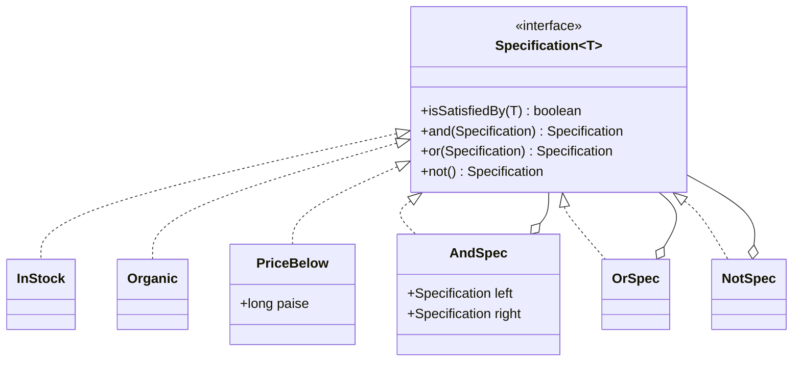
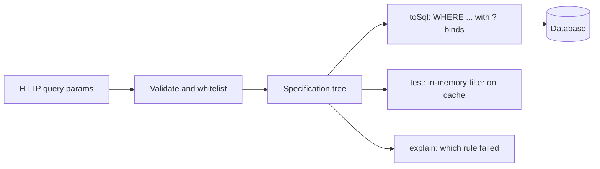

# Specification

<span class="badge-l2">L2 🔵 Practitioner</span> · <span class="read-time">⏱ 35 min read</span> · Prerequisites: [Composite](composite.md), [Interpreter](interpreter.md)

!!! abstract "TL;DR"
    A Specification is a business rule packaged as an object with one question: "does this candidate satisfy me?". Small named rules (`inStock`, `organic`, `cheaperThan(100)`) combine with `and`, `or` and `not` into bigger ones, so you stop writing a finder method for every combination. In memory, `java.util.function.Predicate` is often enough. When the data lives in a database, the specification builds a query instead (Spring Data JPA's `Specification<T>`), so filtering runs in SQL with bind parameters.

## 1. What It Is

**Plain English.** FreshCart's product search has filters: category, price range, organic, in stock, text. Customers combine them freely. Writing `findOrganicFruitInStockUnder100()` for each combination is impossible. Instead, each filter is a small rule object, and the search combines whichever rules the customer chose.

**Definition (Evans and Fowler, "Specifications", 1997; *Domain-Driven Design*, 2003).** "A specification is a predicate that determines if an object does or does not satisfy some criteria." Parts:

- **Specification:** an interface with `isSatisfiedBy(candidate)`.
- **Leaf specifications:** single rules (`InStock`, `PriceBelow(100)`).
- **Composite specifications:** `And`, `Or`, `Not`, built from other specifications (a [Composite](composite.md)).
- **Clients:** use specifications to **select** (filter a collection or query), **validate** (does this object meet the rule?) or **build to order** (describe what to create).

## 2. Why It Exists

Business rules end up copied across services, repositories and UI code, each copy slightly different: "eligible for free delivery" in checkout, in the cart banner and in the marketing email. Repositories grow a method per filter combination. Specification gives each rule one home and one name, lets you combine rules without new code, and lets the same rule drive in-memory checks and database queries.

## 3. Mental Model / Analogy

**Analogy.** A hiring checklist: "5+ years Java" AND ("led a team" OR "open-source maintainer") AND NOT "on non-compete". Each line is reusable on other checklists, and a recruiter can say exactly which line a candidate failed.

**Technical model.** A tree of boolean rules (an [Interpreter](interpreter.md) AST without the text). Evaluating the tree against an object answers in memory; translating the tree produces a SQL `WHERE` clause, an Elasticsearch query or a JPA `Predicate`.

## 4. How It Works





## 5. Subtopics

### Specification interface

**Description.** One method, `isSatisfiedBy(T candidate)`, and one class (or record) per rule. Rules with parameters (`PriceBelow(10_000)`) are records. Clients filter with any combination of rules instead of calling one finder per combination.

**Advantages / features.** Each rule is named, written once and unit-testable; new combinations need no new code; rules can be passed around, stored and logged.

**Before (finder per combination) and after (specifications):**

```java title="SpecificationInterfaceDemo.java"
--8<-- "examples/l2-practitioner/specification/SpecificationInterfaceDemo.java"
```

1. Before: each new combination of filters needs a new method, and the rules (`stock > 0`) are repeated in every one.
2. The interface: a single question about a candidate.
3. A generic finder that accepts any rules; new combinations are new calls, not new methods.

**Run it:** `java SpecificationInterfaceDemo.java`

```text
--8<-- "examples/l2-practitioner/specification/SpecificationInterfaceDemo.expected.txt"
```

| Use of a specification | Question | Example |
|------------------------|----------|---------|
| Selection | Which items match? | Product search |
| Validation | Does this object meet the rule? | Can this order be cancelled? |
| Building to order | What should be created? | Pick a delivery slot that satisfies these rules |

**Use** specifications when the same rules are combined in many ways or used in several places. **Avoid** them for a single, fixed filter; a lambda is clearer.
**Real-world Java:** Spring Data JPA `Specification<T>`, Querydsl `Predicate`/`BooleanExpression`, Hibernate Criteria API.
**Best practice:** name specifications after business terms (`EligibleForFreeDelivery`), not after implementation (`TotalGt499AndKmLt5`). **Gotcha:** rules that need external data (stock from another service) make `isSatisfiedBy` slow and side-effecting; fetch the data first and pass it in.

### and/or/not composition

**Description.** Default methods `and`, `or` and `not` on the interface return new composite specifications, so rules read like the business sentence: `GOLD.or(FREQUENT).and(VERIFIED)`. Adding a `describe()` method makes the composed rule explain itself.

**Advantages / features.** Rules compose without new classes; the description lets you log, display and test the exact rule in force.

```java title="CompositionDemo.java"
--8<-- "examples/l2-practitioner/specification/CompositionDemo.java"
```

1. Each combinator builds a new specification and a description that shows its grouping.
2. A factory that pairs a test with a human-readable name.
3. The business rule reads almost like the requirement.

**Run it:** `java CompositionDemo.java`

```text
--8<-- "examples/l2-practitioner/specification/CompositionDemo.expected.txt"
```

| Combinator | Meaning | Short-circuits |
|------------|---------|----------------|
| `a.and(b)` | Both | Skips `b` if `a` is false |
| `a.or(b)` | Either | Skips `b` if `a` is true |
| `a.not()` | Opposite | n/a |
| `allOf(list)` / `anyOf(list)` | N-ary versions | Yes |

**Use** composition for rules built from reusable parts. **Avoid** deep chains that nobody can read; extract named intermediate specifications.
**Real-world Java:** `Predicate.and/or/negate`, Spring Data `Specification.where(a).and(b)`, Querydsl `BooleanExpression.and/or/not`, Hamcrest `allOf/anyOf/not` matchers.
**Best practice:** put cheap and selective rules first in `and` chains. **Gotcha:** method chaining is left to right, so `a.or(b).and(c)` means `(a or b) and c`, unlike `a || b && c` in Java, which means `a || (b && c)`.

### Predicate&lt;T&gt; as specification

**Description.** `java.util.function.Predicate<T>` has `test`, `and`, `or`, `negate` and `Predicate.not(...)`. For in-memory filtering with streams, it **is** a specification, with no extra code.

**Advantages / features.** Standard, works with streams and collections (`removeIf`), and lambdas are concise.

```java title="PredicateAsSpecDemo.java"
--8<-- "examples/l2-practitioner/specification/PredicateAsSpecDemo.java"
```

1. Named constants make each rule reusable and testable.
2. Composition with `and`, `or`, `negate` and `Predicate.not` (Java 11).
3. The limitation: a lambda can't describe itself, can't be translated to SQL, and can't say which part failed.

**Run it:** `java PredicateAsSpecDemo.java`

```text
--8<-- "examples/l2-practitioner/specification/PredicateAsSpecDemo.expected.txt"
```

| Need | `Predicate<T>` | Custom specification |
|------|----------------|----------------------|
| In-memory filtering | ✅ | ✅ |
| Describe / explain | ❌ | ✅ |
| Translate to SQL or search | ❌ (opaque lambda) | ✅ (inspectable tree) |
| Serialise / store | ❌ | ✅ (records) |
| Zero extra code | ✅ | ❌ |

**Use** `Predicate` for in-memory rules. **Avoid** it when the rule must run in a database or explain itself.
**Real-world Java:** `Collection.removeIf`, `Stream.filter`, `Predicate.isEqual`, `Pattern.asPredicate()`.
**Best practice:** start with `Predicate`, and switch to a custom specification type when you need descriptions or query translation. **Gotcha:** filtering a large table in memory with a `Predicate` after `findAll()` loads every row; push filters to the database.

### Specifications in Spring Data JPA

**Description.** Spring Data JPA's `Specification<T>` doesn't test objects. Its method `toPredicate(Root<T> root, CriteriaQuery<?> query, CriteriaBuilder cb)` **builds** a JPA criteria predicate, which Hibernate turns into SQL. Repositories extend `JpaSpecificationExecutor<T>` to get `findAll(spec)`, `findAll(spec, pageable)` and `count(spec)`. Typical code:

```java
public final class ProductSpecs {
    public static Specification<Product> inCategory(String c) {
        return (root, query, cb) -> cb.equal(root.get("category"), c);
    }
    public static Specification<Product> cheaperThan(long paise) {
        return (root, query, cb) -> cb.lessThan(root.get("pricePaise"), paise);
    }
    public static Specification<Product> organic() {
        return (root, query, cb) -> cb.isTrue(root.get("organic"));
    }
}

List<Product> result = productRepository.findAll(
        organic().and(inCategory("fruit").or(cheaperThan(7_000))));
```

The runnable model below does the same translation by hand so you can see the SQL and the bind parameters, and runs the same tree in memory.

**Advantages / features.** Filters run in the database with indexes; values become bind parameters (safe from SQL injection); specifications combine with paging and sorting.

```java title="JpaStyleSpecificationDemo.java"
--8<-- "examples/l2-practitioner/specification/JpaStyleSpecificationDemo.java"
```

1. Each specification knows how to render itself into a query, like `toPredicate` does with `CriteriaBuilder`.
2. Values are never concatenated into SQL; they're added as bind parameters.
3. Reusable specs as static factory methods, the usual Spring style.
4. A hostile value stays data, not SQL.

**Run it:** `java JpaStyleSpecificationDemo.java`

```text
--8<-- "examples/l2-practitioner/specification/JpaStyleSpecificationDemo.expected.txt"
```

| Option | Type safety | Dynamic filters | Notes |
|--------|-------------|-----------------|-------|
| Derived query methods (`findByCategoryAndOrganic`) | ✅ | ❌ | One method per combination |
| `@Query` JPQL | ❌ (strings) | ❌ | Good for fixed, complex queries |
| `Specification<T>` + Criteria API | ✅ with JPA metamodel | ✅ | Verbose, but composable |
| Querydsl | ✅ (generated Q-classes) | ✅ | Fluent; extra build step |
| Query by Example | ✅ | Equality only | Simple forms |

**Use** JPA specifications for search screens with many optional filters. **Avoid** them for fixed reports; a readable `@Query` is simpler.
**Real-world Java:** Spring Data JPA `JpaSpecificationExecutor`; Spring Data MongoDB's `Criteria`; Elasticsearch's `BoolQueryBuilder` plays the same role.
**Best practice:** use the JPA static metamodel (`Product_.category`) instead of strings like `root.get("category")`. **Gotcha:** joins inside specifications can duplicate rows; call `query.distinct(true)`, and know that count queries for paging reuse the same specification.

## 6. Examples (exactly 3, progressively harder)

### Example 1: Minimal (L2)

**Scenario:** QuickDrop offers free delivery on orders of Rs 499 or more, or on a customer's first order, within 5 km. Checkout, the cart banner and the receipt must agree.

```java title="FreeDeliverySpecDemo.java"
--8<-- "examples/l2-practitioner/specification/FreeDeliverySpecDemo.java"
```

1. The rule is defined once, with a business name, and composed from three conditions.
2. Every screen asks the same question of the same object.

**Run it:** `java FreeDeliverySpecDemo.java`

**Output:**

```text
--8<-- "examples/l2-practitioner/specification/FreeDeliverySpecDemo.expected.txt"
```

**What to notice:**

- Q4 is a big order but too far away; the `and` with distance applies to both branches of the `or`.

### Example 2: Realistic (in FreshCart grocery delivery)

**Scenario:** dispatch assigns each order to the first eligible rider. A rider must be on shift, have bag space, have a cold box if the order has chilled items, and be within 3 km. When an order waits, support needs to know why each nearby rider was skipped.

```java title="RiderAssignmentDemo.java"
--8<-- "examples/l2-practitioner/specification/RiderAssignmentDemo.java"
```

1. An `AllOf` specification that can both answer and explain.
2. A rule that depends on the order as well as the rider: "cold box, or the order doesn't need one".
3. All failures are reported, not just the first, so support sees the full picture.

**Run it:** `java RiderAssignmentDemo.java`

**Output:**

```text
--8<-- "examples/l2-practitioner/specification/RiderAssignmentDemo.expected.txt"
```

**What to notice:**

- Chetan failed two rules, and both are listed.
- The same `CAN_TAKE` drives assignment (`isSatisfiedBy`) and support tooling (`whyNot`).

### Example 3: Production-grade

**Scenario:** FreshCart's product search API takes query parameters (`category=fruit,dairy&max_price=100&in_stock=true&q=...`). The same filter must run as SQL against the database and in memory against a cached "hot" catalogue of top sellers. Requirements: no SQL injection, user text with `%` or `_` searched literally, unknown or invalid filters rejected with a 400, no filter meaning "everything", and SQL and in-memory results provably consistent.

```java title="ProductSearchSpecDemo.java"
--8<-- "examples/l2-practitioner/specification/ProductSearchSpecDemo.java"
```

1. The boundary: only whitelisted filters, typed and validated values, and a limit on the number of filters. Multiple categories become an `AnyOf`.
2. One interpreter over the tree produces SQL; every value goes into the bind list.
3. User text is escaped so `%` and `_` are matched literally, not as wildcards.
4. A second interpreter over the same tree filters in memory.
5. Invalid requests fail with messages the API can return as 400 responses.

**Run it:** `java ProductSearchSpecDemo.java`

**Output:**

```text
--8<-- "examples/l2-practitioner/specification/ProductSearchSpecDemo.expected.txt"
```

**What to notice:**

- The search for `100%` matched only "Spinach 100% organic", because `%` was escaped.
- An empty request became `WHERE TRUE`, not an exception or an empty result.
- `fruit' --` was rejected at the whitelist, and would have been a bind parameter anyway.

## 7. Pros, Cons & Trade-offs

| Aspect | Pros | Cons |
|--------|------|------|
| Reuse | Each rule written once, used everywhere | Indirection: logic is spread over small classes |
| Flexibility | Any combination without new methods | Easy to build queries the database can't index |
| Testability | Each rule tested alone | Combined behaviour still needs tests |
| Explainability | Composite specs can say which rule failed | Only with a custom type, not plain lambdas |
| Persistence | Translate to SQL / search queries | Two interpreters (SQL and memory) can drift apart |

## 8. When to Use / When NOT to Use

**Use it when:**

- users or business people combine filters freely (search screens, segments, eligibility);
- the same rule appears in several places (checkout, banner, email);
- you need to explain decisions (why wasn't this rider assigned?).

**Don't use it when:**

- there's one fixed filter: a lambda or a query method is clearer;
- the query is complex and fixed (reports): write SQL;
- performance needs hand-tuned SQL per combination.

## 9. Best Practices

1. **Name specifications in business language.** *(Consensus, from DDD.)*
2. **Start with `Predicate`;** introduce a custom type when you need descriptions or query translation. *(Opinion, widely shared.)*
3. **Push filtering to the database** with JPA specifications or Querydsl; don't `findAll()` and filter in memory. *(Consensus.)*
4. **Always bind values;** never concatenate them into queries. *(Consensus.)*
5. **Whitelist fields and validate values** at the API boundary. *(Consensus.)*
6. **Test that SQL and in-memory interpretations agree** on fixtures if you have both. *(Opinion, widely shared.)*
7. **Make specifications immutable** so they can be shared and cached. *(Consensus.)*

## 10. Pitfalls & Anti-Patterns

!!! danger "Filtering in memory after loading everything (production failure mode)"
    **Symptom:** product search took 8 seconds and the service ran out of memory during a sale.
    **Root cause:** the repository returned `findAll()` and the code applied a `Predicate` specification in Java, loading 400,000 products per request.
    **Fix:** translate specifications to queries (JPA `Specification`, Querydsl) so the database filters with indexes, and page results.

!!! danger "Building SQL by string concatenation"
    **Symptom:** a search for `fruit' OR '1'='1` returned the whole catalogue, including hidden products.
    **Root cause:** the "specification" rendered `"category = '" + value + "'"`.
    **Fix:** bind parameters for every value; whitelist column names, which can't be bound.

!!! danger "Unescaped LIKE wildcards"
    **Symptom:** searching for `_` returned every product; searching for `100%` returned many unrelated items.
    **Root cause:** user text was put inside `%...%` without escaping `%` and `_`.
    **Fix:** escape `\`, `%` and `_` and declare `ESCAPE '\'`.

!!! danger "Two interpreters that disagree"
    **Symptom:** a product appeared in cached search results but not in database results.
    **Root cause:** in-memory text matching was case-insensitive but SQL `LIKE` was case-sensitive on that column.
    **Fix:** define semantics once (lower-case both sides), and test that both interpreters return the same results on fixtures.

## 11. Configuration & Tuning

| Setting | Default | What it does | When to change it | Risk of changing |
|---------|---------|--------------|-------------------|------------------|
| Max filters per request | 6 (example) | Bounds query complexity | Advanced search screens | Too high allows expensive queries |
| Search text length | 2–40 chars | Avoids `LIKE '%a%'` scans and abuse | Product names are longer | Short terms scan the whole table |
| Page size (`Pageable`) | 20 | Limits rows per query | Infinite scroll, exports | Large pages load slowly |
| `spring.jpa.properties.hibernate.query.in_clause_parameter_padding` | false | Pads `IN` lists to reuse query plans | Many `AnyOf` sizes | None significant |
| Indexes on filter columns | none | Makes filters fast | Columns used in common specs | Slower writes, storage |

## 12. Security Considerations

- **Bind every value**; specifications that concatenate strings are SQL injection.
- **Whitelist fields**: never let a client choose a column name (`root.get(userInput)`), which can expose hidden fields or cause errors that leak schema.
- **Enforce tenant and visibility rules inside the repository**, by always adding `and(visibleTo(user))`, so no combination of filters can bypass them.
- **Escape `LIKE` wildcards** in user text.
- **Limit filter count and text length** to stop expensive queries (a form of denial of service).

## 13. Performance & Scalability

In memory, specifications cost a virtual call per rule per item; order `and` chains so cheap, selective rules run first. In the database, performance depends on the generated SQL: make sure common filters hit indexes, avoid leading-wildcard `LIKE '%text%'` on large tables (use full-text search), and watch for `OR` across different columns, which can defeat index use. Paging with `count(spec)` runs the filter twice; cache counts or use keyset pagination for deep pages.

## 14. Testing It

Test that SQL and binds line up, the in-memory results, escaping, validation, descriptions and explanations:

```java title="ProductSearchSpecTest.java"
--8<-- "examples/l2-practitioner/specification/ProductSearchSpecTest.java"
```

In a real service, add a Testcontainers test that runs each fixture request against PostgreSQL and asserts the same SKUs as the in-memory interpreter.

## 15. Observability & Operations

Log the rendered specification (its description, not the bind values if they're personal data) with query duration, and count requests by filter combination. That shows which combinations need indexes. Slow-query logs in the database, tagged with a request ID, connect slow SQL back to the filters that produced it.

## 16. Version Notes

| Java / library | Change relevant to Specification |
|----------------|----------------------------------|
| Java 8 | `Predicate<T>` with `and`, `or`, `negate`; streams |
| Java 11 | `Predicate.not(...)` |
| Java 16–21 | Records and sealed interfaces for inspectable spec trees; pattern-matching `switch` for interpreters |
| JPA 2.0 | Criteria API and static metamodel |
| Spring Data JPA 1.x | `Specification<T>` and `JpaSpecificationExecutor` |
| Spring Data JPA 3.x | `Specification.allOf/anyOf`; Jakarta Persistence namespace |

## 17. Expert Deep Dive

- **Specification is a Composite of predicates, and translating it is an Interpreter.** The same tree supports many interpretations: SQL, Elasticsearch JSON, in-memory test, explanation, and even code generation.
- **Subsumption.** Evans and Fowler describe asking whether one specification is more general than another (`price < 100` subsumes `price < 50`), useful for caching ("can this query be answered from the cached result of a broader one?") and for detecting redundant rules.
- **Partially satisfied specs.** Returning *which* parts failed (as in Example 2) supports "what would make this eligible?" features, such as "add Rs 120 more for free delivery".
- **Algebra.** `and` and `or` are associative and commutative with identities `TRUE` and `FALSE`; an empty `AllOf` is `TRUE`, an empty `AnyOf` is `FALSE`. Getting these identities right avoids "no filters returns nothing" bugs.
- **Beyond databases.** The same idea powers authorization policies (Open Policy Agent, AWS Cedar) and feature-flag targeting rules.

!!! example "War story: the filter that showed hidden products"
    GreenValley's farm-produce marketplace hid products whose supplier licence had expired by adding `and(visible())` in the controller. A new mobile endpoint reused the repository's `findAll(spec)` but built its own specification from query parameters and forgot `visible()`. For three weeks the app listed products that could not legally be sold, and a regulator noticed before the team did. **Fixes:** the repository method became `search(Specification<Product> userFilters, Viewer viewer)` and always adds `visibleTo(viewer)` itself; the raw `findAll(spec)` was hidden behind a package-private interface; and a test runs every public search endpoint against a fixture with an expired-licence product. **Lesson:** rules that must always apply belong inside the repository, not in each caller's specification.

## 18. Interview Corner

=== "🟢 L1–L2"

    1. **What is a Specification?** A **business rule as an object** answering `isSatisfiedBy(candidate)`.
    2. **Why not a finder method per filter?** **Combinations explode**; specs combine freely.
    3. **How do you combine specs?** **`and`, `or`, `not`.**
    4. **What JDK type is a simple spec?** **`Predicate<T>`.**
    5. **Give an example.** **Free delivery**: total ≥ 499 or first order, and within 5 km.

=== "🟡 L3"

    1. **How does Spring Data JPA use specifications?** `toPredicate(root, query, cb)` **builds a criteria predicate**; `JpaSpecificationExecutor.findAll(spec)`.
    2. **Why not filter in memory with Predicate?** It **loads every row**; push filters to the database.
    3. **What can a custom spec type do that a lambda can't?** **Describe, explain, translate, serialise.**
    4. **How do you prevent SQL injection in specs?** **Bind parameters**, whitelist fields.
    5. **What's an empty AllOf?** **TRUE** (matches everything).

=== "🔴 L4–L5"

    1. **Design a product search API with dynamic filters.** **Whitelist and validate**, build a spec tree, render to SQL/search with binds, paging, mandatory visibility rule, index the common filters.
    2. **How do you keep in-memory and SQL interpretations consistent?** Define semantics once; **fixture tests comparing both** (Testcontainers).
    3. **How would you implement "add Rs 120 for free delivery"?** **Partially satisfied specs** returning the failing parts and the gap.
    4. **Specification vs Querydsl vs Criteria API?** Specification is the **pattern**; Criteria and Querydsl are **query builders** a spec can use.
    5. **How do you stop callers bypassing tenant filters?** The **repository adds them**; don't expose raw `findAll(spec)`.

=== "💻 Hands-on"

    **Task:** Add `min_rating` (1 to 5) to `ProductSearchSpecDemo`.

    ??? success "Solution"
        ```java
        record Product(String sku, String name, String category, long pricePaise, boolean organic, int stock, int rating) { }
        record AtLeast(String field, int min) implements Spec { }    // add to the permits list

        // fromRequest: add "min_rating" to the whitelist, then
        if (q.containsKey("min_rating")) {
            int r = Integer.parseInt(q.get("min_rating"));
            if (r < 1 || r > 5) throw new IllegalArgumentException("min_rating must be 1 to 5");
            parts.add(new AtLeast("rating", r));
        }
        // toSql:  case AtLeast a -> a.field() + " >= ?" + bind(params, a.min());
        // test:   case AtLeast a -> p.rating() >= a.min();
        ```

## 19. Practice

- [ ] Add `describe()` to `FreeDeliverySpecDemo` and print the rule.
    ??? tip "Hint"
        Copy the `Spec.of(description, predicate)` factory from `CompositionDemo`.
- [ ] Extend `RiderAssignmentDemo` to rank eligible riders by distance.
    ??? tip "Hint"
        Filter with the spec, then sort with `Comparator.comparingDouble(Rider::kmAway)`.
- [ ] Add a mandatory `visibleTo(viewer)` rule to `ProductSearchSpecDemo` that callers can't skip.
    ??? tip "Hint"
        Wrap the user spec: `new AllOf(List.of(visible, userSpec))` inside the search method.
- [ ] Implement "add Rs X more for free delivery" using the failing parts of the spec.
    ??? tip "Hint"
        Return the failing rule and compute the gap for the total rule only.

## 20. Quick Revision Card

!!! tip "Remember in 30 seconds"
    - Specification: a named business rule with `isSatisfiedBy`.
    - Combine with `and`, `or`, `not`; empty AllOf = TRUE.
    - In memory: `Predicate<T>` is often enough.
    - Database: Spring Data JPA `Specification.toPredicate` builds the query.
    - Bind values, whitelist fields, escape LIKE, enforce visibility in the repository.

    ```java
    Specification<Product> spec = organic().and(inCategory("fruit").or(cheaperThan(7_000)));
    Page<Product> page = productRepository.findAll(spec, PageRequest.of(0, 20));
    ```

## 21. Further Reading

- Eric Evans and Martin Fowler, ["Specifications"](https://martinfowler.com/apsupp/spec.pdf) (1997).
- Eric Evans, *Domain-Driven Design* (2003), chapter 9, "Specification".
- [Spring Data JPA reference: Specifications](https://docs.spring.io/spring-data/jpa/reference/jpa/specifications.html)
- [Querydsl reference](http://querydsl.com/static/querydsl/latest/reference/html/)
- OWASP, "SQL Injection Prevention Cheat Sheet".

---

[← Previous: Null Object](null-object.md) · [Next: Testing Patterns →](testing-patterns.md)
