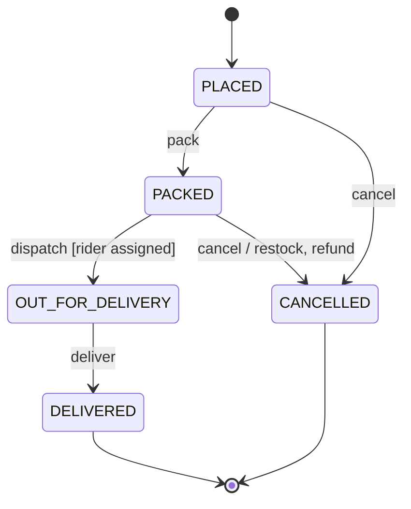
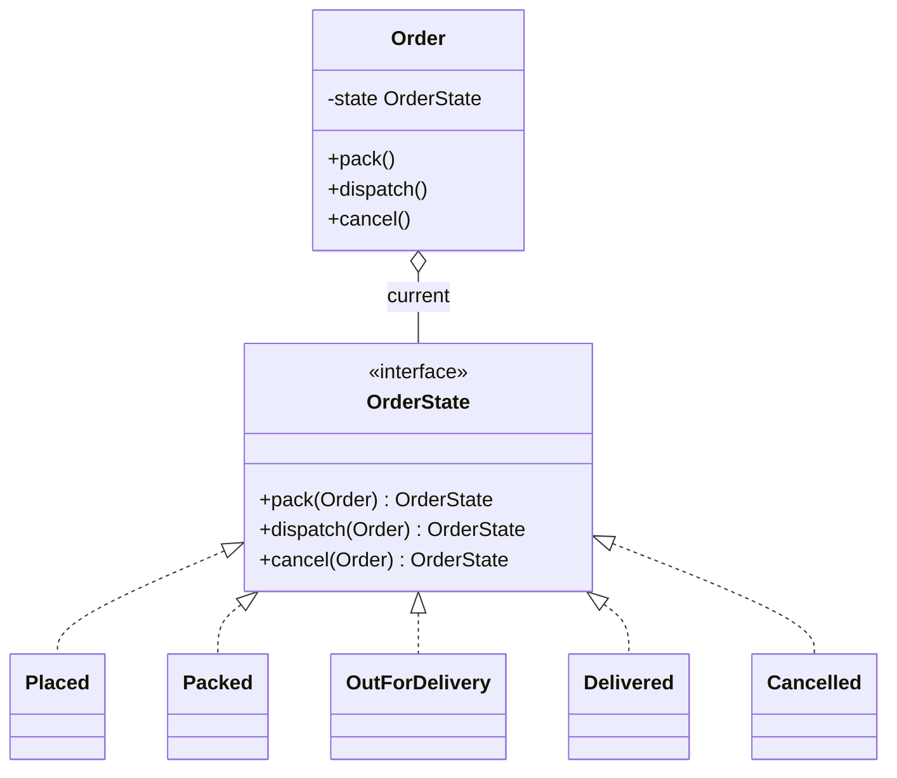

# State

<span class="badge-l2">L2 🔵 Practitioner</span> · <span class="read-time">⏱ 40 min read</span> · Prerequisites: [Strategy](../l1-foundations/strategy.md), [Command](command.md)

!!! abstract "TL;DR"
    State lets an object change its behaviour when its internal state changes, so "what does cancel do?" is answered by the current state instead of `if`/`switch` chains in every method. Java gives you several ways to build it: one class per state (classic GoF), an enum with allowed transitions, sealed records with an exhaustive `switch` (modern Java), or a transition table (state machine as data). In production, add guards, optimistic versioning, idempotent events and a history.

## 1. What It Is

**Plain English.** A FreshCart order is placed, packed, out for delivery, delivered, or cancelled. "Cancel" means a free cancellation when placed, a restock plus refund when packed, and "too late, refuse at the door" when the rider is on the way. Instead of one method full of `if (status == ...)`, each state knows what each action means.

**Definition (GoF).** "Allow an object to alter its behavior when its internal state changes. The object will appear to change its class." Parts:

- **Context:** the object clients use (`Order`); holds the current state and delegates to it.
- **State:** an interface with one method per event or action (`pack`, `dispatch`, `cancel`).
- **Concrete states:** implement the behaviour for that state and decide the next state.

A related, more general idea is the **finite state machine**: a set of states, events, and transitions (from, event → to), often with guards (conditions) and actions (side effects).

## 2. Why It Exists

Status fields plus conditionals spread state logic across every method: `pack()`, `dispatch()`, `cancel()` each switch on status, and adding a state (`RETURNED`) means editing all of them and hoping nothing is missed. Invalid transitions (cancel after delivery) slip through as silent bugs. The State pattern groups behaviour by state, makes illegal transitions explicit, and turns "what can happen next?" into something you can read, test, and draw.

## 3. Mental Model / Analogy

**Analogy.** A traffic light. The same "timer expired" event means "go to yellow" when green and "go to red" when yellow. The light's behaviour depends entirely on which state it's in, and some transitions (green straight to red) never happen.

**Technical model.** A directed graph: nodes are states, edges are transitions labelled by events. The context holds a pointer to the current node. Handling an event follows the matching edge (if any), runs its action, and moves the pointer. Everything else is an illegal transition.

## 4. How It Works





## 5. Subtopics

### State interface per state

**Description.** The classic GoF form: an interface with one method per action, one class per state, and a context that delegates and stores whatever state the method returns. Default methods can reject every action, so each state only overrides what it allows.

**Advantages / features.** Behaviour grouped by state; adding a state is adding a class; illegal actions handled in one place.

**Before (status switches in every method) and after (state classes):**

```java title="StatePerClassDemo.java"
--8<-- "examples/l2-practitioner/state/StatePerClassDemo.java"
```

1. Before: every action repeats a switch on the status string; a new status edits all of them.
2. The state interface: actions are rejected by default, so states override only what they allow.
3. Each state decides its next state and its side effects ("cancel" differs between `Placed` and `Packed`).
4. The context delegates and swaps its state; callers never see a status check.

**Run it:** `java StatePerClassDemo.java`

```text
--8<-- "examples/l2-practitioner/state/StatePerClassDemo.expected.txt"
```

| Pros | Cons |
|------|------|
| Behaviour grouped by state | Many small classes |
| Illegal actions rejected by default | The overall flow is spread across classes |
| States can hold state-specific logic | Persisting the state needs a mapping to a column |

**Use it** when states have substantial, different behaviour. **Avoid** it when states only differ in which transitions are allowed; an enum or table is simpler.
**Real-world Java:** `java.util.Iterator` implementations are tiny state machines; TCP connection handling in network stacks; game entities.
**Best practice:** make states stateless singletons or records, keeping data in the context. **Gotcha:** if states call back into the context and the context calls states, it's easy to create loops; let states return the next state instead of setting it.

### Enum-based state machines

**Description.** When states mostly differ in **which transitions are allowed**, an enum is the most compact model: each constant declares its allowed next states, and one `moveTo` method enforces them. It maps directly to a database column.

**Advantages / features.** One small type, easy persistence (`@Enumerated(STRING)`), exhaustive `switch` over constants, `EnumSet`/`EnumMap` performance.

```java title="EnumStateMachineDemo.java"
--8<-- "examples/l2-practitioner/state/EnumStateMachineDemo.java"
```

1. The enum is both the state and the transition rules.
2. Terminal states allow nothing; adding a constant without a `case` won't compile.
3. Every change goes through `moveTo`, which rejects illegal transitions.

**Run it:** `java EnumStateMachineDemo.java`

```text
--8<-- "examples/l2-practitioner/state/EnumStateMachineDemo.expected.txt"
```

| Pros | Cons |
|------|------|
| Compact, readable, persistable | Behaviour per state gets crowded in one file |
| Exhaustive switches | No state-specific data (a rider ID only when dispatched) |
| `EnumSet`/`EnumMap` are fast | Guards and actions need extra structure |

**Use** enums for status workflows (orders, tickets, payments). **Avoid** putting large behaviours inside enum constants; move them to services keyed by state.
**Real-world Java:** `Thread.State`, `java.time.DayOfWeek` (cyclic), JPA entities with `@Enumerated` status columns.
**Best practice:** persist enums by name (`EnumType.STRING`), never by ordinal. **Gotcha:** reordering enum constants with `EnumType.ORDINAL` silently corrupts every stored row.

### State with sealed types and switch

**Description.** With Java 21, each state can be a `record` in a sealed hierarchy, carrying only the data that exists in that state (`OutForDelivery` has a rider ID; `Delivered` has who received it). Transitions are an exhaustive `switch` over (state, event) with record patterns and guards. Impossible combinations, like a delivered order without a delivery time, can't be represented.

**Advantages / features.** "Make illegal states unrepresentable"; state-specific data is type-checked; the whole machine fits in one readable function.

```java title="SealedStateDemo.java"
--8<-- "examples/l2-practitioner/state/SealedStateDemo.java"
```

1. The sealed interface lists every state.
2. Each state record holds only its own data: no nullable `riderId` on a placed order.
3. A `switch` with `when` guards and record patterns matches (state, event) pairs.
4. Everything else is an illegal transition with a clear message.

**Run it:** `java SealedStateDemo.java`

```text
--8<-- "examples/l2-practitioner/state/SealedStateDemo.expected.txt"
```

| Pros | Cons |
|------|------|
| State-specific data is type-safe | Persistence needs mapping (JSON or columns per state) |
| One function shows all transitions | `default` branch weakens exhaustiveness checks |
| Immutable states: easy to test and log | Requires Java 21 pattern matching |

**Use** sealed states when states carry different data. **Avoid** them when you need the machine to be configurable at runtime; use a table.
**Real-world Java:** modern domain models in Java 21 codebases; the same style as Kotlin sealed classes and Scala ADTs.
**Best practice:** switch on the state and match the event inside each case for full exhaustiveness on states. **Gotcha:** a `default ->` branch means a new state compiles even if you forgot it; keep the default only for "illegal event" handling, and review it when adding states.

### Transition tables

**Description.** The whole state machine as data: a map from (state, event) to next state, optionally with guards and actions. The table can be printed as documentation, validated (unreachable states, dead ends), loaded from configuration, and tested exhaustively.

**Advantages / features.** Reviewable by non-developers; validation at startup; easy to generate diagrams from.

```java title="TransitionTableDemo.java"
--8<-- "examples/l2-practitioner/state/TransitionTableDemo.java"
```

1. `EnumMap` of `EnumMap`: a fast, ordered table.
2. Firing an event is a lookup; a missing entry is an illegal transition.
3. Validation finds states nobody can reach, a classic forgotten-transition bug.

**Run it:** `java TransitionTableDemo.java`

```text
--8<-- "examples/l2-practitioner/state/TransitionTableDemo.expected.txt"
```

| Approach | Pros | Cons |
|----------|------|------|
| Table in code | Reviewable, validatable, printable | Actions and guards need a structure |
| Table in configuration | Changeable without deploys | Untyped; risky without validation |
| State machine library (Spring Statemachine) | Hierarchical states, persistence, listeners | Heavy; learning curve |

**Use** tables when there are many states and events, or business people review the flow. **Avoid** configuration-driven machines unless the flow really changes without code changes.
**Real-world Java:** Spring Statemachine, workflow engines (Camunda, Temporal workflows), parsers' lexer tables.
**Best practice:** generate the diagram from the table in CI so documentation can't drift. **Gotcha:** a table with actions that call external services makes "fire" slow and failure-prone; record the transition and run side effects asynchronously (outbox).

### State vs. Strategy

**Description.** Both patterns hold an interface and delegate to it. In **Strategy**, the client chooses the implementation and it usually stays the same for the object's life. In **State**, the object (or the state itself) replaces the implementation as events happen, and states know about each other's existence.

**Advantages / features (of knowing the difference).** Clear names and designs: "fee strategy" vs "order state".

```java title="StateVsStrategyDemo.java"
--8<-- "examples/l2-practitioner/state/StateVsStrategyDemo.java"
```

1. Strategy: chosen from outside at construction; `Checkout` never changes it.
2. State: the current state decides the next one (two jobs in a row means a break).
3. The context swaps its own state after every event.

**Run it:** `java StateVsStrategyDemo.java`

```text
--8<-- "examples/l2-practitioner/state/StateVsStrategyDemo.expected.txt"
```

| | Strategy | State |
|---|----------|-------|
| Who chooses | The client | The context or states themselves |
| Changes during life | Rarely | Constantly, driven by events |
| Implementations know each other | No | Yes (they return the next state) |
| Typical question | "How should this be done?" | "What does this mean right now?" |

**Use** the name that reflects who controls the switch. **Avoid** State when nothing ever changes it after construction; that's Strategy.
**Real-world Java:** Strategy: `Comparator`, `RetryPolicy`; State: connection lifecycles, order workflows.
**Best practice:** if a "strategy" field is reassigned inside the class based on events, rename it as state. **Gotcha:** states holding references to each other as fields create cycles that complicate serialisation; return new states instead.

## 6. Examples (exactly 3, progressively harder)

### Example 1: Minimal (L2)

**Scenario:** a rider's app has one big button whose meaning depends on the shift state.

```java title="RiderShiftDemo.java"
--8<-- "examples/l2-practitioner/state/RiderShiftDemo.java"
```

1. Each enum constant overrides `tap` with its own behaviour and next state.
2. The abstract method forces every state to define what a tap means.

**Run it:** `java RiderShiftDemo.java`

**Output:**

```text
--8<-- "examples/l2-practitioner/state/RiderShiftDemo.expected.txt"
```

**What to notice:**

- One button, three meanings, no `if` in the caller.

### Example 2: Realistic (in FreshCart grocery delivery)

**Scenario:** customers can tap "Cancel order" at any time. The effects depend on the state: refund only, restock and refund, refuse (rider on the way), error (delivered), or nothing (already cancelled, a double tap).

```java title="OrderLifecycleDemo.java"
--8<-- "examples/l2-practitioner/state/OrderLifecycleDemo.java"
```

1. One exhaustive switch over sealed states decides the effects of "cancel".
2. Some actions are valid but change nothing: the state stays the same and the customer is told why.
3. Cancelling an already cancelled order is a harmless no-op (double taps happen).

**Run it:** `java OrderLifecycleDemo.java`

**Output:**

```text
--8<-- "examples/l2-practitioner/state/OrderLifecycleDemo.expected.txt"
```

**What to notice:**

- Only the packed order triggered a restock; only the delivered order raised an error.
- The side effects are passed in, so tests can record them.

### Example 3: Production-grade

**Scenario:** order state changes come from many places (store app, rider app, payment webhooks), sometimes twice, sometimes at the same moment. Requirements: transitions declared once and validated at startup; guards for business rules; optimistic versioning so two workers can't both change the same version; idempotent events (a redelivered event is ignored); and an audit history.

```java title="OrderStateMachineDemo.java"
--8<-- "examples/l2-practitioner/state/OrderStateMachineDemo.java"
```

1. The order is an immutable snapshot with a version, as read from a table.
2. Duplicate transition definitions fail at startup, not in production.
3. Optimistic locking: like `UPDATE ... WHERE id = ? AND version = ?` affecting zero rows.
4. Idempotency: an event ID seen before returns the current order without changing anything.
5. A guard enforces a rule that the table alone can't express.

**Run it:** `java OrderStateMachineDemo.java`

**Output:**

```text
--8<-- "examples/l2-practitioner/state/OrderStateMachineDemo.expected.txt"
```

**What to notice:**

- Worker B's cancel was based on version 2 after worker A had moved the order to version 3, so it was rejected instead of cancelling an order already with a rider.
- The redelivered `ev-3` didn't create a second history entry.
- The history shows exactly which event caused each transition.

## 7. Pros, Cons & Trade-offs

| Aspect | Pros | Cons |
|--------|------|------|
| Clarity | Behaviour grouped by state; flow can be drawn | Flow spread across classes (classic form) |
| Correctness | Illegal transitions explicit | Guards and actions add complexity |
| Extensibility | New states without editing all methods | Every new state needs every event considered |
| Concurrency | Versioning and idempotency fit naturally | Needs persistence design |
| Testability | Each transition testable | Many combinations to cover |
| Simplicity | Enum form is tiny | Classic form can be overkill |

## 8. When to Use / When NOT to Use

**Use it when:**

- an object's behaviour depends on a status that changes over time;
- there are rules about which changes are allowed;
- many methods would otherwise switch on the same status.

**Don't use it when:**

- there are only two states with trivial differences (a boolean is fine);
- behaviour doesn't depend on the state (it's just a label);
- the variation is chosen once and never changes (that's Strategy).

## 9. Best Practices

1. **Make illegal transitions impossible or loud**, never silent. *(Consensus.)*
2. **Pick the lightest form**: enum → sealed records → classes → table/library as complexity grows. *(Opinion, widely shared.)*
3. **Persist states by name**, with a version column for optimistic locking. *(Consensus.)*
4. **Make event handling idempotent** with event IDs. *(Consensus for distributed systems.)*
5. **Keep side effects out of the transition** or run them via an outbox. *(Consensus.)*
6. **Record a history** of transitions with the triggering event. *(Consensus.)*
7. **Generate diagrams from the definition** so documentation matches code. *(Opinion.)*

## 10. Pitfalls & Anti-Patterns

!!! danger "Lost update between two apps (production failure mode)"
    **Symptom:** an order showed "cancelled" while the customer received it, and the customer was refunded for delivered groceries.
    **Root cause:** the store app cancelled based on a "packed" order it had read earlier; meanwhile the rider app had dispatched it. Both wrote without checking, and the last write won.
    **Fix:** optimistic versioning (`WHERE version = ?`); reload and re-check rules on conflict; refunds triggered from the committed transition, not from the request.

!!! danger "Boolean soup"
    **Symptom:** an order with `isPacked=true, isCancelled=true, isDelivered=true`.
    **Root cause:** state represented as independent flags that can combine in impossible ways.
    **Fix:** one state field (enum or sealed type) with explicit transitions.

!!! danger "Status set directly"
    **Symptom:** a support tool set orders straight to `DELIVERED`, skipping payment capture.
    **Root cause:** a public `setStatus` bypassed the state machine.
    **Fix:** no setters; all changes go through events handled by the machine.

!!! danger "Ordinal persistence"
    **Symptom:** after adding `RETURNED` in the middle of the enum, thousands of orders appeared returned.
    **Root cause:** `@Enumerated(EnumType.ORDINAL)` stored positions, which shifted.
    **Fix:** `EnumType.STRING`, and a migration.

## 11. Configuration & Tuning

| Setting | Default | What it does | When to change it | Risk of changing |
|---------|---------|--------------|-------------------|------------------|
| `@Enumerated` | `ORDINAL` (JPA default) | How enum states are stored | Always use `STRING` | Changing later needs a data migration |
| `@Version` column | none | Optimistic locking | Any concurrently updated state | Conflicts must be handled (retry or report) |
| Processed-event retention | your choice | Idempotency window | Longer for slow redelivery | Storage growth |
| State timeouts | none | Auto-transition after time (e.g. unpaid → cancelled) | Payment holds, reservations | Scheduler reliability matters |

## 12. Security Considerations

- Check permissions per transition: a customer may cancel, only support may refund after delivery, only riders may mark delivered.
- Never let clients send the target state; send events ("cancel") and let the server decide the result.
- The transition history is an audit log: record the actor, keep it append-only.

## 13. Performance & Scalability

State machines are cheap: a table lookup or a `switch` per event. The costs are in persistence and side effects. Use optimistic locking (no long-held locks), keep transitions in short transactions, and move slow side effects (SMS, refunds) to an outbox so state changes stay fast under load. For very high event rates, partition by order ID so each order's events are processed in order by one consumer.

## 14. Testing It

Test the happy path, illegal transitions, guards, idempotency, stale versions and startup validation:

```java title="OrderStateMachineTest.java"
--8<-- "examples/l2-practitioner/state/OrderStateMachineTest.java"
```

For tables, a parameterised test over every (state, event) pair checks that each is either a defined transition or rejected, so nothing is accidentally allowed.

## 15. Observability & Operations

Emit a metric per transition (`order_transition_total{from,to}`) and per rejected event; a spike in rejections often means two systems disagree about the flow. Track time spent in each state (orders stuck in `PACKED` for over 30 minutes need attention). Keep the history queryable for support: "why was this order cancelled?" should be one lookup.

## 16. Version Notes

| Java | Change relevant to State |
|------|--------------------------|
| 5 | Enums with constant-specific methods; `EnumSet`, `EnumMap` |
| 8 | Default methods: states reject unknown actions by default |
| 14 | Switch expressions (final) |
| 17 | Sealed classes and interfaces (final) |
| 21 | Pattern matching for `switch` with guards (`when`) and record patterns (final) |

## 17. Expert Deep Dive

- **Make illegal states unrepresentable.** Sealed records per state remove whole classes of bugs (a delivered order without a delivery time can't exist). This is the biggest modern upgrade to the GoF pattern.
- **Statecharts.** Real workflows need hierarchical states (an order "in fulfilment" with sub-states), parallel regions, history states, and timeouts. Harel statecharts (and SCXML, Spring Statemachine) model these; use them when flat machines explode.
- **Event sourcing.** Instead of storing the current state, store events and fold them through the transition function. The State pattern's `apply(state, event)` becomes the core of the aggregate. See [Distributed Data Patterns](../l4-senior/distributed-data-patterns.md).
- **Workflows across services.** When transitions span services (payment, warehouse, delivery), the state machine becomes a saga orchestrator or a durable workflow engine (Temporal), with compensations instead of undo.

!!! example "War story: the order that was delivered twice"
    A grocery company's rider app retried "mark delivered" when the network dropped, and the payment service captured payment on each `DELIVERED` event. A handful of customers were charged twice per day. The state machine did reject `DELIVERED → DELIVERED`, but the rejection happened **after** the capture side effect, which ran in the request handler. **Fixes:** event IDs from the rider app made retries idempotent; payment capture moved to an outbox written in the same transaction as the transition, so it happens exactly once per real transition; and a reconciliation job compares captures with deliveries daily. **Lesson:** side effects belong to committed transitions, not to requests.

## 18. Interview Corner

=== "🟢 L1–L2"

    1. **What does the State pattern do?** Lets an object **change behaviour when its state changes** by delegating to state objects.
    2. **Name the parts.** **Context, state interface, concrete states.**
    3. **How would you model order statuses simply?** An **enum** with allowed transitions.
    4. **What's an illegal transition?** An event **not allowed** in the current state (deliver a cancelled order).
    5. **Why not booleans for status?** Flags combine into **impossible states**.

=== "🟡 L3"

    1. **State vs Strategy?** Strategy is **chosen by the client** and stable; State **changes itself** with events.
    2. **How do sealed types improve State?** Each state carries **only its own data**; switches are **exhaustive**.
    3. **How do you persist an enum state safely?** **`EnumType.STRING`** plus a **version column**.
    4. **What's a guard?** A **condition** that must hold for a transition (rider assigned before dispatch).
    5. **Why make event handling idempotent?** Events are **redelivered**; duplicates must not repeat effects.

=== "🔴 L4–L5"

    1. **Two services update the same order concurrently. Design it.** **Optimistic versioning, events not states, idempotency, outbox side effects, single-writer per order** (partitioning).
    2. **When would you use a workflow engine?** **Long-running, cross-service** flows with timeouts, retries and compensations.
    3. **How does event sourcing relate to State?** State is a **fold of events** through the transition function.
    4. **How do you evolve a state machine in production?** Add states **backward-compatibly**, migrate data, handle **in-flight** instances, version the machine.
    5. **How do you test a state machine exhaustively?** **Every (state, event) pair**, property-based tests over random event sequences, invariants.

=== "💻 Hands-on"

    **Task:** Add a `RETURNED` state reachable from `DELIVERED` within 2 days, to `OrderStateMachineDemo`.

    ??? success "Solution"
        ```java
        enum S { PLACED, PACKED, OUT_FOR_DELIVERY, DELIVERED, CANCELLED, RETURNED }
        enum E { PACK, DISPATCH, DELIVER, CANCEL, RETURN }

        new Transition(S.DELIVERED, E.RETURN, S.RETURNED,
                e -> Duration.between(deliveredAt(e), clock.get()).toDays() < 2,
                "returns are accepted within 2 days of delivery")
        ```

## 19. Practice

- [ ] Add a `PAYMENT_PENDING` state before `PLACED` in `TransitionTableDemo`, with a timeout event that cancels unpaid orders.
    ??? tip "Hint"
        Add `E.PAYMENT_TIMEOUT` from `PAYMENT_PENDING` to `CANCELLED`.
- [ ] Generate a Mermaid `stateDiagram-v2` from `TransitionTableDemo.TABLE`.
    ??? tip "Hint"
        Print `FROM --> TO : EVENT` for each entry.
- [ ] Write a parameterised test that every (state, event) pair in `OrderStateMachineDemo` is either allowed or throws.
    ??? tip "Hint"
        Nested loops over `S.values()` and `E.values()`.
- [ ] Find a class in a codebase with several boolean status flags and redesign it as a state machine.
    ??? tip "Hint"
        List which flag combinations are actually valid; each becomes a state.

## 20. Quick Revision Card

!!! tip "Remember in 30 seconds"
    - Intent: behaviour depends on current state; transitions are explicit.
    - Forms: state classes (GoF), enum with allowed transitions, sealed records + switch, transition table.
    - Illegal transitions rejected loudly; no status setters; events, not target states.
    - Production: guards, optimistic versions, idempotent events, history, side effects via outbox.
    - State changes itself; Strategy is chosen from outside.

    ```java
    static State apply(State s, Event e) {
        return switch (s) {
            case Placed p when e instanceof Pack(int bags) -> new Packed(bags);
            case Packed p when e instanceof Dispatch(String rider) -> new OutForDelivery(rider);
            default -> throw new IllegalStateException(e + " not allowed in " + s);
        };
    }
    ```

## 21. Further Reading

- Gamma, Helm, Johnson, Vlissides, *Design Patterns* (1994), "State".
- David Harel, "Statecharts: A Visual Formalism for Complex Systems" (1987).
- [Spring Statemachine reference](https://docs.spring.io/spring-statemachine/docs/current/reference/)
- [JEP 441: Pattern Matching for switch](https://openjdk.org/jeps/441)
- Scott Wlaschin, *Domain Modeling Made Functional* (2018), "Making illegal states unrepresentable".

---

[← Previous: Iterator](iterator.md) · [Next: Chain of Responsibility →](chain-of-responsibility.md)
