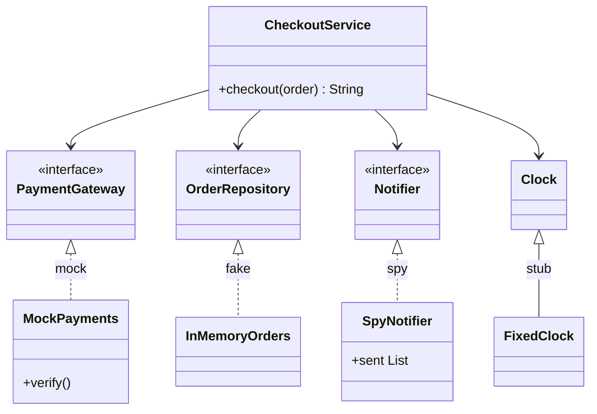
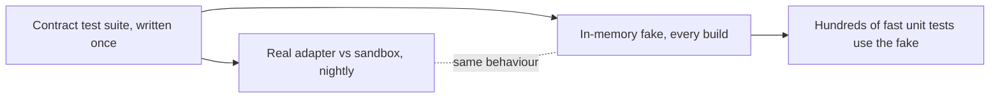

# Testing Patterns

<span class="badge-l2">L2 🔵 Practitioner</span> · <span class="read-time">⏱ 40 min read</span> · Prerequisites: [Dependency Injection](dependency-injection.md), [Strategy](../l1-foundations/strategy.md)

!!! abstract "TL;DR"
    Tests have their own design patterns. **Test doubles** (dummy, stub, fake, spy, mock) stand in for collaborators. **Object Mother** and **Test Data Builder** make test data short and readable. **Arrange-Act-Assert** gives every test the same three-part shape. Design patterns in production code (DI, Strategy, Decorator) create **seams** where doubles plug in. **Contract tests** run one suite against every implementation of an interface, including your fakes, so the fakes stay honest.

## 1. What It Is

**Plain English.** FreshCart's checkout talks to payments, inventory, SMS and the clock. A unit test can't charge real cards or wait until 10 pm. Testing patterns are the standard ways to replace those collaborators, build test data, structure each test, and check that replacements behave like the real thing.

**Definition.** The vocabulary comes from Gerard Meszaros, *xUnit Test Patterns* (2007), and Michael Feathers, *Working Effectively with Legacy Code* (2004):

- **Test double:** any object that replaces a real collaborator in a test. Five kinds: dummy, stub, fake, spy, mock.
- **Object Mother / Test Data Builder:** factories for test data.
- **Four-phase test / Arrange-Act-Assert:** set up, exercise, verify (and tear down).
- **Seam:** a place where behaviour can change without editing the code there.
- **Contract test:** an abstract test suite for an interface, run against each implementation.

## 2. Why It Exists

Tests that hit real services are slow, flaky and sometimes dangerous (real SMS, real charges). Tests that build data by hand are long and break whenever a constructor changes. Tests that mix many behaviours fail with "check failed" and no clue. And fakes written without checks drift from reality, so tests pass while production breaks. Each testing pattern targets one of these problems.

## 3. Mental Model / Analogy

**Analogy.** A film shoot. **Dummies** stand in the background, **stunt doubles** (stubs) do one scripted action, a **rehearsal set** (fake) works but isn't the real city, a **camera** (spy) records what actors did, and a **director with a script** (mock) stops the take if an actor says the wrong line. Before using the rehearsal set, you check it has the same doors as the real building (contract test).

**Technical model.** Code under test depends on interfaces. The test chooses the implementations (through constructor injection), arranges their state, performs one action, and asserts on outputs or on the recorded interactions.

## 4. How It Works





## 5. Subtopics

### Test doubles: dummy, stub, fake, spy, mock

**Description.** Meszaros's five kinds, from simplest to most opinionated:

- **Dummy:** fills a parameter; never used on this path.
- **Stub:** returns canned answers to steer the code (a declining payment, a fixed clock).
- **Fake:** a real, simplified implementation (an in-memory repository).
- **Spy:** records calls so the test can check them afterwards.
- **Mock:** pre-programmed with expectations and verifies them itself.

**Advantages / features.** Fast, deterministic tests; failure paths (declines, timeouts) on demand; no external side effects.

```java title="TestDoublesDemo.java"
--8<-- "examples/l2-practitioner/testing-patterns/TestDoublesDemo.java"
```

1. A dummy that fails loudly if it's ever used, which proves this path doesn't touch auditing.
2. A stub: one canned answer that sends checkout down the decline path.
3. A fake: genuinely stores and returns orders, just in memory.
4. A spy: records what was sent; the test inspects it after the act step.
5. A mock: knows what call to expect and fails if it's wrong or missing.

**Run it:** `java TestDoublesDemo.java`

```text
--8<-- "examples/l2-practitioner/testing-patterns/TestDoublesDemo.expected.txt"
```

| Double | Answers calls? | Records calls? | Has real logic? | Verifies itself? | Typical use |
|--------|---------------|----------------|-----------------|------------------|-------------|
| Dummy | No | No | No | No | Unused parameter |
| Stub | Canned | No | No | No | Drive a path (decline, time) |
| Fake | Yes | Via state | Simplified | No | Repository, cache, queue |
| Spy | Optional | Yes | No | No | Check outgoing messages |
| Mock | Programmed | Yes | No | Yes | Strict interaction protocols |

**Use** stubs and fakes by default, spies for outgoing side effects, mocks sparingly. **Avoid** mocking types you don't own (HTTP clients, JDBC); wrap them in your own interface and fake that.
**Real-world Java:** Mockito (`mock`, `when(...).thenReturn`, `verify`, `spy`), `Clock.fixed`, Spring's `MockMvc`, Testcontainers (real dependencies instead of doubles), WireMock (a fake HTTP server).
**Best practice:** assert on outcomes (state, return values) before interactions; interaction checks make tests brittle to refactoring. **Gotcha:** Mockito's "mock" is technically a stub or spy until you call `verify`; the words are used loosely, so say what you mean in code reviews.

### Object Mother and Test Data Builder

**Description.** An **Object Mother** is a class of named factory methods for typical test objects (`Orders.goldExpressOrder()`). A **Test Data Builder** (Nat Pryce) starts from sensible defaults and lets each test override only what it's about: `anOrder().coupon("FRESH10").build()`. They combine well: mother methods are built from the builder.

**Advantages / features.** Tests show only the data that matters to them; constructor changes are fixed in one place; names document the scenario.

**Before (every field in every test) and after:**

```java title="TestDataBuilderDemo.java"
--8<-- "examples/l2-practitioner/testing-patterns/TestDataBuilderDemo.java"
```

1. Before: the reader can't tell which of seven arguments matter, and every test breaks when a field is added.
2. Object Mother: named, reusable scenarios.
3. Test Data Builder: defaults for everything, fluent overrides for what the test is about.

**Run it:** `java TestDataBuilderDemo.java`

```text
--8<-- "examples/l2-practitioner/testing-patterns/TestDataBuilderDemo.expected.txt"
```

| | Object Mother | Test Data Builder |
|-|---------------|-------------------|
| Strength | Named scenarios | Small, local variations |
| Weakness | Grows into a "god mother" with many near-duplicates | More code up front |
| Reads like | `Orders.unpaidOrder()` | `anOrder().unpaid().build()` |
| Best together | Mother methods call the builder | |

**Use** builders for domain objects with more than three or four fields. **Avoid** random data in assertions; if you use generated data, make it reproducible with a seed.
**Real-world Java:** Lombok `@Builder(toBuilder = true)` in test fixtures, Instancio and EasyRandom for generated data, AssertJ's soft assertions alongside builders.
**Best practice:** builder defaults should create a **valid** object, so tests only change what makes them interesting. **Gotcha:** shared mutable fixtures (one static order reused by many tests) cause order-dependent failures; build a fresh object per test.

### Arrange-Act-Assert

**Description.** Each test has three visible parts: **arrange** the state, **act** once, **assert** the outcome. Behaviour-driven teams call it Given-When-Then. One behaviour per test, named as a sentence, with assertions that print expected and actual values.

**Advantages / features.** A failing test's name says which behaviour broke; its message says how; readers find the action instantly.

**Before (one long test with bare checks) and after:**

```java title="ArrangeActAssertDemo.java"
--8<-- "examples/l2-practitioner/testing-patterns/ArrangeActAssertDemo.java"
```

1. Before: four behaviours in one test, checked with booleans. When it fails, you learn only that something failed.
2. After: one behaviour, three marked phases, a name that reads as a requirement.
3. A descriptive assertion: what was checked, expected and actual.

**Run it:** `java ArrangeActAssertDemo.java`

```text
--8<-- "examples/l2-practitioner/testing-patterns/ArrangeActAssertDemo.expected.txt"
```

| Smell | AAA fix |
|-------|---------|
| Several act steps | Split into several tests |
| Asserting before acting | Move setup checks into arrange or delete them |
| `assertTrue(a == b)` | `assertEquals(b, a)` for a useful message |
| Test name `test1` | Name the behaviour: `zeroQuantityIsRejected` |
| Logic (`if`, loops) in tests | Parameterised tests |

**Use** AAA for every unit test. **Avoid** "and" in test names; it usually means two tests.
**Real-world Java:** JUnit 5 `@DisplayName`, `@ParameterizedTest`, `assertAll`; AssertJ's fluent assertions; Spock's `given:/when:/then:` blocks.
**Best practice:** several assertions are fine when they describe one outcome (quantity and line count after one add). **Gotcha:** a setup that needs 30 lines is a design smell in the production code, not just the test.

### Testing through seams created by patterns

**Description.** Michael Feathers defines a **seam** as "a place where you can alter behaviour in your program without editing in that place". Constructor injection ([Dependency Injection](dependency-injection.md)), [Strategy](../l1-foundations/strategy.md) and [Decorator](../l1-foundations/decorator.md) all create seams. `new RealSms()` and `LocalTime.now()` inside a method remove them.

**Advantages / features.** Time, randomness, network and files become controllable; tests become deterministic; the same seams later allow features like fault injection.

**Before (hard-wired) and after (seams):**

```java title="SeamsDemo.java"
--8<-- "examples/l2-practitioner/testing-patterns/SeamsDemo.java"
```

1. Before: the wall clock and a real SMS client are created inside the method. The result depends on when you run the test.
2. After: the clock and the sender come in through the constructor, so tests choose them.
3. A decorator seam: wraps any sender to record (or delay, or fail) without changing it.

**Run it:** `java SeamsDemo.java`

```text
--8<-- "examples/l2-practitioner/testing-patterns/SeamsDemo.expected.txt"
```

| Hidden dependency | Seam | Test replacement |
|-------------------|------|------------------|
| `LocalDateTime.now()` | Inject `java.time.Clock` | `Clock.fixed(...)` |
| `new Random()` / `UUID.randomUUID()` | Inject `RandomGenerator` / `Supplier<UUID>` | Seeded or fixed values |
| `new HttpClient()` | Your own interface (port) | Fake or WireMock |
| Static utility with side effects | Instance behind an interface | Stub |
| `System.getenv` | Config object | Test config |

**Use** constructor injection for every collaborator with side effects or nondeterminism. **Avoid** making methods `protected` just to override them in tests; inject instead.
**Real-world Java:** `java.time.Clock`, Spring's constructor injection and `@TestConfiguration`, `java.util.random.RandomGenerator` (Java 17).
**Best practice:** treat "hard to test" as feedback about coupling. **Gotcha:** mocking static methods (`Mockito.mockStatic`) works but hides the missing seam; prefer adding the seam.

### Contract tests for interface implementations

**Description.** A contract test is one suite of tests written against an interface and run against every implementation. In JUnit 5: an abstract class (or interface) with the `@Test` methods and an abstract factory method, plus one subclass per implementation, often `@Nested`. Running the same contract against your **fakes** makes them **verified fakes**.

**Advantages / features.** Liskov substitution checked automatically; new implementations get a full suite for free; fakes can't silently drift from the real thing.

```java title="ContractTestDemo.java"
--8<-- "examples/l2-practitioner/testing-patterns/ContractTestDemo.java"
```

1. The contract, written once against the interface.
2. A rule an "optimisation" could easily break.
3. Each implementation runs the same suite.

**Run it:** `java ContractTestDemo.java`

```text
--8<-- "examples/l2-practitioner/testing-patterns/ContractTestDemo.expected.txt"
```

| Where | Contract runs against | When |
|-------|----------------------|------|
| Library interfaces | Every implementation in the repo | Every build |
| Fakes of external services | Fake (every build) and real sandbox (nightly) | Both |
| Consumer-driven contracts (Pact) | Provider service, using consumers' expectations | Provider's CI |

**Use** contract tests for any interface with more than one implementation, and for every fake. **Avoid** copying tests per implementation; they diverge.
**Real-world Java:** the JDK's TCK and Guava's `guava-testlib` (`ListTestSuiteBuilder`, `MapTestSuiteBuilder`) test collection implementations against a contract; Pact and Spring Cloud Contract for services.
**Best practice:** run the contract against the real system on a schedule, not only on every build, if it's slow or rate-limited. **Gotcha:** a contract that's too loose ("returns something") passes for broken implementations; include the edge cases that matter.

## 6. Examples (exactly 3, progressively harder)

### Example 1: Minimal (L2)

**Scenario:** DairyDay delivers tomorrow if you order before 10 pm IST, otherwise the day after. The rule must be tested exactly at the boundary and over New Year.

```java title="SlotCutoffDemo.java"
--8<-- "examples/l2-practitioner/testing-patterns/SlotCutoffDemo.java"
```

1. The clock is a constructor parameter: a seam.
2. A helper that builds a stub clock at an exact local time.

**Run it:** `java SlotCutoffDemo.java`

**Output:**

```text
--8<-- "examples/l2-practitioner/testing-patterns/SlotCutoffDemo.expected.txt"
```

**What to notice:**

- 21:59:59 and 22:00:00 give different days, tested in milliseconds, not by waiting.
- The last line passes a UTC clock for 22:15 IST; the planner converts to IST itself, so it's still "after cutoff".

### Example 2: Realistic (in FreshCart grocery delivery)

**Scenario:** checkout reserves stock, charges, and publishes an event. The team wants each test to be a few lines, so they build a **test kit**: a builder for carts, a fake inventory, a spy payment gateway and a fixed clock.

```java title="CheckoutTestKitDemo.java"
--8<-- "examples/l2-practitioner/testing-patterns/CheckoutTestKitDemo.java"
```

1. The kit bundles all the doubles and builders a checkout test needs.
2. A failure-path test that also checks nothing was charged and no stock was leaked by the earlier reservation.
3. Because the clock is fixed, the event text can be compared exactly.

**Run it:** `java CheckoutTestKitDemo.java`

**Output:**

```text
--8<-- "examples/l2-practitioner/testing-patterns/CheckoutTestKitDemo.expected.txt"
```

**What to notice:**

- Each test is arrange (one line), act (one line), assert (one or two lines).
- The fake inventory caught a real bug while this example was written: MILK stayed reserved when PANEER was out of stock, until checkout released earlier reservations.

### Example 3: Production-grade

**Scenario:** PayLink is the payment provider. Hundreds of tests use an in-memory fake gateway instead of calling the provider. Requirements: the fake must behave like the real adapter for idempotency, declines, refund limits and timeouts; the same contract must run against the real adapter (the provider's sandbox, nightly in CI); and a quickly-written fake must be caught before it misleads anyone.

```java title="VerifiedFakeDemo.java"
--8<-- "examples/l2-practitioner/testing-patterns/VerifiedFakeDemo.java"
```

1. The real adapter maps HTTP responses to domain results; here the HTTP server is simulated.
2. The fake: in memory, but with the provider's real rules (idempotency, magic test cards, refund limits).
3. The contract, written once.
4. Idempotency: a retry with the same key must not charge twice. Fakes most often get this wrong.
5. The rule that makes fakes trustworthy.

**Run it:** `java VerifiedFakeDemo.java`

**Output:**

```text
--8<-- "examples/l2-practitioner/testing-patterns/VerifiedFakeDemo.expected.txt"
```

**What to notice:**

- The naive fake would make retry and refund tests pass while production double-charges or over-refunds.
- The fake uses the provider's documented test cards, so the same test data works against the sandbox.

## 7. Pros, Cons & Trade-offs

| Aspect | Pros | Cons |
|--------|------|------|
| Speed | Doubles make unit tests milliseconds | Integration gaps if nothing tests the real thing |
| Determinism | Fixed clocks and stubs remove flakiness | Fakes can drift from reality without contracts |
| Readability | Builders and AAA make intent clear | Test kits are code to maintain |
| Design feedback | Seams push towards loose coupling | Over-abstraction "just for tests" |
| Refactoring | State-based tests survive refactors | Interaction-heavy mock tests break on every change |

## 8. When to Use / When NOT to Use

**Use them when:**

- collaborators are slow, nondeterministic or have side effects (payments, SMS, clock, network);
- domain objects have many fields (builders);
- an interface has several implementations or a fake (contract tests).

**Don't use them when:**

- the collaborator is a simple value or pure function: use the real one;
- you could run the real dependency cheaply (Testcontainers for PostgreSQL) and the test is about the integration;
- a mock would only restate the implementation line by line.

## 9. Best Practices

1. **Prefer real objects, then fakes, then stubs, then mocks.** *(Opinion, widely shared; "classicist" school.)*
2. **Don't mock what you don't own;** wrap third-party APIs and fake your wrapper. *(Consensus, Freeman and Pryce.)*
3. **Inject `Clock`, randomness and IDs.** *(Consensus.)*
4. **One behaviour per test, named as a sentence, AAA layout.** *(Consensus.)*
5. **Builders with valid defaults** for test data. *(Consensus.)*
6. **Verify every fake with a contract test** shared with the real implementation. *(Consensus.)*
7. **Assert on outcomes before interactions.** *(Opinion, widely shared.)*

## 10. Pitfalls & Anti-Patterns

!!! danger "Unverified fake hides a double charge (production failure mode)"
    **Symptom:** after a network blip, some customers were charged twice; every test was green.
    **Root cause:** the in-memory payment fake ignored idempotency keys and always returned a new payment, so the retry logic was "tested" against behaviour the real provider doesn't have, and a bug that sent a new key on retry was never caught.
    **Fix:** a contract suite run against the fake on every build and against the provider sandbox nightly; idempotency is the first contract test.

!!! danger "Over-mocking"
    **Symptom:** a harmless refactor (extracting a method) broke 40 tests.
    **Root cause:** tests verified every internal call with mocks, so they tested the implementation, not the behaviour.
    **Fix:** assert on results and state; reserve `verify` for meaningful outgoing effects (a payment was charged once).

!!! danger "Flaky time-dependent tests"
    **Symptom:** tests failed every night between 22:00 and 00:00 IST, and on 31 December.
    **Root cause:** production code called `LocalDate.now()`; tests assumed "tomorrow" was a fixed offset.
    **Fix:** inject `Clock`; test boundary times explicitly.

!!! danger "Shared mutable fixtures"
    **Symptom:** tests passed alone but failed when run together, in a different order each time.
    **Root cause:** a `static` test order was modified by one test and read by another.
    **Fix:** build fresh data per test with a builder; make shared fixtures immutable.

## 11. Configuration & Tuning

| Setting | Default | What it does | When to change it | Risk of changing |
|---------|---------|--------------|-------------------|------------------|
| Mockito strict stubs (`MockitoExtension`) | Strict | Fails on unused stubs | Keep strict | Lenient hides dead setup |
| JUnit `junit.jupiter.execution.parallel.enabled` | false | Runs tests in parallel | Large suites with independent tests | Exposes shared-state bugs (good, but noisy) |
| JUnit `@TestMethodOrder` | Deterministic but unspecified | Order of tests | Never rely on order | Order-dependent tests |
| Testcontainers reuse | off | Reuses containers between runs | Local development speed | State leaking between runs |
| Contract suite against sandbox | n/a | Verifies fakes against reality | Nightly or on adapter changes | Rate limits, sandbox outages |

## 12. Security Considerations

- Never put real credentials, card numbers or customer data in test fixtures; use the provider's documented test cards and synthetic data.
- Make sure fakes and test-only endpoints can't be enabled in production (separate source sets, `@Profile("test")`).
- Sandbox credentials for contract tests are secrets; store them in the CI secret store, not in the repo.
- Test security behaviour with real filters (Spring Security test support), not by mocking the security layer away.

## 13. Performance & Scalability

Fakes and stubs keep unit tests in milliseconds; aim for a unit suite that runs in under a minute so people run it constantly. Mock frameworks add startup cost per class; hand-written fakes are often faster and clearer. Use Testcontainers for the smaller number of integration tests, and run slow contract tests against sandboxes on a schedule. Parallel test execution needs tests with no shared state, which builders and fresh fakes give you.

## 14. Testing It

The contract as real JUnit 5 tests: an abstract class with the tests, one `@Nested` subclass per implementation, AAA in each test:

```java title="PaymentGatewayContractTest.java"
--8<-- "examples/l2-practitioner/testing-patterns/PaymentGatewayContractTest.java"
```

Adding a new gateway (a second provider) means adding one `@Nested` class with a `create()` method; it immediately gets all five checks.

## 15. Observability & Operations

Track test-suite duration and flaky tests (tests that both pass and fail on the same commit) in CI; quarantine and fix flakes quickly. For contract tests against sandboxes, alert when the real adapter fails the contract: that usually means the provider changed behaviour, which you want to know before production does.

## 16. Version Notes

| Java / tool | Change relevant to testing patterns |
|-------------|-------------------------------------|
| Java 8 | `java.time.Clock` for injectable time; lambdas as one-line stubs |
| Java 16 | Records: value-based test data with `equals` for assertions |
| Java 17 | `RandomGenerator` interface for injectable randomness |
| JUnit 5 (2017) | `@Nested`, `@DisplayName`, `@ParameterizedTest`, extensions |
| Mockito 2–5 | Strict stubs; inline mock maker default in 5 (final classes mockable) |
| Testcontainers | Real databases and brokers in tests instead of fakes |

## 17. Expert Deep Dive

- **London vs Chicago (Detroit) schools.** "Mockist" TDD (Freeman and Pryce, *Growing Object-Oriented Software, Guided by Tests*) designs object roles through mocks; "classicist" TDD prefers real objects and fakes, asserting on state. Most teams mix them: mocks at architectural boundaries, real objects inside.
- **Hexagonal architecture makes doubles natural.** Ports (interfaces owned by the domain) are exactly where fakes plug in; adapters are tested with contract and integration tests.
- **Verified fakes at scale.** Google's testing guidance recommends that owners of a service also own its fake and its contract tests, so consumers don't each write their own drifting fakes.
- **Property-based testing** (jqwik) generates many inputs for contracts: "for any sequence of charges and refunds, refunded never exceeds captured".
- **Mutation testing** (PIT) changes production code and checks tests fail; it finds tests that execute code without really asserting anything.

!!! example "War story: the fake that never timed out"
    TextBlast's SMS service used a fake provider in all tests. The fake answered instantly and never failed. The real provider occasionally took 30 seconds, and the production client had no timeout, so during a provider incident every request thread blocked and order confirmation stopped across the platform. Tests had never exercised a slow or failing provider. **Fixes:** the fake gained configurable latency and failure modes (`slowFor(Duration)`, `failNext(n)`); a contract test ran against the provider sandbox nightly; the client got timeouts and a circuit breaker; and a test checked that checkout completes when SMS is down. **Lesson:** a fake must model the real system's failure modes, not just its happy path.

## 18. Interview Corner

=== "🟢 L1–L2"

    1. **Name the five test doubles.** **Dummy, stub, fake, spy, mock.**
    2. **Stub vs mock?** A stub **returns canned answers**; a mock **verifies expected calls**.
    3. **What's Arrange-Act-Assert?** **Set up, act once, check the outcome.**
    4. **How do you test code that uses the current time?** **Inject `Clock`**, use `Clock.fixed`.
    5. **What's a Test Data Builder?** Defaults plus **fluent overrides** for test objects.

=== "🟡 L3"

    1. **What's a fake, and why is it risky?** A **working in-memory implementation**; it can **drift from the real thing**.
    2. **What is a seam?** A place to **change behaviour without editing there** (injection, strategy, decorator).
    3. **Why "don't mock what you don't own"?** Your mock encodes **your assumptions** about their API; wrap and fake **your interface**.
    4. **How do you write contract tests in JUnit 5?** **Abstract test class + subclass per implementation**, often `@Nested`.
    5. **State vs interaction testing?** State survives **refactoring**; interactions check **outgoing effects**.

=== "🔴 L4–L5"

    1. **Design the test strategy for a payment integration.** **Port interface, verified fake with contract tests, sandbox nightly, idempotency and failure modes, Testcontainers for DB.**
    2. **How do you keep a large test suite fast and reliable?** **Pyramid**, fakes over mocks, no shared state, parallel execution, flake tracking.
    3. **London vs Chicago TDD?** **Mocks to design roles** vs **real objects and state**; mix at boundaries.
    4. **How do you know your tests are good?** **Mutation testing**, coverage of failure paths, contracts on fakes.
    5. **Consumer-driven contracts vs provider contract tests?** **Pact**: consumers publish expectations the provider verifies; provider suites verify implementations of one interface.

=== "💻 Hands-on"

    **Task:** Add a "slow" mode to `FakePaymentGateway` and a contract test that a timeout is reported as `GatewayTimeout`, not as a decline.

    ??? success "Solution"
        ```java
        // in FakePaymentGateway
        private boolean timeOutNext;
        public FakePaymentGateway timeOutNextCall() { timeOutNext = true; return this; }

        public Result charge(String key, String card, long paise) {
            if (timeOutNext || card.equals(TIMEOUT_CARD)) { timeOutNext = false; throw new GatewayTimeout(); }
            ...
        }

        // contract (works for the sandbox too, via the magic timeout card)
        @Test
        void timeoutIsNotADecline() {
            assertThrows(VerifiedFakeDemo.GatewayTimeout.class,
                    () -> gateway.charge("k6", "4000000000000119", 100));
        }
        ```

## 19. Practice

- [ ] Rewrite `TestDoublesDemo` with Mockito and compare which hand-written double each Mockito call replaces.
    ??? tip "Hint"
        `when(...).thenReturn(false)` is the stub; `verify(payments).charge("FC-2", 64900)` is the mock check.
- [ ] Add `withCustomer(String)` to the cart builder in `CheckoutTestKitDemo` and a test that charges go to the right customer.
    ??? tip "Hint"
        Assert on `kit.charges`.
- [ ] Make `ContractTestDemo` a real JUnit 5 contract with `@Nested` classes.
    ??? tip "Hint"
        Copy the structure of `PaymentGatewayContractTest`.
- [ ] Find a test in your codebase that uses `LocalDateTime.now()` indirectly and add a `Clock` seam.
    ??? tip "Hint"
        Search production code for `now()` without a `Clock` argument.

## 20. Quick Revision Card

!!! tip "Remember in 30 seconds"
    - Doubles: dummy (unused), stub (canned), fake (works in memory), spy (records), mock (verifies).
    - Data: Object Mother for named cases, Builder for "default except...".
    - Shape: Arrange-Act-Assert, one behaviour, sentence names.
    - Seams: inject `Clock`, randomness, and your own interfaces for external systems.
    - Contracts: one suite per interface, run against every implementation, including fakes.

    ```java
    abstract static class Contract {
        abstract PaymentGateway create();
        @Test void idempotent() { var g = create(); assertEquals(g.charge("k", CARD, 100), g.charge("k", CARD, 100)); }
    }
    @Nested class Fake extends Contract { PaymentGateway create() { return new FakePaymentGateway(); } }
    ```

## 21. Further Reading

- Gerard Meszaros, *xUnit Test Patterns: Refactoring Test Code* (2007).
- Michael Feathers, *Working Effectively with Legacy Code* (2004), chapter 4, "The Seam Model".
- Steve Freeman and Nat Pryce, *Growing Object-Oriented Software, Guided by Tests* (2009).
- Martin Fowler, ["Mocks Aren't Stubs"](https://martinfowler.com/articles/mocksArentStubs.html).
- [JUnit 5 User Guide](https://junit.org/junit5/docs/current/user-guide/) (nested tests, test interfaces).

---

[← Previous: Specification](specification.md) · [Next: L3 Professional →](../l3-professional/index.md)
