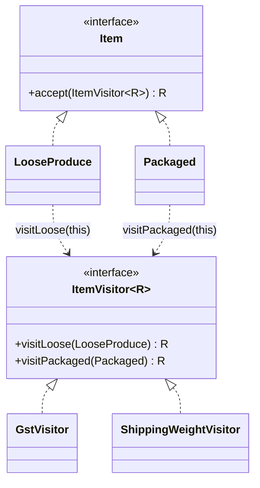
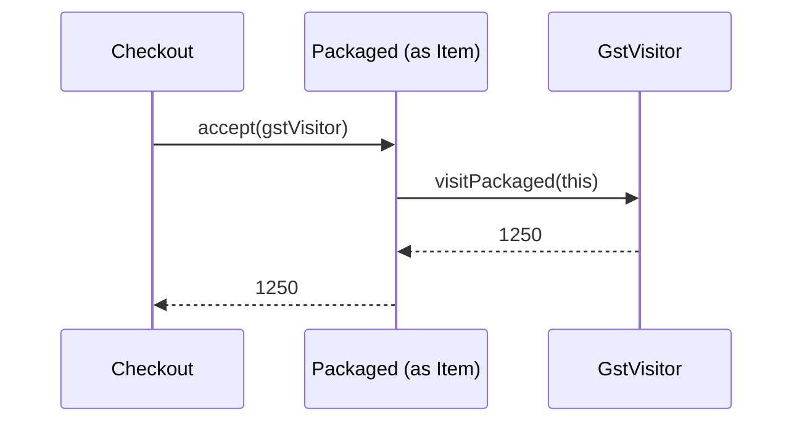

# Visitor

<span class="badge-l2">L2 🔵 Practitioner</span> · <span class="read-time">⏱ 40 min read</span> · Prerequisites: [Composite](composite.md), [OOP Refresher](../l1-foundations/oop-refresher.md)

!!! abstract "TL;DR"
    Visitor lets you add new operations (tax, weight, export, validation) to a fixed set of element types without changing those types. Classic Visitor uses "double dispatch": each element's `accept(visitor)` calls the visitor method for its own type. Since Java 21, a sealed interface plus an exhaustive `switch` with pattern matching does the same job with far less code, and the compiler checks you handled every type. Choose Visitor when operations change more often than types.

## 1. What It Is

**Plain English.** A FreshCart order contains loose produce, packaged goods, subscriptions and gift cards. Finance needs GST, the warehouse needs weights, and analytics needs CSV lines. Adding a method for each of those to every item class would mix unrelated concerns into the item model. Visitor puts each operation in its own place and "visits" every kind of item.

**Definition (GoF).** "Represent an operation to be performed on the elements of an object structure. Visitor lets you define a new operation without changing the classes of the elements on which it operates." Parts:

- **Visitor:** an interface with one method per element type (`visitLoose`, `visitPackaged`).
- **Concrete visitors:** one per operation (`GstVisitor`, `ShippingWeightVisitor`).
- **Element:** declares `accept(Visitor)`.
- **Concrete elements:** implement `accept` by calling the visitor method for their own type.
- **Object structure:** often a [Composite](composite.md) tree or a list that visitors walk.

## 2. Why It Exists

Java chooses an overloaded method by the variable's **compile-time** type, so `printer.print(item)` with `Item item` always calls `print(Item)`, never `print(Packaged)`. Without help, each operation becomes an `instanceof` chain that must be updated (and is easily forgotten) whenever a type is added. Visitor solves this by letting the element tell the visitor its real type. Modern Java solves it directly with sealed types and pattern matching, which the compiler checks for completeness.

## 3. Mental Model / Analogy

**Analogy.** A tax inspector and a fire inspector visit the same shops. Each shop says "I'm a restaurant" or "I'm a warehouse" (accept), and each inspector applies their own checklist for that kind of shop (visit). Adding a new kind of inspection doesn't change the shops; adding a new kind of shop means every inspector needs a new checklist.

**Technical model.** Two dynamic dispatches: `element.accept(v)` picks the element's real class; inside it, `v.visitX(this)` picks the visitor's real class. Together they select the right code for the (element type, operation) pair, like a 2D table.

## 4. How It Works





## 5. Subtopics

### Double dispatch

**Description.** Single dispatch (normal virtual calls) chooses code by **one** runtime type: the receiver. Overload resolution uses **compile-time** types. Double dispatch chooses by **two** runtime types by making two virtual calls: the element's `accept` (dispatch on the element), which calls the visitor's method (dispatch on the visitor) with `this` typed precisely.

**Advantages / features.** Correct per-type behaviour without `instanceof` chains.

```java title="DoubleDispatchDemo.java"
--8<-- "examples/l2-practitioner/visitor/DoubleDispatchDemo.java"
```

1. Inside `LooseProduce`, `this` has the static type `LooseProduce`, so the right overload is chosen.
2. Calling the overload directly with an `Item` variable always picks `print(Item)`.
3. Going through `accept` gives the per-type label.

**Run it:** `java DoubleDispatchDemo.java`

```text
--8<-- "examples/l2-practitioner/visitor/DoubleDispatchDemo.expected.txt"
```

| Mechanism | Chooses by | Decided at |
|-----------|-----------|------------|
| Overloading | Static types of arguments | Compile time |
| Overriding (virtual call) | Runtime type of the receiver | Runtime |
| Double dispatch (Visitor) | Runtime types of element and visitor | Runtime, two calls |
| Pattern-matching `switch` | Runtime type of the selector | Runtime, one switch |

**Use** double dispatch when you need per-type behaviour from code that only sees the base type. **Avoid** relying on overloads for polymorphism; they don't do it.
**Real-world Java:** `javax.lang.model.element.ElementVisitor` (annotation processors), `java.nio.file.FileVisitor` (single type, but the same callback idea), ASM's `ClassVisitor`.
**Best practice:** when you see overloads taking subtypes of one interface, check whether callers actually have the subtype statically. **Gotcha:** passing `null` to an overloaded method picks the most specific overload, which can surprise you.

### Classic visitor

**Description.** The GoF form: a visitor interface with one method per element type, elements with `accept`, and one class per operation. Generic return types (`ItemVisitor<R>`) let visitors return values instead of accumulating state.

**Advantages / features.** Each operation lives in one class; elements stay focused on data; adding an operation needs no element changes.

**Before (instanceof chains per operation) and after (visitors):**

```java title="ClassicVisitorDemo.java"
--8<-- "examples/l2-practitioner/visitor/ClassicVisitorDemo.java"
```

1. Before: each operation repeats the type checks and fails at runtime for forgotten types.
2. One method per element type; the generic `R` lets each visitor return its own result type.
3. GST in one place, for every item type.
4. A second operation added without touching the item classes.

**Run it:** `java ClassicVisitorDemo.java`

```text
--8<-- "examples/l2-practitioner/visitor/ClassicVisitorDemo.expected.txt"
```

| Pros | Cons |
|------|------|
| New operations without changing elements | New element types change every visitor |
| Operation logic grouped in one class | Boilerplate `accept` in every element |
| Compile-time completeness (interface methods) | Visitors may need access to element internals |

**Use** classic visitors in libraries that must support Java versions before 21, or when you can't make the hierarchy sealed. **Avoid** them for hierarchies that change often.
**Real-world Java:** the compiler tree API (`com.sun.source.tree.TreeVisitor`), ASM, JavaParser, Hibernate's SQL AST walkers.
**Best practice:** provide a base visitor with default methods for "do nothing" cases. **Gotcha:** a default implementation that silently ignores unknown types hides missing cases; make defaults throw unless ignoring is intended.

### Visitor with sealed interfaces and pattern matching

**Description.** With a `sealed` interface, the compiler knows every subtype. A `switch` expression over it must cover all of them (no `default` needed), and record patterns destructure fields. Each operation becomes a static method with a `switch`; elements need no `accept` method.

**Advantages / features.** Far less code; exhaustiveness checked by the compiler; operations can live anywhere, even in another module; works naturally with records.

```java title="SealedPatternVisitorDemo.java"
--8<-- "examples/l2-practitioner/visitor/SealedPatternVisitorDemo.java"
```

1. The sealed interface lists every item type.
2. An exhaustive `switch`: the compiler rejects it if a type is missing.
3. Adding a type to `permits` turns every incomplete switch into a compile error, which is exactly what you want.

**Run it:** `java SealedPatternVisitorDemo.java`

```text
--8<-- "examples/l2-practitioner/visitor/SealedPatternVisitorDemo.expected.txt"
```

| | Classic visitor | Sealed + switch |
|---|-----------------|-----------------|
| Code per element | `accept` method | None |
| Code per operation | A class with N methods | A method with one `switch` |
| Completeness check | Interface methods | Exhaustive switch |
| Java version | Any | 21+ (17 for sealed alone) |
| Open hierarchies | Works | Requires sealed (closed) hierarchy |

**Use** sealed + switch for hierarchies you own. **Avoid** `default` branches in these switches; they disable the completeness check.
**Real-world Java:** the `java.lang.classfile` API (Java 24) is designed around sealed interfaces and pattern matching; modern compilers and interpreters written in Java 21.
**Best practice:** keep each operation's switch in one class (`Pricing`, `Exporter`). **Gotcha:** switches over a sealed type from another module recompile-check only when compiled together; a new subtype in a library can cause `MatchException` at runtime in old compiled code.

### Expression problem

**Description.** The "expression problem" names the trade-off: with methods on classes (OO style), adding a **type** is easy (one class) but adding an **operation** touches every class; with visitors (or sealed switches), adding an **operation** is easy (one visitor) but adding a **type** touches every visitor. No simple design makes both cheap.

**Advantages / features (of knowing it).** You pick the design based on which axis will grow.

```java title="ExpressionProblemDemo.java"
--8<-- "examples/l2-practitioner/visitor/ExpressionProblemDemo.java"
```

1. OO style: each type implements every operation.
2. Visitor style: each operation implements every type.
3. Pick the axis you expect to change most.

**Run it:** `java ExpressionProblemDemo.java`

```text
--8<-- "examples/l2-practitioner/visitor/ExpressionProblemDemo.expected.txt"
```

| You expect to add... | Prefer | Example |
|----------------------|--------|---------|
| New types often, few operations | Methods on classes (polymorphism) | Payment providers, notification channels |
| New operations often, stable types | Visitor / sealed switch | Compiler ASTs, pricing rules, order line kinds |
| Both, by third parties | Plugins with registries (or acyclic visitor) | IDE plugins, extensible editors |

**Use** this lens in design reviews. **Avoid** forcing Visitor onto a hierarchy that grows every sprint.
**Real-world Java:** ASTs (stable node types, many analyses) are the classic visitor domain; payment providers (many types, few operations) are the classic polymorphism domain.
**Best practice:** start with polymorphism; switch to visitor when operations start crowding the classes. **Gotcha:** mixing both (some operations as methods, some as visitors) is fine, but document which is which.

### Acyclic visitor

**Description.** In the classic visitor, the visitor interface depends on every element and every element depends on the visitor interface: a dependency cycle, and adding an element breaks every visitor. The Acyclic Visitor (Robert C. Martin) uses an empty marker `Visitor` interface and one small interface per element type; elements check whether the visitor implements their interface. Visitors implement only what they handle.

**Advantages / features.** New element types don't break existing visitors; visitors can be partial; good for plugin systems.

```java title="AcyclicVisitorDemo.java"
--8<-- "examples/l2-practitioner/visitor/AcyclicVisitorDemo.java"
```

1. A marker interface plus one interface per element type.
2. Each element checks whether the visitor can handle it.
3. A visitor written before `GiftCard` existed keeps working and simply skips it.

**Run it:** `java AcyclicVisitorDemo.java`

```text
--8<-- "examples/l2-practitioner/visitor/AcyclicVisitorDemo.expected.txt"
```

| Pros | Cons |
|------|------|
| No dependency cycle; plugins can add types | Lost compile-time completeness |
| Partial visitors are natural | Runtime type checks |
| New types don't break old visitors | Silently skipped elements can be bugs |

**Use** acyclic visitors when element types come from plugins or separate teams. **Avoid** them when every operation must handle every type (prefer sealed + switch).
**Real-world Java:** plugin-based tools and IDEs, where third parties contribute node types.
**Best practice:** log or count skipped elements so missing handling is visible. **Gotcha:** "skipped silently" in a tax visitor means untaxed items; decide per operation whether skipping is safe.

## 6. Examples (exactly 3, progressively harder)

### Example 1: Minimal (L2)

**Scenario:** the dispatcher needs a cart's total weight; loose and packaged items count differently.

```java title="CartWeightVisitorDemo.java"
--8<-- "examples/l2-practitioner/visitor/CartWeightVisitorDemo.java"
```

1. The operation lives outside the item classes.
2. Packaged items add their packaging weight.

**Run it:** `java CartWeightVisitorDemo.java`

**Output:**

```text
--8<-- "examples/l2-practitioner/visitor/CartWeightVisitorDemo.expected.txt"
```

**What to notice:**

- Adding "weight" didn't touch `Loose` or `Packaged`.

### Example 2: Realistic (in FreshCart grocery delivery)

**Scenario:** an order has four kinds of line. Finance needs net amounts and GST with different rules per kind; analytics needs a CSV export that masks gift-card codes. Each operation is written once and must handle every kind of line.

```java title="InvoiceVisitorDemo.java"
--8<-- "examples/l2-practitioner/visitor/InvoiceVisitorDemo.java"
```

1. Each operation is an exhaustive switch over the sealed line types.
2. The CSV export is a separate operation that reuses `net` and `gst`.
3. Sensitive data (gift-card codes) is masked in exactly one place.

**Run it:** `java InvoiceVisitorDemo.java`

**Output:**

```text
--8<-- "examples/l2-practitioner/visitor/InvoiceVisitorDemo.expected.txt"
```

**What to notice:**

- Subscriptions got 18% (a service), produce 0%, gift cards 0% until redeemed.
- Adding a fifth line type (say, a delivery tip) would make all three switches fail to compile until handled.

### Example 3: Production-grade

**Scenario:** the catalogue is a tree of products and bundles. The same tree needs pricing (exact money), a JSON feed for partners (with escaping), and validation that reports **every** problem with its path so merchandisers can fix a whole bundle at once. Requirements: the recursion is written once and reused; validation doesn't stop at the first problem.

```java title="CatalogVisitorsDemo.java"
--8<-- "examples/l2-practitioner/visitor/CatalogVisitorsDemo.java"
```

1. A generic fold: one recursion over the tree; each operation supplies what to do per node type and how to combine children.
2. Pricing in `BigDecimal`, with bundle discounts applied to children's totals.
3. JSON export escapes quotes so product names can't break the feed.
4. Validation needs the path, so it walks the tree itself and collects all problems.
5. The path is popped on the way out, so siblings get correct paths.

**Run it:** `java CatalogVisitorsDemo.java`

**Output:**

```text
--8<-- "examples/l2-practitioner/visitor/CatalogVisitorsDemo.expected.txt"
```

**What to notice:**

- `Bread "multigrain"` was escaped correctly in JSON.
- The broken bundle produced four problems with paths like `B-9 > P-9`, not just the first one.
- Price, JSON and validation share the product model without adding methods to it.

## 7. Pros, Cons & Trade-offs

| Aspect | Pros | Cons |
|--------|------|------|
| Extensibility | New operations without touching elements | New element types touch every operation |
| Cohesion | Each operation in one place | Element data may need to be exposed |
| Safety | Compile-time completeness (classic or sealed) | Acyclic form loses it |
| Code size | Sealed + switch is compact | Classic form has `accept` boilerplate |
| Composites | Natural recursion over trees | Recursion repeated per visitor unless folded |
| Readability | Operation logic easy to find | Control flow (accept → visit) is indirect |

## 8. When to Use / When NOT to Use

**Use it when:**

- the set of element types is stable but operations keep being added;
- operations are unrelated to the elements' core responsibility (export, tax, reporting);
- you walk a composite structure (AST, catalogue tree, document) with many analyses.

**Don't use it when:**

- element types change often (prefer polymorphic methods);
- there's only one or two operations;
- the hierarchy is open to third parties and completeness doesn't matter (consider a registry).

## 9. Best Practices

1. **Prefer sealed interfaces + exhaustive `switch`** in Java 21+. *(Consensus.)*
2. **No `default` branch** in switches over sealed types. *(Consensus.)*
3. **Return values from visitors** (generic `R`) rather than accumulating mutable state. *(Consensus.)*
4. **Write recursion once** (a fold) for tree-shaped structures. *(Opinion, widely shared.)*
5. **Collect all validation problems** with paths for user-facing validation. *(Consensus.)*
6. **Choose by the expression problem**: which axis will grow? *(Consensus.)*

## 10. Pitfalls & Anti-Patterns

!!! danger "Silent default branch (production failure mode)"
    **Symptom:** after "delivery tip" lines were added, tips appeared on invoices with no GST, and the tax filing was wrong for a month.
    **Root cause:** the GST switch had `default -> 0`, so the new line type compiled and silently got zero tax.
    **Fix:** remove `default`; make line types sealed so a new type breaks the build until each operation decides; add a test that every line type has an explicit tax rule.

!!! danger "Overloads mistaken for polymorphism"
    **Symptom:** every item printed a "generic label".
    **Root cause:** `printer.print(item)` with `Item item` always picked the `Item` overload.
    **Fix:** double dispatch or a pattern-matching switch.

!!! danger "Visitor for a hierarchy that keeps growing"
    **Symptom:** every new payment provider required editing twelve visitors.
    **Root cause:** Visitor applied to the axis that changes most.
    **Fix:** move operations back onto the provider classes (polymorphism); keep visitors for stable hierarchies.

!!! danger "Stateful visitor reused"
    **Symptom:** totals doubled on the second request.
    **Root cause:** a visitor accumulating into a field was a shared singleton.
    **Fix:** return values instead of accumulating, or create a new visitor per traversal.

## 11. Configuration & Tuning

| Setting | Default | What it does | When to change it | Risk of changing |
|---------|---------|--------------|-------------------|------------------|
| `-Xlint:all` / `-Werror` | off | Turns warnings (including some incomplete-switch cases on enums) into errors | Always in CI | None significant |
| Error Prone `MissingCasesInEnumSwitch` | off | Flags enum switches missing cases | Codebases with enum-based dispatch | None significant |
| Max tree depth for recursive visitors | none | Avoids stack overflow on untrusted trees | User-supplied ASTs or documents | Too low rejects valid input |

## 12. Security Considerations

- Export visitors must escape output for its format (JSON, CSV, HTML) in one place; CSV cells starting with `=`, `+`, `-`, `@` can trigger formula injection in spreadsheets.
- Mask sensitive fields (card codes, phone numbers) inside the export operation itself, not in each caller.
- Recursive visitors over untrusted trees need depth limits.

## 13. Performance & Scalability

Classic visitors cost two virtual calls per element; pattern-matching switches compile to efficient type checks (and `invokedynamic`-based type switches). Both are negligible next to I/O. For large trees, a single fold that computes several results in one pass avoids walking the tree once per operation. Avoid allocating a new visitor per element in hot loops; reuse stateless visitors.

## 14. Testing It

Test each operation across all element types, nested structures, escaping and multi-problem validation:

```java title="CatalogVisitorsTest.java"
--8<-- "examples/l2-practitioner/visitor/CatalogVisitorsTest.java"
```

A reflection-based test can assert that every permitted subtype (`Item.class.getPermittedSubclasses()`) appears in a test case, so new types can't be added untested.

## 15. Observability & Operations

For validation visitors, export counts of problems by type to see which data issues are common. For export visitors, count records and bytes per run, and log the first few rejected items with paths. For acyclic visitors, count skipped elements per visitor and element type.

## 16. Version Notes

| Java | Change relevant to Visitor |
|------|----------------------------|
| 5 | Generics: `Visitor<R>` returning values |
| 6 | `javax.lang.model` visitors for annotation processing |
| 16 | Records and pattern matching for `instanceof` |
| 17 | Sealed classes; `Class.getPermittedSubclasses()` |
| 21 | Pattern matching for `switch` and record patterns (final): visitor without `accept` |
| 24 | `java.lang.classfile` API built on sealed types and patterns |

## 17. Expert Deep Dive

- **Visitor is a workaround for missing multiple dispatch and pattern matching.** Languages with multimethods (Common Lisp) or algebraic data types (Haskell, Scala, Kotlin, Java 21) express it directly; Java 21's sealed types make classic Visitor mostly legacy for code you own.
- **Folds and catamorphisms.** The generic `Fold` in Example 3 is a catamorphism: one recursion scheme, many algebras. It keeps traversal logic out of each operation and is the standard technique in compilers.
- **Tree rewriting.** Visitors that return new trees (optimisers, refactoring tools) need structural sharing and immutable nodes; records are ideal.
- **Combining with Interpreter.** An [Interpreter](interpreter.md) evaluates an AST; additional analyses (pretty-printing, validation, optimisation) are visitors over the same AST.

!!! example "War story: the forgotten line type"
    A grocery platform added "bottle deposit" lines (refundable deposits on glass milk bottles) to orders. Five operations used `instanceof` chains with a final `else` that treated unknown lines as zero-value packaged goods. Deposits were therefore excluded from invoices and from the payment total, while the warehouse charged customers at the door. Reconciling a month of orders took two weeks. **Fixes:** order lines became a sealed interface; every operation became an exhaustive switch without `default`; and a test iterates `getPermittedSubclasses()` to check each operation has a case per type. **Lesson:** the value of Visitor (classic or sealed) is that the compiler finds every place a new type must be handled; a catch-all branch throws that away.

## 18. Interview Corner

=== "🟢 L1–L2"

    1. **What does Visitor do?** Adds **new operations** to element types **without changing them**.
    2. **What's `accept` for?** It calls the **visitor method for the element's own type** (double dispatch).
    3. **Why doesn't overloading solve it?** Overloads are chosen by **compile-time types**.
    4. **Give an example.** **GST and shipping weight** visitors over cart items.
    5. **How does Java 21 simplify Visitor?** **Sealed interface + exhaustive `switch`** with pattern matching.

=== "🟡 L3"

    1. **What's double dispatch?** Selecting code by **two runtime types** via two virtual calls.
    2. **What is the expression problem?** Easy to add **types or operations, not both**.
    3. **Why avoid `default` in switches over sealed types?** It **disables exhaustiveness** checks.
    4. **When is Visitor a bad choice?** When **element types change often**.
    5. **What's an acyclic visitor?** Per-type visitor interfaces; **no dependency cycle**; visitors handle a subset.

=== "🔴 L4–L5"

    1. **Design a validation framework for a product tree.** **Path-aware walker collecting all problems**, sealed node types, severity levels, depth limits.
    2. **How would you structure analyses for a rules AST?** **Sealed nodes**, folds for evaluation/printing/optimisation, immutable trees.
    3. **How do sealed types behave across module versions?** New subtypes from a library can cause **`MatchException`** in old compiled switches; version APIs carefully.
    4. **When choose a plugin registry over Visitor?** When **third parties add types** and completeness can't be checked.
    5. **How do you compute several results in one tree walk?** A **fold returning a record of results** (product algebra).

=== "💻 Hands-on"

    **Task:** Add a `DeliveryTip` line to `InvoiceVisitorDemo` with 0% GST.

    ??? success "Solution"
        ```java
        sealed interface Line permits Loose, Packaged, Subscription, GiftCard, DeliveryTip { }
        record DeliveryTip(long paise) implements Line { }

        // the compiler now flags net, gst and csv; add a case to each:
        case DeliveryTip t -> t.paise();          // net
        case DeliveryTip t -> 0;                  // gst
        case DeliveryTip t -> "tip";              // csv kind
        ```

## 19. Practice

- [ ] Add a "count items per kind" operation to `CatalogVisitorsDemo` using the `Fold`.
    ??? tip "Hint"
        Return a `Map<String, Integer>` and merge children's maps in `bundle`.
- [ ] Make `ClassicVisitorDemo` use a base visitor with defaults that throw `UnsupportedOperationException`.
    ??? tip "Hint"
        An abstract class implementing `ItemVisitor<R>`.
- [ ] Write a test that every permitted subtype of `InvoiceVisitorDemo.Line` has a GST test case.
    ??? tip "Hint"
        `Line.class.getPermittedSubclasses()`.
- [ ] Find an `instanceof` chain in a codebase and decide whether polymorphism or a sealed switch fits better.
    ??? tip "Hint"
        Ask: will types or operations grow faster?

## 20. Quick Revision Card

!!! tip "Remember in 30 seconds"
    - Intent: add operations to a stable set of types without changing them.
    - Classic: `accept(visitor)` → `visitor.visitX(this)` (double dispatch).
    - Modern: sealed interface + exhaustive `switch`, no `default`.
    - Expression problem: visitors make operations cheap and types expensive.
    - Trees: write recursion once (fold); validation collects all problems with paths.

    ```java
    static long gst(Line l) {
        return switch (l) {
            case Loose x -> 0;
            case Packaged p -> net(p) * p.gstPercent() / 100;
            case Subscription s -> net(s) * 18 / 100;
            case GiftCard g -> 0;
        };
    }
    ```

## 21. Further Reading

- Gamma, Helm, Johnson, Vlissides, *Design Patterns* (1994), "Visitor".
- Robert C. Martin, "Acyclic Visitor", in *Pattern Languages of Program Design 3* (1997).
- [JEP 441: Pattern Matching for switch](https://openjdk.org/jeps/441)
- [JEP 409: Sealed Classes](https://openjdk.org/jeps/409)
- Philip Wadler, "The Expression Problem" (1998, mailing-list note).

---

[← Previous: Memento](memento.md) · [Next: Interpreter →](interpreter.md)
