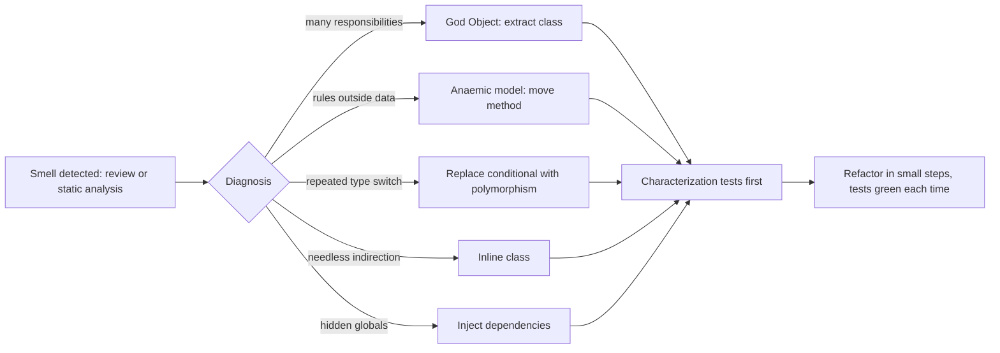
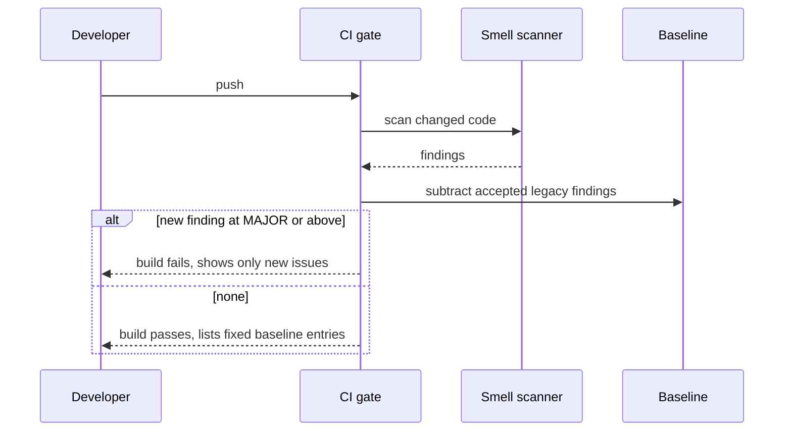

# Anti-Patterns and Code Smells

<span class="badge-l3">L3 🟡 Professional</span> · <span class="read-time">⏱ 40 min read</span> · Prerequisites: [SOLID Principles](../l1-foundations/solid-principles.md), [Enterprise Application Patterns](enterprise-application-patterns.md)

!!! abstract "TL;DR"
    An **anti-pattern** is a common solution that looks reasonable but causes more problems than it solves. A **code smell** is a surface symptom (a long method, a repeated switch, a class with 60 fields) that often points to a deeper design problem. This page covers the classic anti-patterns (**God Object, Anaemic Domain Model, Spaghetti code and Lava Flow, Golden Hammer, Singletonitis, Poltergeists**) and the smells that suggest which pattern would help. Two lessons: patterns fix smells, and patterns overused *are* smells. Detect with reviews and static analysis, fix in small steps protected by tests, and gate only *new* problems so legacy debt doesn't block delivery.

## 1. What It Is

**Plain English.** Over time, code bases grow habits: one class that everyone adds to, rules copied into five services, dead code no one dares delete, a favourite pattern used everywhere. These habits have names. Knowing the names helps teams spot them early and agree on a fix.

**Definition.**

| Anti-pattern | Symptom | Usual fix |
|--------------|---------|-----------|
| God Object | One class knows and does everything | Extract classes by responsibility |
| Anaemic Domain Model | Data classes + services full of rules | Move behaviour into the domain |
| Spaghetti / Lava Flow | Tangled flow; dead, frozen code | Simplify conditionals; delete dead code |
| Golden Hammer | One tool or pattern used for everything | Choose by problem, start simple |
| Singletonitis | Global singletons everywhere | Dependency injection |
| Poltergeist | Classes that only pass calls along | Inline them |

## 2. Why It Exists

Anti-patterns appear for understandable reasons: deadlines ("just add it to `OrderManager`"), fear ("don't delete it, something might use it"), fashion ("we use factories for everything"), and missing feedback (no tests, no reviews). Each step is locally reasonable; the damage is cumulative. Naming anti-patterns, from Brown et al.'s *AntiPatterns* (1998) and Fowler's catalogue of smells in *Refactoring* (1999), turns vague discomfort into an actionable diagnosis.

## 3. Mental Model / Analogy

**Analogy.** A kitchen. A God Object is the one drawer where everything goes. An Anaemic Model is ingredients with no recipes, so every cook improvises. Lava Flow is the jar in the fridge nobody remembers opening. A Golden Hammer is using the pressure cooker for toast. Singletonitis is one shared knife chained to the counter. A Poltergeist is a waiter who carries the plate two metres and hands it to another waiter.

**Technical model.** Smells are **measurable** (size, coupling, duplication, complexity); anti-patterns are **structural diagnoses**. Tools find smells; humans decide whether they indicate an anti-pattern and which refactoring fits.

## 4. How It Works





## 5. Subtopics

### God object

**Description.** A God Object (or God Class, "Blob") centralises too many responsibilities: state and logic for cart, pricing, stock, payment, notifications and reporting in one class. Everyone edits it, so merge conflicts and regressions are constant, and it can't be tested in isolation. It violates the Single Responsibility Principle at scale.

**Advantages / features of the fix.** Small classes with one reason to change; independent tests; parallel work without conflicts.

**Before (one class does everything) and after (split by responsibility):**

```java title="GodObjectDemo.java"
--8<-- "examples/l3-professional/anti-patterns-and-code-smells/GodObjectDemo.java"
```

1. Cart data, pricing, stock, revenue and SMS in one class; any change risks all of them.
2. Each responsibility gets its own small class.
3. A thin service coordinates them; behaviour is identical, as the output shows.

**Run it:** `java GodObjectDemo.java`

```text
--8<-- "examples/l3-professional/anti-patterns-and-code-smells/GodObjectDemo.expected.txt"
```

| Smell indicating a God Object | Typical threshold |
|-------------------------------|-------------------|
| Lines of code | > 1,000 |
| Fields | > 15–20 |
| Methods | > 30–50 |
| Collaborators (imports, injected deps) | > 7–10 |
| Changed in most pull requests | Top 1% of files by churn |

**Use** extract-class refactorings along responsibility lines (names often appear in method prefixes: `price*`, `stock*`, `notify*`). **Avoid** splitting by technical layer only (`OrderManagerHelper`, `OrderManagerUtils`), which just spreads the god around.
**Real-world Java:** legacy `*Manager`, `*Util` and `*ServiceImpl` classes with thousands of lines; Spring `@Service`s with 15 injected dependencies.
**Best practice:** watch for constructor parameter counts in DI; more than about 7 is a warning. **Gotcha:** a God Object often has hidden temporal coupling (methods that must be called in order); capture it in characterization tests before splitting.

### Anaemic domain model

**Description.** An anaemic domain model has entity classes with only getters and setters; all rules live in services. Because nothing protects the data, rules are duplicated or forgotten in some services, and objects can enter invalid states. Fowler called it an anti-pattern because it pays the cost of a domain model without the benefits.

**Advantages / features of the fix.** Invariants enforced in one place; services shrink; invalid states become impossible.

```java title="AnaemicDomainModelDemo.java"
--8<-- "examples/l3-professional/anti-patterns-and-code-smells/AnaemicDomainModelDemo.java"
```

1. A bean with a public setter: anyone can set any balance.
2. One service remembered the "no overdraft" rule; another didn't, and the balance went negative.
3. The rich wallet exposes intention-revealing methods and enforces its rules itself.

**Run it:** `java AnaemicDomainModelDemo.java`

```text
--8<-- "examples/l3-professional/anti-patterns-and-code-smells/AnaemicDomainModelDemo.expected.txt"
```

| Anaemic | Rich |
|---------|------|
| `setBalance(getBalance() - x)` | `debit(x)` |
| Rules in many services | Rules in the entity |
| Any state reachable | Only valid states |
| Easy to map to tables | Needs careful mapping (protected setters) |

**Use** rich models for core business concepts with rules. **Avoid** calling every data class "anaemic"; DTOs, events and read models are *supposed* to be plain data.
**Real-world Java:** JPA entities generated from tables with Lombok `@Data`; services named after entities (`WalletService`) full of `if` statements.
**Best practice:** "Tell, don't ask": call `wallet.debit(x)` instead of reading the balance and deciding outside. **Gotcha:** Lombok `@Data` on entities generates public setters and `equals`/`hashCode` over all fields, which breaks both encapsulation and JPA identity.

### Spaghetti and lava flow

**Description.** **Spaghetti code** has tangled, deeply nested control flow, so the actual rule is hard to see. **Lava Flow** is dead or frozen code (old flags, unused classes, commented-out blocks) that nobody dares remove because nobody knows if it's used. Both make every change slower and riskier.

**Advantages / features of the fix.** Readable rules; smaller code; fewer false leads during incidents.

```java title="SpaghettiLavaFlowDemo.java"
--8<-- "examples/l3-professional/anti-patterns-and-code-smells/SpaghettiLavaFlowDemo.java"
```

1. Nested `if`/`else` five levels deep; the rule is somewhere inside.
2. Lava: a branch behind a flag that's been off for years.
3. After: the dead branch is deleted and the rule is a short sequence of guard clauses; an exhaustive comparison proves it's equivalent.

**Run it:** `java SpaghettiLavaFlowDemo.java`

```text
--8<-- "examples/l3-professional/anti-patterns-and-code-smells/SpaghettiLavaFlowDemo.expected.txt"
```

| Smell | Refactoring |
|-------|-------------|
| Deep nesting | Guard clauses, extract method |
| Complex boolean conditions | Decompose conditional, named predicates |
| Many branches on data | Table-driven logic, Strategy |
| Dead flags and code | Delete (version control remembers) |
| Commented-out code | Delete |

**Use** coverage data and production telemetry to prove code is dead before deleting it. **Avoid** "cleanup" PRs that mix deletion with behaviour changes; review them separately.
**Real-world Java:** stale feature flags (Unleash/LaunchDarkly flags at 100% for months), `@Deprecated` code without removal plans.
**Best practice:** every feature flag gets an owner and an expiry date. **Gotcha:** reflection, Spring wiring and serialisation can use "unused" code; search config and logs, not just call sites.

### Golden hammer

**Description.** "If all you have is a hammer, everything looks like a nail." A team applies a favourite tool to every problem: a pattern (factories everywhere), a technology (Kafka for request/response, microservices for a three-person team), or a library. The result is complexity with no matching benefit.

**Advantages / features of the fix.** Code proportional to the problem; easier onboarding; less to maintain.

```java title="GoldenHammerDemo.java"
--8<-- "examples/l3-professional/anti-patterns-and-code-smells/GoldenHammerDemo.java"
```

1. Interface, factory, factory provider and registry, for "multiply by 5%".
2. The same rule as an enum: data plus one method.
3. Same results with a fraction of the code; add abstraction back only when a second varying behaviour really appears.

**Run it:** `java GoldenHammerDemo.java`

```text
--8<-- "examples/l3-professional/anti-patterns-and-code-smells/GoldenHammerDemo.expected.txt"
```

| Golden hammer | Better default |
|---------------|----------------|
| Factory + Strategy for one behaviour | A method or enum |
| Microservices for a small team | A modular monolith |
| Event sourcing for CRUD | A table |
| Reactive streams for simple blocking I/O | Virtual threads |
| Regex for parsing structured formats | A real parser |

**Use** patterns when you can name the force they resolve (variation, decoupling, extension). **Avoid** "future-proofing" for variations nobody has asked for (YAGNI).
**Real-world Java:** enterprise code with `AbstractSingletonProxyFactoryBean`-style names outside framework internals.
**Best practice:** in reviews, ask "what change does this abstraction make easier?" **Gotcha:** removing a premature abstraction later is often harder than adding one when needed.

### Singletonitis

**Description.** Overusing the Singleton pattern: clocks, configuration, caches, repositories and services all accessed through `getInstance()`. Dependencies become invisible (they're not in constructors), tests can't substitute them, global state leaks between tests, and initialisation order bugs appear.

**Advantages / features of the fix.** Visible dependencies; easy test doubles; no hidden global state.

```java title="SingletonitisDemo.java"
--8<-- "examples/l3-professional/anti-patterns-and-code-smells/SingletonitisDemo.java"
```

1. Global singletons for clock and config: the service's behaviour depends on the real time.
2. After: dependencies are constructor parameters; production passes the system clock, tests a fixed one.
3. The 22:00 cutoff is now testable on both sides without waiting until night.

**Run it:** `java SingletonitisDemo.java`

```text
--8<-- "examples/l3-professional/anti-patterns-and-code-smells/SingletonitisDemo.expected.txt"
```

| Need | Instead of a singleton |
|------|------------------------|
| One instance per app | A DI container bean (Spring singleton scope) |
| Current time | Inject `java.time.Clock` |
| Configuration | Typed config record injected at startup |
| Shared cache | Injected `Cache` interface |
| Truly global, stateless | A static utility or enum singleton is fine |

**Use** dependency injection for anything with state or side effects. **Avoid** `getInstance()` calls inside business logic.
**Real-world Java:** Spring beans are singletons by *scope*, not by pattern: the container creates one and injects it, so tests can replace it.
**Best practice:** if a constructor needs many injected singletons, that's a God Object smell. **Gotcha:** static mocking (Mockito `mockStatic`) is a workaround, not a fix; it signals the design needs injection.

### Poltergeists

**Description.** Poltergeists are classes with little or no state or behaviour that exist only to start or pass calls to another class: `*Starter`, `*Initiator`, `*Controller` wrappers. They add indirection, files and confusion without adding meaning.

**Advantages / features of the fix.** Shorter call paths; fewer classes to understand; clearer ownership.

```java title="PoltergeistDemo.java"
--8<-- "examples/l3-professional/anti-patterns-and-code-smells/PoltergeistDemo.java"
```

1. A starter that only calls the controller.
2. A controller that only calls the real generator.
3. After inlining, the caller uses the class that does the work.

**Run it:** `java PoltergeistDemo.java`

```text
--8<-- "examples/l3-professional/anti-patterns-and-code-smells/PoltergeistDemo.expected.txt"
```

| Looks like a poltergeist | But is legitimate when |
|--------------------------|------------------------|
| Thin wrapper | It's an Adapter translating an interface |
| Pass-through service | It's a transaction or security boundary |
| Forwarding class | It's a Proxy adding behaviour (caching, logging) |
| Facade | It simplifies several subsystems for callers |

**Use** Inline Class when a class adds nothing. **Avoid** inlining real boundaries (adapters, facades, transactional services); they add meaning even when thin.
**Real-world Java:** layered code with `XController → XManager → XService → XServiceImpl → XDao` where three layers only forward.
**Best practice:** every class should be able to answer "what decision do you make?" **Gotcha:** frameworks sometimes need a thin class (a Spring `@Configuration`, a JAX-RS resource); that's not a poltergeist.

### Code smells that point to patterns

**Description.** Fowler and Beck's code smells are hints, not rules. Several point straight at a pattern: repeated switches on a type code suggest polymorphism (Strategy, State, enum with behaviour); long parameter lists suggest a Parameter Object or Builder; duplicated object creation suggests a Factory; growing conditional logic around state suggests the State pattern.

**Advantages / features.** A shared vocabulary for reviews; a clear next step for each smell.

```java title="CodeSmellsToPatternsDemo.java"
--8<-- "examples/l3-professional/anti-patterns-and-code-smells/CodeSmellsToPatternsDemo.java"
```

1. The same switch on a string type code in two methods; a third will appear soon.
2. An enum whose constants carry their own data and behaviour: adding a vehicle is one line, and the compiler checks completeness.
3. A typo in a type code fails only at runtime; with the enum, it doesn't compile.

**Run it:** `java CodeSmellsToPatternsDemo.java`

```text
--8<-- "examples/l3-professional/anti-patterns-and-code-smells/CodeSmellsToPatternsDemo.expected.txt"
```

| Smell | Pattern or refactoring |
|-------|------------------------|
| Repeated switch on type code | Enum with behaviour, Strategy, sealed types + switch |
| Conditionals on object state | State |
| Long parameter list | Parameter Object, Builder |
| Duplicated construction logic | Factory Method, Abstract Factory |
| Feature envy (method uses another class's data) | Move Method |
| Shotgun surgery (one change, many files) | Move related behaviour together, Facade |
| Primitive obsession | Value objects (`Money`, `PinCode`) |
| Divergent change (one class, many reasons) | Extract Class |
| Message chains (`a.b().c().d()`) | Hide Delegate, Facade |

**Use** smells as prompts in code review. **Avoid** refactoring every smell; fix the ones in code that changes often.
**Real-world Java:** IntelliJ inspections, SonarQube rules (cognitive complexity, too many parameters), PMD's God Class rule.
**Best practice:** combine smells with churn data; a smelly file nobody touches is low priority. **Gotcha:** with Java 21, a sealed hierarchy plus exhaustive `switch` is a good alternative to polymorphism when operations change more often than types.

## 6. Examples (exactly 3, progressively harder)

### Example 1: Minimal (L2)

**Scenario:** QuickDrop's checkout uses unexplained numbers (49900, 2500, 0.18) mixing paise and percentages. Replace them with named constants and a `Money` type.

```java title="MagicNumbersDemo.java"
--8<-- "examples/l3-professional/anti-patterns-and-code-smells/MagicNumbersDemo.java"
```

1. A value object fixes the unit (paise) and gives arithmetic names.
2. Named constants say what each number means and where to change it.

**Run it:** `java MagicNumbersDemo.java`

**Output:**

```text
--8<-- "examples/l3-professional/anti-patterns-and-code-smells/MagicNumbersDemo.expected.txt"
```

**What to notice:**

- The results are the same; the difference is that the next developer can read and safely change the rule.

### Example 2: Realistic (in FreshCart grocery delivery)

**Scenario:** the rider payout function takes seven primitives, including three booleans in a row that callers keep swapping. Refactor to a parameter object that owns the calculation, and prove nothing changed.

```java title="RiderPayoutRefactorDemo.java"
--8<-- "examples/l3-professional/anti-patterns-and-code-smells/RiderPayoutRefactorDemo.java"
```

1. A long parameter list: `payoutBefore(14, 52, true, false, 1, 48, false)` is unreadable and easy to get wrong.
2. Parameter objects group related values; the calculation moves next to the data (fixing feature envy) and splits into named parts.
3. A characterization test runs both versions on 10,000 random inputs and counts differences.

**Run it:** `java RiderPayoutRefactorDemo.java`

**Output:**

```text
--8<-- "examples/l3-professional/anti-patterns-and-code-smells/RiderPayoutRefactorDemo.expected.txt"
```

**What to notice:**

- Zero mismatches on 10,000 random shifts gives confidence that the refactoring is behaviour-preserving.
- Boundary cases (rating 4.6 vs 4.7, 9 vs 10 deliveries) are also tested explicitly in the test file.

### Example 3: Production-grade

**Scenario:** ParcelGo's platform team wants a CI gate for smells. The code base has years of accepted debt that can't all be fixed now, so the gate must fail only on **new** critical or major issues, report which old issues were fixed (so the baseline shrinks), and have sane thresholds that fail fast if misconfigured.

```java title="SmellScannerDemo.java"
--8<-- "examples/l3-professional/anti-patterns-and-code-smells/SmellScannerDemo.java"
```

1. Each finding has a stable key (file, rule, detail) so it can be matched against a baseline.
2. Rules: long parameter lists, long methods, God Class (fields and methods), empty catch blocks, and singleton overuse.
3. The gate subtracts the baseline and sorts new findings by severity.
4. Baseline entries no longer found are reported as fixed, so the baseline only ever shrinks.
5. The build fails only on new findings at or above the configured severity.

**Run it:** `java SmellScannerDemo.java`

**Output:**

```text
--8<-- "examples/l3-professional/anti-patterns-and-code-smells/SmellScannerDemo.expected.txt"
```

**What to notice:**

- Four legacy findings in `OrderManager` were accepted, so they didn't fail the build.
- The new empty catch in `SlotService` did, even though it's one line.
- `Invoice.java`'s long method no longer appears, so it's reported as fixed and can be removed from the baseline.
- Real tools (SonarQube's "new code" period, PMD/SpotBugs baselines, Error Prone) use the same idea at scale with parsers instead of regular expressions.

## 7. Pros, Cons & Trade-offs

| Practice | Pros | Cons |
|----------|------|------|
| Naming anti-patterns | Shared vocabulary, faster reviews | Can become name-calling; context matters |
| Static analysis | Consistent, automatic | False positives; metric gaming |
| Baselines | Stop new debt without blocking delivery | Old debt can be ignored forever |
| Refactoring smells | Faster future change | Costs time now; risk without tests |
| Deleting dead code | Smaller, clearer code | Risk if "dead" code is used via reflection |

## 8. When to Use / When NOT to Use

**Fix anti-patterns when:**

- the code changes often (high churn) or causes incidents;
- you're about to add a feature to that area anyway (refactor first, then add);
- the smell blocks testing.

**Leave them when:**

- the code is stable and rarely touched;
- it's scheduled for replacement;
- there are no tests and no time to write characterization tests; refactoring blind is riskier than the smell.

## 9. Best Practices

1. **Write characterization tests before refactoring legacy code.** *(Consensus; Michael Feathers.)*
2. **Refactor in small, behaviour-preserving steps; commit each.** *(Consensus.)*
3. **Prioritise by churn × complexity, not by smell count.** *(Consensus; Adam Tornhill.)*
4. **Gate new code strictly; pay down old debt deliberately.** *(Consensus.)*
5. **Delete dead code and expired flags; version control remembers.** *(Consensus.)*
6. **Prefer the simplest design that handles today's known variation.** *(Consensus; YAGNI.)*
7. **Don't chase metrics; use them to start conversations.** *(Opinion, widely shared.)*

## 10. Pitfalls & Anti-Patterns

!!! danger "Big-bang rewrite of a God Object (production failure mode)"
    **Symptom:** a three-month rewrite of `OrderManager` shipped; within a day, refunds for partial cancellations were wrong.
    **Root cause:** an undocumented rule (refund delivery fee only if all items cancelled) lived in a 400-line method and was missed.
    **Fix:** strangle incrementally: characterization tests on real production inputs, extract one responsibility at a time, compare old and new outputs in shadow mode before switching.

!!! danger "Refactoring without tests"
    **Symptom:** a "pure cleanup" PR changed rounding in invoices.
    **Root cause:** reordering arithmetic in integer division.
    **Fix:** characterization tests first; review refactorings separately from behaviour changes.

!!! danger "Pattern-itis after learning patterns"
    **Symptom:** a new teammate's PR adds an abstract factory, a visitor and a builder to send one email.
    **Root cause:** golden hammer: patterns applied for their own sake.
    **Fix:** ask what change each abstraction makes easier; start with the simplest code.

!!! danger "Static-analysis whack-a-mole"
    **Symptom:** methods split into `part1`, `part2` to satisfy a length rule.
    **Root cause:** optimising the metric rather than the design.
    **Fix:** use findings as prompts for discussion; allow justified suppressions with comments.

## 11. Configuration & Tuning

| Setting | Typical default | What it does | When to change it | Risk of changing |
|---------|-----------------|--------------|-------------------|------------------|
| Sonar cognitive complexity per method | 15 | Flags hard-to-follow methods | Lower for core domain | Noise |
| Max method parameters (PMD/Sonar) | 7 | Long parameter list | 4–5 for new code | Noise in legacy |
| PMD `GodClass` (WMC, ATFD, TCC) | WMC ≥ 47 | Detects god classes | Rarely | Misses or false positives |
| Sonar "new code" period | Previous version | What counts as new | Per release process | Old debt hidden |
| Quality gate severity | Blocker/Critical | Fails the build | Add Major for new code | Slower merges |
| Error Prone checks | Built-in set | Compile-time bug patterns | Enable more over time | Build failures |

## 12. Security Considerations

- Empty catch blocks and swallowed exceptions hide security failures (failed signature checks, auth errors).
- God Objects with broad access concentrate risk; a bug there touches everything.
- Lava-flow code may include old, vulnerable endpoints or crypto still reachable; delete it.
- Singletons holding mutable state (e.g., current user) can leak data between requests.
- Static analysis tools (SpotBugs + FindSecBugs, Semgrep) find security smells alongside design ones.

## 13. Performance & Scalability

Anti-patterns often hurt performance indirectly: God Objects become lock hotspots; Singletonitis with synchronised state serialises requests; Golden Hammer choices (a message broker for synchronous calls) add latency. Fixes rarely need trade-offs: smaller objects are easier for the JIT to inline. Measure before and after any refactoring done for performance.

## 14. Testing It

Characterization tests protect refactorings; rule tests protect the scanner itself (clean code passes, each rule triggers, the gate only fails on new issues):

```java title="SmellScannerTest.java"
--8<-- "examples/l3-professional/anti-patterns-and-code-smells/SmellScannerTest.java"
```

For legacy code, approval-testing libraries (ApprovalTests) capture current outputs as golden files; ArchUnit enforces structural rules (no `getInstance()` in domain packages, no cycles between packages).

## 15. Observability & Operations

Track debt like any other metric: number of baseline entries over time (should fall), hotspots (files high in both churn and complexity, via CodeScene or `git log` analysis), and time-to-change for common features. Incident post-mortems should record when an anti-pattern contributed, which builds the case for refactoring time.

## 16. Version Notes

| Year / version | Change |
|----------------|--------|
| 1998 | *AntiPatterns* (Brown et al.): God Object (Blob), Lava Flow, Golden Hammer, Poltergeists |
| 1999 | Fowler's *Refactoring*: catalogue of code smells (with Kent Beck) |
| 2003 | Fowler names the Anaemic Domain Model |
| 2004 | Feathers' *Working Effectively with Legacy Code*: characterization tests |
| 2018 | *Refactoring* 2nd edition |
| Java 17–21 | Records, sealed types and pattern matching make some smells (type codes, boilerplate beans) easier to fix |

## 17. Expert Deep Dive

- **Hotspot analysis.** Combine complexity with change frequency (`git log --format= --name-only | sort | uniq -c`); the top few files usually account for most defects and are the best refactoring targets.
- **Strangler fig for god objects.** Route one use case at a time to new code, compare outputs in shadow mode, then remove the old path.
- **Architecture fitness functions.** ArchUnit tests ("domain must not depend on infrastructure", "no class over 500 lines in `domain`") make design rules executable.
- **Smells vs context.** A switch on type is a smell in an open hierarchy, and a feature (exhaustive, explicit) with sealed types; judge by which axis changes more.
- **Social causes.** Many anti-patterns are organisational (Conway's Law): a God Object often mirrors a team that owns "everything about orders".

!!! example "War story: the OrderManager nobody could touch"
    FreshCart's `OrderManager` reached 6,800 lines, 140 methods and 23 injected dependencies; 70% of PRs touched it and its tests took 12 minutes. Two attempts at a rewrite were abandoned. The third approach worked: the team wrote characterization tests from a week of anonymised production requests, then extracted one responsibility per sprint (pricing first, because it changed most), running old and new code side by side and logging differences. After six months, `OrderManager` was a 200-line coordinator, PR conflicts dropped sharply, and a new delivery-fee rule that used to take two weeks took two days. **Lesson:** fix god objects incrementally, highest-churn responsibility first, with tests built from real behaviour.

## 18. Interview Corner

=== "🟢 L1–L2"

    1. **What's an anti-pattern?** A **common solution that causes more problems** than it solves.
    2. **What's a code smell?** A **surface symptom** that may indicate a design problem.
    3. **What's a God Object?** A class with **too many responsibilities**.
    4. **Why are magic numbers bad?** **Unclear meaning**, easy to change inconsistently.
    5. **Why delete dead code?** It **misleads readers** and adds maintenance; **git remembers it**.

=== "🟡 L3"

    1. **What's an anaemic domain model?** **Entities without behaviour**; rules duplicated in services.
    2. **How do you fix a repeated switch on type?** **Polymorphism**: enum with behaviour, Strategy, or sealed types.
    3. **Why is Singleton overuse a problem?** **Hidden dependencies, global state, hard to test.**
    4. **What's a Golden Hammer?** **Using a favourite tool for everything.**
    5. **How do you refactor safely?** **Characterization tests, small steps, behaviour-preserving commits.**

=== "🔴 L4–L5"

    1. **How do you decide which debt to pay first?** **Churn × complexity hotspots**, incident data, upcoming features.
    2. **How do you introduce quality gates in a legacy code base?** **Baseline existing issues, gate only new code, shrink the baseline.**
    3. **Rewrite or refactor a God Object?** **Refactor incrementally** (strangler fig), rarely rewrite.
    4. **When is a "smell" actually fine?** **Stable code, intentional trade-offs** (DTOs are anaemic by design).
    5. **How do anti-patterns relate to team structure?** **Conway's Law**: ownership boundaries shape code boundaries.

=== "💻 Hands-on"

    **Task:** Add a "Feature Envy" rule to `SmellScannerDemo`: flag a method whose body calls getters on one other object more than 4 times (e.g., `order.getX()`).

    ??? success "Solution"
        ```java
        private static final Pattern GETTER_CALL = Pattern.compile("\\b(\\w+)\\.get\\w+\\(\\)");

        static void featureEnvy(String file, String name, String body, List<Finding> out) {
            Map<String, Integer> calls = new LinkedHashMap<>();
            Matcher m = GETTER_CALL.matcher(body);
            while (m.find()) calls.merge(m.group(1), 1, Integer::sum);
            calls.forEach((target, n) -> {
                if (n > 4) out.add(new Finding(file, "FeatureEnvy", Severity.MAJOR, name + " calls " + n + " getters on " + target));
            });
        }
        // call it from scan() with the method's body lines (start .. start + length)
        ```

## 19. Practice

- [ ] Find the largest class in a project you know (by lines or methods) and list its responsibilities by method-name prefix.
    ??? tip "Hint"
        `find . -name "*.java" | xargs wc -l | sort -n | tail`.
- [ ] Replace one `getInstance()` dependency with constructor injection and write a test using a fake.
    ??? tip "Hint"
        Start with `Clock`; it's the easiest win.
- [ ] Find a feature flag that's been at 100% for over a month and remove it.
    ??? tip "Hint"
        Delete the flag check and the dead branch in one PR, with no other changes.
- [ ] Add an ArchUnit rule that forbids `getInstance()` calls in the `domain` package.
    ??? tip "Hint"
        `noClasses().that().resideInAPackage("..domain..").should().callMethodWhere(...)`.

## 20. Quick Revision Card

!!! tip "Remember in 30 seconds"
    - God Object → extract classes by responsibility, incrementally.
    - Anaemic model → move rules into entities ("tell, don't ask").
    - Spaghetti/Lava → guard clauses, delete dead code and old flags.
    - Golden Hammer → choose tools by problem; start simple.
    - Singletonitis → inject dependencies (especially `Clock`).
    - Poltergeist → inline classes that make no decisions.
    - Smells point to patterns; patterns overused are smells. Tests first, small steps, gate new code.

    ```java
    enum Vehicle {
        BIKE(20) { int minutesFor(int km) { return km * 3; } },
        CAR(150) { int minutesFor(int km) { return km * 4 + 5; } };
        final int capacityKg;
        Vehicle(int c) { capacityKg = c; }
        abstract int minutesFor(int km);
    }
    ```

## 21. Further Reading

- William Brown et al., *AntiPatterns: Refactoring Software, Architectures, and Projects in Crisis* (1998).
- Martin Fowler, *Refactoring* (2nd ed., 2018), and ["AnemicDomainModel"](https://martinfowler.com/bliki/AnemicDomainModel.html).
- Michael Feathers, *Working Effectively with Legacy Code* (2004).
- Adam Tornhill, *Your Code as a Crime Scene* (2nd ed., 2024).
- [SourceMaking: AntiPatterns](https://sourcemaking.com/antipatterns) and [Refactoring Guru: Code Smells](https://refactoring.guru/refactoring/smells).

---

[← Previous: Error Handling Patterns](error-handling-patterns.md) · [Next: Refactoring to Patterns →](refactoring-to-patterns.md)
