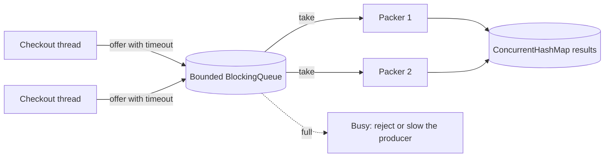
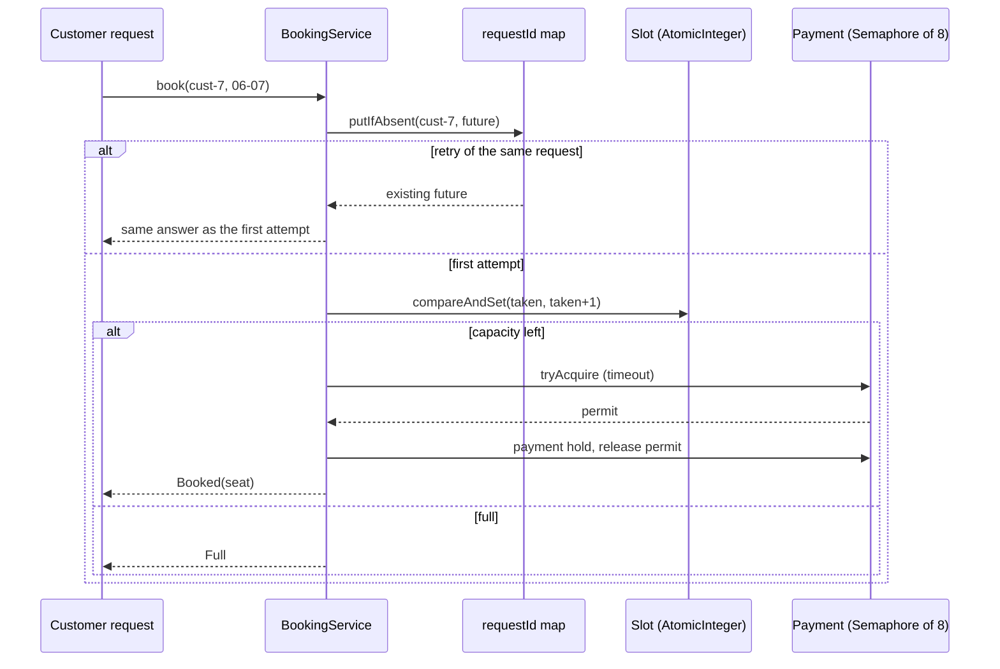

# Concurrency Patterns

<span class="badge-l3">L3 🟡 Professional</span> · <span class="read-time">⏱ 50 min read</span> · Prerequisites: [Patterns in Modern Java](patterns-in-modern-java.md), [Functional Patterns](functional-patterns.md)

!!! abstract "TL;DR"
    Concurrent code goes wrong when threads share mutable state without coordination. The patterns here avoid that in three ways. **Don't share**: immutability and thread confinement. **Share through a safe channel**: producer-consumer queues, thread pools, futures, Active Object. **Coordinate explicitly**: read-write locks, balking, guarded suspension, atomic compare-and-set. Java 21's **virtual threads** make blocking, thread-per-request code scale again, and **structured concurrency** and **scoped values** (final in Java 25) tidy up task lifetimes and context passing. Prefer the highest-level tool that fits: an executor over raw threads, a concurrent collection over a lock, an immutable snapshot over both.

## 1. What It Is

**Plain English.** FreshCart handles thousands of checkouts at once. Each one is a thread doing work, and they all touch shared things: stock counts, delivery slots, caches, counters. Concurrency patterns are proven ways to let many threads work at the same time without corrupting shared data, deadlocking, or exhausting the machine.

**Definition.** The patterns on this page, grouped by approach:

| Approach | Patterns |
|----------|----------|
| Avoid sharing | Immutability, thread confinement (`ThreadLocal`), scoped values |
| Hand work over safely | Producer-consumer (`BlockingQueue`), thread pool (`ExecutorService`), Future/`CompletableFuture`, Active Object |
| Coordinate access | Read-write lock, `StampedLock`, compare-and-set, balking, guarded suspension |
| Manage lifetimes | Virtual threads, structured concurrency |

Most come from Doug Lea's *Concurrent Programming in Java* and Brian Goetz et al.'s *Java Concurrency in Practice*, and are implemented in `java.util.concurrent`.

## 2. Why It Exists

Three problems cause almost every concurrency bug. **Race conditions**: two threads read-modify-write the same data and one update is lost. **Visibility**: without a happens-before relationship (locks, `volatile`, atomics, thread start/join, executor hand-off), one thread may never see another's writes. **Liveness**: deadlocks, starvation and unbounded resource use. Low-level tools (`synchronized`, `wait`/`notify`) can solve each, but are easy to get wrong. The patterns package correct solutions so you reason about the design, not every interleaving.

## 3. Mental Model / Analogy

**Analogy.** A busy restaurant kitchen. Recipes are printed and never edited (immutability). Each cook has their own knife (confinement). Orders go on a ticket rail with limited slots (bounded queue). A fixed team of cooks takes tickets (thread pool). The pass has one person plating at a time (Active Object). Many people can read the menu board, but it's covered while being rewritten (read-write lock).

**Technical model.** Threads communicate only through **safe publication points**: a final field set in a constructor, a `volatile` write, a lock release, a concurrent collection, a future's completion. Everything else is either private to a thread or immutable.

## 4. How It Works





## 5. Subtopics

### Immutability

**Description.** An immutable object's state can't change after construction, so any number of threads can read it without locks. To "change" shared state, build a new immutable snapshot and publish it atomically (an `AtomicReference`, a `volatile` field, or a concurrent map entry). Records with validated, immutable components are ideal snapshots.

**Advantages / features.** No locks for readers; invariants checked once in the constructor; no torn reads of half-updated objects.

**Before (mutable shared object) and after (immutable snapshots):**

```java title="ImmutabilityDemo.java"
--8<-- "examples/l3-professional/concurrency-patterns/ImmutabilityDemo.java"
```

1. Updating two fields is two steps; a reader between them sees an impossible combination (sale above MRP). The demo replays that interleaving deterministically.
2. The snapshot validates its invariant and can never change afterwards.
3. Writers publish whole new snapshots; readers always see a complete, valid one.

**Run it:** `java ImmutabilityDemo.java`

```text
--8<-- "examples/l3-professional/concurrency-patterns/ImmutabilityDemo.expected.txt"
```

| Technique | Use for |
|-----------|---------|
| `final` fields + records | Value objects, events, configuration |
| `List.copyOf`, `Map.copyOf` | Immutable collection components |
| `AtomicReference<Snapshot>` + `updateAndGet` | Replace shared state atomically |
| `volatile Snapshot` | Single writer, many readers |
| Copy-on-write (`CopyOnWriteArrayList`) | Rarely changed listener lists |

**Use** immutable snapshots for read-mostly shared state (prices, config, feature flags). **Avoid** them for large structures updated very often; copying gets expensive.
**Real-world Java:** `String`, `LocalDate`, `BigDecimal`, `List.of`; Spring's `Environment` property sources are replaced, not mutated.
**Best practice:** make fields `final`; it also guarantees safe publication of the constructed object (JLS §17.5). **Gotcha:** `updateAndGet` may call your function several times under contention, so it must be side-effect free.

### Thread confinement and ThreadLocal

**Description.** If only one thread ever touches an object, it needs no synchronisation. Local variables are confined automatically; `ThreadLocal<T>` gives each thread its own instance of a shared field. It's used for non-thread-safe helpers (`SimpleDateFormat`, `MessageDigest`) and per-request context (tenant, transaction, security). In thread pools, values must be removed at the end of each task, or they leak into the next one.

**Advantages / features.** No contention; non-thread-safe objects become safe to use from many threads.

```java title="ThreadConfinementDemo.java"
--8<-- "examples/l3-professional/concurrency-patterns/ThreadConfinementDemo.java"
```

1. Each thread lazily gets its own formatter.
2. Removing the value in `finally` is what stops leaks between pooled tasks.
3. Often the better fix is an immutable, thread-safe alternative that needs no confinement.

**Run it:** `java ThreadConfinementDemo.java`

```text
--8<-- "examples/l3-professional/concurrency-patterns/ThreadConfinementDemo.expected.txt"
```

| Confinement kind | How |
|------------------|-----|
| Stack confinement | Local variables, never published |
| `ThreadLocal` | Per-thread copy of a shared field |
| Single-thread executor / Active Object | All access through one thread |
| Scoped values (Java 25) | Immutable per-call binding |

**Use** `ThreadLocal` for expensive, non-thread-safe helpers and framework-level context. **Avoid** it for passing business data between methods; parameters are clearer.
**Real-world Java:** Spring's `TransactionSynchronizationManager` and `SecurityContextHolder`, SLF4J's `MDC`, `ThreadLocalRandom`.
**Best practice:** always `remove()` in `finally` when a pool thread is used. **Gotcha:** with millions of virtual threads, each `ThreadLocal` copy costs memory; caching expensive objects per thread no longer pays off.

### Producer-consumer with BlockingQueue

**Description.** Producers put work into a `BlockingQueue`; consumers take it. The queue handles all synchronisation and visibility. A **bounded** queue applies back-pressure: when it's full, producers block or are refused, so a slow consumer can't cause unbounded memory growth. A "poison pill" message tells consumers to stop.

**Advantages / features.** Producers and consumers run at their own pace; easy to scale consumers; clean shutdown.

```java title="ProducerConsumerDemo.java"
--8<-- "examples/l3-professional/concurrency-patterns/ProducerConsumerDemo.java"
```

1. A sentinel value meaning "no more work", one per consumer.
2. A bounded queue: at most five jobs wait at any time.
3. `put` blocks while the queue is full, slowing the producer to the consumers' pace.

**Run it:** `java ProducerConsumerDemo.java`

```text
--8<-- "examples/l3-professional/concurrency-patterns/ProducerConsumerDemo.expected.txt"
```

| Queue | Bounded | Notes |
|-------|---------|-------|
| `ArrayBlockingQueue` | Yes | Fixed array; one lock |
| `LinkedBlockingQueue` | Optional (default unbounded!) | Two locks; higher throughput |
| `SynchronousQueue` | Capacity 0 | Direct hand-off |
| `PriorityBlockingQueue` | No | Priority order |
| `DelayQueue` | No | Items available after a delay |
| `LinkedTransferQueue` | No | Producer can wait for a consumer |

| Producer method | When full |
|-----------------|-----------|
| `put` | Blocks |
| `offer(e, timeout)` | Waits up to timeout, then returns `false` |
| `offer(e)` | Returns `false` immediately |
| `add` | Throws |

**Use** bounded queues between stages with different speeds. **Avoid** unbounded queues in front of slow consumers; they turn overload into an out-of-memory error.
**Real-world Java:** `ThreadPoolExecutor`'s work queue, Logback's `AsyncAppender`, Kafka consumer hand-off, `java.util.logging` handlers.
**Best practice:** decide the full-queue policy explicitly (block, drop, reject with a busy response). **Gotcha:** `new LinkedBlockingQueue<>()` is unbounded, as is the queue inside `Executors.newFixedThreadPool`.

### Thread pool and executor

**Description.** An `ExecutorService` owns a set of worker threads and a task queue; you submit `Runnable`/`Callable` tasks and get `Future`s. Pools reuse threads, bound concurrency and centralise shutdown. `ThreadPoolExecutor` lets you choose core/max size, queue type and a **rejection policy** for when the queue is full.

**Advantages / features.** Bounded resource use; task submission separated from execution policy; futures for results and errors.

**Before (thread per task) and after (pool):**

```java title="ExecutorDemo.java"
--8<-- "examples/l3-professional/concurrency-patterns/ExecutorDemo.java"
```

1. Before: a platform thread per task. Fine for 20 tasks; for 10,000 it exhausts memory and the OS.
2. After: four workers, a bounded queue, and `CallerRunsPolicy`, which slows the submitter instead of dropping work when the queue is full.
3. `invokeAll` submits everything and waits; results come back in submission order.

**Run it:** `java ExecutorDemo.java`

```text
--8<-- "examples/l3-professional/concurrency-patterns/ExecutorDemo.expected.txt"
```

| Factory | Threads | Queue | Use for |
|---------|---------|-------|---------|
| `newFixedThreadPool(n)` | n | Unbounded | CPU work (careful with the queue) |
| `newCachedThreadPool()` | Unbounded | Hand-off | Short bursts only |
| `newVirtualThreadPerTaskExecutor()` | One virtual thread per task | None | Blocking I/O (Java 21) |
| `newScheduledThreadPool(n)` | n | Delay queue | Timers, retries |
| `ForkJoinPool` | Work-stealing | Per-worker deques | Divide-and-conquer, parallel streams |
| `new ThreadPoolExecutor(...)` | Explicit | Explicit | Production pools with limits |

**Use** an explicit `ThreadPoolExecutor` (bounded queue, named threads, rejection policy) for CPU-bound or rate-limited work. **Avoid** `newCachedThreadPool` under load; it can create thousands of threads.
**Real-world Java:** servlet containers' request pools, Spring's `ThreadPoolTaskExecutor`, `CompletableFuture` default pool (`ForkJoinPool.commonPool()`).
**Best practice:** size CPU pools near the core count; give threads names via a `ThreadFactory`; shut down on application stop. **Gotcha:** exceptions in `submit`ted tasks are captured in the `Future`; if nobody calls `get()`, they vanish silently.

### Future and CompletableFuture

**Description.** A `Future` represents a result that will be available later. `CompletableFuture` adds composition: `thenApply`, `thenCompose`, `thenCombine`, `allOf`, plus error handling (`exceptionally`, `handle`) and timeouts (`orTimeout`, `completeOnTimeout`). Independent calls start together and their results are combined when ready.

**Advantages / features.** Latency is the slowest call, not the sum; failures and timeouts become values with fallbacks.

```java title="CompletableFutureDemo.java"
--8<-- "examples/l3-professional/concurrency-patterns/CompletableFutureDemo.java"
```

1. All four calls start immediately on virtual threads.
2. The slow ETA service gets a deadline; after 300 ms a default ETA is used.
3. A failure in an optional section (reviews) becomes a fallback value instead of failing the page.

**Run it:** `java CompletableFutureDemo.java`

```text
--8<-- "examples/l3-professional/concurrency-patterns/CompletableFutureDemo.expected.txt"
```

| Method | Purpose |
|--------|---------|
| `supplyAsync(s, executor)` | Start work on a chosen executor |
| `thenApply` / `thenCompose` | Transform / chain an async step |
| `thenCombine` / `allOf` / `anyOf` | Join independent results |
| `exceptionally` / `handle` | Recover from failure |
| `orTimeout` / `completeOnTimeout` | Fail or default after a deadline |
| `join` / `get` | Wait (unchecked / checked exceptions) |

**Use** `CompletableFuture` to fan out independent calls with deadlines. **Avoid** long chains that hide control flow; with virtual threads, plain blocking code is often clearer.
**Real-world Java:** `HttpClient.sendAsync`, Spring's `@Async` returning `CompletableFuture`, Caffeine's `AsyncCache`.
**Best practice:** always pass an executor to `*Async` methods for I/O; the default common pool is for CPU work. **Gotcha:** a timeout completes the future but doesn't stop the underlying work, which keeps running and holding resources.

### Read-write lock

**Description.** A `ReentrantReadWriteLock` lets many readers hold the read lock at once, while a writer needs exclusive access. `StampedLock` adds **optimistic reads**: read without locking, then validate the stamp; retry with a real read lock only if a write happened meanwhile.

**Advantages / features.** Read-heavy data structures scale across cores; optimistic reads cost almost nothing when there are no writes.

```java title="ReadWriteLockDemo.java"
--8<-- "examples/l3-professional/concurrency-patterns/ReadWriteLockDemo.java"
```

1. Many readers hold the read lock at the same time.
2. A writer waits until readers leave and blocks new readers while it writes.
3. An optimistic read takes no lock; `validate` tells you whether to retry with one.

**Run it:** `java ReadWriteLockDemo.java`

```text
--8<-- "examples/l3-professional/concurrency-patterns/ReadWriteLockDemo.expected.txt"
```

| Tool | Readers in parallel | Reentrant | Best when |
|------|---------------------|-----------|-----------|
| `synchronized` | No | Yes | Short critical sections |
| `ReentrantReadWriteLock` | Yes | Yes | Long reads, rare writes |
| `StampedLock` | Yes, plus optimistic | No | Very frequent short reads |
| Immutable snapshot + `AtomicReference` | Yes, lock-free | n/a | Writes replace the whole value |
| `ConcurrentHashMap` | Yes | n/a | Key-value data |

**Use** read-write locks for read-mostly structures with non-trivial reads. **Avoid** them for tiny critical sections; their overhead is higher than a plain lock, and often a `ConcurrentHashMap` or immutable snapshot is simpler.
**Real-world Java:** caches inside libraries, `java.util.concurrent.ConcurrentSkipListMap` (lock-free alternative), JDK's `StampedLock` examples for point coordinates.
**Best practice:** release locks in `finally`; never call unknown code while holding one. **Gotcha:** `ReentrantReadWriteLock` can't upgrade a read lock to a write lock; trying deadlocks.

### Active Object

**Description.** An Active Object owns a private thread and a queue of method requests. Callers call methods that return futures; the object executes requests one by one on its own thread, so its state is confined to that thread and needs no locks. It decouples method **invocation** from **execution**.

**Advantages / features.** Simple, lock-free state handling; natural serialisation of operations; callers aren't blocked by the work.

```java title="ActiveObjectDemo.java"
--8<-- "examples/l3-professional/concurrency-patterns/ActiveObjectDemo.java"
```

1. A single-thread executor is the object's private thread and request queue.
2. Public methods enqueue work and return futures immediately.
3. Closing the object drains its queue and stops the thread.

**Run it:** `java ActiveObjectDemo.java`

```text
--8<-- "examples/l3-professional/concurrency-patterns/ActiveObjectDemo.expected.txt"
```

| | Lock-based object | Active Object | Actor (Akka, Erlang) |
|-|-------------------|---------------|----------------------|
| Concurrency control | Locks around state | One owning thread | One mailbox per actor |
| Caller gets | Result directly | `Future` | Usually a message back |
| Blocking callers | Yes | No | No |
| Scale | Contention under load | Throughput of one thread | Millions of actors |

**Use** Active Object for components with complex internal state and moderate throughput (dispatchers, session managers, device drivers). **Avoid** it for hot paths needing more throughput than one thread can give.
**Real-world Java:** Swing's Event Dispatch Thread, Android's main `Looper`/`Handler`, Netty's event loops, Akka actors.
**Best practice:** never block inside the active object's thread, or every caller waits. **Gotcha:** calling the object's own public methods from inside its thread and waiting on the future deadlocks.

### Balking and guarded suspension

**Description.** Two answers to "the object isn't ready". **Balking**: return immediately and do nothing (an autosave with no changes, a job already running). **Guarded suspension**: wait until another thread makes the condition true (a slot frees up, a queue has items), using `Condition.await` in a `while` loop or `wait`/`notify`.

**Advantages / features.** Clear, explicit state-dependent behaviour; no busy-waiting.

```java title="BalkingGuardedDemo.java"
--8<-- "examples/l3-professional/concurrency-patterns/BalkingGuardedDemo.java"
```

1. Balking: if there's nothing to do, or someone is already doing it, return at once.
2. Guarded suspension: wait in a loop, because wake-ups can be spurious or the condition may be taken by another thread first.
3. Whoever changes the state signals the waiting threads.

**Run it:** `java BalkingGuardedDemo.java`

```text
--8<-- "examples/l3-professional/concurrency-patterns/BalkingGuardedDemo.expected.txt"
```

| Situation | Pattern | Example |
|-----------|---------|---------|
| Work is optional or already in progress | Balking | Autosave, "refresh" while refreshing |
| Work must happen once the condition holds | Guarded suspension | Waiting for a slot, a connection, an item |
| Waiting forever is unacceptable | Guarded suspension with timeout | `await(timeout)`, `poll(timeout)` |

**Use** balking for idempotent, optional actions; guarded suspension with timeouts for resources. **Avoid** hand-written waiting when a library primitive exists (`Semaphore`, `BlockingQueue`, `CountDownLatch`).
**Real-world Java:** `BlockingQueue.take` (guarded), `Semaphore.acquire` (guarded), `AtomicBoolean.compareAndSet` start guards (balking), Spring's scheduled tasks skipping overlapping runs.
**Best practice:** always wait in a `while` loop and signal while holding the lock. **Gotcha:** `signal` wakes one waiter; if waiters wait for different conditions, use separate `Condition`s or `signalAll`.

### Virtual threads and structured concurrency

**Description.** Virtual threads (Java 21) are lightweight threads scheduled by the JVM onto a few carrier threads. When a virtual thread blocks on I/O, it unmounts and its carrier runs others, so you can have millions. That makes the simple **thread-per-request** style scale. **Structured concurrency** (`StructuredTaskScope`, preview in 21–24) treats a group of subtasks as one unit: they start and finish inside a scope, and if one fails, the others are cancelled.

**Advantages / features.** Blocking code that scales like async code; readable stack traces; with structured concurrency, no orphaned subtasks.

```java title="VirtualThreadsDemo.java"
--8<-- "examples/l3-professional/concurrency-patterns/VirtualThreadsDemo.java"
```

1. One virtual thread per task: 10,000 concurrent blocking calls finish in about the time of one.
2. The executor's try-with-resources block is a scope: tasks can't outlive it.
3. When one subtask fails, cancel the others. `StructuredTaskScope.ShutdownOnFailure` does this automatically.

**Run it:** `java VirtualThreadsDemo.java`

```text
--8<-- "examples/l3-professional/concurrency-patterns/VirtualThreadsDemo.expected.txt"
```

With the preview API (Java 21–24, `--enable-preview`), the last part reads:

```java
try (var scope = new StructuredTaskScope.ShutdownOnFailure()) {
    Subtask<String> stock = scope.fork(() -> callPartner(1));
    Subtask<String> eta = scope.fork(() -> etaService());
    scope.join().throwIfFailed();          // cancels the other subtask if one fails
    return new Page(stock.get(), eta.get());
}
```

| | Platform threads | Virtual threads |
|-|------------------|-----------------|
| Cost | ~1 MB stack, OS thread | A few KB on the heap |
| How many | Thousands | Millions |
| Good for | CPU-bound work | Blocking I/O |
| Pooling | Yes | No: create one per task |
| Pitfalls | Exhaustion | Pinning (`synchronized` + blocking, before Java 24), large `ThreadLocal`s |

**Use** virtual threads for request handling and I/O fan-out. **Avoid** them for CPU-bound work (no gain) and don't pool them.
**Real-world Java:** Spring Boot 3.2+ (`spring.threads.virtual.enabled=true`), Tomcat and Jetty virtual-thread executors, Helidon Níma.
**Best practice:** limit access to scarce resources with a `Semaphore`, not a small pool. **Gotcha:** before Java 24, blocking inside `synchronized` pins the carrier thread; use `ReentrantLock` on hot paths (JEP 491 fixes this in 24).

### Scoped values

**Description.** `ScopedValue` (preview in Java 21, final in Java 25) binds an immutable value for the duration of a call: `ScopedValue.where(CONTEXT, ctx).run(...)`. Code inside reads it with `CONTEXT.get()`; when the call returns, the binding is gone. Child tasks in a structured scope inherit it cheaply. It replaces `ThreadLocal` for passing context like request IDs and tenants.

**Advantages / features.** Immutable (no accidental overwrites); automatic cleanup (no leaks in pools); cheap with millions of virtual threads.

The demo implements the same semantics on Java 21 without preview flags:

```java title="ScopedValuesDemo.java"
--8<-- "examples/l3-professional/concurrency-patterns/ScopedValuesDemo.java"
```

1. A small class with `ScopedValue`'s shape: bind for a call, read inside, nothing outside.
2. The previous binding is restored when the call ends, so nesting works and nothing leaks.
3. Deep code reads the context without it being passed through every method.

**Run it:** `java ScopedValuesDemo.java`

```text
--8<-- "examples/l3-professional/concurrency-patterns/ScopedValuesDemo.expected.txt"
```

On Java 25 the real API is:

```java
static final ScopedValue<RequestContext> CONTEXT = ScopedValue.newInstance();

ScopedValue.where(CONTEXT, new RequestContext("req-1", "freshcart"))
           .call(() -> repositoryCall());      // CONTEXT.get() works inside, nowhere else
```

| | `ThreadLocal` | `InheritableThreadLocal` | `ScopedValue` |
|-|---------------|--------------------------|---------------|
| Mutable | Yes (`set`) | Yes | No |
| Lifetime | Until `remove()` | Until `remove()` | The call |
| Child threads | No | Copied at creation | Inherited in structured scopes |
| Cost with many virtual threads | High | Higher | Low |

**Use** scoped values (Java 25+) for request context. **Avoid** `ThreadLocal` for new context-passing code on virtual threads.
**Real-world Java:** expected to back frameworks' request, transaction and security contexts as they adopt Java 25.
**Best practice:** keep scoped values `static final` and private to the module that binds them. **Gotcha:** `get()` outside a binding throws; check `isBound()` when the value is optional.

## 6. Examples (exactly 3, progressively harder)

### Example 1: Minimal (L2)

**Scenario:** QuickDrop counts orders per second from many request threads for a live dashboard.

```java title="OrderCounterDemo.java"
--8<-- "examples/l3-professional/concurrency-patterns/OrderCounterDemo.java"
```

1. `plain++` is read, add, write: three steps, so concurrent increments overwrite each other.
2. `LongAdder` spreads increments across cells and sums them on read: correct and fast under contention.

**Run it:** `java OrderCounterDemo.java`

**Output:**

```text
--8<-- "examples/l3-professional/concurrency-patterns/OrderCounterDemo.expected.txt"
```

**What to notice:**

- The plain counter's exact value differs from run to run, which is the whole problem; the page prints only what's guaranteed.

### Example 2: Realistic (in FreshCart grocery delivery)

**Scenario:** checkout threads hand paid orders to the packing station. Packers are slower than checkout at peak. Checkout must never pile up threads waiting; it gets a quick "busy" answer and can show a message. On shutdown, every accepted order must be packed.

```java title="DispatchQueueDemo.java"
--8<-- "examples/l3-professional/concurrency-patterns/DispatchQueueDemo.java"
```

1. Results go into a concurrent map with atomic counters, so packers never need a lock.
2. `offer` with a short timeout turns overload into an explicit rejection.
3. Shutdown sends one stop message per packer after all real work, then waits for them.

**Run it:** `java DispatchQueueDemo.java`

**Output:**

```text
--8<-- "examples/l3-professional/concurrency-patterns/DispatchQueueDemo.expected.txt"
```

**What to notice:**

- Exact accepted and rejected counts depend on timing, so the program checks the invariants: nothing lost, nothing packed twice, every accepted order finished.

### Example 3: Production-grade

**Scenario:** DairyDay opens next-morning delivery slots at 9 pm and thousands of customers tap "book" at once; mobile apps retry on timeouts. Requirements: never overbook; a retried request books at most once and gets the same answer; the payment provider allows only 8 concurrent "hold" calls; the availability screen must never show negative or half-updated numbers; each request runs on its own virtual thread.

```java title="SlotBookingServiceDemo.java"
--8<-- "examples/l3-professional/concurrency-patterns/SlotBookingServiceDemo.java"
```

1. Capacity is claimed with compare-and-set in a loop, so two threads can't take the last seat.
2. The first attempt for a request ID registers a future; concurrent retries wait for that same answer instead of booking again.
3. A `Semaphore` is a bulkhead: at most 8 payment calls in flight, with a timeout so requests don't wait forever. If no permit is available, the seat is released.
4. Availability is published as an immutable map snapshot.
5. One virtual thread per request; the try-with-resources block waits for all of them.

**Run it:** `java SlotBookingServiceDemo.java`

**Output:**

```text
--8<-- "examples/l3-professional/concurrency-patterns/SlotBookingServiceDemo.expected.txt"
```

**What to notice:**

- Exactly 150 customers booked 150 seats; the 100 retries got the same answers as their first attempts.
- Payment holds equal seats booked: no customer was held twice.
- The first version of this example registered the request ID *after* booking; concurrent retries both booked, one released its seat late, and seats were left empty while others had been told "full". The test on this page now races six identical requests to catch that.

## 7. Pros, Cons & Trade-offs

| Aspect | Pros | Cons |
|--------|------|------|
| Immutability / confinement | No locks, no races | Copying cost; context passing gets awkward |
| Queues and pools | Bounded resources, decoupled stages | Latency from queuing; tuning needed |
| Futures | Parallel I/O with deadlines | Harder debugging; work continues after timeout |
| Locks | Fine-grained control | Deadlocks, contention, easy to misuse |
| Virtual threads | Simple blocking code at scale | Pinning and `ThreadLocal` costs; not for CPU work |
| Active Object | Lock-free state | Single-thread throughput limit |

## 8. When to Use / When NOT to Use

**Use them when:**

- work arrives concurrently (web requests, events, batch partitions);
- I/O latency dominates and calls can run in parallel;
- shared state is unavoidable (counters, caches, capacity).

**Don't use them when:**

- the problem is sequential and fast enough: concurrency adds risk for nothing;
- a database or message broker can provide the guarantee (unique constraints, row locks, partitions) more simply;
- the code is CPU-bound and already uses all cores.

## 9. Best Practices

1. **Prefer immutability and confinement over locks.** *(Consensus.)*
2. **Use `java.util.concurrent` instead of `wait`/`notify` and raw threads.** *(Consensus.)*
3. **Bound every queue and pool; decide the overload policy.** *(Consensus.)*
4. **Virtual threads for blocking I/O; semaphores to limit scarce resources.** *(Consensus for Java 21+.)*
5. **Timeouts on every remote call and every wait.** *(Consensus.)*
6. **Make retried operations idempotent.** *(Consensus.)*
7. **Test concurrency with real contention** (latches to start together, repeated runs) and tools like jcstress for low-level code. *(Opinion, widely shared.)*

## 10. Pitfalls & Anti-Patterns

!!! danger "Check-then-act overbooking (production failure mode)"
    **Symptom:** during a sale, 61 customers were booked into a 50-seat delivery slot; riders couldn't deliver them all.
    **Root cause:** `if (taken < capacity) taken++` ran in many threads: several saw 49 and all incremented.
    **Fix:** atomic claim (`compareAndSet` loop, `AtomicInteger.updateAndGet` with a guard) or a database constraint; a test that races hundreds of requests with a start latch.

!!! danger "Unbounded queue hides overload"
    **Symptom:** the service ran fine for an hour into a traffic spike, then died with `OutOfMemoryError`.
    **Root cause:** `Executors.newFixedThreadPool` uses an unbounded `LinkedBlockingQueue`; tasks piled up faster than they ran.
    **Fix:** a bounded queue with a rejection policy, and a metric on queue depth.

!!! danger "Deadlock from lock ordering"
    **Symptom:** two transfer threads froze forever; thread dumps showed each holding one wallet lock.
    **Root cause:** thread A locked wallet 1 then 2; thread B locked 2 then 1.
    **Fix:** always lock in a global order (e.g., by ID), use `tryLock` with timeout, or avoid nested locks.

!!! danger "ThreadLocal leak in a pool"
    **Symptom:** a request occasionally saw another tenant's data.
    **Root cause:** a `ThreadLocal` tenant was set but never removed; the pooled thread carried it into the next request that didn't set one.
    **Fix:** `remove()` in `finally`, or scoped values.

## 11. Configuration & Tuning

| Setting | Default | What it does | When to change it | Risk of changing |
|---------|---------|--------------|-------------------|------------------|
| CPU pool size | — | Workers for CPU-bound tasks | ≈ number of cores | Oversubscription |
| I/O concurrency limit (`Semaphore`) | — | Max in-flight calls to a dependency | Match the dependency's capacity | Too high overloads it |
| `jdk.virtualThreadScheduler.parallelism` | Cores | Carrier threads for virtual threads | Rarely | Starvation or waste |
| `java.util.concurrent.ForkJoinPool.common.parallelism` | Cores − 1 | Parallel streams and default async pool | Containers with CPU limits | Starvation |
| Queue capacity | — | Burst absorption | Based on latency budget | Memory vs rejections |
| `-Djdk.tracePinnedThreads=full` | off | Logs virtual-thread pinning (Java 21–23) | Diagnosing pinning | Log noise |

## 12. Security Considerations

- Unbounded queues and thread creation are denial-of-service vectors; bound them and rate-limit per client.
- `ThreadLocal` leaks can expose one user's data (tenant, auth) to another; clear them or use scoped values.
- Security context doesn't propagate automatically to other threads; use context-propagating executors.
- Time-of-check/time-of-use races can bypass authorisation or quotas (two concurrent redemptions of a single-use coupon); enforce with atomic operations or database constraints.

## 13. Performance & Scalability

Contention, not thread count, limits throughput: a single hot lock or atomic serialises all threads. Spread contention (`LongAdder`, striped locks, per-key `ConcurrentHashMap` operations) and keep critical sections short. Little's Law (concurrency = throughput × latency) sizes pools and semaphores: 500 requests/s at 200 ms each needs about 100 concurrent requests. Virtual threads remove the thread-count limit for I/O but not the downstream limit. Measure with JFR (`jdk.ThreadPark`, `jdk.JavaMonitorEnter`, `jdk.VirtualThreadPinned`) and JMH.

## 14. Testing It

Concurrency tests need real contention: start all threads together with a latch, repeat the test, and assert invariants (no overbooking, one booking per retry, bounded in-flight calls):

```java title="SlotBookingTest.java"
--8<-- "examples/l3-professional/concurrency-patterns/SlotBookingTest.java"
```

For low-level code (custom atomics, lock-free structures), use OpenJDK's jcstress, which explores interleavings and memory-model outcomes that ordinary tests rarely hit.

## 15. Observability & Operations

Export pool size, active threads, queue depth and rejection counts for every executor (Micrometer's `ExecutorServiceMetrics`). Track semaphore wait time and timeouts per dependency. Thread dumps (`jcmd <pid> Thread.dump_to_file -format=json`) show deadlocks and include virtual threads. JFR events show lock contention and pinning. Alert on queue depth growth and rejection spikes before they become outages.

## 16. Version Notes

| Java | Change relevant to concurrency patterns |
|------|-----------------------------------------|
| 5 | `java.util.concurrent`: executors, `BlockingQueue`, atomics, locks; Java Memory Model (JSR-133) |
| 7 | Fork/Join framework, `Phaser`, `TransferQueue` |
| 8 | `CompletableFuture`, `LongAdder`, `StampedLock`, `ConcurrentHashMap` improvements |
| 9 | `Flow`, `orTimeout`/`completeOnTimeout`, `VarHandle` |
| 19 | `ExecutorService` is `AutoCloseable` |
| 21 | Virtual threads (final); structured concurrency and scoped values (preview) |
| 24 | Virtual threads no longer pinned by `synchronized` (JEP 491) |
| 25 | Scoped values final (JEP 506); structured concurrency still preview |

## 17. Expert Deep Dive

- **The Java Memory Model.** Correctness depends on happens-before edges: unlock → lock of the same monitor, `volatile` write → read, thread start, `join`, executor submission → task execution, future completion → `get`. Without one, the JIT and CPU may reorder or cache writes.
- **Lock-free algorithms.** CAS loops (as in `Slot.tryClaim`) avoid blocking but can livelock under extreme contention; `LongAdder` and striped structures reduce contention by spreading state.
- **Little's Law and bulkheads.** Bulkheads (separate semaphores or pools per dependency) stop one slow dependency from consuming all threads; with virtual threads they become semaphores rather than pools.
- **Idempotency is a concurrency pattern.** Retries make every request potentially concurrent with itself; registering the request before doing work (in memory, or with a unique key in the database) is what makes "exactly once" effects possible.
- **Structured concurrency and observability.** Scopes form a tree of tasks that thread dumps can show, making async failures as readable as stack traces.

!!! example "War story: the 61-seat slot"
    DairyDay's slot booking checked `remaining > 0` and then decremented, inside a service that ran on 200 request threads. On the first big promotion night, the 9 pm rush oversold several slots by 10–20%. Riders arrived with more crates than their vans held, and 400 deliveries were late. **Fixes:** an atomic claim in the application (compare-and-set) **and** a database check constraint (`taken <= capacity`) as a backstop; request IDs stored with a unique index so app retries couldn't double-book; a semaphore limiting payment-hold calls, which had been timing out under load and triggering more retries. A load test with 5,000 virtual-thread clients now runs before every promotion. **Lesson:** any check-then-act on shared state is a race; make the check and the change one atomic step, and make retries idempotent.

## 18. Interview Corner

=== "🟢 L1–L2"

    1. **Why are immutable objects thread-safe?** Their state **never changes** after construction.
    2. **What's a thread pool for?** **Reusing a bounded set of threads** for many tasks.
    3. **What does a `BlockingQueue` do when full?** `put` **blocks**; `offer` returns **false** (or waits with timeout).
    4. **Why is `count++` unsafe?** It's **read-modify-write**, not atomic.
    5. **What's a virtual thread?** A **lightweight JVM-scheduled thread** for blocking I/O.

=== "🟡 L3"

    1. **`synchronized` vs `ReentrantLock`?** Lock adds **tryLock, timeouts, fairness, multiple conditions**.
    2. **What's happens-before?** The **visibility/ordering guarantee** between actions (locks, volatile, start/join).
    3. **Balking vs guarded suspension?** **Return immediately** vs **wait until the condition holds**.
    4. **Why bound queues?** To apply **back-pressure** and avoid **OOM** under overload.
    5. **When not to use virtual threads?** **CPU-bound** work; don't **pool** them.

=== "🔴 L4–L5"

    1. **Design slot booking for a 9 pm rush.** **Atomic claim, DB constraint, idempotent request IDs, semaphore bulkhead, timeouts, load tests.**
    2. **How do you find a deadlock in production?** **Thread dump** (jstack/jcmd), look for lock cycles; fix lock ordering or use tryLock.
    3. **How do you size pools?** **Little's Law**; cores for CPU work; dependency limits for I/O.
    4. **What's pinning and how is it fixed?** Virtual thread **stuck to its carrier** while blocking in `synchronized`; use **ReentrantLock** or Java 24+.
    5. **ThreadLocal vs ScopedValue?** **Mutable, manual cleanup** vs **immutable, bounded lifetime**, cheap for virtual threads.

=== "💻 Hands-on"

    **Task:** Make `SlotBookingServiceDemo` let customers cancel, freeing the seat and letting a retried booking for the same request ID succeed again.

    ??? success "Solution"
        ```java
        boolean cancel(String requestId) {
            CompletableFuture<Result> f = byRequestId.get(requestId);
            if (f == null || !(f.join() instanceof Booked b)) return false;
            if (!byRequestId.remove(requestId, f)) return false;     // only one cancel wins
            slots.get(b.slot()).release();
            publish();
            return true;
        }
        // test: book, cancel twice concurrently -> exactly one returns true, seat count restored once
        ```

## 19. Practice

- [ ] Replace the `CompletableFuture` fan-out in `CompletableFutureDemo` with plain blocking calls on virtual threads and compare readability.
    ??? tip "Hint"
        Submit three `Callable`s to a virtual-thread executor and call `get()` with timeouts.
- [ ] Add a metric for queue depth to `DispatchQueueDemo` and print it every 10 orders.
    ??? tip "Hint"
        `queue.size()` is approximate but fine for metrics.
- [ ] Introduce a deadlock between two `ReentrantLock`s on purpose, find it with `jstack`, then fix it with lock ordering.
    ??? tip "Hint"
        Thread dumps report "Found one Java-level deadlock".
- [ ] Write a jcstress test for `Slot.tryClaim` with capacity 1 and two actors.
    ??? tip "Hint"
        Acceptable outcome: exactly one actor gets seat 1.

## 20. Quick Revision Card

!!! tip "Remember in 30 seconds"
    - Don't share (immutable, confined) → share safely (queues, pools, futures, Active Object) → coordinate (locks, CAS).
    - Bound every queue and pool; decide overload behaviour.
    - Check-then-act is a race: make it atomic (CAS, constraints).
    - Virtual threads for blocking I/O; semaphores for scarce resources; timeouts everywhere.
    - `ThreadLocal`: remove in `finally`; prefer scoped values (Java 25).
    - Retries make requests concurrent with themselves: idempotency keys.

    ```java
    int tryClaim() {
        while (true) {
            int now = taken.get();
            if (now >= capacity) return -1;
            if (taken.compareAndSet(now, now + 1)) return now + 1;
        }
    }
    ```

## 21. Further Reading

- Brian Goetz et al., *Java Concurrency in Practice* (2006).
- Doug Lea, *Concurrent Programming in Java* (2nd ed., 1999).
- [JEP 444: Virtual Threads](https://openjdk.org/jeps/444), [JEP 505: Structured Concurrency](https://openjdk.org/jeps/505), [JEP 506: Scoped Values](https://openjdk.org/jeps/506).
- Aleksey Shipilёv, ["Java Memory Model Pragmatics"](https://shipilev.net/blog/2014/jmm-pragmatics/).
- [OpenJDK jcstress](https://github.com/openjdk/jcstress).

---

[← Previous: Patterns in Spring](patterns-in-spring.md) · [Next: Enterprise Application Patterns →](enterprise-application-patterns.md)
