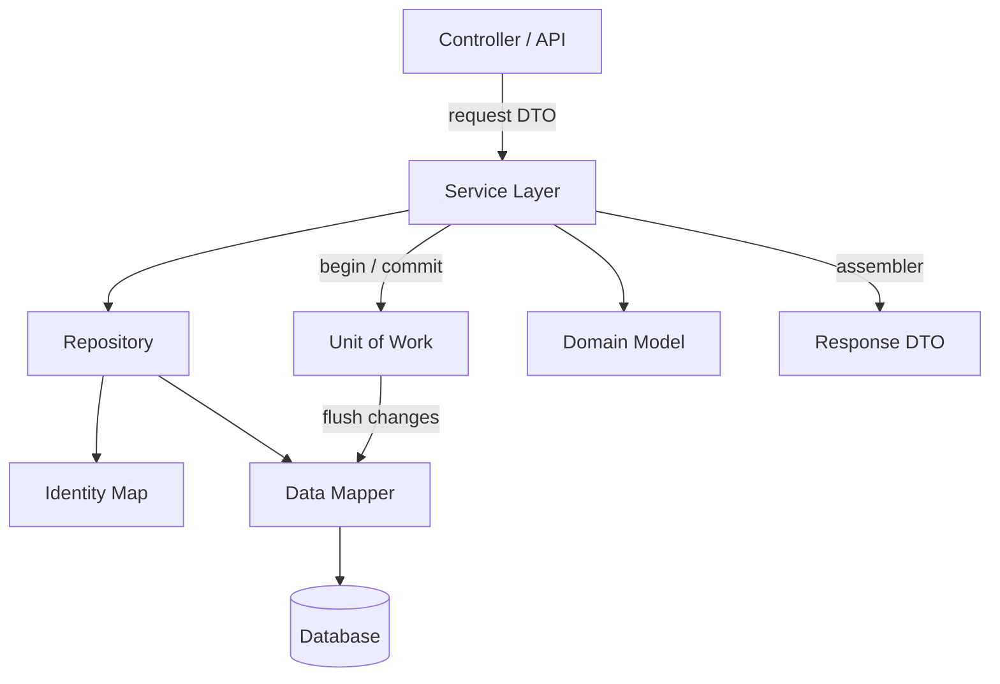
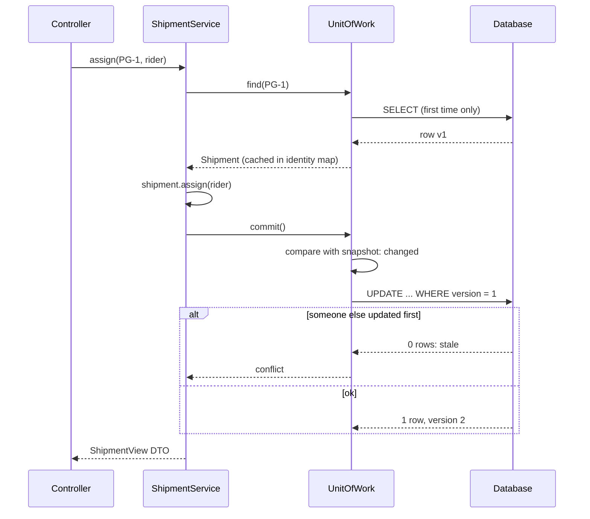

# Enterprise Application Patterns

<span class="badge-l3">L3 🟡 Professional</span> · <span class="read-time">⏱ 45 min read</span> · Prerequisites: [Dependency Injection](../l2-practitioner/dependency-injection.md), [Concurrency Patterns](concurrency-patterns.md)

!!! abstract "TL;DR"
    Martin Fowler's *Patterns of Enterprise Application Architecture* (PoEAA, 2002) names the building blocks of almost every business application: how to organise **business logic** (Transaction Script or Domain Model), where **use cases** live (Service Layer), and how objects reach the **database** (Repository, Data Mapper or Active Record, Unit of Work, Identity Map, Lazy Load), plus how data crosses **boundaries** (DTOs and assemblers). JPA/Hibernate and Spring Data implement most of them for you, so knowing them explains what your ORM is doing, why N+1 queries and lost updates happen, and when to step outside the framework.

## 1. What It Is

**Plain English.** A grocery app is mostly "take a request, apply business rules, save data, return an answer". These patterns are the standard answers to the questions every such app faces: where do the rules go, how do objects get in and out of tables, how do we keep many changes consistent, and what do we send to the mobile app?

**Definition.** The patterns on this page, by layer:

| Layer | Pattern | One line |
|-------|---------|----------|
| Domain logic | Transaction Script | One procedure per use case |
| Domain logic | Domain Model | Objects with data and behaviour enforce the rules |
| Application | Service Layer | The set of use cases; owns transactions |
| Data source | Repository | Collection-like access to aggregates |
| Data source | Data Mapper / Active Record | Separate mapper vs object that saves itself |
| Object-relational behaviour | Unit of Work | Track changes, write them together |
| Object-relational behaviour | Identity Map | One object per row per unit of work |
| Object-relational behaviour | Lazy Load | Load related data when first used |
| Distribution | DTO and assembler | Boundary-shaped data and its conversion |

## 2. Why It Exists

Business applications combine three hard things: complex, changing rules; relational databases whose shape differs from objects (the "object-relational impedance mismatch"); and many concurrent users. Without structure, SQL, rules and HTTP code tangle together, rules get duplicated across endpoints, and concurrency bugs (lost updates, half-saved orders) appear. These patterns separate the concerns so each can change independently, and give teams shared names for the pieces.

## 3. Mental Model / Analogy

**Analogy.** A supermarket. Shop-floor staff follow the store's rules (Domain Model). The customer-service desk handles requests start to finish (Service Layer). The stockroom clerk fetches and shelves items without the customer seeing the stockroom (Repository, Data Mapper). The clerk writes changes on a clipboard and updates the ledger once at closing (Unit of Work), never keeps two cards for the same item (Identity Map), and fetches a pallet's contents only when someone opens it (Lazy Load). Receipts show what the customer needs, not supplier costs (DTO).

**Technical model.** Requests enter through controllers, call the **service layer**, which opens a **unit of work**, loads aggregates via **repositories** (mapped by a **data mapper**, cached in an **identity map**), calls domain methods, then commits; the result leaves as **DTOs**.

## 4. How It Works





## 5. Subtopics

### Transaction Script vs. Domain Model

**Description.** A **Transaction Script** puts each use case's logic in one procedure that reads data, applies rules and writes results. A **Domain Model** puts rules into objects (`Order`, `Line`) that protect their own state, so every use case that touches an order gets the same rules. Scripts are simpler for simple logic; domain models win when rules are many, shared and changing.

**Advantages / features.** Scripts: obvious, fast to write. Domain model: rules in one place, invalid states impossible, easy unit tests.

**Before (Transaction Script) and after (Domain Model):**

```java title="TransactionScriptVsDomainModelDemo.java"
--8<-- "examples/l3-professional/enterprise-application-patterns/TransactionScriptVsDomainModelDemo.java"
```

1. The script computes correctly, but its data is a plain map: other scripts can put anything in it.
2. The domain object owns its lines, coupon and status; there's no way to change them except through its methods.
3. State transitions are guarded: a placed order can't get new lines.

**Run it:** `java TransactionScriptVsDomainModelDemo.java`

```text
--8<-- "examples/l3-professional/enterprise-application-patterns/TransactionScriptVsDomainModelDemo.expected.txt"
```

| | Transaction Script | Domain Model |
|-|--------------------|--------------|
| Logic lives in | Service procedures | Entities and value objects |
| Good for | CRUD, reports, simple flows | Complex, shared, evolving rules |
| Duplication risk | High as use cases grow | Low |
| Persistence | Easy (plain SQL) | Needs mapping (ORM or mapper) |
| Anaemic-model smell | n/a | When entities are only getters/setters |

**Use** scripts for simple CRUD and batch jobs; a domain model for the core business (pricing, ordering, slots). **Avoid** an anaemic domain model: entities with only getters and setters plus "service" scripts doing everything is a Transaction Script with extra layers.
**Real-world Java:** Spring Boot apps with `@Entity` classes and `@Service` scripts (often anaemic); DDD-style aggregates in Axon or jMolecules-based projects.
**Best practice:** start with scripts, and move rules into objects once two use cases need the same rule. **Gotcha:** JPA requires a no-arg constructor and often setters; keep them `protected` so domain invariants aren't bypassed.

### Service Layer

**Description.** The Service Layer defines the application's boundary: one method per use case (`placeOrder`, `cancelOrder`). It coordinates repositories, domain objects and external systems, and owns the **transaction** boundary. Business rules stay in the domain; the service sequences them.

**Advantages / features.** One place for transactions, security checks and orchestration; every client (REST, mobile, batch, messaging) calls the same use cases.

```java title="ServiceLayerDemo.java"
--8<-- "examples/l3-professional/enterprise-application-patterns/ServiceLayerDemo.java"
```

1. A stand-in for `@Transactional`: begin, then commit or roll back on exception.
2. The service sequences the steps; it holds no pricing or stock rules.
3. The SMS goes out **after** commit, so a rolled-back order never sends "placed".

**Run it:** `java ServiceLayerDemo.java`

```text
--8<-- "examples/l3-professional/enterprise-application-patterns/ServiceLayerDemo.expected.txt"
```

| Responsibility | Service layer | Domain model | Controller |
|----------------|---------------|--------------|------------|
| Transaction boundary | ✅ | | |
| Business rules | | ✅ | |
| Authorisation per use case | ✅ | | sometimes |
| HTTP/JSON mapping | | | ✅ |
| Calling external systems | ✅ (via ports) | | |

**Use** a service layer when several clients share use cases or transactions span repositories. **Avoid** services that just forward to a repository; that's an extra layer for nothing.
**Real-world Java:** Spring `@Service` + `@Transactional`; Jakarta EE stateless session beans.
**Best practice:** name services after use cases, not tables (`CheckoutService`, not `OrderTableService`). **Gotcha:** sending emails or messages inside the transaction means they go out even when it later rolls back; use `@TransactionalEventListener(phase = AFTER_COMMIT)` or an outbox.

### Repository

**Description.** A Repository gives the domain a collection-like interface (`findById`, `save`, `findAvailableInZone`) for aggregates, hiding how they're stored. Implementations can use JDBC, JPA, a document store or memory. Query methods speak the domain's language.

**Advantages / features.** Domain code free of SQL; fast in-memory implementations for tests; storage can change behind the interface.

```java title="RepositoryDemo.java"
--8<-- "examples/l3-professional/enterprise-application-patterns/RepositoryDemo.java"
```

1. The interface is in the domain's language and exposes no storage concepts.
2. An in-memory implementation is perfect for tests; a JPA one would implement the same interface.
3. Business code works with any implementation.

**Run it:** `java RepositoryDemo.java`

```text
--8<-- "examples/l3-professional/enterprise-application-patterns/RepositoryDemo.expected.txt"
```

| | Repository | DAO |
|-|------------|-----|
| Granularity | One per aggregate | Often one per table |
| Language | Domain (`findOverdueOrders`) | Data (`selectByStatusAndDate`) |
| Returns | Domain objects | Rows, entities or DTOs |
| Typical home | Domain layer interface, infra implementation | Data access layer |

**Use** repositories for aggregates in a domain model. **Avoid** generic repositories exposing arbitrary queries everywhere (`findAll` with 50 filter parameters); that leaks storage concerns.
**Real-world Java:** Spring Data `JpaRepository`, `CrudRepository`, derived query methods; Micronaut Data.
**Best practice:** keep repository interfaces in the domain package and implementations in infrastructure. **Gotcha:** Spring Data's `findAll()` on a large table loads everything into memory; page or stream instead.

### Data Mapper vs. Active Record

**Description.** With **Active Record**, each object wraps a table row and has `save()`/`find()` methods; simple and quick, but domain and database are coupled. With a **Data Mapper**, a separate mapper moves data between objects and tables, so the domain object knows nothing about storage and table design can differ from object design.

**Advantages / features.** Active Record: minimal code for CRUD. Data Mapper: rich domain objects, independent schema, persistence-free unit tests.

```java title="DataMapperVsActiveRecordDemo.java"
--8<-- "examples/l3-professional/enterprise-application-patterns/DataMapperVsActiveRecordDemo.java"
```

1. Active Record: fields mirror columns and the object saves itself, so a negative price is saved happily.
2. The domain object validates its value and has behaviour, but no persistence code.
3. The mapper translates between the domain's names and the table's (`sku` to `item_code`, `price` to `mrp_paise`).

**Run it:** `java DataMapperVsActiveRecordDemo.java`

```text
--8<-- "examples/l3-professional/enterprise-application-patterns/DataMapperVsActiveRecordDemo.expected.txt"
```

| | Active Record | Data Mapper |
|-|---------------|-------------|
| Domain/DB coupling | Tight | Loose |
| Code for CRUD | Least | More (or an ORM) |
| Testing without DB | Hard | Easy |
| Schema differs from objects | Painful | Fine |
| Examples | Rails ActiveRecord, ActiveJDBC, Panache `PanacheEntity` | Hibernate/JPA, MyBatis, jOOQ with records |

**Use** Active Record for simple CRUD apps and admin tools. **Avoid** it for complex domains, where persistence concerns crowd out business logic.
**Real-world Java:** JPA (Hibernate) is a Data Mapper with annotations; Quarkus Panache offers an Active Record style on top of it.
**Best practice:** keep mapping configuration (annotations or XML) out of business methods. **Gotcha:** JPA entity annotations still couple the class to its table; truly independent models need separate persistence classes and explicit mapping.

### Unit of Work

**Description.** A Unit of Work records objects that are new, changed ("dirty") or removed during a business transaction, then writes everything in one database transaction at commit, in the right order, with redundant writes collapsed. If anything fails, nothing is written.

**Advantages / features.** Fewer round trips (batched writes); consistency; callers don't call `save` after every change.

```java title="UnitOfWorkDemo.java"
--8<-- "examples/l3-professional/enterprise-application-patterns/UnitOfWorkDemo.java"
```

1. Three sets track what changed, in insertion order.
2. Changing an object twice still produces one UPDATE; a new object's INSERT already contains its latest values.
3. Commit writes inserts, updates and deletes in one transaction; an object created and removed in the same unit produces no SQL at all.

**Run it:** `java UnitOfWorkDemo.java`

```text
--8<-- "examples/l3-professional/enterprise-application-patterns/UnitOfWorkDemo.expected.txt"
```

| Tracking style | How changes are found | Example |
|----------------|----------------------|---------|
| Caller registration | Code calls `registerDirty` | This demo, hand-rolled DAOs |
| Snapshot comparison | Compare with loaded copy at flush | Hibernate's default dirty checking |
| Bytecode enhancement | Setters mark the object dirty | Hibernate enhancement, EclipseLink weaving |

**Use** a unit of work for use cases that change several objects. **Avoid** long-lived units (minutes, whole sessions): memory grows, and data goes stale.
**Real-world Java:** JPA `EntityManager`/Hibernate `Session` (flush at commit), Spring's `@Transactional` scope.
**Best practice:** one unit per request or use case. **Gotcha:** in JPA, changing a managed entity is saved at commit even if you never call `save()`; surprising when code modifies an entity "just for display".

### Identity Map

**Description.** An Identity Map keeps every object loaded in a unit of work, keyed by ID. Loading the same row twice returns the same object, so changes made by different parts of the code can't conflict, and repeated lookups skip the database.

**Advantages / features.** No lost updates within a unit; fewer queries; object identity (`==`) matches row identity.

```java title="IdentityMapDemo.java"
--8<-- "examples/l3-professional/enterprise-application-patterns/IdentityMapDemo.java"
```

1. The map is scoped to one unit of work, not the whole application.
2. The first `find` loads and caches; later ones return the cached object.
3. Without the map, the refund and the payment each had their own copy; the last save wins and the refund is lost.

**Run it:** `java IdentityMapDemo.java`

```text
--8<-- "examples/l3-professional/enterprise-application-patterns/IdentityMapDemo.expected.txt"
```

| | Identity Map | Second-level / shared cache |
|-|--------------|-----------------------------|
| Scope | One unit of work | Whole application or cluster |
| Purpose | Consistency within a transaction | Performance across transactions |
| Staleness risk | Low (short-lived) | High; needs invalidation |
| JPA | Persistence context (always on) | Hibernate L2 cache (opt-in) |

**Use** an identity map in any ORM-like layer. **Avoid** sharing it across requests; it becomes a cache with staleness and concurrency problems.
**Real-world Java:** JPA persistence context: `em.find(Order.class, 1) == em.find(Order.class, 1)` in one transaction.
**Best practice:** keep units short so the map stays small and fresh. **Gotcha:** JPQL/Criteria queries still hit the database, but return the already-managed instances, so they may not reflect changes made by native SQL in the same transaction until refreshed.

### Lazy Load

**Description.** Lazy Load defers loading related data until it's accessed: a virtual proxy, value holder or ghost object fetches on first use. It avoids loading huge object graphs, but iterating over many parents and touching each child collection causes the **N+1 query problem**: one query for parents plus one per parent.

**Advantages / features.** Cheap loading of objects whose relations aren't needed; transparent to callers.

```java title="LazyLoadDemo.java"
--8<-- "examples/l3-professional/enterprise-application-patterns/LazyLoadDemo.java"
```

1. A value holder runs its loader once, on first access.
2. Showing only names costs one query; the orders are never loaded.
3. When the screen does need the orders, fetching them in one batch query beats loading them one customer at a time.

**Run it:** `java LazyLoadDemo.java`

```text
--8<-- "examples/l3-professional/enterprise-application-patterns/LazyLoadDemo.expected.txt"
```

| Fix for N+1 | JPA / Hibernate |
|-------------|-----------------|
| Join fetch | `SELECT c FROM Customer c JOIN FETCH c.orders` |
| Entity graph | `@EntityGraph(attributePaths = "orders")` |
| Batch fetching | `@BatchSize(size = 50)` or `hibernate.default_batch_fetch_size` |
| DTO projection | `SELECT new OrderSummary(...)` or a Spring Data interface projection |

**Use** lazy loading as the default for collections. **Avoid** relying on it in loops; decide fetch plans per use case.
**Real-world Java:** JPA `FetchType.LAZY` (default for collections), Hibernate proxies, Spring's `ObjectProvider`.
**Best practice:** log SQL in tests and assert query counts for list screens. **Gotcha:** accessing a lazy collection after the transaction closes throws `LazyInitializationException`; "open session in view" hides it at the cost of queries during rendering.

### DTO and assemblers

**Description.** A Data Transfer Object carries data across a boundary (API, message, UI) in exactly the shape the other side needs. An **assembler** (or mapper) converts domain objects to DTOs and requests into domain objects. DTOs keep internal fields private and decouple the API's contract from the domain's evolution.

**Advantages / features.** No leaking of internal data; stable API contracts; fewer round trips (one DTO per screen).

```java title="DtoAssemblerDemo.java"
--8<-- "examples/l3-professional/enterprise-application-patterns/DtoAssemblerDemo.java"
```

1. The response DTO contains only what the app shows, with the phone masked.
2. The request DTO is what the client sends; it isn't trusted as a domain object.
3. The assembler is the one place that knows both shapes.

**Run it:** `java DtoAssemblerDemo.java`

```text
--8<-- "examples/l3-professional/enterprise-application-patterns/DtoAssemblerDemo.expected.txt"
```

| Mapping approach | Pros | Cons |
|------------------|------|------|
| Hand-written assembler | Explicit, debuggable | Boilerplate |
| MapStruct | Compile-time generated, fast | Annotation config to learn |
| ModelMapper (reflection) | Little code | Runtime surprises, slower |
| JPA/Spring Data projections | No entity loaded at all | Tied to persistence layer |

**Use** DTOs at every external boundary. **Avoid** returning JPA entities from REST controllers: lazy-loading errors, leaked fields and an API that changes whenever the table does.
**Real-world Java:** Java records as DTOs, MapStruct, Spring Data projections, Jackson views.
**Best practice:** separate request and response DTOs, and validate requests (`@Valid`) at the edge. **Gotcha:** mass assignment: binding request JSON straight onto an entity lets clients set fields like `role` or `price`.

## 6. Examples (exactly 3, progressively harder)

### Example 1: Minimal (L2)

**Scenario:** GreenValley farm tracks crates of produce and needs "how many kg of tomatoes do we have?"

```java title="FarmStockDemo.java"
--8<-- "examples/l3-professional/enterprise-application-patterns/FarmStockDemo.java"
```

1. A repository interface in the farm's language.
2. A service exposing the use case; it doesn't know crates are stored in a `TreeMap`.

**Run it:** `java FarmStockDemo.java`

**Output:**

```text
--8<-- "examples/l3-professional/enterprise-application-patterns/FarmStockDemo.expected.txt"
```

**What to notice:**

- Swapping the in-memory repository for a JDBC one changes no service code.

### Example 2: Realistic (in FreshCart grocery delivery)

**Scenario:** checkout takes a cart DTO, reserves stock for each line, creates the order with delivery-fee rules, and returns a response DTO. If any line is out of stock, no stock is taken.

```java title="CheckoutServiceDemo.java"
--8<-- "examples/l3-professional/enterprise-application-patterns/CheckoutServiceDemo.java"
```

1. A fake store with a transaction that restores the previous state on failure, standing in for `@Transactional`.
2. The service layer orchestrates repositories and domain objects; stock and fee rules live in `Product` and `Order`.
3. The response DTO carries formatted amounts, not domain objects.

**Run it:** `java CheckoutServiceDemo.java`

**Output:**

```text
--8<-- "examples/l3-professional/enterprise-application-patterns/CheckoutServiceDemo.expected.txt"
```

**What to notice:**

- Meera's order failed on mangoes after milk was already taken; the rollback restored the milk (7 left, not 4).
- Errors become `Rejected` DTOs; the client never sees exceptions or stack traces.

### Example 3: Production-grade

**Scenario:** ParcelGo's dispatch desks assign riders to shipments. Two dispatchers sometimes edit the same shipment at once; the second must get a clear conflict instead of silently overwriting. Reads shouldn't produce writes. Each request runs in its own unit of work and returns a DTO. This is, in miniature, what JPA does for you.

```java title="OrderPersistenceDemo.java"
--8<-- "examples/l3-professional/enterprise-application-patterns/OrderPersistenceDemo.java"
```

1. The data mapper is the only code that knows both row and domain shapes.
2. Identity map plus snapshots: one object per row, and a copy of what was loaded, including its version.
3. Dirty checking compares current state with the snapshot; unchanged objects produce no SQL.
4. The batch is atomic, and each UPDATE carries `WHERE version = ?`: optimistic locking.
5. The service returns view DTOs and typed outcomes (`Done`, `Conflict`, `Invalid`).

**Run it:** `java OrderPersistenceDemo.java`

**Output:**

```text
--8<-- "examples/l3-professional/enterprise-application-patterns/OrderPersistenceDemo.expected.txt"
```

**What to notice:**

- Desk B's change was rejected, so rider-bina's assignment (desk A) wasn't silently replaced.
- A read-only unit of work wrote nothing.
- In JPA, the same behaviour comes from `@Version`, the persistence context and flush-time dirty checking; the failure is `OptimisticLockException`.

## 7. Pros, Cons & Trade-offs

| Aspect | Pros | Cons |
|--------|------|------|
| Domain Model | Rules in one place; testable | Needs mapping; learning curve |
| Service Layer | Clear use cases and transactions | Can become a thin pass-through |
| Repository | Storage-independent domain | Abstraction over powerful query tools |
| Data Mapper / ORM | Rich objects, independent schema | Complexity; hidden SQL |
| Unit of Work + Identity Map | Consistency, batching | Memory per transaction; implicit writes |
| Lazy Load | Load only what's needed | N+1, `LazyInitializationException` |
| DTOs | Safe, stable contracts | Mapping code |

## 8. When to Use / When NOT to Use

**Use them when:**

- the application has real business rules and a relational database;
- several clients (web, mobile, batch) share use cases;
- multiple users edit the same data.

**Don't use them when:**

- the app is a thin CRUD layer over tables; Active Record or Spring Data REST may be enough;
- reports and analytics: query SQL directly into DTOs, no domain objects needed;
- extreme throughput paths where ORM overhead matters: use jOOQ or JDBC for those paths.

## 9. Best Practices

1. **Keep business rules in the domain model, transactions in the service layer.** *(Consensus.)*
2. **One unit of work (transaction) per use case; keep it short.** *(Consensus.)*
3. **Use optimistic locking (`@Version`) on entities edited by people.** *(Consensus.)*
4. **Choose fetch plans per use case; watch for N+1.** *(Consensus.)*
5. **Never expose entities across the API boundary; use DTOs.** *(Consensus.)*
6. **Use CQRS-lite: domain model for writes, SQL projections for reads.** *(Opinion, widely used.)*
7. **Send side effects after commit (outbox or after-commit events).** *(Consensus.)*

## 10. Pitfalls & Anti-Patterns

!!! danger "Lost update without optimistic locking (production failure mode)"
    **Symptom:** a rider showed up for a shipment that had been reassigned; support saw the old rider in the database.
    **Root cause:** two dispatchers loaded the shipment, both saved; the last write silently replaced the first.
    **Fix:** a `@Version` column; on `OptimisticLockException`, reload and show "this shipment was changed by someone else".

!!! danger "N+1 queries on the order history screen"
    **Symptom:** the orders page took 4 seconds for customers with long histories; the database showed hundreds of identical queries per request.
    **Root cause:** a lazy `lines` collection accessed in a loop while rendering.
    **Fix:** `@EntityGraph` or `JOIN FETCH` for that query, or a DTO projection; a test asserting the query count.

!!! danger "Anaemic domain model"
    **Symptom:** the same discount rule exists in four services, each slightly different.
    **Root cause:** entities with only getters/setters; all rules in services.
    **Fix:** move rules into entity and value-object methods; services call them.

!!! danger "Entity returned from a REST controller"
    **Symptom:** `LazyInitializationException` in JSON serialisation, or internal fields (cost price) in the API.
    **Root cause:** serialising the entity graph outside the transaction.
    **Fix:** response DTOs built inside the service.

## 11. Configuration & Tuning

| Setting | Default | What it does | When to change it | Risk of changing |
|---------|---------|--------------|-------------------|------------------|
| `spring.jpa.open-in-view` | `true` (with warning) | Keeps the persistence context open while rendering | Set `false` | Exposes hidden lazy loads |
| `hibernate.default_batch_fetch_size` | none | Loads lazy collections in batches | 16–100 for list screens | Larger IN lists |
| `hibernate.jdbc.batch_size` | none | Batches INSERT/UPDATE | 20–50 for bulk writes | Needs ordered inserts |
| `hibernate.order_inserts` / `order_updates` | `false` | Groups statements for batching | With batch size | Minor |
| `@Version` | none | Optimistic locking | Entities edited concurrently | Must handle conflicts |
| `spring.jpa.show-sql` / `org.hibernate.SQL` logging | off | Logs SQL | In tests and debugging | Log noise in prod |

## 12. Security Considerations

- **Mass assignment:** bind requests to DTOs, never directly to entities.
- **Data exposure:** response DTOs decide what leaves the system; entities with sensitive fields must never be serialised.
- **Authorisation at the service layer:** check ownership in use cases (`order.customerId == currentUser`) so every client is covered.
- **SQL injection:** repositories and mappers use bound parameters; never build JPQL or SQL with string concatenation.

## 13. Performance & Scalability

ORMs cost CPU and memory for dirty checking and identity maps, but the dominant cost is usually query count and shape. Measure queries per request; fix N+1 with fetch plans or projections; batch writes. Use read-only transactions (`@Transactional(readOnly = true)`) so Hibernate skips dirty checking. Keep units of work small; a persistence context holding 100,000 entities makes every flush slow. For read-heavy screens, project straight into DTOs.

## 14. Testing It

Test domain rules without a database, repositories against a real database (Testcontainers), and persistence behaviour (identity, dirty checking, optimistic locking, rollback) explicitly:

```java title="OrderPersistenceTest.java"
--8<-- "examples/l3-professional/enterprise-application-patterns/OrderPersistenceTest.java"
```

With JPA, the equivalent tests use `@DataJpaTest`, two `EntityManager`s (or two transactions) for the conflict case, and a query-count assertion (Hibernate statistics or datasource-proxy) for N+1.

## 15. Observability & Operations

Log slow queries and query counts per request (Hibernate statistics, datasource-proxy, p6spy). Track optimistic-lock conflicts as a metric; a spike means users fight over the same records or a retry loop is wrong. Trace spans per repository call (Micrometer Tracing with JDBC instrumentation). Watch connection-pool wait time; long units of work hold connections.

## 16. Version Notes

| Version | Change relevant to these patterns |
|---------|-----------------------------------|
| PoEAA (2002) | Patterns catalogued |
| JPA 1.0 (2006) | Standard Data Mapper, Unit of Work, Identity Map, Lazy Load |
| Spring Data (2011) | Repository interfaces with derived queries |
| Java 16 | Records: ideal DTOs and value objects |
| Jakarta Persistence 3.1 / Hibernate 6 | `jakarta.*` namespace; improved SQL generation |
| Spring Boot 3.x | Requires Jakarta EE 9+; records as projections |
| Jakarta Persistence 3.2 / Hibernate 7 | Records as embeddables; `EntityManager` improvements |

## 17. Expert Deep Dive

- **Aggregates set the unit of consistency.** In DDD, a repository per aggregate root and one aggregate per transaction keeps units of work small and avoids lock contention.
- **Persistence context lifecycle.** `persist`, `merge`, detached entities and flush modes explain most JPA surprises; `merge` copies state onto a managed instance and returns *that*, not the argument.
- **Read/write split.** Domain models are great for writes and poor for reads; CQRS-lite (projections for queries) removes most N+1 and DTO-mapping pain.
- **Optimistic vs pessimistic locking.** Optimistic for low-contention edits by people; pessimistic (`SELECT ... FOR UPDATE`) for hot counters, or better, an atomic `UPDATE ... SET stock = stock - ? WHERE stock >= ?`.
- **Outbox pattern.** Writing events to an outbox table in the same unit of work makes side effects reliable without distributed transactions.

!!! example "War story: the 4-second order history"
    FreshCart's order history page was fast in development (5 test orders) and slow in production. Loyal customers had 300+ orders; the page loaded orders, then each order's lines, then each line's product: 1 + 300 + 2,400 queries. "Open session in view" hid it by allowing lazy loads during JSON rendering. **Fixes:** `open-in-view: false` (which surfaced every hidden lazy load as an exception), a paged DTO projection query for the list, `@EntityGraph` for the detail screen, and a test that fails if the history endpoint runs more than 3 queries. P95 dropped from 4.1 s to 120 ms. **Lesson:** lazy loading is a default, not a plan; each screen needs a fetch plan.

## 18. Interview Corner

=== "🟢 L1–L2"

    1. **What's a Repository?** **Collection-like access to domain objects** that hides storage.
    2. **What's a DTO?** An object **shaped for a boundary**, carrying only needed data.
    3. **What does a Service Layer do?** Defines **use cases** and owns **transactions**.
    4. **Active Record vs Data Mapper?** **Object saves itself** vs **separate mapper**.
    5. **What's lazy loading?** Loading related data **on first access**.

=== "🟡 L3"

    1. **What's the N+1 problem and how do you fix it?** **1 query + 1 per row**; fix with **join fetch, entity graphs, batch fetching, projections**.
    2. **What's an Identity Map?** **One object per row per unit of work**; JPA's persistence context.
    3. **How does JPA know what to update?** **Dirty checking** against snapshots at **flush**.
    4. **Why not return entities from controllers?** **Lazy-loading errors, leaked fields, coupled API**.
    5. **Transaction Script vs Domain Model?** **Procedures** for simple logic vs **objects with rules** for complex logic.

=== "🔴 L4–L5"

    1. **Two users edit the same order; what happens and how do you handle it?** **Lost update**; use **`@Version`** and show a **conflict**, or merge.
    2. **When would you bypass the ORM?** **Reports, bulk updates, hot paths**: jOOQ/JDBC or **atomic SQL**.
    3. **How do you keep side effects consistent with the transaction?** **Outbox** or **after-commit events**.
    4. **How big should a unit of work be?** **One use case, one aggregate** where possible; short-lived.
    5. **Is `open-in-view` good?** Convenient but **hides N+1** and holds connections; **disable it** in APIs.

=== "💻 Hands-on"

    **Task:** Add delete support to `OrderPersistenceDemo`'s unit of work: `remove(Shipment)` should produce `DELETE ... WHERE version = ?` at commit and fail on a stale version.

    ??? success "Solution"
        ```java
        private final Set<String> removed = new LinkedHashSet<>();
        void remove(Shipment s) {
            if (created.remove(s)) { identityMap.remove(s.id()); return; }   // never written: nothing to delete
            removed.add(s.id());
        }
        // in commit(): pass deletes to the batch, built from snapshots so the version is the loaded one
        List<Row> deletes = removed.stream().map(snapshots::get).toList();
        // Database.executeBatch checks versions for updates and deletes before applying anything,
        // then: deletes.forEach(r -> { shipments.remove(r.id()); log.add("DELETE " + r.id() + " WHERE version=" + r.version()); });
        // and commit() must skip removed ids when computing updates.
        ```

## 19. Practice

- [ ] Rewrite `CheckoutServiceDemo` with Spring Data JPA and H2; keep the response DTOs unchanged.
    ??? tip "Hint"
        `Product` becomes an `@Entity`; `take` stays a domain method; the service gets `@Transactional`.
- [ ] Add a query-count assertion to a list endpoint using Hibernate's `Statistics`.
    ??? tip "Hint"
        `sessionFactory.getStatistics().getPrepareStatementCount()` before and after.
- [ ] Turn `spring.jpa.open-in-view` off in an existing app and fix every exception that appears.
    ??? tip "Hint"
        Each one is a missing fetch plan.
- [ ] Replace the reflective mapping in a project with MapStruct and compare startup time.
    ??? tip "Hint"
        MapStruct generates plain Java at compile time.

## 20. Quick Revision Card

!!! tip "Remember in 30 seconds"
    - Rules in the **domain model**, use cases and transactions in the **service layer**.
    - **Repository** = collection of aggregates; **Data Mapper** = objects ↔ tables.
    - **Unit of Work** writes changes together; **Identity Map** = one object per row.
    - **Lazy Load** by default, explicit fetch plans per screen; beware **N+1**.
    - **DTOs** at every boundary; never expose entities.
    - **`@Version`** for concurrent edits.

    ```java
    @Transactional
    public OrderView place(PlaceOrderRequest req) {
        Order order = Order.from(req.items(), catalog);   // rules in the domain
        orders.save(order);                               // repository
        return OrderAssembler.toView(order);              // DTO out
    }
    ```

## 21. Further Reading

- Martin Fowler, *Patterns of Enterprise Application Architecture* (2002), and the [online catalog](https://martinfowler.com/eaaCatalog/).
- Eric Evans, *Domain-Driven Design* (2003); Vaughn Vernon, *Implementing Domain-Driven Design* (2013).
- Vlad Mihalcea, *High-Performance Java Persistence* (2016) and [his blog](https://vladmihalcea.com/).
- [Spring Data JPA reference](https://docs.spring.io/spring-data/jpa/reference/).
- [Hibernate ORM user guide](https://docs.jboss.org/hibernate/orm/current/userguide/html_single/Hibernate_User_Guide.html).

---

[← Previous: Concurrency Patterns](concurrency-patterns.md) · [Next: UI and Mobile Patterns →](ui-and-mobile-patterns.md)
