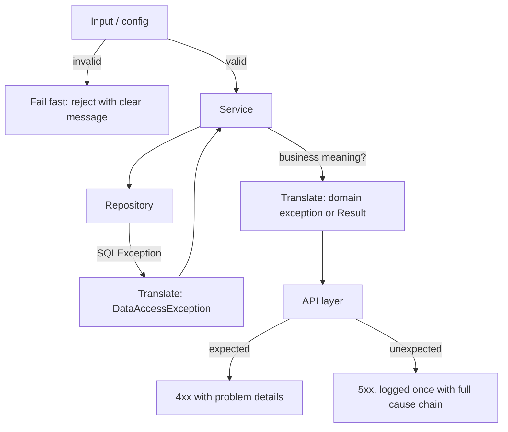
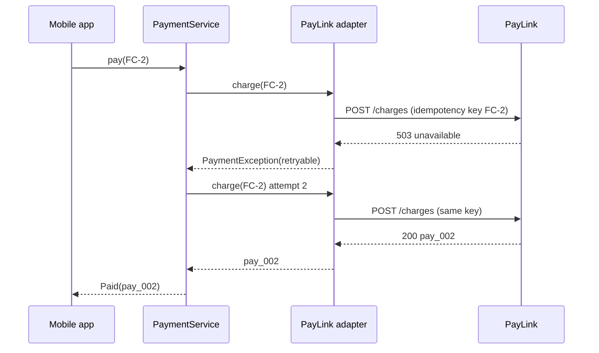

# Error Handling Patterns

<span class="badge-l3">L3 🟡 Professional</span> · <span class="read-time">⏱ 40 min read</span> · Prerequisites: [Functional Patterns](functional-patterns.md), [Patterns in Modern Java](patterns-in-modern-java.md)

!!! abstract "TL;DR"
    Good error handling answers three questions: **who can do something about this failure, what do they need to know, and what state is the system left in?** Use **checked exceptions** (sparingly) for recoverable conditions a caller must handle, **unchecked** ones for bugs and unrecoverable failures. **Translate** exceptions at layer boundaries so each layer speaks its own language, keeping the cause. Use **Result types** when failure is an expected outcome, so the compiler forces handling. **Fail fast** on bad input and configuration, as early and clearly as possible. Use the **Notification pattern** to report every validation problem at once. Never swallow exceptions, and never lose the cause.

## 1. What It Is

**Plain English.** Things go wrong all the time in a grocery app: a customer types "two" for quantity, a card is declined, the database times out, a supplier sends a broken file. Error handling patterns are standard ways to detect those problems, decide who deals with them, and tell the right person (customer, caller, operator) the right thing.

**Definition.**

| Pattern | Use when |
|---------|----------|
| Checked vs unchecked exceptions | Choosing how a Java method signals failure |
| Exception translation | Crossing a layer or library boundary |
| Result types | Failure is a normal, expected outcome |
| Fail fast | Input or configuration is invalid |
| Notification | Validating many fields or rows and reporting all problems |

## 2. Why It Exists

Most production incidents involve error paths: an exception swallowed in a `catch` block, a retry storm on a non-retryable error, a misleading message that sent engineers down the wrong path, a half-applied batch. Error paths are tested less than happy paths, so their design must make the right behaviour the easy one. Java's exception system is powerful but easy to misuse (checked-exception noise, `catch (Exception e) {}`), and modern Java's sealed types and pattern matching add a second tool: errors as values.

## 3. Mental Model / Analogy

**Analogy.** A hospital. A nurse who sees something minor handles it (local recovery). Something serious is escalated to the doctor in medical terms, not "the machine beeped" (translation, keeping the original reading as evidence). Admission forms list every missing field at once (notification). Patients with obviously wrong data are stopped at reception, not discovered in surgery (fail fast). Routine outcomes like "test negative" are results, not emergencies (result types).

**Technical model.** Every failure has an **owner**: the layer that can act on it. Below the owner, failures propagate (often translated); at the owner, they're handled; above it, only an outcome is visible.

## 4. How It Works





## 5. Subtopics

### Checked vs. unchecked exceptions

**Description.** Java has **checked** exceptions (subclasses of `Exception` but not `RuntimeException`), which must be declared or caught, and **unchecked** ones (`RuntimeException`, `Error`), which needn't be. The common guideline (Effective Java, Item 70): checked for **recoverable conditions** the caller can reasonably handle; unchecked for **programming errors** (bad arguments, broken invariants) and failures nobody nearby can fix.

**Advantages / features.** Checked: the compiler reminds callers of real alternatives. Unchecked: no signature noise; work with lambdas and streams.

```java title="CheckedVsUncheckedDemo.java"
--8<-- "examples/l3-professional/error-handling-patterns/CheckedVsUncheckedDemo.java"
```

1. A checked exception for an expected, recoverable situation, carrying data the caller can use.
2. A negative quantity is a caller bug: an unchecked `IllegalArgumentException`.
3. Lambdas can't throw checked exceptions; wrap in an unchecked one and keep the cause.

**Run it:** `java CheckedVsUncheckedDemo.java`

```text
--8<-- "examples/l3-professional/error-handling-patterns/CheckedVsUncheckedDemo.expected.txt"
```

| Kind | Examples | Use for |
|------|----------|---------|
| Checked | `IOException`, `SQLException`, custom `OutOfStockException` | Recoverable, expected conditions |
| Unchecked | `IllegalArgumentException`, `IllegalStateException`, `NullPointerException` | Bugs, violated preconditions |
| Unchecked (framework) | Spring `DataAccessException`, `UncheckedIOException` | Infrastructure failures most callers can't fix |
| `Error` | `OutOfMemoryError`, `StackOverflowError` | Never catch (except at the very top for logging) |

**Use** checked exceptions sparingly, for recoverable conditions in APIs with few callers. **Avoid** checked exceptions in widely used APIs and functional code; Spring, Hibernate and most modern libraries are unchecked.
**Real-world Java:** `java.io` (checked), `java.time` and collections (unchecked), Spring's choice to make everything unchecked.
**Best practice:** for expected business outcomes, a Result type (below) often beats both. **Gotcha:** `NumberFormatException` is an `IllegalArgumentException`; a `catch (IllegalArgumentException e)` also catches parse errors, which may or may not be what you meant.

### Exception translation

**Description.** Each layer catches exceptions from the layer below and rethrows them in its own vocabulary, **with the original as the cause**. The repository turns `SQLException` into data-access exceptions; the service turns a duplicate-key error into `CouponAlreadyRedeemedException`. Callers depend on abstractions, not on JDBC or a vendor SDK.

**Advantages / features.** Layers stay decoupled; error meaning matches the caller's level; full diagnostic chain preserved.

```java title="ExceptionTranslationDemo.java"
--8<-- "examples/l3-professional/error-handling-patterns/ExceptionTranslationDemo.java"
```

1. The repository translates by kind of failure, not one generic wrapper.
2. The service translates only errors that have business meaning; others pass through.
3. The cause chain keeps every level's evidence for debugging.

**Run it:** `java ExceptionTranslationDemo.java`

```text
--8<-- "examples/l3-professional/error-handling-patterns/ExceptionTranslationDemo.expected.txt"
```

| Layer | Catches | Throws |
|-------|---------|--------|
| Repository / adapter | `SQLException`, vendor SDK errors, HTTP status codes | Data-access or gateway exceptions |
| Service | Data-access exceptions with business meaning | Domain exceptions or Results |
| API | Domain exceptions | HTTP responses (RFC 9457 problem details) |

**Use** translation at every boundary to infrastructure or third parties. **Avoid** translating without a cause (`throw new X(e.getMessage())`), or wrapping at every method ("exception tunnelling" five levels deep).
**Real-world Java:** Spring's `PersistenceExceptionTranslationPostProcessor` and `SQLExceptionTranslator`, `@Repository` translation, `UncheckedIOException`.
**Best practice:** log an exception once, at the place it's handled, not at every rethrow. **Gotcha:** translating checked to unchecked hides the failure from the compiler; document it (`@throws`) for callers.

### Result types

**Description.** A Result (or Either) type returns success **or** an error as a value: `Result<Zone>` is `Ok(zone)` or `Err(error)`. With sealed interfaces and pattern matching, the compiler checks that every error case is handled. Results compose with `map`/`flatMap`, so a pipeline stops at the first error without nested `try` blocks.

**Advantages / features.** Errors visible in the signature; exhaustive handling; cheap (no stack trace); works naturally with streams and lambdas.

```java title="ResultTypeDemo.java"
--8<-- "examples/l3-professional/error-handling-patterns/ResultTypeDemo.java"
```

1. A sealed Result with two cases and `map`/`flatMap` to chain steps.
2. Error cases are their own sealed hierarchy, so each can carry precise data.
3. The switch is exhaustive: adding an error type makes this a compile error until it's handled.

**Run it:** `java ResultTypeDemo.java`

```text
--8<-- "examples/l3-professional/error-handling-patterns/ResultTypeDemo.expected.txt"
```

| | Exceptions | Result type | `Optional` |
|-|------------|-------------|------------|
| Failure visible in signature | Only checked | Yes | Yes (absence only) |
| Carries error detail | Yes | Yes | No |
| Compiler forces handling | Checked only | Yes (with sealed + switch) | Partly |
| Cost | Stack trace capture | Allocation only | Allocation only |
| Best for | Unexpected failures | Expected business outcomes | "Not found" |

**Use** Results for validation, parsing and business outcomes (declined, not serviceable). **Avoid** them for truly exceptional failures (database down) and in code bases where the team expects exceptions; mixing styles randomly is worse than either.
**Real-world Java:** Vavr's `Either` and `Try`, `CompletableFuture` (a result with failure), Java 21 sealed types for hand-written results.
**Best practice:** keep error types sealed and specific; convert to exceptions or HTTP responses at the boundary. **Gotcha:** don't silently `.orElse(null)` a Result; you've thrown away the error.

### Fail fast

**Description.** Detect problems as early as possible, as close to the cause as possible, and stop with a precise message. Validate configuration at startup, method arguments at entry (`Objects.requireNonNull`, guard clauses), and invariants in constructors. A system that fails fast is easier to debug and safer than one that carries bad data forward.

**Advantages / features.** Errors appear near their cause; bad deploys fail at startup, not at the first payment; invalid objects can't exist.

**Before (late failure) and after (validated at startup):**

```java title="FailFastDemo.java"
--8<-- "examples/l3-professional/error-handling-patterns/FailFastDemo.java"
```

1. The compact constructor validates every field, with messages naming the config key.
2. A guard clause rejects bad arguments before any work happens.
3. Before: a typo in config ("3s") only surfaces when the first customer pays.

**Run it:** `java FailFastDemo.java`

```text
--8<-- "examples/l3-professional/error-handling-patterns/FailFastDemo.expected.txt"
```

| Where | Tool |
|-------|------|
| Configuration | `@ConfigurationProperties` + `@Validated`, record constructors |
| Method arguments | `Objects.requireNonNull`, `Objects.checkIndex`, guard clauses |
| Object invariants | Constructors, compact record constructors |
| HTTP requests | Bean Validation (`@Valid`, `@NotBlank`) |
| Collections | Immutable copies (`List.copyOf` rejects nulls) |

**Use** fail fast for configuration, preconditions and invariants. **Avoid** failing fast where partial results are acceptable (dashboards, search results) or where you should collect all errors (forms; see Notification).
**Real-world Java:** Spring Boot failing startup on invalid `@ConfigurationProperties`, `List.of` rejecting nulls, fail-fast iterators (`ConcurrentModificationException`).
**Best practice:** messages should say what was expected, what was found, and where (key, field, line). **Gotcha:** `assert` statements are disabled by default in production JVMs; don't use them for validation.

### Notification pattern for validation

**Description.** Instead of throwing on the first problem, validation collects every problem into a **notification** object and returns it. The caller decides what to do: show all field errors on the form, or reject a file row with all its issues. Fowler described it as a replacement for exceptions in validation.

**Advantages / features.** Users fix everything in one round trip; validation logic separated from error presentation; structured errors (field, code, message).

```java title="NotificationPatternDemo.java"
--8<-- "examples/l3-professional/error-handling-patterns/NotificationPatternDemo.java"
```

1. A small collector of field errors.
2. Each rule adds an error and validation continues.
3. The API returns every problem with one 400 response.

**Run it:** `java NotificationPatternDemo.java`

```text
--8<-- "examples/l3-professional/error-handling-patterns/NotificationPatternDemo.expected.txt"
```

| | Throw on first error | Notification |
|-|----------------------|--------------|
| Round trips to fix a form | One per error | One |
| Structured output | Usually a message | List of field errors |
| Control flow | Exceptions | Plain return value |
| Fits | Preconditions, invariants | User input, file rows, imports |

**Use** notifications for user input and batch rows. **Avoid** them for programming errors; those should fail fast.
**Real-world Java:** Bean Validation's `Set<ConstraintViolation>`, Spring's `BindingResult` and `Errors`, RFC 9457 problem details with an `errors` array.
**Best practice:** give each error a stable code (`E_PRICE_FORMAT`) as well as a message; clients and translators depend on codes. **Gotcha:** validating dependent fields (PIN depends on country) needs ordering; skip dependent checks when the field they depend on already failed.

## 6. Examples (exactly 3, progressively harder)

### Example 1: Minimal (L2)

**Scenario:** QuickDrop's quantity box accepts free text. Parse it, enforce 1 to 20, and give a clear message instead of a stack trace.

```java title="ParseQuantityDemo.java"
--8<-- "examples/l3-professional/error-handling-patterns/ParseQuantityDemo.java"
```

1. Range checking fails fast with the expected range and the actual value.
2. The parse error is translated into a user-friendly message, with the original as the cause.

**Run it:** `java ParseQuantityDemo.java`

**Output:**

```text
--8<-- "examples/l3-professional/error-handling-patterns/ParseQuantityDemo.expected.txt"
```

**What to notice:**

- The range `IllegalArgumentException` isn't caught by `catch (NumberFormatException e)`; the two failures stay distinct.

### Example 2: Realistic (in FreshCart grocery delivery)

**Scenario:** FreshCart charges cards through PayLink. Some failures are temporary (503, 429) and worth retrying with the same idempotency key; others (insufficient funds, expired card) must never be retried. The app needs a customer-friendly outcome either way.

```java title="PaymentErrorHandlingDemo.java"
--8<-- "examples/l3-professional/error-handling-patterns/PaymentErrorHandlingDemo.java"
```

1. The adapter translates PayLink's HTTP errors into our `PaymentException`, classifying retryable ones.
2. The service retries at most three times, only for retryable errors, using the order ID as idempotency key.
3. Declines become a customer message; the raw code stays in the log.

**Run it:** `java PaymentErrorHandlingDemo.java`

**Output:**

```text
--8<-- "examples/l3-professional/error-handling-patterns/PaymentErrorHandlingDemo.expected.txt"
```

**What to notice:**

- The insufficient-funds decline was tried once; retrying a decline can trigger bank fraud checks.
- The rate-limited order stopped after three attempts and told the customer they weren't charged.
- In production, add exponential backoff with jitter between attempts (see [Resilience Patterns](../l4-senior/resilience-patterns.md)).

### Example 3: Production-grade

**Scenario:** GreenValley sends a nightly CSV of supplier prices. Bad configuration must stop the job at startup. Each bad row must be reported with every problem and an error code; good rows are applied. If more than 20% of rows are bad (a broken export), nothing is applied. I/O failures are reported in the job's own terms, and the file is always closed.

```java title="SupplierImportDemo.java"
--8<-- "examples/l3-professional/error-handling-patterns/SupplierImportDemo.java"
```

1. Fail fast: impossible configuration is rejected at construction.
2. Each row becomes a `Good` or a `Bad` with all its errors (Result + Notification).
3. try-with-resources closes the reader whatever happens; I/O errors are translated with their cause.
4. An error budget: a mostly broken file means the export is broken, so nothing is applied.
5. Only after the decision are good rows applied, so a run is all-or-budgeted, never half-done by accident.

**Run it:** `java SupplierImportDemo.java`

**Output:**

```text
--8<-- "examples/l3-professional/error-handling-patterns/SupplierImportDemo.expected.txt"
```

**What to notice:**

- Night 1 applied eight prices and reported two bad rows with codes the supplier can act on.
- Night 2's file used semicolons; the budget stopped it, and yesterday's prices stayed.
- Night 3's network error surfaced as `ImportFailedException` with the SFTP cause attached.

## 7. Pros, Cons & Trade-offs

| Pattern | Pros | Cons |
|---------|------|------|
| Checked exceptions | Compiler-enforced handling | Signature noise; awkward with lambdas |
| Unchecked exceptions | Clean signatures | Easy to forget to handle |
| Exception translation | Layer independence; rich causes | Boilerplate; risk of over-wrapping |
| Result types | Exhaustive, explicit, cheap | Verbose without language support; mixed styles |
| Fail fast | Errors near their cause | Less tolerant of partial data |
| Notification | All errors at once | More code than throwing |

## 8. When to Use / When NOT to Use

**Use them when:**

- failures cross layers or third-party boundaries (translation);
- failure is a normal outcome (Result);
- input comes from users, files or configuration (fail fast, notification).

**Don't use them when:**

- the "error" is just absence; `Optional` is enough;
- wrapping adds no information (rethrowing the same meaning one layer up);
- in tight inner loops, don't use exceptions for control flow at all.

## 9. Best Practices

1. **Never swallow exceptions**; at minimum log with the cause, and usually rethrow. *(Consensus.)*
2. **Always keep the cause when wrapping.** *(Consensus.)*
3. **Log once, where handled; include context (IDs), not personal data.** *(Consensus.)*
4. **Classify errors: retryable vs not, client vs server.** *(Consensus.)*
5. **Fail fast on config at startup.** *(Consensus.)*
6. **Return problem details (RFC 9457) from APIs with stable error codes.** *(Consensus.)*
7. **Prefer Results for expected business outcomes in new code.** *(Opinion, increasingly common with Java 21.)*

## 10. Pitfalls & Anti-Patterns

!!! danger "Retrying a non-retryable error (production failure mode)"
    **Symptom:** customers saw five "payment declined" SMSes from their bank, and some cards were blocked for suspected fraud.
    **Root cause:** a generic retry wrapped every payment exception, including hard declines.
    **Fix:** classify errors at the gateway adapter; retry only timeouts, 429 and 5xx, with idempotency keys and backoff.

!!! danger "Swallowed exception"
    **Symptom:** nightly stock sync "succeeded" for a week while stock drifted; no errors in logs.
    **Root cause:** `catch (Exception e) { }` around the sync call, added "temporarily" to stop a crash.
    **Fix:** remove it; handle specific exceptions; alert on failure.

!!! danger "Lost cause"
    **Symptom:** logs show `ServiceException: payment failed` with no clue why.
    **Root cause:** `throw new ServiceException("payment failed")` without passing `e`.
    **Fix:** always pass the cause; a static-analysis rule (Error Prone, Sonar) can enforce it.

!!! danger "Log and rethrow at every layer"
    **Symptom:** one failure produces six identical stack traces; alerts fire six times.
    **Root cause:** each layer logs and rethrows.
    **Fix:** log once, where the exception is finally handled.

## 11. Configuration & Tuning

| Setting | Default | What it does | When to change it | Risk of changing |
|---------|---------|--------------|-------------------|------------------|
| `server.error.include-stacktrace` (Spring Boot) | `never` | Stack traces in error responses | Never in production | Information leak |
| `spring.mvc.problemdetails.enabled` | `false` | RFC 9457 responses | Enable for APIs | Response format change |
| `-XX:-OmitStackTraceInFastThrow` | omit enabled | Keeps stack traces for frequent JVM exceptions | When logs show traceless NPEs | Slight cost |
| Retry max attempts | — | Bounds retries | Per dependency | Retry storms |
| Import error budget | — | Max bad rows before aborting | Per data source | Too low: noisy aborts; too high: bad data |
| Logback `maxDepthPerThrowable` | unlimited | Truncates huge traces | Very deep chains | Losing the root cause |

## 12. Security Considerations

- Never return stack traces, SQL or internal class names to clients; map to generic messages with an error ID you can look up.
- Distinguish user-facing messages from log messages; logs may contain IDs, never passwords, card numbers or OTPs.
- Uniform error messages for authentication ("invalid phone or OTP") avoid revealing which part was wrong.
- Validate on the server even if the client validates; fail fast on malformed input before it reaches parsers (size limits, content types).
- Error budgets and rate limits stop attackers from probing with malformed requests cheaply.

## 13. Performance & Scalability

Creating an exception captures a stack trace, which costs microseconds; throwing thousands per second (exceptions as control flow) shows up in profiles. For high-volume expected failures (validation, parsing), Results or a preallocated exception without a stack trace (`super(msg, null, false, false)`) are cheaper. Retries multiply load; bound them and add jitter. Large notification lists for huge files should be capped ("first 1,000 errors").

## 14. Testing It

Test error paths as carefully as happy paths: each error code, the retry classification, the budget boundary, the cause chain and that resources are closed:

```java title="SupplierImportTest.java"
--8<-- "examples/l3-professional/error-handling-patterns/SupplierImportTest.java"
```

## 15. Observability & Operations

Count errors by type and code (Micrometer counters tagged with `error.code`), not just "500s". Give every unexpected error a correlation ID returned to the client and logged with the full cause chain. Alert on rates, not individual errors. For batch jobs, emit the report (applied, rejected, aborted) as a metric and keep rejected rows for replay. Use structured logging so causes and codes are searchable.

## 16. Version Notes

| Java | Change |
|------|--------|
| 1.0 | Checked and unchecked exceptions |
| 1.4 | Exception chaining (`getCause`), `assert` |
| 7 | try-with-resources, multi-catch, suppressed exceptions |
| 8 | `UncheckedIOException`, `Optional` |
| 14 | Helpful `NullPointerException` messages (on by default from 15) |
| 17 | Sealed classes: exhaustive error hierarchies |
| 21 | Record patterns and pattern matching for `switch`: ergonomic Result types |

Spring Framework 6 added `ProblemDetail` and `ErrorResponse` for RFC 7807 (now RFC 9457).

## 17. Expert Deep Dive

- **Error ownership.** Decide per failure who can act: the user (validation), the caller (business outcome), an operator (infrastructure). That decides type, message and logging level.
- **Exceptions vs Results at scale.** Results make error handling explicit in domain code; exceptions keep infrastructure failures out of every signature. A common split: Results inside the domain, exceptions for infrastructure, translation at the boundary.
- **Suppressed exceptions.** try-with-resources attaches exceptions from `close()` as suppressed rather than hiding the original; read them in logs (`getSuppressed`).
- **Idempotency and retries.** Retrying is safe only for idempotent operations; payment and order APIs need idempotency keys so a retry after a timeout doesn't double-charge.
- **Error budgets beyond SRE.** The import's "abort above 20%" rule is the same idea as an SLO error budget: tolerate some failure, stop when the pattern says something is systemically wrong.

!!! example "War story: the price list that zeroed the store"
    GreenValley's supplier changed their export to use a comma as the decimal separator. FreshCart's import caught `NumberFormatException` per row and defaulted the price to 0 "so the job wouldn't crash". Overnight, 1,400 products were priced at Rs 0; by morning, 300 orders had been placed for free. **Fixes:** the default-to-zero catch was removed; rows became Results with error codes; an error budget aborted the run when more than 20% of rows failed; and a sanity check compared each new price with the old one (reject changes over 50% without review). **Lesson:** a catch block that "keeps the job running" with a made-up value turns a visible failure into silent data corruption.

## 18. Interview Corner

=== "🟢 L1–L2"

    1. **Checked vs unchecked?** Checked must be **declared or caught**; unchecked (`RuntimeException`) needn't be.
    2. **What's try-with-resources?** Automatically **closes resources**, even on exceptions.
    3. **Why not `catch (Exception e) {}`?** It **hides failures**; bugs become silent.
    4. **What's exception chaining?** Wrapping with the **original as cause**.
    5. **What's fail fast?** **Stop early** with a clear error when something is invalid.

=== "🟡 L3"

    1. **When would you use a Result type instead of exceptions?** For **expected business outcomes** that callers must handle.
    2. **What's exception translation?** Rethrowing in the **current layer's vocabulary**, keeping the cause.
    3. **How do you validate a form?** **Notification pattern**: collect all errors, return them together.
    4. **Which errors should be retried?** **Transient** ones (timeouts, 429, 5xx) on **idempotent** operations.
    5. **Where should you log exceptions?** **Once**, where handled.

=== "🔴 L4–L5"

    1. **Design error handling for a payments service.** **Classify retryable, idempotency keys, translate gateway errors, customer vs log messages, metrics by code.**
    2. **Exceptions or Results in a new code base?** **Results in the domain, exceptions for infrastructure**, translate at boundaries; be consistent.
    3. **A batch job sometimes corrupts data on bad input; how do you redesign it?** **Per-row results, error budget, apply after decision, sanity checks, replayable rejects.**
    4. **How do you expose errors in a public API?** **RFC 9457 problem details**, stable codes, correlation IDs, no internals.
    5. **What's the cost of exceptions?** **Stack-trace capture**; avoid for control flow, or disable stack traces for hot expected errors.

=== "💻 Hands-on"

    **Task:** Add a sanity check to `SupplierImportDemo`: reject (code `E_PRICE_JUMP`) any row whose new price differs from the current catalogue price by more than 50%.

    ??? success "Solution"
        ```java
        static RowResult checkJump(RowResult r, int line, Map<String, Long> catalogue) {
            if (!(r instanceof Good g)) return r;
            Long old = catalogue.get(g.price().sku());
            if (old == null) return r;
            long diff = Math.abs(g.price().paise() - old);
            return diff * 2 > old
                    ? new Bad(List.of(new RowError(line, "E_PRICE_JUMP", old + " -> " + g.price().paise())))
                    : r;
        }
        // in runImport: switch (checkJump(parseRow(line, text, cfg), line, catalogue)) { ... }
        ```

## 19. Practice

- [ ] Convert `ResultTypeDemo`'s errors into an RFC 9457 problem-details JSON response.
    ??? tip "Hint"
        Map each error type to a `type` URI, `title`, `status` and `detail`.
- [ ] Add exponential backoff with jitter to `PaymentErrorHandlingDemo`.
    ??? tip "Hint"
        `delay = base * 2^attempt + random(0, base)`, capped.
- [ ] Find a `catch` block in your code base that swallows exceptions and fix it.
    ??? tip "Hint"
        Search for `catch (Exception` and empty blocks.
- [ ] Write a test that the import report lists both errors when a row has a bad SKU and a bad price.
    ??? tip "Hint"
        `parseRow` already collects both.

## 20. Quick Revision Card

!!! tip "Remember in 30 seconds"
    - Who can act on this failure? Handle it there; let it propagate until then.
    - Checked = recoverable, expected; unchecked = bugs, infrastructure.
    - Translate at boundaries; always keep the cause; log once.
    - Results for expected outcomes; sealed + switch makes handling exhaustive.
    - Fail fast on config and preconditions; Notification for user input and rows.
    - Retry only transient errors on idempotent operations.

    ```java
    try {
        return client.charge(orderId, paise);
    } catch (PayLinkHttpException e) {
        throw new PaymentException(e.code, e.status == 429 || e.status >= 500, e);   // translate, classify, keep cause
    }
    ```

## 21. Further Reading

- Joshua Bloch, *Effective Java* (3rd ed.), Chapter 10, "Exceptions".
- Martin Fowler, ["Replacing Throwing Exceptions with Notification in Validations"](https://martinfowler.com/articles/replaceThrowWithNotification.html).
- [RFC 9457: Problem Details for HTTP APIs](https://www.rfc-editor.org/rfc/rfc9457).
- Michael Nygard, *Release It!* (2nd ed., 2018), on stability patterns and failure handling.
- [Spring Framework: Error Responses](https://docs.spring.io/spring-framework/reference/web/webmvc/mvc-ann-rest-exceptions.html).

---

[← Previous: UI and Mobile Patterns](ui-and-mobile-patterns.md) · [Next: Anti-Patterns and Code Smells →](anti-patterns-and-code-smells.md)
