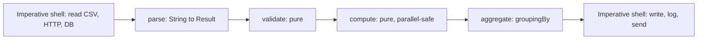
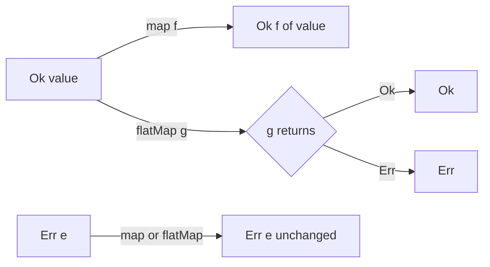

# Functional Patterns in Java

<span class="badge-l3">L3 🟡 Professional</span> · <span class="read-time">⏱ 40 min read</span> · Prerequisites: [Patterns in Modern Java](patterns-in-modern-java.md), [Strategy](../l1-foundations/strategy.md)

!!! abstract "TL;DR"
    Functional programming has its own pattern catalogue, and Java 8–21 supports most of it. **Higher-order functions** wrap behaviour (retry, caching, logging) once. **Composition** builds pipelines from small functions. **Optional** and **Result/Either** make absence and failure into values you can chain. **Currying and partial application** fix arguments early. **Streams** express data pipelines declaratively. **Immutability** makes all of it safe to share and parallelise. The practical architecture is "functional core, imperative shell": pure functions inside, I/O at the edges.

## 1. What It Is

**Plain English.** Instead of objects that change over time and call each other, you write small functions that take values and return new values. You then build bigger behaviour by passing functions around and joining them together. FreshCart's pricing becomes "subtotal → member discount → coupon → delivery → tax", each step a function you can test alone and reorder.

**Definition.** Functional patterns treat **functions as values** and **data as immutable**:

- **Pure function:** output depends only on input; no side effects.
- **Higher-order function:** takes or returns a function.
- **Composition:** `f.andThen(g)` builds `x -> g(f(x))`.
- **Functor / monad (informally):** containers such as `Optional`, `Stream`, `CompletableFuture` and `Result` with `map` and `flatMap`.
- **Currying / partial application:** turning multi-argument functions into chains of one-argument functions, or fixing some arguments.
- **Persistent data structure:** an immutable collection where "updates" return new versions sharing structure with the old.

## 2. Why It Exists

Mutable shared state is the main source of bugs in concurrent and large codebases: you can't reason about a method without knowing who else changes the same objects. Exceptions and `null` hide failure paths from the type system. Functional patterns address both: pure functions are trivially testable and thread-safe, and container types (`Optional`, `Result`) make "might be missing" and "might fail" visible and composable.

## 3. Mental Model / Analogy

**Analogy.** An assembly line. Each station (function) takes a part, does one thing, and passes a new part on; no station reaches back to modify earlier parts. You can test each station alone, add or remove stations, and run several lines in parallel without them interfering.

**Technical model.** Data flows through a chain of transformations. Containers carry context along the chain: `Optional` carries "maybe absent", `Result` carries "maybe failed", `Stream` carries "many values, lazily", `CompletableFuture` carries "later". `map` transforms the value inside; `flatMap` chains a step that itself returns a container.

## 4. How It Works





## 5. Subtopics

### Higher-order functions

**Description.** A higher-order function takes a function, returns a function, or both. It lets you write cross-cutting behaviour once and wrap any function with it: retry, timing, logging, memoisation, authorisation checks. It is the functional form of [Decorator](../l1-foundations/decorator.md).

**Advantages / features.** Reusable wrappers without class hierarchies; behaviour is parameterised; wrappers stack in any order.

```java title="HigherOrderFunctionsDemo.java"
--8<-- "examples/l3-professional/functional-patterns/HigherOrderFunctionsDemo.java"
```

1. Takes a call and returns a new call that retries it: a decorator as a function.
2. Returns a caching version of any function.
3. Wrappers stack: here memoisation wraps logging, so only real lookups are logged.

**Run it:** `java HigherOrderFunctionsDemo.java`

```text
--8<-- "examples/l3-professional/functional-patterns/HigherOrderFunctionsDemo.expected.txt"
```

| Wrapper | Signature shape | OO equivalent |
|---------|-----------------|---------------|
| Retry | `Supplier<T> -> Supplier<T>` | Retry decorator / proxy |
| Memoise | `Function<A,B> -> Function<A,B>` | Caching proxy |
| Log / time | `Function<A,B> -> Function<A,B>` | Logging decorator, AOP advice |
| Guard | `Function<A,B> -> Function<A,B>` | Protection proxy |

**Use** higher-order wrappers for small, local cross-cutting concerns. **Avoid** them for concerns that need configuration and lifecycle (circuit breakers, metrics); use a library (Resilience4j) built on the same idea.
**Real-world Java:** `Comparator.comparing(keyExtractor)`, `CompletableFuture.thenApply`, Resilience4j `Retry.decorateSupplier`, Spring's `TransactionTemplate.execute(callback)`.
**Best practice:** keep wrapper signatures generic (`<A, B>`) so they apply anywhere. **Gotcha:** the `HashMap` memoiser above isn't thread-safe and fails with `ConcurrentModificationException` for recursive functions; use `ConcurrentHashMap` (non-recursive) or Caffeine.

### Function composition

**Description.** `Function.andThen(g)` and `compose(g)` join functions into pipelines; `Predicate.and/or` and `Comparator.thenComparing` do the same for their types. Each business rule becomes a small function, and the overall behaviour is their composition.

**Advantages / features.** Rules are testable alone; pipelines can be built from configuration; order is explicit.

**Before (one method doing everything) and after (composition):**

```java title="FunctionCompositionDemo.java"
--8<-- "examples/l3-professional/functional-patterns/FunctionCompositionDemo.java"
```

1. Before: four rules interleaved in one method. Changing order or switching one off means editing it.
2. After: a pipeline of named steps; the order reads top to bottom.
3. Pipelines built from a list, so configuration can choose the steps.

**Run it:** `java FunctionCompositionDemo.java`

```text
--8<-- "examples/l3-professional/functional-patterns/FunctionCompositionDemo.expected.txt"
```

| Method | Result | Order |
|--------|--------|-------|
| `f.andThen(g)` | `x -> g(f(x))` | f first |
| `f.compose(g)` | `x -> f(g(x))` | g first |
| `Function.identity()` | `x -> x` | Neutral element for `reduce` |
| `p.and(q)` / `p.or(q)` / `p.negate()` | Combined predicates | Short-circuit |

**Use** composition for pipelines of independent rules. **Avoid** it when steps need to share lots of intermediate state; a small record carried through the pipeline (like `Priced`) solves that up to a point.
**Real-world Java:** `Comparator.comparing(...).thenComparing(...)`, Spring WebFlux `RouterFunction.and`, Reactor operator chains.
**Best practice:** test that the composed version matches the old imperative version over many inputs before switching (the page's test does this). **Gotcha:** `andThen` and `compose` read in opposite directions; pick one and use it consistently.

### Optional as a container

**Description.** `Optional<T>` holds zero or one value. `map` transforms the value if present, `flatMap` chains a step that returns `Optional`, `filter` keeps it only if it matches, `or` supplies another `Optional`, and `orElse` / `orElseGet` / `orElseThrow` end the chain.

**Advantages / features.** Nested null checks become a linear chain; absence is visible in the return type.

**Before (nested null checks) and after:**

```java title="OptionalContainerDemo.java"
--8<-- "examples/l3-professional/functional-patterns/OptionalContainerDemo.java"
```

1. Each step runs only if the previous produced a value; `map` turns a `null` result into empty.
2. `or` (Java 9) tries a second source lazily.
3. `orElse` always evaluates its argument, even when the value is present; `orElseGet` doesn't.

**Run it:** `java OptionalContainerDemo.java`

```text
--8<-- "examples/l3-professional/functional-patterns/OptionalContainerDemo.expected.txt"
```

| Method | Use when |
|--------|----------|
| `map(f)` | Transform the value; a `null` result becomes empty |
| `flatMap(f)` | `f` itself returns `Optional` |
| `filter(p)` | Keep only matching values |
| `or(() -> other)` | Fall back to another optional source |
| `orElseGet(supplier)` | Default that's expensive to compute |
| `orElseThrow(...)` | Absence is an error here |
| `ifPresentOrElse(a, b)` | Side effects for both cases |

**Use** `Optional` as a **return type** for lookups. **Avoid** it for fields, parameters and collections (return an empty collection instead).
**Real-world Java:** `Stream.findFirst`, `Map`-backed repositories, Spring Data `findById`.
**Best practice:** never call `get()` without a check; prefer `orElseThrow()` which states intent. **Gotcha:** `Optional.of(null)` throws; use `ofNullable` at boundaries with nullable APIs.

### Result/Either types

**Description.** A `Result<T>` (also called `Either<E, T>` or `Try<T>`) is a value that is **either** a success with a `T` **or** a failure with an error. With `map` and `flatMap`, a chain of steps runs until the first failure, which then flows through unchanged: "railway-oriented programming". Java has no built-in type; a sealed interface with two records is enough, or use Vavr's `Either` / `Try`.

**Advantages / features.** Expected failures are in the type and can't be ignored; no exceptions for control flow; errors are data you can collect, log and return.

```java title="ResultEitherDemo.java"
--8<-- "examples/l3-professional/functional-patterns/ResultEitherDemo.java"
```

1. A sealed `Result` with `map`, `flatMap` and `orElse` as default methods.
2. `flatMap` chains a step that can itself fail; an `Err` skips all later steps.
3. Parse SKU, then quantity, then build the line: the first error wins.

**Run it:** `java ResultEitherDemo.java`

```text
--8<-- "examples/l3-professional/functional-patterns/ResultEitherDemo.expected.txt"
```

| Approach | Failure visible in type | Composable | Collects all errors | Cost |
|----------|------------------------|------------|---------------------|------|
| Exceptions | Checked only | Poorly (try/catch) | No | Stack traces are expensive |
| `null` / `Optional` | Absence only, no reason | `Optional` yes | No | Loses the error |
| `Result` / `Either` | ✅ with reason | ✅ `map`/`flatMap` | No (first error) | Small |
| `Validation` (applicative) | ✅ | ✅ | ✅ | Small |

**Use** `Result` for expected, recoverable failures in pure code (parsing, validation, business rules). **Avoid** it for programming errors and infrastructure failures, where exceptions are clearer. See [Error Handling Patterns](error-handling-patterns.md).
**Real-world Java:** Vavr `Either` and `Try`; Kotlin's `Result`; Rust's `Result` inspired many Java versions.
**Best practice:** errors should be typed (a sealed error hierarchy) in real code, not strings. **Gotcha:** wrapping everything in `Result` across a codebase that also throws exceptions gives you both problems; agree where each is used.

### Currying and partial application

**Description.** **Currying** turns `f(a, b, c)` into `a -> b -> c -> result`. **Partial application** fixes some arguments of a function and returns a function of the rest. Both let you configure a function early (tax rate, city fee table) and use it later where only the remaining argument is known.

**Advantages / features.** Configured functions fit into `map` and other one-argument APIs; configuration and use are separated.

```java title="CurryingDemo.java"
--8<-- "examples/l3-professional/functional-patterns/CurryingDemo.java"
```

1. A curried function: give it the rate, get back a function of the amount.
2. Partial application of an existing `BiFunction`.
3. Three levels of configuration; Java's types get long, which is the main practical limit.

**Run it:** `java CurryingDemo.java`

```text
--8<-- "examples/l3-professional/functional-patterns/CurryingDemo.expected.txt"
```

| | Currying | Partial application | Factory method returning a lambda |
|-|----------|---------------------|-----------------------------------|
| Shape | `A -> B -> R` | `(A, B) -> R` plus `a` gives `B -> R` | `rate -> (paise -> ...)` |
| Java readability | Poor beyond two levels | Good | Best |
| Typical use | Functional libraries | Adapting to `map` | Most Java code |

**Use** partial application (often as a simple factory method like `percentOff(10)`) to adapt functions to one-argument APIs. **Avoid** deep currying in Java; named factory methods read better.
**Real-world Java:** `Comparator.comparing(keyExtractor)` returns a configured comparator; Spring's `RouterFunctions.route(predicate, handler)`.
**Best practice:** prefer `static Function<Long, Long> percentOff(int pct)` over `Function<Integer, Function<Long, Long>>`. **Gotcha:** boxing: `Function<Long, Long>` boxes every value; use `LongUnaryOperator` in hot paths.

### Streams as pipelines

**Description.** `Stream` expresses "filter, transform, group, reduce" as a pipeline of operations. Intermediate operations are lazy; a terminal operation (`collect`, `toList`, `reduce`) runs the pipeline. Collectors (`groupingBy`, `summingLong`, `teeing`) build results without mutable accumulators.

**Advantages / features.** Code reads as the requirement; no mutable loop state; parallelism is one call away when functions are pure.

**Before (loop) and after (pipeline):**

```java title="StreamsPipelineDemo.java"
--8<-- "examples/l3-professional/functional-patterns/StreamsPipelineDemo.java"
```

1. Before: correct, but the intent (revenue per city of delivered orders) is spread over several lines of mutation.
2. After: filter, group, sum, into a sorted map, in one expression.
3. In parallel streams, collect results; never `forEach` into a shared `ArrayList`, which is not thread-safe.

**Run it:** `java StreamsPipelineDemo.java`

```text
--8<-- "examples/l3-professional/functional-patterns/StreamsPipelineDemo.expected.txt"
```

| Collector | Produces |
|-----------|----------|
| `toList()` (Java 16, on Stream) | Unmodifiable list |
| `groupingBy(key, mapFactory, downstream)` | Map of groups, with a chosen map type |
| `partitioningBy(pred)` | `Map<Boolean, List<T>>` |
| `summingLong`, `averagingLong`, `counting` | Aggregates |
| `teeing(c1, c2, merger)` (Java 12) | Two aggregates in one pass |
| `toMap(k, v, merge, mapFactory)` | Map with explicit duplicate handling |

**Use** streams for transformations and aggregations of collections. **Avoid** them for logic with complex early exits, checked exceptions or index arithmetic; a loop is clearer.
**Real-world Java:** `Files.lines`, `BufferedReader.lines`, JDBC result streaming in Spring (`queryForStream`), `Map.entrySet().stream()`.
**Best practice:** use `Collectors.toMap` with a merge function, or it throws on duplicate keys. **Gotcha:** `parallelStream()` uses the shared common ForkJoinPool; blocking I/O inside it starves the whole JVM's parallel work.

### Immutability and persistent collections

**Description.** Immutable objects never change after construction. Java gives you records, `List.of`, `List.copyOf` and `Collections.unmodifiableList`. The last is only a **view**: the underlying list can still change. **Persistent** collections (Vavr, PCollections, Clojure's) go further: "adding" returns a new version that shares most of its structure with the old one, so both versions stay valid and cheap.

**Advantages / features.** Safe sharing between threads and caches; no defensive copies; time travel (keep old versions for undo and auditing).

```java title="PersistentCollectionsDemo.java"
--8<-- "examples/l3-professional/functional-patterns/PersistentCollectionsDemo.java"
```

1. A minimal persistent list: a sealed interface with `Cons` (head and tail) and `Nil`.
2. An unmodifiable view still reflects changes to its source; `List.copyOf` takes a real snapshot.
3. Prepending creates one new node and reuses the old list as the tail.

**Run it:** `java PersistentCollectionsDemo.java`

```text
--8<-- "examples/l3-professional/functional-patterns/PersistentCollectionsDemo.expected.txt"
```

| Option | Can change? | Cost of "update" | Notes |
|--------|------------|------------------|-------|
| `ArrayList` | Yes | O(1) amortised | Not safe to share |
| `Collections.unmodifiableList(x)` | Through `x` | n/a | View, not snapshot |
| `List.of` / `List.copyOf` | No | Full copy, O(n) | No nulls allowed |
| Persistent (Vavr `List`, `Vector`) | No | O(1) to O(log n), shared | Extra dependency |

**Use** `List.copyOf` and records by default; persistent collections when you keep many versions or update large immutable structures often. **Avoid** copying large lists on every small change in hot paths.
**Real-world Java:** `List.of`, `Map.of`, `Set.copyOf`; Vavr, PCollections, Guava `ImmutableList`; `String` itself is immutable.
**Best practice:** expose immutable types from APIs and accept any `Collection` as input. **Gotcha:** `List.of(...).contains(null)` throws `NullPointerException`.

## 6. Examples (exactly 3, progressively harder)

### Example 1: Minimal (L2)

**Scenario:** QuickDrop runs several discounts at once. Marketing switches them on and off; the checkout just applies "all active discounts".

```java title="DiscountPipelineDemo.java"
--8<-- "examples/l3-professional/functional-patterns/DiscountPipelineDemo.java"
```

1. Each discount is a function built by a small factory (partial application).
2. `reduce` with the identity folds the list into one function.

**Run it:** `java DiscountPipelineDemo.java`

**Output:**

```text
--8<-- "examples/l3-professional/functional-patterns/DiscountPipelineDemo.expected.txt"
```

**What to notice:**

- An empty list of discounts still works: the identity function returns the price unchanged.
- `flatOff` never goes below zero.

### Example 2: Realistic (in FreshCart grocery delivery)

**Scenario:** the checkout form has phone, pincode, slot and tip. Customers hate fixing one error only to be told about the next, so the form must report every problem at once, without exceptions.

```java title="OrderFormValidationDemo.java"
--8<-- "examples/l3-professional/functional-patterns/OrderFormValidationDemo.java"
```

1. A `Validation` type: like `Result`, but designed to accumulate errors.
2. Independent checks, each producing a value or an error.
3. All errors are combined; only if there are none is a `ValidOrder` built.

**Run it:** `java OrderFormValidationDemo.java`

**Output:**

```text
--8<-- "examples/l3-professional/functional-patterns/OrderFormValidationDemo.expected.txt"
```

**What to notice:**

- The second form got all four problems in one response.
- `ValidOrder` can only be created through validation, so the rest of checkout never sees bad input.

### Example 3: Production-grade

**Scenario:** ParcelGo pays riders nightly from a CSV of the day's deliveries. Requirements: one corrupt line must not stop the run, and every bad line must be reported; money must be exact; per-zone rates come from a slow lookup; the computation must be parallel for large days and give identical results on re-runs (finance re-runs it for audits).

```java title="RiderSettlementDemo.java"
--8<-- "examples/l3-professional/functional-patterns/RiderSettlementDemo.java"
```

1. Parsing returns a value for every line, good or bad, so errors are collected instead of thrown.
2. A thread-safe memoised lookup: two zones, two real lookups, however many deliveries.
3. A pure earning function with `BigDecimal` and explicit rounding.
4. The pure core: grouped and summed in parallel into a sorted map.
5. Running twice and comparing is the cheapest determinism check; the test goes further and shuffles input.

**Run it:** `java RiderSettlementDemo.java`

**Output:**

```text
--8<-- "examples/l3-professional/functional-patterns/RiderSettlementDemo.expected.txt"
```

**What to notice:**

- Three bad lines were reported with reasons; the other five were paid.
- R2's late delivery got 10% less: (30 + 8 × 7.5) × 0.9 = 81.00.
- Output is sorted by rider (TreeMap), so reports diff cleanly between runs.

## 7. Pros, Cons & Trade-offs

| Aspect | Pros | Cons |
|--------|------|------|
| Testability | Pure functions need no mocks | Effects still need testing at the shell |
| Concurrency | Immutable data is thread-safe | Copying can cost memory and GC |
| Readability | Pipelines read like requirements | Long chains and nested generics get dense |
| Error handling | Failures visible in types | Java lacks built-in Result; libraries differ |
| Debugging | Fewer state bugs | Stack traces through lambdas are noisier |
| Performance | Easy parallelism | Boxing, allocation and stream overhead in hot loops |

## 8. When to Use / When NOT to Use

**Use them when:**

- transforming and aggregating data (reports, settlements, pricing);
- business rules are independent steps that can be composed;
- failures are expected and should be reported, not thrown;
- data is shared across threads.

**Don't use them when:**

- the code is mostly I/O orchestration with little logic (plain imperative code is clearer);
- a tight numeric loop must avoid allocation and boxing;
- the team can't read the style yet: introduce it gradually.

## 9. Best Practices

1. **Functional core, imperative shell:** pure logic inside, I/O at the edges. *(Consensus.)*
2. **Name functions** (constants or methods) rather than writing long inline lambdas. *(Consensus.)*
3. **`Optional` for return values only.** *(Consensus.)*
4. **Collect, don't mutate,** in streams, especially parallel ones. *(Consensus.)*
5. **Use primitive specialisations** (`LongStream`, `LongUnaryOperator`) in hot paths. *(Consensus.)*
6. **Pick one error style per layer:** `Result`/`Validation` in the domain, exceptions for infrastructure. *(Opinion, widely shared.)*
7. **`BigDecimal` with explicit rounding for money.** *(Consensus.)*

## 10. Pitfalls & Anti-Patterns

!!! danger "Side effects in a parallel stream (production failure mode)"
    **Symptom:** the nightly settlement occasionally paid some riders twice and others not at all, and once crashed with `ArrayIndexOutOfBoundsException`.
    **Root cause:** a `parallelStream().forEach(list::add)` appended to a shared `ArrayList`, and a shared `HashMap` accumulated totals.
    **Fix:** pure functions plus `collect` (`groupingBy`, `toMap`); add a test that shuffled input gives identical output.

!!! danger "Blocking I/O in parallel streams"
    **Symptom:** unrelated parts of the app slowed down whenever a report ran.
    **Root cause:** a parallel stream called an HTTP service per element, blocking common ForkJoinPool threads used across the JVM.
    **Fix:** use an executor (or virtual threads) for I/O, and keep parallel streams for CPU-bound work.

!!! danger "`orElse` with an expensive or side-effecting default"
    **Symptom:** every lookup created a new "guest" customer row in the database.
    **Root cause:** `find(id).orElse(createGuest())` always calls `createGuest()`.
    **Fix:** `orElseGet(this::createGuest)`.

!!! danger "Lambda soup"
    **Symptom:** a 40-line chained expression nobody could debug.
    **Root cause:** every step was an inline lambda with nested streams.
    **Fix:** extract named functions and intermediate variables; functional doesn't mean one expression.

## 11. Configuration & Tuning

| Setting | Default | What it does | When to change it | Risk of changing |
|---------|---------|--------------|-------------------|------------------|
| `java.util.concurrent.ForkJoinPool.common.parallelism` | CPU cores − 1 | Threads for parallel streams | Containers with CPU limits | Too high oversubscribes CPUs |
| Custom `ForkJoinPool` for a parallel stream | n/a | Isolates heavy jobs | Big batch jobs in a server | Relies on implementation detail |
| Memoisation cache size / expiry | Unbounded (hand-written) | Bounds memory | Many distinct keys | Unbounded growth |
| `-XX:+UseStringDeduplication` / G1 settings | Off | Reduces memory from many immutable strings | Heavy immutable data | Small CPU cost |

## 12. Security Considerations

- Immutable value objects can't be modified after validation (time-of-check/time-of-use bugs disappear).
- `Validation`/`Result` errors returned to users must not include internal details (stack traces, SQL).
- Memoisation caches keyed by user input can grow without bound; cap them to avoid memory exhaustion.
- Pure functions are easy to fuzz and property-test, which helps find parsing bugs in untrusted input.

## 13. Performance & Scalability

Lambdas that capture nothing are allocated once; capturing ones may allocate per use, often removed by escape analysis. Streams add some overhead per element compared with loops, which matters only in tight loops; primitive streams avoid boxing. Parallel streams help for CPU-bound work over large inputs (roughly 10,000+ elements of non-trivial work) and hurt for small or I/O-bound work. Immutable data increases allocation but makes caching and parallelism lock-free. Measure with JMH; see [Performance Cost of Patterns](performance-of-patterns.md).

## 14. Testing It

Pure functions make tests short: exact earnings, parsing as values, order independence with shuffled input, error accumulation, and the composed pricing checked against the old imperative version:

```java title="RiderSettlementTest.java"
--8<-- "examples/l3-professional/functional-patterns/RiderSettlementTest.java"
```

Property-based testing (jqwik) is a natural next step: "for any list of deliveries, the total equals the sum of individual earnings".

## 15. Observability & Operations

In the imperative shell, log counts of good and bad inputs, and the first few bad lines with reasons. Keep pure functions free of logging; return information (errors, statistics) as values and log it at the edge. For parallel streams, record the pool size and job duration; for memoisation, export hit rates.

## 16. Version Notes

| Java | Change relevant to functional patterns |
|------|----------------------------------------|
| 8 | Lambdas, `java.util.function`, `Optional`, `Stream`, `CompletableFuture` |
| 9 | `Optional.or/ifPresentOrElse/stream`, `Stream.takeWhile/dropWhile/iterate`, `List.of` |
| 10 | `List.copyOf`, `Collectors.toUnmodifiableList`, `Optional.orElseThrow()` |
| 11 | `Predicate.not` |
| 12 | `Collectors.teeing` |
| 16 | `Stream.toList()`, `Stream.mapMulti`, records |
| 21 | Sequenced collections; pattern matching for sealed Result types |
| 22–24 | Stream gatherers (`Stream.gather`, final in 24) for custom intermediate operations |

## 17. Expert Deep Dive

- **Functor and monad laws, informally.** `map(identity)` must change nothing; `map(f).map(g)` equals `map(f.andThen(g))`; `flatMap` must be associative. `Optional` mostly follows them, except that `map` turns `null` results into empty, which breaks the laws in edge cases.
- **Applicative validation.** `Validation` combines independent checks and accumulates errors, which a monad (`Result.flatMap`) can't, because each step depends on the previous success.
- **Effects at the edges.** The "functional core, imperative shell" architecture (Gary Bernhardt) keeps I/O in a thin layer; the core becomes deterministic and fast to test, and the shell is tested with a few integration tests.
- **Persistent data structures.** Hash array mapped tries (Clojure, Vavr `HashMap`) give O(log₃₂ n) updates with structural sharing; they are why immutable maps can be practical at scale.
- **Gatherers.** Java 24's `Stream.gather` allows custom stateful intermediate operations (windowing, deduplication) without leaving the stream.

!!! example "War story: the settlement that changed on re-run"
    ParcelGo's finance team re-ran a month of rider settlements for an audit and got different totals from the originals for 37 riders. The settlement code used `parallelStream()` with a shared `HashMap<String, Double>` for totals and `double` arithmetic. Lost updates under contention dropped some deliveries, and floating-point sums varied with the order of addition. **Fixes:** totals became a pure `groupingBy` collection; money moved to `BigDecimal` with `HALF_EVEN` rounding at the delivery level; output became a sorted map; and a test shuffles 500 deliveries five times and expects identical results. Re-runs have matched to the paisa since. **Lesson:** determinism is a feature of pure functions and exact arithmetic, and it's cheap to test.

## 18. Interview Corner

=== "🟢 L1–L2"

    1. **What is a pure function?** Same input gives **same output**, **no side effects**.
    2. **What is a higher-order function?** One that **takes or returns a function**.
    3. **`map` vs `flatMap` on Optional?** `flatMap` is for a function that **already returns Optional**.
    4. **`orElse` vs `orElseGet`?** `orElse` **always evaluates** its argument; `orElseGet` is **lazy**.
    5. **What does `andThen` do?** Runs one function **then another** on its result.

=== "🟡 L3"

    1. **Why are immutable objects thread-safe?** **Nothing changes** after construction, so no races.
    2. **What's a Result/Either type for?** **Expected failures as values**, chained with `flatMap`.
    3. **When are parallel streams a bad idea?** **Small inputs, blocking I/O, shared mutable state**, or order-dependent side effects.
    4. **`unmodifiableList` vs `List.copyOf`?** **View** vs **snapshot**.
    5. **What's partial application?** **Fixing some arguments** to get a function of the rest.

=== "🔴 L4–L5"

    1. **Explain functional core, imperative shell.** **Pure logic inside, I/O at the edges**; core unit-tested, shell integration-tested.
    2. **Result vs Validation?** **First error (monadic)** vs **all errors (applicative)**.
    3. **How do persistent collections stay efficient?** **Structural sharing** (tries, cons lists).
    4. **How would you make a batch job deterministic?** **Pure functions, exact arithmetic, sorted output, shuffled-input tests.**
    5. **Where would you not use functional style in Java?** **Hot numeric loops, heavy I/O orchestration**, or where it hurts readability.

=== "💻 Hands-on"

    **Task:** Add a "peak hour bonus" (Rs 10 for deliveries marked `peak`) to `RiderSettlementDemo` without breaking determinism.

    ??? success "Solution"
        ```java
        record Delivery(String riderId, String zone, double km, boolean late, boolean peak) { }

        // parse: accept a 5th field "peak" / "off_peak"
        static BigDecimal earning(Delivery d) {
            Rate r = rate(d.zone());
            BigDecimal gross = r.base().add(r.perKm().multiply(BigDecimal.valueOf(d.km())));
            BigDecimal adjusted = d.late() ? gross.multiply(new BigDecimal("0.90")) : gross;
            BigDecimal bonus = d.peak() ? BigDecimal.TEN : BigDecimal.ZERO;
            return adjusted.add(bonus).setScale(2, RoundingMode.HALF_EVEN);
        }
        // the shuffled-input test keeps passing because earning() is still pure
        ```

## 19. Practice

- [ ] Write `timed(String name, Function<A,B> f)` that prints how long each call took, and stack it with `memoize`.
    ??? tip "Hint"
        `System.nanoTime()` before and after `f.apply(a)`.
- [ ] Replace `Result<T>` in `ResultEitherDemo` with Vavr's `Either<String, T>` and compare the code.
    ??? tip "Hint"
        `Either.right(value)`, `Either.left(error)`, `flatMap` works the same way.
- [ ] Rewrite a loop in your codebase that builds a `Map` into a `groupingBy` collector.
    ??? tip "Hint"
        Look for `map.put(k, map.getOrDefault(k, 0) + ...)`.
- [ ] Add `append` to the persistent list and explain why it's O(n) while `prepend` is O(1).
    ??? tip "Hint"
        Appending must copy every node to change the last tail.

## 20. Quick Revision Card

!!! tip "Remember in 30 seconds"
    - Pure functions + immutable data = easy tests and safe parallelism.
    - Higher-order functions wrap behaviour (retry, cache, log); composition builds pipelines.
    - `Optional`: return types only; `map`/`flatMap`/`orElseGet`.
    - `Result`: first error; `Validation`: all errors.
    - Streams: collect, don't mutate; parallel only for CPU-bound, large, pure work.
    - Functional core, imperative shell.

    ```java
    Map<String, Long> revenue = orders.stream()
        .filter(o -> o.status().equals("DELIVERED"))
        .collect(groupingBy(Order::city, TreeMap::new, summingLong(Order::totalPaise)));
    ```

## 21. Further Reading

- Venkat Subramaniam, *Functional Programming in Java* (2nd ed., 2023).
- Raoul-Gabriel Urma, Mario Fusco, Alan Mycroft, *Modern Java in Action* (2nd ed., 2018).
- Scott Wlaschin, ["Railway Oriented Programming"](https://fsharpforfunandprofit.com/rop/).
- Gary Bernhardt, "Boundaries" (talk, 2012): functional core, imperative shell.
- [Vavr user guide](https://docs.vavr.io/) and [JEP 485: Stream Gatherers](https://openjdk.org/jeps/485).

---

[← Previous: Patterns in Modern Java (17–21)](patterns-in-modern-java.md) · [Next: Patterns in the JDK →](patterns-in-the-jdk.md)
