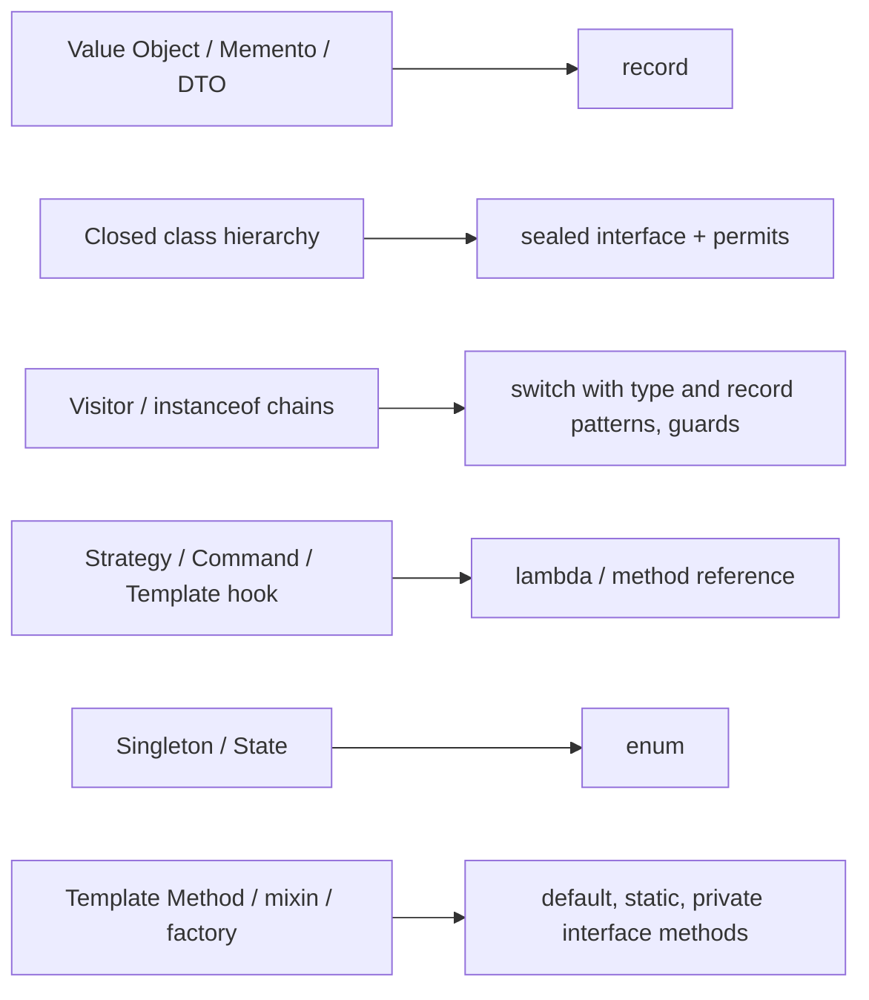
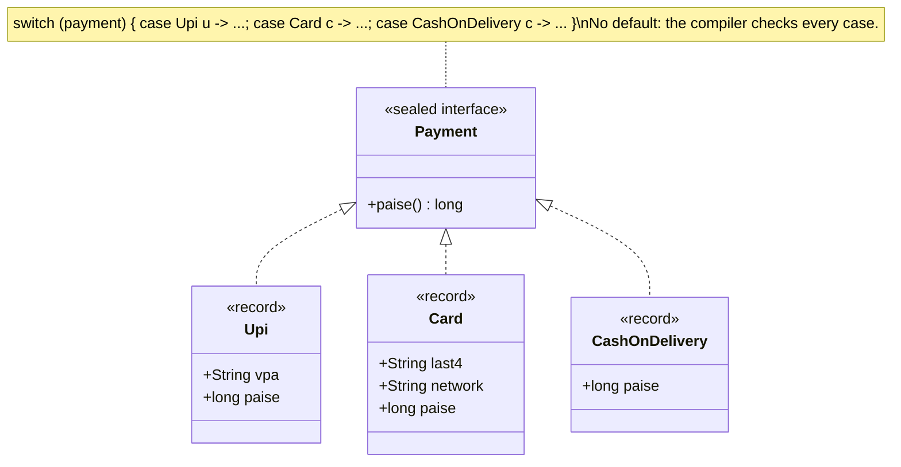

# Patterns in Modern Java (17–21)

<span class="badge-l3">L3 🟡 Professional</span> · <span class="read-time">⏱ 40 min read</span> · Prerequisites: [Visitor](../l2-practitioner/visitor.md), [Strategy](../l1-foundations/strategy.md), [Singleton](../l1-foundations/singleton.md)

!!! abstract "TL;DR"
    Java 16–21 added records, sealed types, pattern matching for `switch` and record patterns, on top of lambdas (8) and richer interfaces (8–9). Together they change how many GoF patterns look. Value Objects and Mementos become records. Closed hierarchies become sealed interfaces. Visitor becomes a `switch`. Strategy, Command and Template Method become lambdas. Singleton and State become enums. The intent of each pattern stays the same; the boilerplate goes, and the compiler checks more of it for you.

## 1. What It Is

**Plain English.** Many classic patterns were workarounds for what older Java couldn't say directly: "this class is just data", "these are the only kinds of payment", "do something different for each kind", "pass behaviour as a value". Modern Java can say all of these in a line or two, so the patterns shrink into language features.

**Definition.** This page maps language features to the patterns they replace or simplify:

- **Records (Java 16):** immutable data carriers with value-based `equals`, `hashCode` and `toString` → Value Object, Memento, DTO, event.
- **Sealed classes and interfaces (Java 17):** a fixed list of subtypes → closed hierarchies, algebraic data types.
- **Pattern matching for `switch` and record patterns (Java 21):** type tests, deconstruction and guards in one expression → Visitor, `instanceof` chains.
- **Lambdas and method references (Java 8):** behaviour as values → Strategy, Command, Template Method hooks, Observer callbacks.
- **Enums (Java 5):** fixed instances with behaviour → Singleton, State, Strategy registries.
- **Default, static and private interface methods (Java 8–9):** behaviour in interfaces → Template Method, mixins, factories.

## 2. Why It Exists

GoF (1994) was written for C++ and Smalltalk. In Java before version 8, passing behaviour meant an anonymous class; data classes needed 50 lines of `equals`, `hashCode` and getters; and there was no way to tell the compiler "these are all the subtypes". Patterns filled those gaps at the cost of boilerplate and bugs (forgotten `hashCode`, missing `visit` methods, `default` branches that swallow new types). Modern Java removes the gaps, so knowing which features replace which patterns makes code shorter and safer.

## 3. Mental Model / Analogy

**Analogy.** Early phones needed separate devices for maps, music and the camera. Smartphones didn't make navigation or photography obsolete; they built them in. Modern Java builds in several patterns: the idea is still there, but you no longer carry the extra device.

**Technical model.** Think of a domain as **data** (records), **closed sets of alternatives** (sealed interfaces), and **functions over them** (`switch` with patterns, lambdas). This is the "data-oriented programming" style Brian Goetz describes, and it complements object-oriented design: use objects with behaviour where types change often, data plus functions where operations change often.

## 4. How It Works





## 5. Subtopics

### Records for value objects and mementos

**Description.** A `record` declares a class whose state is exactly its components. Java generates the constructor, accessors, `equals`, `hashCode` and `toString`. A compact constructor validates and normalises input (and makes defensive copies). Records are shallowly immutable, so they fit Value Objects (Money, Address), Mementos (snapshots), DTOs and events.

**Advantages / features.** No forgotten `hashCode`; validation in one place; safe to share across threads (with immutable components); readable `toString` for logs and tests.

**Before (hand-written value class) and after (record):**

```java title="RecordsValueObjectDemo.java"
--8<-- "examples/l3-professional/patterns-in-modern-java/RecordsValueObjectDemo.java"
```

1. Before: `equals` without `hashCode`, a classic bug. Hash-based collections treat equal values as different.
2. The compact constructor runs before fields are assigned: the one place for validation.
3. A "wither": records are immutable, so changes return a new value.
4. A Memento as a record: `List.copyOf` makes the snapshot independent of the live cart.

**Run it:** `java RecordsValueObjectDemo.java`

```text
--8<-- "examples/l3-professional/patterns-in-modern-java/RecordsValueObjectDemo.expected.txt"
```

| Need | Record? | Notes |
|------|---------|-------|
| Value Object (Money, Address) | ✅ | Validate in compact constructor |
| Memento / snapshot | ✅ | Copy mutable components |
| DTO / API payload | ✅ | Jackson 2.12+ supports records |
| Domain event | ✅ | Ideal: immutable facts |
| JPA entity | ❌ | Entities need mutability, no-arg constructor, identity equality |
| Class needing inheritance | ❌ | Records are final and can't extend classes |

**Use** records for any class that is "just its data". **Avoid** records for entities with identity and lifecycle.
**Real-world Java:** Jackson and Spring Boot 3 bind records to JSON and `@ConfigurationProperties`; JDK's `java.lang.classfile` models; jOOQ and Spring Data projections.
**Best practice:** copy collection components with `List.copyOf` in the compact constructor. **Gotcha:** a record with a `List` component is only as immutable as that list; also, arrays in records compare by identity in `equals`.

### Sealed interfaces for closed hierarchies

**Description.** `sealed interface Payment permits Upi, Card, CashOnDelivery` lists every allowed implementation. Each one must be `final` (records are), `sealed` or `non-sealed`. The compiler and `Class.getPermittedSubclasses()` know the full set, so `switch` over a sealed type can be checked for completeness.

**Advantages / features.** Models "one of these" (sum types) directly; no surprise subclasses from other modules; exhaustive switches without `default`.

**Before (open hierarchy) and after (sealed):**

```java title="SealedHierarchyDemo.java"
--8<-- "examples/l3-professional/patterns-in-modern-java/SealedHierarchyDemo.java"
```

1. Before: the fallback treats every unknown subtype as a card, including one added later elsewhere.
2. Sealed: the list of payment kinds is part of the type.
3. An exhaustive switch: adding a fourth kind breaks compilation here until it's handled.

**Run it:** `java SealedHierarchyDemo.java`

```text
--8<-- "examples/l3-professional/patterns-in-modern-java/SealedHierarchyDemo.expected.txt"
```

| Modifier on subtype | Meaning |
|---------------------|---------|
| `final` (or a record) | No further subclasses |
| `sealed ... permits` | Its own closed list of subclasses |
| `non-sealed` | Re-opens this branch to any subclass |

**Use** sealed types when the set of variants is part of the domain (payment kinds, order states, results). **Avoid** them for extension points that third parties implement (plugins).
**Real-world Java:** `java.lang.constant.ConstantDesc`, `java.lang.classfile` (JDK 24), many result and event types in modern libraries.
**Best practice:** keep permitted subclasses in the same file or package for readability. **Gotcha:** across separately compiled modules, a new permitted subtype can reach old compiled code; the runtime throws `MatchException` from a switch that didn't know it.

### Pattern matching for switch replacing Visitor

**Description.** Java 21's `switch` matches on types (`case Card c`), deconstructs records (`case Packed(var sku, var qty, var unit)`), nests patterns, and adds guards (`when qty >= 6`). Over a sealed type it is exhaustive. That covers what [Visitor](../l2-practitioner/visitor.md) did with double dispatch, in one function per operation and no `accept` methods.

**Advantages / features.** Operations in one place; no boilerplate in data classes; guards express rules that would otherwise be `if`s inside visit methods.

**Before (Visitor) and after (pattern switch):**

```java title="PatternSwitchVsVisitorDemo.java"
--8<-- "examples/l3-professional/patterns-in-modern-java/PatternSwitchVsVisitorDemo.java"
```

1. Before: a visitor interface, `accept` in every element, and a class per operation.
2. A record pattern deconstructs the components straight into variables.
3. A guard adds a rule (bulk discount) as its own case. Cases are tried top to bottom, so the guarded case comes first.

**Run it:** `java PatternSwitchVsVisitorDemo.java`

```text
--8<-- "examples/l3-professional/patterns-in-modern-java/PatternSwitchVsVisitorDemo.expected.txt"
```

| | Classic Visitor | Pattern switch |
|-|-----------------|----------------|
| Code in data classes | `accept` per class | None |
| Per-type logic with conditions | `if` inside `visitX` | `case X x when ...` |
| Deconstruction | Getter calls | Record patterns |
| Completeness | Interface methods | Exhaustive switch over sealed type |
| Works on open hierarchies | Yes | Only with a `default` (losing exhaustiveness) |

**Use** pattern switches over sealed types for operations on data. **Avoid** them on open hierarchies; there a polymorphic method is better.
**Real-world Java:** compilers and code tools built on `java.lang.classfile`; JSON tree processing with sealed node types.
**Best practice:** no `default` branch over sealed types. **Gotcha:** a guarded case placed after an unguarded case of the same type is unreachable, and the compiler reports it as dominated; order specific cases first.

### Lambdas replacing Strategy, Command and Template Method

**Description.** Any pattern whose core is an interface with one method can be a lambda: [Strategy](../l1-foundations/strategy.md) becomes a `Comparator` or `Function`, [Command](../l2-practitioner/command.md) becomes a `Runnable` or `Supplier` in a queue, and the hook in a [Template Method](../l1-foundations/template-method.md) becomes a parameter.

**Advantages / features.** No class per variant; strategies compose (`thenComparing`, `andThen`); behaviour is defined next to where it's used.

```java title="LambdasReplacePatternsDemo.java"
--8<-- "examples/l3-professional/patterns-in-modern-java/LambdasReplacePatternsDemo.java"
```

1. Strategy as `Comparator` values, composed with `reversed()` and `thenComparing`.
2. Command as `Runnable`: a queue of actions to run later.
3. Template Method with the varying step passed in as a function instead of overridden in a subclass.

**Run it:** `java LambdasReplacePatternsDemo.java`

```text
--8<-- "examples/l3-professional/patterns-in-modern-java/LambdasReplacePatternsDemo.expected.txt"
```

| Pattern | Functional form | Keep a class when |
|---------|-----------------|-------------------|
| Strategy | `Function`, `Comparator`, custom `@FunctionalInterface` | The strategy has state, config or several methods |
| Command | `Runnable`, `Supplier`, `Consumer` | Undo, serialisation or logging need data |
| Template Method | Higher-order method taking hooks | Many hooks, or hooks share state |
| Observer | `Consumer<Event>` listeners | Listeners need lifecycle (unsubscribe, priorities) |
| Factory | `Supplier<T>`, constructor references | Creation needs parameters and validation |

**Use** lambdas for short, stateless behaviour. **Avoid** long lambdas; name them as constants or methods for stack traces and reuse.
**Real-world Java:** `Comparator.comparing`, `Executor.execute(Runnable)`, `JdbcTemplate.query(sql, RowMapper)`, `Map.computeIfAbsent`.
**Best practice:** define a named `@FunctionalInterface` when the domain meaning matters (`PricingRule` rather than `Function<Cart, Long>`). **Gotcha:** lambdas can't be compared or printed meaningfully, so Commands that need logging or undo should stay records.

### Enums for Singleton and State

**Description.** An enum with one constant is the simplest correct [Singleton](../l1-foundations/singleton.md): the JVM guarantees one instance, and serialization and reflection can't create another. An enum whose constants override a method is a compact [State](../l2-practitioner/state.md) machine, with each state defining its own transitions.

**Advantages / features.** Thread-safe initialisation for free; no reflection or serialization attacks; `EnumMap` and `EnumSet` give fast lookups keyed by state.

```java title="EnumSingletonStateDemo.java"
--8<-- "examples/l3-professional/patterns-in-modern-java/EnumSingletonStateDemo.java"
```

1. The enum singleton recommended in *Effective Java* (Item 3).
2. Each constant is a state with its own transition rules.
3. The JVM refuses to create enum instances reflectively, unlike the classic singleton above.

**Run it:** `java EnumSingletonStateDemo.java`

```text
--8<-- "examples/l3-professional/patterns-in-modern-java/EnumSingletonStateDemo.expected.txt"
```

| | Classic singleton | Enum singleton | DI container singleton |
|-|-------------------|----------------|------------------------|
| Thread-safe init | Needs care | ✅ | ✅ |
| Reflection-proof | ❌ | ✅ | n/a |
| Serialization-safe | Needs `readResolve` | ✅ | n/a |
| Testable / replaceable | ❌ | ❌ | ✅ |
| Lazy | Optional | On first use of the enum | Configurable |

**Use** enum singletons for true process-wide constants with behaviour. **Avoid** singletons for services; let a DI container manage one instance so tests can replace it.
**Real-world Java:** `TimeUnit`, `ChronoUnit` (enums with behaviour), `Thread.State`, `RoundingMode`.
**Best practice:** enums with state machines work best for small, stable sets of states; persist the enum name, not its ordinal. **Gotcha:** mutable fields in an enum singleton are global mutable state; make them `volatile` or atomic, or avoid them.

### Default and static interface methods

**Description.** Since Java 8, interfaces can have **default** methods (inherited behaviour built from abstract methods), **static** methods (factories and combinators, as in `Comparator.comparing`), and since Java 9 **private** methods (helpers shared by defaults).

**Advantages / features.** Template Method without an abstract class (so implementers can still extend something else); factories live with the type; APIs can evolve without breaking implementers.

```java title="InterfaceMethodsDemo.java"
--8<-- "examples/l3-professional/patterns-in-modern-java/InterfaceMethodsDemo.java"
```

1. Default methods are template steps built on the single abstract method.
2. Static factories and a combinator (a small [Composite](../l2-practitioner/composite.md)) on the interface itself.
3. A private helper shared by the defaults and hidden from implementers.

**Run it:** `java InterfaceMethodsDemo.java`

```text
--8<-- "examples/l3-professional/patterns-in-modern-java/InterfaceMethodsDemo.expected.txt"
```

| Method kind | Since | Pattern use |
|-------------|-------|-------------|
| `default` | 8 | Template Method steps, mixins, API evolution |
| `static` | 8 | Factory methods, combinators |
| `private` | 9 | Shared helpers for defaults |
| `private static` | 9 | Shared helpers for static methods |

**Use** default methods for convenience operations derived from the abstract ones. **Avoid** state-dependent logic in defaults; interfaces can't have instance fields.
**Real-world Java:** `Comparator.comparing/thenComparing/reversed`, `Iterable.forEach`, `Collection.removeIf`, `List.of`, `Map.entry`.
**Best practice:** keep one abstract method so the interface stays lambda-friendly. **Gotcha:** if a class implements two interfaces with the same default method, it must override it and choose (`A.super.method()`).

## 6. Examples (exactly 3, progressively harder)

### Example 1: Minimal (L2)

**Scenario:** GreenValley delivers farm produce to cities, suburbs and villages, each priced differently.

```java title="DeliveryFeeModernDemo.java"
--8<-- "examples/l3-professional/patterns-in-modern-java/DeliveryFeeModernDemo.java"
```

1. Destinations are a closed set of records.
2. Pricing is one exhaustive switch, with a guard for free short city trips.

**Run it:** `java DeliveryFeeModernDemo.java`

**Output:**

```text
--8<-- "examples/l3-professional/patterns-in-modern-java/DeliveryFeeModernDemo.expected.txt"
```

**What to notice:**

- No classes with methods, no `default` branch, and the records print themselves.

### Example 2: Realistic (in FreshCart grocery delivery)

**Scenario:** an order produces events: placed, item substituted, delivered, refunded. Support needs a readable timeline, and some events trigger side effects (notify about substitutions, credit late deliveries).

```java title="OrderEventsDemo.java"
--8<-- "examples/l3-professional/patterns-in-modern-java/OrderEventsDemo.java"
```

1. The timeline is a projection: nested record patterns pull out exactly the fields each line needs.
2. A guard splits late from on-time deliveries without an `if` inside the case.
3. Side-effect handlers are lambdas registered per event kind, an Observer without listener classes.

**Run it:** `java OrderEventsDemo.java`

**Output:**

```text
--8<-- "examples/l3-professional/patterns-in-modern-java/OrderEventsDemo.expected.txt"
```

**What to notice:**

- `Item(var a, var q1)` inside `ItemSubstituted(...)` deconstructs two levels in one case.
- Adding a fifth event type breaks both switches at compile time, so neither the timeline nor routing can forget it.

### Example 3: Production-grade

**Scenario:** PayLink's checkout was written in 2012 with abstract classes, a visitor for results, and a hand-rolled strategy registry. The rewrite to Java 21 must keep the guarantees and add new ones: requests validate themselves and can't be modified after creation; every payment result maps to an HTTP status with no fallthrough; every payment mode has a processor or the app won't start; and logs must never contain card numbers, UPI IDs or OTP hints.

```java title="ModernCheckoutDemo.java"
--8<-- "examples/l3-professional/patterns-in-modern-java/ModernCheckoutDemo.java"
```

1. The request is a record with validation and a defensive copy; `@Sensitive` marks the component to mask.
2. Results are a sealed hierarchy of records: a sum type.
3. Strategies in an `EnumMap`, checked at startup so a new `Mode` can't ship without a processor.
4. The HTTP mapping is exhaustive and uses guards for the retryable decline.
5. Logging uses record metadata (`getRecordComponents`), so masking works for every record type automatically.

**Run it:** `java ModernCheckoutDemo.java`

**Output:**

```text
--8<-- "examples/l3-professional/patterns-in-modern-java/ModernCheckoutDemo.expected.txt"
```

**What to notice:**

- `instrument=***` and `otpHint=***` in every log line.
- A zero-amount request couldn't even be created.
- The record's own `toString()` would still print the card number; the test on this page proves it, which is why logs go through `toLog`.

## 7. Pros, Cons & Trade-offs

| Aspect | Pros | Cons |
|--------|------|------|
| Code size | Far less boilerplate | Dense pattern syntax takes getting used to |
| Safety | Exhaustiveness, immutability, validation in one place | Shallow immutability of records is easy to forget |
| Evolution | Adding operations is cheap | Adding variants to sealed types touches every switch (by design) |
| Interop | Jackson, Spring Boot 3 support records | JPA entities can't be records; older libraries may not |
| Readability | Data and rules are explicit | Overuse of lambdas hurts stack traces and naming |

## 8. When to Use / When NOT to Use

**Use them when:**

- you're on Java 17+ (21 for pattern switches) and model data, results or events;
- a hierarchy is closed and operations change more often than types;
- behaviour is short and stateless (lambdas).

**Don't use them when:**

- the hierarchy is an extension point for others (keep open interfaces and polymorphism);
- you need JPA entities or mutable builders (classes);
- a lambda would be long or need a name in stack traces (use a class or method reference).

## 9. Best Practices

1. **Records for data, with validation and defensive copies in the compact constructor.** *(Consensus.)*
2. **Sealed interfaces for closed sets; switches over them without `default`.** *(Consensus.)*
3. **Prefer method references and named constants over long inline lambdas.** *(Consensus.)*
4. **Enums for fixed sets with behaviour; persist names, not ordinals.** *(Consensus.)*
5. **Keep functional interfaces to one abstract method; put helpers in default and static methods.** *(Consensus.)*
6. **Don't log records with sensitive components via `toString()`;** override it or use a masking logger. *(Consensus for regulated data.)*

## 10. Pitfalls & Anti-Patterns

!!! danger "Record `toString()` leaks secrets (production failure mode)"
    **Symptom:** card numbers and OTP hints appeared in application logs and were shipped to a third-party log service.
    **Root cause:** payment requests became records, and `log.info("request {}", request)` used the generated `toString()`, which prints every component.
    **Fix:** override `toString()` in records with sensitive components, or log through a masking serializer as in Example 3; add a test that the log form doesn't contain test card numbers.

!!! danger "`default` branch over a sealed type"
    **Symptom:** a new `GiftCard` payment kind was charged the card fee.
    **Root cause:** a `default ->` branch made the switch compile without handling the new type.
    **Fix:** remove `default`; let the compiler find every switch to update.

!!! danger "Shallowly immutable record"
    **Symptom:** a cached order snapshot changed after it was taken.
    **Root cause:** the record held a caller's `ArrayList`, which the caller kept modifying.
    **Fix:** `List.copyOf` (or `Map.copyOf`) in the compact constructor.

!!! danger "Enum ordinal persisted"
    **Symptom:** after a new state was inserted in the middle of an enum, old orders showed the wrong state.
    **Root cause:** the database stored `ordinal()` (JPA `EnumType.ORDINAL` default).
    **Fix:** store names (`@Enumerated(EnumType.STRING)`) or explicit codes.

## 11. Configuration & Tuning

| Setting | Default | What it does | When to change it | Risk of changing |
|---------|---------|--------------|-------------------|------------------|
| `--release 21` (javac) | Compiler's default | Enables pattern switch and record patterns | Always set explicitly in builds | Older runtimes can't run the classes |
| `-Xlint:all -Werror` | Off | Fails the build on warnings | CI | None significant |
| Jackson `ParameterNamesModule` / Boot 3 | On in Boot | Binds records via canonical constructor | Non-Boot apps | Missing module breaks deserialisation |
| `@Enumerated(EnumType.STRING)` | `ORDINAL` | Persists enum names | Always for JPA | None (one-off migration) |
| Preview features (`--enable-preview`) | Off | Unnamed patterns (`_`) before Java 22 | Experiments only | Not for production builds |

## 12. Security Considerations

- Records print every component in `toString()`; mask or override for secrets and personal data.
- Validate in compact constructors so invalid objects can't exist, including those created by deserialisation (Jackson calls the canonical constructor for records, so validation runs).
- Sealed types prevent untrusted code from adding subtypes that bypass checks (within a module).
- Enum singletons resist reflective and serialization attacks that can duplicate classic singletons.

## 13. Performance & Scalability

Records are ordinary final classes; the JIT treats them like any other. Pattern switches over sealed types compile to `invokedynamic` type switches that are fast for small hierarchies. Lambdas are allocated once if they capture nothing; capturing lambdas allocate per creation, which escape analysis often removes. `EnumMap` and `EnumSet` are array- and bit-based and faster than `HashMap` for enum keys. Immutability makes sharing across threads free of locks. See [Performance Cost of Patterns](performance-of-patterns.md) for measuring these with JMH.

## 14. Testing It

Test completeness, validation, immutability and masking:

```java title="ModernCheckoutTest.java"
--8<-- "examples/l3-professional/patterns-in-modern-java/ModernCheckoutTest.java"
```

The `getPermittedSubclasses()` check makes a test fail when someone adds a result type without adding a sample, so the HTTP mapping can't be left untested.

## 15. Observability & Operations

Records make structured logging easy: log components as fields rather than `toString()`. Use a single masking serializer for all records so new sensitive components are handled by annotation. When a pattern switch throws `MatchException` in production, it signals a version mismatch between modules; alert on it as a deployment problem.

## 16. Version Notes

| Java | Feature | Pattern impact |
|------|---------|----------------|
| 5 | Enums | Singleton, State, Strategy registries |
| 8 | Lambdas, method references, default and static interface methods | Strategy, Command, Template Method, factories |
| 9 | Private interface methods; `List.of`, `Map.of` | Helpers in interfaces; immutable collections |
| 14 | Switch expressions (final) | Expression-based dispatch |
| 16 | Records (final); pattern matching for `instanceof` (final) | Value Object, Memento, DTO |
| 17 | Sealed classes (final) | Closed hierarchies |
| 21 | Pattern matching for `switch`, record patterns (final) | Visitor replacement |
| 22 | Unnamed variables and patterns `_` (final) | Cleaner patterns |

## 17. Expert Deep Dive

- **Data-oriented programming.** Records + sealed types are algebraic data types (product and sum types). Brian Goetz's "Data-Oriented Programming in Java" argues for modelling data immutably and exhaustively, and keeping behaviour in functions where operations vary.
- **The expression problem revisited.** Sealed + switch makes new operations cheap and new variants expensive; polymorphic methods do the reverse. Choose per hierarchy, as with [Visitor](../l2-practitioner/visitor.md).
- **Make illegal states unrepresentable.** Instead of one `PaymentResult` class with nullable fields (`paymentId` only when captured), each variant carries exactly its data, and the compiler enforces handling.
- **Records and serialization.** Java serialization of records uses the canonical constructor, so validation runs on deserialisation, closing a long-standing hole in classic serializable classes.
- **What's next.** Project Valhalla (value classes) will let records-like types be flattened in memory; derived record creation (`with` expressions) has been proposed to replace hand-written withers.

!!! example "War story: the gift card that paid the card fee"
    PayLink added gift cards as a payment method in a separate module. Fee calculation used an abstract `Payment` class with an `if (p instanceof Upi) ... else` chain that treated anything unknown as a card. For two weeks gift-card payments were charged a 2% processing fee, and finance had to refund 18,000 transactions. **Fixes:** `Payment` became a sealed interface with records for each kind; fee, settlement and reporting became exhaustive switches with no `default`; and a test uses `getPermittedSubclasses()` to check every kind has a fee rule. The next payment kind (BNPL) failed to compile in four places on day one, which is exactly what the team wanted. **Lesson:** the value of sealed types is that the compiler finds every decision that a new variant affects.

## 18. Interview Corner

=== "🟢 L1–L2"

    1. **What does a record generate?** **Constructor, accessors, `equals`, `hashCode`, `toString`.**
    2. **What does `sealed` do?** **Restricts which classes can implement** the type.
    3. **How does a lambda replace Strategy?** The strategy interface has **one method**, so a **lambda is the strategy**.
    4. **Best way to write a singleton?** A **single-constant enum**, or let **DI** manage it.
    5. **Where do you validate a record?** In the **compact constructor**.

=== "🟡 L3"

    1. **How does a pattern switch replace Visitor?** **Type and record patterns over a sealed type**, exhaustive, no `accept`.
    2. **Why avoid `default` in such switches?** It **disables the completeness check**.
    3. **Are records immutable?** **Shallowly**; copy mutable components.
    4. **Can JPA entities be records?** **No**; they need mutability and identity equality. Records suit **DTOs and projections**.
    5. **What is a guard?** `case X x when condition` adds a **condition to a pattern**.

=== "🔴 L4–L5"

    1. **When choose sealed + switch vs polymorphism?** **Stable variants, growing operations** vs the opposite (expression problem).
    2. **What is `MatchException`?** Thrown when a switch meets a **subtype unknown at compile time** (separate compilation).
    3. **How would you migrate a legacy visitor-based codebase?** **Seal the hierarchy, convert visitors to switch functions one at a time, records for nodes**, tests per permitted subclass.
    4. **Risks of records in APIs?** **Component changes break the canonical constructor and serialisation**; toString leaks.
    5. **How do these features support "make illegal states unrepresentable"?** **Variants carry exactly their data**; compiler enforces handling.

=== "💻 Hands-on"

    **Task:** Add a `Bnpl(String provider, int installments, long paise)` payment to `SealedHierarchyDemo` with a 3% fee.

    ??? success "Solution"
        ```java
        sealed interface Payment permits Upi, Card, CashOnDelivery, Bnpl { long paise(); }
        record Bnpl(String provider, int installments, long paise) implements Payment { }

        // the compiler now rejects feePaise until this case is added:
        case Bnpl b -> b.paise() * 3 / 100;
        ```

## 19. Practice

- [ ] Convert a getter/setter DTO in your codebase to a record and add validation.
    ??? tip "Hint"
        Check that Jackson or your mapper supports records (Jackson 2.12+).
- [ ] Add a `Cancelled(String orderId, String reason)` event to `OrderEventsDemo` and follow the compiler errors.
    ??? tip "Hint"
        Both `timelineLine` and `kind` will need a case, and `Kind` a new constant.
- [ ] Override `toString()` in `ModernCheckoutDemo.PaymentRequest` to mask `instrument`, and update the test.
    ??? tip "Hint"
        Return `toLog(this)`.
- [ ] Replace a `Comparator` class in your code with `Comparator.comparing(...).thenComparing(...)`.
    ??? tip "Hint"
        Look for classes that implement `Comparator` with one `compare` method.

## 20. Quick Revision Card

!!! tip "Remember in 30 seconds"
    - Value Object, Memento, DTO, event → `record` (+ compact constructor, `List.copyOf`).
    - Closed hierarchy → `sealed interface ... permits`.
    - Visitor → `switch` with type/record patterns and `when` guards, no `default`.
    - Strategy, Command, Template hook → lambda / method reference.
    - Singleton, State → `enum`. Template steps and factories → default/static interface methods.

    ```java
    sealed interface Result permits Captured, Declined { }
    record Captured(String id, long paise) implements Result { }
    record Declined(String code, boolean retryable) implements Result { }

    int status(Result r) {
        return switch (r) {
            case Captured c -> 201;
            case Declined d when d.retryable() -> 409;
            case Declined d -> 402;
        };
    }
    ```

## 21. Further Reading

- Brian Goetz, ["Data-Oriented Programming in Java"](https://www.infoq.com/articles/data-oriented-programming-java/) (InfoQ, 2022).
- Joshua Bloch, *Effective Java* (3rd ed., 2018), Items 3, 34, 42–44.
- [JEP 395: Records](https://openjdk.org/jeps/395), [JEP 409: Sealed Classes](https://openjdk.org/jeps/409), [JEP 440: Record Patterns](https://openjdk.org/jeps/440), [JEP 441: Pattern Matching for switch](https://openjdk.org/jeps/441).
- Venkat Subramaniam, *Functional Programming in Java* (2nd ed., 2023).

---

[← Previous: L3 Professional](index.md) · [Next: Functional Patterns in Java →](functional-patterns.md)
