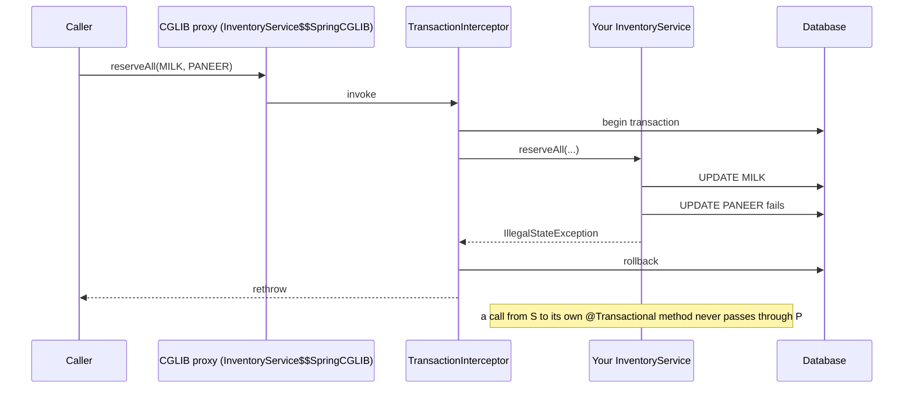
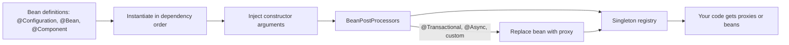

# Patterns in Spring

<span class="badge-l3">L3 🟡 Professional</span> · <span class="read-time">⏱ 40 min read</span> · Prerequisites: [Dependency Injection](../l2-practitioner/dependency-injection.md), [Proxy](../l2-practitioner/proxy.md), [Template Method](../l1-foundations/template-method.md), [Observer](../l1-foundations/observer.md)

!!! abstract "TL;DR"
    Spring is a set of design patterns you configure. The **IoC container** is a Factory plus Dependency Injection with Singleton and Prototype scopes. **AOP** features (`@Transactional`, `@Cacheable`, `@Async`, method security) are **Proxies** around your beans, which is why calling an annotated method on `this` silently skips them. **`JdbcTemplate`**, `TransactionTemplate` and `RestTemplate` are **Template Method with callbacks**. **Application events** are **Observer**. **`FactoryBean`** is Factory. Injecting `List<Strategy>` or `Map<String, Strategy>` gives you **Strategy** registries for free. Knowing the pattern behind each feature explains most Spring surprises.

!!! info "These examples use real Spring"
    Unlike the single-file examples elsewhere, this page's code is a small Maven project using Spring Framework 6.2 and an in-memory H2 database: [`examples/l3-professional/patterns-in-spring`](https://github.com/khiruashish/java-design-pattern-mobile-app/tree/claude/add-playbook-master-prompt/examples/l3-professional/patterns-in-spring). Run one example with `mvn -q compile exec:java -Dexec.mainClass=com.freshcart.spring.<Name>`, or all of them with `mvn verify`; a test checks every output shown here.

## 1. What It Is

**Plain English.** You write plain classes (services, repositories, listeners). Spring creates them, connects them, and wraps some of them with extra behaviour (transactions, caching, security). Each of those jobs is a known pattern, so when Spring does something surprising, the pattern usually explains it.

**Definition.** The main pattern-to-feature map:

| Spring feature | Pattern(s) |
|----------------|------------|
| `ApplicationContext`, `@Bean`, `@Component` | Factory, Dependency Injection, Registry |
| Singleton and prototype scopes | Singleton (per container), Prototype |
| `@Transactional`, `@Cacheable`, `@Async`, `@PreAuthorize` | Proxy (dynamic or CGLIB), Decorator, Chain of Responsibility (interceptor chain) |
| `JdbcTemplate`, `TransactionTemplate`, `RestTemplate`, `JmsTemplate` | Template Method (with callbacks) |
| `ApplicationEventPublisher`, `@EventListener` | Observer, Mediator |
| `FactoryBean`, `@Bean` methods | Factory Method, Abstract Factory |
| `List<T>` / `Map<String, T>` injection, `@Order` | Strategy, Chain of Responsibility |
| `BeanPostProcessor` | Decorator / hook into object creation |
| `HandlerAdapter`, `HttpMessageConverter` | Adapter, Strategy |
| `DispatcherServlet` | Front Controller |

## 2. Why It Exists

Before Spring, Java EE applications wired themselves through JNDI lookups (Service Locator), wrote transaction and resource-handling code by hand, and were hard to test outside a server. Spring applied DI, Proxy and Template Method consistently so business classes stay plain Java, cross-cutting concerns are declared, and infrastructure boilerplate disappears.

## 3. Mental Model / Analogy

**Analogy.** Spring is a stage crew. You (the actors) only learn your lines. The crew builds the set (creates beans), hands you props on cue (injects dependencies), stands invisibly between you and the audience to handle lights and sound (proxies), and announces scene changes to everyone who cares (events).

**Technical model.** At startup Spring reads bean definitions, instantiates them in dependency order, runs `BeanPostProcessor`s (which may replace a bean with a proxy), and stores singletons in a registry. Your code receives references to whatever ended up in the registry: often a proxy, not your object.

## 4. How It Works





## 5. Subtopics

### IoC container and DI

**Description.** The `ApplicationContext` is a factory and registry. `@Configuration` classes declare beans with `@Bean` methods (or classes are found with `@Component` scanning); Spring calls constructors with the dependencies they ask for. Beans are **singletons per container** by default; **prototype** scope creates a new instance per lookup. When several beans match a type, `@Primary` or `@Qualifier` chooses.

**Advantages / features.** Classes don't create or look up their collaborators; configuration is in one place; tests can build the same classes without Spring.

```java title="IocContainerDemo.java"
--8<-- "examples/l3-professional/patterns-in-spring/src/main/java/com/freshcart/spring/IocContainerDemo.java"
```

1. A plain record with constructor injection: no Spring imports needed.
2. The composition root: bean methods say what to create and how.
3. Prototype scope: a new object for every request to the container.

**Run it:** `mvn -q compile exec:java -Dexec.mainClass=com.freshcart.spring.IocContainerDemo`

```text
--8<-- "examples/l3-professional/patterns-in-spring/expected/IocContainerDemo.expected.txt"
```

| Scope | Instances | Typical use |
|-------|-----------|-------------|
| `singleton` (default) | One per container | Stateless services, repositories |
| `prototype` | One per lookup | Stateful helpers, builders |
| `request` / `session` (web) | One per HTTP request / session | Per-user state (use sparingly) |
| Custom (e.g. thread, tenant) | Defined by a `Scope` | Multi-tenant resources |

**Use** constructor injection and `@Configuration` classes. **Avoid** field injection and calling `ctx.getBean` from business code (that's Service Locator).
**Real-world Java:** Spring Boot auto-configuration is many `@Configuration` classes with `@ConditionalOn...` guards; Micronaut and Quarkus do the same wiring at build time.
**Best practice:** keep beans stateless; put state in the database or in request-scoped objects. **Gotcha:** injecting a prototype into a singleton gives the singleton one instance forever; use `ObjectProvider<T>` to get a fresh one.

### Proxies and AOP

**Description.** Spring adds behaviour such as transactions by wrapping your bean in a **proxy**: a JDK dynamic proxy for interfaces or a CGLIB subclass for classes. The proxy runs an interceptor chain (begin transaction, call your method, commit or roll back). Only calls that go **through the proxy** get the behaviour.

**Advantages / features.** Declarative cross-cutting concerns; business code stays free of transaction and caching code.

```java title="ProxiesAopDemo.java"
--8<-- "examples/l3-professional/patterns-in-spring/src/main/java/com/freshcart/spring/ProxiesAopDemo.java"
```

1. Building a proxy by hand with `ProxyFactory` and a `MethodInterceptor`: the same machinery `@Transactional` uses.
2. `@Transactional` asks Spring to put a transaction proxy around this bean.
3. A call to `reserveAll` from inside the class goes to `this`, not the proxy.
4. Through the proxy, the failed reservation rolled back; through `this`, the first update stayed.

**Run it:** `mvn -q compile exec:java -Dexec.mainClass=com.freshcart.spring.ProxiesAopDemo`

```text
--8<-- "examples/l3-professional/patterns-in-spring/expected/ProxiesAopDemo.expected.txt"
```

| Proxy type | When Spring uses it | Limits |
|------------|---------------------|--------|
| JDK dynamic proxy | Bean implements interfaces and `proxyTargetClass=false` | Only interface methods |
| CGLIB subclass | Classes (Spring Boot default) | Not `final` classes or methods; no `private` methods |
| AspectJ weaving | Compile/load-time weaving configured | Works for self-calls; more setup |

**Use** annotations like `@Transactional` on public methods of beans called from other beans. **Avoid** relying on them for self-calls, `private` or `final` methods.
**Real-world Java:** `@Transactional`, `@Cacheable`, `@Async`, `@Retryable`, `@PreAuthorize`, Spring Data repository interfaces (pure proxies with no class of yours behind them).
**Best practice:** put the transactional boundary on the service method that's called from outside (controller, listener). **Gotcha:** self-invocation is the most common Spring bug; move the method to another bean or call through an injected self-reference.

### Template classes

**Description.** `JdbcTemplate`, `TransactionTemplate`, `RestTemplate` and `JmsTemplate` implement the fixed part of an algorithm (get a connection, run, map results, translate exceptions, release resources) and take the varying part as a **callback** (`RowMapper`, `TransactionCallback`). This is [Template Method](../l1-foundations/template-method.md) by composition rather than inheritance.

**Advantages / features.** No resource leaks; database errors become a consistent `DataAccessException` hierarchy; transaction handling in a few lines.

**Before (raw JDBC) and after (JdbcTemplate):**

```java title="TemplateClassesDemo.java"
--8<-- "examples/l3-professional/patterns-in-spring/src/main/java/com/freshcart/spring/TemplateClassesDemo.java"
```

1. Before: correct, but most lines manage resources rather than express the query.
2. After: the callback maps one row; the template does the rest.
3. Vendor-specific SQL errors are translated into meaningful exceptions such as `DuplicateKeyException`.

**Run it:** `mvn -q compile exec:java -Dexec.mainClass=com.freshcart.spring.TemplateClassesDemo`

```text
--8<-- "examples/l3-professional/patterns-in-spring/expected/TemplateClassesDemo.expected.txt"
```

| Template | Callback | Replaced by (newer) |
|----------|----------|---------------------|
| `JdbcTemplate` | `RowMapper`, `PreparedStatementSetter` | `JdbcClient` (6.1, fluent) |
| `TransactionTemplate` | `TransactionCallback` | Still current; `@Transactional` for declarative use |
| `RestTemplate` | `RequestCallback`, `ResponseExtractor` | `RestClient` (6.1) |
| `JmsTemplate` | `MessageCreator` | Still current |

**Use** `JdbcTemplate`/`JdbcClient` for SQL you want to write yourself. **Avoid** raw JDBC in application code.
**Real-world Java:** `NamedParameterJdbcTemplate`, `MongoTemplate`, `KafkaTemplate`, `RedisTemplate`.
**Best practice:** use `TransactionTemplate` when the transaction boundary must be inside a method (e.g., per batch item). **Gotcha:** `queryForObject` throws `EmptyResultDataAccessException` when no row matches; use `query(...).stream().findFirst()` for optional results.

### Application events as Observer

**Description.** A bean publishes an event object through `ApplicationEventPublisher`; any bean with an `@EventListener` method for that type receives it. Publishers don't know their listeners. By default delivery is **synchronous**, in the publisher's thread and transaction. `@Order` sets listener order; `condition` filters with SpEL; `@TransactionalEventListener` delays delivery to a transaction phase.

**Advantages / features.** Decouples the core flow from follow-up work (loyalty, notifications, analytics); new reactions are new listeners.

```java title="ApplicationEventsDemo.java"
--8<-- "examples/l3-professional/patterns-in-spring/src/main/java/com/freshcart/spring/ApplicationEventsDemo.java"
```

1. Events are plain records; no Spring base class needed since 4.2.
2. Publishing doesn't name any listener.
3. A conditional listener with an explicit order.

**Run it:** `mvn -q compile exec:java -Dexec.mainClass=com.freshcart.spring.ApplicationEventsDemo`

```text
--8<-- "examples/l3-professional/patterns-in-spring/expected/ApplicationEventsDemo.expected.txt"
```

| Listener kind | Runs | Use for |
|---------------|------|---------|
| `@EventListener` | Synchronously, inside `publishEvent` | In-process reactions that may share the transaction |
| `@EventListener` + `@Async` | On an executor | Slow work that mustn't block the caller |
| `@TransactionalEventListener(AFTER_COMMIT)` | After commit | Emails, SMS, messages to other systems |
| Spring Modulith / outbox | Persisted, retried | Reliable cross-module or cross-service events |

**Use** events to decouple modules inside one application. **Avoid** using them as a hidden control flow that the core logic depends on.
**Real-world Java:** Spring Boot's `ApplicationReadyEvent`, `ContextRefreshedEvent`; Spring Security's authentication events; Spring Modulith's event publication registry.
**Best practice:** make events immutable records with only the data listeners need. **Gotcha:** an exception in a synchronous listener propagates to the publisher and can roll back its transaction.

### Factory beans

**Description.** A `FactoryBean<T>` is a bean whose job is to create another bean. The container calls `getObject()` and registers the product under the factory's name; `&name` returns the factory itself. `@Bean` methods are the everyday form of the same idea; `FactoryBean` suits reusable, configurable construction logic in libraries.

**Advantages / features.** Complex or conditional creation is encapsulated; consumers just inject the product type.

```java title="FactoryBeanDemo.java"
--8<-- "examples/l3-professional/patterns-in-spring/src/main/java/com/freshcart/spring/FactoryBeanDemo.java"
```

1. The factory decides which implementation to build from the environment.
2. Registering the factory registers its product, `SmsClient`.
3. The `&` prefix asks for the factory instead of the product.

**Run it:** `mvn -q compile exec:java -Dexec.mainClass=com.freshcart.spring.FactoryBeanDemo`

```text
--8<-- "examples/l3-professional/patterns-in-spring/expected/FactoryBeanDemo.expected.txt"
```

| Option | Best for |
|--------|----------|
| `@Bean` method | Application code; most cases |
| `FactoryBean<T>` | Libraries with reusable, configurable creation (e.g. `LocalSessionFactoryBean`) |
| `@Conditional...` beans | Choose implementations by environment or classpath |
| `ObjectProvider<T>` | Lazy or optional lookup |

**Use** `@Bean` methods first, `FactoryBean` when creation logic needs to be a reusable component. **Avoid** environment checks scattered in services; choose implementations at wiring time.
**Real-world Java:** `LocalContainerEntityManagerFactoryBean`, `SqlSessionFactoryBean` (MyBatis), `ProxyFactoryBean`, Spring Data's repository factory beans.
**Best practice:** implement `getObjectType()` accurately so type-based injection works before the product exists. **Gotcha:** `isSingleton()` defaults to `true`, so `getObject()` is cached; override it for a new product per lookup.

### Strategy beans with List/Map injection

**Description.** Declare each strategy as a bean implementing a shared interface. Inject `List<Strategy>` to get all of them in `@Order`/`Ordered` order (a chain or pipeline), or `Map<String, Strategy>` to get them keyed by bean name (a registry). Adding a strategy is adding a bean.

**Advantages / features.** No hand-written registry; open for extension; ordering and selection are declarative.

```java title="StrategyBeansDemo.java"
--8<-- "examples/l3-professional/patterns-in-spring/src/main/java/com/freshcart/spring/StrategyBeansDemo.java"
```

1. A chain of fee rules injected as an ordered list.
2. A router keyed by bean name.
3. Declaration order doesn't matter; `@Order` on the classes decides list order.

**Run it:** `mvn -q compile exec:java -Dexec.mainClass=com.freshcart.spring.StrategyBeansDemo`

```text
--8<-- "examples/l3-professional/patterns-in-spring/expected/StrategyBeansDemo.expected.txt"
```

| Injection | You get | Use for |
|-----------|---------|---------|
| `List<T>` | All beans of type `T`, ordered | Chains, pipelines, validators |
| `Map<String, T>` | Bean name → bean | Lookup by key (payment mode, channel) |
| `ObjectProvider<T>` | Lazy/optional access, `orderedStream()` | Optional strategies |
| `T` with `@Qualifier` | One chosen bean | A fixed choice |

**Use** list and map injection for open sets of strategies. **Avoid** keying business logic on bean names that refactoring can change; prefer a `key()` method on the strategy and build the map yourself, as in Example 3.
**Real-world Java:** Spring MVC's `HandlerMethodArgumentResolver` and `HttpMessageConverter` lists; Spring Security's filter chain; Boot's `HealthIndicator` map.
**Best practice:** validate at startup that every required key has a strategy. **Gotcha:** if no bean of the type exists, injecting `List<T>` fails unless it's optional (`ObjectProvider` or `@Autowired(required = false)`).

## 6. Examples (exactly 3, progressively harder)

### Example 1: Minimal (L2)

**Scenario:** QuickDrop's ETA service needs a traffic client. The classes must work without Spring, and Spring should only wire them.

```java title="SpringWiringDemo.java"
--8<-- "examples/l3-professional/patterns-in-spring/src/main/java/com/freshcart/spring/SpringWiringDemo.java"
```

1. Plain records with constructor injection.
2. The configuration is the only Spring-specific code.

**Run it:** `mvn -q compile exec:java -Dexec.mainClass=com.freshcart.spring.SpringWiringDemo`

**Output:**

```text
--8<-- "examples/l3-professional/patterns-in-spring/expected/SpringWiringDemo.expected.txt"
```

**What to notice:**

- The same objects work with and without the container, so unit tests don't need Spring.

### Example 2: Realistic (in FreshCart grocery delivery)

**Scenario:** checkout charges the order through the payment mode the customer picked, records the payment, marks the order paid, and triggers a receipt. A failed charge must leave no payment row and no status change.

```java title="CheckoutFlowDemo.java"
--8<-- "examples/l3-professional/patterns-in-spring/src/main/java/com/freshcart/spring/CheckoutFlowDemo.java"
```

1. One transaction around the whole payment, provided by a proxy.
2. Payment strategies come from a `Map` injected by Spring.
3. Follow-up work listens for an event instead of being called directly.

**Run it:** `mvn -q compile exec:java -Dexec.mainClass=com.freshcart.spring.CheckoutFlowDemo`

**Output:**

```text
--8<-- "examples/l3-professional/patterns-in-spring/expected/CheckoutFlowDemo.expected.txt"
```

**What to notice:**

- The receipt line printed before `pay` returned: plain `@EventListener` runs inside the transaction. Example 3 shows why that matters.
- The failed card payment left FC-1 untouched and wrote no payment row.

### Example 3: Production-grade

**Scenario:** PayLink places orders and charges them. After incidents, the team requires: every payment mode has a processor or the service won't start; a declined payment (a **checked** exception) must roll back the order; the "order confirmed" SMS must never go out for a rolled-back order; every call to the order service is audited without adding code to it.

```java title="OrderPlacementProductionDemo.java"
--8<-- "examples/l3-professional/patterns-in-spring/src/main/java/com/freshcart/spring/OrderPlacementProductionDemo.java"
```

1. The router builds its own map from each strategy's `mode()` and fails startup if any mode is missing.
2. By default Spring rolls back only on unchecked exceptions; `rollbackFor = Exception.class` includes checked ones like `PaymentDeclined`.
3. The SMS listener runs only after a successful commit.
4. A plain `@EventListener` shown for contrast: it fires immediately, even for orders that are later rolled back.
5. A `BeanPostProcessor` that wraps `@Audited` beans in a proxy: how Spring's own AOP features are added.

**Run it:** `mvn -q compile exec:java -Dexec.mainClass=com.freshcart.spring.OrderPlacementProductionDemo`

**Output:**

```text
--8<-- "examples/l3-professional/patterns-in-spring/expected/OrderPlacementProductionDemo.expected.txt"
```

**What to notice:**

- FC-11 was rolled back: it isn't in the database, and the after-commit SMS skipped it, while the naive listener would have texted the customer.
- The audit proxy recorded both the success and the failure without any code in `OrderService`.
- The broken configuration (no CARD processor) failed at startup with a clear message.

## 7. Pros, Cons & Trade-offs

| Aspect | Pros | Cons |
|--------|------|------|
| Productivity | Wiring, transactions and resources handled for you | "Magic" hides control flow |
| Testability | Plain classes, constructor injection | Integration tests need a context (slower) |
| Cross-cutting concerns | Declarative via proxies | Self-invocation and `final` methods bypass proxies |
| Extensibility | Strategies and listeners added as beans | Implicit ordering and conditions can surprise |
| Startup | Validation possible at startup | Large contexts start slowly (reflection, scanning) |

## 8. When to Use / When NOT to Use

**Use these Spring patterns when:**

- you're building a Spring application: lean on DI, proxies, templates and events instead of re-inventing them;
- cross-cutting concerns (transactions, caching, security) apply across many classes;
- strategies or listeners are added over time.

**Don't use them when:**

- a small library or tool would need a whole container for a few objects (wire by hand);
- behaviour must be explicit and visible (a direct call is clearer than an event);
- hot code paths can't afford proxy overhead (rare; measure first).

## 9. Best Practices

1. **Constructor injection, no field injection.** *(Consensus; Spring team recommendation.)*
2. **Transactional boundaries on public service methods called from other beans.** *(Consensus.)*
3. **`rollbackFor = Exception.class`** when checked exceptions mean failure, or use unchecked exceptions. *(Consensus.)*
4. **`@TransactionalEventListener(AFTER_COMMIT)`** for side effects outside the database; an outbox for reliability. *(Consensus.)*
5. **Validate strategy registries at startup.** *(Opinion, widely shared.)*
6. **Prefer `@Bean` methods over `FactoryBean`** in application code. *(Consensus.)*
7. **Keep business classes free of Spring imports** where practical. *(Opinion, widely shared.)*

## 10. Pitfalls & Anti-Patterns

!!! danger "Self-invocation skips `@Transactional` (production failure mode)"
    **Symptom:** after a refactor, failed multi-item reservations left some items reserved; stock counts drifted for days.
    **Root cause:** a public method called the class's own `@Transactional` method. The call went to `this`, not to the proxy, so there was no transaction and nothing rolled back.
    **Fix:** move the transactional method to another bean or make the caller's method the transactional boundary; add an integration test that a failure rolls back.

!!! danger "Checked exceptions don't roll back"
    **Symptom:** orders were saved even though payment was declined.
    **Root cause:** `PaymentDeclined` was a checked exception; `@Transactional` rolls back only on `RuntimeException` and `Error` by default, so the transaction committed.
    **Fix:** `@Transactional(rollbackFor = Exception.class)`, or make the exception unchecked.

!!! danger "Notifications sent for rolled-back work"
    **Symptom:** customers got "order confirmed" SMS for orders that didn't exist.
    **Root cause:** a plain `@EventListener` sent the SMS synchronously inside the transaction, before a later step failed and rolled back.
    **Fix:** `@TransactionalEventListener(phase = AFTER_COMMIT)`; for guaranteed delivery, a transactional outbox.

!!! danger "Prototype inside a singleton"
    **Symptom:** every user's cart session shared the same items.
    **Root cause:** a prototype-scoped `CartSession` was injected into a singleton service once at startup.
    **Fix:** inject `ObjectProvider<CartSession>` and call `getObject()` per use, or don't keep per-user state in beans.

## 11. Configuration & Tuning

| Setting | Default | What it does | When to change it | Risk of changing |
|---------|---------|--------------|-------------------|------------------|
| `spring.aop.proxy-target-class` | `true` in Boot | CGLIB class proxies vs JDK interface proxies | Interface-only codebases | Behaviour differs for `final` and interface-less beans |
| `@Transactional(rollbackFor)` | Unchecked only | Which exceptions roll back | Checked domain exceptions | Unintended rollbacks |
| `@Transactional(propagation)` | `REQUIRED` | Join or create transactions | Audit logs that must survive rollbacks (`REQUIRES_NEW`) | Deadlocks, partial commits |
| `spring.main.lazy-initialization` | `false` | Create beans on first use | Faster startup in dev | Errors found late |
| `@EnableAsync` executor | Simple executor in Boot (task pool) | Runs `@Async` listeners | Size for workload | Lost events on shutdown |
| `spring.jpa.open-in-view` | `true` | Keeps session open during web rendering | Set `false` in APIs | Lazy-loading errors if code relied on it |

## 12. Security Considerations

- Method security (`@PreAuthorize`) is also a proxy: self-calls bypass authorisation checks just as they bypass transactions.
- Don't expose `ApplicationContext` or `getBean(String)` with user-controlled names (it becomes an arbitrary-object lookup).
- SpEL in annotations (`condition`, `@PreAuthorize`) is safe when written by developers; never evaluate user input as SpEL with a `StandardEvaluationContext`.
- Event listeners run with the publisher's security context synchronously, but not on `@Async` threads unless you propagate it (`DelegatingSecurityContextExecutor`).

## 13. Performance & Scalability

Proxy calls add a small interceptor-chain cost (sub-microsecond), negligible next to database and network work. Context startup is the main cost: classpath scanning, reflection and CGLIB generation. Spring Boot 3's AOT processing and GraalVM native images precompute much of it. `JdbcTemplate` adds almost nothing over raw JDBC. Synchronous events cost a method call per listener; `@Async` listeners need a bounded executor to avoid unbounded queues.

## 14. Testing It

The Maven project has two test classes. `GoldenOutputTest` runs each example and compares its output with the files shown on this page. `SpringPatternsTest` checks the behaviours the page relies on against the real framework:

```java title="SpringPatternsTest.java"
--8<-- "examples/l3-professional/patterns-in-spring/src/test/java/com/freshcart/spring/SpringPatternsTest.java"
```

In Spring Boot apps, use `@SpringBootTest` for full contexts, slice tests (`@DataJdbcTest`, `@WebMvcTest`) for faster focused ones, and plain unit tests with constructor injection for business logic.

## 15. Observability & Operations

Boot's `/actuator/beans` and `/actuator/conditions` show which beans exist and why; `/actuator/mappings` shows web routes. Log the strategies registered at startup. Enable `logging.level.org.springframework.transaction=DEBUG` temporarily to see transaction boundaries when debugging self-invocation. Micrometer observes `@Transactional`, `JdbcTemplate` and event listener timings when instrumented.

## 16. Version Notes

| Spring | Change relevant to patterns |
|--------|-----------------------------|
| 2.5 | Annotation-driven DI (`@Autowired`, `@Component`) |
| 3.0 | Java `@Configuration` and `@Bean` |
| 4.2 | `@EventListener`, `@TransactionalEventListener`, events as any object |
| 4.3 | Implicit constructor injection with a single constructor |
| 5.0 | Functional bean registration; `@Nullable` |
| 6.0 / Boot 3 | Java 17 baseline, Jakarta EE namespace, AOT and native images |
| 6.1 | `JdbcClient`, `RestClient`; virtual threads support |
| 6.2 | Fallback beans (`@Fallback`), background bean initialisation |
| 7.0 (2025) | Java 17+ still, JSpecify null-safety, API versioning, resilience annotations |

## 17. Expert Deep Dive

- **How proxies are created.** `AbstractAutoProxyCreator` (a `BeanPostProcessor`) finds advisors that match a bean and wraps it. `@EnableTransactionManagement` registers the advisor; `@Transactional` methods are matched by a pointcut. Your own `BeanPostProcessor` in Example 3 is a miniature version.
- **`@Configuration` is a proxy too.** Bean methods in a `@Configuration` class are intercepted so `a()` called twice returns the same singleton. With `proxyBeanMethods = false` (Boot's own configs), calls are plain method calls; inject beans as parameters instead.
- **Transaction synchronisation.** `@TransactionalEventListener` registers a `TransactionSynchronization`; if no transaction is active, the event is dropped unless `fallbackExecution = true`.
- **Transactional outbox.** For events that must reach other services, write them to an outbox table in the same transaction and publish asynchronously (Spring Modulith's event publication registry, Debezium).
- **Build-time DI.** Micronaut, Quarkus and Dagger generate wiring code at compile time, trading some flexibility for startup speed; Spring's AOT engine moves in the same direction.

!!! example "War story: the SMS for orders that never existed"
    FreshCart's checkout published `OrderConfirmed` inside a `@Transactional` method, and an `@EventListener` sent the SMS immediately. A later step in the same method reserved a delivery slot and sometimes failed when slots ran out, rolling back the order. During a Diwali rush, 3,200 customers received "Your order is confirmed!" for orders that had been rolled back, then saw nothing in the app. Support was overwhelmed. **Fixes:** the listener became `@TransactionalEventListener(phase = AFTER_COMMIT)`; slot reservation moved before order creation; and an integration test forces a slot failure and asserts no SMS. Later they adopted an outbox so SMS survived app restarts between commit and send. **Lesson:** listeners in Spring are synchronous and inside the transaction unless you say otherwise; side effects outside the database belong after commit.

## 18. Interview Corner

=== "🟢 L1–L2"

    1. **What is IoC?** The **container creates and wires objects**, instead of objects doing it themselves.
    2. **Default bean scope?** **Singleton** per container.
    3. **Which pattern is `JdbcTemplate`?** **Template Method** with callbacks.
    4. **How does `@Transactional` work?** A **proxy** starts and ends the transaction around the method.
    5. **How do you get all beans of an interface?** Inject a **`List<T>`** (or `Map<String, T>`).

=== "🟡 L3"

    1. **Why doesn't `@Transactional` work on self-calls?** The call **bypasses the proxy**.
    2. **JDK proxy vs CGLIB?** **Interfaces** vs **subclass**; CGLIB can't proxy `final`.
    3. **Which exceptions roll back by default?** **Unchecked** (`RuntimeException`, `Error`).
    4. **What's `@TransactionalEventListener` for?** Running listeners **after commit** (or other phases).
    5. **What does `&` mean in `getBean("&name")`?** Return the **FactoryBean itself**.

=== "🔴 L4–L5"

    1. **How would you guarantee notifications for committed orders only, even across restarts?** **Transactional outbox** + async publisher; `AFTER_COMMIT` alone isn't durable.
    2. **How does Spring create proxies internally?** **`BeanPostProcessor` auto-proxy creators** with advisors and pointcuts.
    3. **Prototype in singleton: how to fix?** **`ObjectProvider`**, lookup method injection, or scoped proxies.
    4. **How do you speed up Spring startup?** **AOT/native**, lazy init, fewer auto-configs, `proxyBeanMethods = false`.
    5. **When avoid events?** When the **core flow depends on the result** or ordering must be explicit.

=== "💻 Hands-on"

    **Task:** Fix `ProxiesAopDemo.InventoryService.reserveAllViaSelfCall` so it runs in a transaction.

    ??? success "Solution"
        ```java
        // Option 1: make the outer method the boundary
        @Transactional
        public void reserveAllViaSelfCall(String... skus) { reserveAll(skus); }

        // Option 2: call through the proxy via another bean
        public static class ReservationFacade {
            private final InventoryService inventory;   // the injected proxy
            public ReservationFacade(InventoryService inventory) { this.inventory = inventory; }
            public void reserve(String... skus) { inventory.reserveAll(skus); }
        }
        ```

## 19. Practice

- [ ] Add a `@Cacheable` price lookup to the Maven project and show that self-calls bypass the cache too.
    ??? tip "Hint"
        Add `@EnableCaching` and a `ConcurrentMapCacheManager` bean.
- [ ] Make the SMS listener in Example 3 `@Async` and observe that the calling thread no longer waits.
    ??? tip "Hint"
        `@EnableAsync` and print `Thread.currentThread().getName()`.
- [ ] Rewrite `TemplateClassesDemo.delivered` with `JdbcClient` (Spring 6.1).
    ??? tip "Hint"
        `JdbcClient.create(ds).sql(...).param(city).query(OrderRow.class).list()`.
- [ ] Find a `@Transactional` method in your codebase that throws a checked exception and check its `rollbackFor`.
    ??? tip "Hint"
        Search for `@Transactional` methods with `throws` clauses.

## 20. Quick Revision Card

!!! tip "Remember in 30 seconds"
    - Container = Factory + DI + Singleton registry; constructor injection.
    - `@Transactional`/`@Cacheable`/`@Async` = Proxy: self-calls, `private`, `final` bypass it.
    - Rollback on unchecked by default; `rollbackFor` for checked.
    - `*Template` = Template Method with callbacks; `JdbcClient`/`RestClient` are the new fluent forms.
    - Events = Observer, synchronous by default; side effects `AFTER_COMMIT` (or outbox).
    - `List<T>`/`Map<String,T>` injection = Strategy registry; validate at startup.

    ```java
    @Transactional(rollbackFor = Exception.class)
    public String place(Order o) throws PaymentDeclined { ... events.publishEvent(new OrderConfirmed(o.id())); ... }

    @TransactionalEventListener(phase = TransactionPhase.AFTER_COMMIT)
    public void sms(OrderConfirmed e) { ... }
    ```

## 21. Further Reading

- [Spring Framework reference: Core Technologies](https://docs.spring.io/spring-framework/reference/core.html) (IoC container, AOP, events).
- [Spring Framework reference: Transaction Management](https://docs.spring.io/spring-framework/reference/data-access/transaction.html).
- Rod Johnson, *Expert One-on-One J2EE Design and Development* (2002): the book Spring grew out of.
- Josh Long, *Reactive Spring* and the "Spring Tips" series.
- [Spring Modulith reference](https://docs.spring.io/spring-modulith/reference/) (event publication registry).

---

[← Previous: Patterns in the JDK](patterns-in-the-jdk.md) · [Next: Concurrency Patterns →](concurrency-patterns.md)
