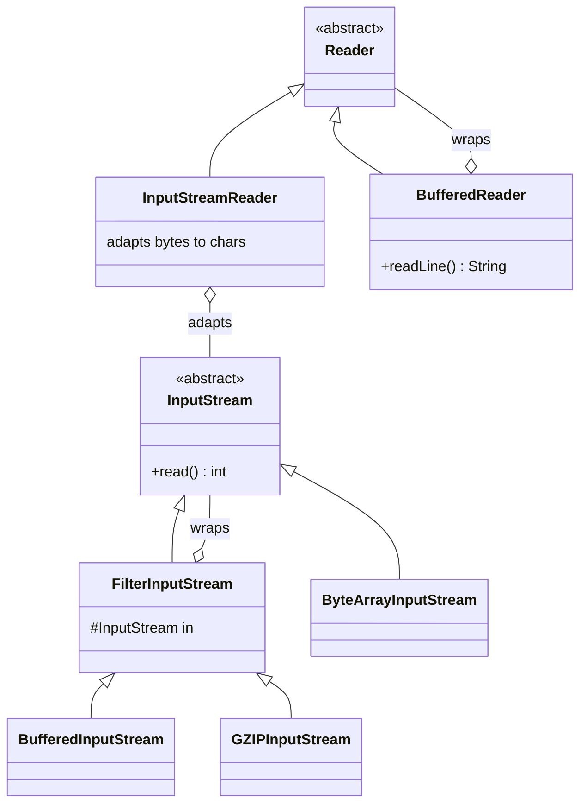
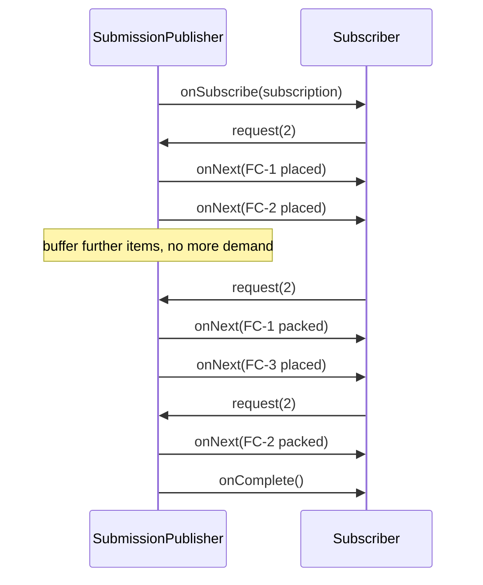

# Patterns in the JDK

<span class="badge-l3">L3 🟡 Professional</span> · <span class="read-time">⏱ 35 min read</span> · Prerequisites: [Decorator](../l1-foundations/decorator.md), [Iterator](../l2-practitioner/iterator.md), [Strategy](../l1-foundations/strategy.md)

!!! abstract "TL;DR"
    You already use dozens of design patterns every day through the JDK. Collections give you Iterator, Adapter (`Arrays.asList`), Proxy views (`unmodifiableList`) and Factory methods (`List.of`). `java.io` is a stack of Decorators with an Adapter (`InputStreamReader`) between bytes and characters. `Runtime` is a Singleton, `Integer.valueOf` a Flyweight, `Collections.emptyList` a Null Object. `Comparator` is Strategy. `ServiceLoader` is a plugin registry. `Flow` is Observer with back-pressure. Recognising them tells you how the APIs behave, including their traps.

## 1. What It Is

**Plain English.** The JDK's designers used the same patterns this playbook teaches. When you know that `BufferedReader` is a decorator, you know it wraps another reader and adds buffering, that closing it closes the inner one, and that you can write your own wrapper. When you know `Arrays.asList` is an adapter, you know it writes through to the array and can't grow.

**Definition.** This page maps JDK APIs to the patterns they implement:

| Pattern | JDK examples |
|---------|--------------|
| Iterator | `Iterator`, `Iterable`, `Spliterator`, `Enumeration` |
| Adapter | `Arrays.asList`, `InputStreamReader`, `OutputStreamWriter`, `Collections.list(Enumeration)` |
| Decorator | `BufferedInputStream`, `GZIPInputStream`, `Collections.synchronizedList`, `checkedList` |
| Proxy | `Collections.unmodifiableList`, `java.lang.reflect.Proxy`, RMI stubs |
| Factory method | `List.of`, `LocalDate.of`, `Executors.newFixedThreadPool`, `Calendar.getInstance` |
| Builder | `StringBuilder`, `HttpRequest.newBuilder`, `Stream.builder`, `Locale.Builder` |
| Singleton | `Runtime.getRuntime()`, `Desktop.getDesktop()` |
| Flyweight | `Integer.valueOf` (−128..127), `Boolean.valueOf`, `String.intern` |
| Null Object | `Collections.emptyList()`, `OutputStream.nullOutputStream()` |
| Strategy | `Comparator`, `ThreadPoolExecutor.RejectedExecutionHandler`, `Collator` |
| Template Method | `AbstractList`, `InputStream.read(byte[])` built on `read()` |
| Command | `Runnable`, `Callable` |
| Observer | `Flow`, `PropertyChangeListener`, `WatchService` |
| Plugin / Service Locator | `ServiceLoader` |

## 2. Why It Exists

Reading the JDK through patterns gives you two things. First, a way to predict behaviour: decorators delegate and close their inner stream, views reflect their source, flyweights share instances. Second, a set of well-tested reference implementations: when you design your own API, `java.io` shows how to build a decorator family, and `ServiceLoader` shows how to load plugins without a framework.

## 3. Mental Model / Analogy

**Analogy.** Learning patterns from the JDK is like learning architecture by walking around a city you already live in: you've used these buildings for years, and now you can name the styles and see why the doors are where they are.

**Technical model.** Look at a JDK type and ask: does it **wrap** another object of the same interface (Decorator/Proxy)? **convert** one interface to another (Adapter)? **create** objects behind a static method (Factory)? **share** instances (Flyweight/Singleton)? **take behaviour as a parameter** (Strategy/Command)? **notify** others (Observer)?

## 4. How It Works





## 5. Subtopics

### Collections and Iterator

**Description.** The Collections Framework is built on patterns. **Iterator** lets any `Iterable` work with for-each without exposing storage. `Arrays.asList` is an **Adapter** from array to `List`. `unmodifiableList` is a protection **Proxy**; `synchronizedList` is a **Decorator** adding locking; `subList` and map `keySet` are **views**. `List.of`, `Set.of` and `Map.of` are **factory methods** returning hidden implementations.

**Advantages / features.** One interface (`List`) with many behaviours chosen by wrapping; client code stays the same.

```java title="CollectionsIteratorDemo.java"
--8<-- "examples/l3-professional/patterns-in-the-jdk/CollectionsIteratorDemo.java"
```

1. Implementing `Iterable` is enough for for-each; the route's array stays private.
2. An adapter, not a copy: changing the array changes the list, and the list can't grow.
3. Proxy and decorator over the same list: the unmodifiable view sees writes made through the synchronized wrapper.

**Run it:** `java CollectionsIteratorDemo.java`

```text
--8<-- "examples/l3-professional/patterns-in-the-jdk/CollectionsIteratorDemo.expected.txt"
```

| API | Pattern | Behaviour to remember |
|-----|---------|-----------------------|
| `Arrays.asList(arr)` | Adapter | Writes through; fixed size |
| `Collections.unmodifiableList(l)` | Proxy (view) | Reflects changes to `l` |
| `Collections.synchronizedList(l)` | Decorator | Iteration still needs manual `synchronized` |
| `list.subList(a, b)` | View | Structural changes to the parent invalidate it |
| `List.of(...)` | Factory method | Immutable, no nulls |
| `map.keySet()` / `values()` | View | Removing from the view removes from the map |

**Use** views to avoid copies when the source is stable. **Avoid** returning views of internal state from APIs; return `List.copyOf`.
**Real-world Java:** every `List`, `Set` and `Map` in the JDK; Guava's `Lists.transform` and `Iterables` follow the same ideas.
**Best practice:** know whether an API returns a copy or a view before you mutate the source. **Gotcha:** `Collections.synchronizedList` doesn't make iteration thread-safe; wrap loops in `synchronized (list)` or use `CopyOnWriteArrayList`.

### java.io decorators

**Description.** `InputStream`, `OutputStream`, `Reader` and `Writer` each have a family of **decorators** (`FilterInputStream` subclasses: `BufferedInputStream`, `GZIPInputStream`, `DataInputStream`, `CipherInputStream`) that wrap another stream and add one ability. `InputStreamReader` is an **Adapter** that turns bytes into characters using a charset.

**Advantages / features.** Any combination of abilities without a class per combination; your own decorator plugs into the same stack.

```java title="IoDecoratorsDemo.java"
--8<-- "examples/l3-professional/patterns-in-the-jdk/IoDecoratorsDemo.java"
```

1. A custom decorator: extend `FilterInputStream`, override `read`, delegate to `super`.
2. Read the stack from inside out: bytes → count → gunzip → count → characters → buffered lines.
3. The adapter between the byte world and the character world, with an explicit charset.

**Run it:** `java IoDecoratorsDemo.java`

```text
--8<-- "examples/l3-professional/patterns-in-the-jdk/IoDecoratorsDemo.expected.txt"
```

| Layer | Class | Adds |
|-------|-------|------|
| Source | `FileInputStream`, `ByteArrayInputStream`, socket stream | Bytes |
| Decorator | `BufferedInputStream` | Fewer system calls |
| Decorator | `GZIPInputStream`, `InflaterInputStream` | Decompression |
| Decorator | `CipherInputStream`, `DigestInputStream` | Decryption, hashing |
| Adapter | `InputStreamReader` | Bytes → chars (charset) |
| Decorator | `BufferedReader` | `readLine()`, `lines()` |

**Use** the decorator stack for any streamed processing. **Avoid** reading whole files into memory when a stream would do.
**Real-world Java:** `Files.newBufferedReader`, `HttpClient` body handlers, `ZipInputStream`, Servlet request streams.
**Best practice:** always pass an explicit charset to readers and writers. **Gotcha:** closing the outermost decorator closes the whole stack; closing only an inner stream leaves buffered data unflushed in writers.

### Runtime and singletons

**Description.** `Runtime.getRuntime()` returns the single runtime object for the JVM: a classic **Singleton**. Related sharing patterns: `Integer.valueOf`, `Long.valueOf`, `Boolean.valueOf` and `Character.valueOf` return cached **Flyweights** for common values; `Collections.emptyList()` returns a shared immutable **Null Object**.

**Advantages / features.** No duplicate global objects; fewer allocations for common values.

```java title="RuntimeSingletonsDemo.java"
--8<-- "examples/l3-professional/patterns-in-the-jdk/RuntimeSingletonsDemo.java"
```

1. One runtime per JVM, reached through a static accessor.
2. Autoboxing uses `Integer.valueOf`, which caches −128 to 127. Outside that range, `==` compares different objects.
3. A shared, immutable empty list: safe to return from any method.

**Run it:** `java RuntimeSingletonsDemo.java`

```text
--8<-- "examples/l3-professional/patterns-in-the-jdk/RuntimeSingletonsDemo.expected.txt"
```

| API | Pattern | Note |
|-----|---------|------|
| `Runtime.getRuntime()` | Singleton | Process-wide |
| `Integer.valueOf(int)` | Flyweight | Cache −128..127 (upper bound tunable) |
| `Boolean.TRUE/FALSE` | Flyweight | Only two instances ever needed |
| `Collections.emptyList()` | Null Object / Singleton | Immutable |
| `String.intern()` | Flyweight | String pool |
| `System` | Facade (static) | Over runtime, properties, streams |

**Use** `equals` for boxed values, always. **Avoid** `new Integer(...)` (deprecated for removal) and identity comparisons on value-based classes.
**Real-world Java:** `Optional.empty()`, `LocalTime.MIDNIGHT`, `BigDecimal.ZERO` are shared constants of the same kind.
**Best practice:** treat value-based classes (`Integer`, `LocalDate`, `Optional`) as values: never synchronise on them or compare with `==`. **Gotcha:** a test passing with small numbers (`==` on 100) and failing in production with 1000 is the Integer cache at work.

### Comparator strategies

**Description.** `Comparator<T>` is **Strategy**: `List.sort`, `Collections.sort`, `TreeMap` and `PriorityQueue` take the ordering as a parameter. Static and default methods (`comparing`, `thenComparing`, `reversed`, `nullsLast`) build strategies from parts. `java.text.Collator` is a locale-aware string comparison strategy.

**Advantages / features.** The same sort algorithm, many orderings; orderings compose and are reusable constants.

```java title="ComparatorStrategiesDemo.java"
--8<-- "examples/l3-professional/patterns-in-the-jdk/ComparatorStrategiesDemo.java"
```

1. A composed strategy that also decides where `null` prices go.
2. `String.compareTo` sorts by UTF-16 code units (uppercase before lowercase); `Collator` sorts the way people expect.
3. Sorted collections use the comparator to decide equality: products with the same brand count as duplicates.

**Run it:** `java ComparatorStrategiesDemo.java`

```text
--8<-- "examples/l3-professional/patterns-in-the-jdk/ComparatorStrategiesDemo.expected.txt"
```

| Method | Purpose |
|--------|---------|
| `Comparator.comparing(key)` | Order by a key |
| `thenComparing(key)` | Tie-breaker |
| `reversed()` | Opposite order |
| `nullsFirst/nullsLast(cmp)` | Handle nulls explicitly |
| `Comparator.naturalOrder()` | Use `Comparable` |
| `Collator.getInstance(locale)` | Human-language string order |

**Use** composed comparators as named constants. **Avoid** subtraction-based comparators (`a - b`), which overflow; use `Integer.compare` or `comparingInt`.
**Real-world Java:** `TreeMap`, `PriorityQueue`, `Stream.sorted`, `Collections.max`, Spring's `OrderComparator`.
**Best practice:** for sorted sets and maps, make the comparator consistent with `equals` (add tie-breakers on a unique key). **Gotcha:** the `TreeSet` above silently dropped one of four products.

### ServiceLoader

**Description.** `ServiceLoader` discovers implementations of an interface at runtime. Providers are registered in `META-INF/services/<interface name>` on the classpath or with `provides ... with ...` in `module-info.java`. The caller depends only on the interface: a plugin system and a form of Service Locator built into the JDK.

**Advantages / features.** Add implementations by adding a jar; no framework; lazy iteration, and `ServiceLoader.stream()` (Java 9) exposes provider types before instantiation.

```java title="ServiceLoaderDemo.java"
--8<-- "examples/l3-professional/patterns-in-the-jdk/ServiceLoaderDemo.java"
```

1. The service interface. Providers must be public with a public no-argument constructor (or a `provider()` method in modules).
2. Writing the registration file to a temporary folder keeps this demo in one file; in a real project it lives in `src/main/resources/META-INF/services/`.
3. Iterating the loader instantiates each provider lazily.

**Run it:** `java ServiceLoaderDemo.java`

```text
--8<-- "examples/l3-professional/patterns-in-the-jdk/ServiceLoaderDemo.expected.txt"
```

| Registration | Where | Notes |
|--------------|-------|-------|
| `META-INF/services/com.x.Api` | Classpath jar | One implementation class name per line |
| `provides com.x.Api with com.y.Impl;` | `module-info.java` | Checked at compile time; `uses` in the consumer |
| Spring Boot `AutoConfiguration.imports` | Boot jars | Same idea, Spring-specific |

**Use** `ServiceLoader` for libraries that need pluggable implementations without a DI container. **Avoid** it for application wiring inside a Spring app; use beans.
**Real-world Java:** JDBC drivers (`java.sql.Driver`), `FileSystemProvider`, `CharsetProvider`, SLF4J 2 bindings, Jackson modules (`findAndRegisterModules`).
**Best practice:** use `ServiceLoader.stream()` and `Provider.type()` to read metadata without constructing every provider. **Gotcha:** the thread context class loader decides what's found in app servers; pass the class loader explicitly.

### Flow and reactive streams

**Description.** `java.util.concurrent.Flow` (Java 9) defines `Publisher`, `Subscriber`, `Subscription` and `Processor`: the Reactive Streams interfaces. It's **Observer** with **back-pressure**: the subscriber says how many items it can take with `request(n)`, so a fast publisher can't overwhelm it. `SubmissionPublisher` is the JDK's implementation.

**Advantages / features.** Asynchronous delivery with bounded buffers; a standard interface shared by Reactor, RxJava and Akka Streams.

```java title="FlowReactiveDemo.java"
--8<-- "examples/l3-professional/patterns-in-the-jdk/FlowReactiveDemo.java"
```

1. A subscriber that controls its own pace.
2. Demand is signalled in batches; the publisher buffers until the subscriber asks for more.
3. `SubmissionPublisher` delivers on an executor; closing it sends `onComplete` after pending items.

**Run it:** `java FlowReactiveDemo.java`

```text
--8<-- "examples/l3-professional/patterns-in-the-jdk/FlowReactiveDemo.expected.txt"
```

| | Classic Observer | Flow (Reactive Streams) |
|-|------------------|-------------------------|
| Delivery | Synchronous calls | Asynchronous |
| Overload protection | None | `request(n)` back-pressure |
| Completion and errors | Ad hoc | `onComplete`, `onError` |
| Cancellation | Unregister | `subscription.cancel()` |

**Use** `Flow` types as the interop boundary between reactive libraries. **Avoid** implementing `Publisher` yourself; the specification has many subtle rules. Use `SubmissionPublisher`, Reactor or RxJava.
**Real-world Java:** `java.net.http.HttpClient` body publishers and subscribers; Reactor and RxJava adapters (`JdkFlowAdapter`); R2DBC.
**Best practice:** size the publisher's buffer and decide what happens when it's full (`offer` with a drop handler vs blocking `submit`). **Gotcha:** `submit` blocks when a subscriber's buffer is full, which can stall the producer thread.

## 6. Examples (exactly 3, progressively harder)

### Example 1: Minimal (L2)

**Scenario:** a code-reading exercise for new joiners at FreshCart: six everyday JDK calls, each checked against the behaviour its pattern promises.

```java title="JdkPatternSpottingDemo.java"
--8<-- "examples/l3-professional/patterns-in-the-jdk/JdkPatternSpottingDemo.java"
```

1. `StringBuilder` is a Builder: accumulate parts, then `toString()` to build.
2. An executor runs commands (`Runnable`/`Callable`) for you; Java 21 executors are `AutoCloseable`.

**Run it:** `java JdkPatternSpottingDemo.java`

**Output:**

```text
--8<-- "examples/l3-professional/patterns-in-the-jdk/JdkPatternSpottingDemo.expected.txt"
```

**What to notice:**

- Each line tests a promise of the pattern (shared instance, blocked writes), not just the name.

### Example 2: Realistic (in FreshCart grocery delivery)

**Scenario:** GreenValley's farms upload gzipped price lists, some with broken rows. The importer must stream (files can be gigabytes), skip and count bad rows, and show products in natural alphabetical order for the catalogue team.

```java title="SupplierPriceImportDemo.java"
--8<-- "examples/l3-professional/patterns-in-the-jdk/SupplierPriceImportDemo.java"
```

1. An `Iterator` that reads one row ahead from a decorator stack, so memory stays constant.
2. Parsing returns `Optional`: bad rows are skipped and counted, not thrown.
3. Display order uses a `Collator` strategy, so "Apples" and "banana" sort as people expect.

**Run it:** `java SupplierPriceImportDemo.java`

**Output:**

```text
--8<-- "examples/l3-professional/patterns-in-the-jdk/SupplierPriceImportDemo.expected.txt"
```

**What to notice:**

- Two bad rows (a non-number and a missing column) were skipped and counted.
- Without the collator, "Apples" and "Okra" would sort before "banana" and "spinach".

### Example 3: Production-grade

**Scenario:** TextBlast's notification service sends SMS through several gateways delivered as separate jars. Requirements: discover gateways without hard-coding them; pick the best gateway per country by priority and fall back on failure; refuse to start on duplicate ids or uncovered countries; don't construct expensive gateways that aren't used; record calls and failures per gateway without changing gateway code.

```java title="ProviderRegistryDemo.java"
--8<-- "examples/l3-professional/patterns-in-the-jdk/ProviderRegistryDemo.java"
```

1. `ServiceLoader.stream()` gives `Provider` handles; `type()` reads annotations without calling constructors.
2. Duplicate ids (a copy-pasted jar) stop startup instead of silently shadowing each other.
3. A `Comparator` strategy orders candidates by priority per country.
4. `java.lang.reflect.Proxy` creates a dynamic proxy that counts calls and failures for any channel.
5. Fallback: try candidates in order until one succeeds.

**Run it:** `java ProviderRegistryDemo.java`

**Output:**

```text
--8<-- "examples/l3-professional/patterns-in-the-jdk/ProviderRegistryDemo.expected.txt"
```

**What to notice:**

- The legacy gateway's constructor message never printed: it was discovered but never instantiated.
- Singapore had one candidate, it failed, and the failure was counted by the proxy.
- Both misconfigurations were caught at startup, not on the first SMS.

## 7. Pros, Cons & Trade-offs

| Aspect | Pros | Cons |
|--------|------|------|
| Learning | Patterns you already use become concrete | Some JDK designs are dated (`Stack`, `Vector`, `Observable`) |
| Predictability | Pattern tells you behaviour (views, wrapping) | Views and adapters surprise people who expect copies |
| Reuse | Well-tested building blocks | Some need care (`synchronizedList` iteration, `Integer` cache) |
| Extensibility | Decorators, SPI and strategies are open for extension | SPI class loading can be confusing in containers |

## 8. When to Use / When NOT to Use

**Use JDK patterns when:**

- a JDK abstraction already fits (streams, comparators, executors, ServiceLoader);
- you design your own APIs and want familiar shapes for users.

**Don't use them when:**

- the JDK version is a legacy design: `java.util.Observable` (deprecated), `Vector`, `Hashtable`, `Stack`, `Date`;
- a framework already provides the mechanism (Spring beans instead of `ServiceLoader` in an app).

## 9. Best Practices

1. **Know copy vs view** for every collection API you call. *(Consensus.)*
2. **Pass explicit charsets** to readers and writers. *(Consensus.)*
3. **Compare boxed values with `equals`.** *(Consensus.)*
4. **Make comparators consistent with equals** for sorted collections. *(Consensus.)*
5. **Use `ServiceLoader.stream()`** to inspect providers before instantiating. *(Opinion, widely shared.)*
6. **Prefer library implementations of `Flow`** over writing publishers. *(Consensus.)*

## 10. Pitfalls & Anti-Patterns

!!! danger "Comparator inconsistent with equals (production failure mode)"
    **Symptom:** a catalogue export was missing hundreds of products; no errors were logged.
    **Root cause:** products were collected into a `TreeSet` sorted by name only. Products with the same name from different brands were treated as duplicates and dropped.
    **Fix:** add tie-breakers on a unique key (`thenComparing(Product::sku)`), and test the size of the output against the input.

!!! danger "`==` on boxed numbers"
    **Symptom:** a quantity check worked in tests but failed for large orders.
    **Root cause:** `Integer` values were compared with `==`; tests used values under 128 (cached), production didn't.
    **Fix:** `equals` or unbox to `int`.

!!! danger "Returning a view of internal state"
    **Symptom:** a cart's "read-only" item list showed items added after checkout started.
    **Root cause:** the API returned `Collections.unmodifiableList(items)`, a live view.
    **Fix:** return `List.copyOf(items)` when callers need a snapshot.

!!! danger "Platform default charset"
    **Symptom:** supplier names with non-ASCII letters were corrupted on one server only.
    **Root cause:** `new InputStreamReader(in)` used the platform charset, which differed between servers (before Java 18 made UTF-8 the default).
    **Fix:** always specify `StandardCharsets.UTF_8`.

## 11. Configuration & Tuning

| Setting | Default | What it does | When to change it | Risk of changing |
|---------|---------|--------------|-------------------|------------------|
| `-XX:AutoBoxCacheMax=<n>` | 127 | Raises the `Integer` cache upper bound | Heavy boxing of small ranges | Memory; hides `==` bugs differently |
| `file.encoding` / `-Dstdout.encoding` | UTF-8 since 18 (JEP 400) | Default charset | Legacy systems | Corrupted text |
| `SubmissionPublisher` buffer capacity | 256 (`Flow.defaultBufferSize()`) | Per-subscriber buffer | Bursty producers | Memory vs blocking |
| `BufferedReader` buffer size | 8192 chars | Read chunk size | Very large sequential files | Minor |
| `java.util.concurrent.ForkJoinPool.common.parallelism` | Cores − 1 | Default async executor for `SubmissionPublisher` | Containers | Starvation |

## 12. Security Considerations

- `ServiceLoader` loads whatever is on the classpath; a malicious jar can register a provider. Control your dependencies and, for sensitive SPIs, allow-list provider classes.
- `java.lang.reflect.Proxy` and reflection can bypass encapsulation only where modules allow it; keep sensitive packages unexported.
- `ObjectInputStream` (a decorator over bytes) deserialises arbitrary classes; never use it on untrusted input, or set a deserialisation filter (`ObjectInputFilter`).
- `GZIPInputStream` on untrusted uploads can be a "zip bomb"; limit decompressed size with a counting decorator like the one above.

## 13. Performance & Scalability

Decorators add a method call per layer, negligible next to I/O; buffering is the decorator that matters most for performance. Views avoid copying but keep the source alive. `Integer` caching reduces allocation for small values. `java.lang.reflect.Proxy` calls cost more than direct calls (reflection and boxing of arguments); fine for I/O-bound gateways, not for hot inner loops. `ServiceLoader` scans the classpath on first use; cache the results.

## 14. Testing It

Test priority ordering, lazy instantiation, proxy statistics, startup validation, and the lazy price iterator:

```java title="ProviderRegistryTest.java"
--8<-- "examples/l3-professional/patterns-in-the-jdk/ProviderRegistryTest.java"
```

For your own decorators, test that they pass data through unchanged (round-trip) and that closing the outer stream closes the inner one.

## 15. Observability & Operations

Log the providers `ServiceLoader` found at startup (id, class, jar) so "why is this gateway used?" can be answered from logs. Export per-provider call and failure counters from the proxy. For stream imports, log bytes in and out (from counting decorators) and rows skipped. For `Flow` publishers, monitor `estimateMaximumLag()` and dropped items.

## 16. Version Notes

| Java | Change relevant to JDK patterns |
|------|---------------------------------|
| 1.0–1.2 | `java.io` decorators; Collections Framework; `Observable` |
| 1.3 | `java.lang.reflect.Proxy` (dynamic proxies) |
| 5 | `Integer.valueOf` cache; `Executor` framework (Command) |
| 6 | `ServiceLoader` |
| 8 | `Comparator` combinators; streams; `Optional` |
| 9 | `Flow`; `List.of/Set.of/Map.of`; `ServiceLoader.stream()`; `Observable` deprecated |
| 11 | `nullOutputStream`, `nullReader`, `nullWriter` |
| 18 | UTF-8 by default (JEP 400) |
| 21 | Sequenced collections (`reversed()` views); virtual threads; executors are `AutoCloseable` (19) |

## 17. Expert Deep Dive

- **Template Method in `AbstractList`.** Implement `get` and `size`, and you inherit `iterator`, `indexOf`, `subList`, `equals` and `hashCode`; implement `set`, `add` and `remove` to make it modifiable. The JDK's skeletal implementations (`AbstractMap`, `AbstractSet`) show how to design extensible APIs.
- **Value-based classes and Valhalla.** `Integer`, `Optional` and `LocalDate` are documented as value-based: identity-sensitive operations (`==`, `synchronized`) may change behaviour when Project Valhalla turns them into value types.
- **Sequenced collections (Java 21)** added `reversed()`, `getFirst()` and `getLast()` to `List`, `Deque` and `LinkedHashMap`; `reversed()` returns a view, another Proxy-style API.
- **SPI design.** Good SPIs separate the service interface (stable, small) from provider metadata (annotations or a descriptor), and let the consumer choose (priority, capability) instead of "first found wins".
- **Dynamic proxies vs bytecode generation.** `java.lang.reflect.Proxy` only proxies interfaces; Spring uses CGLIB/ByteBuddy to proxy classes. See [Proxy](../l2-practitioner/proxy.md) and [Patterns in Spring](patterns-in-spring.md).

!!! example "War story: the missing products"
    FreshCart's nightly partner feed suddenly dropped from 14,200 to 11,900 products after a refactor, and a marketplace partner delisted the missing items for a weekend. The refactor had replaced a `List` with a `TreeSet<Product>` "to keep it sorted and remove duplicates", using `Comparator.comparing(Product::name)`. Products with identical names from different brands ("Toned Milk 1L") compared as equal, so the set kept one of each. Nothing failed, because `TreeSet.add` simply returns `false`. **Fixes:** the comparator gained `thenComparing(Product::brand).thenComparing(Product::sku)`; the feed job asserts the output count equals the number of distinct SKUs; and a code-review checklist item asks "is this comparator consistent with equals?" for every sorted collection. **Lesson:** a JDK Strategy you pass in changes the collection's notion of equality, not just its order.

## 18. Interview Corner

=== "🟢 L1–L2"

    1. **Name a Decorator in the JDK.** **`BufferedReader`, `BufferedInputStream`, `GZIPInputStream`.**
    2. **Which JDK type is Strategy?** **`Comparator`.**
    3. **What pattern is `Iterator`?** **Iterator**: traverse without exposing the structure.
    4. **Is `Runtime.getRuntime()` a singleton?** **Yes.**
    5. **What does `Arrays.asList` return?** A **fixed-size adapter** over the array.

=== "🟡 L3"

    1. **Why does `Integer a = 128, b = 128; a == b` give false?** The **cache covers −128..127**.
    2. **What's `InputStreamReader`'s role?** An **Adapter** from bytes to characters.
    3. **View vs copy?** Views **reflect** source changes; copies don't.
    4. **How does `ServiceLoader` find providers?** `META-INF/services` files or **`provides`** in module-info.
    5. **What does `Flow` add to Observer?** **Back-pressure** via `request(n)`, plus completion and errors.

=== "🔴 L4–L5"

    1. **Design a plugin system without a framework.** **ServiceLoader, annotation metadata, `stream()` for lazy instantiation, priority strategy, startup validation, proxy for instrumentation.**
    2. **Why is `Observable` deprecated?** **Weak model** (no ordering, not serializable, not thread-safe, class not interface); replaced by `Flow` and listeners.
    3. **Risks of `ServiceLoader` in app servers?** **Class loader visibility** and malicious providers.
    4. **How do value-based classes affect your code?** **No `==` or synchronisation** on them; future Valhalla changes.
    5. **When is a dynamic proxy too slow?** In **hot, CPU-bound paths**; use generated code or direct wrappers.

=== "💻 Hands-on"

    **Task:** Write a `LimitedInputStream` decorator that throws after N bytes, to protect against zip bombs.

    ??? success "Solution"
        ```java
        static final class LimitedInputStream extends FilterInputStream {
            private final long max; private long read;
            LimitedInputStream(InputStream in, long max) { super(in); this.max = max; }
            @Override public int read() throws IOException {
                int b = super.read();
                if (b >= 0 && ++read > max) throw new IOException("input larger than " + max + " bytes");
                return b;
            }
            @Override public int read(byte[] b, int off, int len) throws IOException {
                int n = super.read(b, off, len);
                if (n > 0 && (read += n) > max) throw new IOException("input larger than " + max + " bytes");
                return n;
            }
        }
        // usage: new BufferedReader(new InputStreamReader(new LimitedInputStream(new GZIPInputStream(upload), 50_000_000), UTF_8))
        ```

## 19. Practice

- [ ] Find three views in your codebase (`subList`, `keySet`, `unmodifiable*`) and check whether callers expect copies.
    ??? tip "Hint"
        Search for methods returning these without `copyOf`.
- [ ] Add a `HashingInputStream` decorator that computes SHA-256 of an upload while it's read.
    ??? tip "Hint"
        `java.security.DigestInputStream` already does this; compare your version with it.
- [ ] Register a provider with `module-info.java` (`provides`) instead of `META-INF/services`.
    ??? tip "Hint"
        The consumer module needs `uses com.x.Channel;`.
- [ ] Replace a hand-written observer in your code with `SubmissionPublisher` and add back-pressure.
    ??? tip "Hint"
        Request a batch in `onSubscribe`, request more after processing.

## 20. Quick Revision Card

!!! tip "Remember in 30 seconds"
    - Collections: Iterator, Adapter (`asList`), Proxy views (`unmodifiable*`), Factory (`List.of`).
    - java.io: Decorators (`Buffered*`, `GZIP*`) + Adapter (`InputStreamReader`).
    - Singleton `Runtime`; Flyweight `Integer.valueOf` (−128..127, use `equals`); Null Object `emptyList`.
    - Strategy: `Comparator`, `Collator`; keep sorted collections consistent with equals.
    - Plugins: `ServiceLoader`; Observer with back-pressure: `Flow`.

    ```java
    try (BufferedReader r = new BufferedReader(
            new InputStreamReader(new GZIPInputStream(Files.newInputStream(path)), StandardCharsets.UTF_8))) {
        r.lines().forEach(this::importRow);
    }
    ```

## 21. Further Reading

- Joshua Bloch, *Effective Java* (3rd ed., 2018), Items 1, 3, 20, 59, 64.
- [Java Collections Framework overview](https://docs.oracle.com/en/java/javase/21/core/java-collections-framework.html) (Oracle).
- [`ServiceLoader` API documentation](https://docs.oracle.com/en/java/javase/21/docs/api/java.base/java/util/ServiceLoader.html).
- [Reactive Streams specification](https://www.reactive-streams.org/) and [JEP 266](https://openjdk.org/jeps/266) (`Flow`).
- [JEP 400: UTF-8 by Default](https://openjdk.org/jeps/400).

---

[← Previous: Functional Patterns in Java](functional-patterns.md) · [Next: Patterns in Spring →](patterns-in-spring.md)
