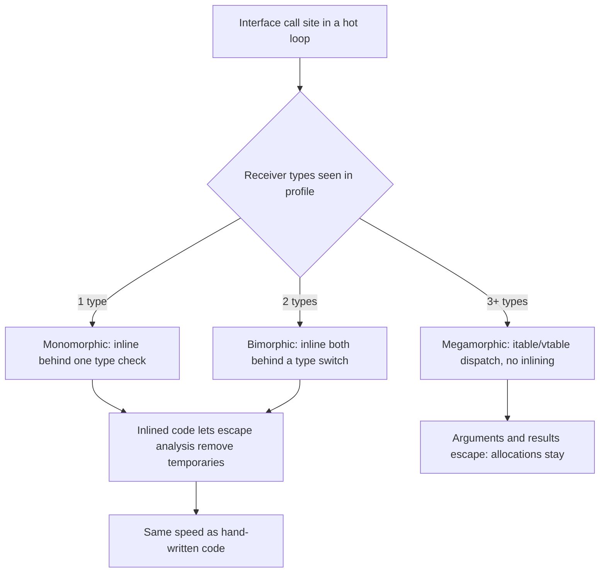
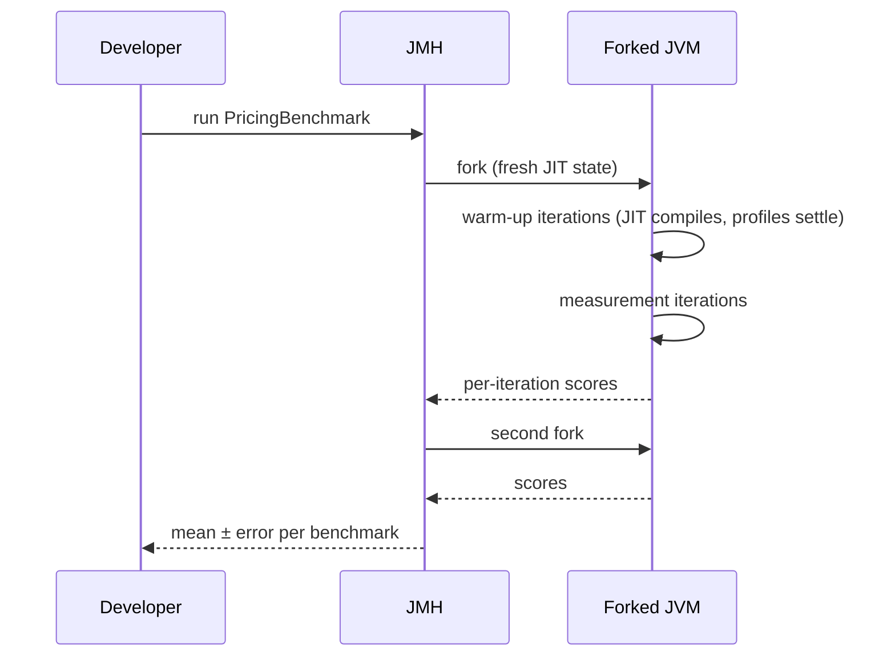

# Performance Cost of Patterns

<span class="badge-l3">L3 🟡 Professional</span> · <span class="read-time">⏱ 45 min read</span> · Prerequisites: [Decorator](../l1-foundations/decorator.md), [Proxy](../l2-practitioner/proxy.md), [Patterns in Spring](patterns-in-spring.md)

!!! abstract "TL;DR"
    Most design patterns add indirection: an interface call, a wrapper object, a proxy, a lookup. On the JVM that indirection is usually **almost free**, because the JIT compiler inlines calls at **monomorphic and bimorphic** call sites and **escape analysis** removes short-lived objects. Costs become real when call sites turn **megamorphic** (many implementations through one site), when objects **escape** (stored, boxed, carried in loops), when calls go through **reflection or dynamic proxies** on hot paths, and at **startup**, where reflective DI containers scan and wire classes. Rules: don't guess, **measure with JMH**; compare against a baseline in the same run; optimise only the hot path, and keep the pattern everywhere else.

## 1. What It Is

**Plain English.** People worry that patterns make code slow: "a Decorator chain of four classes must be four times slower than one method." Usually it isn't, because the JVM rewrites your code as it runs. This page explains when the worry is wrong, when it's right, and how to find out for your own code.

**Definition.** The main cost sources:

| Cost | Patterns affected | Usually matters? |
|------|-------------------|------------------|
| Virtual/interface calls | Strategy, Decorator, State, Visitor, Observer | Only when megamorphic in hot loops |
| Allocation | Builder, Command, value objects, iterators, boxing | When objects escape or are boxed in bulk |
| Reflection and proxies | Spring AOP, JDK Proxy, ORMs, serializers | Hot paths with very short methods |
| Startup | DI containers, classpath scanning, proxies | Serverless, CLIs, autoscaling |
| Memory | Flyweight (helps), caches, wrappers | Large collections |

## 2. Why It Exists

Two opposite mistakes are common. One team avoids interfaces and small objects "for performance" and ends up with unmaintainable code that's no faster. Another stacks proxies, reflection and boxing on a hot path and wonders why throughput collapses. Understanding how HotSpot optimises (inlining, type profiling, escape analysis) and how to measure correctly lets you keep good design almost everywhere and spend effort only where measurements say it pays.

## 3. Mental Model / Analogy

**Analogy.** A warehouse picker following instructions on cards. If every card says "go to the next card" (indirection), it seems slow, but after a few rounds the picker memorises the route and skips the cards (inlining). If the route changes every time (megamorphic), they must read every card. Packing items into boxes that are immediately unpacked costs nothing once the picker learns to skip boxing (escape analysis); boxes that are shipped (escaping) must be real.

**Technical model.** HotSpot starts by interpreting, profiles each call site (which receiver types appear), and compiles hot methods with C2, inlining small methods behind cheap type guards. If a guard fails later, it deoptimises and recompiles.

## 4. How It Works





## 5. Subtopics

### Virtual calls, inlining and megamorphic call sites

**Description.** An interface call (`rule.fee(p)`) needs to find the right implementation. HotSpot records which classes actually appear at each call site. With one class (**monomorphic**), it inlines that implementation behind a type check; with two (**bimorphic**), both; with more (**megamorphic**), it uses a dispatch table and can't inline, which also blocks further optimisations. Patterns like Strategy are usually monomorphic per call site in practice, so they're free.

**Advantages / features.** Clean polymorphic designs cost nothing at mono/bimorphic sites; only a few hot sites ever need attention.

```java title="CallSiteShapesDemo.java"
--8<-- "examples/l3-professional/performance-of-patterns/CallSiteShapesDemo.java"
```

1. Four Strategy implementations of a fee rule.
2. Three identical loops, so each call site gets its own type profile: one with one type, one with two, one with four.
3. Warm-up runs let the JIT compile each loop before it's timed.

**Run it:** `java CallSiteShapesDemo.java`

```text
--8<-- "examples/l3-professional/performance-of-patterns/CallSiteShapesDemo.expected.txt"
```

Timings printed to stderr on one cloud VM (JDK 21); yours will differ:

| Call site | ns/call |
|-----------|---------|
| monomorphic | 1.5 |
| bimorphic | 1.4 |
| megamorphic | 5.4 |

| Situation | Typical effect |
|-----------|----------------|
| Strategy with one active implementation | Free (inlined) |
| Decorator chain, fixed composition | Usually free (each site sees one type) |
| Visitor / Observer over many types in one loop | Megamorphic: 3–5x per call, no inlining |
| `List<Shape>` with many shapes, `shape.area()` | Megamorphic |

**Use** polymorphism freely; check hot loops over heterogeneous collections. **Avoid** "optimising" by replacing interfaces with `instanceof` chains unless JMH shows a real gain; sealed types + `switch` is a clean alternative when you do need it.
**Real-world Java:** `ArrayList.forEach` with many lambda types, Stream pipelines (each lambda a different class), Netty pipelines.
**Best practice:** if a megamorphic site is hot, split by type (sort or group first) so each loop is monomorphic. **Gotcha:** microbenchmarks with one implementation look great and then degrade in production when more implementations load: profile pollution.

### Allocation and escape analysis

**Description.** Patterns create objects: value objects (`Money`), commands, iterators, builders, lambdas. Allocation in the JVM is cheap (bump-the-pointer in thread-local buffers), and **escape analysis** lets C2 eliminate objects that never leave a compiled method (scalar replacement). Objects that are stored in fields or arrays, returned to non-inlined callers, or carried around a loop usually remain real allocations and add GC work.

**Advantages / features.** Immutable value objects and small helper objects are often literally free.

```java title="EscapeAnalysisDemo.java"
--8<-- "examples/l3-professional/performance-of-patterns/EscapeAnalysisDemo.java"
```

1. An immutable value object with methods returning new instances.
2. Temporaries used only to compute a `long` are eliminated by scalar replacement.
3. An object reassigned around a loop flows through a merge point; C2 often can't eliminate it, so one object per iteration is allocated.

**Run it:** `java EscapeAnalysisDemo.java`

```text
--8<-- "examples/l3-professional/performance-of-patterns/EscapeAnalysisDemo.expected.txt"
```

Bytes allocated per iteration on one cloud VM (stderr):

| Style | Bytes/iteration |
|-------|-----------------|
| Temporaries | 0 |
| Loop-carried object | 24 |
| Stored in an array | ~29 (object + reference) |

| Allocation source | Mitigation |
|-------------------|------------|
| Boxing (`List<Long>`, `Map<Integer, ...>`) | Primitive arrays, `LongStream`, primitive collections |
| Loop-carried value objects | Accumulate primitives, convert at the end |
| Iterators in hot loops | Indexed loops over arrays/`ArrayList` (often eliminated anyway) |
| Lambdas capturing variables | Usually eliminated if inlined; non-capturing lambdas are singletons |
| Builders on hot paths | Fine if short-lived and inlined |

**Use** value objects everywhere; they're usually free and always clearer. **Avoid** boxing large numeric datasets; that cost is real and escape analysis doesn't help collections.
**Real-world Java:** `Optional` and `Stream` intermediates are often scalar-replaced; Valhalla value classes (preview) aim to make this guaranteed.
**Best practice:** measure allocation with JMH's `-prof gc` or JFR allocation profiling. **Gotcha:** escape analysis only works after C2 compiles and inlines; in short-lived processes (CLIs, tests) everything allocates.

### Proxy and reflection overhead

**Description.** Frameworks implement Proxy, Decorator and DI using JDK dynamic proxies, CGLIB/ByteBuddy subclasses, reflection (`Method.invoke`) and `MethodHandle`s. Each adds per-call overhead (argument arrays, boxing, access checks, `InvocationHandler` dispatch). For calls that do real work (database, HTTP, milliseconds), nanoseconds of overhead don't matter; for tiny methods in tight loops, they can dominate.

**Advantages / features.** The same transparency that makes Spring AOP, `@Transactional` and mocks possible.

```java title="ProxyReflectionDemo.java"
--8<-- "examples/l3-professional/performance-of-patterns/ProxyReflectionDemo.java"
```

1. A JDK dynamic proxy forwarding to the target, like a minimal AOP proxy.
2. Plain reflection: boxing arguments and results on each call.
3. A bound `MethodHandle`: the JIT can optimise it much better than `Method.invoke`.

**Run it:** `java ProxyReflectionDemo.java`

```text
--8<-- "examples/l3-professional/performance-of-patterns/ProxyReflectionDemo.expected.txt"
```

On one cloud VM (stderr; via a lambda wrapper, so all include that cost):

| Call style | ns/call |
|------------|---------|
| direct | 2.9 |
| interface | 3.2 |
| dynamic proxy | 8.7 |
| reflection (`Method.invoke`) | 18.7 |
| `MethodHandle` | 8.6 |

| Mechanism | Used by | Notes |
|-----------|---------|-------|
| JDK dynamic proxy | Spring AOP (interfaces), Mockito (some modes), Retrofit | Reflection-based dispatch |
| Subclass proxies (ByteBuddy/CGLIB) | Spring AOP on classes, Hibernate lazy loading | Generated bytecode, faster than JDK proxy |
| `Method.invoke` | Older frameworks, Jackson (partly) | Reimplemented on method handles in JDK 18 (JEP 416) |
| `MethodHandle` / `LambdaMetafactory` | Modern frameworks, records' `toString` | Near-direct speed when constant |

**Use** proxies and reflection at boundaries (services, repositories, controllers). **Avoid** them inside tight computational loops; call the target directly or cache method handles in `static final` fields.
**Real-world Java:** Spring `@Transactional` proxies, Hibernate proxies, Jackson's afterburner/blackbird modules.
**Best practice:** a `static final MethodHandle` is treated as a constant and can be inlined. **Gotcha:** Spring self-invocation (`this.method()`) bypasses the proxy entirely, so `@Transactional` or `@Cacheable` silently doesn't apply.

### Measuring with JMH

**Description.** Hand-written timing loops lie: the JIT warms up mid-measurement, removes code whose result is unused (dead-code elimination), folds constants, and different benchmarks pollute each other's type profiles in one JVM. **JMH** (Java Microbenchmark Harness, from the OpenJDK team) handles warm-up, forks fresh JVMs, consumes results with a `Blackhole`, and reports statistics with error bars.

**Advantages / features.** Trustworthy microbenchmarks; built-in profilers (`-prof gc`, `-prof perfasm`, `-prof stack`).

The Maven project in `examples/l3-professional/performance-of-patterns/jmh/` benchmarks the pricing Decorator chain against a flat method:

```java title="PricingBenchmark.java"
--8<-- "examples/l3-professional/performance-of-patterns/jmh/src/main/java/com/freshcart/perf/PricingBenchmark.java"
```

**Run it:**

```bash
cd examples/l3-professional/performance-of-patterns/jmh
mvn -q package
java -jar target/benchmarks.jar                       # full run, about 2 minutes
java -jar target/benchmarks.jar -f 1 -wi 2 -i 3 -p subtotal=52000   # quick check
```

One quick run on a cloud VM (short, so the error bars are wide):

```text
Benchmark                         (subtotal)  Mode  Cnt   Score    Error  Units
PricingBenchmark.decoratorChain        52000  avgt    3   7.605 ± 15.253  ns/op
PricingBenchmark.flat                  52000  avgt    3   6.943 ± 14.293  ns/op
PricingBenchmark.megamorphicLoop       52000  avgt    3  28.254 ±  8.952  ns/op
PricingBenchmark.wrongDeadCode         52000  avgt    3   2.288 ±  1.711  ns/op
```

The decorator chain and the flat method are within noise of each other. `wrongDeadCode` looks fastest because the JIT can discard work whose result is never used; that number is meaningless.

| Pitfall | JMH remedy |
|---------|-----------|
| No warm-up | `@Warmup` iterations |
| Dead-code elimination | Return results or use `Blackhole.consume` |
| Constant folding | Read inputs from `@State` fields, not literals |
| Profile pollution between benchmarks | `@Fork` runs each in a fresh JVM |
| One noisy run | Multiple forks and iterations; report error |
| Unknown cause | `-prof gc`, `-prof stack`, `-prof perfasm` |

**Use** JMH for any claim like "X is faster than Y" at the method level. **Avoid** microbenchmarks for whole-system questions; use load tests and production profiling (JFR, async-profiler) for those.
**Real-world Java:** the JDK itself, Netty, Caffeine and Jackson all maintain JMH suites.
**Best practice:** benchmark realistic inputs (`@Param`) and the shapes production sees (several implementations, not one). **Gotcha:** a benchmark that's faster than physics (sub-nanosecond for real work) is measuring nothing.

### Startup cost of DI containers

**Description.** Reflective DI containers do work at startup: scan the classpath, read annotations, resolve constructors, create proxies. That costs hundreds of milliseconds to seconds, which matters for serverless functions, CLIs, autoscaling and tests. Compile-time DI (Dagger, Micronaut, Quarkus build-time processing, Spring AOT) moves that work to the build.

**Advantages / features.** Same Dependency Injection pattern, different time of wiring; faster startup and lower memory.

```java title="DiStartupDemo.java"
--8<-- "examples/l3-professional/performance-of-patterns/DiStartupDemo.java"
```

1. A tiny reflective container: discovers constructors and resolves dependencies at runtime, caching singletons.
2. Hand wiring: the same object graph built with plain `new`; this is what compile-time DI generates.
3. The container created classes in dependency order; both approaches produce the same graph.

**Run it:** `java DiStartupDemo.java`

```text
--8<-- "examples/l3-professional/performance-of-patterns/DiStartupDemo.expected.txt"
```

On one cloud VM (stderr, cold JVM): reflective container about 2.8 ms for six classes, hand wiring about 5 µs. Real containers handle thousands of classes, plus scanning and proxy generation.

| Approach | Wiring happens | Startup | Examples |
|----------|----------------|---------|----------|
| Reflective container | Runtime | Slowest | Spring (classic), Guice |
| Build-time processing | Build | Fast | Micronaut, Quarkus, Dagger |
| Spring AOT + GraalVM native image | Build | Very fast (tens of ms) | Spring Boot 3 native |
| CDS / AppCDS / Leyden (AOT cache, JDK 24+) | Training run | Faster JVM startup | Any JVM app |
| Hand wiring | Code | Fastest | Small apps, libraries |

**Use** compile-time DI or native images when startup matters (functions, CLIs, scale-to-zero). **Avoid** premature migration for long-running services, where startup is paid once.
**Real-world Java:** Spring Boot 3 AOT and native, Micronaut, Quarkus, Dagger on Android (reflection is slow there).
**Best practice:** measure startup with `-Xlog:startuptime` or Spring's `ApplicationStartup` / `BufferingApplicationStartup` to find slow beans. **Gotcha:** native images need reflection metadata; libraries that use reflection dynamically need hints or fail at runtime.

## 6. Examples (exactly 3, progressively harder)

### Example 1: Minimal (L2)

**Scenario:** QuickDrop's reporting job sums a million order amounts held in a `List<Long>`. How much memory does boxing cost compared with a `long[]`?

```java title="BoxingCostDemo.java"
--8<-- "examples/l3-professional/performance-of-patterns/BoxingCostDemo.java"
```

1. Each `Long` is a separate heap object, plus a reference in the list.
2. A primitive array stores the values inline, 8 bytes each.

**Run it:** `java BoxingCostDemo.java`

**Output:**

```text
--8<-- "examples/l3-professional/performance-of-patterns/BoxingCostDemo.expected.txt"
```

**What to notice:**

- On one VM (stderr), the list used about 28 bytes per amount and the array 8: boxing costs 3.5x memory, and escape analysis can't remove objects stored in a collection.

### Example 2: Realistic (in FreshCart grocery delivery)

**Scenario:** a flash-sale repricing job runs pricing rules (GST, member discount, sale) over 2 million cart lines. Someone proposes replacing the Decorator chain with one flat method "for speed". Measure first.

```java title="PricingHotPathDemo.java"
--8<-- "examples/l3-professional/performance-of-patterns/PricingHotPathDemo.java"
```

1. The flattened alternative: the same arithmetic in one method.
2. Warm-up before timing, and the best of five runs, to reduce noise.
3. Several chain shapes through the same call site make it megamorphic.

**Run it:** `java PricingHotPathDemo.java`

**Output:**

```text
--8<-- "examples/l3-professional/performance-of-patterns/PricingHotPathDemo.expected.txt"
```

**What to notice:**

- On one VM (stderr): flat 9.2 ms, decorator chain 9.6 ms. The pattern is effectively free when the chain's shape is stable.
- Running four different chain shapes through one site took 59 ms for 4x the work, about 1.6x slower per line: megamorphism, not the pattern itself, is the cost.
- The right decision is to keep the decorators; if mixed shapes are ever hot, process each shape in its own batch.

### Example 3: Production-grade

**Scenario:** DairyDay wants CI to catch performance regressions in the pricing hot path. Absolute timings vary between developer laptops and CI machines, so the gate must compare against a baseline measured in the same run, use medians, avoid dead-code elimination, fail obvious regressions even on noisy machines, and say INCONCLUSIVE rather than flake when results are too noisy to judge. Its logic must be unit-testable without real timing.

```java title="PerfBudgetGateDemo.java"
--8<-- "examples/l3-professional/performance-of-patterns/PerfBudgetGateDemo.java"
```

1. A volatile sink consumes every result, so the JIT can't discard the measured work.
2. Warm-up rounds run before measurement; the clock is injected (`System::nanoTime` in production, scripted in tests).
3. Median and p90 resist outliers; the coefficient of variation measures noise.
4. If even the candidate's best time exceeds the budget against the baseline's p90, it's a clear failure regardless of noise.
5. Otherwise, the median ratio is compared with the budget, unless noise makes the result inconclusive.

**Run it:** `java PerfBudgetGateDemo.java`

**Output:**

```text
--8<-- "examples/l3-professional/performance-of-patterns/PerfBudgetGateDemo.expected.txt"
```

**What to notice:**

- The decorator chain passed (it runs at the same speed as the flat method).
- The "stringly" regression (formatting and parsing a number per call) failed by a wide margin even though its timings were noisy because of GC.
- For production use, run real JMH benchmarks in CI with the same relative-budget idea, on dedicated runners.

## 7. Pros, Cons & Trade-offs

| Choice | Pros | Cons |
|--------|------|------|
| Patterns with interfaces | Flexible, testable; usually free | Megamorphic hot sites cost 3–5x per call |
| Value objects | Clear, safe; usually scalar-replaced | Real allocation when stored or loop-carried |
| Proxies / reflection | Transparent cross-cutting concerns | Per-call overhead; self-invocation pitfalls |
| Reflective DI | Convenient, dynamic | Slower startup, more memory |
| Compile-time DI / AOT | Fast startup | Build complexity; less dynamism |
| Hand optimisation | Maximum speed on a hot path | Harder to read and change |

## 8. When to Use / When NOT to Use

**Worry about pattern cost when:**

- profiling shows a hot method dominated by dispatch, reflection or allocation;
- the code runs millions of times per second (pricing engines, parsers, serializers);
- startup time is a requirement (serverless, CLIs, scale-to-zero).

**Don't worry when:**

- the method does I/O (database, network): microseconds are lost in milliseconds;
- the code runs rarely (admin screens, nightly jobs);
- you haven't measured.

## 9. Best Practices

1. **Measure before optimising; use JMH for micro-level claims.** *(Consensus.)*
2. **Profile production-like workloads (JFR, async-profiler) to find real hot spots.** *(Consensus.)*
3. **Keep patterns; optimise only measured hot paths.** *(Consensus.)*
4. **Avoid boxing in large numeric workloads.** *(Consensus.)*
5. **Keep hot call sites monomorphic where it matters (group by type).** *(Consensus among performance engineers.)*
6. **Cache reflective lookups; prefer `MethodHandle` in `static final` fields.** *(Consensus.)*
7. **Use relative performance budgets in CI, on stable runners.** *(Opinion, widely used.)*

## 10. Pitfalls & Anti-Patterns

!!! danger "Proxy on a hot path (production failure mode)"
    **Symptom:** after adding `@Timed` and `@Cacheable` to a small price-lookup method, the repricing job slowed from 4 to 11 minutes.
    **Root cause:** the method was called 50 million times per run; each call went through an AOP proxy, a cache key allocation and a metrics timer, costing more than the method's own work.
    **Fix:** move the annotations to the batch-level method; inside the loop, call the plain implementation; measure with JMH and JFR before and after.

!!! danger "Benchmarking dead code"
    **Symptom:** a benchmark shows the new algorithm at 0.3 ns per call, "100x faster".
    **Root cause:** the result was unused, so the JIT removed the work.
    **Fix:** return results or use `Blackhole`; sanity-check numbers against physics.

!!! danger "Premature de-patterning"
    **Symptom:** strategies replaced with a 400-line `switch` "for performance"; no measurable gain; every change now risky.
    **Root cause:** optimising without measurement.
    **Fix:** revert; measure; optimise only proven hot spots.

!!! danger "Startup blamed on the JVM"
    **Symptom:** a Lambda function takes 9 seconds on cold start.
    **Root cause:** a full Spring context with classpath scanning of 4,000 classes for a function that uses three beans.
    **Fix:** Spring AOT/native image, or a lighter framework, or hand wiring; enable SnapStart/CRaC where available.

## 11. Configuration & Tuning

| Setting | Default | What it does | When to change it | Risk of changing |
|---------|---------|--------------|-------------------|------------------|
| `-XX:+DoEscapeAnalysis` | on | Escape analysis | Never turn off (diagnostics only) | Large slowdowns |
| `-XX:MaxInlineSize` / `-XX:FreqInlineSize` | 35 / 325 bytecodes | Inlining limits | Rarely; measure | Code bloat |
| `-XX:TypeProfileMajorReceiverPercent` | 90 | When a dominant type is inlined at polymorphic sites | Rarely | Deopt churn |
| `-XX:TieredStopAtLevel=1` | full tiering | C1 only: faster startup, slower peak | Short-lived tools, dev | Lower peak performance |
| `-XX:SharedArchiveFile` (AppCDS) | none | Class data sharing archive | Faster startup | Archive maintenance |
| `spring.main.lazy-initialization` | false | Creates beans on first use | Dev and tests | First-request latency, late errors |

## 12. Security Considerations

- Reflection-heavy code may need `--add-opens`, weakening module encapsulation; prefer `MethodHandles.privateLookupIn` with explicit grants.
- Dynamic proxies and bytecode generation increase attack surface (deserialisation gadgets have used proxy classes); keep libraries updated.
- Performance shortcuts must not skip security checks (e.g., bypassing a security proxy by calling the target directly in a loop); keep authorisation at the batch boundary.
- Benchmarks and profilers in production must not expose data; restrict JFR and async-profiler access.

## 13. Performance & Scalability

Rough costs on modern hardware (orders of magnitude, measure your own): inlined call ~0 ns; megamorphic interface call ~2–5 ns; small allocation ~5–20 ns plus GC; dynamic proxy ~5–10 ns; `Method.invoke` ~10–30 ns; uncontended lock ~20 ns; L3 cache miss ~40 ns; database round trip 0.5–5 ms. Pattern overhead matters only when it is a meaningful fraction of the work per call. For throughput, GC pressure from escaping allocations often matters more than dispatch.

## 14. Testing It

Performance logic (statistics, budgets, noise handling) is ordinary code and deserves deterministic unit tests with a scripted clock; the measurements themselves run in JMH or a dedicated CI stage:

```java title="PerfBudgetGateTest.java"
--8<-- "examples/l3-professional/performance-of-patterns/PerfBudgetGateTest.java"
```

## 15. Observability & Operations

In production, use **JFR** (continuous, ~1% overhead) for allocation, lock and method profiling, and **async-profiler** for CPU flame graphs that include JIT-compiled frames. Watch GC metrics (allocation rate, pause times), and JIT events (`jdk.Deoptimization`, compilation failures). Track startup time per deploy. Compare flame graphs before and after refactorings that touch hot paths.

## 16. Version Notes

| Java | Change relevant to pattern performance |
|------|----------------------------------------|
| 6u23 | Escape analysis on by default |
| 7 | `invokedynamic`, `MethodHandle` |
| 8 | Lambdas via `LambdaMetafactory` |
| 9 | AppCDS for application classes (commercial in 8) |
| 12+ | Default CDS archive |
| 18 | Core reflection reimplemented on method handles (JEP 416) |
| 21 | Virtual threads; generational ZGC |
| 24 | Ahead-of-time class loading and linking (JEP 483, Project Leyden) |
| 25 | AOT method profiling (JEP 515), compact object headers (JEP 519) |

## 17. Expert Deep Dive

- **Profile pollution.** Type profiles are per bytecode, not per caller; a shared helper called with many types becomes megamorphic for everyone. Inlining the helper into callers (by making it small) gives each caller its own profile.
- **Class hierarchy analysis (CHA).** If only one class implements an interface at the time of compilation, the JIT can inline without a type check; loading another implementation later triggers deoptimisation.
- **Partial escape analysis.** GraalVM's compiler removes allocations on paths where an object doesn't escape, even if it escapes elsewhere; it often beats C2 on pattern-heavy code (Scala, Kotlin, streams).
- **Valhalla.** Value classes (preview builds) will let `Money`-style objects be flattened in arrays and fields, removing the "stored objects allocate" cost.
- **Startup vs peak.** CDS, Leyden AOT caches and CRaC checkpoints attack startup without giving up the JIT's peak performance; native images trade some peak throughput for instant start.

!!! example "War story: the 11-minute repricing job"
    FreshCart's nightly repricing job took 4 minutes. A team added `@Cacheable` to the price lookup and `@Timed` for metrics, both on a method called 50 million times per run. The job took 11 minutes and allocated 40 GB more. JFR showed most time in proxy dispatch, cache-key construction (`SimpleKey` with boxed arguments) and timer recording, all around a method that did a few arithmetic operations on in-memory data. **Fixes:** caching and timing moved to the per-batch method (one call per 10,000 lines); the inner loop called the implementation directly; a JMH benchmark and a relative budget were added to CI. The job dropped to 3.5 minutes. **Lesson:** proxies are cheap per call for real work, and expensive in bulk for trivial work; put cross-cutting concerns at the right granularity.

## 18. Interview Corner

=== "🟢 L1–L2"

    1. **Are interface calls slow in Java?** Usually **no**: the JIT **inlines** them.
    2. **What's boxing?** Wrapping a primitive in an **object** (`long` → `Long`).
    3. **Why benchmark with JMH?** It handles **warm-up, dead-code elimination, forks and statistics**.
    4. **What's JIT compilation?** Compiling **hot bytecode to machine code** at runtime.
    5. **Does DI slow down startup?** **Reflective** DI can; compile-time DI avoids it.

=== "🟡 L3"

    1. **What's a megamorphic call site?** One that sees **3+ receiver types**: **no inlining**.
    2. **What's escape analysis?** Removing allocations of objects that **don't escape** a compiled method.
    3. **Why can a benchmark show impossible numbers?** **Dead-code elimination or constant folding.**
    4. **Proxy vs MethodHandle vs reflection cost?** **Reflection slowest; MethodHandle near direct when constant.**
    5. **When does pattern overhead matter?** **Tiny methods in hot loops**, not around I/O.

=== "🔴 L4–L5"

    1. **A team wants to remove all interfaces for speed; how do you respond?** **Measure with JMH/JFR; show inlining; optimise only hot spots.**
    2. **How do you reduce startup for a Spring service on serverless?** **AOT/native image, CDS/Leyden, CRaC/SnapStart, fewer beans.**
    3. **How do you design performance regression tests in CI?** **JMH on stable runners, relative budgets, multiple forks, noise handling.**
    4. **Why can a microbenchmark mislead about production?** **Profile pollution, different data shapes, GC and cache effects.**
    5. **How would Valhalla change pattern costs?** **Value objects flattened; no allocation for stored values.**

=== "💻 Hands-on"

    **Task:** In `PricingHotPathDemo`, keep four chain shapes but make each call site monomorphic again, without removing the Decorator pattern.

    ??? success "Solution"
        ```java
        // Process each shape in its own loop method so each has its own call-site profile.
        static long runShape0(Price p, long[] lines) { long s = 0; for (long l : lines) s += p.of(l); return s; }
        static long runShape1(Price p, long[] lines) { long s = 0; for (long l : lines) s += p.of(l); return s; }
        // ... one per shape, or group input lines by shape and dispatch once per batch:
        long total = 0;
        for (Price p : variants) total += batchFor(p).run(p, lines);   // batchFor returns a dedicated loop per shape
        // Re-measure: each loop is monomorphic, so the chain inlines again.
        ```

## 19. Practice

- [ ] Run the JMH project with `-prof gc` and compare `gc.alloc.rate.norm` for each benchmark.
    ??? tip "Hint"
        `java -jar target/benchmarks.jar -prof gc`.
- [ ] Add a `@Benchmark` for a `Stream`-based version of the pricing loop and compare.
    ??? tip "Hint"
        `Arrays.stream(lines).map(chain::of).sum()`.
- [ ] Record a JFR file for `PricingHotPathDemo` and look at the hottest methods.
    ??? tip "Hint"
        `java -XX:StartFlightRecording=duration=30s,filename=rec.jfr PricingHotPathDemo.java`, then open in JDK Mission Control.
- [ ] Measure Spring Boot startup of a sample app with and without `spring.main.lazy-initialization=true`.
    ??? tip "Hint"
        Look at the "Started ... in X seconds" log line, averaged over several runs.

## 20. Quick Revision Card

!!! tip "Remember in 30 seconds"
    - Mono/bimorphic calls inline (free); megamorphic hot sites cost 3–5x per call.
    - Short-lived objects are often scalar-replaced; stored, boxed and loop-carried ones aren't.
    - Proxies and reflection: fine around I/O, costly in tight loops; prefer `MethodHandle`s.
    - Reflective DI costs startup; AOT/compile-time DI and CDS help.
    - Measure with JMH (forks, warm-up, Blackhole); profile with JFR/async-profiler.
    - Keep the pattern; optimise only the measured hot path.

    ```java
    @Benchmark
    public long decoratorChain() {
        return chain.of(subtotal);   // return the result so the JIT can't discard the work
    }
    ```

## 21. Further Reading

- [JMH samples](https://github.com/openjdk/jmh/tree/master/jmh-samples/src/main/java/org/openjdk/jmh/samples), the best tutorial on benchmarking pitfalls.
- Aleksey Shipilёv, ["The Black Magic of (Java) Method Dispatch"](https://shipilev.net/blog/2015/black-magic-method-dispatch/).
- Scott Oaks, *Java Performance* (2nd ed., 2020).
- [OpenJDK Project Leyden](https://openjdk.org/projects/leyden/) and [Spring AOT and native images](https://docs.spring.io/spring-boot/reference/packaging/native-image/index.html).
- [async-profiler](https://github.com/async-profiler/async-profiler) and [JDK Flight Recorder](https://docs.oracle.com/en/java/javase/21/jfapi/).

---

[← Previous: Refactoring to Patterns](refactoring-to-patterns.md) · [Next: L4 Senior / Lead →](../l4-senior/index.md)
