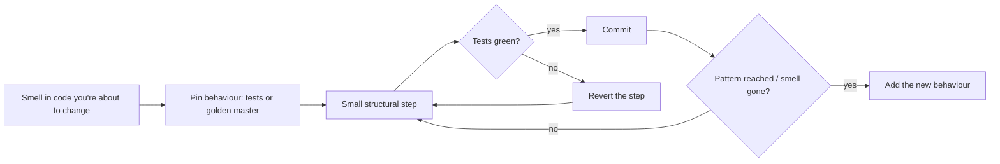
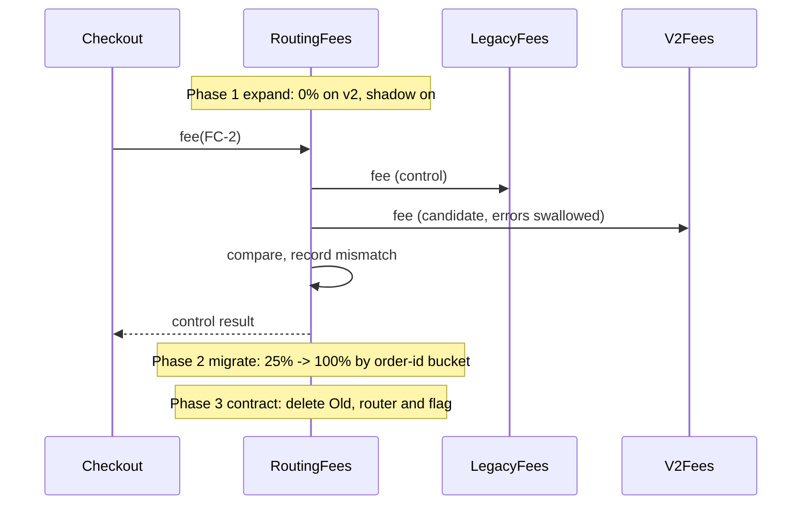

# Refactoring to Patterns

<span class="badge-l3">L3 🟡 Professional</span> · <span class="read-time">⏱ 40 min read</span> · Prerequisites: [Anti-Patterns and Code Smells](anti-patterns-and-code-smells.md), [Strategy](../l1-foundations/strategy.md)

!!! abstract "TL;DR"
    Patterns are best **discovered** in working code, not imposed up front. Joshua Kerievsky's *Refactoring to Patterns* (2004) shows how to move code **toward** a pattern when a smell justifies it, and **away** from one when it no longer pays. The workflow is always the same: pin current behaviour with tests (a golden master if needed), then change structure in small, behaviour-preserving steps, running the tests after each. Key moves: **Replace Conditional with Polymorphism**, **Replace Constructors with Creation Methods**, **Extract Strategy**, and **Inline** a pattern that adds only indirection. For risky production changes, use **Parallel Change** (expand, migrate, contract) with shadow comparison and gradual rollout.

## 1. What It Is

**Plain English.** Refactoring means changing how code is organised without changing what it does. Refactoring *to patterns* means using those small, safe changes to arrive at a design pattern (Strategy, State, Factory) when the code has grown to need it, or to remove one that has become dead weight.

**Definition.**

| Move | From | To | Triggered by |
|------|------|----|--------------|
| Replace Conditional with Polymorphism | `switch`/`if` on a type or status | Subclasses, sealed types, enum methods | The same switch in several places |
| Replace Constructors with Creation Methods | Overloaded constructors | Named static factories | Constructors whose meaning depends on argument types |
| Extract Strategy | Algorithm variants inside a method | Strategy interface + implementations | Variants selected by flags or config |
| Inline Pattern | Observer/Strategy/Factory with one fixed use | Direct calls | Abstraction with no variation |
| Parallel Change | Old implementation | New implementation | Risky replacements in production |

## 2. Why It Exists

Designing every pattern up front leads to speculative generality (the Golden Hammer); never refactoring leads to God Objects and spaghetti. Refactoring to patterns sits between: start simple, and let real duplication and real variation pull the design toward the pattern that removes them. Doing it in small steps under tests makes structural change routine instead of risky, which is what keeps a code base changeable for years.

## 3. Mental Model / Analogy

**Analogy.** Renovating a shop while it stays open. You don't knock down every wall at once. You put up a temporary partition (tests), move one shelf at a time, check customers can still find everything (run tests), and only remove the old shelving when nobody uses it. For a big change (new tills), you run old and new side by side, compare receipts, and switch over one counter at a time (parallel change).

**Technical model.** Every step keeps the code compiling and the tests green. A step is small enough that if tests fail, you revert instead of debugging.

## 4. How It Works





## 5. Subtopics

### Refactoring workflow with tests

**Description.** Before refactoring, make sure behaviour is pinned. If good unit tests exist, use them. If not, write **characterization tests** (also called a **golden master** or approval tests): run the current code over many inputs, save the outputs, and assert later versions produce exactly the same. Then refactor in tiny steps (extract method, rename, introduce guard clauses), running the check after each.

**Advantages / features.** Safe changes to code you don't fully understand; easy reverts; reviewers see each step's intent.

```java title="RefactoringWorkflowDemo.java"
--8<-- "examples/l3-professional/refactoring-to-patterns/RefactoringWorkflowDemo.java"
```

1. A systematic set of inputs, including the boundaries (20 vs 21 items, 100,000 vs 100,001 paise).
2. The golden master: today's outputs, whatever they are, become the expectation.
3. Each refactoring step is checked against it; a red step is reverted, not debugged.

**Run it:** `java RefactoringWorkflowDemo.java`

```text
--8<-- "examples/l3-professional/refactoring-to-patterns/RefactoringWorkflowDemo.expected.txt"
```

| Technique | Use when |
|-----------|----------|
| Existing unit tests | Code is already well tested |
| Characterization tests | Legacy code, unclear behaviour |
| Golden master over generated inputs | Pure functions with many combinations |
| Recorded production traffic | Services with complex real inputs |
| Approval tests (ApprovalTests library) | Large outputs (reports, JSON, HTML) |

**Use** characterization tests whenever behaviour isn't fully understood. **Avoid** "fixing" bugs during refactoring; note them, finish the refactoring, then fix them in a separate commit with a test.
**Real-world Java:** IntelliJ's automated refactorings (Extract Method, Introduce Parameter Object, Replace Constructor with Factory Method) are behaviour-preserving by construction.
**Best practice:** one refactoring per commit, with a message naming it. **Gotcha:** a golden master captures bugs too; that's intentional, since changing behaviour is a separate decision.

### Replace conditional with polymorphism

**Description.** When the same `switch` or `if` chain on a type code or status appears in several methods, move each branch into a type that represents that case. With Java 21, the types can be a sealed interface with records, so data specific to a case (rider and ETA only when out for delivery) lives only there.

**Advantages / features.** One place per case; new cases can't be forgotten; case-specific data has a home.

```java title="ReplaceConditionalWithPolymorphismDemo.java"
--8<-- "examples/l3-professional/refactoring-to-patterns/ReplaceConditionalWithPolymorphismDemo.java"
```

1. Before: string codes switched in two methods, with rider and ETA passed even when meaningless.
2. A sealed interface lists every status; each one implements its behaviour.
3. Only the out-for-delivery status carries a rider and ETA.

**Run it:** `java ReplaceConditionalWithPolymorphismDemo.java`

```text
--8<-- "examples/l3-professional/refactoring-to-patterns/ReplaceConditionalWithPolymorphismDemo.expected.txt"
```

| Steps (Fowler) | |
|----------------|-|
| 1 | Create the type hierarchy (or sealed interface) for the cases |
| 2 | Replace creation of codes with creation of types (factory) |
| 3 | Move one branch at a time into an overriding method; run tests |
| 4 | When all branches are moved, delete the switch |

**Use** it when cases are stable and operations grow. **Avoid** it when operations change more often than cases; then keep a sealed hierarchy with exhaustive `switch` expressions (Visitor-like), so new operations don't touch every type.
**Real-world Java:** `java.util.concurrent.TimeUnit` (enum methods), Spring's `HttpStatus.Series`.
**Best practice:** let the compiler help: sealed types + exhaustive switches fail compilation when a case is missing. **Gotcha:** don't move persistence or UI into the status types; keep them about domain behaviour.

### Replace constructors with creation methods

**Description.** When a class has several constructors whose meaning depends on argument types or order (`new Coupon("X", 100L, 500L)`), replace them with **static creation methods** named after intent: `Coupon.percentOff`, `Coupon.flatOff`, `Coupon.freeDelivery`. Each can validate its own rules and use clearer units.

**Advantages / features.** Readable call sites; per-variant validation; freedom to return cached or subclass instances later.

```java title="CreationMethodsDemo.java"
--8<-- "examples/l3-professional/refactoring-to-patterns/CreationMethodsDemo.java"
```

1. Before: overloaded constructors; `100L, 500L` could mean anything.
2. After: named creation methods with intent-specific validation and units (rupees in, paise inside).
3. Behaviour depends on the fields set by each creation method.

**Run it:** `java CreationMethodsDemo.java`

```text
--8<-- "examples/l3-professional/refactoring-to-patterns/CreationMethodsDemo.expected.txt"
```

| Option | When |
|--------|------|
| Creation methods (`of`, `from`, named) | A few distinct ways to create |
| Builder | Many optional parameters |
| Factory class | Creation needs dependencies or chooses subclasses |
| Plain constructor | One obvious way to create |

**Use** creation methods when there are distinct kinds of an object. **Avoid** them when there's only one way to construct; `new` is clearer.
**Real-world Java:** `List.of`, `Duration.ofMinutes`, `BigDecimal.valueOf`, `Optional.empty`, `LocalDate.of`.
**Best practice:** follow JDK naming: `of`, `from`, `valueOf`, `parse`, `newInstance`, or intent names. **Gotcha:** record canonical constructors stay public; validate in the compact constructor too, or callers can bypass the creation methods.

### Extract strategy

**Description.** When a method contains several versions of an algorithm chosen by flags or config (`if city == "BLR" ... else if city == "PUN"`), extract each version into a class (or lambda) implementing a common interface, and choose one by configuration. The method shrinks to "pick strategy, call it".

**Advantages / features.** New variants without editing existing code; each variant tested alone; selection becomes data.

```java title="ExtractStrategyDemo.java"
--8<-- "examples/l3-professional/refactoring-to-patterns/ExtractStrategyDemo.java"
```

1. Before: three algorithms interleaved in one loop, selected by city.
2. A strategy interface; each variant is a small, readable lambda.
3. The dispatcher maps cities to strategies with a fallback; outputs match the original.

**Run it:** `java ExtractStrategyDemo.java`

```text
--8<-- "examples/l3-professional/refactoring-to-patterns/ExtractStrategyDemo.expected.txt"
```

| Step | Action |
|------|--------|
| 1 | Extract each branch's logic into its own method |
| 2 | Introduce the interface; make each method an implementation |
| 3 | Replace the conditional with a lookup (map, config, DI) |
| 4 | Move selection to configuration; delete the conditional |

**Use** Extract Strategy when variants differ by city, customer type, experiment or version. **Avoid** it for two variants that will never grow; an `if` is fine.
**Real-world Java:** Spring injects `Map<String, Strategy>` of all beans implementing an interface; `Comparator` strategies.
**Best practice:** name strategies by the business rule (`NEAREST`, `BEST_RATED_NOT_BUSY`), not by city. **Gotcha:** subtle shared state in the original loop (like the `best` variable reused across branches) can make variants not quite independent; check with a golden master.

### Inline a pattern that doesn't pay

**Description.** Patterns cost indirection. When an Observer has exactly one listener that will always be there, a Strategy has one implementation, or a Factory always creates the same class, inline it: call the collaborator directly. Kerievsky calls these refactorings "away from" patterns. The dependency becomes visible and navigation becomes trivial.

**Advantages / features.** Less code; "find usages" works; fewer runtime surprises (registration order, missing listeners).

```java title="InlinePatternDemo.java"
--8<-- "examples/l3-professional/refactoring-to-patterns/InlinePatternDemo.java"
```

1. Before: listener interface, event registry and registration code for a single audit listener.
2. After: a plainly named collaborator.
3. The catalogue calls it directly; same result, and the dependency is in the constructor.

**Run it:** `java InlinePatternDemo.java`

```text
--8<-- "examples/l3-professional/refactoring-to-patterns/InlinePatternDemo.expected.txt"
```

| Pattern | Inline when |
|---------|-------------|
| Observer / events | One listener, same module, needs to run synchronously and in a transaction |
| Strategy | One implementation for a year, no plans for more |
| Factory | Always creates the same concrete class, no configuration |
| Decorator chain | One decorator, always applied |
| Interface + Impl | One implementation, not a module boundary, not mocked |

**Use** inlining when variation never arrived. **Avoid** inlining real boundaries: module APIs, ports to infrastructure, extension points for plugins.
**Real-world Java:** many `FooService` + `FooServiceImpl` pairs where the interface exists only by habit.
**Best practice:** inline with the IDE (Inline Class / Inline Method) to keep it behaviour-preserving. **Gotcha:** events are sometimes used for decoupling across modules or for after-commit side effects; check for those reasons before inlining.

## 6. Examples (exactly 3, progressively harder)

### Example 1: Minimal (L2)

**Scenario:** TextBlast's SMS builder is one dense method. Extract named steps without changing the messages.

```java title="ExtractMethodDemo.java"
--8<-- "examples/l3-professional/refactoring-to-patterns/ExtractMethodDemo.java"
```

1. The top-level method now reads like the requirement.
2. Each extracted method has a name that says what it does and can be tested alone.

**Run it:** `java ExtractMethodDemo.java`

**Output:**

```text
--8<-- "examples/l3-professional/refactoring-to-patterns/ExtractMethodDemo.expected.txt"
```

**What to notice:**

- Extract Method is the first step of almost every larger refactoring, including the pattern moves on this page.

### Example 2: Realistic (in FreshCart grocery delivery)

**Scenario:** the discount method grows a new `if` every sale. Marketing wants each discount shown on the receipt. Refactor the conditional chain into rule objects, proven equivalent on 20,000 random carts, and get the receipt lines for free.

```java title="DiscountRulesRefactorDemo.java"
--8<-- "examples/l3-professional/refactoring-to-patterns/DiscountRulesRefactorDemo.java"
```

1. Each discount is a rule with a name and a calculation (Strategy).
2. The engine applies every rule in order and caps the total (a simple chain).
3. A golden master over random carts compares the engine with the original method.

**Run it:** `java DiscountRulesRefactorDemo.java`

**Output:**

```text
--8<-- "examples/l3-professional/refactoring-to-patterns/DiscountRulesRefactorDemo.expected.txt"
```

**What to notice:**

- Zero mismatches gives confidence; the boundary cases are also checked explicitly in the test.
- The receipt breakdown was hard with the `if` chain and trivial with named rules: refactoring made the feature easy.

### Example 3: Production-grade

**Scenario:** PayLink is moving FreshCart to a new fee calculation service. Fees affect every order, so the switch must be provably safe. Use **Parallel Change**: put old and new behind one interface; run the new one in shadow mode, comparing results without affecting customers; fix mismatches; roll out by percentage with stable per-order bucketing; keep a kill switch; finally delete the old code.

```java title="ParallelChangeDemo.java"
--8<-- "examples/l3-professional/refactoring-to-patterns/ParallelChangeDemo.java"
```

1. One interface for both implementations: the seam that makes parallel change possible.
2. The experiment always returns the control result; candidate errors and mismatches are only recorded.
3. Bucketing by order ID makes routing deterministic: the same order always takes the same path.
4. The router combines rollout percentage, kill switch and shadow mode.
5. After the rounding bug is fixed, the shadow run shows zero mismatches.

**Run it:** `java ParallelChangeDemo.java`

**Output:**

```text
--8<-- "examples/l3-professional/refactoring-to-patterns/ParallelChangeDemo.expected.txt"
```

**What to notice:**

- Shadow mode found a one-paisa rounding difference in almost half of orders before any customer saw it.
- At 25%, about a quarter of orders used v2; raising the percentage keeps earlier orders on v2 (tested).
- The kill switch sent all traffic back to the old path instantly, with no deploy.

## 7. Pros, Cons & Trade-offs

| Aspect | Pros | Cons |
|--------|------|------|
| Small steps under tests | Safe, reviewable, revertible | Slower than a big edit (in the short term) |
| Golden master | Works on legacy code with no tests | Freezes bugs; brittle for non-deterministic output |
| Toward patterns | Removes duplication, enables variation | Adds indirection |
| Away from patterns | Less code, clearer flow | May need re-adding if variation appears |
| Parallel change | Zero-downtime, measurable migrations | Temporary duplication, flags to clean up |

## 8. When to Use / When NOT to Use

**Use them when:**

- you're about to change code and the current structure makes the change hard ("make the change easy, then make the easy change");
- the same conditional or duplication appears for the third time;
- replacing a critical component in production.

**Don't use them when:**

- the code is stable and nobody needs to change it;
- you can't pin behaviour and the risk is high (write tests first);
- the "pattern" would serve hypothetical future variation.

## 9. Best Practices

1. **Make the change easy, then make the easy change.** *(Consensus; Kent Beck.)*
2. **Separate refactoring commits from behaviour changes.** *(Consensus.)*
3. **Pin behaviour first; revert red steps instead of debugging.** *(Consensus.)*
4. **Use IDE automated refactorings where available.** *(Consensus.)*
5. **Refactor toward patterns on the rule of three.** *(Consensus.)*
6. **For production replacements: expand, shadow, migrate, contract.** *(Consensus.)*
7. **Remove flags and old paths promptly after migration.** *(Consensus.)*

## 10. Pitfalls & Anti-Patterns

!!! danger "Big-bang migration without shadowing (production failure mode)"
    **Symptom:** after switching to a new fee service, finance found a Rs 4 lakh discrepancy at month end.
    **Root cause:** the new service rounded half-up while the old one truncated; no comparison was run before cutover.
    **Fix:** shadow comparison on real traffic until mismatches are zero (or explained), then gradual rollout with a kill switch.

!!! danger "Refactoring and feature in one PR"
    **Symptom:** a 2,000-line PR "adds express delivery" and nobody can review it; a regression in standard delivery ships.
    **Root cause:** structural changes mixed with behaviour changes.
    **Fix:** one PR (or commit series) that refactors with no behaviour change, then a small PR for the feature.

!!! danger "Non-deterministic golden master"
    **Symptom:** characterization tests fail randomly.
    **Root cause:** outputs include timestamps, random IDs or map iteration order.
    **Fix:** inject clocks and ID generators, sort collections, or scrub volatile fields before comparing.

!!! danger "Flags that never die"
    **Symptom:** three years later, the code has both fee paths and nobody knows which runs.
    **Root cause:** the contract phase never happened.
    **Fix:** a ticket for removal created with the flag; an expiry date the build checks.

## 11. Configuration & Tuning

| Setting | Default | What it does | When to change it | Risk of changing |
|---------|---------|--------------|-------------------|------------------|
| Rollout percentage | 0 | Share of traffic on the new path | Step up: 1, 5, 25, 50, 100 | Larger blast radius |
| Shadow mode | off | Runs candidate for comparison | During expand phase | Double load on dependencies |
| Shadow sample rate | 100% | Fraction compared | High-volume paths | Missing rare mismatches |
| Kill switch | off | Forces the old path | Incidents | None (that's the point) |
| Mismatch alert threshold | — | When to page | Before increasing rollout | Noise vs missed issues |
| Flag expiry | — | Date to remove flag | Always set | Flag debt |

## 12. Security Considerations

- Shadow mode must not cause side effects twice: never shadow non-idempotent calls (payments, emails) for real; compare computations or use test doubles.
- Logs of mismatches may contain personal or financial data; log IDs and diffs, not full payloads.
- Refactoring can silently drop security checks (an authorisation `if` deleted as "dead code"); keep security tests in the golden suite.
- Feature flag systems are control planes; restrict who can change production flags and audit changes.

## 13. Performance & Scalability

Refactoring to patterns usually costs little at runtime: the JIT inlines small methods and monomorphic interface calls (see [Performance Cost of Patterns](performance-of-patterns.md)). Shadow mode doubles the work on the shadowed path; sample it on hot paths and run candidates asynchronously if latency matters. Golden-master test suites with large input sets should run in CI in parallel, or on a sample per commit and fully nightly.

## 14. Testing It

Pin behaviour, then test the migration mechanics themselves (control result always returned, candidate failures contained, rollout deterministic and monotonic, kill switch works):

```java title="ParallelChangeTest.java"
--8<-- "examples/l3-professional/refactoring-to-patterns/ParallelChangeTest.java"
```

## 15. Observability & Operations

During a parallel change, dashboard: share of traffic per path, mismatch rate (with examples), candidate error rate, and latency of both paths. Promote to the next rollout step only when mismatch and error rates are zero or explained over a full business cycle (including peaks). After contract, remove the dashboard and the flag so nobody relies on stale signals.

## 16. Version Notes

| Year / version | Change |
|----------------|--------|
| 1999 | Fowler's *Refactoring* (Java examples) |
| 2001+ | IntelliJ IDEA and Eclipse automate refactorings |
| 2004 | Kerievsky's *Refactoring to Patterns*; Feathers' characterization tests |
| 2014 | Danilo Sato's "Parallel Change"; GitHub's Scientist library (Ruby, later ported to Java) |
| 2018 | *Refactoring* 2nd edition (JavaScript examples, same catalogue) |
| Java 17–21 | Sealed types and pattern matching add a "sealed + switch" alternative to polymorphism |

## 17. Expert Deep Dive

- **Branch by abstraction.** Parallel change in code: introduce an abstraction over the old component, switch callers to it, build the new implementation behind it, switch over, remove the old one, all on trunk without long-lived branches.
- **Expression problem.** Polymorphism makes adding types easy; sealed switches make adding operations easy. Choose based on which axis changes more; refactoring between them is mechanical.
- **Mikado method.** For large refactorings, try the goal, note what breaks, revert, fix prerequisites first; build a dependency graph of small steps.
- **Refactoring at the service level.** Strangler fig, parallel run and shadow traffic apply the same ideas to services and databases (dual writes with reconciliation).
- **Automated refactoring at scale.** OpenRewrite recipes apply refactorings (framework upgrades, API migrations) across hundreds of repositories reproducibly.

!!! example "War story: the one-paisa migration"
    PayLink's fee engine was rewritten as a separate service. A shadow comparison was added "just in case" and ran for a week. It reported mismatches on 48% of orders, all by one paisa: the new code used `Math.round(amount * 0.02)` while the old truncated with integer arithmetic. Individually trivial, it would have meant roughly Rs 4 lakh per month of fee differences and a reconciliation nightmare with the payment partner. The fix was a one-line change; shadow mode then showed zero mismatches for two weeks, through a sale weekend. The rollout went 1%, 10%, 50%, 100% over ten days, and the old path, router and flag were deleted in the following sprint. **Lesson:** compare before you switch; trivial differences multiplied by millions of orders are not trivial.

## 18. Interview Corner

=== "🟢 L1–L2"

    1. **What's refactoring?** **Changing structure without changing behaviour.**
    2. **Why tests before refactoring?** To **detect accidental behaviour changes**.
    3. **What's Extract Method?** Moving a block into a **named method**.
    4. **What's a creation method?** A **named static factory** like `List.of`.
    5. **Why small steps?** Easy to **verify and revert**.

=== "🟡 L3"

    1. **When do you replace a conditional with polymorphism?** When the **same switch appears in several places**.
    2. **What's a golden master?** **Recorded current outputs** used as expected results.
    3. **How do you extract a strategy?** **Extract each branch, introduce the interface, replace the conditional with a lookup.**
    4. **When would you remove a pattern?** When it has **one implementation and no variation**.
    5. **Why separate refactoring from feature commits?** **Reviewability and safe reverts.**

=== "🔴 L4–L5"

    1. **How do you replace a critical component in production?** **Parallel change: expand, shadow, migrate by percentage, contract; kill switch.**
    2. **Polymorphism vs sealed + switch?** **Types change often → polymorphism; operations change often → sealed + switch.**
    3. **How do you refactor a 5,000-line class nobody understands?** **Characterization tests from real inputs, hotspot first, extract by responsibility, Mikado.**
    4. **What can go wrong with shadow traffic?** **Duplicate side effects, extra load, data exposure in logs.**
    5. **How do you refactor across 200 repositories?** **Automated recipes (OpenRewrite), staged rollout, CI verification.**

=== "💻 Hands-on"

    **Task:** Add a "Diwali 15% on sweets" rule to `DiscountRulesRefactorDemo` without editing any existing rule.

    ??? success "Solution"
        ```java
        record FestiveSweets(int sweetsPaise) implements DiscountRule {
            public String name() { return "Diwali 15% on sweets"; }
            public long discount(Cart c) { return sweetsPaise * 15L / 100; }
        }
        // Cart would carry the sweets subtotal; in practice the rule reads cart lines by category.
        var engine = new DiscountEngine(List.of(new FirstOrder(), new MemberFivePercent(),
                new DairyBundle(), new Fresh10Coupon(), new FestiveSweets(40_000)), 50);
        // existing rules and the engine are unchanged: Open/Closed
        ```

## 19. Practice

- [ ] Take the `feeBefore` method from the Anti-Patterns page and refactor it in four commits, each checked against a golden master.
    ??? tip "Hint"
        Delete the dead branch first; then guard clauses.
- [ ] Replace `ExtractStrategyDemo`'s map with Spring's `Map<String, AssignmentStrategy>` injection.
    ??? tip "Hint"
        Bean names become keys: `@Component("BLR")`.
- [ ] Find an interface with exactly one implementation in a project and decide whether to inline it.
    ??? tip "Hint"
        Is it a module boundary, mocked in tests, or an extension point? If none, inline.
- [ ] Add latency measurement for both paths to `ParallelChangeDemo`'s experiment.
    ??? tip "Hint"
        `System.nanoTime()` around each supplier; report P50/P99.

## 20. Quick Revision Card

!!! tip "Remember in 30 seconds"
    - Pin behaviour (tests, golden master), then tiny steps; revert red steps.
    - Repeated switch → polymorphism or sealed types.
    - Confusing constructors → named creation methods.
    - Algorithm variants → Extract Strategy, selection as data.
    - Pattern with no variation → inline it.
    - Risky replacement → parallel change: expand, shadow, migrate, contract.

    ```java
    T run(Supplier<T> control, Supplier<T> candidate) {
        T expected = control.get();
        try { if (!expected.equals(candidate.get())) mismatches++; } catch (RuntimeException e) { errors++; }
        return expected;   // customers always get the old, proven answer
    }
    ```

## 21. Further Reading

- Joshua Kerievsky, *Refactoring to Patterns* (2004).
- Martin Fowler, *Refactoring* (2nd ed., 2018), and the [online catalog](https://refactoring.com/catalog/).
- Michael Feathers, *Working Effectively with Legacy Code* (2004).
- Danilo Sato, ["ParallelChange"](https://martinfowler.com/bliki/ParallelChange.html); Martin Fowler, ["BranchByAbstraction"](https://martinfowler.com/bliki/BranchByAbstraction.html).
- [OpenRewrite](https://docs.openrewrite.org/) for automated large-scale refactoring.

---

[← Previous: Anti-Patterns and Code Smells](anti-patterns-and-code-smells.md) · [Next: Performance Cost of Patterns →](performance-of-patterns.md)
