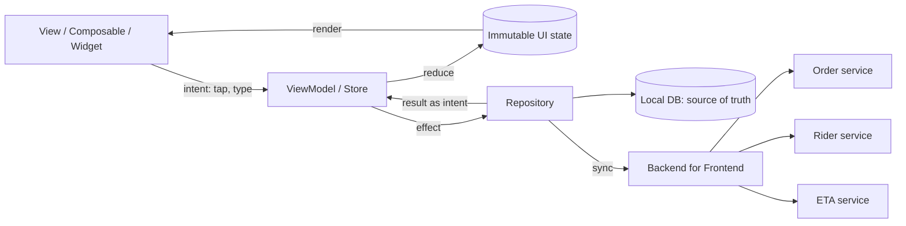
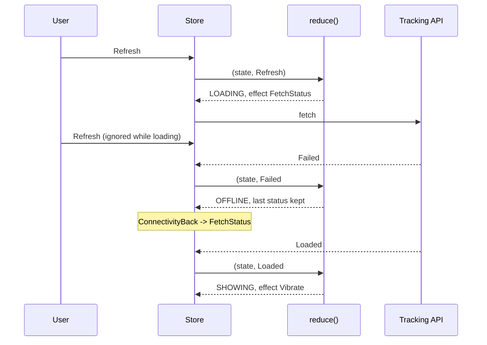

# UI and Mobile Patterns

<span class="badge-l3">L3 🟡 Professional</span> · <span class="read-time">⏱ 45 min read</span> · Prerequisites: [Observer](../l1-foundations/observer.md), [Command](../l2-practitioner/command.md), [State](../l2-practitioner/state.md)

!!! abstract "TL;DR"
    UI code fails when screens hold business logic, state is scattered, and asynchronous answers arrive in surprising orders. **MVC, MVP and MVVM** separate what's shown (view) from what it means (model) and the logic in between (controller, presenter, ViewModel). **MVI / unidirectional data flow** goes further: one immutable state, changed only by a pure reducer, so every screen is a function of state. Mobile apps add **offline-first repositories** (local data is the source of truth), **coordinators** that own navigation, and a **Backend for Frontend** that shapes server data for each client. Android's recommended architecture is MVVM + UDF with Jetpack Compose; Flutter's BLoC and Riverpod follow the same ideas.

## 1. What It Is

**Plain English.** A grocery app's cart screen shows items, totals and a checkout button, reacts to taps, talks to a server that may be slow or unreachable, and must survive the phone rotating or killing the app. UI patterns decide where each of those responsibilities lives so the screen stays correct and testable.

**Definition.** The patterns on this page:

| Pattern | Core idea | Typical home |
|---------|-----------|--------------|
| MVC | Controller handles input, model notifies views | Server-side web (Spring MVC), desktop |
| MVP | Presenter drives a passive view interface | Older Android, GWT, WinForms |
| MVVM | View binds to observable ViewModel state | Android Jetpack, WPF, SwiftUI, Flutter |
| MVI / UDF | Intents → reducer → immutable state → view | Compose, Redux, BLoC |
| Offline-first repository | Local DB is the source of truth; sync in background | Mobile apps |
| Coordinator / navigator | One object decides screen flow | iOS, Android navigation graphs |
| Backend for Frontend | One API layer per client type | Mobile and web backends |

## 2. Why It Exists

Early UIs put everything in the screen class: an Android `Activity` that validated input, called the network, wrote the database and updated widgets. Those screens couldn't be unit-tested, lost state on rotation, leaked memory through callbacks, and showed wrong data when responses arrived out of order. Separating presentation logic from rendering made logic testable; making state explicit and immutable made bugs reproducible; moving data access into repositories made offline support possible.

## 3. Mental Model / Analogy

**Analogy.** A restaurant's order screen in the kitchen. The **model** is the list of orders. The **view** is the screen on the wall. In **MVC**, waiters (controllers) change orders and the screen redraws itself. In **MVP**, a manager (presenter) tells the screen exactly what to show. In **MVVM**, the screen watches a whiteboard (ViewModel) and redraws when it changes. In **MVI**, every change is a written ticket processed in order by one clerk who rewrites the whole whiteboard, so you can replay the day from the tickets.

**Technical model.** Data flows one way: user events → logic → new state → render. Effects (network, navigation, vibration) are triggered by logic but executed outside it, and their results come back as new events.

## 4. How It Works





## 5. Subtopics

### MVC

**Description.** Model-View-Controller splits an interactive app into the **model** (data and rules), **views** (render the model) and **controllers** (turn input into model operations). In classic MVC the model notifies views through Observer; in web MVC (Spring MVC), a controller handles a request, updates or reads the model and picks a view template.

**Advantages / features.** Several views of one model stay in sync; input handling separate from rendering.

```java title="MvcDemo.java"
--8<-- "examples/l3-professional/ui-and-mobile-patterns/MvcDemo.java"
```

1. The model owns the data and notifies listeners on every change; it knows nothing about how it's shown.
2. Two independent views render the same model differently.
3. The controller interprets input and calls model operations; it never touches views.

**Run it:** `java MvcDemo.java`

```text
--8<-- "examples/l3-professional/ui-and-mobile-patterns/MvcDemo.expected.txt"
```

| Variant | Who updates the view | Where |
|---------|----------------------|-------|
| Classic (Smalltalk) MVC | Model notifies views | Desktop toolkits, Swing |
| Web MVC (Model 2) | Controller picks a view per request | Spring MVC, Rails, ASP.NET MVC |
| "Massive View Controller" | Everything in the controller | Anti-pattern in iOS UIKit apps |

**Use** web MVC for server-rendered pages and REST controllers. **Avoid** classic MVC for modern mobile apps; MVVM or MVI fit reactive toolkits better.
**Real-world Java:** Spring MVC `@Controller` + Thymeleaf; Swing's `JTable` with `TableModel`.
**Best practice:** keep controllers thin; they translate input, call services and choose a view. **Gotcha:** on Android, `Activity` was meant as the controller and ended up as controller + view + model: the "massive activity".

### MVP

**Description.** Model-View-Presenter makes the view **passive**: an interface with methods like `showLoading`, `showError`, `goToHome`. The presenter holds all presentation logic and calls those methods; the real view (an Activity, a Swing frame) just implements them. Tests use a fake view.

**Advantages / features.** Presentation logic testable without a UI toolkit; view is trivially simple.

```java title="MvpDemo.java"
--8<-- "examples/l3-professional/ui-and-mobile-patterns/MvpDemo.java"
```

1. The view contract: commands the presenter can give. The real screen implements these.
2. All decisions (validation, loading, errors, navigation) live in the presenter.
3. A recording view lets tests assert exactly what the screen was told to do, in order.

**Run it:** `java MvpDemo.java`

```text
--8<-- "examples/l3-professional/ui-and-mobile-patterns/MvpDemo.expected.txt"
```

| | MVP | MVVM |
|-|-----|------|
| Presenter/ViewModel knows the view | Yes (interface) | No |
| View updates | Imperative calls | Data binding / observation |
| Lifecycle (rotation) | Presenter must be detached/reattached | ViewModel survives configuration changes |
| Tests | Verify calls on fake view | Assert on state values |

**Use** MVP for imperative UI toolkits without binding (Swing, legacy Android Views). **Avoid** it for declarative UIs (Compose, Flutter, SwiftUI), where the view is a function of state.
**Real-world Java:** pre-2017 Android apps (Mosby library), GWT, Vaadin's MVP add-ons.
**Best practice:** one presenter per screen; keep the view interface intention-revealing. **Gotcha:** presenters holding a view reference across asynchronous calls leak the Activity or crash after rotation; detach the view in `onDestroy`.

### MVVM

**Description.** Model-View-ViewModel exposes screen state as **observable properties** on a ViewModel. The view binds to them and sends user actions to ViewModel methods. The ViewModel never references the view, so it survives rotation and is easy to test. On Android: `ViewModel` + `StateFlow`/`LiveData`; in Flutter: `ChangeNotifier`, Riverpod or BLoC.

**Advantages / features.** No view references in logic; automatic UI updates; survives configuration changes.

```java title="MvvmDemo.java"
--8<-- "examples/l3-professional/ui-and-mobile-patterns/MvvmDemo.java"
```

1. A minimal observable value, like `StateFlow`: holds a value and notifies observers only when it changes.
2. The ViewModel exposes state and actions; it has no idea which widgets exist.
3. Views subscribe and redraw; tapping a full slot changes nothing, so nothing redraws.

**Run it:** `java MvvmDemo.java`

```text
--8<-- "examples/l3-professional/ui-and-mobile-patterns/MvvmDemo.expected.txt"
```

| Platform | ViewModel | Observable state | View |
|----------|-----------|------------------|------|
| Android | `androidx.lifecycle.ViewModel` | `StateFlow`, `LiveData` | Compose, XML + data binding |
| Flutter | `ChangeNotifier`, Cubit, Riverpod `Notifier` | `ValueNotifier`, streams | Widgets |
| JavaFX | Plain class | `Property<T>` | FXML with bindings |
| iOS | `ObservableObject` | `@Published` | SwiftUI |

**Use** MVVM as the default for mobile and desktop UIs. **Avoid** many independent observables that can drift out of sync; a single state object (below) prevents impossible combinations.
**Real-world Java:** Android Architecture Components, JavaFX bindings.
**Best practice:** expose read-only state (`StateFlow`) and private mutable state. **Gotcha:** one-off events (show a toast, navigate) as state get replayed after rotation; model them as consumed events or effects.

### MVI and unidirectional data flow

**Description.** Model-View-Intent keeps **one immutable state** per screen. User actions and results become **intents**; a pure **reducer** `(state, intent) → state` produces the next state; the view renders it. Side effects run outside the reducer and feed results back as intents. Because the reducer is pure, every bug is a sequence of intents you can replay.

**Advantages / features.** Impossible states are unrepresentable; time-travel debugging; trivial unit tests; ordering problems become explicit.

```java title="MviDemo.java"
--8<-- "examples/l3-professional/ui-and-mobile-patterns/MviDemo.java"
```

1. The whole screen state in one record.
2. Every way the state can change is an intent type.
3. The reducer is a pure function; it ignores results that belong to an older query.

**Run it:** `java MviDemo.java`

```text
--8<-- "examples/l3-professional/ui-and-mobile-patterns/MviDemo.expected.txt"
```

| | MVVM (many observables) | MVI (single state) |
|-|-------------------------|---------------------|
| State | Several fields | One immutable object |
| Changes | Methods mutate fields | Reducer returns new state |
| Impossible combinations | Possible (loading + error) | Prevented by design |
| Boilerplate | Lower | Higher (intents, reducer) |
| Debugging | Inspect fields | Replay intent log |

**Use** MVI for complex screens with async results, offline behaviour or many interactions. **Avoid** it for static or form-only screens where it's ceremony.
**Real-world Java:** Redux-style stores in Compose apps (Orbit MVI, Mavericks), Flutter BLoC, Elm-inspired architectures.
**Best practice:** keep reducers pure and fast; run effects in the store. **Gotcha:** creating a new state object on every keystroke is fine; deep-copying large lists each time isn't. Use persistent collections or structural sharing.

### Repository for offline-first apps

**Description.** An offline-first repository makes the **local database the single source of truth**. The UI always reads local data (instantly, even offline). Writes go to the local DB and an **outbox** of pending changes; a sync process pushes them when online and pulls server changes. On Android this is Room + WorkManager; in Flutter, Drift or Isar plus a background sync.

**Advantages / features.** Instant UI; works in lifts and basements; survives app restarts; fewer network calls.

```java title="OfflineFirstRepositoryDemo.java"
--8<-- "examples/l3-professional/ui-and-mobile-patterns/OfflineFirstRepositoryDemo.java"
```

1. The local copy is what the UI reads; it never waits for the network.
2. Changes queue in an outbox in order, so nothing is lost while offline.
3. Sync pushes pending changes first, then pulls the server's view (including changes made elsewhere).

**Run it:** `java OfflineFirstRepositoryDemo.java`

```text
--8<-- "examples/l3-professional/ui-and-mobile-patterns/OfflineFirstRepositoryDemo.expected.txt"
```

| Conflict strategy | How | Good for |
|-------------------|-----|----------|
| Last write wins | Timestamp or server order | Preferences, simple lists |
| Server wins | Discard local change, notify user | Prices, stock |
| Field-level merge | Merge non-overlapping fields | Profiles, addresses |
| Operations / CRDTs | Sync operations, not values | Shared lists, collaborative editing |

**Use** offline-first for apps used on the move (shopping lists, delivery rider apps). **Avoid** it for data that must be live (payments, stock reservations); show a clear "offline" state instead.
**Real-world Java:** Android's Now in Android sample (Room + WorkManager), Firebase Firestore's offline persistence.
**Best practice:** make outbox operations idempotent (client-generated IDs) so retries are safe. **Gotcha:** clocks on phones are wrong; don't resolve conflicts with device timestamps.

### Navigation and coordinator patterns

**Description.** A **coordinator** (or navigator, or navigation graph) owns the flow between screens. Screens only report what happened ("checkout tapped", "login succeeded"); the coordinator decides where to go, handles conditional flows (log in first, then continue) and deep links. Screens become reusable in different flows.

**Advantages / features.** Navigation logic in one testable place; screens decoupled from each other; consistent deep-link handling.

```java title="CoordinatorDemo.java"
--8<-- "examples/l3-professional/ui-and-mobile-patterns/CoordinatorDemo.java"
```

1. Screens emit events, not navigation commands.
2. The coordinator maps events to navigation, using flow state (logged in, pending checkout).
3. A conditional detour: log in, then continue to payment where the user left off.

**Run it:** `java CoordinatorDemo.java`

```text
--8<-- "examples/l3-professional/ui-and-mobile-patterns/CoordinatorDemo.expected.txt"
```

| Approach | Platform |
|----------|----------|
| Navigation graph (XML or Compose `NavHost`) | Android Jetpack Navigation |
| `go_router` / `Navigator 2.0` | Flutter |
| Coordinator objects | iOS UIKit |
| Router with route table | Web SPAs (Angular, React Router) |

**Use** a coordinator or navigation graph when flows have conditions, deep links or reuse screens. **Avoid** screens calling each other directly (`startActivity(new Intent(this, PaymentActivity.class))` scattered everywhere).
**Real-world Java:** Jetpack Navigation with Safe Args; Spring Web Flow for server-side wizards.
**Best practice:** treat deep links as just another entry into the coordinator, and rebuild a sensible back stack. **Gotcha:** after payment, reset the stack; pressing Back into a "pay now" screen causes double payments.

### Backend for Frontend

**Description.** A Backend for Frontend (BFF) is a server-side API built for one client type (mobile app, web app, partner). It aggregates calls to several microservices, removes fields the client doesn't need, shapes data per screen, and handles client-specific concerns (versioning, auth tokens, image sizes).

**Advantages / features.** One round trip per screen on slow mobile networks; small payloads; clients evolve independently; internal fields stay internal.

```java title="BffDemo.java"
--8<-- "examples/l3-professional/ui-and-mobile-patterns/BffDemo.java"
```

1. Each client gets a DTO shaped for its screen.
2. The mobile BFF calls three services and returns four fields.
3. The support console's BFF returns different, more detailed data from the same services.

**Run it:** `java BffDemo.java`

```text
--8<-- "examples/l3-professional/ui-and-mobile-patterns/BffDemo.expected.txt"
```

| | Shared general API | BFF per client | GraphQL gateway |
|-|--------------------|----------------|-----------------|
| Payload shape | Generic | Per screen | Client chooses fields |
| Round trips | Many | One per screen | One |
| Ownership | Platform team | Client team | Platform team |
| Risk | Over-fetching | Duplicated logic across BFFs | Expensive queries |

**Use** a BFF when mobile and web need different shapes or aggregation. **Avoid** putting business rules in the BFF; it should compose and shape, not decide.
**Real-world Java:** Spring Boot or Spring Cloud Gateway services per client; Netflix's and SoundCloud's original BFFs.
**Best practice:** the client team owns its BFF. **Gotcha:** fan-out in the BFF multiplies latency and failure points; call services in parallel with timeouts and degrade optional sections.

## 6. Examples (exactly 3, progressively harder)

### Example 1: Minimal (L2)

**Scenario:** QuickDrop's product page has a quantity stepper: minimum 1, maximum the stock limit, with buttons disabled at the limits.

```java title="QuantityStepperDemo.java"
--8<-- "examples/l3-professional/ui-and-mobile-patterns/QuantityStepperDemo.java"
```

1. The ViewModel computes everything the view needs, including which buttons are enabled.
2. The view only renders state; it contains no rules.

**Run it:** `java QuantityStepperDemo.java`

**Output:**

```text
--8<-- "examples/l3-professional/ui-and-mobile-patterns/QuantityStepperDemo.expected.txt"
```

**What to notice:**

- Taps beyond the limits do nothing, and the disabled state comes from the same rule, so the UI and logic can't disagree.

### Example 2: Realistic (in FreshCart grocery delivery)

**Scenario:** the cart screen lists items, shows the subtotal and a "free delivery" nudge, disables checkout when empty, and shows a message when the customer asks for more than is in stock.

```java title="CartScreenDemo.java"
--8<-- "examples/l3-professional/ui-and-mobile-patterns/CartScreenDemo.java"
```

1. One UI state record holds everything the screen shows.
2. Actions go through the ViewModel, which asks the repository and records any message.
3. The state is derived from repository data every time, so totals can't drift.

**Run it:** `java CartScreenDemo.java`

**Output:**

```text
--8<-- "examples/l3-professional/ui-and-mobile-patterns/CartScreenDemo.expected.txt"
```

**What to notice:**

- The "only 1 available" message is part of state, so it survives rotation and is easy to test.
- The free-delivery threshold logic lives in one place; in production it would come from the BFF.

### Example 3: Production-grade

**Scenario:** DairyDay's order-tracking screen. Customers pull to refresh repeatedly, lose signal in lifts, and get late responses from old requests. The screen must never show stale data over new data, must keep the last known status when offline, must vibrate exactly once on delivery, and must restore the open order after Android kills the app in the background.

```java title="OrderTrackingStoreDemo.java"
--8<-- "examples/l3-professional/ui-and-mobile-patterns/OrderTrackingStoreDemo.java"
```

1. One immutable state, with a request number and a minimal saved form for process-death restore.
2. A pure reducer returns the next state **and** the effects to run.
3. Responses for older requests are dropped by comparing request numbers.
4. The store is the only mutable holder; it renders only when the state actually changes.
5. Effects (network, vibration) run outside the reducer, and their results come back as intents.

**Run it:** `java OrderTrackingStoreDemo.java`

**Output:**

```text
--8<-- "examples/l3-professional/ui-and-mobile-patterns/OrderTrackingStoreDemo.expected.txt"
```

**What to notice:**

- The second refresh during loading made no request; three fetches ran in total.
- Offline kept "PACKED" on screen with a banner instead of a blank error page.
- The late answer to request 2 ("OUT_FOR_DELIVERY") arrived after "DELIVERED" and was ignored.
- Only the order ID is saved for restore; data is re-fetched, so it's never stale.

## 7. Pros, Cons & Trade-offs

| Pattern | Pros | Cons |
|---------|------|------|
| MVC | Simple, well known | Fat controllers; poor fit for reactive UIs |
| MVP | Testable, passive view | Lifecycle leaks; verbose view interfaces |
| MVVM | Lifecycle-aware, binding | Scattered observables; event handling awkward |
| MVI | Predictable, replayable | Boilerplate; learning curve |
| Offline-first | Fast, resilient | Sync and conflict complexity |
| Coordinator | Centralised flows | Another layer; can grow large |
| BFF | Lean payloads, client autonomy | More services to run; logic duplication |

## 8. When to Use / When NOT to Use

**Use them when:**

- screens have logic worth testing (validation, async loading, error states);
- the app runs on unreliable networks or must survive lifecycle events;
- several clients consume the same backend differently.

**Don't use them when:**

- the screen is static content; a plain view is enough;
- a prototype or throwaway demo where speed matters more than structure;
- a single client with one simple API; a BFF adds a hop for nothing.

## 9. Best Practices

1. **Views render state and forward events; no business logic in views.** *(Consensus.)*
2. **Single immutable state per screen, updated in one place.** *(Consensus for Compose/Flutter; Android official guidance.)*
3. **Local data as the source of truth for mobile apps.** *(Consensus, Android architecture guide.)*
4. **Ignore stale async results** (request IDs, cancellation, `switchMap`/`collectLatest`). *(Consensus.)*
5. **Navigation in a coordinator or graph, not screen-to-screen calls.** *(Consensus.)*
6. **Save minimal state for process death; re-fetch data.** *(Consensus on Android.)*
7. **The client team owns the BFF.** *(Opinion, Sam Newman's recommendation.)*

## 10. Pitfalls & Anti-Patterns

!!! danger "Stale response overwrites fresh data (production failure mode)"
    **Symptom:** the tracking screen flipped from "Delivered" back to "Out for delivery"; customers called support.
    **Root cause:** two refreshes in flight; the older, slower response arrived last and was rendered.
    **Fix:** tag requests and ignore old ones in the reducer (or cancel previous calls with `collectLatest`/`switchMap`); a test that delivers responses out of order.

!!! danger "Massive Activity / Fragment"
    **Symptom:** a 3,000-line `CheckoutActivity` nobody wants to touch; no unit tests.
    **Root cause:** network, validation, persistence and rendering all in the screen.
    **Fix:** extract a ViewModel and repository; the screen keeps only rendering and event forwarding.

!!! danger "One-off events stored as state"
    **Symptom:** after rotating the phone, the "Order placed!" toast shows again, or navigation happens twice.
    **Root cause:** the event was a field in the ViewModel's state and was replayed to the new view.
    **Fix:** model effects separately (a channel consumed once) or clear the event after handling.

!!! danger "Leaking the view"
    **Symptom:** memory grows with each rotation; crashes "view not attached".
    **Root cause:** presenters or callbacks holding a reference to a destroyed Activity.
    **Fix:** lifecycle-aware ViewModels without view references; cancel work in `onCleared`.

## 11. Configuration & Tuning

| Setting | Default | What it does | When to change it | Risk of changing |
|---------|---------|--------------|-------------------|------------------|
| `SharingStarted.WhileSubscribed(5000)` | — | Keeps flows alive briefly after the UI stops | Avoid restarts on rotation | Wasted work if too long |
| Room / Drift DB as cache | — | Local source of truth | Offline-first apps | Migration effort |
| WorkManager sync constraints | none | Run sync when online/charging | Background sync | Delayed sync |
| `SavedStateHandle` | — | State surviving process death | Store IDs, not data | Bundle size limit (~1 MB transaction) |
| BFF timeouts per downstream | — | Bounds screen latency | Always set | Too short: degraded screens |
| HTTP cache headers from BFF | none | Client-side caching | Static or slow-changing data | Stale data |

## 12. Security Considerations

- Never trust client-side validation; the BFF and services must re-validate.
- Don't store tokens or personal data in plain local databases; use Android Keystore / EncryptedSharedPreferences, iOS Keychain, or `flutter_secure_storage`.
- Deep links are untrusted input: validate parameters and require auth before showing sensitive screens.
- The BFF must not expose internal fields; response DTOs are an allow-list.
- Logs and crash reports from state (MVI intent logs) must redact personal data.

## 13. Performance & Scalability

UI performance means not doing work on the main thread and not re-rendering more than needed. Emit state only when it changes (`distinctUntilChanged`), use stable keys in lists, and keep reducers cheap. Offline-first reads are fast because they're local; batch sync writes. A BFF reduces mobile round trips (each 100–300 ms on 4G), so aggregate in parallel server-side. Measure with Android Studio profilers, Compose recomposition counts, and Flutter DevTools.

## 14. Testing It

Reducers and ViewModels are plain code: test them with plain unit tests, delivering intents and responses in tricky orders. UI tests (Espresso, Compose testing, Flutter widget tests) then only check rendering:

```java title="OrderTrackingStoreTest.java"
--8<-- "examples/l3-professional/ui-and-mobile-patterns/OrderTrackingStoreTest.java"
```

## 15. Observability & Operations

Log screen state transitions (not raw data) in debug builds; in production, record intent names as breadcrumbs for crash reports (Firebase Crashlytics, Sentry). Track sync outbox size and age, offline time, and stale-response drops. For the BFF, trace each downstream call and measure per-screen latency (P50/P95) and payload size.

## 16. Version Notes

| Year / version | Change |
|----------------|--------|
| 1979 | MVC at Xerox PARC (Smalltalk) |
| 1996–2004 | MVP (Taligent, then Fowler's "Passive View") |
| 2005 | MVVM (Microsoft WPF) |
| 2015 | Redux, BFF named by Sam Newman |
| 2017 | Android Architecture Components (ViewModel, LiveData, Room) |
| 2018 | Flutter 1.0; BLoC popularised |
| 2021 | Jetpack Compose 1.0; Android guide recommends UDF |
| 2023+ | Kotlin Multiplatform shared ViewModels; Compose Multiplatform |

## 17. Expert Deep Dive

- **Process death is the real lifecycle test.** Rotation keeps ViewModels; background kills don't. Save IDs and user input, not fetched data, and test with "Don't keep activities".
- **State vs effects.** Things you can see (state) must be replayable; things that happen once (navigate, vibrate, toast) are effects. Mixing them is the root of many UI bugs.
- **Concurrency on the UI.** The same rules as server code apply: only the main thread touches views; async results race; cancellation and request IDs prevent stale writes.
- **Shared logic across platforms.** Kotlin Multiplatform and Dart let you share ViewModels and reducers between Android and iOS; pure reducers make this easy.
- **BFF vs GraphQL.** GraphQL lets clients pick fields from one gateway; a BFF lets client teams own aggregation code. Many companies use GraphQL as the BFF.

!!! example "War story: the delivered order that came back"
    DairyDay's tracking screen refreshed every 30 seconds and on pull-to-refresh. On slow networks, two requests could be in flight; when the older one returned last, the screen jumped from "Delivered" back to "Out for delivery" and sent a second "arriving soon" notification. Support tickets about "ghost deliveries" rose 4x during monsoon weeks. **Fixes:** the screen moved to MVI with request numbers, so the reducer ignored stale answers; notifications became effects emitted only on a status *transition*; and the BFF added `updatedAt` to responses so clients could reject older data even across app restarts. **Lesson:** async UI is concurrent programming; order and idempotency matter as much as on the server.

## 18. Interview Corner

=== "🟢 L1–L2"

    1. **What's MVC?** **Model** (data), **View** (display), **Controller** (input handling).
    2. **Why separate UI from logic?** **Testability** and **reuse**.
    3. **What does a ViewModel do?** Holds **screen state** and **actions**; survives rotation.
    4. **What's offline-first?** **Local data is the source of truth**; sync later.
    5. **What's a BFF?** A **backend per client type** shaping data for its screens.

=== "🟡 L3"

    1. **MVP vs MVVM?** Presenter **calls the view** vs view **observes** ViewModel state.
    2. **What's unidirectional data flow?** **Events → logic → state → view**, one direction.
    3. **How do you handle one-off events?** As **effects/channels**, not persistent state.
    4. **How do you avoid stale responses?** **Request IDs or cancellation** (`collectLatest`).
    5. **Where does navigation logic go?** A **coordinator or navigation graph**.

=== "🔴 L4–L5"

    1. **Design offline-first for a shopping list shared by family members.** **Local DB, outbox with idempotent ops, server merge or CRDT, conflict UI.**
    2. **MVI vs MVVM for a large app?** **MVI** for complex async screens; **MVVM** with single state for simpler ones; consistency matters most.
    3. **How do you survive process death?** **SavedStateHandle with IDs**, re-fetch data, **test with "Don't keep activities"**.
    4. **When is a BFF a bad idea?** **Single client**, or when it accumulates **business rules** duplicated across BFFs.
    5. **How do you share UI logic across Android and iOS?** **KMP/Dart shared ViewModels**, pure reducers.

=== "💻 Hands-on"

    **Task:** Add auto-refresh to `OrderTrackingStoreDemo`: a `Tick` intent every 30 seconds that refreshes only when the screen is `SHOWING` and the order isn't delivered.

    ??? success "Solution"
        ```java
        record Tick() implements Intent {}
        // in reduce():
        case Tick t -> s.phase() == Phase.SHOWING && !"DELIVERED".equals(s.status())
                ? load(s)
                : new Next(s, List.of());
        // the timer lives outside the reducer: a scheduler dispatches new Tick() every 30 s
        // while the screen is visible, and is cancelled when it isn't.
        ```

## 19. Practice

- [ ] Port `CartScreenDemo` to Android with Compose and a `StateFlow<CartUiState>`, or to Flutter with a Cubit.
    ??? tip "Hint"
        The state record and ViewModel logic carry over almost line for line.
- [ ] Add an intent log to the store and replay it to reproduce a bug.
    ??? tip "Hint"
        Record each intent before reducing; replay with `fold`.
- [ ] Add conflict handling to `OfflineFirstRepositoryDemo`: server wins for items deleted on another phone.
    ??? tip "Hint"
        Send a version with each outbox operation.
- [ ] Add a "Repeat last order" deep link to `CoordinatorDemo` that requires login.
    ??? tip "Hint"
        Reuse the pending-action mechanism used for checkout.

## 20. Quick Revision Card

!!! tip "Remember in 30 seconds"
    - View renders state, forwards events; logic in presenter/ViewModel/reducer.
    - MVC: controller → model → views. MVP: presenter → passive view. MVVM: view observes. MVI: intents → pure reducer → one state.
    - State is replayable; effects happen once.
    - Ignore stale async results; save IDs for process death.
    - Mobile: local DB is the source of truth; outbox for writes.
    - Coordinator owns navigation; BFF shapes data per client.

    ```java
    static Next reduce(State s, Intent i) {
        return switch (i) {
            case Loaded l when l.requestNo() != s.requestNo() -> new Next(s, List.of());
            case Loaded l -> new Next(s.showing(l), List.of());
            // ...
        };
    }
    ```

## 21. Further Reading

- Martin Fowler, ["GUI Architectures"](https://martinfowler.com/eaaDev/uiArchs.html) and ["Presentation Model"](https://martinfowler.com/eaaDev/PresentationModel.html).
- [Android: Guide to app architecture](https://developer.android.com/topic/architecture) and [Offline-first apps](https://developer.android.com/topic/architecture/data-layer/offline-first).
- [Flutter: architecture recommendations](https://docs.flutter.dev/app-architecture).
- Sam Newman, ["Backends For Frontends"](https://samnewman.io/patterns/architectural/bff/).
- Hannes Dorfmann, ["Model-View-Intent on Android"](http://hannesdorfmann.com/android/mosby3-mvi-1/).

---

[← Previous: Enterprise Application Patterns](enterprise-application-patterns.md) · [Next: Error Handling Patterns →](error-handling-patterns.md)
