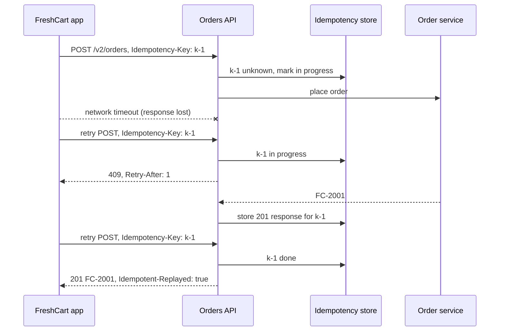
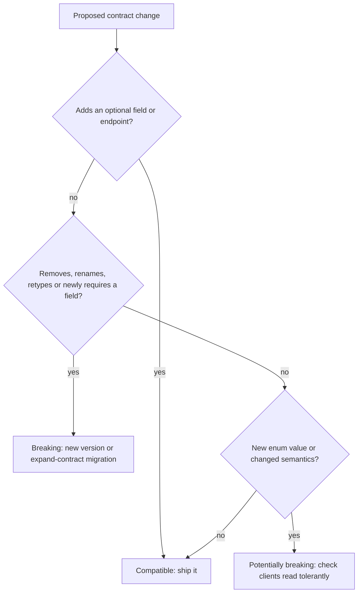

# API Design Patterns

<span class="badge-l4">L4 🟠 Senior / Lead</span> · <span class="read-time">⏱ 30 min read</span> · Prerequisites: [Builder](../l1-foundations/builder.md), [Microservice Patterns](microservice-patterns.md)

!!! abstract "TL;DR"
    An API is a promise to code you don't control, so design it to evolve without breaking callers. **Fluent interfaces** (and staged builders) make Java APIs read well and make misuse fail to compile. **Versioning** lets incompatible changes coexist; deprecate with dates and measure usage before retiring. **Cursor (keyset) pagination** stays correct and fast as data changes; offset pagination doesn't. **Idempotency keys** make retried POSTs safe: store the result per key and replay it. **Backward compatibility rules**: add optional fields freely; never remove, rename, retype or newly require fields; treat new enum values as potentially breaking; clients read tolerantly. Consistent errors (Problem Details) round it off.

## 1. What It Is

**Plain English.** FreshCart's API is used by its own apps (some installed years ago and never updated), partner systems and internal services. These patterns make the API pleasant to call, safe to retry, efficient to page through, and possible to change without breaking any of those callers.

**Definition.**

| Pattern | Problem it solves |
|---------|-------------------|
| Fluent interface | Readable call chains; invalid combinations fail to compile |
| Versioning | Incompatible changes without breaking existing clients |
| Pagination | Large result sets in stable, efficient chunks |
| Idempotency keys | Safe retries for non-idempotent operations |
| Backward compatibility rules | Evolving contracts without new versions |

## 2. Why It Exists

Clients upgrade slowly: mobile apps stay installed for years, partners deploy quarterly, internal teams have their own priorities. Every breaking change forces all of them to change at once or break. Networks fail mid-request, so clients retry, and without idempotency a retried payment is a double charge. Lists grow from tens to millions of rows, and page 5,000 of an offset query scans everything before it. These patterns are the accumulated practice of public API providers (Stripe, Google, GitHub) and of Java library design (Bloch's *Effective Java*).

## 3. Mental Model / Analogy

**Analogy.** A restaurant menu. Fluent: you order in a natural sequence (starter, main, dessert) and the waiter won't take dessert before a main. Versioning: a new menu is printed while regulars can still order from the old one until a stated date. Pagination: "show me the next ten dishes after the one I'm looking at", not "skip the first 40 dishes" while the kitchen adds specials. Idempotency key: your order number; if you ask twice, you get the same order, not two meals. Compatibility: you can add dishes to the menu, but you can't quietly change what "Thali" means.

**Technical model.** A contract (types, fields, status codes, semantics) with rules for how it may change, plus protocol-level mechanisms (headers, cursors, keys) that make interactions safe under failures and growth.

## 4. How It Works





## 5. Subtopics

### Fluent interfaces

**Description.** Methods return an object (often `this`) so calls chain into readable sentences: `slots().in("BLR").on(date).withAtLeast(5)`. A **staged (step) builder** returns a different interface at each step, so required steps can't be skipped or reordered and the compiler enforces the API's grammar.

**Advantages / features.** Readable, discoverable through IDE completion; required parameters enforced at compile time; optional parameters without telescoping constructors.

```java title="FluentInterfaceDemo.java"
--8<-- "examples/l4-senior/api-design-patterns/FluentInterfaceDemo.java"
```

1. Each step is its own interface exposing only the next valid methods.
2. Lambdas implement the required steps; optional settings return the same object.
3. The call reads like a sentence and can only be written in a valid order.

**Run it:** `java FluentInterfaceDemo.java`

```text
--8<-- "examples/l4-senior/api-design-patterns/FluentInterfaceDemo.expected.txt"
```

| Style | Example | Notes |
|-------|---------|-------|
| Mutable builder returning `this` | `StringBuilder`, Lombok `@Builder` | Simple; required fields checked at runtime |
| Staged builder | jOOQ DSL, this demo | Compile-time order; more interfaces |
| Immutable "wither" chain | `java.time` (`withDayOfMonth`) | Each call returns a new value |
| Query DSL | Criteria API, AssertJ | Domain-specific vocabulary |

**Use** for builders, query DSLs and configuration. **Avoid** fluent setters on entities (`order.setX().setY()` breaks JavaBeans tools and hides invariants).
**Real-world Java:** `HttpClient.newBuilder()`, `Stream`, AssertJ `assertThat(...).isEqualTo(...)`, jOOQ, Spring Security `HttpSecurity` lambdas.
**Best practice:** end chains with a terminal method (`build()`, `execute()`) and validate there. **Gotcha:** long chains make stack traces and debugging harder; keep each step simple.

### Versioning

**Description.** When a change can't be made compatibly, publish a new version and serve both. Common schemes: URI (`/v2/orders`), header (`Accept: application/vnd.freshcart.v2+json`, `API-Version: 2026-11-01`) or date-based versions. Keep one domain model and render each version from it. Announce retirement with `Deprecation` and `Sunset` headers and track usage per version.

**Advantages / features.** Old clients keep working; new clients get the better contract; retirement becomes a measured, planned event.

```java title="VersioningDemo.java"
--8<-- "examples/l4-senior/api-design-patterns/VersioningDemo.java"
```

1. One representation function per version, all rendering the same domain model.
2. The version comes from the URI here; headers work the same way.
3. Old versions carry deprecation and sunset information, and usage is counted.

**Run it:** `java VersioningDemo.java`

```text
--8<-- "examples/l4-senior/api-design-patterns/VersioningDemo.expected.txt"
```

| Scheme | Pros | Cons |
|--------|------|------|
| URI `/v2/` | Visible, cacheable, easy routing | Versions whole API surface |
| Header / media type | Clean URIs, per-resource | Harder to test in a browser; caches need `Vary` |
| Date-based (Stripe-style) | Fine-grained, pinned per client | Needs version transformation layers |
| No versioning, only compatible changes | Simplest for clients | Requires strict discipline |

**Use** versions for genuinely breaking changes, and as rarely as possible. **Avoid** versioning every release, and avoid forking the domain model per version.
**Real-world Java:** Spring `@RequestMapping("/v2/...")`, Spring Framework 7 API versioning support (`ApiVersionConfigurer`), springdoc OpenAPI groups per version.
**Best practice:** support at least two versions in parallel and publish a deprecation policy. **Gotcha:** mobile apps in the field may call v1 for years; measure before you sunset.

### Pagination

**Description.** Return large collections in pages. **Offset pagination** (`?offset=40&limit=20`) is simple but slow for deep pages and inconsistent when rows are inserted or deleted between requests. **Cursor (keyset) pagination** returns an opaque cursor encoding the last item's sort key, and the next request asks for items after it: stable under inserts and fast with an index.

**Advantages / features.** Bounded response sizes; no duplicates or gaps while data changes; constant-time page fetches with a matching index.

```java title="PaginationDemo.java"
--8<-- "examples/l4-senior/api-design-patterns/PaginationDemo.java"
```

1. Offset pagination counts from the start every time.
2. Cursor pagination continues after the last key seen.
3. The cursor is opaque to clients (encoded), so the server can change its contents later.

**Run it:** `java PaginationDemo.java`

```text
--8<-- "examples/l4-senior/api-design-patterns/PaginationDemo.expected.txt"
```

| | Offset | Cursor / keyset |
|-|--------|-----------------|
| Jump to page N | Yes | No (next/previous only) |
| Inserts during paging | Duplicates or gaps | Stable |
| Deep page cost | Scans skipped rows | Index seek |
| Total count | Easy (but expensive) | Usually omitted |
| SQL | `OFFSET ? LIMIT ?` | `WHERE (placed_at, id) < (?, ?) ORDER BY ... LIMIT ?` |

**Use** cursors for feeds, histories and large or changing lists; offsets for small, stable admin tables. **Avoid** exposing raw database IDs or SQL in cursors.
**Real-world Java:** Spring Data `Window`/`ScrollPosition` (keyset scrolling), jOOQ `seek()`, GraphQL Relay connections.
**Best practice:** cap `limit` server-side and make the sort order total (add a unique tie-breaker). **Gotcha:** sorting by a non-unique column alone (timestamp) skips or repeats rows that share a value.

### Idempotency keys

**Description.** For non-idempotent operations (create order, charge card), the client generates a unique key per logical operation and sends it in an `Idempotency-Key` header. The server stores the request fingerprint and response under that key; a retry with the same key returns the stored response instead of performing the operation again.

**Advantages / features.** Clients can retry safely after timeouts; no double orders or charges; simple client logic.

```java title="IdempotencyKeyDemo.java"
--8<-- "examples/l4-senior/api-design-patterns/IdempotencyKeyDemo.java"
```

1. A key reused with a different request is a client bug; reject it.
2. Same key, same request: replay the stored response.
3. The response is stored under the key after the first execution.

**Run it:** `java IdempotencyKeyDemo.java`

```text
--8<-- "examples/l4-senior/api-design-patterns/IdempotencyKeyDemo.expected.txt"
```

| Detail | Recommendation |
|--------|----------------|
| Key format | Client-generated UUID per logical operation |
| Scope | Per client/account + key |
| Stored | Request fingerprint, status, response body, headers |
| Concurrent duplicate | 409 with `Retry-After` while in progress |
| Server errors | Release the key so the client can retry |
| Retention | Longer than any client retry window (often 24 h+) |

**Use** on every POST that creates or charges. **Avoid** generating the key on the server or per HTTP attempt (it must survive retries).
**Real-world Java:** a filter or interceptor with a database table keyed by `(client_id, idempotency_key)` and a unique constraint; Stripe's API popularised the header (IETF draft `Idempotency-Key`).
**Best practice:** store the key and the business effect in the same transaction. **Gotcha:** keys that expire before the client stops retrying (an app offline for two days) let duplicates through.

### Backward compatibility rules

**Description.** Rules that decide whether a contract change can ship without a new version. Safe: adding endpoints, optional request fields, response fields. Breaking: removing or renaming fields, changing types or meaning, making optional fields required, tightening validation, changing defaults. Potentially breaking: new enum values (strict clients fail), new error codes. Clients follow the **tolerant reader** rule: ignore unknown fields, handle unknown enum values.

**Advantages / features.** Most changes ship without versions; checks can be automated in CI against the published schema.

```java title="BackwardCompatibilityDemo.java"
--8<-- "examples/l4-senior/api-design-patterns/BackwardCompatibilityDemo.java"
```

1. Removing a field or changing its type breaks clients that read it.
2. A newly required field breaks clients that don't send it.
3. New enum values break clients that map statuses with a strict `switch` or enum.

**Run it:** `java BackwardCompatibilityDemo.java`

```text
--8<-- "examples/l4-senior/api-design-patterns/BackwardCompatibilityDemo.expected.txt"
```

| Change | Compatible? |
|--------|-------------|
| Add optional response field | Yes (tolerant readers) |
| Add optional request field with a default | Yes |
| Add enum value | Only if clients handle unknowns |
| Rename field | No: add new, deprecate old, remove later (expand and contract) |
| Change type (number to object) | No |
| Tighten validation | No |
| Change default behaviour | No, even if the schema is unchanged |

**Use** these rules as a CI gate on your OpenAPI or schema files. **Avoid** "it's only a small rename".
**Real-world Java:** openapi-diff or oasdiff in CI, Jackson `FAIL_ON_UNKNOWN_PROPERTIES=false` and `@JsonEnumDefaultValue` for tolerant reading, Protobuf field-number rules.
**Best practice:** expand and contract: add the new field, migrate clients, then remove the old one. **Gotcha:** Hyrum's Law: with enough users, every observable behaviour (field order, timing, error text) is depended on by somebody.

## 6. Examples (exactly 3, progressively harder)

### Example 1: Minimal (L2)

**Scenario:** FreshCart's API returned errors in four different shapes. Clients now get one standard shape.

```java title="ProblemDetailsDemo.java"
--8<-- "examples/l4-senior/api-design-patterns/ProblemDetailsDemo.java"
```

1. RFC 9457 fields: a type URI, a short title, the status, a human-readable detail and the request path.
2. The type identifies the problem precisely; clients branch on it, not on the message text.

**Run it:** `java ProblemDetailsDemo.java`

**Output:**

```text
--8<-- "examples/l4-senior/api-design-patterns/ProblemDetailsDemo.expected.txt"
```

**What to notice:**

- Spring Boot 3+ can produce this shape for you (`spring.mvc.problemdetails.enabled=true`, `ProblemDetail`, `ErrorResponseException`).

### Example 2: Realistic (in FreshCart grocery delivery)

**Scenario:** the "My orders" screen pages through a customer's orders, newest first, filtered by status. Several orders often share the same timestamp, and the app must not be able to forge cursors.

```java title="OrderHistoryApiDemo.java"
--8<-- "examples/l4-senior/api-design-patterns/OrderHistoryApiDemo.java"
```

1. The cursor carries the last position and the filter, so later pages can't drift to a different query.
2. Keyset condition on (placedAt, id): ties on time are broken by ID.
3. Cursors are signed with an HMAC; edited or forged cursors are rejected.

**Run it:** `java OrderHistoryApiDemo.java`

**Output:**

```text
--8<-- "examples/l4-senior/api-design-patterns/OrderHistoryApiDemo.expected.txt"
```

**What to notice:**

- FC-104 and FC-102 share a timestamp, and paging split between them without skipping or repeating either.
- The second request's filter parameter was ignored; the cursor's filter won.
- The secret is hardcoded only for the demo; in production it comes from a secrets manager and is rotated.

### Example 3: Production-grade

**Scenario:** the checkout endpoint must be safe under retries from flaky mobile networks, concurrent double-taps, partial outages and two API versions.

```java title="CheckoutApiDemo.java"
--8<-- "examples/l4-senior/api-design-patterns/CheckoutApiDemo.java"
```

1. Missing keys are rejected with a Problem Details error, so every client is forced to be retry-safe.
2. A duplicate that arrives while the first request is running gets 409 and `Retry-After`.
3. A completed key replays the stored response, marked with `Idempotent-Replayed`.
4. Server-side failures release the key so the client can retry with the same key.
5. Responses are rendered per version from one domain result.

**Run it:** `java CheckoutApiDemo.java`

**Output:**

```text
--8<-- "examples/l4-senior/api-design-patterns/CheckoutApiDemo.expected.txt"
```

**What to notice:**

- Validation errors (422) are stored and replayed like successes; only server errors release the key.
- The v1 retry got rupees as a decimal and the v2 calls got a money object, from the same `Placed` result.
- After 24 hours the key had expired and the same request created a third order: retention must outlast every client's retry behaviour.

## 7. Pros, Cons & Trade-offs

| Pattern | Pros | Cons |
|---------|------|------|
| Fluent interface | Readable, compile-time safety (staged) | More types; harder debugging |
| Versioning | Breaking changes without breaking clients | Parallel maintenance; version sprawl |
| Cursor pagination | Stable, fast | No random page access; opaque cursors |
| Idempotency keys | Safe retries | Storage, retention, extra checks |
| Compatibility rules | Fewer versions | Discipline; tolerant clients needed |

## 8. When to Use / When NOT to Use

**Use them when:**

- clients are outside your release cycle (mobile apps, partners, other teams);
- operations have side effects and networks are unreliable;
- collections can grow without bound.

**Don't overdo them when:**

- the API is internal to one deployable and changes together with its callers;
- a list is small and bounded (a full response is fine);
- an operation is naturally idempotent (PUT of a full resource, DELETE).

## 9. Best Practices

1. **Design contract-first (OpenAPI) and check compatibility in CI.** *(Consensus.)*
2. **Add, don't change: expand and contract for renames.** *(Consensus.)*
3. **Clients read tolerantly: ignore unknown fields, handle unknown enum values.** *(Consensus.)*
4. **Idempotency keys on all creating POSTs.** *(Consensus.)*
5. **Cursor pagination with a total sort order and a server-side limit cap.** *(Consensus.)*
6. **One error format (Problem Details) across the API.** *(Consensus.)*
7. **Publish deprecation policy; send `Deprecation`/`Sunset` headers; measure usage.** *(Widely used.)*

## 10. Pitfalls & Anti-Patterns

!!! danger "Double orders from app retries (production failure mode)"
    **Symptom:** customers on slow networks received two identical deliveries and two charges.
    **Root cause:** the app retried `POST /orders` after a timeout; the first request had succeeded.
    **Fix:** mandatory `Idempotency-Key` generated once per checkout attempt and stored with the order (Example 3).

!!! danger "Renamed field breaks old apps"
    **Symptom:** app versions older than three months showed blank prices.
    **Root cause:** `price` renamed to `unitPrice` in a "harmless cleanup".
    **Fix:** expand and contract; compatibility checks in CI; keep old fields until usage reaches zero.

!!! danger "New enum value crashes clients"
    **Symptom:** Android app crashed on the order screen after `OUT_FOR_DELIVERY` was added.
    **Root cause:** the app mapped statuses to an enum with `valueOf`, failing on unknown values.
    **Fix:** clients map unknown values to a default (`UNKNOWN`); servers add new values behind client capability checks.

!!! danger "Deep offset pagination"
    **Symptom:** the admin order export slowed to minutes per page after a year.
    **Root cause:** `OFFSET 400000` scanned and discarded rows every request.
    **Fix:** keyset pagination on an indexed (created_at, id).

## 11. Configuration & Tuning

| Setting | Default | What it does | When to change it | Risk of changing |
|---------|---------|--------------|-------------------|------------------|
| Max page size | — | Caps `limit` | Always set (e.g. 100) | Too low: chatty clients |
| Idempotency key retention | — | How long keys are remembered | Above client retry window | Storage growth |
| Jackson `FAIL_ON_UNKNOWN_PROPERTIES` | true | Strict reading | false for clients | Typos go unnoticed |
| Jackson `READ_UNKNOWN_ENUM_VALUES_USING_DEFAULT_VALUE` | false | Unknown enum handling | true with `@JsonEnumDefaultValue` | Silent defaults |
| Spring `spring.mvc.problemdetails.enabled` | false | RFC 9457 errors | true | Error shape change for clients |
| Spring Data `Pageable` max size | 2000 | Caps `size` param | Lower it | Clients requesting more get capped |

## 12. Security Considerations

- Cursors must not leak internal data or allow access to other users' data; sign or encrypt them and re-check authorisation per page.
- Idempotency keys are scoped per client or user; otherwise one client could replay another's response.
- Cap page sizes and request bodies to prevent resource exhaustion.
- Error details must not reveal stack traces, SQL or internal hostnames.
- Old API versions need security fixes too, or must be retired.

## 13. Performance & Scalability

Keyset pagination is O(log n) per page with the right composite index; offset is O(offset). Idempotency lookups add one indexed read per request; keep the table partitioned or TTL-cleaned. Version transformation layers add little CPU but grow complexity; prefer rendering from one model. Fluent builders allocate small objects; irrelevant except in hot loops.

## 14. Testing It

Test the API's behaviour under retries, concurrency, failures and versions:

```java title="CheckoutApiTest.java"
--8<-- "examples/l4-senior/api-design-patterns/CheckoutApiTest.java"
```

Add contract tests (Spring Cloud Contract, Pact) per consumer and an OpenAPI diff check in CI.

## 15. Observability & Operations

Track requests per API version and per client app version (to plan sunsets), idempotent replays and 409s (signals of client retry behaviour), 422s on reused keys (client bugs), page sizes and deep-pagination usage, and error types by Problem Details `type`. Publish a changelog and deprecation schedule.

## 16. Version Notes

| Year | Change |
|------|--------|
| 2005 | Fowler names "Fluent Interface" |
| 2008 | *Effective Java* 2nd ed.: Builder for many parameters |
| 2010s | Stripe popularises Idempotency-Key and date-based API versions |
| 2016 | RFC 7807 Problem Details; OpenAPI 3 work begins (3.0 in 2017) |
| 2019 | RFC 8594 `Sunset` header |
| 2023 | RFC 9457 replaces 7807; Spring Data 3.1 adds keyset scrolling |
| 2025 | RFC 9745 `Deprecation` header; Spring Framework 7 adds first-class API versioning |

## 17. Expert Deep Dive

- **Hyrum's Law.** Observable behaviour becomes contract. Randomise what you don't promise (map ordering, timing) to prevent accidental dependencies.
- **Version transformation chains.** Stripe-style: the core speaks the latest version; per-version transformers convert requests and responses step by step back to each client's pinned version.
- **Postel's law, revisited.** Liberal reading in clients is good; liberal acceptance in servers can lock you into quirks forever. Validate strictly on input, read tolerantly on output.
- **Consumer-driven contracts.** Let consumers publish what they use, and break only what nobody uses.
- **Library APIs.** For Java libraries, binary compatibility (method signatures, default methods, sealed hierarchies) matters as much as source compatibility; tools like japicmp and Revapi check it.

!!! example "War story: two deliveries, two charges"
    FreshCart's checkout used a plain `POST /orders`. When a popular sale coincided with a mobile network slowdown in Pune, the app's HTTP client timed out after 10 seconds and retried automatically. The first request had usually succeeded. About 1,100 customers were charged twice and 600 received duplicate deliveries before the app was patched. **Fixes:** a mandatory `Idempotency-Key` created once per checkout attempt and persisted on the device, 409 for in-flight duplicates, replay of stored responses, key retention of 7 days because some app versions retried on next launch, and a dashboard of replays per app version. **Lesson:** every client retries eventually, so every creating endpoint needs an answer for "what if this arrives twice?"

## 18. Interview Corner

=== "🟢 L1–L2"

    1. **What's a fluent interface?** **Chained calls** that read like a sentence.
    2. **Why version an API?** To make **breaking changes without breaking existing clients**.
    3. **Why paginate?** To return **large collections in bounded chunks**.
    4. **What's idempotent?** **Same effect whether done once or many times.**
    5. **Is adding a response field breaking?** **No**, for tolerant clients.

=== "🟡 L3"

    1. **Offset vs cursor pagination?** **Skip N** vs **continue after last key**; cursor is stable and fast.
    2. **Which HTTP methods are idempotent?** **GET, PUT, DELETE** (and HEAD, OPTIONS); **POST isn't**.
    3. **How do idempotency keys work?** **Store response per key; replay on retry.**
    4. **What's a staged builder?** A builder with **an interface per step** to enforce order.
    5. **Is a new enum value breaking?** **Potentially**, for strict clients.

=== "🔴 L4–L5"

    1. **How do you rename a field safely?** **Expand and contract.**
    2. **URI vs header versioning?** **Visibility and routing** vs **clean URIs and per-resource**; both fine if consistent.
    3. **Concurrent requests with the same key?** **First wins; others get 409 while in progress.**
    4. **How do you decide when to sunset v1?** **Usage metrics per client version, published policy, Sunset headers.**
    5. **What's Hyrum's Law?** **All observable behaviour gets depended on.**

=== "💻 Hands-on"

    **Task:** Add a server-side cap to `OrderHistoryApiDemo.list`: clamp `limit` to 1..50 and default to 20 when it's 0 or missing.

    ??? success "Solution"
        ```java
        static int effectiveLimit(Integer requested) {
            if (requested == null || requested == 0) return 20;
            return Math.max(1, Math.min(50, requested));   // never let a client ask for 100,000 rows
        }
        ```

## 19. Practice

- [ ] Write a staged builder for a FreshCart delivery booking (address, then slot, then optional notes).
    ??? tip "Hint"
        One interface per required step; `build()` only on the last.
- [ ] Add `oasdiff breaking` to a CI pipeline for an OpenAPI file.
    ??? tip "Hint"
        Compare against the spec from the main branch.
- [ ] Implement keyset pagination with Spring Data `Window<T>` and `ScrollPosition.keyset()`.
    ??? tip "Hint"
        Sort by a unique, indexed combination.
- [ ] Make an Android/Java client map unknown enum values to `UNKNOWN` with Jackson.
    ??? tip "Hint"
        `@JsonEnumDefaultValue` plus the matching deserialization feature.

## 20. Quick Revision Card

!!! tip "Remember in 30 seconds"
    - Fluent + staged builders: readable and impossible to misuse.
    - Version only for breaking changes; one model, many renderings; Deprecation/Sunset; measure usage.
    - Cursor pagination with a total order; cap the limit; opaque, signed cursors.
    - Idempotency-Key on creating POSTs: fingerprint, 409 in progress, replay, release on 5xx, long retention.
    - Compatible: add optional. Breaking: remove, rename, retype, require. Enums: careful.

    ```java
    if (existing.inProgress()) return problem(409, "request-in-progress", "...");
    return withHeader(existing.response(), "Idempotent-Replayed", "true");
    ```

## 21. Further Reading

- Joshua Bloch, *Effective Java* (3rd ed., 2018), item 2 (builders) and chapter 8 (methods).
- JJ Geewax, *API Design Patterns* (Manning, 2021).
- [Google API Improvement Proposals](https://google.aip.dev/), especially AIP-158 (pagination) and AIP-180 (backwards compatibility).
- RFC 9457 (Problem Details), RFC 8594 (Sunset), RFC 9745 (Deprecation), IETF draft "The Idempotency-Key HTTP Header Field".

---

[← Previous: Caching Patterns](caching-patterns.md) · [Next: L5 Staff / Principal →](../l5-staff-principal/index.md)
